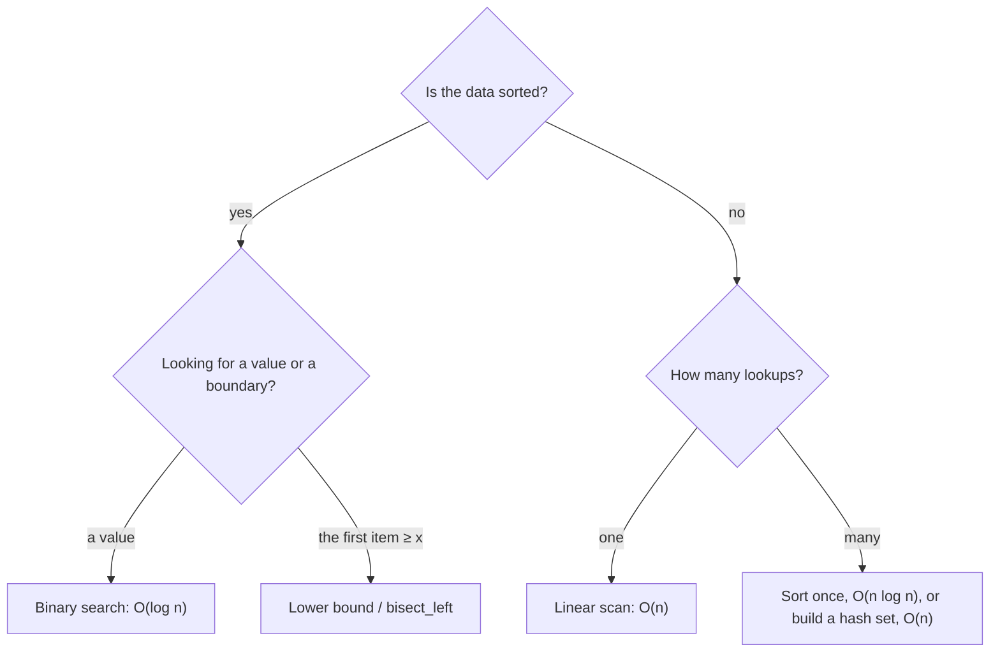

# Sorting and binary search

> Data Structures & Algorithms · L1 Foundation · Recursion, sorting & binary search · about 95 min · hub module `m08` ([open the hub](https://claude.ai/artifact/SWv6N1Uh2oiFNH1mxefcNr))

## Why it matters
Sorting is the most common first step in a fast solution, and binary search turns “check every item” into about 20 checks for a million items. Together they unlock a big family of problems, including “binary search on the answer”.

## Pre-question (answer before reading)
**Q:** I'm thinking of a number from 1 to 100 and will say “higher” or “lower”. What's your best first guess, and how many guesses do you need at most?

<details><summary>Answer</summary>

50, the middle, because each answer rules out half of what's left. 100 → 50 → 25 → 13 → 7 → 4 → 2 → 1 means at most 7 guesses, since 2⁷ = 128 ≥ 100.

</details>

## 🍎 Story time (kid version)
**The toy room and the treasure-map road trip: Finding page 300**

Ben wants page 300 of a 500-page storybook. Tara opens it in the middle: page 250. “Too early,” says Ben, so they forget the whole first half. She opens the middle of the back half: page 375. “Too far!” They forget everything after it. Halving again and again, they reach page 300 in a handful of tries, never more than nine, instead of three hundred. The trick only works because the pages are in order: in Ben's messy pile of picture cards, opening the middle tells you nothing until he sorts the pile.

| In the story | In code |
|---|---|
| Opening the middle page | Check the middle item: `mid = (lo + hi) // 2` |
| “Too early”: forget the first half | Target is bigger: `lo = mid + 1` |
| “Too far”: forget the back half | Target is smaller: `hi = mid − 1` |
| Never more than nine tries for 500 pages | O(log n): log₂ 500 ≈ 9 |
| Sorting the messy card pile first | Binary search needs sorted data: sort once, O(n log n) |

**Where the story breaks:** A book opens at any page instantly, like an array. On a linked list you can't jump to the middle, so binary search loses its speed. And real searches often want the *first* page that matches (a lower bound), which needs a slightly different loop.

## Key ideas (grown-up version)
- **Built-in sorts are stable and fast**: Python's `sorted()` / `list.sort()` (an adaptive merge sort from the Timsort family, O(n log n)) and JavaScript's `Array.prototype.sort` (stable since ES2019; O(n log n) in V8 and Node.js, though the spec doesn't promise a complexity). Use them in real code.
- **JavaScript's default sort compares strings**: `[10, 9, 1].sort()` gives `[1, 10, 9]`. Always pass a comparator for numbers: `a.sort((x, y) => x - y)`.
- **Sort by a key**: Python `sorted(people, key=lambda p: (p.age, p.name))`; JavaScript `people.toSorted((a, b) => a.age - b.age || a.name.localeCompare(b.name))`. `sorted()` and `toSorted()` return a new list; `sort()` sorts in place. Note that `localeCompare` follows language rules while Python compares code points, so “alice” and “Bob” can come out in a different order.
- **The classic sorts**: insertion sort is O(n²) but quick on tiny or nearly sorted input; merge sort is O(n log n), stable, O(n) extra space; quicksort is O(n log n) on average, O(n²) worst case, in place; counting sort is O(n + k) for small integer ranges.
- **Binary search** needs sorted (monotonic) data and halves the search space each step: O(log n), about 20 steps for a million items.
- **Pick one interval style and stick to it.** Closed: `while lo <= hi`, `hi = mid − 1`. Half-open lower bound: `while lo < hi`, `hi = mid`. Most bugs come from mixing the two.
- **Library help**: Python's `bisect.bisect_left` / `bisect_right` give insertion points. JavaScript has no built-in binary search, so keep a lower-bound function handy.
- **Binary search on the answer**: when “can it be done with x?” goes false, false, …, true, true, binary-search the smallest x that works (eating speed, shipping capacity: L2).

## Diagrams
**Binary search for 23**

| 16 < 23 → go right | 0 | 1 | 2 | 3 | 4 | 5 | 6 | 7 | 8 | 9 |
|---|---|---|---|---|---|---|---|---|---|---|
| value | 2 | 5 | 8 | 12 | **16** | 23 | 38 | 56 | 72 | 91 |
| pointer | lo |  |  |  | mid |  |  |  |  | hi |

| 56 > 23 → go left | 0 | 1 | 2 | 3 | 4 | 5 | 6 | 7 | 8 | 9 |
|---|---|---|---|---|---|---|---|---|---|---|
| value | 2 | 5 | 8 | 12 | 16 | 23 | 38 | **56** | 72 | 91 |
| pointer |  |  |  |  |  | lo |  | mid |  | hi |

| 23 found | 0 | 1 | 2 | 3 | 4 | 5 | 6 | 7 | 8 | 9 |
|---|---|---|---|---|---|---|---|---|---|---|
| value | 2 | 5 | 8 | 12 | 16 | 23 | 38 | 56 | 72 | 91 |
| pointer |  |  |  |  |  | lo·mid | hi |  |  |  |

_Each step throws away half of what's left: 10 → 5 → 2 candidates, found on the third look._

**Search or sort?**



## Comparisons
**Sorting algorithms at a glance**

| Algorithm | Best | Average | Worst | Extra space | Stable? |
|---|---|---|---|---|---|
| Insertion sort | O(n) | O(n²) | O(n²) | O(1) | Yes |
| Merge sort | O(n log n) | O(n log n) | O(n log n) | O(n) | Yes |
| Quicksort | O(n log n) | O(n log n) | O(n²) | O(log n) stack | No |
| Heapsort (L2) | O(n log n) | O(n log n) | O(n log n) | O(1) | No |
| Counting sort (keys 0..k) | O(n + k) | O(n + k) | O(n + k) | O(n + k) | Yes |
| Python `sorted` / JS `sort` (V8) | O(n) | O(n log n) | O(n log n) | O(n) | Yes |

**Sorting in Python and JavaScript**

| Task | Python | JavaScript |
|---|---|---|
| Numbers ascending, as a new list | `sorted(a)` | `a.toSorted((x, y) => x - y)` |
| In place | `a.sort()` | `a.sort((x, y) => x - y)` |
| Descending | `sorted(a, reverse=True)` | `a.toSorted((x, y) => y - x)` |
| By a key, then a tie-breaker | `sorted(p, key=lambda r: (r.age, r.name))` | `p.toSorted((a, b) => a.age - b.age || a.name.localeCompare(b.name))` |
| Insertion point for x | `bisect.bisect_left(a, x)` | Write a lower-bound loop |

## Code (JavaScript + Python)
### Binary search (closed interval) and lower bound (half-open)
```python
def binary_search(a, target):              # closed interval [lo, hi]
    lo, hi = 0, len(a) - 1
    while lo <= hi:
        mid = (lo + hi) // 2
        if a[mid] == target:
            return mid
        if a[mid] < target:
            lo = mid + 1                   # the answer is right of mid
        else:
            hi = mid - 1                   # the answer is left of mid
    return -1

def lower_bound(a, target):                # first index with a[i] >= target
    lo, hi = 0, len(a)                     # half-open interval [lo, hi)
    while lo < hi:
        mid = (lo + hi) // 2
        if a[mid] < target:
            lo = mid + 1
        else:
            hi = mid                       # mid might be the answer: keep it
    return lo

a = [2, 5, 8, 12, 16, 23, 38, 56, 72, 91]
print(binary_search(a, 23), binary_search(a, 7))
print(lower_bound([1, 3, 3, 3, 7], 3), lower_bound([1, 3, 3, 3, 7], 4))
```

Output:
```text
5 -1
1 4
```

- line 3: Closed interval: `lo <= hi`, because a one-item range [lo, lo] still needs checking.
- line 20: Half-open: `hi = mid`, never `mid − 1`, because mid may be the first match. It returns what `bisect.bisect_left` returns.

```javascript
function binarySearch(a, target) {         // closed interval [lo, hi]
  let lo = 0, hi = a.length - 1;
  while (lo <= hi) {
    const mid = Math.floor((lo + hi) / 2);
    if (a[mid] === target) return mid;
    if (a[mid] < target) lo = mid + 1;     // the answer is right of mid
    else hi = mid - 1;                     // the answer is left of mid
  }
  return -1;
}

function lowerBound(a, target) {           // first index with a[i] >= target
  let lo = 0, hi = a.length;               // half-open interval [lo, hi)
  while (lo < hi) {
    const mid = Math.floor((lo + hi) / 2);
    if (a[mid] < target) lo = mid + 1;
    else hi = mid;                         // mid might be the answer: keep it
  }
  return lo;
}

const a = [2, 5, 8, 12, 16, 23, 38, 56, 72, 91];
console.log(binarySearch(a, 23), binarySearch(a, 7));
console.log(lowerBound([1, 3, 3, 3, 7], 3), lowerBound([1, 3, 3, 3, 7], 4));
```

Output:
```text
5 -1
1 4
```

- line 4: `Math.floor`: plain `/` gives a fraction such as 4.5.
- line 17: Half-open: `hi = mid`, never `mid − 1`, because mid may be the first match.

### Sorting with keys, and JavaScript's default-sort trap
```python
nums = [10, 9, 1, 100]
print(*sorted(nums), "|", *sorted(nums, key=str))     # numbers vs text order

people = [("Tara", 9), ("Ben", 7), ("Ava", 9), ("Raj", 7)]
by_age_then_name = sorted(people, key=lambda p: (p[1], p[0]))
print(*(name for name, _ in by_age_then_name))
```

Output:
```text
1 9 10 100 | 1 10 100 9
Ben Raj Ava Tara
```

- line 5: A tuple key sorts by age first, then by name to break ties.

```javascript
const nums = [10, 9, 1, 100];
console.log(...nums.toSorted((x, y) => x - y), "|", ...nums.toSorted());   // numbers vs the default (text order)

const people = [["Tara", 9], ["Ben", 7], ["Ava", 9], ["Raj", 7]];
const byAgeThenName = people.toSorted((a, b) => a[1] - b[1] || a[0].localeCompare(b[0]));
console.log(...byAgeThenName.map(([name]) => name));
```

Output:
```text
1 9 10 100 | 1 10 100 9
Ben Raj Ava Tara
```

- line 2: With no comparator, JavaScript sorts the numbers as text: "100" comes before "9".
- line 5: `||` falls through to the name comparison only when the ages are equal (difference 0).

### Merge sort: split, sort both halves, merge
```python
def merge_sort(a):
    if len(a) <= 1:                        # base case: already sorted
        return a
    mid = len(a) // 2
    left = merge_sort(a[:mid])             # sort each half (recursion)
    right = merge_sort(a[mid:])
    out, i, j = [], 0, 0
    while i < len(left) and j < len(right):   # merge: take the smaller head
        if left[i] <= right[j]:            # <= keeps equal items in order (stable)
            out.append(left[i])
            i += 1
        else:
            out.append(right[j])
            j += 1
    out.extend(left[i:])                   # one side may have leftovers
    out.extend(right[j:])
    return out

print(*merge_sort([38, 27, 43, 3, 9, 82, 10]))
```

Output:
```text
3 9 10 27 38 43 82
```

- line 5: The slices copy O(n) items per level, which merge sort pays for merging anyway: still O(n log n) in total.
- line 9: `<=` takes from the left half on ties, which is what makes merge sort stable.

```javascript
function mergeSort(a) {
  if (a.length <= 1) return a;             // base case: already sorted
  const mid = Math.floor(a.length / 2);
  const left = mergeSort(a.slice(0, mid)); // sort each half (recursion)
  const right = mergeSort(a.slice(mid));
  const out = [];
  let i = 0, j = 0;
  while (i < left.length && j < right.length) {    // merge: take the smaller head
    if (left[i] <= right[j]) out.push(left[i++]);  // <= keeps equal items in order (stable)
    else out.push(right[j++]);
  }
  return out.concat(left.slice(i), right.slice(j));   // one side may have leftovers
}

console.log(...mergeSort([38, 27, 43, 3, 9, 82, 10]));
```

Output:
```text
3 9 10 27 38 43 82
```

- line 9: `<=` takes from the left half on ties, which is what makes merge sort stable.

## Worked example
**Problem.** Find ⌊√x⌋ for a whole number x ≥ 0 without calling a square-root function.

1. The answer lies between 0 and x, and the test “mid × mid ≤ x” goes true, true, …, true, false, false: it's monotonic.
2. Binary-search for the *last* true: if `mid * mid <= x`, remember mid and search right (`lo = mid + 1`); otherwise search left (`hi = mid − 1`).
3. Each step halves the range: O(log x) steps and O(1) space.
4. Check the edges: 0 and 1 return themselves, perfect squares are exact, and 8 gives 2.

```python
def isqrt(x):
    lo, hi, ans = 0, x, 0
    while lo <= hi:
        mid = (lo + hi) // 2
        if mid * mid <= x:                 # small enough: remember it, try bigger
            ans = mid
            lo = mid + 1
        else:                              # too big: try smaller
            hi = mid - 1
    return ans

print(isqrt(0), isqrt(1), isqrt(8), isqrt(16), isqrt(2_147_395_599))
```

Output:
```text
0 1 2 4 46339
```

```javascript
function isqrt(x) {
  let lo = 0, hi = x, ans = 0;
  while (lo <= hi) {
    const mid = Math.floor((lo + hi) / 2);
    if (mid * mid <= x) {                  // small enough: remember it, try bigger
      ans = mid;
      lo = mid + 1;
    } else hi = mid - 1;                   // too big: try smaller
  }
  return ans;
}

console.log(isqrt(0), isqrt(1), isqrt(8), isqrt(16), isqrt(2_147_395_599));
```

Output:
```text
0 1 2 4 46339
```

**Answer.** 0, 1, 2, 4 and 46339. O(log x) steps. “Find the last value where a yes/no test is still true” is *binary search on the answer*, and it shows up in many medium problems. (In JavaScript, `mid * mid` is exact up to 2⁵³; for bigger x, compare `mid <= x / mid` or use `BigInt`.)

## Your turn (faded example)
**Problem.** Finish insertion sort: grow a sorted prefix by inserting one item at a time.

- ✓ Before step i, `a[0..i − 1]` is already sorted.
- **How do you insert `a[i]` into the sorted prefix?**
  <details><summary>Answer</summary>Save it as `key`, shift every bigger item one place right, then drop `key` into the gap.</details>
- **What are the best and worst cases?**
  <details><summary>Answer</summary>Best O(n) on sorted input (nothing shifts). Worst O(n²) on reversed input (everything shifts).</details>
- **Is it stable?**
  <details><summary>Answer</summary>Yes, as long as you only shift items strictly greater than `key` (`>`, not `>=`).</details>

Starter:
```python
def insertion_sort(a):
    for i in range(1, len(a)):
        key = a[i]
        j = i - 1
        # TODO: while j >= 0 and a[j] > key, shift a[j] one place right
        a[j + 1] = key
    return a

print(insertion_sort([5, 2, 4, 6, 1, 3]))    # expect [1, 2, 3, 4, 5, 6]
```

```javascript
function insertionSort(a) {
  for (let i = 1; i < a.length; i++) {
    const key = a[i];
    let j = i - 1;
    // TODO: while j >= 0 and a[j] > key, shift a[j] one place right
    a[j + 1] = key;
  }
  return a;
}

console.log(insertionSort([5, 2, 4, 6, 1, 3]));    // expect [1, 2, 3, 4, 5, 6]
```

<details><summary>Full solution</summary>

```python
def insertion_sort(a):
    for i in range(1, len(a)):
        key = a[i]
        j = i - 1
        while j >= 0 and a[j] > key:       # > (not >=) keeps it stable
            a[j + 1] = a[j]                # shift the bigger item right
            j -= 1
        a[j + 1] = key                     # drop key into the gap
    return a

print(*insertion_sort([5, 2, 4, 6, 1, 3]))
```

Output:
```text
1 2 3 4 5 6
```

```javascript
function insertionSort(a) {
  for (let i = 1; i < a.length; i++) {
    const key = a[i];
    let j = i - 1;
    while (j >= 0 && a[j] > key) {         // > (not >=) keeps it stable
      a[j + 1] = a[j];                     // shift the bigger item right
      j--;
    }
    a[j + 1] = key;                        // drop key into the gap
  }
  return a;
}

console.log(...insertionSort([5, 2, 4, 6, 1, 3]));
```

Output:
```text
1 2 3 4 5 6
```

</details>

## Socratic checks and quiz (answers hidden)
**1. What does this JavaScript print?**

```javascript
console.log([10, 9, 1, 100].sort().join(" "));
```

- A. 1 10 100 9
- B. 1 9 10 100
- C. 100 10 9 1
- D. 9 1 10 100

<details><summary>Answer</summary>

1 10 100 9. With no comparator the numbers are compared as text: "1" < "10" < "100" < "9".

</details>

**2. What does this print?**

```python
a = list(range(1, 101))          # 1..100
lo, hi, steps = 0, len(a) - 1, 0
while lo <= hi:
    mid = (lo + hi) // 2
    steps += 1
    if a[mid] == 37:
        break
    if a[mid] < 37:
        lo = mid + 1
    else:
        hi = mid - 1
print(steps)
```

```javascript
const a = Array.from({ length: 100 }, (_, i) => i + 1);   // 1..100
let lo = 0, hi = a.length - 1, steps = 0;
while (lo <= hi) {
  const mid = Math.floor((lo + hi) / 2);
  steps++;
  if (a[mid] === 37) break;
  if (a[mid] < 37) lo = mid + 1;
  else hi = mid - 1;
}
console.log(steps);
```

- A. 3
- B. 7
- C. 37
- D. 6

<details><summary>Answer</summary>

3. It looks at 50 (too big), then 25 (too small), then 37: three looks. Seven is the worst case for 100 items, not the count for every target.

</details>

**3. What's wrong with `nums = nums.sort()` in Python?**

- A. `list.sort()` sorts in place and returns `None`, so `nums` becomes `None`
- B. Nothing: `nums` is now sorted
- C. It sorts in descending order
- D. It raises a `TypeError`

<details><summary>Answer</summary>

`list.sort()` sorts in place and returns `None`, so `nums` becomes `None`. In-place methods return `None` in Python. Write `nums.sort()` on its own, or `nums = sorted(nums)`.

</details>

**4. Which of these sorts are stable? (choose 3)**

- A. Merge sort
- B. Insertion sort
- C. Python's `sorted()`
- D. A typical in-place quicksort
- E. Heapsort

<details><summary>Answer</summary>

Merge sort, Insertion sort, Python's `sorted()`. Merge sort and insertion sort never move an item past an equal one, and Python's sort is guaranteed stable (so is JavaScript's since ES2019). Typical quicksort and heapsort swap items over long distances.

</details>

**5. Judge each statement.**

- Binary search on 1,000,000 sorted items needs at most about 20 comparisons.
- Binary search works on unsorted data if you search both halves.
- Sorting first is worth it for a single lookup in unsorted data.
- `bisect_left([1, 3, 3, 3, 7], 3)` returns 1.

<details><summary>Answer</summary>

Binary search on 1,000,000 sorted items needs at most about 20 comparisons.: Yes; Binary search works on unsorted data if you search both halves.: No; Sorting first is worth it for a single lookup in unsorted data.: No; `bisect_left([1, 3, 3, 3, 7], 3)` returns 1.: Yes. Searching both halves is just a slow linear scan. For one lookup, an O(n) scan beats an O(n log n) sort. `bisect_left` gives the first position of 3.

</details>

**6. Complete the Python lower bound in half-open style, [lo, hi): the first index with a[i] >= target.**

```
def lower_bound(a, target):
    lo, hi = 0, {{0}}
    while lo {{1}} hi:
        mid = (lo + hi) // 2
        if a[mid] < target:
            lo = mid + 1
        else:
            hi = {{2}}
    return lo

```

<details><summary>Answer</summary>

len(a) | < | mid. Half-open style: `hi` starts at `len(a)` (the answer can be “after everything”), the loop runs while `lo < hi`, and `hi = mid` keeps mid as a candidate.

</details>

**7. For n = 1,000,000, order these by how many steps they take (fewest first).**

- (put the steps in order)

<details><summary>Answer</summary>

Binary search (about 20) → Linear scan (1,000,000) → Merge sort (about 20,000,000) → Insertion sort on reversed input (about 500,000,000,000). log n < n < n log n < n²/2.

</details>

**8. Match each situation to the best tool.**


<details><summary>Answer</summary>

Find 42 in a sorted array = Binary search; The smallest speed that finishes on time (the yes/no test is monotonic) = Binary search on the answer; Sort 10 nearly sorted items = Insertion sort; Sort a million records stably with guaranteed O(n log n) = Merge sort. A sorted array or a monotonic test means binary search. Tiny or nearly sorted input suits insertion sort; guaranteed O(n log n) and stability point to merge sort.

</details>

## Traps & misconceptions
- **“`[10, 9, 1].sort()` sorts numbers in JavaScript.”** Without a comparator JavaScript compares the items as text, giving `[1, 10, 9]`. Use `a.sort((x, y) => x - y)`.
- **“`mid = (lo + hi) / 2` is fine in JavaScript.”** `/` gives a fraction such as 4.5. Use `Math.floor((lo + hi) / 2)`; in Python use `//`.
- **“`while lo < hi` with `hi = mid − 1` is a working binary search.”** Mixing styles skips answers or loops forever. Closed: `lo <= hi` with `hi = mid − 1`. Half-open: `lo < hi` with `hi = mid`.
- **“Binary search works on any array.”** Only on sorted (or monotonic) data. Sorting first costs O(n log n), which only pays off if you search many times.
- **“`list.sort()` returns the sorted list.”** Python's `list.sort()` sorts in place and returns `None`, so `a = a.sort()` loses your list; use `sorted(a)` for a new one. JavaScript's `sort()` sorts in place *and* returns the same array; use `toSorted()` for a copy.
- **“Quicksort is always O(n log n).”** Bad pivots, such as always the first item on already-sorted input, make it O(n²). Random pivots make that very unlikely.

## Discussion prompts
- **When is it worth sorting first?**
  <details><summary>One good answer</summary>When it unlocks a faster next step: binary search for many queries, two pointers for pair sums, grouping equal items, or merging intervals. Sorting costs O(n log n) once, so for a single lookup a linear scan (O(n)) is cheaper.</details>
- **Why does a stable sort matter?**
  <details><summary>One good answer</summary>It keeps equal items in their original order, so you can sort by a secondary key first and then by the primary key, and ties stay in the earlier order. Python's sort and modern JavaScript's sort are both stable.</details>

## Teach-back
**Prompt:** Explain to a junior colleague how binary search works, why it's O(log n), and the two most common bugs.

Rubric:
- [ ] It needs sorted (monotonic) data
- [ ] Compare with the middle and discard the half that can't contain the answer
- [ ] The range halves every step, so about log₂ n steps (20 for a million)
- [ ] Bug 1: mixing interval styles (lo <= hi with hi = mid − 1, or lo < hi with hi = mid)
- [ ] Bug 2: midpoint maths (integer division; Math.floor in JavaScript) and off-by-one at the edges

<details><summary>Model answer</summary>

Binary search works on sorted data. Look at the middle item: if it's the target, you're done; if it's smaller, the target can only be in the right half, so discard the left half; if it's bigger, discard the right half. Each step halves what's left, so a million items need only about 20 steps: O(log n). The most common bugs are mixing the two interval styles, closed (while lo <= hi, hi = mid − 1) and half-open (while lo < hi, hi = mid), which skips answers or loops forever, and getting the midpoint wrong, for example forgetting Math.floor in JavaScript.

</details>

## Quick Q&A (also in the SRS deck)
- **At most how many binary-search steps for 1,000,000 sorted items?** About 20, since 2²⁰ ≈ 1,000,000.
- **How do you sort numbers correctly in JavaScript?** Pass a comparator: `a.sort((x, y) => x - y)`. The default compares the items as text.
- **Closed-interval binary search: loop condition and updates?** `while lo <= hi`; then `lo = mid + 1` or `hi = mid − 1`.
- **What does `bisect_left(a, x)` return?** The first index where x could be inserted and keep a sorted: the first i with a[i] >= x.
- **Merge sort: time, extra space and stability?** O(n log n) always, O(n) extra space, stable.
- **What is “binary search on the answer”?** Binary-searching the smallest (or largest) value for which a monotonic yes/no test passes, instead of searching an array.

## Practice problems
- [ ] [LC 704 · Binary Search](https://leetcode.com/problems/binary-search/) · Easy · the closed-interval template
- [ ] [LC 35 · Search Insert Position](https://leetcode.com/problems/search-insert-position/) · Easy · lower bound
- [ ] [LC 278 · First Bad Version](https://leetcode.com/problems/first-bad-version/) · Easy · the first true: half-open template
- [ ] [LC 374 · Guess Number Higher or Lower](https://leetcode.com/problems/guess-number-higher-or-lower/) · Easy · binary search against an API
- [ ] [LC 1051 · Height Checker](https://leetcode.com/problems/height-checker/) · Easy · sort a copy and compare
- [ ] [LC 976 · Largest Perimeter Triangle](https://leetcode.com/problems/largest-perimeter-triangle/) · Easy · sort, then check neighbours from the largest
- [ ] [LC 912 · Sort an Array](https://leetcode.com/problems/sort-an-array/) · Medium · write merge sort yourself; the built-in isn't the point
- [ ] [LC 75 · Sort Colors](https://leetcode.com/problems/sort-colors/) · Medium · counting sort, or the one-pass three-pointer version
- [ ] [LC 34 · Find First and Last Position of Element in Sorted Array](https://leetcode.com/problems/find-first-and-last-position-of-element-in-sorted-array/) · Medium · two lower bounds: target and target + 1
- [ ] [LC 74 · Search a 2D Matrix](https://leetcode.com/problems/search-a-2d-matrix/) · Medium · treat the matrix as one sorted array

## Sources (accessed 2026-10-09)
- [Python docs: Sorting techniques](https://docs.python.org/3/howto/sorting.html)
- [Python docs: bisect](https://docs.python.org/3/library/bisect.html)
- [MDN: Array.prototype.sort](https://developer.mozilla.org/en-US/docs/Web/JavaScript/Reference/Global_Objects/Array/sort)
- [MDN: Array.prototype.toSorted](https://developer.mozilla.org/en-US/docs/Web/JavaScript/Reference/Global_Objects/Array/toSorted)
- [USACO Guide: Binary search](https://usaco.guide/silver/binary-search)
