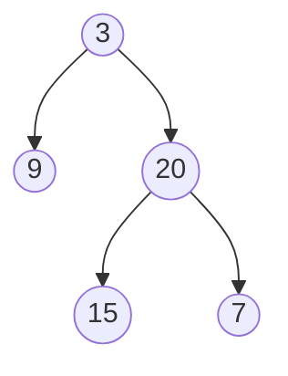
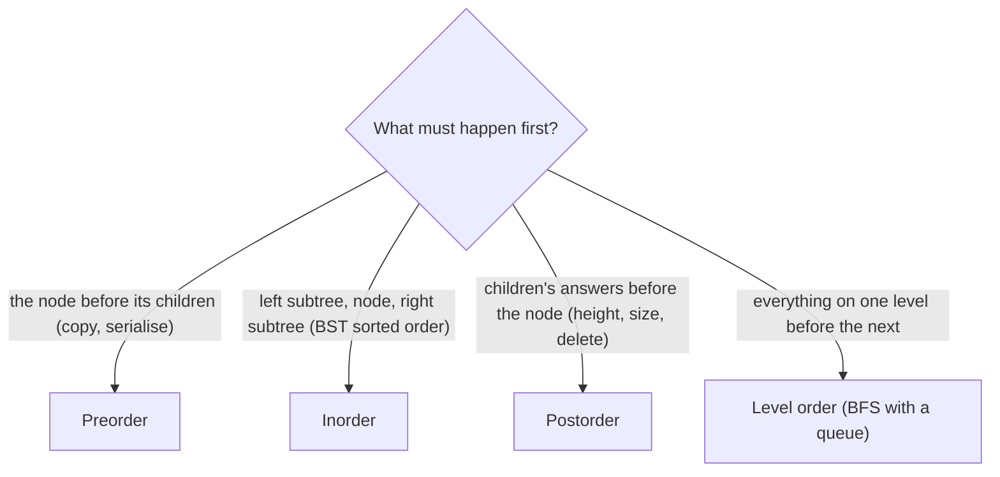

# Binary trees: traversals and tree recursion

> Data Structures & Algorithms · L2 Proficient · Trees, heaps & tries · about 100 min · hub module `m01` ([open the hub](https://claude.ai/artifact/DQhszKFoe8qbiNbSpWkqM5))

## Why it matters
Trees are everywhere: file systems, web pages, org charts, database indexes, and a large share of medium interview problems. Almost every tree problem is solved by one idea: ask each child for its answer, then combine.

## Pre-question (answer before reading)
**Q:** A tree's height is 1 + the taller child's height. Using only that rule, what's the height of a single node with no children (counting nodes, not edges)?

<details><summary>Answer</summary>

1. An empty child has height 0, so the node's height is 1 + max(0, 0) = 1. Deciding what the *empty* tree returns (0) is the base case that makes the recursion work.

</details>

## 🍎 Story time (kid version)
**The toy room and the treasure-map road trip: The family tree**

Ben draws the family tree on a big sheet: Grandma at the top, her two children under her, and their children under them. To count everyone, he doesn't run around the whole sheet. He asks Grandma: “How many people are in your branch?” She asks each of her children the same question, and they ask theirs, all the way down. A person with no children answers “just me: 1”. Everyone else adds up their children's answers, plus 1 for themselves, and passes the total back up, until Grandma tells Ben the size of the whole family.

| In the story | In code |
|---|---|
| Grandma at the top | The root node |
| Asking each child “how many in your branch?” | Recursive calls on the left and right subtrees |
| “Just me: 1” from someone with no children | A leaf: 1 + 0 + 0, because its empty children (None / null) count 0 |
| Adding the children's answers, plus 1 for yourself | The combine step, 1 + left + right: a postorder traversal |

**Where the story breaks:** In a binary tree each node has at most two children, and every child has exactly one parent. Real families have two parents per child, which makes them graphs, not trees. Code also needs the “empty child” case (None / null) that a family drawing never shows.

## Key ideas (grown-up version)
- **Binary tree**: each node has a value and up to two children, `left` and `right`. The top node is the **root**; nodes with no children are **leaves**. Height is the longest root-to-leaf path, counted in nodes or in edges: say which.
- **Depth-first traversals** order the node and its two subtrees differently: **preorder** (node, left, right), **inorder** (left, node, right), **postorder** (left, right, node). Each is O(n) time and O(h) stack space, where h is the height.
- **Breadth-first (level order)** uses a queue and visits the tree level by level. It's the natural fit for “per level” questions: averages, the right-side view, minimum depth.
- **The tree-recursion template**: handle the empty tree (base case), recurse on `left` and `right`, then combine. Height, size, sum, mirror and “is it balanced?” all follow it.
- **Return one thing, track another**: when the answer isn't what the recursion returns (diameter, maximum path sum), return what the parent needs (a height, or the best downward path sum) and update a separate best answer as you go.
- **h ranges from about log₂ n to n**: a balanced tree is shallow, but a skewed one is a chain, so recursion depth can pass Python's 1,000-call limit. An explicit stack avoids that.
- **LeetCode's input format** lists nodes level by level with gaps: `[3, 9, 20, null, null, 15, 7]`. This module's helpers convert between that list and a tree.

## Diagrams
**The tree [3, 9, 20, null, null, 15, 7]**



_Preorder 3 9 20 15 7 · Inorder 9 3 15 20 7 · Postorder 9 15 7 20 3 · Level order 3 | 9 20 | 15 7_

**Which traversal does the question need?**



## Comparisons
**Recursive or iterative traversal?**

|  | Recursive | Iterative (explicit stack or queue) |
|---|---|---|
| Code length | 3–5 lines | 10–15 lines |
| Extra space | O(h) call stack | O(h) stack for DFS, O(widest level) queue for BFS |
| Very deep trees | Python stops near 1,000 levels; Node.js after roughly 8,000–10,000 frames, depending on the function | Fine: the stack is an ordinary list in memory |
| Use it for | Most interview problems | Very deep trees, iterators that pause and resume |

## Code (JavaScript + Python)
### Helpers used by this module's code (run these first)
```python
from collections import deque

class TreeNode:
    def __init__(self, val=0, left=None, right=None):
        self.val, self.left, self.right = val, left, right

def build(level):                      # [3, 9, 20, None, None, 15, 7] -> tree
    if not level or level[0] is None:
        return None
    root = TreeNode(level[0])
    q, i = deque([root]), 1
    while q and i < len(level):
        node = q.popleft()
        for side in ("left", "right"):
            if i < len(level) and level[i] is not None:
                child = TreeNode(level[i])
                setattr(node, side, child)
                q.append(child)
            i += 1
    return root

def to_list(root):                     # tree -> level-order list, None for gaps
    out, q = [], deque([root])
    while q:
        node = q.popleft()
        if node:
            out.append(node.val)
            q.append(node.left)
            q.append(node.right)
        else:
            out.append(None)
    while out and out[-1] is None:     # trim trailing gaps
        out.pop()
    return out
```

```javascript
class TreeNode {
  constructor(val = 0, left = null, right = null) { this.val = val; this.left = left; this.right = right; }
}

function build(level) {                // [3, 9, 20, null, null, 15, 7] -> tree
  if (!level.length || level[0] === null) return null;
  const root = new TreeNode(level[0]);
  const q = [root];
  let head = 0, i = 1;
  while (head < q.length && i < level.length) {
    const node = q[head++];
    for (const side of ["left", "right"]) {
      if (i < level.length && level[i] !== null) {
        node[side] = new TreeNode(level[i]);
        q.push(node[side]);
      }
      i++;
    }
  }
  return root;
}

function toList(root) {                // tree -> level-order list, null for gaps
  const out = [], q = [root];
  for (let head = 0; head < q.length; head++) {
    const node = q[head];
    if (node) { out.push(node.val); q.push(node.left, node.right); }
    else out.push(null);
  }
  while (out.length && out[out.length - 1] === null) out.pop();   // trim trailing gaps
  return out;
}
```

### Four traversals on one tree
```python
def preorder(node, out):
    if node:
        out.append(node.val)          # the node first
        preorder(node.left, out)
        preorder(node.right, out)
    return out

def inorder(node, out):
    if node:
        inorder(node.left, out)
        out.append(node.val)          # the node in the middle
        inorder(node.right, out)
    return out

def postorder(node, out):
    if node:
        postorder(node.left, out)
        postorder(node.right, out)
        out.append(node.val)          # the node last
    return out

def level_order(root):
    levels, q = [], deque([root] if root else [])
    while q:
        level = []
        for _ in range(len(q)):       # exactly the nodes of this level
            node = q.popleft()
            level.append(node.val)
            for child in (node.left, node.right):
                if child:
                    q.append(child)
        levels.append(level)
    return levels

root = build([3, 9, 20, None, None, 15, 7])
print(*preorder(root, []))
print(*inorder(root, []))
print(*postorder(root, []))
print(" | ".join(" ".join(map(str, lvl)) for lvl in level_order(root)))
```

Output:
```text
3 9 20 15 7
9 3 15 20 7
9 15 7 20 3
3 | 9 20 | 15 7
```

- line 3: The only difference between the three depth-first orders is where this line sits.
- line 26: `len(q)` is taken once, before the loop, so the round covers exactly one level.

```javascript
function preorder(node, out = []) {
  if (node) {
    out.push(node.val);                 // the node first
    preorder(node.left, out);
    preorder(node.right, out);
  }
  return out;
}

function inorder(node, out = []) {
  if (node) {
    inorder(node.left, out);
    out.push(node.val);                 // the node in the middle
    inorder(node.right, out);
  }
  return out;
}

function postorder(node, out = []) {
  if (node) {
    postorder(node.left, out);
    postorder(node.right, out);
    out.push(node.val);                 // the node last
  }
  return out;
}

function levelOrder(root) {
  const levels = [];
  let q = root ? [root] : [];
  while (q.length) {
    levels.push(q.map(n => n.val));     // every node of this level
    const next = [];
    for (const n of q) {
      if (n.left) next.push(n.left);
      if (n.right) next.push(n.right);
    }
    q = next;                           // a fresh array per level: no shift() needed
  }
  return levels;
}

const root = build([3, 9, 20, null, null, 15, 7]);
console.log(...preorder(root));
console.log(...inorder(root));
console.log(...postorder(root));
console.log(levelOrder(root).map(l => l.join(" ")).join(" | "));
```

Output:
```text
3 9 20 15 7
9 3 15 20 7
9 15 7 20 3
3 | 9 20 | 15 7
```

- line 3: The only difference between the three depth-first orders is where this line sits.
- line 38: Swapping in a new array per level avoids `shift()` on a long queue.

### The tree-recursion template: height, size, mirror
```python
def height(node):                       # nodes on the longest root-to-leaf path
    if node is None:
        return 0                        # base case: the empty tree
    return 1 + max(height(node.left), height(node.right))

def size(node):
    if node is None:
        return 0
    return 1 + size(node.left) + size(node.right)

def mirror(node):                       # swap every left and right child
    if node is None:
        return None
    node.left, node.right = mirror(node.right), mirror(node.left)
    return node

root = build([4, 2, 7, 1, 3, 6, 9])
print(height(root), size(root))
print(*to_list(mirror(root)))
```

Output:
```text
3 7
4 7 2 9 6 3 1
```

- line 3: The empty tree's answer is the base case. Pick it so the combine step works for leaves too.
- line 14: Both recursive calls finish before the swap, so this is a postorder step.

```javascript
function height(node) {                 // nodes on the longest root-to-leaf path
  if (node === null) return 0;          // base case: the empty tree
  return 1 + Math.max(height(node.left), height(node.right));
}

function size(node) {
  if (node === null) return 0;
  return 1 + size(node.left) + size(node.right);
}

function mirror(node) {                 // swap every left and right child
  if (node === null) return null;
  [node.left, node.right] = [mirror(node.right), mirror(node.left)];
  return node;
}

const root = build([4, 2, 7, 1, 3, 6, 9]);
console.log(height(root), size(root));
console.log(...toList(mirror(root)));
```

Output:
```text
3 7
4 7 2 9 6 3 1
```

- line 2: The empty tree's answer is the base case. Pick it so the combine step works for leaves too.

### Iterative inorder: no recursion limit
```python
def inorder_iterative(root):
    out, stack, node = [], [], root
    while stack or node:
        while node:                     # go as far left as possible
            stack.append(node)
            node = node.left
        node = stack.pop()              # the leftmost node not yet visited
        out.append(node.val)
        node = node.right               # then its right subtree
    return out

print(*inorder_iterative(build([3, 9, 20, None, None, 15, 7])))

deep = TreeNode(0)                      # a chain 50,000 nodes deep
cur = deep
for v in range(1, 50_000):
    cur.right = TreeNode(v)
    cur = cur.right
vals = inorder_iterative(deep)
print(len(vals), *vals[:3], vals[-1])
```

Output:
```text
9 3 15 20 7
50000 0 1 2 49999
```

- line 5: The explicit stack plays the role of the call stack, but it's an ordinary list, so depth isn't limited.
- line 19: A recursive inorder would raise RecursionError on this chain.

```javascript
function inorderIterative(root) {
  const out = [], stack = [];
  let node = root;
  while (stack.length || node) {
    while (node) {                      // go as far left as possible
      stack.push(node);
      node = node.left;
    }
    node = stack.pop();                 // the leftmost node not yet visited
    out.push(node.val);
    node = node.right;                  // then its right subtree
  }
  return out;
}

console.log(...inorderIterative(build([3, 9, 20, null, null, 15, 7])));

const deep = new TreeNode(0);           // a chain 50,000 nodes deep
let cur = deep;
for (let v = 1; v < 50000; v++) {
  cur.right = new TreeNode(v);
  cur = cur.right;
}
const vals = inorderIterative(deep);
console.log(vals.length, ...vals.slice(0, 3), vals.at(-1));
```

Output:
```text
9 3 15 20 7
50000 0 1 2 49999
```

- line 6: The explicit stack plays the role of the call stack, and an array can grow far past the call-stack limit.

## Worked example
**Problem.** Is a binary tree height-balanced, meaning that at *every* node the left and right subtree heights differ by at most 1?

1. Balanced must hold at every node, not just the root.
2. Naive: call `height` at every node and compare. Each call costs the size of its subtree, so a chain costs O(n²) (O(n log n) when the tree really is balanced).
3. Better: one postorder pass. Each call returns its height, or −1 as a signal that something below is already unbalanced.
4. Every node is visited once: O(n) time and O(h) stack space. The −1 sentinel lets the answer bubble up without a second pass.

```python
def is_balanced(root):
    def check(node):                    # height, or -1 if unbalanced below
        if node is None:
            return 0
        lh = check(node.left)
        if lh == -1:
            return -1                   # stop early
        rh = check(node.right)
        if rh == -1 or abs(lh - rh) > 1:
            return -1
        return 1 + max(lh, rh)
    return check(root) != -1

for level in ([3, 9, 20, None, None, 15, 7], [1, 2, 2, 3, 3, None, None, 4, 4], []):
    print("balanced" if is_balanced(build(level)) else "not balanced")
```

Output:
```text
balanced
not balanced
balanced
```

```javascript
function isBalanced(root) {
  function check(node) {                // height, or -1 if unbalanced below
    if (node === null) return 0;
    const lh = check(node.left);
    if (lh === -1) return -1;           // stop early
    const rh = check(node.right);
    if (rh === -1 || Math.abs(lh - rh) > 1) return -1;
    return 1 + Math.max(lh, rh);
  }
  return check(root) !== -1;
}

for (const level of [[3, 9, 20, null, null, 15, 7], [1, 2, 2, 3, 3, null, null, 4, 4], []])
  console.log(isBalanced(build(level)) ? "balanced" : "not balanced");
```

Output:
```text
balanced
not balanced
balanced
```

**Answer.** balanced, not balanced, balanced. In the second tree the root's left side is 3 levels deep and its right side 1 level, so the root fails. O(n) time, O(h) stack.

## Your turn (faded example)
**Problem.** Count the “good” nodes: a node is good if no node on the path from the root down to it has a bigger value.

- ✓ This time information flows *down*: each call needs the biggest value seen so far on its path.
- **What extra parameter does the recursive helper need?**
  <details><summary>Answer</summary>`best`: the largest value on the path from the root to this node's parent.</details>
- **When is a node good, and what do you pass to its children?**
  <details><summary>Answer</summary>It's good when `node.val >= best`. Pass `max(best, node.val)` to both children.</details>
- **Time and space?**
  <details><summary>Answer</summary>O(n) time, since each node is visited once, and O(h) stack space.</details>

Starter:
```python
def good_nodes(root):
    def walk(node, best):
        if node is None:
            return 0
        good = 1 if node.val >= best else 0
        # TODO: add the good nodes of both children, passing the new best down
        return good
    return walk(root, float("-inf"))

print(good_nodes(build([3, 1, 4, 3, None, 1, 5])))   # expect 4
```

```javascript
function goodNodes(root) {
  function walk(node, best) {
    if (node === null) return 0;
    const good = node.val >= best ? 1 : 0;
    // TODO: add the good nodes of both children, passing the new best down
    return good;
  }
  return walk(root, -Infinity);
}

console.log(goodNodes(build([3, 1, 4, 3, null, 1, 5])));   // expect 4
```

<details><summary>Full solution</summary>

```python
def good_nodes(root):
    def walk(node, best):
        if node is None:
            return 0
        good = 1 if node.val >= best else 0
        best = max(best, node.val)          # what the children must beat
        return good + walk(node.left, best) + walk(node.right, best)
    return walk(root, float("-inf"))

print(good_nodes(build([3, 1, 4, 3, None, 1, 5])), good_nodes(build([3, 3, None, 4, 2])), good_nodes(build([1])))
```

Output:
```text
4 3 1
```

```javascript
function goodNodes(root) {
  function walk(node, best) {
    if (node === null) return 0;
    const good = node.val >= best ? 1 : 0;
    best = Math.max(best, node.val);        // what the children must beat
    return good + walk(node.left, best) + walk(node.right, best);
  }
  return walk(root, -Infinity);
}

console.log(goodNodes(build([3, 1, 4, 3, null, 1, 5])), goodNodes(build([3, 3, null, 4, 2])), goodNodes(build([1])));
```

Output:
```text
4 3 1
```

</details>

## Socratic checks and quiz (answers hidden)
**1. What does this print? (`build` turns the level-order list into a tree.)**

```python
def walk(node, out):
    if node:
        walk(node.left, out)
        walk(node.right, out)
        out.append(node.val)
    return out

print(*walk(build([1, 2, 3, 4, 5]), []))
```

```javascript
function walk(node, out = []) {
  if (node) {
    walk(node.left, out);
    walk(node.right, out);
    out.push(node.val);
  }
  return out;
}

console.log(...walk(build([1, 2, 3, 4, 5])));
```

- A. 4 5 2 3 1
- B. 1 2 4 5 3
- C. 4 2 5 1 3
- D. 1 2 3 4 5

<details><summary>Answer</summary>

4 5 2 3 1. The node is added after both subtrees: postorder. The tree is 1 with children 2 and 3, and 2 has children 4 and 5. The other options are preorder, inorder and level order.

</details>

**2. What does this print?**

```python
def height(node):
    return 0 if node is None else 1 + max(height(node.left), height(node.right))

print(height(build([1, 2, None, 3, None, 4])))
```

```javascript
const height = node => (node === null ? 0 : 1 + Math.max(height(node.left), height(node.right)));

console.log(height(build([1, 2, null, 3, null, 4])));
```

- A. 4
- B. 3
- C. 6
- D. 2

<details><summary>Answer</summary>

4. Each node has only a left child: 1 → 2 → 3 → 4, a chain of 4 nodes. Skewed trees like this have height n.

</details>

**3. You need the average value on each level of a tree. Which approach fits best?**

- A. Breadth-first search with a queue, one level per round
- B. An inorder traversal
- C. A postorder traversal that returns heights
- D. Sort all the values first

<details><summary>Answer</summary>

Breadth-first search with a queue, one level per round. Level order visits exactly one level per round, so each level's sum and count are at hand. Depth-first orders mix levels together.

</details>

**4. Which of these need only facts about descendants, with nothing passed down from the parent? (choose 3)**

- A. The height of a tree
- B. Whether the tree is balanced
- C. The diameter of a tree
- D. Counting nodes that are the largest on their root path
- E. Printing each node's depth

<details><summary>Answer</summary>

The height of a tree, Whether the tree is balanced, The diameter of a tree. Height, balance and diameter need facts about descendants. “Largest on the path” and depth need facts about ancestors, so they pass values down.

</details>

**5. Judge each statement.**

- A recursive traversal of a 100,000-node chain can crash in Python with default settings.
- Inorder traversal of any binary tree visits the values in sorted order.
- Level-order traversal visits every node once: O(n) time.
- A tree with n nodes always has a height of about log₂ n.

<details><summary>Answer</summary>

A recursive traversal of a 100,000-node chain can crash in Python with default settings.: Yes; Inorder traversal of any binary tree visits the values in sorted order.: No; Level-order traversal visits every node once: O(n) time.: Yes; A tree with n nodes always has a height of about log₂ n.: No. The default recursion limit is about 1,000. Sorted inorder only holds for BSTs. Skewed trees have height n.

</details>

**6. Put the tree-recursion template in order.**

- (put the steps in order)

<details><summary>Answer</summary>

Check for the empty tree and return the base answer → Call the function on the left and right children → Combine their answers with the current node's value → Return the combined answer to the caller. Base case, recurse, combine, return. Almost every tree function has this shape.

</details>

**7. Complete the Python level-order traversal.**

```
def level_order(root):
    levels, q = [], deque([root] if root else [])
    while q:
        level = []
        for _ in range({{0}}):
            node = q.{{1}}()
            level.append(node.val)
            for child in (node.left, node.right):
                if child:
                    q.{{2}}(child)
        levels.append(level)
    return levels

```

<details><summary>Answer</summary>

len(q) | popleft | append. Take `len(q)` once to fix the size of this level, remove from the front with `popleft`, and add children at the back with `append`: first in, first out.

</details>

**8. Match each job to the traversal that fits.**


<details><summary>Answer</summary>

Copy or serialise a tree, parent before children = Preorder; List a BST's values in sorted order = Inorder; Delete every node, children first = Postorder; Find the rightmost node on each level = Level order. Where the node sits relative to its subtrees decides the job each traversal is good at.

</details>

## Traps & misconceptions
- **“Height always counts edges.”** Some books count edges (a single node has height 0); LeetCode's “maximum depth” counts nodes (a single node has depth 1). Either is fine: say which you use and keep the base case consistent.
- **“Inorder gives sorted output for any binary tree.”** Only for a binary *search* tree. For a general binary tree, inorder is just one visiting order.
- **“Tree recursion uses O(log n) space.”** It uses O(h). A balanced tree has h ≈ log n, but a skewed tree has h = n: a 100,000-node chain crashes default recursion in both Python and Node.js.
- **“Level order needs recursion.”** Breadth-first order uses a queue. Process `len(q)` nodes per round (or swap in a fresh array) to know where each level ends.
- **“Looking at a node's two children is enough to judge ‘balanced’ or ‘valid’.”** Many tree properties depend on whole subtrees. Return the summary the parent needs (height, min and max) from each call.
- **“A list works as the BFS queue.”** `list.pop(0)` is O(n) per call. Use `collections.deque.popleft()`; in JavaScript use a head index or a fresh array per level.

## Discussion prompts
- **Top-down or bottom-up: how do you decide which way information flows in a tree recursion?**
  <details><summary>One good answer</summary>If a node needs facts about its ancestors (the largest value on the path, the current depth), pass them down as parameters. If it needs facts about its descendants (height, size, whether a subtree is valid), return them up. Some problems need both.</details>
- **When would you use an iterative traversal in real code?**
  <details><summary>One good answer</summary>When trees can be very deep (degenerate or user-generated data), when you need an iterator that yields one node at a time, or when the runtime's stack is small.</details>

## Teach-back
**Prompt:** Explain to a junior colleague the tree-recursion template and how it computes the height of a binary tree.

Rubric:
- [ ] Base case: the empty tree returns a neutral answer (0 for height)
- [ ] Recurse on the left and right subtrees
- [ ] Combine: 1 + max(left, right) for height
- [ ] Each node is visited once: O(n) time, O(h) stack space
- [ ] Mentions that h can be n for a skewed tree

<details><summary>Model answer</summary>

Most tree problems follow one template: handle the empty tree, ask the left and right subtrees for their answers by calling the same function, then combine those answers at the current node. For height, the empty tree has height 0, and any other node's height is 1 plus the larger of its children's heights. Each node is visited once, so it's O(n) time, and the call stack holds at most one frame per level, so O(h) space. h is about log n for a balanced tree but can be n for a skewed one, which is when an iterative version is safer.

</details>

## Quick Q&A (also in the SRS deck)
- **Preorder, inorder, postorder: where does the node go?** Preorder: node, left, right. Inorder: left, node, right. Postorder: left, right, node.
- **Which structure drives level-order traversal?** A queue (BFS): process one level's nodes and enqueue their children for the next level.
- **Time and space of a recursive traversal?** O(n) time and O(h) stack space, where h is the height (about log n balanced, n worst case).
- **Height of the empty tree when you count nodes?** 0, so a single node has height 1 + max(0, 0) = 1.
- **Find a tree's diameter in one pass?** Return each subtree's height; at every node, update best = max(best, left height + right height).
- **When should information be passed down instead of returned up?** When a node needs facts about its ancestors, such as the largest value on its path or its depth.

## Practice problems
- [ ] [LC 104 · Maximum Depth of Binary Tree](https://leetcode.com/problems/maximum-depth-of-binary-tree/) · Easy · the height template
- [ ] [LC 226 · Invert Binary Tree](https://leetcode.com/problems/invert-binary-tree/) · Easy · mirror: swap children recursively
- [ ] [LC 101 · Symmetric Tree](https://leetcode.com/problems/symmetric-tree/) · Easy · compare two subtrees as mirror images
- [ ] [LC 543 · Diameter of Binary Tree](https://leetcode.com/problems/diameter-of-binary-tree/) · Easy · return heights, track the best left + right
- [ ] [LC 112 · Path Sum](https://leetcode.com/problems/path-sum/) · Easy · pass the remaining sum down
- [ ] [LC 102 · Binary Tree Level Order Traversal](https://leetcode.com/problems/binary-tree-level-order-traversal/) · Medium · BFS, one level per round
- [ ] [LC 105 · Construct Binary Tree from Preorder and Inorder Traversal](https://leetcode.com/problems/construct-binary-tree-from-preorder-and-inorder-traversal/) · Medium · preorder gives the root; inorder splits left from right
- [ ] [LC 124 · Binary Tree Maximum Path Sum](https://leetcode.com/problems/binary-tree-maximum-path-sum/) · Hard · like diameter, but with values; drop negative branches
- [ ] [LC 297 · Serialize and Deserialize Binary Tree](https://leetcode.com/problems/serialize-and-deserialize-binary-tree/) · Hard · preorder with null markers

## Sources (accessed 2026-10-09)
- [Python docs: collections.deque](https://docs.python.org/3/library/collections.html#collections.deque)
- [MIT 6.006 Introduction to Algorithms (Spring 2020): binary trees](https://ocw.mit.edu/courses/6-006-introduction-to-algorithms-spring-2020/)
- [USACO Guide: Introduction to tree algorithms](https://usaco.guide/silver/intro-tree)
- [Open Data Structures (Pat Morin): binary trees](https://opendatastructures.org/ods-python/6_Binary_Trees.html)
