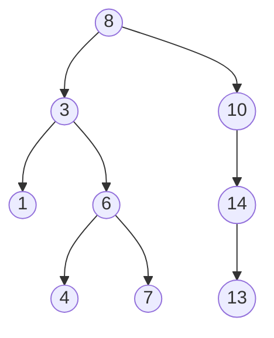
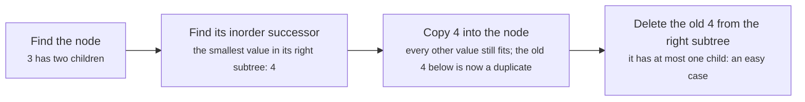

# Binary search trees and lowest common ancestor

> Data Structures & Algorithms · L2 Proficient · Trees, heaps & tries · about 95 min · hub module `m02` ([open the hub](https://claude.ai/artifact/DQhszKFoe8qbiNbSpWkqM5))

## Why it matters
A binary search tree keeps data sorted while still allowing fast inserts and deletes: the idea behind ordered maps and database indexes. Interviews love it because one rule (left smaller, right bigger) answers so many questions.

## Pre-question (answer before reading)
**Q:** In a tree where every left subtree holds smaller values and every right subtree bigger ones, how would you find 37 starting from a root of 50?

<details><summary>Answer</summary>

37 < 50, so go left and ignore the whole right side. Keep comparing and turning left or right, like binary search, until you find 37 or reach an empty spot.

</details>

## 🍎 Story time (kid version)
**The toy room and the treasure-map road trip: The cushion path**

Tara sets up a game on the floor: a cushion with the number 50 at the top of the room. Every new number card walks down from the top cushion: smaller numbers step left, bigger numbers step right, until they find an empty spot and sit there. To check whether card 37 is in the game, Ben follows the same path: 37 is less than 50, so left; more than 30, so right… He never looks at the other side of the room. But when Tara adds cards that are already in order, 51, 52, 53, 54, they all step right and make one long, slow line.

| In the story | In code |
|---|---|
| The top cushion (50) | The root of the BST |
| Smaller cards step left, bigger cards step right | The BST rule: left subtree < node < right subtree |
| Following the path to check for 37 | Search in O(h), ruling out one side at every step |
| Cards added in order forming one long line | A degenerate BST: height n, so every operation becomes O(n) |

**Where the story breaks:** Real BST libraries rebalance themselves (red-black and AVL trees; B-trees in databases), so the line never gets long. Neither Python nor JavaScript ships a BST in its standard library.

## Key ideas (grown-up version)
- **The BST rule**: for every node, all values in its left subtree are smaller and all values in its right subtree are larger. Decide where duplicates go (not allowed, or always right) and say so.
- **Search, insert and delete cost O(h)**: compare with the node and go one way. Balanced → O(log n). Inserting sorted data into a plain BST builds a chain → O(n).
- **Inorder traversal of a BST visits values in sorted order.** That gives you the k-th smallest value, a validity check (each value bigger than the last) and range listings.
- **Validate with bounds, not just children**: pass `(low, high)` down the recursion; every node must satisfy low < val < high. Comparing a node only with its own children misses deeper mistakes.
- **Delete has three cases**: a leaf (just remove it), one child (lift the child into its place), two children (copy in the inorder successor's value, then delete the successor from the right subtree).
- **Lowest common ancestor (LCA)**: the deepest node with both p and q in its subtree (a node counts as its own descendant). In a BST, walk down: both smaller → left, both bigger → right, otherwise you're at the LCA. O(h).
- **LCA in a general binary tree**: recurse; return the node if it is p or q; if both sides return something, this node is the LCA; otherwise pass up whichever side found something. O(n).
- **Self-balancing trees** (AVL, red-black) and B-trees keep h = O(log n) by rotating or splitting nodes. You won't code them in interviews, but mention them when asked about the worst case.

## Diagrams
**A BST, with the search path for 4 highlighted**



_4 < 8 → left; 4 > 3 → right; 4 < 6 → left; found in 4 steps. Inorder gives 1 3 4 6 7 8 10 13 14._

**Deleting a node with two children (delete 3 above)**



## Comparisons
**Where a BST fits**

| Need | Hash map | Sorted array + binary search | Balanced BST |
|---|---|---|---|
| Look up a key | O(1) average | O(log n) | O(log n) |
| Insert or delete | O(1) average | O(n): items shift | O(log n) |
| Smallest or largest key | O(n) | O(1) | O(log n) |
| Next bigger key, all keys in a range | O(n) | O(log n + k) | O(log n + k) |
| In Python / JavaScript | `dict` / `Map` | `list` + `bisect` / array + a lower-bound function | Nothing built in; Python's third-party `sortedcontainers` offers the same operations |

## Code (JavaScript + Python)
### Helpers used by this module's code (run these first)
```python
from collections import deque

class TreeNode:
    def __init__(self, val=0, left=None, right=None):
        self.val, self.left, self.right = val, left, right

def build(level):                      # LeetCode level order, None for gaps
    if not level or level[0] is None:
        return None
    root = TreeNode(level[0])
    q, i = deque([root]), 1
    while q and i < len(level):
        node = q.popleft()
        for side in ("left", "right"):
            if i < len(level) and level[i] is not None:
                child = TreeNode(level[i])
                setattr(node, side, child)
                q.append(child)
            i += 1
    return root

def inorder(node, out=None):           # sorted values of a BST
    out = [] if out is None else out
    if node:
        inorder(node.left, out)
        out.append(node.val)
        inorder(node.right, out)
    return out
```

```javascript
class TreeNode {
  constructor(val = 0, left = null, right = null) { this.val = val; this.left = left; this.right = right; }
}

function build(level) {                // LeetCode level order, null for gaps
  if (!level.length || level[0] === null) return null;
  const root = new TreeNode(level[0]);
  const q = [root];
  let head = 0, i = 1;
  while (head < q.length && i < level.length) {
    const node = q[head++];
    for (const side of ["left", "right"]) {
      if (i < level.length && level[i] !== null) {
        node[side] = new TreeNode(level[i]);
        q.push(node[side]);
      }
      i++;
    }
  }
  return root;
}

function inorder(node, out = []) {     // sorted values of a BST
  if (node) {
    inorder(node.left, out);
    out.push(node.val);
    inorder(node.right, out);
  }
  return out;
}
```

### Search and insert, and why insert order matters
```python
def search(root, target):                # O(h)
    node = root
    while node and node.val != target:
        node = node.left if target < node.val else node.right
    return node

def insert(root, val):                   # O(h); returns the (possibly new) root
    if root is None:
        return TreeNode(val)
    if val < root.val:
        root.left = insert(root.left, val)
    elif val > root.val:
        root.right = insert(root.right, val)
    return root                          # duplicates are ignored

def height(node):
    return 0 if node is None else 1 + max(height(node.left), height(node.right))

root = None
for v in [8, 3, 10, 1, 6, 14, 4, 7, 13]:
    root = insert(root, v)
print(*inorder(root))                    # sorted
print(search(root, 6).val, "found" if search(root, 5) else "missing")

chain = None
for v in range(1, 256):                  # sorted input: every value goes right
    chain = insert(chain, v)

def middle_first(lo, hi, out):           # medians first gives a balanced tree
    if lo <= hi:
        mid = (lo + hi) // 2
        out.append(mid)
        middle_first(lo, mid - 1, out)
        middle_first(mid + 1, hi, out)
    return out

balanced = None
for v in middle_first(1, 255, []):
    balanced = insert(balanced, v)
print(height(chain), height(balanced))
```

Output:
```text
1 3 4 6 7 8 10 13 14
6 missing
255 8
```

- line 4: One comparison decides which subtree to ignore.
- line 40: The same 255 values: a chain 255 levels tall versus a tree 8 levels tall (2⁸ − 1 = 255).

```javascript
function search(root, target) {          // O(h)
  let node = root;
  while (node && node.val !== target) node = target < node.val ? node.left : node.right;
  return node;
}

function insert(root, val) {             // O(h); returns the (possibly new) root
  if (root === null) return new TreeNode(val);
  if (val < root.val) root.left = insert(root.left, val);
  else if (val > root.val) root.right = insert(root.right, val);
  return root;                           // duplicates are ignored
}

const height = node => (node === null ? 0 : 1 + Math.max(height(node.left), height(node.right)));

let root = null;
for (const v of [8, 3, 10, 1, 6, 14, 4, 7, 13]) root = insert(root, v);
console.log(...inorder(root));           // sorted
console.log(search(root, 6).val, search(root, 5) ? "found" : "missing");

let chain = null;
for (let v = 1; v < 256; v++) chain = insert(chain, v);   // sorted input: every value goes right

function middleFirst(lo, hi, out = []) { // medians first gives a balanced tree
  if (lo <= hi) {
    const mid = Math.floor((lo + hi) / 2);
    out.push(mid);
    middleFirst(lo, mid - 1, out);
    middleFirst(mid + 1, hi, out);
  }
  return out;
}

let balanced = null;
for (const v of middleFirst(1, 255)) balanced = insert(balanced, v);
console.log(height(chain), height(balanced));
```

Output:
```text
1 3 4 6 7 8 10 13 14
6 missing
255 8
```

- line 3: One comparison decides which subtree to ignore.
- line 36: The same 255 values: a chain 255 levels tall versus a tree 8 levels tall.

### Validate a BST with bounds (and the check that fails)
```python
def is_valid_bst(root):
    def ok(node, low, high):             # every value strictly between low and high
        if node is None:
            return True
        if not (low < node.val < high):
            return False
        return ok(node.left, low, node.val) and ok(node.right, node.val, high)
    return ok(root, float("-inf"), float("inf"))

def children_only(node):                 # WRONG: compares a node with its children only
    if node is None:
        return True
    if node.left and node.left.val >= node.val:
        return False
    if node.right and node.right.val <= node.val:
        return False
    return children_only(node.left) and children_only(node.right)

trees = ([2, 1, 3], [5, 1, 4, None, None, 3, 6], [5, 1, 6, None, None, 3, 7])
print(*("valid" if is_valid_bst(build(t)) else "invalid" for t in trees))
print("children-only check says:", "valid" if children_only(build(trees[2])) else "invalid")
```

Output:
```text
valid invalid invalid
children-only check says: valid
```

- line 7: Going left, the node's value becomes the new upper bound; going right, the new lower bound.
- line 21: In [5, 1, 6, null, null, 3, 7], 3 sits in 5's right subtree, but every parent–child pair looks fine.

```javascript
function isValidBST(root) {
  function ok(node, low, high) {         // every value strictly between low and high
    if (node === null) return true;
    if (!(low < node.val && node.val < high)) return false;
    return ok(node.left, low, node.val) && ok(node.right, node.val, high);
  }
  return ok(root, -Infinity, Infinity);
}

function childrenOnly(node) {            // WRONG: compares a node with its children only
  if (node === null) return true;
  if (node.left && node.left.val >= node.val) return false;
  if (node.right && node.right.val <= node.val) return false;
  return childrenOnly(node.left) && childrenOnly(node.right);
}

const trees = [[2, 1, 3], [5, 1, 4, null, null, 3, 6], [5, 1, 6, null, null, 3, 7]];
console.log(...trees.map(t => (isValidBST(build(t)) ? "valid" : "invalid")));
console.log("children-only check says:", childrenOnly(build(trees[2])) ? "valid" : "invalid");
```

Output:
```text
valid invalid invalid
children-only check says: valid
```

- line 5: Going left, the node's value becomes the new upper bound; going right, the new lower bound.

### Delete: the three cases
```python
def delete(root, key):                   # O(h); returns the new root
    if root is None:
        return None
    if key < root.val:
        root.left = delete(root.left, key)
    elif key > root.val:
        root.right = delete(root.right, key)
    else:
        if root.left is None:            # 0 or 1 child: lift the other side up
            return root.right
        if root.right is None:
            return root.left
        succ = root.right                # 2 children: the inorder successor is
        while succ.left:                 # the smallest value in the right subtree
            succ = succ.left
        root.val = succ.val
        root.right = delete(root.right, succ.val)
    return root

root = build([8, 3, 10, 1, 6, None, 14, None, None, 4, 7, 13])
for key in (3, 14, 1):                   # two children, one child, a leaf
    root = delete(root, key)
    print(*inorder(root))
```

Output:
```text
1 4 6 7 8 10 13 14
1 4 6 7 8 10 13
4 6 7 8 10 13
```

- line 9: A leaf has no children, so this line also handles it: it returns None.
- line 16: Copy the successor's value, then delete the successor, which has no left child.

```javascript
function deleteNode(root, key) {         // O(h); returns the new root
  if (root === null) return null;
  if (key < root.val) root.left = deleteNode(root.left, key);
  else if (key > root.val) root.right = deleteNode(root.right, key);
  else {
    if (root.left === null) return root.right;   // 0 or 1 child: lift the other side up
    if (root.right === null) return root.left;
    let succ = root.right;               // 2 children: the inorder successor is
    while (succ.left) succ = succ.left;  // the smallest value in the right subtree
    root.val = succ.val;
    root.right = deleteNode(root.right, succ.val);
  }
  return root;
}

let root = build([8, 3, 10, 1, 6, null, 14, null, null, 4, 7, 13]);
for (const key of [3, 14, 1]) {          // two children, one child, a leaf
  root = deleteNode(root, key);
  console.log(...inorder(root));
}
```

Output:
```text
1 4 6 7 8 10 13 14
1 4 6 7 8 10 13
4 6 7 8 10 13
```

- line 1: Named `deleteNode` because `delete` is a reserved word in JavaScript.

## Worked example
**Problem.** Find the lowest common ancestor of two values p and q in a general binary tree (not a BST). Both values are in the tree and all values are unique.

1. LCA(p, q) is the deepest node whose subtree contains both p and q, and a node counts as being in its own subtree.
2. Base case: if the node is empty, or is p or q, return it.
3. Ask both children. If both return a node, p and q are on different sides, so this node is the LCA. Otherwise, pass up whichever side found something.
4. Each node is visited at most once: O(n) time and O(h) stack space. In a BST you'd use the ordering instead and walk a single path: O(h).

```python
def lca(root, p, q):                     # p and q are values present in the tree
    if root is None or root.val in (p, q):
        return root
    left = lca(root.left, p, q)
    right = lca(root.right, p, q)
    if left and right:                   # found on both sides: this is the split point
        return root
    return left or right                 # pass up whichever side found something

root = build([3, 5, 1, 6, 2, 0, 8, None, None, 7, 4])
print(lca(root, 5, 1).val, lca(root, 5, 4).val, lca(root, 7, 8).val)
```

Output:
```text
3 5 3
```

```javascript
function lca(root, p, q) {               // p and q are values present in the tree
  if (root === null || root.val === p || root.val === q) return root;
  const left = lca(root.left, p, q);
  const right = lca(root.right, p, q);
  if (left && right) return root;        // found on both sides: this is the split point
  return left ?? right;                  // pass up whichever side found something
}

const root = build([3, 5, 1, 6, 2, 0, 8, null, null, 7, 4]);
console.log(lca(root, 5, 1).val, lca(root, 5, 4).val, lca(root, 7, 8).val);
```

Output:
```text
3 5 3
```

**Answer.** 3, 5 and 3. For (5, 4), 4 is inside 5's subtree, so the recursion returns 5 as soon as it reaches it, and 5 is the answer. O(n) time, O(h) stack.

## Your turn (faded example)
**Problem.** Add up every value between `low` and `high` (inclusive) in a BST, skipping subtrees that can't hold any of them.

- ✓ Visiting every node is O(n). The BST rule lets you skip whole subtrees.
- **If `node.val < low`, which subtree can you skip?**
  <details><summary>Answer</summary>The left one: everything there is even smaller. Only the right subtree can hold values in range.</details>
- **And if `node.val > high`?**
  <details><summary>Answer</summary>Skip the right subtree; only the left subtree can hold values in range.</details>
- **What happens when low ≤ node.val ≤ high?**
  <details><summary>Answer</summary>Count `node.val` and search both subtrees.</details>

Starter:
```python
def range_sum(node, low, high):
    if node is None:
        return 0
    if node.val < low:
        return ...                      # TODO: only the right side can help
    if node.val > high:
        return ...                      # TODO: only the left side can help
    return node.val + range_sum(node.left, low, high) + range_sum(node.right, low, high)

print(range_sum(build([10, 5, 15, 3, 7, None, 18]), 7, 15))   # expect 32
```

```javascript
function rangeSum(node, low, high) {
  if (node === null) return 0;
  if (node.val < low) return /* TODO: only the right side can help */ 0;
  if (node.val > high) return /* TODO: only the left side can help */ 0;
  return node.val + rangeSum(node.left, low, high) + rangeSum(node.right, low, high);
}

console.log(rangeSum(build([10, 5, 15, 3, 7, null, 18]), 7, 15));   // expect 32
```

<details><summary>Full solution</summary>

```python
def range_sum(node, low, high):
    if node is None:
        return 0
    if node.val < low:
        return range_sum(node.right, low, high)   # the left side is even smaller
    if node.val > high:
        return range_sum(node.left, low, high)    # the right side is even bigger
    return node.val + range_sum(node.left, low, high) + range_sum(node.right, low, high)

print(range_sum(build([10, 5, 15, 3, 7, None, 18]), 7, 15),
      range_sum(build([10, 5, 15, 3, 7, 13, 18, 1, None, 6]), 6, 10))
```

Output:
```text
32 23
```

```javascript
function rangeSum(node, low, high) {
  if (node === null) return 0;
  if (node.val < low) return rangeSum(node.right, low, high);    // the left side is even smaller
  if (node.val > high) return rangeSum(node.left, low, high);    // the right side is even bigger
  return node.val + rangeSum(node.left, low, high) + rangeSum(node.right, low, high);
}

console.log(rangeSum(build([10, 5, 15, 3, 7, null, 18]), 7, 15),
            rangeSum(build([10, 5, 15, 3, 7, 13, 18, 1, null, 6]), 6, 10));
```

Output:
```text
32 23
```

</details>

## Socratic checks and quiz (answers hidden)
**1. What does this print?**

```python
def insert(node, v):
    if node is None:
        return TreeNode(v)
    if v < node.val:
        node.left = insert(node.left, v)
    else:
        node.right = insert(node.right, v)
    return node

root = None
for v in [5, 2, 8, 1, 9, 3]:
    root = insert(root, v)
print(root.left.right.val, root.right.right.val)
```

```javascript
function insert(node, v) {
  if (node === null) return new TreeNode(v);
  if (v < node.val) node.left = insert(node.left, v);
  else node.right = insert(node.right, v);
  return node;
}

let root = null;
for (const v of [5, 2, 8, 1, 9, 3]) root = insert(root, v);
console.log(root.left.right.val, root.right.right.val);
```

- A. 3 9
- B. 1 9
- C. 3 8
- D. 2 9

<details><summary>Answer</summary>

3 9. 5 is the root; 2 goes left and 8 right; 1 goes left of 2; 9 right of 8; 3 is less than 5 but more than 2, so it lands right of 2.

</details>

**2. Which of these level-order trees is NOT a valid BST?**

- A. [5, 1, 6, null, null, 3, 7]
- B. [2, 1, 3]
- C. [8, 3, 10, 1, 6, null, 14]
- D. [4, 2, 6, 1, 3, 5, 7]

<details><summary>Answer</summary>

[5, 1, 6, null, null, 3, 7]. In the first tree, 3 is under 6 in 5's right subtree, but 3 < 5. Each parent–child pair looks fine, which is why child-only checks fail.

</details>

**3. You insert 1, 2, 3, …, 1,000 in that order into a plain (non-balancing) BST. What are the height and the cost of a search?**

- A. Height 1,000; a search is O(n)
- B. Height about 10; a search is O(log n)
- C. Height 500; a search is O(n log n)
- D. Height 1; a search is O(1)

<details><summary>Answer</summary>

Height 1,000; a search is O(n). Every new value is the largest so far, so it always goes right: the tree is a chain. Self-balancing trees exist to prevent exactly this.

</details>

**4. Which questions does a balanced BST answer quickly but a hash map can't answer without scanning everything? (choose 2)**

- A. What's the smallest key bigger than 42?
- B. List every key between 10 and 20
- C. Is key 42 present?
- D. How many times was key 42 inserted?
- E. Insert key 42

<details><summary>Answer</summary>

What's the smallest key bigger than 42?, List every key between 10 and 20. Order questions need order. Presence, counting and inserting are O(1) on average in a hash map.

</details>

**5. Judge each statement.**

- Inorder traversal of a BST yields its values in increasing order.
- Checking each node against only its two children is enough to validate a BST.
- The LCA of p and q can be p itself.
- Python's `dict` keeps its keys in sorted order.

<details><summary>Answer</summary>

Inorder traversal of a BST yields its values in increasing order.: Yes; Checking each node against only its two children is enough to validate a BST.: No; The LCA of p and q can be p itself.: Yes; Python's `dict` keeps its keys in sorted order.: No. Sorted inorder is the BST's superpower. Validity is about whole subtrees. A node is its own descendant. Dicts keep insertion order, not sorted order.

</details>

**6. Put the steps for deleting a node with two children in order.**

- (put the steps in order)

<details><summary>Answer</summary>

Find the node to delete → Find its inorder successor: the smallest node in its right subtree → Copy the successor's value into the node → Delete the now-duplicate value from the right subtree. The successor has no left child, so deleting it is one of the easy cases.

</details>

**7. Complete the JavaScript LCA for a BST.**

```
function lcaBST(root, p, q) {
  let node = root;
  while (node) {
    if (p < node.val && q < node.val) node = node.{{0}};
    else if (p > node.val && q > node.val) node = node.{{1}};
    else return {{2}};
  }
  return null;
}

```

<details><summary>Answer</summary>

left | right | node. Both smaller → go left, both bigger → go right; the first node where they split (or that equals one of them) is the LCA.

</details>

**8. Match each BST task to its approach.**


<details><summary>Answer</summary>

Check that the tree is a valid BST = Pass (low, high) bounds down; Find the k-th smallest value = Inorder traversal, stopping at the k-th value; Find the LCA of two values = Walk down until the values split; Delete a node with two children = Swap in the inorder successor. Each task uses the ordering rule differently: bounds, sorted inorder, splitting paths, successors.

</details>

## Traps & misconceptions
- **“A BST is valid if every node is bigger than its left child and smaller than its right child.”** The rule covers whole subtrees. In [5, 1, 6, null, null, 3, 7] every parent–child pair looks fine, but 3 sits in 5's right subtree. Pass (low, high) bounds down.
- **“BST operations are O(log n).”** They're O(h). Inserting sorted data into a plain BST builds a chain with h = n. Only self-balancing trees guarantee O(log n).
- **“Python's `dict` or JavaScript's `Map` is a kind of BST.”** They're hash tables: no sorted order and no “next bigger key”. For sorted keys, keep a sorted list with `bisect` or use a sorted container.
- **“To delete a node with two children, just remove it.”** That breaks the tree apart. Copy in the inorder successor's (or predecessor's) value, then delete that node, which has at most one child.
- **“The LCA must be a different node from p and q.”** A node counts as its own descendant: if q is inside p's subtree, the LCA is p itself.
- **“0 and −1 make fine starting bounds.”** Values can be negative or huge. Start with `-inf` / `inf` (`-Infinity` / `Infinity` in JavaScript), or use `None` / `null` to mean “no bound”.

## Discussion prompts
- **When would you choose a balanced BST over a hash map?**
  <details><summary>One good answer</summary>When you need order: the smallest or largest key, the next bigger key, or every key in a range. A hash map can't answer those without scanning everything.</details>
- **Why do databases use B-trees rather than binary search trees?**
  <details><summary>One good answer</summary>A disk or memory page holds many keys. A B-tree packs hundreds of keys into each node, so the tree is only a few levels deep and each lookup touches very few pages.</details>

## Teach-back
**Prompt:** Explain to a junior colleague what makes a binary search tree valid, and how you would check it.

Rubric:
- [ ] Everything in the left subtree is smaller and everything in the right subtree is larger, for every node
- [ ] Checking only direct children is not enough (gives an example)
- [ ] Pass (low, high) bounds down, or check that the inorder sequence is strictly increasing
- [ ] O(n) time, O(h) space
- [ ] Mentions that duplicates need an agreed rule

<details><summary>Model answer</summary>

A BST is valid when, for every node, everything in its left subtree is smaller and everything in its right subtree is larger, not just its two children. A tree with 5 at the root, 6 on its right and 3 under the 6 passes a child-only check but is invalid, because 3 is in 5's right subtree. The reliable check passes bounds down: each node must be strictly between low and high; going left, the node's value becomes the new high, and going right, the new low. Equivalently, an inorder traversal must be strictly increasing. Both are O(n) time and O(h) space. Duplicates need an agreed rule, such as not allowed or always to the right.

</details>

## Quick Q&A (also in the SRS deck)
- **The BST rule?** For every node, all values in the left subtree are smaller and all values in the right subtree are larger.
- **Cost of search, insert and delete in a BST?** O(h): O(log n) when balanced, O(n) for a chain (for example, after inserting sorted data).
- **What does an inorder traversal of a BST produce?** The values in increasing order.
- **How do you delete a node with two children?** Copy in its inorder successor's value (the smallest in its right subtree), then delete the successor from the right subtree.
- **LCA in a BST in O(h)?** From the root: both values smaller → go left; both bigger → go right; otherwise the current node is the LCA.
- **LCA in a general binary tree?** Recurse; return the node if it's p or q; if both sides return a node, the current node is the LCA; otherwise pass up the non-empty side. O(n).

## Practice problems
- [ ] [LC 98 · Validate Binary Search Tree](https://leetcode.com/problems/validate-binary-search-tree/) · Medium · pass bounds down
- [ ] [LC 230 · Kth Smallest Element in a BST](https://leetcode.com/problems/kth-smallest-element-in-a-bst/) · Medium · inorder, stop at the k-th value
- [ ] [LC 235 · Lowest Common Ancestor of a Binary Search Tree](https://leetcode.com/problems/lowest-common-ancestor-of-a-binary-search-tree/) · Medium · walk down until the values split
- [ ] [LC 701 · Insert into a Binary Search Tree](https://leetcode.com/problems/insert-into-a-binary-search-tree/) · Medium · the insert above, from memory
- [ ] [LC 450 · Delete Node in a BST](https://leetcode.com/problems/delete-node-in-a-bst/) · Medium · three cases; the successor trick
- [ ] [LC 108 · Convert Sorted Array to Binary Search Tree](https://leetcode.com/problems/convert-sorted-array-to-binary-search-tree/) · Easy · the middle element as the root, recursively
- [ ] [LC 173 · Binary Search Tree Iterator](https://leetcode.com/problems/binary-search-tree-iterator/) · Medium · iterative inorder with a stack, paused between calls

## Sources (accessed 2026-10-09)
- [MIT 6.006 Introduction to Algorithms (Spring 2020): binary trees and AVL trees](https://ocw.mit.edu/courses/6-006-introduction-to-algorithms-spring-2020/)
- [Python docs: bisect (sorted lists without a tree)](https://docs.python.org/3/library/bisect.html)
- [Sorted Containers (third-party sorted collections for Python)](https://grantjenks.com/docs/sortedcontainers/)
- [Open Data Structures (Pat Morin): binary search trees](https://opendatastructures.org/ods-python/6_2_BinarySearchTree_Unbala.html)
