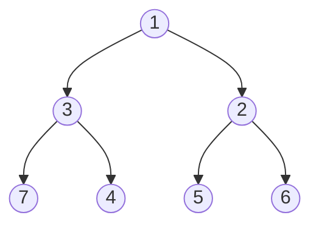

# Heaps and priority queues

> Data Structures & Algorithms · L2 Proficient · Trees, heaps & tries · about 95 min · hub module `m03` ([open the hub](https://claude.ai/artifact/DQhszKFoe8qbiNbSpWkqM5))

## Why it matters
Whenever you need “the smallest (or largest) item right now” over and over (the next job, the closest point, the top 10 scores), a heap gives it to you in O(log n) per step instead of re-sorting everything.

## Pre-question (answer before reading)
**Q:** Scores keep arriving and you must always be able to report the top 3 so far. Do you need to keep every score sorted?

<details><summary>Answer</summary>

No. Keep only the best 3 in a small min-heap: if a new score beats the smallest of the three, swap it in. That's O(log 3) per score instead of re-sorting everything.

</details>

## 🍎 Story time (kid version)
**The toy room and the treasure-map road trip: The hungriest-first snack line**

Ben runs the snack line on the road trip, and the hungriest child goes first, not whoever asked first. He keeps the hungriest child's name at the top of his notepad. When a new child asks, Ben writes them at the bottom and lets them swap upwards past anyone less hungry. When the top child gets a snack, Ben moves the last name to the top and lets it sink down past hungrier children. He never sorts the whole list; he only fixes one short path.

| In the story | In code |
|---|---|
| The hungriest child at the top of the notepad | The root of a max-heap: the biggest item, O(1) to peek |
| A new name swapping upwards past less hungry children | Push: add at the end, sift up, O(log n) |
| The last name moved to the top and sinking down | Pop: move the last item to the root, sift down, O(log n) |
| Never sorting the whole list | A heap is only partly ordered: each parent beats its children, nothing more |

**Where the story breaks:** Ben's notepad is really a tree written as a list: the children of position i sit at 2i + 1 and 2i + 2. And the notepad can't quickly list everyone in order, tell you the 5th-hungriest child or find one particular name: heaps only make the top cheap.

## Key ideas (grown-up version)
- **A binary heap** is a complete binary tree stored in an array: the children of index i are at 2i + 1 and 2i + 2, and its parent is at (i − 1) // 2. Min-heap rule: every parent ≤ its children, so the minimum sits at index 0.
- **Costs**: peek O(1); push and pop O(log n), because sift up and sift down follow one path; building a heap from n items with heapify O(n); finding an arbitrary value O(n).
- **Python**: `heapq` works on a plain list and is a **min-heap**: `heappush`, `heappop`, `heapify`, `nlargest`, `nsmallest`. For a max-heap, push negated values; Python 3.14+ also adds `heappush_max` and friends.
- **JavaScript has no built-in heap or priority queue.** Keep a small class with a comparator, like the helper above, or use a library.
- **Records and ties**: push tuples or arrays like `(priority, order, item)`. The order counter breaks ties, so the items themselves are never compared. Python compares tuples item by item; JavaScript arrays compare as strings, so pass a comparator that checks the priority, then the order (as in the code below).
- **Top-k largest**: keep a *min*-heap of size k and pop the smallest whenever it grows past k. O(n log k) time, O(k) space. (Quickselect averages O(n) but is harder to get right.)
- **Two heaps** (a max-heap for the lower half, a min-heap for the upper half) keep a running median in O(log n) per insert, and a heap of list heads merges k sorted lists in O(N log k).

## Diagrams
**A min-heap and the array behind it: [1, 3, 2, 7, 4, 5, 6]**



_Index i's children sit at 2i + 1 and 2i + 2: the children of 3 (index 1) are 7 and 4 (indexes 3 and 4)._

**Pushing 0: append it, then sift up**

| append 0 | 0 | 1 | 2 | 3 | 4 | 5 | 6 | 7 |
|---|---|---|---|---|---|---|---|---|
| value | 1 | 3 | 2 | 7 | 4 | 5 | 6 | **0** |

| swap with 7 | 0 | 1 | 2 | 3 | 4 | 5 | 6 | 7 |
|---|---|---|---|---|---|---|---|---|
| value | 1 | 3 | 2 | **0** | 4 | 5 | 6 | 7 |

| swap with 3 | 0 | 1 | 2 | 3 | 4 | 5 | 6 | 7 |
|---|---|---|---|---|---|---|---|---|
| value | 1 | **0** | 2 | 3 | 4 | 5 | 6 | 7 |

| swap with 1 | 0 | 1 | 2 | 3 | 4 | 5 | 6 | 7 |
|---|---|---|---|---|---|---|---|---|
| value | 0 | 1 | 2 | 3 | 4 | 5 | 6 | 7 |

_Sift up only compares with parents (7 → 3 → 1 → 0): at most log₂ n swaps._

## Comparisons
**Four ways to get the k largest of n**

| Approach | Time | Extra space | When |
|---|---|---|---|
| Sort everything, take k | O(n log n) | O(n) | Simple; fine for small n |
| Min-heap capped at k | O(n log k) | O(k) | Streams, or k much smaller than n |
| Heapify all n, pop k times | O(n + k log n) | O(n) | All data in memory and small k |
| Quickselect | O(n) on average, O(n²) worst | O(1) beyond the array | A one-off k-th element; careful coding |

## Code (JavaScript + Python)
### Helpers used by this module's code (run these first)
```python
import heapq                             # Python's heap functions work on a plain list
```

```javascript
class MinHeap {                          // JavaScript has no built-in heap
  constructor(less = (a, b) => a < b) { this.a = []; this.less = less; }
  get size() { return this.a.length; }
  peek() { return this.a[0]; }
  push(x) {                              // O(log n): sift up
    const a = this.a;
    a.push(x);
    let i = a.length - 1;
    while (i > 0) {
      const p = (i - 1) >> 1;            // parent index
      if (!this.less(a[i], a[p])) break;
      [a[i], a[p]] = [a[p], a[i]];
      i = p;
    }
  }
  pop() {                                // O(log n): sift down
    const a = this.a, top = a[0], last = a.pop();
    if (a.length) {
      a[0] = last;
      let i = 0;
      for (;;) {
        const l = 2 * i + 1, r = l + 1;
        let m = i;
        if (l < a.length && this.less(a[l], a[m])) m = l;
        if (r < a.length && this.less(a[r], a[m])) m = r;
        if (m === i) break;
        [a[i], a[m]] = [a[m], a[i]];
        i = m;
      }
    }
    return top;
  }
}
```

### Heap basics in both languages
```python
heap = []
for x in [5, 1, 8, 3, 9, 2]:
    heapq.heappush(heap, x)                 # O(log n) each
print(heap[0])                              # peek at the minimum: O(1)
print(*[heapq.heappop(heap) for _ in range(3)])   # pops come out smallest first

data = [5, 1, 8, 3, 9, 2]
heapq.heapify(data)                         # O(n), rearranges the list in place
print(data[0], len(data))

maxheap = []
for x in [5, 1, 8]:
    heapq.heappush(maxheap, -x)             # negate for a max-heap
print(-maxheap[0])
```

Output:
```text
1
1 2 3
1 6
8
```

- line 8: heapify builds the heap bottom-up in O(n), cheaper than n pushes.
- line 13: A max-heap in Python 3.12–3.13: store −x, and negate again when reading.

```javascript
const heap = new MinHeap();
for (const x of [5, 1, 8, 3, 9, 2]) heap.push(x);   // O(log n) each
console.log(heap.peek());                   // peek at the minimum: O(1)
console.log(heap.pop(), heap.pop(), heap.pop());     // pops come out smallest first

const data = new MinHeap();
for (const x of [5, 1, 8, 3, 9, 2]) data.push(x);   // n pushes: O(n log n)
console.log(data.peek(), data.size);

const maxheap = new MinHeap((a, b) => a > b);       // a comparator makes it a max-heap
for (const x of [5, 1, 8]) maxheap.push(x);
console.log(maxheap.peek());
```

Output:
```text
1
1 2 3
1 6
8
```

- line 7: No heapify here: n pushes cost O(n log n), which is fine at this size.
- line 10: Same class, different comparator: “less” now means “bigger”.

### Top-k with a heap capped at k
```python
def top_k(nums, k):                         # the k largest, O(n log k)
    heap = []
    for x in nums:
        heapq.heappush(heap, x)
        if len(heap) > k:
            heapq.heappop(heap)             # drop the smallest of the k + 1
    return sorted(heap, reverse=True)

print(*top_k([3, 2, 1, 5, 6, 4], 2), "|", *top_k([3, 2, 3, 1, 2, 4, 5, 5, 6], 4))
print(*heapq.nlargest(2, [3, 2, 1, 5, 6, 4]))   # the library one-liner
```

Output:
```text
6 5 | 6 5 5 4
6 5
```

- line 6: The root is the smallest of the k + 1 items, so it can't be in the top k: evict it.

```javascript
function topK(nums, k) {                    // the k largest, O(n log k)
  const heap = new MinHeap();
  for (const x of nums) {
    heap.push(x);
    if (heap.size > k) heap.pop();          // drop the smallest of the k + 1
  }
  const out = [];
  while (heap.size) out.push(heap.pop());
  return out.reverse();
}

console.log(...topK([3, 2, 1, 5, 6, 4], 2), "|", ...topK([3, 2, 3, 1, 2, 4, 5, 5, 6], 4));
console.log(...[3, 2, 1, 5, 6, 4].toSorted((a, b) => b - a).slice(0, 2));   // no library: sort, O(n log n)
```

Output:
```text
6 5 | 6 5 5 4
6 5
```

- line 5: The root is the smallest of the k + 1 items, so it can't be in the top k: evict it.

### Priorities with ties: (priority, counter, item)
```python
import itertools

tasks = []
counter = itertools.count()                 # breaks ties in arrival order
for priority, name in [(2, "email"), (1, "deploy"), (2, "lunch"), (1, "review")]:
    heapq.heappush(tasks, (priority, next(counter), name))
print(*[heapq.heappop(tasks)[2] for _ in range(4)])
```

Output:
```text
deploy review email lunch
```

- line 6: If two priorities tie, the counter decides, so Python never needs to compare the names (or other objects).

```javascript
const tasks = new MinHeap((a, b) => a[0] < b[0] || (a[0] === b[0] && a[1] < b[1]));
let counter = 0;                            // breaks ties in arrival order
for (const [priority, name] of [[2, "email"], [1, "deploy"], [2, "lunch"], [1, "review"]])
  tasks.push([priority, counter++, name]);
const order = [];
while (tasks.size) order.push(tasks.pop()[2]);
console.log(...order);
```

Output:
```text
deploy review email lunch
```

- line 1: The comparator compares priority first, then arrival order.

## Worked example
**Problem.** Merge k sorted arrays into one sorted array (N items in total).

1. Concatenating and sorting costs O(N log N) for a general sort. (TimSort, used by Python and V8, does spot the sorted runs; the heap still wins by streaming lazily with only O(k) extra memory, and it works on iterators and linked lists too.)
2. Keep a min-heap holding the current front item of each array: at most k items.
3. Pop the smallest front, append it to the output, and push the next item from the same array.
4. Each of the N items is pushed and popped once in a heap of at most k items: O(N log k) time, O(k) extra space plus the output.

```python
def merge_k(arrays):
    heap = [(arr[0], i, 0) for i, arr in enumerate(arrays) if arr]   # (value, which array, index)
    heapq.heapify(heap)
    out = []
    while heap:
        val, i, j = heapq.heappop(heap)
        out.append(val)
        if j + 1 < len(arrays[i]):
            heapq.heappush(heap, (arrays[i][j + 1], i, j + 1))   # that array's next item
    return out

print(*merge_k([[1, 4, 5], [1, 3, 4], [2, 6], []]))
```

Output:
```text
1 1 2 3 4 4 5 6
```

```javascript
function mergeK(arrays) {
  const heap = new MinHeap((a, b) => a[0] < b[0] || (a[0] === b[0] && a[1] < b[1]));   // [value, array, index]
  arrays.forEach((arr, i) => { if (arr.length) heap.push([arr[0], i, 0]); });
  const out = [];
  while (heap.size) {
    const [val, i, j] = heap.pop();
    out.push(val);
    if (j + 1 < arrays[i].length) heap.push([arrays[i][j + 1], i, j + 1]);   // that array's next item
  }
  return out;
}

console.log(...mergeK([[1, 4, 5], [1, 3, 4], [2, 6], []]));
```

Output:
```text
1 1 2 3 4 4 5 6
```

**Answer.** 1 1 2 3 4 4 5 6. O(N log k) time and O(k) extra space. Python's `heapq.merge` does the same thing lazily.

## Your turn (faded example)
**Problem.** Every item in `nums` is at most k positions away from its place in sorted order. Sort it in O(n log k).

- ✓ The item that belongs next in the output is among the k + 1 items read but not yet written out, which are exactly the heap's contents, so the heap's root is always the next item.
- **What goes into the heap before you write anything out?**
  <details><summary>Answer</summary>The first k + 1 items (or all of them, if there are fewer).</details>
- **What does each step of the main loop do?**
  <details><summary>Answer</summary>Pop the smallest into the output, then push the next unread item.</details>
- **Time and space?**
  <details><summary>Answer</summary>O(n log k) time, because the heap never holds more than k + 1 items, and O(k) extra space.</details>

Starter:
```python
def sort_nearly_sorted(nums, k):
    heap = nums[:k + 1]
    heapq.heapify(heap)
    out = []
    for x in nums[k + 1:]:
        ...                          # TODO: pop the smallest into out, then push x
    while heap:
        out.append(heapq.heappop(heap))
    return out

print(sort_nearly_sorted([6, 5, 3, 2, 8, 10, 9], 3))   # expect [2, 3, 5, 6, 8, 9, 10]
```

```javascript
function sortNearlySorted(nums, k) {
  const heap = new MinHeap();
  for (const x of nums.slice(0, k + 1)) heap.push(x);
  const out = [];
  for (const x of nums.slice(k + 1)) {
    // TODO: pop the smallest into out, then push x
  }
  while (heap.size) out.push(heap.pop());
  return out;
}

console.log(sortNearlySorted([6, 5, 3, 2, 8, 10, 9], 3));   // expect [2, 3, 5, 6, 8, 9, 10]
```

<details><summary>Full solution</summary>

```python
def sort_nearly_sorted(nums, k):
    heap = nums[:k + 1]
    heapq.heapify(heap)
    out = []
    for x in nums[k + 1:]:
        out.append(heapq.heappop(heap))   # the smallest of the window is final
        heapq.heappush(heap, x)
    while heap:
        out.append(heapq.heappop(heap))
    return out

print(*sort_nearly_sorted([6, 5, 3, 2, 8, 10, 9], 3))
```

Output:
```text
2 3 5 6 8 9 10
```

```javascript
function sortNearlySorted(nums, k) {
  const heap = new MinHeap();
  for (const x of nums.slice(0, k + 1)) heap.push(x);
  const out = [];
  for (const x of nums.slice(k + 1)) {
    out.push(heap.pop());                 // the smallest of the window is final
    heap.push(x);
  }
  while (heap.size) out.push(heap.pop());
  return out;
}

console.log(...sortNearlySorted([6, 5, 3, 2, 8, 10, 9], 3));
```

Output:
```text
2 3 5 6 8 9 10
```

</details>

## Socratic checks and quiz (answers hidden)
**1. What does this print? (`MinHeap` is this module's JavaScript helper.)**

```python
heap = []
for x in [4, 7, 2, 9, 1]:
    heapq.heappush(heap, x)
heapq.heappop(heap)
print(heap[0], len(heap))
```

```javascript
const heap = new MinHeap();
for (const x of [4, 7, 2, 9, 1]) heap.push(x);
heap.pop();
console.log(heap.peek(), heap.size);
```

- A. 2 4
- B. 1 4
- C. 2 5
- D. 4 4

<details><summary>Answer</summary>

2 4. The pop removes the minimum, 1. The new minimum is 2, and 4 items remain.

</details>

**2. What does this print?**

```python
heap = [1, 3, 2, 7, 4, 5, 6]
i = 1
print(heap[2 * i + 1], heap[2 * i + 2], heap[(5 - 1) // 2])
```

```javascript
const heap = [1, 3, 2, 7, 4, 5, 6];
const i = 1;
console.log(heap[2 * i + 1], heap[2 * i + 2], heap[Math.floor((5 - 1) / 2)]);
```

- A. 7 4 2
- B. 3 2 1
- C. 2 7 3
- D. 7 4 3

<details><summary>Answer</summary>

7 4 2. Index 1's children are indexes 3 and 4 (values 7 and 4). Index 5's parent is (5 − 1) // 2 = 2 (value 2).

</details>

**3. You stream 10 million numbers and need the 100 largest at the end, using little memory. What's the best approach?**

- A. A min-heap capped at 100 items
- B. A max-heap of all 10 million numbers
- C. Sort all the numbers at the end
- D. A hash set of the numbers

<details><summary>Answer</summary>

A min-heap capped at 100 items. The capped min-heap keeps 100 items and costs O(n log 100). The others store everything.

</details>

**4. Which are true for a binary min-heap with n items? (choose 3)**

- A. Peeking at the minimum is O(1)
- B. Pop is O(log n)
- C. Building it from n items with heapify is O(n)
- D. Finding an arbitrary value is O(log n)
- E. The underlying array is always sorted

<details><summary>Answer</summary>

Peeking at the minimum is O(1), Pop is O(log n), Building it from n items with heapify is O(n). A heap doesn't support fast search: an arbitrary value could be anywhere below the root, so it's O(n). And the array is only partly ordered.

</details>

**5. Judge each statement.**

- JavaScript has a built-in PriorityQueue class.
- On a list kept with heapify and heappush, heappop returns the smallest item.
- A min-heap of size k is the right tool for the k largest items.
- Pushing (priority, dict) tuples into heapq is always safe.

<details><summary>Answer</summary>

JavaScript has a built-in PriorityQueue class.: No; On a list kept with heapify and heappush, heappop returns the smallest item.: Yes; A min-heap of size k is the right tool for the k largest items.: Yes; Pushing (priority, dict) tuples into heapq is always safe.: No. No heap ships with JavaScript. heapq is a min-heap. The min-heap's root is the item to evict. Tied priorities make Python compare the dicts, which raises TypeError.

</details>

**6. Put the steps of popping from a min-heap in order.**

- (put the steps in order)

<details><summary>Answer</summary>

Remember the root (the minimum) → Move the last item into the root position → Swap it with its smaller child while it's bigger than that child → Return the remembered minimum. Taking the last item keeps the tree complete; sifting it down restores the heap rule.

</details>

**7. Complete this Python sift-up for a hand-written min-heap.**

```
def push(heap, x):
    heap.append(x)
    i = len(heap) - 1
    while i > 0:
        p = {{0}}
        if heap[i] {{1}} heap[p]:
            break
        heap[i], heap[p] = heap[p], heap[i]
        i = {{2}}

```

<details><summary>Answer</summary>

(i - 1) // 2 | >= | p. The parent of i is (i − 1) // 2. Stop once the new item is no smaller than its parent, otherwise swap and continue from the parent's position.

</details>

**8. Match each problem to its heap technique.**


<details><summary>Answer</summary>

The 10 most frequent words = A min-heap of size 10 (or nlargest); A running median of a stream = Two heaps: lower half and upper half; Merge 50 sorted log files = A heap of each file's current head; Jobs by priority, ties in arrival order = Tuples (priority, counter, job). Capped heaps for top-k, two heaps for medians, head-of-list heaps for k-way merges, and counters for ties.

</details>

## Traps & misconceptions
- **“A heap is sorted.”** Only parent ≤ children holds. [1, 3, 2, 7, 4, 5, 6] is a valid min-heap but not sorted; only the root is guaranteed to be the minimum.
- **“Python's `heapq` has a flag for a max-heap.”** `heapq` is a min-heap. Push negated numbers (or tuples with a negated priority). Python 3.14 added `heappush_max` and friends, but they don't exist in 3.12–3.13.
- **“For the k largest items, use a max-heap of size k.”** Use a *min*-heap of size k: its root is the weakest of your current top k, which is exactly the one to evict.
- **“Heapify is O(n log n).”** Building a heap bottom-up is O(n). n separate pushes are O(n log n).
- **“You can push any records into `heapq`.”** When priorities tie, Python compares the next tuple element; if that's a dict or an object with no ordering, you get a `TypeError`. Add a counter as a tie-breaker.
- **“Re-sorting a JavaScript array after each insert is a priority queue.”** Each re-sort costs O(n) at best (TimSort on an almost-sorted array) and O(n log n) in general. A heap does each insert and removal in O(log n).

## Discussion prompts
- **When is sorting better than a heap for top-k?**
  <details><summary>One good answer</summary>When n is small, when you need everything sorted anyway, or when the data isn't a stream. Sorting is one simple line; a heap shines when k is much smaller than n or items keep arriving.</details>
- **Why does a heap live in an array rather than in linked nodes?**
  <details><summary>One good answer</summary>A complete binary tree has no gaps, so parent and child positions are simple arithmetic (2i + 1, 2i + 2). That saves memory and keeps the data close together, which is fast.</details>

## Teach-back
**Prompt:** Explain to a junior colleague how a binary min-heap does push and pop in O(log n), and how you'd use one to keep the top 10 scores from a stream.

Rubric:
- [ ] A complete tree in an array; children at 2i + 1 and 2i + 2
- [ ] Min-heap rule: parent ≤ children, so the minimum is at the root
- [ ] Push appends then sifts up; pop moves the last item to the root then sifts down; each walks one path of about log n
- [ ] Top 10: a min-heap of size 10; if a new score beats the root, replace the root
- [ ] States O(n log k) for the stream

<details><summary>Model answer</summary>

A binary min-heap is a complete binary tree stored in an array, where index i's children live at 2i + 1 and 2i + 2. Its only rule is that each parent is no bigger than its children, so the minimum is always at index 0. To push, put the new item at the end and swap it upwards while it's smaller than its parent. To pop, take the root, move the last item into the root and swap it down with its smaller child until the rule holds. Both walk a single path about log₂ n long. To keep the top 10 scores from a stream, keep a min-heap of size 10: the root is the weakest of the current top 10, so when a new score beats it, pop the root and push the new score. That's O(n log 10) for n scores.

</details>

## Quick Q&A (also in the SRS deck)
- **Where are the children and the parent of index i in an array heap?** Children at 2i + 1 and 2i + 2; parent at (i − 1) // 2.
- **Costs of peek, push, pop and heapify?** Peek O(1); push and pop O(log n); heapify O(n).
- **How do you get a max-heap from Python's heapq?** Push negated values (or tuples with a negated priority). Python 3.14+ also has heappush_max and related functions.
- **Top-k largest with a heap: which kind, and what size?** A min-heap of size k; evict the root when it grows past k. O(n log k).
- **Why add a counter to heap tuples?** To break priority ties without comparing the items themselves, which may not be comparable.
- **Cost of merging k sorted lists with a heap?** O(N log k) for N items in total, with at most k items in the heap.

## Practice problems
- [ ] [LC 703 · Kth Largest Element in a Stream](https://leetcode.com/problems/kth-largest-element-in-a-stream/) · Easy · a min-heap of size k
- [ ] [LC 1046 · Last Stone Weight](https://leetcode.com/problems/last-stone-weight/) · Easy · a max-heap: negate in Python
- [ ] [LC 215 · Kth Largest Element in an Array](https://leetcode.com/problems/kth-largest-element-in-an-array/) · Medium · a min-heap of size k, or quickselect
- [ ] [LC 973 · K Closest Points to Origin](https://leetcode.com/problems/k-closest-points-to-origin/) · Medium · a max-heap of size k on distance
- [ ] [LC 621 · Task Scheduler](https://leetcode.com/problems/task-scheduler/) · Medium · count the tasks; a max-heap with a cooldown queue, or the counting formula
- [ ] [LC 295 · Find Median from Data Stream](https://leetcode.com/problems/find-median-from-data-stream/) · Hard · two heaps, rebalanced after each insert
- [ ] [LC 23 · Merge k Sorted Lists](https://leetcode.com/problems/merge-k-sorted-lists/) · Hard · a heap of list heads; break ties with an index

## Sources (accessed 2026-10-09)
- [Python docs: heapq (heap queue algorithm)](https://docs.python.org/3/library/heapq.html)
- [MIT 6.006 Introduction to Algorithms (Spring 2020): binary heaps](https://ocw.mit.edu/courses/6-006-introduction-to-algorithms-spring-2020/)
- [Wikipedia: Binary heap](https://en.wikipedia.org/wiki/Binary_heap)
