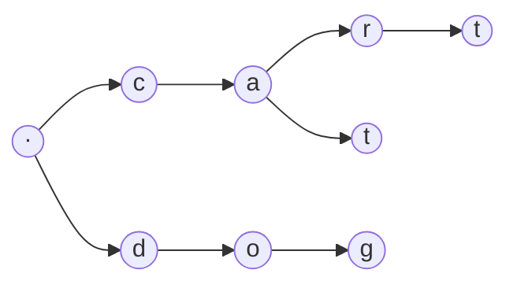

# Tries (prefix trees)

> Data Structures & Algorithms · L2 Proficient · Trees, heaps & tries · about 90 min · hub module `m04` ([open the hub](https://claude.ai/artifact/DQhszKFoe8qbiNbSpWkqM5))

## Why it matters
Autocomplete, spell-checkers and word games all ask “which words start with these letters?”. A trie reaches those words in time proportional to the length of the prefix, however many words you've stored, and then visits only the matches.

## Pre-question (answer before reading)
**Q:** You store 100,000 words. How could you find every word starting with “car” without checking all 100,000?

<details><summary>Answer</summary>

Store the words letter by letter in a tree that shares common beginnings. Follow c → a → r, and every word below that point starts with “car”. The walk takes 3 steps whatever the number of words.

</details>

## 🍎 Story time (kid version)
**The toy room and the treasure-map road trip: The word railway**

Tara builds a railway for her word cards. Every track starts at the station and splits at junctions, one branch per letter. “CAT” goes C, then A, then T, and she plants a little flag at the end of the T track to show that a word stops there. “CAR” shares the C and A track and only branches off at the last letter, and “DOG” gets its own track from the station. To find every word that starts with “CA”, Ben drives to the CA junction and explores the tracks beyond it: CAT and CAR. He never visits the D track at all.

| In the story | In code |
|---|---|
| The station where every track starts | The root node (the empty prefix) |
| One branch per letter at each junction | Children: a map from character to child node |
| The flag at the end of CAT | An end-of-word flag: “cat” is a word, “ca” is only a prefix |
| Driving to the CA junction and exploring beyond it | Prefix search: walk the prefix, then collect its subtree |

**Where the story breaks:** Real tries can use a lot of memory: one node per character of every word. Compressed tries (radix trees) merge long single-track chains, and many systems use a sorted list with binary search instead.

## Key ideas (grown-up version)
- **A trie** stores strings one character at a time from a root. Each node holds `children` (character → node) and an `end` flag marking that a whole word stops there.
- **Costs**: insert, search and starts-with take O(L) for a word or prefix of length L, independent of how many words are stored. Memory is O(total characters) in the worst case.
- **Search vs starts-with**: both walk the characters; `search` also needs `end` to be true at the last node, `starts_with` doesn't.
- **Collecting words under a prefix**: walk to the prefix's node, then DFS its subtree, building each word as you go. Visit children in sorted order for alphabetical results.
- **Children as a dict/Map or an array of 26**: a map is simple and handles any alphabet; an array indexed by `ord(c) − ord('a')` is faster for lowercase-only input.
- **Wildcards** (`.` matches any letter): at a wildcard, try every child (a small backtracking search). Word Search II puts all the words in one trie and searches the grid once.
- **When not to use a trie**: for whole-word lookups only, a hash set is simpler and also O(L), because hashing reads the whole word. Tries win when prefixes matter.

## Diagrams
**A trie holding car, cart, cat and dog**



_Highlighted nodes end a word: car, cart, cat, dog. The path c → a is a prefix but not a word._

## Comparisons
**A dictionary of n words, query length L**

| Operation | Hash set | Sorted list + binary search | Trie |
|---|---|---|---|
| Is this word present? | O(L) on average | O(L log n) | O(L) |
| Does any word start with this prefix? | O(n · L): check every word | O(L log n) | O(L) |
| List every word with this prefix | O(n · L) | O(L log n + output) | O(L + output) |
| Memory | The words | The words | Up to one node per character: often the most |

## Code (JavaScript + Python)
### Helpers used by this module's code (run these first)
```python
class TrieNode:
    def __init__(self):
        self.children = {}              # character -> TrieNode
        self.end = False                # does a word stop here?
```

```javascript
class TrieNode {
  constructor() {
    this.children = new Map();          // character -> TrieNode
    this.end = false;                   // does a word stop here?
  }
}
```

### A trie: insert, search, starts_with and words with a prefix
```python
class Trie:
    def __init__(self):
        self.root = TrieNode()

    def insert(self, word):                 # O(L)
        node = self.root
        for ch in word:
            node = node.children.setdefault(ch, TrieNode())
        node.end = True

    def _walk(self, s):                     # the node for prefix s, or None
        node = self.root
        for ch in s:
            node = node.children.get(ch)
            if node is None:
                return None
        return node

    def search(self, word):                 # O(L): a whole word?
        node = self._walk(word)
        return node is not None and node.end

    def starts_with(self, prefix):          # O(L): any word with this prefix?
        return self._walk(prefix) is not None

    def words_with_prefix(self, prefix):
        out, start = [], self._walk(prefix)
        def dfs(node, path):
            if node.end:
                out.append(prefix + path)
            for ch in sorted(node.children):    # alphabetical order
                dfs(node.children[ch], path + ch)
        if start:
            dfs(start, "")
        return out

t = Trie()
for w in ["car", "cat", "cart", "dog", "care"]:
    t.insert(w)
checks = (t.search("car"), t.search("ca"), t.starts_with("ca"), t.starts_with("cow"))
print(*("yes" if c else "no" for c in checks))
print(*t.words_with_prefix("car"))
```

Output:
```text
yes no yes no
car care cart
```

- line 8: `setdefault` returns the existing child, or stores and returns the new node. Python builds the `TrieNode()` argument on every call, even when it's thrown away; `if ch not in node.children:` avoids that.
- line 21: “ca” reaches a node, but no word ends there, so search says no while starts_with says yes.
- line 31: Sorting the child letters gives alphabetical results; dicts keep insertion order, not sorted order.

```javascript
class Trie {
  constructor() { this.root = new TrieNode(); }

  insert(word) {                          // O(L)
    let node = this.root;
    for (const ch of word) {
      if (!node.children.has(ch)) node.children.set(ch, new TrieNode());
      node = node.children.get(ch);
    }
    node.end = true;
  }

  walk(s) {                               // the node for prefix s, or null
    let node = this.root;
    for (const ch of s) {
      node = node.children.get(ch);
      if (!node) return null;
    }
    return node;
  }

  search(word) { const n = this.walk(word); return n !== null && n.end; }   // O(L): a whole word?
  startsWith(prefix) { return this.walk(prefix) !== null; }               // O(L): any word with it?

  wordsWithPrefix(prefix) {
    const out = [], start = this.walk(prefix);
    const dfs = (node, path) => {
      if (node.end) out.push(prefix + path);
      for (const ch of [...node.children.keys()].sort()) dfs(node.children.get(ch), path + ch);   // alphabetical
    };
    if (start) dfs(start, "");
    return out;
  }
}

const t = new Trie();
for (const w of ["car", "cat", "cart", "dog", "care"]) t.insert(w);
const checks = [t.search("car"), t.search("ca"), t.startsWith("ca"), t.startsWith("cow")];
console.log(...checks.map(c => (c ? "yes" : "no")));
console.log(...t.wordsWithPrefix("car"));
```

Output:
```text
yes no yes no
car care cart
```

- line 7: Create the child only if it's missing, then step into it.
- line 29: Spread the keys and sort them for alphabetical results; a Map keeps insertion order.

## Worked example
**Problem.** Autocomplete: as each letter of `word` is typed, suggest up to 3 products that start with the typed prefix, in alphabetical order.

1. Brute force re-scans every product for every prefix: O(L · n · L) for a word of length L and n products.
2. Insert all products into a trie once: O(total characters).
3. Walk the typed word one letter at a time; after each letter you're already standing on the prefix's node.
4. From that node, a DFS in alphabetical order that stops after 3 words gives the suggestions. The cost per keystroke no longer depends on n.

```python
def suggestions(products, word):
    root = TrieNode()
    for p in products:
        node = root
        for ch in p:
            node = node.children.setdefault(ch, TrieNode())
        node.end = True

    def first_three(node, prefix, out):     # alphabetical DFS that stops at 3
        if len(out) == 3:
            return
        if node.end:
            out.append(prefix)
        for ch in sorted(node.children):
            first_three(node.children[ch], prefix + ch, out)

    result, node, prefix = [], root, ""
    for ch in word:
        prefix += ch
        node = node.children.get(ch) if node else None   # stay on the prefix's node
        found = []
        if node:
            first_three(node, prefix, found)
        result.append(found)
    return result

for row in suggestions(["mobile", "mouse", "moneypot", "monitor", "mousepad"], "mouse"):
    print(" ".join(row) or "-")
```

Output:
```text
mobile moneypot monitor
mobile moneypot monitor
mouse mousepad
mouse mousepad
mouse mousepad
```

```javascript
function suggestions(products, word) {
  const root = new TrieNode();
  for (const p of products) {
    let node = root;
    for (const ch of p) {
      if (!node.children.has(ch)) node.children.set(ch, new TrieNode());
      node = node.children.get(ch);
    }
    node.end = true;
  }

  function firstThree(node, prefix, out) {  // alphabetical DFS that stops at 3
    if (out.length === 3) return;
    if (node.end) out.push(prefix);
    for (const ch of [...node.children.keys()].sort()) firstThree(node.children.get(ch), prefix + ch, out);
  }

  const result = [];
  let node = root, prefix = "";
  for (const ch of word) {
    prefix += ch;
    node = node ? node.children.get(ch) ?? null : null;   // stay on the prefix's node
    const found = [];
    if (node) firstThree(node, prefix, found);
    result.push(found);
  }
  return result;
}

for (const row of suggestions(["mobile", "mouse", "moneypot", "monitor", "mousepad"], "mouse"))
  console.log(row.join(" ") || "-");
```

Output:
```text
mobile moneypot monitor
mobile moneypot monitor
mouse mousepad
mouse mousepad
mouse mousepad
```

**Answer.** mobile moneypot monitor (twice), then mouse mousepad for “mou”, “mous” and “mouse”. Building the trie is O(total characters); each keystroke then costs O(1) to move plus the small DFS to find 3 words. (Duplicate products are stored once, because they end at the same node.)

## Your turn (faded example)
**Problem.** Make a trie answer “how many stored words start with this prefix?” in O(L), without walking the subtree.

- ✓ Walking the whole subtree to count would be slow for popular prefixes.
- **What can each node store so the answer is ready once you reach it?**
  <details><summary>Answer</summary>A `count` of how many inserted words pass through that node.</details>
- **Where do you update it?**
  <details><summary>Answer</summary>During insert: add 1 to `count` on every node you step into.</details>
- **What should `count_prefix` return for a prefix that isn't in the trie?**
  <details><summary>Answer</summary>0.</details>
- **What does the solution return for the empty prefix, and how would you fix that?**
  <details><summary>Answer</summary>0, because the root's count never changes. Add 1 to the root's count in `insert` too, and the empty prefix counts every word.</details>

Starter:
```python
class CountingTrie:
    def __init__(self):
        self.root = {"count": 0, "kids": {}}

    def insert(self, word):
        node = self.root
        for ch in word:
            node = node["kids"].setdefault(ch, {"count": 0, "kids": {}})
            # TODO: one line here

    def count_prefix(self, prefix):
        node = self.root
        for ch in prefix:
            node = node["kids"].get(ch)
            if node is None:
                return 0
        return node["count"]
```

```javascript
class CountingTrie {
  constructor() { this.root = { count: 0, kids: new Map() }; }

  insert(word) {
    let node = this.root;
    for (const ch of word) {
      if (!node.kids.has(ch)) node.kids.set(ch, { count: 0, kids: new Map() });
      node = node.kids.get(ch);
      // TODO: one line here
    }
  }

  countPrefix(prefix) {
    let node = this.root;
    for (const ch of prefix) {
      node = node.kids.get(ch);
      if (!node) return 0;
    }
    return node.count;
  }
}
```

<details><summary>Full solution</summary>

```python
class CountingTrie:
    def __init__(self):
        self.root = {"count": 0, "kids": {}}

    def insert(self, word):
        node = self.root
        for ch in word:
            node = node["kids"].setdefault(ch, {"count": 0, "kids": {}})
            node["count"] += 1             # one more word passes through here

    def count_prefix(self, prefix):
        node = self.root
        for ch in prefix:
            node = node["kids"].get(ch)
            if node is None:
                return 0
        return node["count"]

ct = CountingTrie()
for w in ["apple", "app", "apply", "bat"]:
    ct.insert(w)
print(*(ct.count_prefix(p) for p in ("app", "ap", "b", "c", "apple")))
```

Output:
```text
3 3 1 0 1
```

```javascript
class CountingTrie {
  constructor() { this.root = { count: 0, kids: new Map() }; }

  insert(word) {
    let node = this.root;
    for (const ch of word) {
      if (!node.kids.has(ch)) node.kids.set(ch, { count: 0, kids: new Map() });
      node = node.kids.get(ch);
      node.count++;                        // one more word passes through here
    }
  }

  countPrefix(prefix) {
    let node = this.root;
    for (const ch of prefix) {
      node = node.kids.get(ch);
      if (!node) return 0;
    }
    return node.count;
  }
}

const ct = new CountingTrie();
for (const w of ["apple", "app", "apply", "bat"]) ct.insert(w);
console.log(...["app", "ap", "b", "c", "apple"].map(p => ct.countPrefix(p)));
```

Output:
```text
3 3 1 0 1
```

</details>

## Socratic checks and quiz (answers hidden)
**1. How many nodes, not counting the root, does this trie have? What does it print?**

```python
root = {}
for w in ["to", "tea", "ted", "ten", "in", "inn"]:
    node = root
    for ch in w:
        node = node.setdefault(ch, {})
    node["$"] = True                       # end-of-word marker

def count_nodes(node):
    return sum(1 + count_nodes(child) for key, child in node.items() if key != "$")

print(count_nodes(root))
```

```javascript
const root = new Map();
for (const w of ["to", "tea", "ted", "ten", "in", "inn"]) {
  let node = root;
  for (const ch of w) {
    if (!node.has(ch)) node.set(ch, new Map());
    node = node.get(ch);
  }
  node.set("$", true);                     // end-of-word marker
}

function countNodes(node) {
  let n = 0;
  for (const [key, child] of node) if (key !== "$") n += 1 + countNodes(child);
  return n;
}

console.log(countNodes(root));
```

- A. 9
- B. 16
- C. 6
- D. 12

<details><summary>Answer</summary>

9. Shared prefixes share nodes: t, o, e, a, d, n (under te), i, n, n. There are 16 letters in total but only 9 nodes.

</details>

**2. A trie holds “car”, “cart” and “care”. What do `search('ca')` and `starts_with('ca')` return?**

- A. false and true
- B. true and true
- C. false and false
- D. true and false

<details><summary>Answer</summary>

false and true. The path c → a exists, so starts_with is true, but no word ends at that node, so search is false.

</details>

**3. You need fast whole-word membership checks for 1 million words and never query prefixes. What's the simplest good choice?**

- A. A hash set
- B. A trie
- C. A sorted linked list
- D. A max-heap

<details><summary>Answer</summary>

A hash set. A hash set gives O(L) average lookups with less memory and less code. A trie only pays off when prefixes matter.

</details>

**4. Which problems is a trie a natural fit for? (choose 3)**

- A. Autocomplete suggestions as the user types
- B. Replacing each word with its shortest dictionary root
- C. Finding many dictionary words in a letter grid
- D. The median of a stream of numbers
- E. The shortest path between two cities

<details><summary>Answer</summary>

Autocomplete suggestions as the user types, Replacing each word with its shortest dictionary root, Finding many dictionary words in a letter grid. All three are prefix questions. Medians need two heaps; shortest paths need graph searches.

</details>

**5. Judge each statement.**

- Trie lookups cost O(L), however many words are stored.
- A trie always uses less memory than a plain list of the words.
- Python dicts iterate in alphabetical order, so trie results come out sorted.
- A `.` wildcard can be handled by trying every child at that position.

<details><summary>Answer</summary>

Trie lookups cost O(L), however many words are stored.: Yes; A trie always uses less memory than a plain list of the words.: No; Python dicts iterate in alphabetical order, so trie results come out sorted.: No; A `.` wildcard can be handled by trying every child at that position.: Yes. The walk only depends on L. Node objects can cost more than the words. Dicts keep insertion order. Wildcards branch into every child.

</details>

**6. Put the steps of `search(word)` in order.**

- (put the steps in order)

<details><summary>Answer</summary>

Start at the root → Take the next character and look up its child → If there's no such child, return false; otherwise move to it and repeat → After the last character, return the node's end-of-word flag. The last step is what separates search from starts_with.

</details>

**7. Complete the JavaScript insert (`TrieNode` is this module's helper).**

```
function insert(root, word) {
  let node = root;
  for (const ch of word) {
    if (!node.children.{{0}}(ch)) node.children.set(ch, new TrieNode());
    node = node.children.{{1}}(ch);
  }
  node.{{2}} = true;
}

```

<details><summary>Answer</summary>

has | get | end. Check with `has`, step in with `get`, and mark the last node with `end = true`.

</details>

**8. Match each question to how a trie answers it.**


<details><summary>Answer</summary>

Is “apple” a stored word? = Walk the letters, then check the end flag; Does any word start with “app”? = Walk the letters only; List the words starting with “app” alphabetically = Walk, then DFS with sorted children; How many words start with “app”? = Read a per-node count. Every trie query starts with the same walk; what you do at the end decides the answer.

</details>

## Traps & misconceptions
- **“`search('ca')` is true because ‘car’ is stored.”** Only if a word *ends* at that node. Search checks the end flag; starts-with doesn't. Forgetting the flag is the most common trie bug.
- **“A trie is always faster than a hash set.”** For whole-word lookups both read every character (hashing is O(L) too), and a hash set uses less memory. Tries win when you need prefix queries.
- **“Tries save memory because prefixes are shared.”** Every node is an object with its own map. With many words and few shared prefixes, a trie can use far more memory than the words themselves.
- **“Children come out in alphabetical order.”** Dicts and Maps keep insertion order, not sorted order. Sort the child keys (or use a 26-slot array) when order matters.
- **“Deleting a word means removing its last node.”** Other words may share the path. Clear the end flag, then remove nodes only while they have no children and don't end another word.
- **“Building `prefix + ch` strings while walking is free.”** Each concatenation copies the string. That's fine when collecting results, but for heavy searches keep a list of characters and join once.

## Discussion prompts
- **When would you choose a sorted list with binary search over a trie for autocomplete?**
  <details><summary>One good answer</summary>When memory matters and the word list rarely changes: binary-search for the first word ≥ the prefix, then read forward while words still match. Tries win when words are added often or you run many prefix queries.</details>
- **How does a trie help find many dictionary words in a letter grid (Word Search II)?**
  <details><summary>One good answer</summary>Instead of searching the grid once per word, you walk the grid and the trie together: any path that isn't a prefix of some word is abandoned at once.</details>

## Teach-back
**Prompt:** Explain to a junior colleague how a trie stores words and why `starts_with` costs O(L) no matter how many words are stored.

Rubric:
- [ ] Each node holds children keyed by character, plus an end-of-word flag
- [ ] Insert walks or creates one node per character
- [ ] starts_with only walks the prefix's characters: L steps
- [ ] The number of stored words doesn't affect the walk
- [ ] search also checks the end flag

<details><summary>Model answer</summary>

A trie stores words one character at a time in a tree. The root stands for the empty prefix, each node maps characters to child nodes, and a flag marks the nodes where a complete word ends. Inserting walks down the characters, creating any nodes that don't exist yet, and sets the flag at the end. To check a prefix you just follow its characters from the root: L steps for a prefix of length L. The number of stored words never enters into it, because you only look at one child per step. Searching for a whole word is the same walk plus a check that the end flag is set on the last node.

</details>

## Quick Q&A (also in the SRS deck)
- **What does each trie node hold?** A map (or array) from characters to child nodes, and a flag saying whether a word ends there.
- **Cost of insert, search and starts-with in a trie?** O(L) for a word or prefix of length L, independent of the number of words.
- **Difference between search and starts_with?** Both walk the characters; search also requires the end-of-word flag on the last node.
- **How do you list all words with a prefix?** Walk to the prefix's node, then DFS its subtree building the words; sort the children for alphabetical order.
- **How do you count words with a prefix in O(L)?** Keep a count on each node, incremented on every node an insert passes through.
- **When is a hash set better than a trie?** When you only need whole-word lookups: it's simpler and uses less memory.

## Practice problems
- [ ] [LC 208 · Implement Trie (Prefix Tree)](https://leetcode.com/problems/implement-trie-prefix-tree/) · Medium · the class above, from memory
- [ ] [LC 211 · Design Add and Search Words Data Structure](https://leetcode.com/problems/design-add-and-search-words-data-structure/) · Medium · a `.` tries every child
- [ ] [LC 648 · Replace Words](https://leetcode.com/problems/replace-words/) · Medium · insert the roots; walk each word until the first end flag
- [ ] [LC 212 · Word Search II](https://leetcode.com/problems/word-search-ii/) · Hard · one trie, one grid DFS; prune dead prefixes
- [ ] [LC 1032 · Stream of Characters](https://leetcode.com/problems/stream-of-characters/) · Hard · store the words reversed; check suffixes of the stream

## Sources (accessed 2026-10-09)
- [Wikipedia: Trie](https://en.wikipedia.org/wiki/Trie)
- [Python docs: dict.setdefault](https://docs.python.org/3/library/stdtypes.html#dict.setdefault)
- [MDN: Map](https://developer.mozilla.org/en-US/docs/Web/JavaScript/Reference/Global_Objects/Map)
- [cp-algorithms: Aho-Corasick (many patterns at once, an L3 preview)](https://cp-algorithms.com/string/aho_corasick.html)
