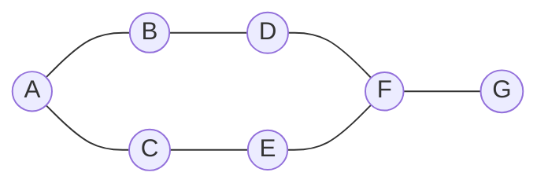
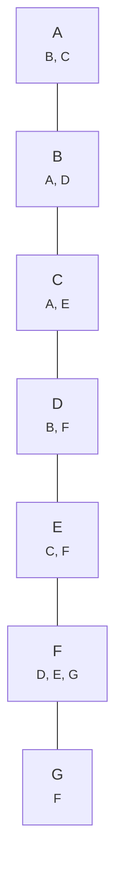

# Graphs: representations, BFS and DFS

> Data Structures & Algorithms · L2 Proficient · Graphs & union-find · about 110 min · hub module `m05` ([open the hub](https://claude.ai/artifact/DQhszKFoe8qbiNbSpWkqM5))

## Why it matters
Maps, social networks, package dependencies and game grids are all graphs. Breadth-first and depth-first search are the two moves behind most graph problems, from “can I get there?” to “what's the fewest number of hops?”.

## Pre-question (answer before reading)
**Q:** On a map where every road takes 1 hour, how could you find the fewest hours from home to the beach without trying every route?

<details><summary>Answer</summary>

Explore in rings: first every town 1 hour away, then every town 2 hours away, and so on. The first time a ring reaches the beach, you've found the fewest hours. That's breadth-first search.

</details>

## 🍎 Story time (kid version)
**The toy room and the treasure-map road trip: Ripples on the road map**

Ben drops a pebble on the road-trip map at their home town, and ripples spread out: first to every town one road away, then to the towns two roads away, then three. The first ripple that touches the beach town tells him the fewest roads they need. Tara explores differently: she follows one road as far as it goes, and only at a dead end does she walk back to the last junction and try another road. Both of them tick off each town they visit, so they never go round in circles.

| In the story | In code |
|---|---|
| Towns and roads on the map | Vertices (nodes) and edges |
| Ripples: towns 1 road away, then 2, then 3 | BFS with a queue, layer by layer |
| The first ripple to touch the beach | BFS finds the fewest edges in an unweighted graph |
| Tara following one road to a dead end, then backing up | DFS with recursion or a stack |
| Ticking off visited towns | A visited set, so each vertex is processed once |

**Where the story breaks:** Real roads take different times, so “fewest roads” isn't the same as “fastest trip”: weighted graphs need Dijkstra's algorithm (L3). And unlike most maps, many graphs are directed: a one-way street only goes one way.

## Key ideas (grown-up version)
- **A graph** is vertices (nodes) plus edges (connections). Edges can be **directed** (one-way) or **undirected**, **weighted** or not. A tree is a connected graph with no cycles.
- **Adjacency list** (a dict/Map from each vertex to its neighbours) is the default: O(V + E) memory. An **adjacency matrix** (V × V) answers “is there an edge?” in O(1) but needs O(V²) memory, so it suits small, dense graphs.
- **BFS** uses a queue and a visited set and explores in layers, so in an unweighted graph the first visit to a vertex is by the fewest edges. O(V + E).
- **DFS** uses recursion or an explicit stack: go deep, back up at dead ends. It suits reachability, counting connected components, cycle detection and topological order (next module). O(V + E).
- **In BFS, mark a vertex visited when you enqueue it**, not when you pop it, or the same vertex can be queued many times.
- **Grids are graphs**: each cell is a vertex and its up/down/left/right neighbours are edges. Loop over a direction list and check the bounds. Number of Islands is “count the DFS starts”.
- **Connected components**: loop over every vertex; each unvisited one starts a new BFS/DFS and adds one to the count.
- **Multi-source BFS**: put several starting vertices in the queue at distance 0 (every rotten orange, every exit) to get each vertex's distance to the nearest source in one pass.

## Diagrams
**BFS from A: layers {A}, {B, C}, {D, E}, {F}, {G}**



_A shortest path from A to G uses 4 edges (highlighted). BFS finds it because it finishes every layer before starting the next._

**The same graph as an adjacency list**



## Comparisons
**BFS or DFS?**

|  | BFS | DFS |
|---|---|---|
| Structure | Queue (first in, first out) | Stack or recursion (last in, first out) |
| Order | Layer by layer from the start | As deep as possible, then back up |
| Fewest edges (unweighted) | Yes: the first visit is by the fewest edges | No |
| Typical uses | Fewest moves, levels, distances from many sources | Reachability, components, cycles, topological order, backtracking |
| Extra space | O(V): the widest layer | O(V): the deepest path (recursion can hit stack limits) |
| Time | O(V + E) | O(V + E) |

## Code (JavaScript + Python)
### Adjacency list, BFS distance and the path
```python
from collections import deque, defaultdict

edges = [("A", "B"), ("A", "C"), ("B", "D"), ("C", "E"), ("D", "F"), ("E", "F"), ("F", "G")]
graph = defaultdict(list)
for u, v in edges:                       # undirected: store both directions
    graph[u].append(v)
    graph[v].append(u)

def bfs(start, goal):
    dist, parent = {start: 0}, {start: None}
    q = deque([start])
    while q:
        u = q.popleft()
        if u == goal:
            break
        for v in graph[u]:
            if v not in dist:            # mark when enqueued, not when popped
                dist[v] = dist[u] + 1
                parent[v] = u
                q.append(v)
    if goal not in dist:                 # the goal can't be reached
        return -1, []
    path, node = [], goal
    while node is not None:              # follow the parent links back to the start
        path.append(node)
        node = parent[node]
    return dist[goal], path[::-1]

steps, path = bfs("A", "G")
print(steps, "-".join(path))
```

Output:
```text
4 A-B-D-F-G
```

- line 5: An undirected edge goes into both vertices' lists.
- line 17: `dist` doubles as the visited set: a vertex gets a distance the moment it's queued.
- line 21: Without this check, rebuilding the path for an unreachable goal fails: a KeyError in Python, an endless loop in JavaScript.
- line 24: Storing each vertex's parent lets you rebuild the path, not just its length.

```javascript
const edges = [["A", "B"], ["A", "C"], ["B", "D"], ["C", "E"], ["D", "F"], ["E", "F"], ["F", "G"]];
const graph = new Map();
for (const [u, v] of edges) {            // undirected: store both directions
  if (!graph.has(u)) graph.set(u, []);
  if (!graph.has(v)) graph.set(v, []);
  graph.get(u).push(v);
  graph.get(v).push(u);
}

function bfs(start, goal) {
  const dist = new Map([[start, 0]]), parent = new Map([[start, null]]);
  const q = [start];
  for (let head = 0; head < q.length; head++) {
    const u = q[head];
    if (u === goal) break;
    for (const v of graph.get(u)) {
      if (!dist.has(v)) {                // mark when enqueued, not when popped
        dist.set(v, dist.get(u) + 1);
        parent.set(v, u);
        q.push(v);
      }
    }
  }
  if (!dist.has(goal)) return [-1, []];  // the goal can't be reached
  const path = [];
  for (let node = goal; node !== null; node = parent.get(node)) path.push(node);   // back to the start
  return [dist.get(goal), path.reverse()];
}

const [steps, path] = bfs("A", "G");
console.log(steps, path.join("-"));
```

Output:
```text
4 A-B-D-F-G
```

- line 13: A head index makes the array an O(1) queue, with no `shift()`.
- line 24: Without this check, `parent.get` returns undefined for an unreachable goal, and the loop below never ends.

### DFS: count connected components (recursive and with a stack)
```python
def build(n, edges):
    graph = [[] for _ in range(n)]
    for u, v in edges:
        graph[u].append(v)
        graph[v].append(u)
    return graph

def components_recursive(n, edges):
    graph, seen = build(n, edges), [False] * n
    def dfs(u):
        seen[u] = True
        for v in graph[u]:
            if not seen[v]:
                dfs(v)
    count = 0
    for u in range(n):
        if not seen[u]:                  # a new component starts here
            count += 1
            dfs(u)
    return count

def components_stack(n, edges):          # the same, with an explicit stack
    graph, seen, count = build(n, edges), [False] * n, 0
    for s in range(n):
        if seen[s]:
            continue
        count += 1
        seen[s] = True
        stack = [s]
        while stack:
            u = stack.pop()
            for v in graph[u]:
                if not seen[v]:
                    seen[v] = True
                    stack.append(v)
    return count

edges = [(0, 1), (1, 2), (3, 4)]
print(components_recursive(6, edges), components_stack(6, edges))
```

Output:
```text
3 3
```

- line 17: Each time the outer loop finds an unvisited vertex, a whole new component is waiting to be explored.
- line 29: The stack version has no recursion limit, so it's the safe choice for big graphs.

```javascript
function build(n, edges) {
  const graph = Array.from({ length: n }, () => []);
  for (const [u, v] of edges) {
    graph[u].push(v);
    graph[v].push(u);
  }
  return graph;
}

function componentsRecursive(n, edges) {
  const graph = build(n, edges), seen = new Array(n).fill(false);
  const dfs = u => {
    seen[u] = true;
    for (const v of graph[u]) if (!seen[v]) dfs(v);
  };
  let count = 0;
  for (let u = 0; u < n; u++) {
    if (!seen[u]) {                      // a new component starts here
      count++;
      dfs(u);
    }
  }
  return count;
}

function componentsStack(n, edges) {     // the same, with an explicit stack
  const graph = build(n, edges), seen = new Array(n).fill(false);
  let count = 0;
  for (let s = 0; s < n; s++) {
    if (seen[s]) continue;
    count++;
    seen[s] = true;
    const stack = [s];
    while (stack.length) {
      const u = stack.pop();
      for (const v of graph[u]) {
        if (!seen[v]) {
          seen[v] = true;
          stack.push(v);
        }
      }
    }
  }
  return count;
}

const edges = [[0, 1], [1, 2], [3, 4]];
console.log(componentsRecursive(6, edges), componentsStack(6, edges));
```

Output:
```text
3 3
```

- line 18: Each time the outer loop finds an unvisited vertex, a whole new component is waiting to be explored.

### Grids are graphs: number of islands
```python
def num_islands(grid):
    rows, cols = len(grid), len(grid[0])
    seen = set()
    def sink(r, c):                      # DFS over one island
        if r < 0 or r >= rows or c < 0 or c >= cols or grid[r][c] != "1" or (r, c) in seen:
            return
        seen.add((r, c))
        for dr, dc in ((1, 0), (-1, 0), (0, 1), (0, -1)):
            sink(r + dr, c + dc)
    islands = 0
    for r in range(rows):
        for c in range(cols):
            if grid[r][c] == "1" and (r, c) not in seen:
                islands += 1
                sink(r, c)
    return islands

grid = ["11000",
        "11000",
        "00100",
        "00011"]
print(num_islands(grid))
```

Output:
```text
3
```

- line 5: Check the bounds first; the other conditions would fail (or wrap around) outside the grid.
- line 8: Four directions: up, down, left, right. Add the diagonals for 8-connected grids.

```javascript
function numIslands(grid) {
  const rows = grid.length, cols = grid[0].length;
  const seen = new Set();
  const sink = (r, c) => {               // DFS over one island
    if (r < 0 || r >= rows || c < 0 || c >= cols || grid[r][c] !== "1" || seen.has(r * cols + c)) return;
    seen.add(r * cols + c);              // one number per cell: row * cols + col
    for (const [dr, dc] of [[1, 0], [-1, 0], [0, 1], [0, -1]]) sink(r + dr, c + dc);
  };
  let islands = 0;
  for (let r = 0; r < rows; r++)
    for (let c = 0; c < cols; c++)
      if (grid[r][c] === "1" && !seen.has(r * cols + c)) {
        islands++;
        sink(r, c);
      }
  return islands;
}

const grid = ["11000",
              "11000",
              "00100",
              "00011"];
console.log(numIslands(grid));
```

Output:
```text
3
```

- line 6: A Set of `[r, c]` arrays wouldn't work (arrays compare by identity), so encode each cell as one number.

## Worked example
**Problem.** A lock has 4 wheels showing “0000”. One move turns one wheel up or down by 1 (9 wraps to 0 and back). Avoiding the `deadends`, what's the fewest moves to reach `target`? Return −1 if impossible (LeetCode 752, Open the Lock).

1. The states are the 10,000 combinations “0000” to “9999”, and each connects to 8 neighbours (4 wheels × up or down). It's an implicit graph: you generate the neighbours as you go.
2. Every move costs 1, so BFS from “0000” finds the fewest moves.
3. Never enqueue a dead end, and mark each state as seen when you enqueue it.
4. At most 10,000 states with 8 neighbours each: a fixed amount of work for this puzzle. In general, BFS is O(V + E).

```python
from collections import deque

def open_lock(deadends, target):
    dead = set(deadends)
    if "0000" in dead:
        return -1
    q, seen = deque([("0000", 0)]), {"0000"}
    while q:
        state, moves = q.popleft()
        if state == target:
            return moves
        for i in range(4):
            d = int(state[i])
            for step in (1, -1):         # turn wheel i up or down
                nxt = state[:i] + str((d + step) % 10) + state[i + 1:]
                if nxt not in seen and nxt not in dead:
                    seen.add(nxt)
                    q.append((nxt, moves + 1))
    return -1

print(open_lock(["0201", "0101", "0102", "1212", "2002"], "0202"),
      open_lock(["8888"], "0009"),
      open_lock(["8887", "8889", "8878", "8898", "8788", "8988", "7888", "9888"], "8888"))
```

Output:
```text
6 1 -1
```

```javascript
function openLock(deadends, target) {
  const dead = new Set(deadends);
  if (dead.has("0000")) return -1;
  const q = [["0000", 0]], seen = new Set(["0000"]);
  for (let head = 0; head < q.length; head++) {
    const [state, moves] = q[head];
    if (state === target) return moves;
    for (let i = 0; i < 4; i++) {
      const d = Number(state[i]);
      for (const step of [1, -1]) {      // turn wheel i up or down
        const nxt = state.slice(0, i) + ((d + step + 10) % 10) + state.slice(i + 1);
        if (!seen.has(nxt) && !dead.has(nxt)) {
          seen.add(nxt);
          q.push([nxt, moves + 1]);
        }
      }
    }
  }
  return -1;
}

console.log(openLock(["0201", "0101", "0102", "1212", "2002"], "0202"),
            openLock(["8888"], "0009"),
            openLock(["8887", "8889", "8878", "8898", "8788", "8988", "7888", "9888"], "8888"));
```

Output:
```text
6 1 -1
```

**Answer.** 6, 1 and −1. In the last case every neighbour of 8888 is a dead end, so it can't be reached. Note the JavaScript `(d + step + 10) % 10`: in JavaScript `-1 % 10` is −1, while Python's `%` already wraps to 9.

## Your turn (faded example)
**Problem.** Flood fill: starting from cell (sr, sc), repaint its connected region of the same colour (up, down, left, right) with `new_color`.

- ✓ The region is a connected component of the grid graph.
- **What should happen if `new_color` equals the starting colour?**
  <details><summary>Answer</summary>Nothing needs to change, so return straight away; otherwise you'd keep repainting the same cells forever.</details>
- **Which cells does the search move to?**
  <details><summary>Answer</summary>In-bounds up/down/left/right neighbours that still have the starting colour.</details>
- **Time and space?**
  <details><summary>Answer</summary>O(rows × cols) time, and O(rows × cols) for the stack in the worst case.</details>

Starter:
```python
def flood_fill(image, sr, sc, new_color):
    start = image[sr][sc]
    if start == new_color:
        return image
    rows, cols = len(image), len(image[0])
    stack = [(sr, sc)]
    while stack:
        r, c = stack.pop()
        if 0 <= r < rows and 0 <= c < cols and image[r][c] == start:
            ...    # TODO: paint (r, c), then push its four neighbours
    return image

print(flood_fill([[1, 1, 1], [1, 1, 0], [1, 0, 1]], 1, 1, 2))   # expect [[2, 2, 2], [2, 2, 0], [2, 0, 1]]
```

```javascript
function floodFill(image, sr, sc, newColor) {
  const start = image[sr][sc];
  if (start === newColor) return image;
  const rows = image.length, cols = image[0].length;
  const stack = [[sr, sc]];
  while (stack.length) {
    const [r, c] = stack.pop();
    if (r >= 0 && r < rows && c >= 0 && c < cols && image[r][c] === start) {
      // TODO: paint (r, c), then push its four neighbours
    }
  }
  return image;
}

console.log(floodFill([[1, 1, 1], [1, 1, 0], [1, 0, 1]], 1, 1, 2));   // expect [[2, 2, 2], [2, 2, 0], [2, 0, 1]]
```

<details><summary>Full solution</summary>

```python
def flood_fill(image, sr, sc, new_color):
    start = image[sr][sc]
    if start == new_color:
        return image
    rows, cols = len(image), len(image[0])
    stack = [(sr, sc)]
    while stack:
        r, c = stack.pop()
        if 0 <= r < rows and 0 <= c < cols and image[r][c] == start:
            image[r][c] = new_color          # painting also marks it as visited
            stack += [(r + 1, c), (r - 1, c), (r, c + 1), (r, c - 1)]
    return image

result = flood_fill([[1, 1, 1], [1, 1, 0], [1, 0, 1]], 1, 1, 2)
print(*("".join(map(str, row)) for row in result))
```

Output:
```text
222 220 201
```

```javascript
function floodFill(image, sr, sc, newColor) {
  const start = image[sr][sc];
  if (start === newColor) return image;
  const rows = image.length, cols = image[0].length;
  const stack = [[sr, sc]];
  while (stack.length) {
    const [r, c] = stack.pop();
    if (r >= 0 && r < rows && c >= 0 && c < cols && image[r][c] === start) {
      image[r][c] = newColor;                // painting also marks it as visited
      stack.push([r + 1, c], [r - 1, c], [r, c + 1], [r, c - 1]);
    }
  }
  return image;
}

const result = floodFill([[1, 1, 1], [1, 1, 0], [1, 0, 1]], 1, 1, 2);
console.log(...result.map(row => row.join("")));
```

Output:
```text
222 220 201
```

</details>

## Socratic checks and quiz (answers hidden)
**1. What does this print?**

```python
from collections import deque

graph = {1: [2, 3], 2: [4], 3: [4, 5], 4: [6], 5: [6], 6: []}
order, seen, q = [], {1}, deque([1])
while q:
    u = q.popleft()
    order.append(u)
    for v in graph[u]:
        if v not in seen:
            seen.add(v)
            q.append(v)
print(*order)
```

```javascript
const graph = new Map([[1, [2, 3]], [2, [4]], [3, [4, 5]], [4, [6]], [5, [6]], [6, []]]);
const order = [], seen = new Set([1]), q = [1];
for (let head = 0; head < q.length; head++) {
  const u = q[head];
  order.push(u);
  for (const v of graph.get(u)) {
    if (!seen.has(v)) {
      seen.add(v);
      q.push(v);
    }
  }
}
console.log(...order);
```

- A. 1 2 3 4 5 6
- B. 1 2 4 6 3 5
- C. 1 3 5 6 4 2
- D. 6 4 5 2 3 1

<details><summary>Answer</summary>

1 2 3 4 5 6. Layer 0 is 1; layer 1 is 2, 3; layer 2 is 4, 5; layer 3 is 6. The second option is the depth-first order.

</details>

**2. What does this print?**

```python
graph = {1: [2, 3], 2: [4], 3: [4, 5], 4: [6], 5: [6], 6: []}
order, seen = [], set()

def dfs(u):
    seen.add(u)
    order.append(u)
    for v in graph[u]:
        if v not in seen:
            dfs(v)

dfs(1)
print(*order)
```

```javascript
const graph = new Map([[1, [2, 3]], [2, [4]], [3, [4, 5]], [4, [6]], [5, [6]], [6, []]]);
const order = [], seen = new Set();
function dfs(u) {
  seen.add(u);
  order.push(u);
  for (const v of graph.get(u)) if (!seen.has(v)) dfs(v);
}
dfs(1);
console.log(...order);
```

- A. 1 2 4 6 3 5
- B. 1 2 3 4 5 6
- C. 1 3 5 6 4 2
- D. 6 4 2 5 3 1

<details><summary>Answer</summary>

1 2 4 6 3 5. DFS goes 1 → 2 → 4 → 6, backs up to 1, then visits 3 and 5; 4 and 6 are already seen.

</details>

**3. Every road takes the same time. You need the fewest roads from town A to town Z. Which algorithm?**

- A. BFS from A
- B. DFS from A
- C. Sorting the roads by length
- D. Union-find

<details><summary>Answer</summary>

BFS from A. With equal costs, BFS's layers give the fewest edges. DFS may find a long route first, and union-find only answers “connected or not”.

</details>

**4. Which tasks suit DFS well? (choose 3)**

- A. Counting connected components
- B. Detecting a cycle
- C. Listing every path through a small maze
- D. The fewest moves in an unweighted maze
- E. Each cell's distance to its nearest exit

<details><summary>Answer</summary>

Counting connected components, Detecting a cycle, Listing every path through a small maze. The last two are distance questions: BFS and multi-source BFS.

</details>

**5. Judge each statement.**

- An adjacency matrix for 100,000 vertices needs about 10 billion cells.
- BFS should mark vertices visited when they're enqueued.
- DFS finds the shortest path in an unweighted graph.
- A grid can be treated as a graph whose vertices are cells.

<details><summary>Answer</summary>

An adjacency matrix for 100,000 vertices needs about 10 billion cells.: Yes; BFS should mark vertices visited when they're enqueued.: Yes; DFS finds the shortest path in an unweighted graph.: No; A grid can be treated as a graph whose vertices are cells.: Yes. 100,000² = 10¹⁰. Mark on enqueue. DFS gives a path, not the shortest. Cells are vertices; neighbouring cells are edges.

</details>

**6. Put the BFS steps in order.**

- (put the steps in order)

<details><summary>Answer</summary>

Put the start in the queue and mark it visited → Take the vertex at the front of the queue → For each unvisited neighbour, mark it visited and add it to the back → Repeat until the queue is empty or the goal is reached. Mark-on-enqueue is in step 1 and step 3.

</details>

**7. Complete the JavaScript island counter (an explicit stack, cells encoded as r × C + c).**

```
function numIslands(grid) {
  const R = grid.length, C = grid[0].length, seen = new Set();
  let islands = 0;
  for (let r = 0; r < R; r++)
    for (let c = 0; c < C; c++) {
      if (grid[r][c] !== "1" || seen.has(r * C + c)) continue;
      islands++;
      const stack = [[r, c]];
      seen.add(r * C + c);
      while (stack.length) {
        const [y, x] = stack.{{0}}();
        for (const [dy, dx] of [[1, 0], [-1, 0], [0, 1], [0, -1]]) {
          const ny = y + dy, nx = x + dx;
          if (ny < 0 || ny >= R || nx < 0 || nx >= {{1}}) continue;
          if (grid[ny][nx] === "1" && !seen.has(ny * C + nx)) {
            seen.add({{2}});
            stack.push([ny, nx]);
          }
        }
      }
    }
  return islands;
}

```

<details><summary>Answer</summary>

pop | C | ny * C + nx. Pop from the stack, check the column against C (the number of columns), and mark the neighbour's own key, ny × C + nx, before pushing it.

</details>

**8. Match each question to the technique.**


<details><summary>Answer</summary>

The fewest moves for a knight on a chessboard = BFS; Is there any route from A to B at all? = BFS or DFS: either works; Every cell's distance to its nearest exit = Multi-source BFS; How many separate friend groups are there? = Count connected components. Distances need BFS; plain reachability works with either search; groups are components.

</details>

## Traps & misconceptions
- **“Mark a vertex visited when you pop it from the BFS queue.”** Then different neighbours can queue the same vertex many times before it's popped, wasting time and memory. Mark it when you enqueue it.
- **“BFS finds the shortest path in any graph.”** Only when every edge costs the same. With weights, the fewest edges isn't the cheapest route: use Dijkstra (L3).
- **“Recursive DFS is fine on big grids.”** A 300 × 300 grid of land is a 90,000-deep recursion: far past Python's limit and risky in JavaScript. Use an explicit stack or BFS for big inputs.
- **“An undirected edge only needs to be stored once.”** In an adjacency list, add it in both directions (u → v and v → u), or half the neighbours go missing.
- **“Forgetting the visited set only makes the search slower.”** On any graph with a cycle, including every undirected edge (u → v → u), the search never ends.
- **“In JavaScript, `(d - 1) % 10` wraps 0 to 9 like Python.”** JavaScript's `%` keeps the sign, so `-1 % 10` is −1. Write `(d - 1 + 10) % 10`.

## Discussion prompts
- **Adjacency list or adjacency matrix: how do you choose?**
  <details><summary>One good answer</summary>Lists use O(V + E) memory and let you loop over a vertex's actual neighbours, which suits most sparse real-world graphs. A matrix uses O(V²) memory but answers “is there an edge u–v?” in O(1), which suits small, dense graphs.</details>
- **Why does BFS give the fewest edges but DFS doesn't?**
  <details><summary>One good answer</summary>BFS reaches every vertex at distance k before any vertex at distance k + 1, so the first arrival is by the fewest edges. DFS may wander down a long route first and reach the goal the long way round.</details>

## Teach-back
**Prompt:** Explain to a junior colleague how BFS finds the fewest moves in an unweighted graph, and what the visited set is for.

Rubric:
- [ ] A queue processes vertices in the order they were discovered, layer by layer
- [ ] The source starts at distance 0; each new neighbour gets the current distance + 1
- [ ] The first visit to a vertex uses the fewest edges, because every edge costs the same
- [ ] The visited set (marked on enqueue) prevents repeats and infinite loops
- [ ] O(V + E) time and O(V) space

<details><summary>Model answer</summary>

BFS keeps a queue of vertices to explore. It starts with the source at distance 0, then repeatedly takes the vertex at the front and adds each unvisited neighbour to the back with a distance one higher. Because the queue is first in, first out, every vertex at distance k is processed before any vertex at distance k + 1, so the first time you reach a vertex you've used the fewest possible edges, as long as every edge costs the same. The visited set, updated as each vertex is enqueued, makes sure every vertex is added only once, which stops infinite loops on cycles and keeps the total work at O(V + E).

</details>

## Quick Q&A (also in the SRS deck)
- **Adjacency list vs adjacency matrix memory?** List O(V + E); matrix O(V²).
- **Which search finds the fewest edges in an unweighted graph?** BFS: it explores in layers, so the first visit uses the fewest edges.
- **When should BFS mark a vertex visited?** When it's enqueued, so it can't be added twice.
- **How do you count connected components?** Loop over every vertex; each unvisited one starts a new BFS/DFS and adds 1 to the count.
- **Time complexity of BFS and DFS on an adjacency list?** O(V + E).
- **What is multi-source BFS?** BFS that starts with several sources in the queue at distance 0, giving every vertex its distance to the nearest source.

## Practice problems
- [ ] [LC 200 · Number of Islands](https://leetcode.com/problems/number-of-islands/) · Medium · the code above, from memory; then a BFS version
- [ ] [LC 695 · Max Area of Island](https://leetcode.com/problems/max-area-of-island/) · Medium · a DFS that returns the island's size
- [ ] [LC 133 · Clone Graph](https://leetcode.com/problems/clone-graph/) · Medium · BFS or DFS with a map from each node to its copy
- [ ] [LC 994 · Rotting Oranges](https://leetcode.com/problems/rotting-oranges/) · Medium · multi-source BFS from every rotten orange
- [ ] [LC 417 · Pacific Atlantic Water Flow](https://leetcode.com/problems/pacific-atlantic-water-flow/) · Medium · search backwards from each ocean's edge
- [ ] [LC 130 · Surrounded Regions](https://leetcode.com/problems/surrounded-regions/) · Medium · mark the O's connected to the border first
- [ ] [LC 1971 · Find if Path Exists in Graph](https://leetcode.com/problems/find-if-path-exists-in-graph/) · Easy · BFS, DFS or union-find
- [ ] [LC 841 · Keys and Rooms](https://leetcode.com/problems/keys-and-rooms/) · Medium · DFS from room 0
- [ ] [LC 1091 · Shortest Path in Binary Matrix](https://leetcode.com/problems/shortest-path-in-binary-matrix/) · Medium · BFS with 8 directions
- [ ] [LC 785 · Is Graph Bipartite?](https://leetcode.com/problems/is-graph-bipartite/) · Medium · BFS 2-colouring of every component
- [ ] [LC 127 · Word Ladder](https://leetcode.com/problems/word-ladder/) · Hard · BFS over words; neighbours differ by one letter

## Sources (accessed 2026-10-09)
- [MIT 6.006 Introduction to Algorithms (Spring 2020): breadth-first and depth-first search](https://ocw.mit.edu/courses/6-006-introduction-to-algorithms-spring-2020/)
- [USACO Guide: Graph traversal](https://usaco.guide/silver/graph-traversal)
- [cp-algorithms: Breadth-first search](https://cp-algorithms.com/graph/breadth-first-search.html)
- [cp-algorithms: Depth-first search](https://cp-algorithms.com/graph/depth-first-search.html)
