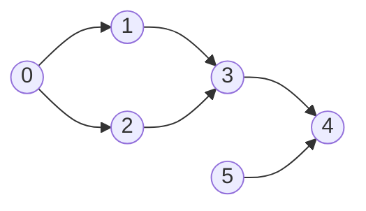
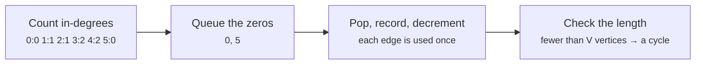

# Topological sort and cycle detection

> Data Structures & Algorithms · L2 Proficient · Graphs & union-find · about 100 min · hub module `m06` ([open the hub](https://claude.ai/artifact/DQhszKFoe8qbiNbSpWkqM5))

## Why it matters
Build systems, course prerequisites, spreadsheet formulas and package managers all need an order in which every task comes after the things it depends on, and they must notice when dependencies go round in a circle.

## Pre-question (answer before reading)
**Q:** To get dressed, socks go on before shoes and trousers before shoes. Which item can you always put on first, and how do you know?

<details><summary>Answer</summary>

Anything with no unmet prerequisites (socks or trousers). Repeatedly doing a task whose prerequisites are all done, then crossing it off, gives a valid order. That's Kahn's topological sort.

</details>

## 🍎 Story time (kid version)
**The toy room and the treasure-map road trip: Getting ready for the road trip**

Before the road trip, Ben has a list of jobs: pack the bags, load the car, buy snacks, fill the tank. Some jobs must wait for others: the car can't be loaded until the bags are packed. Tara writes on each job how many jobs it's still waiting for. Any job with a zero can start now. When a job is done, she crosses it off and lowers the number on every job that was waiting for it. One day Ben writes “load the car before packing” and “pack before loading the car”: both jobs wait for each other forever, so neither number ever reaches zero.

| In the story | In code |
|---|---|
| Jobs and “must happen before” arrows (pack the bags → load the car) | A directed graph: an edge u → v means u comes before v |
| How many jobs each one is still waiting for | In-degree: the number of incoming edges |
| Starting any job whose number is zero | Kahn's algorithm: a queue of in-degree-0 vertices |
| Two jobs waiting for each other forever | A cycle: no valid order exists, and some in-degrees never reach 0 |

**Where the story breaks:** Ben and Tara can do several jobs at the same time, but Kahn's algorithm takes one job at a time off the queue. Processing the queue in rounds (every zero at once) shows which jobs could run in parallel, which is how build tools speed things up.

## Key ideas (grown-up version)
- **A topological order** of a directed graph lists its vertices so that every edge u → v has u before v. One exists if and only if the graph has no directed cycle, that is, it's a **DAG** (directed acyclic graph).
- **Kahn's algorithm (BFS)**: count in-degrees; queue every vertex with in-degree 0; repeatedly pop one into the order and decrement its neighbours' in-degrees, queueing any that reach 0. O(V + E).
- **Cycle detection comes free**: if Kahn's order ends with fewer than V vertices, the rest are in a cycle or wait on one.
- **DFS version**: run DFS and add each vertex to a list *after* all its descendants are finished (postorder). The reversed list is a topological order.
- **Directed cycles with DFS colours**: white = unvisited, grey = on the current path, black = finished. Reaching a grey vertex is a back edge, which means a cycle. Reaching a black vertex is not.
- **Undirected cycles are different**: the edge you arrived by is stored both ways, so it leads straight back to your parent. Skip the parent; any other visited neighbour means a cycle (or use union-find, next module).
- **Get the edge direction right**: for “to take course a you must first take b”, the edge is b → a. Backwards edges give a reversed order.
- **Orders aren't unique**: swap the queue for a min-heap to get the lexicographically smallest order. Python 3.9+ also ships `graphlib.TopologicalSorter`.

## Diagrams
**A DAG: Kahn's algorithm gives 0 5 1 2 3 4**



_0 and 5 have no incoming edges, so they start in the queue. 3 waits for both 1 and 2; 4 waits for 3 and 5._

**Kahn's algorithm**



## Comparisons
**Two ways to sort topologically**

|  | Kahn's (BFS on in-degrees) | DFS postorder, reversed |
|---|---|---|
| Idea | Repeatedly take a vertex with no remaining prerequisites | Finish a vertex after all its descendants, then reverse |
| Cycle detection | The order is shorter than V | Reaching a grey (in-progress) vertex |
| Recursion | None | Recursive, or an explicit stack |
| Smallest-first order | Easy: use a min-heap | Awkward |
| Time / extra space | O(V + E) / O(V) beyond the graph | O(V + E) / O(V) beyond the graph |

## Code (JavaScript + Python)
### Kahn's algorithm, with a cycle check
```python
from collections import deque

def topo_sort(n, edges):                    # edge (u, v): u must come before v
    graph = [[] for _ in range(n)]
    indeg = [0] * n
    for u, v in edges:
        graph[u].append(v)
        indeg[v] += 1
    q = deque(i for i in range(n) if indeg[i] == 0)
    order = []
    while q:
        u = q.popleft()
        order.append(u)
        for v in graph[u]:
            indeg[v] -= 1                    # one prerequisite done
            if indeg[v] == 0:
                q.append(v)
    return order if len(order) == n else None   # None: there's a cycle

print(*topo_sort(6, [(0, 1), (0, 2), (1, 3), (2, 3), (3, 4), (5, 4)]))
print("cycle" if topo_sort(3, [(0, 1), (1, 2), (2, 0)]) is None else "ok")
```

Output:
```text
0 5 1 2 3 4
cycle
```

- line 8: In-degree = how many prerequisites a vertex is still waiting for.
- line 18: In a cycle nobody's in-degree reaches 0, so those vertices never enter the order.

```javascript
function topoSort(n, edges) {               // edge [u, v]: u must come before v
  const graph = Array.from({ length: n }, () => []);
  const indeg = new Array(n).fill(0);
  for (const [u, v] of edges) {
    graph[u].push(v);
    indeg[v]++;
  }
  const q = [];
  for (let i = 0; i < n; i++) if (indeg[i] === 0) q.push(i);
  const order = [];
  for (let head = 0; head < q.length; head++) {
    const u = q[head];
    order.push(u);
    for (const v of graph[u]) {
      indeg[v]--;                            // one prerequisite done
      if (indeg[v] === 0) q.push(v);
    }
  }
  return order.length === n ? order : null;  // null: there's a cycle
}

console.log(...topoSort(6, [[0, 1], [0, 2], [1, 3], [2, 3], [3, 4], [5, 4]]));
console.log(topoSort(3, [[0, 1], [1, 2], [2, 0]]) === null ? "cycle" : "ok");
```

Output:
```text
0 5 1 2 3 4
cycle
```

- line 16: In-degree 0 means every prerequisite is done: the vertex can join the queue.

### DFS postorder, with colours for cycle detection
```python
def topo_dfs(n, edges):
    graph = [[] for _ in range(n)]
    for u, v in edges:
        graph[u].append(v)
    WHITE, GREY, BLACK = 0, 1, 2
    color, post = [WHITE] * n, []

    def dfs(u):                              # returns False if a cycle is found
        color[u] = GREY                      # on the current path
        for v in graph[u]:
            if color[v] == GREY:
                return False                 # a back edge: a cycle
            if color[v] == WHITE and not dfs(v):
                return False
        color[u] = BLACK                     # finished
        post.append(u)                       # after all its descendants
        return True

    for u in range(n):
        if color[u] == WHITE and not dfs(u):
            return None
    return post[::-1]

print(*topo_dfs(6, [(0, 1), (0, 2), (1, 3), (2, 3), (3, 4), (5, 4)]))
print("cycle" if topo_dfs(3, [(0, 1), (1, 2), (2, 0)]) is None else "ok")
```

Output:
```text
5 0 2 1 3 4
cycle
```

- line 11: Grey means “still on the current path”: reaching it again closes a loop.
- line 16: A vertex is appended only after everything reachable from it, so the reversed list puts it before all of them.

```javascript
function topoDfs(n, edges) {
  const graph = Array.from({ length: n }, () => []);
  for (const [u, v] of edges) graph[u].push(v);
  const WHITE = 0, GREY = 1, BLACK = 2;
  const color = new Array(n).fill(WHITE), post = [];

  function dfs(u) {                          // returns false if a cycle is found
    color[u] = GREY;                         // on the current path
    for (const v of graph[u]) {
      if (color[v] === GREY) return false;   // a back edge: a cycle
      if (color[v] === WHITE && !dfs(v)) return false;
    }
    color[u] = BLACK;                        // finished
    post.push(u);                            // after all its descendants
    return true;
  }

  for (let u = 0; u < n; u++) if (color[u] === WHITE && !dfs(u)) return null;
  return post.reverse();
}

console.log(...topoDfs(6, [[0, 1], [0, 2], [1, 3], [2, 3], [3, 4], [5, 4]]));
console.log(topoDfs(3, [[0, 1], [1, 2], [2, 0]]) === null ? "cycle" : "ok");
```

Output:
```text
5 0 2 1 3 4
cycle
```

- line 10: Grey means “still on the current path”: reaching it again closes a loop.
- line 19: A different valid order from Kahn's: topological orders aren't unique.

## Worked example
**Problem.** Given packages and “a depends on b” pairs, return a build order, or report which packages are stuck because of a cycle.

1. “a depends on b” means b must build first, so the edge is b → a. Getting this direction wrong reverses the order.
2. Count each package's in-degree (how many packages it still waits for) and queue those with 0.
3. Pop a package into the order and lower the in-degree of everything that depends on it; queue any that reach 0.
4. Anything left with in-degree > 0 is in a cycle or waits on one. O(V + E) time; O(V) extra space beyond the graph itself.

```python
from collections import deque, defaultdict

def build_order(packages, depends_on):        # (a, b): a depends on b, so b builds first
    graph, indeg = defaultdict(list), {p: 0 for p in packages}
    for a, b in depends_on:
        graph[b].append(a)                    # edge b -> a
        indeg[a] += 1
    q = deque(p for p in packages if indeg[p] == 0)
    order = []
    while q:
        p = q.popleft()
        order.append(p)
        for nxt in graph[p]:
            indeg[nxt] -= 1
            if indeg[nxt] == 0:
                q.append(nxt)
    stuck = [p for p in packages if indeg[p] > 0]   # in a cycle, or waiting on one
    return order, stuck

order, stuck = build_order(["app", "api", "db", "utils", "ui"],
                           [("app", "api"), ("app", "ui"), ("api", "db"), ("api", "utils"), ("ui", "utils")])
print(" -> ".join(order) or "(nothing)", "| stuck:", " ".join(stuck) or "none")
order, stuck = build_order(["a", "b", "c", "d"], [("a", "b"), ("b", "c"), ("c", "b"), ("d", "a")])
print(" -> ".join(order) or "(nothing)", "| stuck:", " ".join(stuck) or "none")
```

Output:
```text
db -> utils -> api -> ui -> app | stuck: none
(nothing) | stuck: a b c d
```

```javascript
function buildOrder(packages, dependsOn) {    // [a, b]: a depends on b, so b builds first
  const graph = new Map(packages.map(p => [p, []]));
  const indeg = new Map(packages.map(p => [p, 0]));
  for (const [a, b] of dependsOn) {
    graph.get(b).push(a);                     // edge b -> a
    indeg.set(a, indeg.get(a) + 1);
  }
  const q = packages.filter(p => indeg.get(p) === 0), order = [];
  for (let head = 0; head < q.length; head++) {
    const p = q[head];
    order.push(p);
    for (const nxt of graph.get(p)) {
      indeg.set(nxt, indeg.get(nxt) - 1);
      if (indeg.get(nxt) === 0) q.push(nxt);
    }
  }
  const stuck = packages.filter(p => indeg.get(p) > 0);   // in a cycle, or waiting on one
  return [order, stuck];
}

let [order, stuck] = buildOrder(["app", "api", "db", "utils", "ui"],
                                [["app", "api"], ["app", "ui"], ["api", "db"], ["api", "utils"], ["ui", "utils"]]);
console.log(order.join(" -> ") || "(nothing)", "| stuck:", stuck.join(" ") || "none");
[order, stuck] = buildOrder(["a", "b", "c", "d"], [["a", "b"], ["b", "c"], ["c", "b"], ["d", "a"]]);
console.log(order.join(" -> ") || "(nothing)", "| stuck:", stuck.join(" ") || "none");
```

Output:
```text
db -> utils -> api -> ui -> app | stuck: none
(nothing) | stuck: a b c d
```

**Answer.** db -> utils -> api -> ui -> app with nothing stuck. In the second case b and c depend on each other, a waits on b and d waits on a, so nothing can ever start: all four are stuck.

## Your turn (faded example)
**Problem.** Does an undirected graph (no repeated edges, no self-loops) contain a cycle? Use DFS and remember where you came from.

- ✓ In an undirected graph every edge is stored both ways, so stepping back to your parent is not a cycle.
- **When does meeting an already-seen neighbour mean a cycle?**
  <details><summary>Answer</summary>When that neighbour isn't the vertex you just came from: it was reached by a second route.</details>
- **Why loop over every vertex as a possible start?**
  <details><summary>Answer</summary>The graph may have several components, and a cycle could be in any of them.</details>
- **Time and space?**
  <details><summary>Answer</summary>O(V + E) time, and O(V) extra space beyond the graph itself.</details>

Starter:
```python
def has_cycle_undirected(n, edges):
    graph = [[] for _ in range(n)]
    for u, v in edges:
        graph[u].append(v)
        graph[v].append(u)
    seen = [False] * n
    for s in range(n):
        if seen[s]:
            continue
        seen[s] = True
        stack = [(s, -1)]                # (vertex, the vertex we came from)
        while stack:
            u, parent = stack.pop()
            for v in graph[u]:
                if v == parent:
                    continue
                ...                      # TODO: seen already -> cycle; otherwise mark it and push (v, u)
    return False
```

```javascript
function hasCycleUndirected(n, edges) {
  const graph = Array.from({ length: n }, () => []);
  for (const [u, v] of edges) {
    graph[u].push(v);
    graph[v].push(u);
  }
  const seen = new Array(n).fill(false);
  for (let s = 0; s < n; s++) {
    if (seen[s]) continue;
    seen[s] = true;
    const stack = [[s, -1]];             // [vertex, the vertex we came from]
    while (stack.length) {
      const [u, parent] = stack.pop();
      for (const v of graph[u]) {
        if (v === parent) continue;
        // TODO: seen already -> cycle; otherwise mark it and push [v, u]
      }
    }
  }
  return false;
}
```

<details><summary>Full solution</summary>

```python
def has_cycle_undirected(n, edges):
    graph = [[] for _ in range(n)]
    for u, v in edges:
        graph[u].append(v)
        graph[v].append(u)
    seen = [False] * n
    for s in range(n):
        if seen[s]:
            continue
        seen[s] = True
        stack = [(s, -1)]
        while stack:
            u, parent = stack.pop()
            for v in graph[u]:
                if v == parent:
                    continue
                if seen[v]:
                    return True          # reached again by a different route
                seen[v] = True
                stack.append((v, u))
    return False

cases = [(4, [(0, 1), (1, 2), (2, 3)]), (3, [(0, 1), (1, 2), (2, 0)]),
         (4, [(0, 1), (2, 3)]), (4, [(0, 1), (1, 2), (2, 3), (3, 1)])]
print(*("yes" if has_cycle_undirected(n, e) else "no" for n, e in cases))
```

Output:
```text
no yes no yes
```

```javascript
function hasCycleUndirected(n, edges) {
  const graph = Array.from({ length: n }, () => []);
  for (const [u, v] of edges) {
    graph[u].push(v);
    graph[v].push(u);
  }
  const seen = new Array(n).fill(false);
  for (let s = 0; s < n; s++) {
    if (seen[s]) continue;
    seen[s] = true;
    const stack = [[s, -1]];
    while (stack.length) {
      const [u, parent] = stack.pop();
      for (const v of graph[u]) {
        if (v === parent) continue;
        if (seen[v]) return true;        // reached again by a different route
        seen[v] = true;
        stack.push([v, u]);
      }
    }
  }
  return false;
}

const cases = [[4, [[0, 1], [1, 2], [2, 3]]], [3, [[0, 1], [1, 2], [2, 0]]],
               [4, [[0, 1], [2, 3]]], [4, [[0, 1], [1, 2], [2, 3], [3, 1]]]];
console.log(...cases.map(([n, e]) => (hasCycleUndirected(n, e) ? "yes" : "no")));
```

Output:
```text
no yes no yes
```

</details>

## Socratic checks and quiz (answers hidden)
**1. What does this print?**

```python
from collections import deque

graph = {"a": ["c"], "b": ["c", "d"], "c": ["e"], "d": ["e"], "e": []}
indeg = {u: 0 for u in graph}
for u in graph:
    for v in graph[u]:
        indeg[v] += 1
q = deque(u for u in graph if indeg[u] == 0)
order = []
while q:
    u = q.popleft()
    order.append(u)
    for v in graph[u]:
        indeg[v] -= 1
        if indeg[v] == 0:
            q.append(v)
print(*order)
```

```javascript
const graph = new Map([["a", ["c"]], ["b", ["c", "d"]], ["c", ["e"]], ["d", ["e"]], ["e", []]]);
const indeg = new Map([...graph.keys()].map(u => [u, 0]));
for (const vs of graph.values()) for (const v of vs) indeg.set(v, indeg.get(v) + 1);
const q = [...graph.keys()].filter(u => indeg.get(u) === 0), order = [];
for (let head = 0; head < q.length; head++) {
  const u = q[head];
  order.push(u);
  for (const v of graph.get(u)) {
    indeg.set(v, indeg.get(v) - 1);
    if (indeg.get(v) === 0) q.push(v);
  }
}
console.log(...order);
```

- A. a b c d e
- B. a c b d e
- C. b d a c e
- D. e d c b a

<details><summary>Answer</summary>

a b c d e. a and b start at in-degree 0. After a and b, c and d reach 0; after both, e does. “b d a c e” is also a valid order, but it isn't what this queue produces.

</details>

**2. To take course 1 you need 0, to take 2 you need 1, and to take 0 you need 2. What does Kahn's algorithm report?**

- A. A cycle: no course ever reaches in-degree 0
- B. The order 0, 1, 2
- C. The order 2, 1, 0
- D. It loops forever

<details><summary>Answer</summary>

A cycle: no course ever reaches in-degree 0. Every course waits for another, so the queue starts empty and the order has 0 of 3 courses. Kahn's algorithm always stops.

</details>

**3. In a DFS for directed cycle detection, you reach a vertex that is already BLACK (finished). What does that tell you?**

- A. Nothing about a cycle: it was finished through another path, so skip it
- B. There is a cycle
- C. The graph is undirected
- D. The topological order is invalid

<details><summary>Answer</summary>

Nothing about a cycle: it was finished through another path, so skip it. Black vertices are completely explored and not on the current path. Only reaching a grey vertex closes a loop.

</details>

**4. Which of these are topological-sort problems? (choose 3)**

- A. Order courses so every prerequisite comes first
- B. Decide the build order of packages from their dependencies
- C. Recover the letter order of an alien alphabet from a sorted word list
- D. Find the cheapest route on a weighted road map
- E. Count the islands in a grid

<details><summary>Answer</summary>

Order courses so every prerequisite comes first, Decide the build order of packages from their dependencies, Recover the letter order of an alien alphabet from a sorted word list. Each of the first three is “order these things given before/after rules”. The others are shortest paths and connected components.

</details>

**5. Judge each statement.**

- A directed graph with a cycle has no topological order.
- Reaching any already-visited vertex in a directed DFS means there's a cycle.
- Reversing the DFS postorder of a DAG gives a topological order.
- Every DAG has exactly one topological order.

<details><summary>Answer</summary>

A directed graph with a cycle has no topological order.: Yes; Reaching any already-visited vertex in a directed DFS means there's a cycle.: No; Reversing the DFS postorder of a DAG gives a topological order.: Yes; Every DAG has exactly one topological order.: No. Cycles block ordering. Black (finished) vertices don't mean a cycle. Reversed postorder works. Orders are usually not unique.

</details>

**6. Put the steps of Kahn's algorithm in order.**

- (put the steps in order)

<details><summary>Answer</summary>

Count every vertex's in-degree → Queue every vertex with in-degree 0 → Pop a vertex and append it to the order → Decrement its neighbours' in-degrees and queue any that reach 0 → If the order has fewer than V vertices, report a cycle. The final length check is the cycle detector.

</details>

**7. Complete Kahn's algorithm in Python.**

```
from collections import deque

def topo_sort(n, edges):
    graph = [[] for _ in range(n)]
    indeg = [0] * n
    for u, v in edges:
        graph[u].append(v)
        indeg[{{0}}] += 1
    q = deque(i for i in range(n) if indeg[i] == {{1}})
    order = []
    while q:
        u = q.popleft()
        order.append(u)
        for v in graph[u]:
            indeg[v] -= 1
            if indeg[v] == 0:
                q.append(v)
    return order if len(order) == {{2}} else None

```

<details><summary>Answer</summary>

v | 0 | n. The edge u → v adds to v's in-degree; vertices with in-degree 0 start the queue; a complete order has all n vertices.

</details>

**8. Match each task to its technique.**


<details><summary>Answer</summary>

Order tasks so prerequisites come first = Topological sort; Find a directed cycle with DFS = Reaching a grey (on-path) vertex again; Find an undirected cycle with DFS = A visited neighbour that isn't the parent; Find tasks that can run in parallel = Kahn's algorithm, level by level. Directed and undirected cycle checks differ; Kahn's levels show the parallel rounds.

</details>

## Traps & misconceptions
- **“Every directed graph has a topological order.”** Only DAGs do. In a cycle (a → b → a) neither can go first. Kahn's algorithm shows it: the order comes out shorter than V.
- **“For ‘to take a you need b’, the edge is a → b.”** Prerequisites come first, so the edge is b → a. Reversing it reverses the order. Always say what an edge means before you code.
- **“In a directed DFS, reaching any visited vertex means a cycle.”** Two paths can meet without looping (a diamond: a → b, a → c, b → d, c → d). Only reaching a vertex still on the current path (grey) is a cycle.
- **“In an undirected DFS, any visited neighbour is a cycle.”** The edge you arrived by is stored both ways, so it leads straight back to the parent you came from. Skip the parent; any *other* visited neighbour means a cycle.
- **“The DFS postorder is the topological order.”** It's the reverse: a vertex is added after its descendants, so reverse the list.
- **“The topological order is unique.”** Usually there are many. If a problem wants one in particular, such as the smallest-first order, use a min-heap in Kahn's algorithm.

## Discussion prompts
- **Kahn's algorithm or DFS for a topological sort?**
  <details><summary>One good answer</summary>Kahn's is iterative, gives cycle detection for free and adapts easily (smallest-first with a heap, or level by level for parallel work). DFS is shorter if you're already writing one, but deep recursion can be a problem in Python.</details>
- **How would you find which tasks can run in parallel, and the fewest rounds needed?**
  <details><summary>One good answer</summary>Run Kahn's algorithm level by level: everything in the queue at the same moment has no dependencies left, so a whole level can run together. The number of levels is the fewest rounds.</details>

## Teach-back
**Prompt:** Explain to a junior colleague how Kahn's algorithm produces a topological order and how it detects a cycle.

Rubric:
- [ ] Edges point from a prerequisite to the thing that depends on it
- [ ] Compute in-degrees and queue every vertex with in-degree 0
- [ ] Pop a vertex into the order, decrement its neighbours, queue those that reach 0
- [ ] An order with fewer than V vertices means a cycle
- [ ] O(V + E)

<details><summary>Model answer</summary>

Draw an edge from each prerequisite to the thing that depends on it, and count every vertex's in-degree: how many prerequisites it still has. Every vertex with in-degree 0 can go first, so put them in a queue. Repeatedly take one from the queue, add it to the order, and lower the in-degree of each vertex it points to; any that reach 0 join the queue. Each vertex and edge is handled once, so it's O(V + E). If the queue empties before all V vertices are in the order, the leftovers are in a cycle or depend on one, because their in-degree can never reach 0.

</details>

## Quick Q&A (also in the SRS deck)
- **When does a directed graph have a topological order?** Exactly when it has no directed cycle (it's a DAG).
- **Kahn's algorithm in one line?** Repeatedly remove a vertex with in-degree 0, adding it to the order and decrementing its neighbours' in-degrees.
- **How does Kahn's algorithm detect a cycle?** The order ends with fewer than V vertices.
- **Topological sort with DFS?** Add each vertex after its descendants are finished (postorder), then reverse the list.
- **Directed cycle detection with DFS colours?** Grey = on the current path; reaching a grey vertex is a back edge, which means a cycle.
- **Edge direction for “to take a you must take b first”?** b → a.

## Practice problems
- [ ] [LC 207 · Course Schedule](https://leetcode.com/problems/course-schedule/) · Medium · Kahn's: did every course get taken?
- [ ] [LC 210 · Course Schedule II](https://leetcode.com/problems/course-schedule-ii/) · Medium · Kahn's order, or [] when there's a cycle
- [ ] [LC 2115 · Find All Possible Recipes from Given Supplies](https://leetcode.com/problems/find-all-possible-recipes-from-given-supplies/) · Medium · seed the queue with the supplies only; a recipe's in-degree is its number of ingredients
- [ ] [LC 310 · Minimum Height Trees](https://leetcode.com/problems/minimum-height-trees/) · Medium · peel the leaves layer by layer, like Kahn's on a tree
- [ ] [LC 1203 · Sort Items by Groups Respecting Dependencies](https://leetcode.com/problems/sort-items-by-groups-respecting-dependencies/) · Hard · two topological sorts: groups, then items

## Sources (accessed 2026-10-09)
- [cp-algorithms: Topological sorting](https://cp-algorithms.com/graph/topological-sort.html)
- [cp-algorithms: Checking a graph for acyclicity and finding a cycle](https://cp-algorithms.com/graph/finding-cycle.html)
- [USACO Guide: Topological sort](https://usaco.guide/gold/toposort)
- [Python docs: graphlib.TopologicalSorter](https://docs.python.org/3/library/graphlib.html)
