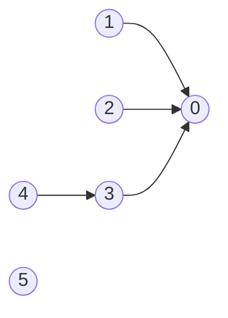
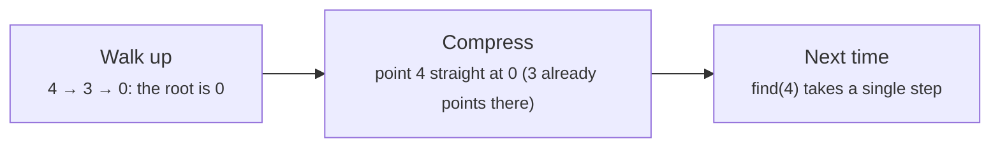

# Union-find (disjoint sets)

> Data Structures & Algorithms · L2 Proficient · Graphs & union-find · about 90 min · hub module `m07` ([open the hub](https://claude.ai/artifact/DQhszKFoe8qbiNbSpWkqM5))

## Why it matters
When connections only ever get added (friendships, network links, merged accounts) and you keep asking “are these two connected?”, union-find answers in effectively constant time. It's also the engine inside Kruskal's minimum spanning tree.

## Pre-question (answer before reading)
**Q:** Friend groups merge whenever two people from different groups become friends. How could you tell whether two people are in the same group without searching all the friendships each time?

<details><summary>Answer</summary>

Give every group a leader. Each person points, directly or through others, to their group's leader; two people are in the same group if they reach the same leader. Merging two groups just makes one leader point to the other.

</details>

## 🍎 Story time (kid version)
**The toy room and the treasure-map road trip: The team captains**

At the toy-room party, every child starts in their own team and is their own captain. When two children hold hands, their teams merge: one captain joins the other captain's team. To check whether Tara and Ben are on the same team, each follows the chain “who's my captain?” until they reach someone who is their own captain. Same captain, same team! To keep the chains short, smaller teams always join bigger ones, and whenever someone walks a chain, everyone on it then points straight at the top captain.

| In the story | In code |
|---|---|
| Every child starts as their own captain | make-set: parent[x] = x |
| Holding hands merges two teams | union(a, b): link one root under the other |
| Following “who's my captain?” to the top | find(x): follow parent links to the root |
| Same captain means same team | a and b are connected exactly when find(a) == find(b) |
| Small teams join big ones; pointing straight at the top | Union by size and path compression |

**Where the story breaks:** Teams can only merge, never split: union-find has no cheap way to remove a connection. It also can't tell you the chain of hand-holds between two children, only that one exists.

## Key ideas (grown-up version)
- **Union-find (DSU)** keeps a `parent` array: each element points to a parent, and a root points to itself. Each root names one disjoint set.
- **find(x)** follows parents up to the root; **union(a, b)** links one root under the other; a and b are connected when their roots match.
- **Path compression**: during find, point every node on the path straight at the root, so later finds are short.
- **Union by size (or rank)**: attach the smaller tree under the larger one, so trees stay shallow.
- **With both tricks** each operation costs O(α(n)) amortised, where α is the inverse Ackermann function: below 5 for any realistic n, so effectively constant.
- **Typical uses**: counting connected components as edges arrive, spotting a cycle in an undirected graph (an edge whose ends already share a root), merging accounts, Kruskal's minimum spanning tree.
- **Kruskal's MST**: sort the edges by weight; keep each edge whose ends are in different sets (the union succeeds); stop after V − 1 edges. O(E log E).
- **Limits**: no splitting sets and no paths. Union-find says *whether* two items are connected, not *how*; use BFS or DFS for routes.

## Diagrams
**Arrows point to parents: union(2, 4) links root 3 under root 0**



_After union(0, 1), union(1, 2) and union(3, 4), find(2) is one step (2 → 0) and find(4) is one step (4 → 3). Union by size puts the smaller tree under the bigger root: root 3 (2 nodes) goes under root 0 (3 nodes), the highlighted arrow. 5 is still alone: a set of its own._

**Path compression on find(4), after the union above**



## Comparisons
**Union-find or BFS/DFS for connectivity?**

|  | Union-find | BFS / DFS |
|---|---|---|
| Edges arrive one at a time | O(α(n)) per new edge | A fresh search after each edge: O(V + E) each |
| Are a and b connected? | O(α(n)) amortised | O(V + E) per fresh search; O(1) after labelling the components once (fixed graph) |
| The actual path | Not available | Yes, with parent links |
| Deleting edges | Not supported | Just search again |
| Directed graphs | No: undirected connectivity only | Yes |

## Code (JavaScript + Python)
### The union-find class used by every example below
```python
class DSU:
    def __init__(self, n):
        self.parent = list(range(n))        # everyone is their own root
        self.size = [1] * n
        self.sets = n

    def find(self, x):
        root = x
        while self.parent[root] != root:    # walk up to the root
            root = self.parent[root]
        while self.parent[x] != root:       # path compression: point the path at the root
            nxt = self.parent[x]
            self.parent[x] = root
            x = nxt
        return root

    def union(self, a, b):                  # False if a and b were already together
        ra, rb = self.find(a), self.find(b)
        if ra == rb:
            return False
        if self.size[ra] < self.size[rb]:   # union by size: small tree under big tree
            ra, rb = rb, ra
        self.parent[rb] = ra
        self.size[ra] += self.size[rb]
        self.sets -= 1
        return True
```

```javascript
class DSU {
  constructor(n) {
    this.parent = Array.from({ length: n }, (_, i) => i);   // everyone is their own root
    this.size = new Array(n).fill(1);
    this.sets = n;
  }

  find(x) {
    let root = x;
    while (this.parent[root] !== root) root = this.parent[root];   // walk up to the root
    while (this.parent[x] !== root) {       // path compression: point the path at the root
      const nxt = this.parent[x];
      this.parent[x] = root;
      x = nxt;
    }
    return root;
  }

  union(a, b) {                             // false if a and b were already together
    let ra = this.find(a), rb = this.find(b);
    if (ra === rb) return false;
    if (this.size[ra] < this.size[rb]) [ra, rb] = [rb, ra];   // union by size
    this.parent[rb] = ra;
    this.size[ra] += this.size[rb];
    this.sets--;
    return true;
  }
}
```

### Unions, finds and set counts
```python
yn = lambda b: "yes" if b else "no"

d = DSU(6)
for a, b in [(0, 1), (1, 2), (3, 4)]:
    d.union(a, b)
print(d.sets, yn(d.find(2) == d.find(0)), yn(d.find(4) == d.find(0)))
d.union(2, 4)                           # merges {0, 1, 2} and {3, 4}
print(d.sets, yn(d.find(4) == d.find(0)), yn(d.union(1, 3)))
```

Output:
```text
3 yes no
2 yes no
```

- line 8: 1 and 3 are already in the same set, so union returns False and nothing changes.

```javascript
const yn = b => (b ? "yes" : "no");

const d = new DSU(6);
for (const [a, b] of [[0, 1], [1, 2], [3, 4]]) d.union(a, b);
console.log(d.sets, yn(d.find(2) === d.find(0)), yn(d.find(4) === d.find(0)));
d.union(2, 4);                          // merges {0, 1, 2} and {3, 4}
console.log(d.sets, yn(d.find(4) === d.find(0)), yn(d.union(1, 3)));
```

Output:
```text
3 yes no
2 yes no
```

- line 7: 1 and 3 are already in the same set, so union returns false and nothing changes.

### Edges arriving one by one: the first loop, and the running group count
```python
def redundant_edge(n, edges):               # the first edge that closes a loop
    d = DSU(n)
    for a, b in edges:
        if not d.union(a, b):               # a and b were already connected
            return a, b
    return None

print(*redundant_edge(4, [(0, 1), (1, 2), (2, 3), (1, 3), (0, 3)]))

d = DSU(5)
counts = []
for a, b in [(0, 1), (2, 3), (1, 0), (3, 4), (1, 2)]:
    d.union(a, b)
    counts.append(d.sets)
print(*counts)
```

Output:
```text
1 3
4 3 3 2 1
```

- line 4: An undirected edge between two items that are already connected must close a loop.
- line 14: Each successful union lowers the count by one; a repeated pair (1, 0) changes nothing.

```javascript
function redundantEdge(n, edges) {          // the first edge that closes a loop
  const d = new DSU(n);
  for (const [a, b] of edges) if (!d.union(a, b)) return [a, b];   // already connected
  return null;
}

console.log(...redundantEdge(4, [[0, 1], [1, 2], [2, 3], [1, 3], [0, 3]]));

const d = new DSU(5), counts = [];
for (const [a, b] of [[0, 1], [2, 3], [1, 0], [3, 4], [1, 2]]) {
  d.union(a, b);
  counts.push(d.sets);
}
console.log(...counts);
```

Output:
```text
1 3
4 3 3 2 1
```

- line 3: An undirected edge between two items that are already connected must close a loop.

### Kruskal's minimum spanning tree
```python
def kruskal(n, edges):                      # edges: (weight, u, v)
    d, total, used = DSU(n), 0, []
    for w, u, v in sorted(edges):           # cheapest first
        if d.union(u, v):                   # joins two different trees: keep it
            total += w
            used.append((u, v))
            if len(used) == n - 1:
                break
    return total, used

total, used = kruskal(5, [(4, 0, 1), (1, 1, 2), (3, 0, 2), (2, 2, 3), (5, 3, 4), (7, 1, 4), (6, 2, 4)])
print(total, *(f"{u}-{v}" for u, v in used))
```

Output:
```text
11 1-2 2-3 0-2 3-4
```

- line 4: Edge 0–1 (weight 4) is skipped: 0 and 1 are already joined through 2.
- line 7: A spanning tree on n vertices has exactly n − 1 edges, so stop early.

```javascript
function kruskal(n, edges) {                // edges: [weight, u, v]
  const d = new DSU(n), used = [];
  let total = 0;
  for (const [w, u, v] of edges.toSorted((a, b) => a[0] - b[0])) {   // cheapest first
    if (d.union(u, v)) {                    // joins two different trees: keep it
      total += w;
      used.push([u, v]);
      if (used.length === n - 1) break;
    }
  }
  return [total, used];
}

const [total, used] = kruskal(5, [[4, 0, 1], [1, 1, 2], [3, 0, 2], [2, 2, 3], [5, 3, 4], [7, 1, 4], [6, 2, 4]]);
console.log(total, ...used.map(([u, v]) => `${u}-${v}`));
```

Output:
```text
11 1-2 2-3 0-2 3-4
```

- line 4: Sort a copy by weight; `toSorted` leaves the input untouched.

## Worked example
**Problem.** Given equations like “a==b” and “b!=c” over lowercase letters, can all of them be true at once? (LeetCode 990, Satisfiability of Equality Equations.)

1. Equality is transitive (a == b and b == c mean a == c), so variables that must be equal form groups: disjoint sets.
2. Pass 1: union the two sides of every “==”. Do all the unions before any check.
3. Pass 2: for every “!=”, the two sides must be in different sets; the same root means a contradiction.
4. 26 letters and n equations: O(n · α(26)), effectively O(n) time, with O(1) extra space.

```python
def equations_possible(equations):
    d = DSU(26)
    idx = lambda ch: ord(ch) - ord("a")
    for e in equations:
        if e[1:3] == "==":
            d.union(idx(e[0]), idx(e[3]))    # first, merge everything that must be equal
    for e in equations:
        if e[1:3] == "!=" and d.find(idx(e[0])) == d.find(idx(e[3])):
            return False                     # then, no "!=" pair may share a set
    return True

tests = [["a==b", "b!=a"], ["b==a", "a==b"], ["a==b", "b==c", "a==c"], ["a==b", "b!=c", "c==a"], ["c==c", "b==d", "x!=z"]]
print(*("yes" if equations_possible(t) else "no" for t in tests))
```

Output:
```text
no yes yes no yes
```

```javascript
function equationsPossible(equations) {
  const d = new DSU(26);
  const idx = ch => ch.charCodeAt(0) - 97;   // 'a' is 97
  for (const e of equations)
    if (e.slice(1, 3) === "==") d.union(idx(e[0]), idx(e[3]));   // first, merge the equal ones
  for (const e of equations)
    if (e.slice(1, 3) === "!=" && d.find(idx(e[0])) === d.find(idx(e[3]))) return false;   // then check
  return true;
}

const tests = [["a==b", "b!=a"], ["b==a", "a==b"], ["a==b", "b==c", "a==c"], ["a==b", "b!=c", "c==a"], ["c==c", "b==d", "x!=z"]];
console.log(...tests.map(t => (equationsPossible(t) ? "yes" : "no")));
```

Output:
```text
no yes yes no yes
```

**Answer.** no, yes, yes, no, yes. In the fourth case a == b and c == a put b and c in one set, which contradicts b != c. In the first, b != a contradicts a == b.

## Your turn (faded example)
**Problem.** `is_connected[i][j] == 1` means cities i and j are directly linked. How many separate groups of cities (provinces) are there?

- ✓ Start with n sets. Each successful union merges two groups, so the count drops by one.
- **Which cells of the matrix do you need to read?**
  <details><summary>Answer</summary>Only those with j > i: the matrix is symmetric and the diagonal is always 1.</details>
- **What's the answer at the end?**
  <details><summary>Answer</summary>The number of sets left, `d.sets`.</details>
- **Time?**
  <details><summary>Answer</summary>O(n² · α(n)) to scan the matrix: effectively O(n²).</details>

Starter:
```python
def count_provinces(is_connected):
    n = len(is_connected)
    d = DSU(n)
    for i in range(n):
        for j in range(i + 1, n):
            ...                     # TODO: merge i and j when they're linked
    return d.sets

print(count_provinces([[1, 1, 0], [1, 1, 0], [0, 0, 1]]))   # expect 2
```

```javascript
function countProvinces(isConnected) {
  const n = isConnected.length, d = new DSU(n);
  for (let i = 0; i < n; i++)
    for (let j = i + 1; j < n; j++) {
      // TODO: merge i and j when they're linked
    }
  return d.sets;
}

console.log(countProvinces([[1, 1, 0], [1, 1, 0], [0, 0, 1]]));   // expect 2
```

<details><summary>Full solution</summary>

```python
def count_provinces(is_connected):
    n = len(is_connected)
    d = DSU(n)
    for i in range(n):
        for j in range(i + 1, n):
            if is_connected[i][j]:
                d.union(i, j)
    return d.sets

print(count_provinces([[1, 1, 0], [1, 1, 0], [0, 0, 1]]), count_provinces([[1, 0, 0], [0, 1, 0], [0, 0, 1]]))
```

Output:
```text
2 3
```

```javascript
function countProvinces(isConnected) {
  const n = isConnected.length, d = new DSU(n);
  for (let i = 0; i < n; i++)
    for (let j = i + 1; j < n; j++)
      if (isConnected[i][j]) d.union(i, j);
  return d.sets;
}

console.log(countProvinces([[1, 1, 0], [1, 1, 0], [0, 0, 1]]), countProvinces([[1, 0, 0], [0, 1, 0], [0, 0, 1]]));
```

Output:
```text
2 3
```

</details>

## Socratic checks and quiz (answers hidden)
**1. What does this print? (`DSU` is this module's union-find class.)**

```python
d = DSU(5)
for a, b in [(0, 1), (2, 3), (1, 2), (0, 3)]:
    d.union(a, b)
print(d.sets)
```

```javascript
const d = new DSU(5);
for (const [a, b] of [[0, 1], [2, 3], [1, 2], [0, 3]]) d.union(a, b);
console.log(d.sets);
```

- A. 2
- B. 1
- C. 3
- D. 4

<details><summary>Answer</summary>

2. Three unions succeed ({0, 1}, {2, 3}, then both together); (0, 3) is already connected. 5 − 3 = 2 sets: {0, 1, 2, 3} and {4}.

</details>

**2. What does this print?**

```python
d = DSU(4)
print(*("new" if d.union(a, b) else "same" for a, b in [(0, 1), (1, 2), (0, 2), (2, 3), (3, 1)]))
```

```javascript
const d = new DSU(4);
console.log(...[[0, 1], [1, 2], [0, 2], [2, 3], [3, 1]].map(([a, b]) => (d.union(a, b) ? "new" : "same")));
```

- A. new new same new same
- B. new new new new same
- C. new same same new same
- D. new new same new new

<details><summary>Answer</summary>

new new same new same. (0, 2) and (3, 1) join items that are already connected, so those unions return false. Each “same” is an edge that would close a loop.

</details>

**3. Edges of an undirected network arrive one by one, and after each you must report how many separate groups exist. What's the best tool?**

- A. Union-find, counting successful unions
- B. A fresh BFS after every edge
- C. A topological sort
- D. A min-heap

<details><summary>Answer</summary>

Union-find, counting successful unions. Each successful union lowers the group count by one, in effectively constant time. A BFS per edge costs O(V + E) every time.

</details>

**4. Which can union-find do efficiently? (choose 2)**

- A. Tell whether two items are in the same set
- B. Merge two sets
- C. Split a set in two
- D. Return the path between two items
- E. Detect a cycle in a directed graph

<details><summary>Answer</summary>

Tell whether two items are in the same set, Merge two sets. Union-find only merges and compares roots. Splitting, paths and directed cycles need other tools.

</details>

**5. Judge each statement.**

- With path compression and union by size, operations are effectively constant time.
- union(a, b) should set parent[a] = b directly.
- Kruskal's algorithm keeps an edge only if its endpoints are in different sets.
- Union-find detects cycles in directed graphs.

<details><summary>Answer</summary>

With path compression and union by size, operations are effectively constant time.: Yes; union(a, b) should set parent[a] = b directly.: No; Kruskal's algorithm keeps an edge only if its endpoints are in different sets.: Yes; Union-find detects cycles in directed graphs.: No. α(n) < 5 in practice. Link roots, not elements. Kruskal skips edges inside a set. Directed cycles need DFS colours or Kahn's algorithm.

</details>

**6. Put Kruskal's algorithm in order.**

- (put the steps in order)

<details><summary>Answer</summary>

Sort the edges by weight, cheapest first → Take the next cheapest edge → Keep it if its endpoints are in different sets (the union succeeds) → Stop once V − 1 edges are kept. Greedy by weight, with union-find rejecting any edge that would close a loop.

</details>

**7. Complete this Python union-find (find with path compression, then union).**

```
def find(parent, x):
    root = x
    while parent[root] != {{0}}:
        root = parent[root]
    while parent[x] != root:
        nxt = parent[x]
        parent[x] = {{1}}
        x = nxt
    return root

def union(parent, a, b):
    ra, rb = find(parent, a), find(parent, b)
    if ra != rb:
        parent[{{2}}] = ra

```

<details><summary>Answer</summary>

root | root | rb. A root is its own parent; compression points each node on the path at the root; union links root rb under root ra.

</details>

**8. Match each question to the union-find move.**


<details><summary>Answer</summary>

Are two people in the same friend group? = find(a) == find(b); Join two friend groups = union(a, b); The cheapest network linking every office = Kruskal's MST with union-find; The first cable that creates a loop = The first union that returns false. Compare roots, merge roots, keep only joining edges, and watch for failed unions.

</details>

## Traps & misconceptions
- **“find is O(1).”** Without path compression and union by size, a chain can grow n tall and find becomes O(n). With both, it's O(α(n)) amortised: effectively constant, but not literally O(1).
- **“union(a, b) can set parent[a] = b.”** Link the *roots*: `parent[find(b)] = find(a)` (or the other way round). Re-pointing `a` itself cuts it off from the rest of its old set.
- **“Union-find can remove a connection.”** It only merges. If edges can disappear, rebuild it or use another technique.
- **“Union-find finds the path between two nodes.”** It answers *whether* they're connected, not *how*. Use BFS or DFS for the route.
- **“Union-find detects cycles in directed graphs.”** It works for undirected graphs. For directed cycles, use DFS colours or Kahn's algorithm.
- **“A recursive find is always fine in Python.”** With union by size (or rank) a tree is at most log₂ n deep, about 20 levels for a million items, so recursion is fine. Without it, path compression alone can leave a chain n long until someone walks it, and a recursive find on that chain can pass Python's 1,000-call limit. The two-loop iterative find is safe either way.

## Discussion prompts
- **Why does union by size keep the trees shallow?**
  <details><summary>One good answer</summary>An element only gets deeper when its tree is attached under a tree at least as big, which at least doubles the size of the tree it belongs to. Sizes can only double about log₂ n times, so depth stays O(log n) even before path compression.</details>
- **When would you choose union-find over BFS/DFS for connectivity?**
  <details><summary>One good answer</summary>When edges arrive over time and you keep asking “connected?” in between. On a fixed graph, one BFS/DFS pass that labels each vertex with its component answers every later question in O(1) too. BFS/DFS is also better when you need the path or distances, or when edges get deleted.</details>

## Teach-back
**Prompt:** Explain to a junior colleague how union-find answers “are a and b connected?” and why its operations are nearly constant time.

Rubric:
- [ ] Each element points to a parent; roots point to themselves and name the set
- [ ] find follows parents to the root; connected means the same root
- [ ] union links one root under the other
- [ ] Path compression flattens paths; union by size keeps trees shallow
- [ ] Together: O(α(n)) amortised, effectively constant

<details><summary>Model answer</summary>

Union-find stores a parent pointer for every element; a root points to itself and stands for its whole set. To check whether a and b are connected, find each one's root by following parent pointers, then compare them. To merge two sets, find both roots and make one the parent of the other. Two tricks keep it fast: union by size attaches the smaller tree under the larger, so trees stay shallow, and path compression makes every node on a find path point straight at the root, so the next find is a single step. Together they make each operation O(α(n)) amortised, and α stays below 5 for any input you'll ever meet.

</details>

## Quick Q&A (also in the SRS deck)
- **What does union-find store?** A parent pointer per element (roots point to themselves), usually plus a size or rank for each root.
- **How do you test whether a and b are connected?** Compare find(a) and find(b).
- **What is path compression?** During find, make every node on the path point directly at the root.
- **What is union by size?** Attach the root of the smaller set under the root of the larger set.
- **Cost per operation with both optimisations?** O(α(n)) amortised: effectively constant.
- **How does Kruskal's algorithm use union-find?** Sort the edges by weight; keep an edge only if union succeeds, meaning it joins two different sets.

## Practice problems
- [ ] [LC 684 · Redundant Connection](https://leetcode.com/problems/redundant-connection/) · Medium · the first union that fails
- [ ] [LC 721 · Accounts Merge](https://leetcode.com/problems/accounts-merge/) · Medium · union accounts that share an email
- [ ] [LC 1584 · Min Cost to Connect All Points](https://leetcode.com/problems/min-cost-to-connect-all-points/) · Medium · Kruskal on every pair of points (or Prim's)
- [ ] [LC 886 · Possible Bipartition](https://leetcode.com/problems/possible-bipartition/) · Medium · union each person's dislikes together, then check for conflicts
- [ ] [LC 2368 · Reachable Nodes With Restrictions](https://leetcode.com/problems/reachable-nodes-with-restrictions/) · Medium · union only unrestricted nodes; answer with the size of 0's set
- [ ] [LC 1579 · Remove Max Number of Edges to Keep Graph Fully Traversable](https://leetcode.com/problems/remove-max-number-of-edges-to-keep-graph-fully-traversable/) · Hard · two DSUs; add the shared edges first

## Sources (accessed 2026-10-09)
- [cp-algorithms: Disjoint Set Union](https://cp-algorithms.com/data_structures/disjoint_set_union.html)
- [cp-algorithms: Kruskal's algorithm with DSU](https://cp-algorithms.com/graph/mst_kruskal_with_dsu.html)
- [USACO Guide: Disjoint set union](https://usaco.guide/gold/dsu)
- [Wikipedia: Disjoint-set data structure](https://en.wikipedia.org/wiki/Disjoint-set_data_structure)
