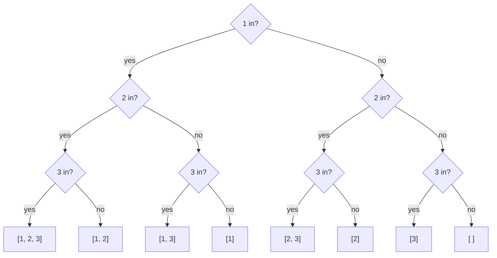
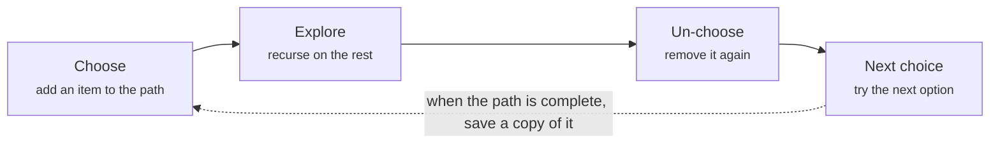

# Backtracking: subsets, permutations, combinations

> Data Structures & Algorithms · L2 Proficient · Backtracking & dynamic programming · about 100 min · hub module `m08` ([open the hub](https://claude.ai/artifact/DQhszKFoe8qbiNbSpWkqM5))

## Why it matters
When a problem says “all”, “every combination” or “any valid arrangement” (subsets, permutations, Sudoku, N-Queens), backtracking explores the choices one at a time and undoes each choice when it leads nowhere.

## Pre-question (answer before reading)
**Q:** How many different subsets does a set of 4 items have, and where does that number come from?

<details><summary>Answer</summary>

16 = 2⁴. For each item you decide “in or out”, and 4 independent yes/no choices give 2 × 2 × 2 × 2 combinations.

</details>

## 🍎 Story time (kid version)
**The toy room and the treasure-map road trip: Packing the toy bag**

Tara is choosing toys for the road trip. She walks along the shelf, and for each toy she asks “in the bag or not?” and writes her answer down. When she reaches the end of the shelf, she has one complete packing list. Then she steps back, changes her last answer, and walks forward again, until she has tried every possible list. If the bag is already too heavy halfway along the shelf, she doesn't bother finishing that list: she steps back straight away.

| In the story | In code |
|---|---|
| Asking “in or out?” for each toy | One decision at each level of the recursion |
| Reaching the end of the shelf with a complete list | A leaf: record a solution (the base case) |
| Stepping back and changing the last answer | Backtracking: undo the last choice (pop) and try the next one |
| Giving up early when the bag is too heavy | Pruning: stop exploring a branch that can't work |

**Where the story breaks:** Tara writes a fresh list every time, but the code keeps one path and changes it in place, so it must store a copy when it records a solution. And no one could finish her game with 30 toys (over a billion lists): backtracking only works for small inputs, or with pruning that cuts most branches early.

## Key ideas (grown-up version)
- **Backtracking** builds a solution step by step: choose, explore (recurse), un-choose. It's a depth-first search over a tree of decisions.
- **The template**: if the path is complete, record a copy and return; otherwise, for each valid choice: make it, recurse, undo it.
- **Record a copy**: `res.append(path[:])` / `res.push([...path])`. Appending `path` itself stores one list that keeps changing.
- **Subsets**: include or skip each item, 2ⁿ results. **Permutations**: pick any unused item for each position, n! results. **Combinations of size k**: C(n, k) results; pass a start index so you never go backwards.
- **Duplicates in the input**: sort first, then skip a choice equal to the previous one at the same depth. For subsets and combinations that's `i > start and nums[i] == nums[i - 1]`; permutations use a `used` check instead (LeetCode 47).
- **Pruning** cuts branches that can't succeed: stop when the running sum passes the target (with sorted candidates), or when a square is under attack.
- **The cost is exponential**: these problems generate everything, so n is small (often ≤ 10–20). State the output size, such as 2ⁿ, n! or C(n, k), when you give the complexity.
- **Library shortcuts**: Python's `itertools.combinations`, `permutations` and `product` generate these for you; interviews usually want the hand-written version, and JavaScript has no built-in equivalent.

## Diagrams
**The decision tree for the subsets of [1, 2, 3]**



**One step of the template**



## Comparisons
**How big the output gets**

| Problem | Count for n = 10 | Formula | Typical limit on n |
|---|---|---|---|
| All subsets | 1,024 | 2ⁿ | about 20 |
| All permutations | 3,628,800 | n! | about 8–10 |
| Combinations of size 3 | 120 | C(n, k) = n! / (k! (n − k)!) | depends on k |
| n-Queens solutions | 724 (and 92 for n = 8) | no simple formula | about 12–14 |

## Code (JavaScript + Python)
### Subsets and permutations with one template
```python
def subsets(nums):
    res, path = [], []
    def backtrack(i):
        if i == len(nums):                  # every item decided: record a copy
            res.append(path[:])
            return
        path.append(nums[i])                # choose: take nums[i]
        backtrack(i + 1)
        path.pop()                          # un-choose
        backtrack(i + 1)                    # the other branch: skip nums[i]
    backtrack(0)
    return res

def permutations(nums):
    res, path, used = [], [], [False] * len(nums)
    def backtrack():
        if len(path) == len(nums):
            res.append(path[:])
            return
        for i, x in enumerate(nums):
            if not used[i]:
                used[i] = True              # choose
                path.append(x)
                backtrack()                 # explore
                path.pop()                  # un-choose
                used[i] = False
    backtrack()
    return res

subs, perms = subsets([1, 2, 3]), permutations([1, 2, 3])
print(len(subs), *("".join(map(str, s)) or "{}" for s in subs))
print(len(perms), *("".join(map(str, p)) for p in perms))
```

Output:
```text
8 123 12 13 1 23 2 3 {}
6 123 132 213 231 312 321
```

- line 5: `path[:]` is a snapshot. Appending `path` itself would store the same list eight times.
- line 9: Pop before the “skip” branch so the path is exactly as it was before the choice.
- line 20: Permutations reuse every unused item at each position, so they track `used` instead of a start index.

```javascript
function subsets(nums) {
  const res = [], path = [];
  function backtrack(i) {
    if (i === nums.length) {                // every item decided: record a copy
      res.push([...path]);
      return;
    }
    path.push(nums[i]);                     // choose: take nums[i]
    backtrack(i + 1);
    path.pop();                             // un-choose
    backtrack(i + 1);                       // the other branch: skip nums[i]
  }
  backtrack(0);
  return res;
}

function permutations(nums) {
  const res = [], path = [], used = new Array(nums.length).fill(false);
  function backtrack() {
    if (path.length === nums.length) {
      res.push([...path]);
      return;
    }
    for (let i = 0; i < nums.length; i++) {
      if (used[i]) continue;
      used[i] = true;                       // choose
      path.push(nums[i]);
      backtrack();                          // explore
      path.pop();                           // un-choose
      used[i] = false;
    }
  }
  backtrack();
  return res;
}

const subs = subsets([1, 2, 3]), perms = permutations([1, 2, 3]);
console.log(subs.length, ...subs.map(s => s.join("") || "{}"));
console.log(perms.length, ...perms.map(p => p.join("")));
```

Output:
```text
8 123 12 13 1 23 2 3 {}
6 123 132 213 231 312 321
```

- line 5: `[...path]` is a snapshot. Pushing `path` itself would store the same array eight times.
- line 26: Permutations reuse every unused item at each position, so they track `used` instead of a start index.

### Combinations with pruning: k digits from 1–9 that add up to n
```python
def combination_sum3(k, n):
    res, path = [], []
    def backtrack(start, remaining):
        if len(path) == k:
            if remaining == 0:
                res.append(path[:])
            return
        for x in range(start, 10):
            if x > remaining:               # prune: the digits only get bigger
                break
            path.append(x)
            backtrack(x + 1, remaining - x) # x + 1: each digit once, no reordering
            path.pop()
    backtrack(1, n)
    return res

print(*(" ".join(map(str, c)) for c in combination_sum3(3, 9)), sep=" | ")
print(len(combination_sum3(3, 15)), len(combination_sum3(4, 1)))
```

Output:
```text
1 2 6 | 1 3 5 | 2 3 4
8 0
```

- line 9: Because the loop goes upwards, one digit that's too big means every later digit is too.
- line 12: Starting the next level at x + 1 means [1, 2, 6] can't also appear as [2, 1, 6].

```javascript
function combinationSum3(k, n) {
  const res = [], path = [];
  function backtrack(start, remaining) {
    if (path.length === k) {
      if (remaining === 0) res.push([...path]);
      return;
    }
    for (let x = start; x <= 9; x++) {
      if (x > remaining) break;             // prune: the digits only get bigger
      path.push(x);
      backtrack(x + 1, remaining - x);      // x + 1: each digit once, no reordering
      path.pop();
    }
  }
  backtrack(1, n);
  return res;
}

console.log(combinationSum3(3, 9).map(c => c.join(" ")).join(" | "));
console.log(combinationSum3(3, 15).length, combinationSum3(4, 1).length);
```

Output:
```text
1 2 6 | 1 3 5 | 2 3 4
8 0
```

- line 9: Because the loop goes upwards, one digit that's too big means every later digit is too.

### N-Queens: count the boards, pruning attacked squares
```python
def n_queens(n):
    cols, diag, anti = set(), set(), set()
    count = 0
    def place(r):                           # put a queen somewhere in row r
        nonlocal count
        if r == n:
            count += 1
            return
        for c in range(n):
            if c in cols or r - c in diag or r + c in anti:
                continue                    # attacked: prune this branch
            cols.add(c)
            diag.add(r - c)
            anti.add(r + c)
            place(r + 1)
            cols.remove(c)
            diag.remove(r - c)
            anti.remove(r + c)
    place(0)
    return count

print(*(n_queens(n) for n in range(1, 9)))
```

Output:
```text
1 0 0 2 10 4 40 92
```

- line 10: Squares on one diagonal share r − c; squares on one anti-diagonal share r + c. Sets make each check O(1).

```javascript
function nQueens(n) {
  const cols = new Set(), diag = new Set(), anti = new Set();
  let count = 0;
  function place(r) {                       // put a queen somewhere in row r
    if (r === n) {
      count++;
      return;
    }
    for (let c = 0; c < n; c++) {
      if (cols.has(c) || diag.has(r - c) || anti.has(r + c)) continue;   // attacked: prune
      cols.add(c); diag.add(r - c); anti.add(r + c);
      place(r + 1);
      cols.delete(c); diag.delete(r - c); anti.delete(r + c);
    }
  }
  place(0);
  return count;
}

console.log(...Array.from({ length: 8 }, (_, i) => nQueens(i + 1)));
```

Output:
```text
1 0 0 2 10 4 40 92
```

- line 10: Squares on one diagonal share r − c; squares on one anti-diagonal share r + c.

## Worked example
**Problem.** Generate every balanced string of n pairs of parentheses.

1. Each position is “(” or “)”: 2²ⁿ strings in total, most of them invalid.
2. Prune with two counters: add “(” only while open < n; add “)” only while close < open.
3. When the string reaches length 2n it's valid by construction: record it.
4. The number of results is the Catalan number (5 for n = 3, 42 for n = 5), and the work is roughly that count × n.

```python
def generate_parentheses(n):
    res, path = [], []
    def backtrack(open_, close):
        if len(path) == 2 * n:
            res.append("".join(path))
            return
        if open_ < n:                       # can still open one
            path.append("(")
            backtrack(open_ + 1, close)
            path.pop()
        if close < open_:                   # can close one that's open
            path.append(")")
            backtrack(open_, close + 1)
            path.pop()
    backtrack(0, 0)
    return res

print(*generate_parentheses(3))
print(*(len(generate_parentheses(n)) for n in range(1, 7)))
```

Output:
```text
((())) (()()) (())() ()(()) ()()()
1 2 5 14 42 132
```

```javascript
function generateParentheses(n) {
  const res = [], path = [];
  function backtrack(open, close) {
    if (path.length === 2 * n) {
      res.push(path.join(""));
      return;
    }
    if (open < n) {                         // can still open one
      path.push("(");
      backtrack(open + 1, close);
      path.pop();
    }
    if (close < open) {                     // can close one that's open
      path.push(")");
      backtrack(open, close + 1);
      path.pop();
    }
  }
  backtrack(0, 0);
  return res;
}

console.log(...generateParentheses(3));
console.log(...Array.from({ length: 6 }, (_, i) => generateParentheses(i + 1).length));
```

Output:
```text
((())) (()()) (())() ()(()) ()()()
1 2 5 14 42 132
```

**Answer.** ((())) (()()) (())() ()(()) ()()() for n = 3, and the counts 1, 2, 5, 14, 42, 132 are the Catalan numbers. The two counters prune every branch that could never close properly.

## Your turn (faded example)
**Problem.** Return every string you can make from `s` by switching the case of its letters (digits stay as they are): “a1b” gives a1b, a1B, A1b, A1B.

- ✓ Each letter is a two-way choice (lower or upper); a digit has only one option.
- **What's the base case?**
  <details><summary>Answer</summary>Index i == len(s): join the path and record it.</details>
- **How many results for a string with k letters?**
  <details><summary>Answer</summary>2^k.</details>
- **Time?**
  <details><summary>Answer</summary>O(2^k · n): 2^k strings, each n characters long.</details>

Starter:
```python
def letter_case_permutations(s):
    res, path = [], []
    def backtrack(i):
        if i == len(s):
            res.append("".join(path))
            return
        ch = s[i]
        if ch.isalpha():
            ...                             # TODO: try ch.lower(), then ch.upper()
        else:
            path.append(ch)
            backtrack(i + 1)
            path.pop()
    backtrack(0)
    return res

print(letter_case_permutations("a1b"))      # expect ['a1b', 'a1B', 'A1b', 'A1B']
```

```javascript
function letterCasePermutations(s) {
  const res = [], path = [];
  function backtrack(i) {
    if (i === s.length) {
      res.push(path.join(""));
      return;
    }
    const ch = s[i];
    if (/[a-z]/i.test(ch)) {
      // TODO: try ch.toLowerCase(), then ch.toUpperCase()
    } else {
      path.push(ch);
      backtrack(i + 1);
      path.pop();
    }
  }
  backtrack(0);
  return res;
}

console.log(letterCasePermutations("a1b"));   // expect ['a1b', 'a1B', 'A1b', 'A1B']
```

<details><summary>Full solution</summary>

```python
def letter_case_permutations(s):
    res, path = [], []
    def backtrack(i):
        if i == len(s):
            res.append("".join(path))
            return
        ch = s[i]
        if ch.isalpha():
            for variant in (ch.lower(), ch.upper()):
                path.append(variant)
                backtrack(i + 1)
                path.pop()
        else:
            path.append(ch)
            backtrack(i + 1)
            path.pop()
    backtrack(0)
    return res

print(*letter_case_permutations("a1b"), *letter_case_permutations("3z4"))
```

Output:
```text
a1b a1B A1b A1B 3z4 3Z4
```

```javascript
function letterCasePermutations(s) {
  const res = [], path = [];
  function backtrack(i) {
    if (i === s.length) {
      res.push(path.join(""));
      return;
    }
    const ch = s[i];
    const options = /[a-z]/i.test(ch) ? [ch.toLowerCase(), ch.toUpperCase()] : [ch];
    for (const variant of options) {
      path.push(variant);
      backtrack(i + 1);
      path.pop();
    }
  }
  backtrack(0);
  return res;
}

console.log(...letterCasePermutations("a1b"), ...letterCasePermutations("3z4"));
```

Output:
```text
a1b a1B A1b A1B 3z4 3Z4
```

</details>

## Socratic checks and quiz (answers hidden)
**1. What does this print?**

```python
res, path = [], []
def backtrack(start):
    res.append(path[:])
    for i in range(start, 3):
        path.append(i)
        backtrack(i + 1)
        path.pop()
backtrack(0)
print(len(res), max(len(p) for p in res))
```

```javascript
const res = [], path = [];
function backtrack(start) {
  res.push([...path]);
  for (let i = start; i < 3; i++) {
    path.push(i);
    backtrack(i + 1);
    path.pop();
  }
}
backtrack(0);
console.log(res.length, Math.max(...res.map(p => p.length)));
```

- A. 8 3
- B. 6 3
- C. 7 2
- D. 3 3

<details><summary>Answer</summary>

8 3. Recording at every node (not just at the leaves) of the start-index tree lists every subset of {0, 1, 2}: 2³ = 8, the largest having 3 items.

</details>

**2. What does this print?**

```python
res, path = [], []
def backtrack(i):
    if i == 2:
        res.append(path)          # no copy!
        return
    for x in "ab":
        path.append(x)
        backtrack(i + 1)
        path.pop()
backtrack(0)
print(len(res), sum(len(p) for p in res))
```

```javascript
const res = [], path = [];
function backtrack(i) {
  if (i === 2) {
    res.push(path);               // no copy!
    return;
  }
  for (const x of "ab") {
    path.push(x);
    backtrack(i + 1);
    path.pop();
  }
}
backtrack(0);
console.log(res.length, res.reduce((s, p) => s + p.length, 0));
```

- A. 4 0
- B. 4 8
- C. 2 4
- D. 0 0

<details><summary>Answer</summary>

4 0. All four entries are the same list, which is empty once the search finishes. Recording a copy would give 4 strings of length 2 (8 letters).

</details>

**3. Which change stops the start-index subsets generator (as in question 1) from producing duplicate subsets for [1, 2, 2]?**

- A. Sort, then skip nums[i] when i > start and nums[i] == nums[i − 1]
- B. Use a while loop instead of recursion
- C. Record path instead of path[:]
- D. Start the loop at 0 every time

<details><summary>Answer</summary>

Sort, then skip nums[i] when i > start and nums[i] == nums[i − 1]. Skipping equal neighbours at the same depth means each value is chosen once per position. The other changes either do nothing or break the generator.

</details>

**4. Which of these need backtracking, because you must list many solutions? (choose 3)**

- A. List every valid placement of 8 queens
- B. List all permutations of a string
- C. List every way to split a string into palindromes
- D. The length of the longest increasing subsequence
- E. The number of ways to climb n stairs

<details><summary>Answer</summary>

List every valid placement of 8 queens, List all permutations of a string, List every way to split a string into palindromes. The last two ask for a single number with overlapping subproblems: dynamic programming.

</details>

**5. Judge each statement.**

- A set of n items has 2ⁿ subsets.
- Permutation generators usually need a start index so earlier items aren't reused.
- Pruning can skip whole branches of the decision tree.
- Generating all permutations of 15 items is quick because each step is O(1).

<details><summary>Answer</summary>

A set of n items has 2ⁿ subsets.: Yes; Permutation generators usually need a start index so earlier items aren't reused.: No; Pruning can skip whole branches of the decision tree.: Yes; Generating all permutations of 15 items is quick because each step is O(1).: No. Permutations track used items, not a start index. 15! is about 1.3 × 10¹²: far too many to list.

</details>

**6. Put one step of the backtracking template in order.**

- (put the steps in order)

<details><summary>Answer</summary>

Check whether the next choice is valid → Make the choice (add it to the path) → Recurse to decide the rest → Undo the choice (remove it from the path). Check, choose, explore, un-choose.

</details>

**7. Complete the JavaScript permutation generator.**

```
function permute(nums) {
  const res = [], path = [], used = new Array(nums.length).fill(false);
  function backtrack() {
    if (path.length === nums.length) {
      res.push({{0}});
      return;
    }
    for (let i = 0; i < nums.length; i++) {
      if (used[i]) continue;
      used[i] = true;
      path.push(nums[i]);
      backtrack();
      path.{{1}}();
      used[i] = {{2}};
    }
  }
  backtrack();
  return res;
}

```

<details><summary>Answer</summary>

[...path] | pop | false. Record a copy, pop the last item to undo the push, and mark the item unused again.

</details>

**8. Match each task to its backtracking shape.**


<details><summary>Answer</summary>

Every subset = Include or skip each item; Every ordering = Pick any unused item for each position; Every size-k group, order ignored = A start index that only moves forward; stop at k items; Subsets of [1, 2, 2] without repeats = Sort, then skip equal neighbours at the same depth. The shape of the decision tree depends on whether order matters and whether items repeat.

</details>

## Traps & misconceptions
- **“`res.append(path)` saves the current path.”** It saves a reference to the one list you keep changing, so every saved entry ends up the same (often empty). Save a copy: `path[:]` / `[...path]`.
- **“Forgetting to undo a choice only affects that branch.”** The leftover item stays in `path` (or `used`) for every later branch and corrupts all the results that follow. Every choose needs a matching un-choose.
- **“Permutations need a start index, like combinations.”** Combinations use a start index so an earlier item is never picked again (order doesn't matter). Permutations reuse every unused item at each position (order matters), so they track `used` instead.
- **“Remove duplicate results by putting them in a set.”** It works but wastes time generating the duplicates. Sort first and skip equal neighbours at the same depth.
- **“Backtracking is roughly O(n²).”** It's exponential: 2ⁿ subsets or n! permutations. That's why inputs are small, and why you state the output size when giving the complexity.
- **“Building strings with `+` in every call is free.”** For short outputs it's fine, but a list `path` with append/pop avoids copying at every step; join only when you record.

## Discussion prompts
- **How can you tell a problem wants backtracking rather than dynamic programming?**
  <details><summary>One good answer</summary>If it asks you to list every solution (all subsets, all valid boards), you have to generate them: backtracking. If it asks for a count or a best value and the same subproblems repeat, DP is usually the better tool.</details>
- **What makes pruning effective?**
  <details><summary>One good answer</summary>Checking as early as possible that a partial solution can't succeed (the sum is already too big, the square is already attacked), especially with sorted input, where one failure means every later choice fails too.</details>

## Teach-back
**Prompt:** Explain to a junior colleague the backtracking template, using “all subsets of a list” as the example.

Rubric:
- [ ] Build a path step by step: at each index, include or skip
- [ ] Choose, recurse, un-choose (pop), so one path list is reused
- [ ] At the end (index n), record a copy of the path
- [ ] 2ⁿ subsets: O(n · 2ⁿ) time
- [ ] Mentions pruning or handling duplicates

<details><summary>Model answer</summary>

Backtracking explores a tree of decisions with depth-first search. For all subsets, the decision at index i is “include nums[i] or not”. The function appends nums[i] to a shared path, recurses to index i + 1, then pops it off and recurses again without it. When the index reaches the end, every item has been decided, so the path is one complete subset: record a copy, because the path will keep changing. With n items there are 2ⁿ leaves, so listing them all costs O(n · 2ⁿ). Pruning, which skips branches that can't lead to a valid answer, is what keeps harder versions fast enough.

</details>

## Quick Q&A (also in the SRS deck)
- **The three moves of backtracking?** Choose, explore (recurse), un-choose.
- **Why record `path[:]` / `[...path]` instead of `path`?** `path` is one list that keeps changing; you need a snapshot.
- **How many subsets and permutations do n items have?** 2ⁿ subsets and n! permutations.
- **How do you avoid duplicate results when the input has duplicates?** Sort, then skip an item equal to the previous one at the same depth.
- **Combinations vs permutations in code?** Combinations pass a start index that only moves forward; permutations track which items are used.
- **What is pruning?** Abandoning a partial solution as soon as it can't lead to a valid answer.

## Practice problems
- [ ] [LC 90 · Subsets II](https://leetcode.com/problems/subsets-ii/) · Medium · sort; skip equal neighbours at the same depth
- [ ] [LC 46 · Permutations](https://leetcode.com/problems/permutations/) · Medium · the used-array template
- [ ] [LC 39 · Combination Sum](https://leetcode.com/problems/combination-sum/) · Medium · reuse allowed: recurse with i, not i + 1; prune when too big
- [ ] [LC 40 · Combination Sum II](https://leetcode.com/problems/combination-sum-ii/) · Medium · each number once; skip duplicates
- [ ] [LC 77 · Combinations](https://leetcode.com/problems/combinations/) · Medium · a start index; stop when the path has k items
- [ ] [LC 17 · Letter Combinations of a Phone Number](https://leetcode.com/problems/letter-combinations-of-a-phone-number/) · Medium · one recursion level per digit
- [ ] [LC 79 · Word Search](https://leetcode.com/problems/word-search/) · Medium · mark the cell, recurse in 4 directions, unmark
- [ ] [LC 131 · Palindrome Partitioning](https://leetcode.com/problems/palindrome-partitioning/) · Medium · cut wherever the prefix is a palindrome
- [ ] [LC 51 · N-Queens](https://leetcode.com/problems/n-queens/) · Hard · sets for columns and both diagonals
- [ ] [LC 37 · Sudoku Solver](https://leetcode.com/problems/sudoku-solver/) · Hard · try 1–9 in each empty cell; undo on failure

## Sources (accessed 2026-10-09)
- [Wikipedia: Backtracking](https://en.wikipedia.org/wiki/Backtracking)
- [Jeff Erickson, Algorithms (free textbook): backtracking chapter](https://jeffe.cs.illinois.edu/teaching/algorithms/)
- [USACO Guide: Complete search with recursion](https://usaco.guide/bronze/complete-rec)
- [Python docs: itertools (combinations, permutations, product)](https://docs.python.org/3/library/itertools.html)
