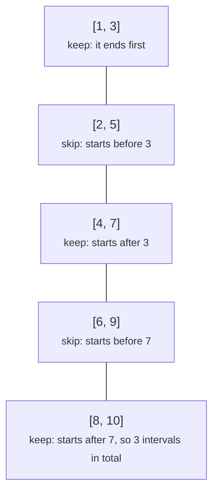
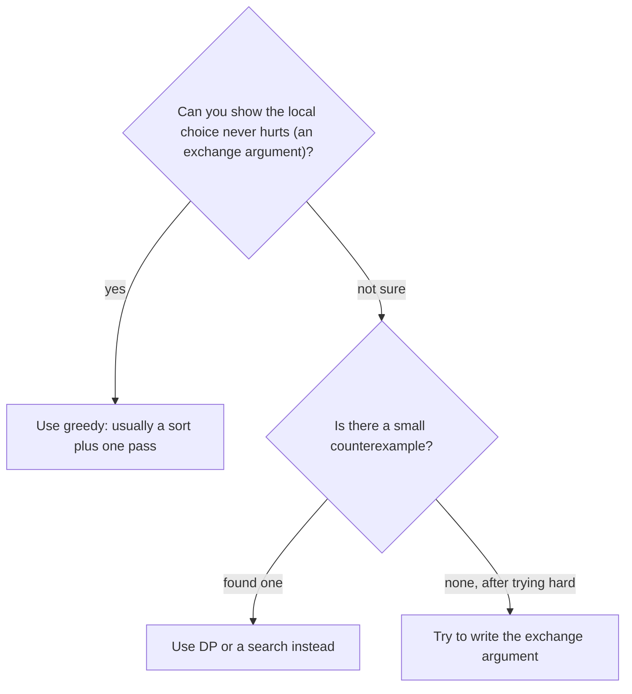

# Greedy algorithms and intervals

> Data Structures & Algorithms · L2 Proficient · Greedy & bit manipulation · about 100 min · hub module `m11` ([open the hub](https://claude.ai/artifact/DQhszKFoe8qbiNbSpWkqM5))

## Why it matters
Some problems reward taking the best-looking option right now and never looking back: scheduling meetings, merging calendars, jumping through an array. Greedy code is short and fast, but it's only correct when you can argue that the local choice is safe.

## Pre-question (answer before reading)
**Q:** You can attend one talk at a time. To fit in as many talks as possible, which talk should you pick first?

<details><summary>Answer</summary>

The one that ends earliest. It leaves the most time for everything else, and any schedule that starts with a different talk can swap it for this one without losing a talk (an exchange argument).

</details>

## 🍎 Story time (kid version)
**The toy room and the treasure-map road trip: Planning the road-trip stops**

On the trip there are lots of fun stops, each open for a set time, and the family can only be at one stop at a time. Ben wants to visit as many stops as possible. Tara's rule: pick the stop that finishes earliest; then, of the stops that start after it ends, again pick the one that finishes earliest, and so on. It sounds too simple, but it works: finishing early never makes the rest of the day worse. Ben's idea, visiting the shortest stops first, sounds clever, but it sometimes picks a short stop that clashes with two others.

| In the story | In code |
|---|---|
| Stops open at set times | Intervals [start, end] |
| Pick the stop that finishes earliest | The greedy choice: sort by end time |
| Then the next stop that starts after it ends | Skip overlapping intervals |
| Finishing early never makes the rest worse | The exchange argument that proves the choice is safe |
| Ben's “shortest first” rule going wrong | Greedy needs proof: plausible rules can be wrong |

**Where the story breaks:** A real family might prefer one long, wonderful stop to three short ones. Once stops have different values, the earliest-finish rule is no longer best, and you need DP (weighted interval scheduling).

## Key ideas (grown-up version)
- **Greedy** = make the locally best choice and never undo it. It's correct only when the choice is provably safe, usually by an **exchange argument**: any optimal solution can be changed to include the greedy choice without getting worse.
- **Interval scheduling** (the most non-overlapping intervals): sort by end time; keep an interval if it starts at or after the last kept end. The fewest removals = n − kept.
- **Merge intervals**: sort by start; if the next interval starts before (or at) the current end, extend the end, otherwise start a new merged interval. O(n log n).
- **Meeting rooms (the maximum overlap)**: sort the start times and end times separately and sweep, or keep a min-heap of end times. The most meetings running at once is the number of rooms.
- **Jump game**: track the farthest index reachable so far; if the current index is beyond it, you're stuck. O(n).
- **Gas station**: if total gas ≥ total cost, a start exists; whenever the running tank drops below zero, the start must be after this point.
- **Sorting is the usual first step, and the sort key is the trick**: by end (scheduling), by start (merging), by a difference or ratio (assignment problems).
- **When greedy fails, use DP**: coin systems like {1, 3, 4}, weighted intervals, 0/1 knapsack.

## Diagrams
**Interval scheduling, sorted by end time**



**Is a greedy rule safe here?**



## Comparisons
**Interval problems and their sort keys**

| Problem | Sort by | Rule | Time |
|---|---|---|---|
| The most non-overlapping intervals | End time | Keep if start ≥ the last kept end | O(n log n) |
| Merge overlapping intervals | Start time | Overlap → extend the end; otherwise start a new one | O(n log n) |
| Rooms needed for meetings | Starts and ends separately | Sweep: +1 at a start, −1 at an end | O(n log n) |
| Insert into sorted intervals | Already sorted | Copy before, merge the overlaps, copy after | O(n) |
| Fewest arrows to burst balloons | End time | Shoot at an end; skip the balloons it hits | O(n log n) |

## Code (JavaScript + Python)
### Two sort keys: merge (by start) and keep the most (by end)
```python
def merge(intervals):
    out = []
    for start, end in sorted(intervals):            # by start
        if out and start <= out[-1][1]:             # overlaps the last merged interval
            out[-1][1] = max(out[-1][1], end)
        else:
            out.append([start, end])
    return out

def max_non_overlapping(intervals):
    kept, last_end = 0, float("-inf")
    for start, end in sorted(intervals, key=lambda iv: iv[1]):   # by end
        if start >= last_end:                       # fits after the last kept one
            kept += 1
            last_end = end
    return kept

print(*(f"[{s},{e}]" for s, e in merge([[1, 3], [2, 6], [8, 10], [15, 18], [17, 20]])))
print(max_non_overlapping([[1, 3], [2, 5], [4, 7], [6, 9], [8, 10]]), max_non_overlapping([[1, 2], [1, 2], [1, 2]]))
```

Output:
```text
[1,6] [8,10] [15,20]
3 1
```

- line 3: Sorted by start, an interval can only overlap the most recent merged one.
- line 12: Sorted by end: the interval that frees the timeline soonest always comes first.

```javascript
function merge(intervals) {
  const out = [];
  for (const [start, end] of intervals.toSorted((a, b) => a[0] - b[0])) {   // by start
    if (out.length && start <= out.at(-1)[1]) out.at(-1)[1] = Math.max(out.at(-1)[1], end);   // overlap
    else out.push([start, end]);
  }
  return out;
}

function maxNonOverlapping(intervals) {
  let kept = 0, lastEnd = -Infinity;
  for (const [start, end] of intervals.toSorted((a, b) => a[1] - b[1])) {   // by end
    if (start >= lastEnd) {                         // fits after the last kept one
      kept++;
      lastEnd = end;
    }
  }
  return kept;
}

console.log(...merge([[1, 3], [2, 6], [8, 10], [15, 18], [17, 20]]).map(([s, e]) => `[${s},${e}]`));
console.log(maxNonOverlapping([[1, 3], [2, 5], [4, 7], [6, 9], [8, 10]]), maxNonOverlapping([[1, 2], [1, 2], [1, 2]]));
```

Output:
```text
[1,6] [8,10] [15,20]
3 1
```

- line 3: Sort a copy by start; `toSorted` leaves the caller's array alone.
- line 12: Sorted by end: the interval that frees the timeline soonest always comes first.

### Meeting rooms: sweep the starts and ends
```python
def rooms_needed(meetings):
    starts = sorted(s for s, _ in meetings)
    ends = sorted(e for _, e in meetings)
    rooms = best = j = 0
    for s in starts:
        while j < len(ends) and ends[j] <= s:       # a meeting has ended: its room is free
            rooms -= 1
            j += 1
        rooms += 1                                  # this meeting takes a room
        best = max(best, rooms)
    return best

print(rooms_needed([[0, 30], [5, 10], [15, 20]]), rooms_needed([[7, 10], [2, 4]]), rooms_needed([[1, 5], [5, 8]]))
```

Output:
```text
2 1 1
```

- line 6: `<=`: a meeting ending at 5 frees its room for one starting at 5. Use `<` if touching meetings need two rooms.

```javascript
function roomsNeeded(meetings) {
  const starts = meetings.map(m => m[0]).sort((a, b) => a - b);
  const ends = meetings.map(m => m[1]).sort((a, b) => a - b);
  let rooms = 0, best = 0, j = 0;
  for (const s of starts) {
    while (j < ends.length && ends[j] <= s) {       // a meeting has ended: its room is free
      rooms--;
      j++;
    }
    rooms++;                                        // this meeting takes a room
    best = Math.max(best, rooms);
  }
  return best;
}

console.log(roomsNeeded([[0, 30], [5, 10], [15, 20]]), roomsNeeded([[7, 10], [2, 4]]), roomsNeeded([[1, 5], [5, 8]]));
```

Output:
```text
2 1 1
```

- line 6: `<=`: a meeting ending at 5 frees its room for one starting at 5.

### Jump game: the farthest reachable index
```python
def can_jump(nums):
    farthest = 0
    for i, step in enumerate(nums):
        if i > farthest:                            # we can't even reach index i
            return False
        farthest = max(farthest, i + step)
    return True

print(*("yes" if can_jump(a) else "no" for a in ([2, 3, 1, 1, 4], [3, 2, 1, 0, 4], [0])))
```

Output:
```text
yes no yes
```

- line 4: Every index up to `farthest` is reachable, so the first index beyond it can never be reached.

```javascript
function canJump(nums) {
  let farthest = 0;
  for (let i = 0; i < nums.length; i++) {
    if (i > farthest) return false;                 // we can't even reach index i
    farthest = Math.max(farthest, i + nums[i]);
  }
  return true;
}

console.log(...[[2, 3, 1, 1, 4], [3, 2, 1, 0, 4], [0]].map(a => (canJump(a) ? "yes" : "no")));
```

Output:
```text
yes no yes
```

- line 4: Every index up to `farthest` is reachable, so the first index beyond it can never be reached.

## Worked example
**Problem.** 2n people must fly to city A or city B; `costs[i] = [a, b]`. Send exactly n people to each city at the lowest total cost (LeetCode 1029, Two City Scheduling).

1. Imagine sending everyone to B, then switching exactly n people to A. Switching person i changes the total by aᵢ − bᵢ.
2. To make the total as small as possible, switch the n people with the most negative aᵢ − bᵢ: sort by that difference.
3. Exchange argument: if a plan sent someone with a bigger difference to A instead of someone with a smaller one, swapping the two couldn't increase the cost.
4. O(n log n) for the sort, then one pass.

```python
def two_city_cost(costs):
    costs = sorted(costs, key=lambda c: c[0] - c[1])   # biggest saving for city A first
    n = len(costs) // 2
    return sum(a for a, _ in costs[:n]) + sum(b for _, b in costs[n:])

print(two_city_cost([[10, 20], [30, 200], [400, 50], [30, 20]]),
      two_city_cost([[259, 770], [448, 54], [926, 667], [184, 139], [840, 118], [577, 469]]))
```

Output:
```text
110 1859
```

```javascript
function twoCityCost(costs) {
  const sorted = costs.toSorted((x, y) => (x[0] - x[1]) - (y[0] - y[1]));   // biggest saving for A first
  const n = sorted.length / 2;
  return sorted.reduce((sum, [a, b], i) => sum + (i < n ? a : b), 0);
}

console.log(twoCityCost([[10, 20], [30, 200], [400, 50], [30, 20]]),
            twoCityCost([[259, 770], [448, 54], [926, 667], [184, 139], [840, 118], [577, 469]]));
```

Output:
```text
110 1859
```

**Answer.** 110 and 1859. In the first example, the two people with the most negative a − b (−170 and −10) fly to A, and the other two fly to B: 10 + 30 + 50 + 20 = 110.

## Your turn (faded example)
**Problem.** Lemonade costs $5. Customers pay with $5, $10 or $20 bills, in order, and you start with no change. Can you give every customer the right change?

- ✓ Keep counts of your $5 and $10 bills; you never hand out a $20.
- **A customer pays with $10. What must you have?**
  <details><summary>Answer</summary>One $5 to give back. Then keep the $10.</details>
- **A customer pays with $20. Which change do you prefer, and why?**
  <details><summary>Answer</summary>$10 + $5 if you can, otherwise three $5s. $5 bills are more useful later, so spend the $10 first: that's the greedy choice.</details>
- **Time and space?**
  <details><summary>Answer</summary>O(n) time and O(1) space.</details>

Starter:
```python
def lemonade_change(bills):
    fives = tens = 0
    for b in bills:
        if b == 5:
            fives += 1
        elif b == 10:
            if fives == 0:
                return False
            fives -= 1
            tens += 1
        else:
            ...                         # TODO: prefer a 10 + 5, otherwise three 5s, otherwise fail
    return True
```

```javascript
function lemonadeChange(bills) {
  let fives = 0, tens = 0;
  for (const b of bills) {
    if (b === 5) fives++;
    else if (b === 10) {
      if (fives === 0) return false;
      fives--;
      tens++;
    } else {
      // TODO: prefer a 10 + 5, otherwise three 5s, otherwise fail
    }
  }
  return true;
}
```

<details><summary>Full solution</summary>

```python
def lemonade_change(bills):
    fives = tens = 0
    for b in bills:
        if b == 5:
            fives += 1
        elif b == 10:
            if fives == 0:
                return False
            fives -= 1
            tens += 1
        elif tens and fives:            # $20: a 10 + 5 keeps more $5s for later
            tens -= 1
            fives -= 1
        elif fives >= 3:
            fives -= 3
        else:
            return False
    return True

print(*("yes" if lemonade_change(b) else "no" for b in ([5, 5, 5, 10, 20], [5, 5, 10, 10, 20], [5, 10, 5, 20])))
```

Output:
```text
yes no yes
```

```javascript
function lemonadeChange(bills) {
  let fives = 0, tens = 0;
  for (const b of bills) {
    if (b === 5) fives++;
    else if (b === 10) {
      if (fives === 0) return false;
      fives--;
      tens++;
    } else if (tens && fives) {         // $20: a 10 + 5 keeps more $5s for later
      tens--;
      fives--;
    } else if (fives >= 3) fives -= 3;
    else return false;
  }
  return true;
}

console.log(...[[5, 5, 5, 10, 20], [5, 5, 10, 10, 20], [5, 10, 5, 20]].map(b => (lemonadeChange(b) ? "yes" : "no")));
```

Output:
```text
yes no yes
```

</details>

## Socratic checks and quiz (answers hidden)
**1. What does this print?**

```python
intervals = [[1, 4], [4, 5], [6, 8], [7, 9], [10, 11]]
out = []
for s, e in sorted(intervals):
    if out and s <= out[-1][1]:
        out[-1][1] = max(out[-1][1], e)
    else:
        out.append([s, e])
print(len(out), out[0][1], out[1][1])
```

```javascript
const intervals = [[1, 4], [4, 5], [6, 8], [7, 9], [10, 11]];
const out = [];
for (const [s, e] of intervals.toSorted((a, b) => a[0] - b[0])) {
  if (out.length && s <= out.at(-1)[1]) out.at(-1)[1] = Math.max(out.at(-1)[1], e);
  else out.push([s, e]);
}
console.log(out.length, out[0][1], out[1][1]);
```

- A. 3 5 9
- B. 4 4 9
- C. 3 4 8
- D. 5 4 5

<details><summary>Answer</summary>

3 5 9. [1, 4] and [4, 5] touch, so with ≤ they merge into [1, 5]; [6, 8] and [7, 9] become [6, 9]; [10, 11] stays. Three intervals.

</details>

**2. What does this print?**

```python
talks = [[1, 10], [2, 3], [3, 4], [4, 5], [11, 12]]
kept, last_end = 0, 0
for s, e in sorted(talks, key=lambda t: t[1]):
    if s >= last_end:
        kept += 1
        last_end = e
print(kept)
```

```javascript
const talks = [[1, 10], [2, 3], [3, 4], [4, 5], [11, 12]];
let kept = 0, lastEnd = 0;
for (const [s, e] of talks.toSorted((a, b) => a[1] - b[1])) {
  if (s >= lastEnd) {
    kept++;
    lastEnd = e;
  }
}
console.log(kept);
```

- A. 4
- B. 2
- C. 3
- D. 5

<details><summary>Answer</summary>

4. By end time: [2, 3], [3, 4], [4, 5] and [11, 12] fit; [1, 10] clashes. Sorting by start would have kept [1, 10] and only 2 talks.

</details>

**3. Which rule maximises the number of non-overlapping meetings?**

- A. Earliest end time first
- B. Earliest start time first
- C. Shortest meeting first
- D. Whichever meeting overlaps the fewest others

<details><summary>Answer</summary>

Earliest end time first. Earliest end is the provably safe choice. Earliest start and shortest first fail on just 3 intervals; fewest overlaps first fails too, but only on larger, trickier inputs.

</details>

**4. Which of these can a greedy rule solve correctly? (choose 3)**

- A. The most non-overlapping intervals
- B. Merging overlapping intervals
- C. Whether you can reach the last index (jump game)
- D. The fewest coins with coins {1, 3, 4}
- E. 0/1 knapsack

<details><summary>Answer</summary>

The most non-overlapping intervals, Merging overlapping intervals, Whether you can reach the last index (jump game). The last two need DP: greedy fails on {1, 3, 4} for amount 6, and on knapsacks where the best value-per-weight item doesn't fit well.

</details>

**5. Judge each statement.**

- Greedy algorithms never go back to change an earlier choice.
- Sorting by start time maximises the number of non-overlapping intervals.
- Most interval greedy algorithms are O(n log n) because of the sort.
- Weighted interval scheduling can always be solved by the earliest-end greedy rule alone (sort by end, keep whatever fits).

<details><summary>Answer</summary>

Greedy algorithms never go back to change an earlier choice.: Yes; Sorting by start time maximises the number of non-overlapping intervals.: No; Most interval greedy algorithms are O(n log n) because of the sort.: Yes; Weighted interval scheduling can always be solved by the earliest-end greedy rule alone (sort by end, keep whatever fits).: No. Greedy commits and moves on. Sort by end, not start. The sort dominates. Weights need DP (which also sorts by end, then binary-searches for the last compatible interval).

</details>

**6. Put the merge-intervals algorithm in order.**

- (put the steps in order)

<details><summary>Answer</summary>

Sort the intervals by start time → Put the first interval in the output → For each next interval: if it overlaps the last output interval, extend that interval's end → Otherwise, append it as a new interval. Sorting by start is what makes it enough to compare with the last output interval.

</details>

**7. Complete the JavaScript jump game.**

```
function canJump(nums) {
  let farthest = 0;
  for (let i = 0; i < nums.length; i++) {
    if (i {{0}} farthest) return false;
    farthest = Math.{{1}}(farthest, i + {{2}});
  }
  return true;
}

```

<details><summary>Answer</summary>

> | max | nums[i]. You're stuck only when i is *beyond* farthest; otherwise extend farthest to the furthest jump from here, i + nums[i].

</details>

**8. Match each problem to its greedy rule.**


<details><summary>Answer</summary>

The most non-overlapping meetings = Sort by end; keep if it starts at or after the last end; Combine overlapping calendar blocks = Sort by start; extend while overlapping; Rooms needed for all meetings = Sweep the starts and ends; track the most at once; Can you reach the last index? = Track the farthest reachable index. The sort key (or the running quantity) is the whole trick in each case.

</details>

## Traps & misconceptions
- **“If a greedy rule works on the examples, it's correct.”** Plausible rules fail on tiny counterexamples: “shortest interval first” and “biggest coin first” both break. Look for a counterexample, or write the exchange argument, before you trust it.
- **“Interval scheduling sorts by start time.”** Sorting by start keeps a long early meeting that blocks many others. Sort by end time; it's *merging* intervals that sorts by start.
- **“Touching intervals [1, 3] and [3, 5] always overlap.”** It depends on the problem: for meeting rooms, a meeting ending at 3 frees the room for one starting at 3; when merging, LeetCode treats them as overlapping. Read the statement and choose < or ≤ on purpose.
- **“Sorting the input in place is harmless.”** It changes the caller's data. Sort a copy (`sorted()` / `toSorted()`) unless changing the input is allowed.
- **“Greedy algorithms are O(n).”** Interval greedies are dominated by the sort, O(n log n); only the pass after it is O(n). Some greedies need no sort at all: the jump game and the gas station are O(n).
- **“Weighted intervals work the same way.”** Once intervals carry values, earliest-end greedy can be beaten; that version needs DP with binary search.

## Discussion prompts
- **What's an exchange argument, in plain words?**
  <details><summary>One good answer</summary>Take any best solution that doesn't make the greedy choice, swap one of its choices for the greedy one, and show the result is still valid and no worse. Repeat, and any best solution turns into the greedy one, so greedy is best too.</details>
- **How do you choose between greedy and DP when you're unsure?**
  <details><summary>One good answer</summary>Try to break the greedy rule with tiny inputs (2–4 items). A counterexample means DP. If you can't find one, try to state why the local choice is always safe; if you can't, DP is the safer bet in an interview, and you can mention greedy as a possible speed-up.</details>

## Teach-back
**Prompt:** Explain to a junior colleague how to schedule the most non-overlapping meetings, and why the greedy choice is correct.

Rubric:
- [ ] Sort by end time
- [ ] Keep a meeting if it starts at or after the last kept meeting's end
- [ ] Exchange argument: the earliest-ending meeting can replace the first meeting of any best schedule
- [ ] O(n log n) for the sort
- [ ] Mentions a wrong rule (shortest first or earliest start)

<details><summary>Model answer</summary>

Sort the meetings by end time, then walk through them, keeping a meeting whenever it starts at or after the end of the last one kept. Why does it work? Take any best schedule. Its first meeting ends no earlier than the meeting that ends earliest overall, so you can swap that first meeting for the earliest-ending one without clashing with anything: the schedule stays valid and just as long. Repeating the argument for the rest shows the greedy schedule is as long as any other. Sorting costs O(n log n) and the pass is O(n). Tempting rules like “shortest meeting first” or “earliest start first” fail on small examples.

</details>

## Quick Q&A (also in the SRS deck)
- **When is a greedy algorithm correct?** When you can show the local choice is always safe, usually with an exchange argument.
- **The most non-overlapping intervals: sort key and rule?** Sort by end; keep an interval if it starts at or after the last kept end.
- **Merge intervals: sort key and rule?** Sort by start; extend the last merged interval if the next one overlaps, otherwise start a new one.
- **How do you count the rooms needed for meetings?** Sweep the sorted starts and ends (or keep a min-heap of end times); the most meetings at once is the answer.
- **Jump game in O(n)?** Track the farthest reachable index; reaching an index beyond it means false.
- **A greedy counterexample for coins?** Coins {1, 3, 4} and amount 6: greedy gives 4 + 1 + 1, but 3 + 3 is better.

## Practice problems
- [ ] [LC 455 · Assign Cookies](https://leetcode.com/problems/assign-cookies/) · Easy · sort both; give each child the smallest cookie that fits
- [ ] [LC 55 · Jump Game](https://leetcode.com/problems/jump-game/) · Medium · the farthest reachable index
- [ ] [LC 45 · Jump Game II](https://leetcode.com/problems/jump-game-ii/) · Medium · count a jump each time you pass the current jump's reach
- [ ] [LC 134 · Gas Station](https://leetcode.com/problems/gas-station/) · Medium · restart after any point where the tank goes negative
- [ ] [LC 846 · Hand of Straights](https://leetcode.com/problems/hand-of-straights/) · Medium · sort; build runs from the smallest card with a counter
- [ ] [LC 763 · Partition Labels](https://leetcode.com/problems/partition-labels/) · Medium · last position of each letter; cut when you reach the furthest
- [ ] [LC 56 · Merge Intervals](https://leetcode.com/problems/merge-intervals/) · Medium · the merge code, from memory
- [ ] [LC 57 · Insert Interval](https://leetcode.com/problems/insert-interval/) · Medium · copy before, merge the overlaps, copy after
- [ ] [LC 435 · Non-overlapping Intervals](https://leetcode.com/problems/non-overlapping-intervals/) · Medium · n − the most non-overlapping intervals
- [ ] [LC 452 · Minimum Number of Arrows to Burst Balloons](https://leetcode.com/problems/minimum-number-of-arrows-to-burst-balloons/) · Medium · sort by end; one arrow per group
- [ ] [LC 2402 · Meeting Rooms III](https://leetcode.com/problems/meeting-rooms-iii/) · Hard · two heaps: free rooms, and busy rooms by end time

## Sources (accessed 2026-10-09)
- [Jeff Erickson, Algorithms (free textbook): greedy algorithms chapter](https://jeffe.cs.illinois.edu/teaching/algorithms/)
- [Wikipedia: Interval scheduling](https://en.wikipedia.org/wiki/Interval_scheduling)
- [USACO Guide: Greedy algorithms with sorting](https://usaco.guide/silver/greedy-sorting)
