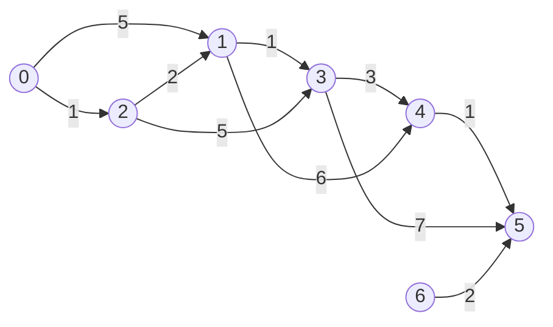
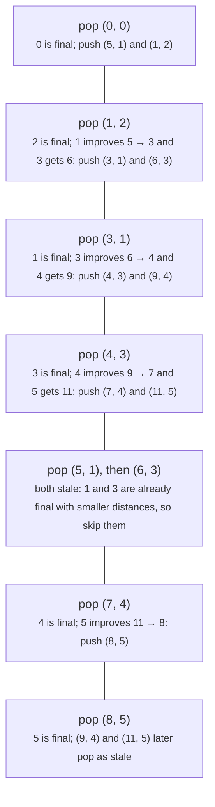
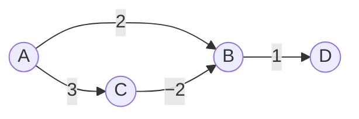

# Dijkstra's algorithm and 0-1 BFS

> Data Structures & Algorithms · L3 Specialist · Weighted & advanced graphs · about 110 min · hub module `m01` ([open the hub](https://claude.ai/artifact/JfuakQWBwAvSgLi1rcuJUk))

## Why it matters
Route planners, network routers (OSPF computes its routes with Dijkstra's algorithm) and game maps all need the cheapest route when steps cost different amounts. BFS counts steps; Dijkstra adds up costs. With small twists the same loop handles 0/1 costs in linear time, “the worst single step” costs, and counting the shortest routes.

## Pre-question (answer before reading)
**Q:** From home, one route to the beach is 3 roads of 1 hour each; another is 2 roads of 2 hours each. BFS picks the 2-road route. How would you find the fastest route without trying every route?

<details><summary>Answer</summary>

Keep the best-known time to each town. Again and again, take the unfinished town with the smallest time: no other route can beat it, because every other route still has to pass a town that's no closer, and driving further never takes time away. Mark it finished and update its neighbours. That's Dijkstra's algorithm, and here it finds the 3-hour route.

</details>

## 🍎 Story time (kid version)
**The toy room and the treasure-map road trip: Sticky notes on the road map**

Ben puts sticky notes on the road-trip map: on each town, the fastest time he knows from home. Home gets 0. Each turn he takes the smallest note on the map. If it's an old note on a town he has already circled, he throws it away. Otherwise he circles that town and looks along every road out of it: if “this town's time + the road's time” beats the neighbour's note, he sticks a new, smaller note there. Tara checks the rule: a circled town can never get faster. Any other route must first reach an uncircled town, whose note is at least as big, and driving further never takes time away.

| In the story | In code |
|---|---|
| The note on a town: the fastest time Ben knows so far | dist[v], the best distance found so far (∞ until v is reached) |
| Taking the smallest note on the map | Popping the smallest (distance, vertex) pair from a min-heap |
| Throwing away an old note on a circled town | Lazy deletion: skip a popped pair whose d > dist[v] |
| “This town's time + the road's time” beats the neighbour's note | Relaxation: if d + w < dist[v], set dist[v] = d + w and push (dist[v], v) |
| A circled town can never get faster | A vertex is final when it's popped, because every weight is ≥ 0 |

**Where the story breaks:** Real roads never take negative time, but graph edges can have negative weights, and then a circled town *can* get faster later: Tara's rule breaks. And Ben scans the whole map for the smallest note, while a program keeps the notes in a binary heap, so taking the smallest costs O(log E) instead of a look at every note.

## Key ideas (grown-up version)
- **Dijkstra's algorithm** finds the shortest distance from one source to every vertex when every edge weight is ≥ 0. Start with dist = ∞ everywhere except the source (0); repeatedly take the unfinished vertex with the smallest dist, mark it final and relax its outgoing edges.
- **Relaxation**: for an edge u → v of weight w, if dist[u] + w < dist[v], set dist[v] = dist[u] + w and parent[v] = u. Following the parent links back from a target and reversing them gives the path itself.
- **Lazy deletion** replaces “decrease-key”: whenever dist[v] improves, push a new (dist[v], v) pair and leave the old one in the heap. A pair that pops with d > dist[v] is stale: skip it. At most E + 1 pairs are ever pushed, so each heap step costs O(log E) = O(log V) (E ≤ V² without repeated edges): O((V + E) log V) time and O(V + E) space.
- **Why it's correct**: when (d, u) pops, any other path to u must first reach an unfinished vertex whose dist is already ≥ d, and the rest of that path adds weights ≥ 0. One negative edge breaks this: with A → B 2, A → C 3 and C → B −2, B pops at 2 although its true distance is 1. For negative weights, use Bellman–Ford (module 02).
- **0-1 BFS**: when every weight is 0 or 1, use a deque instead of a heap. On an improvement, a 0-edge puts v at the front and a 1-edge puts it at the back. The deque then holds at most two distance values, in order, so its front is always a smallest one: O(V + E) time and O(V) extra space (each vertex is pushed at most twice).
- **Change the path cost, keep the loop**: the proof only needs two things: extending a path never makes it cheaper, and a cheaper start stays at least as cheap after the same next step. Both hold for max, so bottleneck problems (Path With Minimum Effort, Swim in Rising Water) relax with max(d, w) instead of d + w.
- **Implicit graphs**: in a grid, a cell's neighbours (up, down, left, right) are generated on the fly, so there's no adjacency list to build. The same loop runs on grids, puzzles and word ladders.
- **Counting shortest paths**: keep ways[v]. A strictly shorter route resets ways[v] = ways[u]; an equally short one adds ways[u]. With weights > 0, every vertex just before u on a shortest path is strictly closer and pops first, so ways[u] is complete when u pops.

## Diagrams
**Dijkstra from 0: distances 0 3 1 4 7 8, and 6 is unreachable**



_The cheapest route to 5 (highlighted) uses 5 edges and costs 8. The 3-edge routes 0 → 1 → 4 → 5 and 0 → 2 → 3 → 5 cost 12 and 13, so counting edges (BFS) would pick a worse route. Vertex 6 is never reached: its only edge leaves it._

**The heap pops for the graph above (lazy deletion)**



**Why weights must be ≥ 0**



_B pops (is “final”) at 2 and gives D 3. Only then does C pop at 3 and find 3 + (−2) = 1 for B, so the true distances are B = 1 and D = 2. Code that never revisits a popped vertex reports D = 3._

## Comparisons
**Single-source shortest paths: which algorithm?**

|  | Weights allowed | Structure | Time | Extra space |
|---|---|---|---|---|
| BFS | All equal (it counts edges) | Queue | O(V + E) | O(V) |
| 0-1 BFS | 0 or 1 | Deque | O(V + E) | O(V) |
| Dijkstra | Any weight ≥ 0 | Binary heap with lazy deletion | O((V + E) log V) | O(V + E) |
| Bellman–Ford | Any, even negative; it detects a reachable negative cycle | Edge list, V − 1 rounds | O(V · E) | O(V) |

**One loop, different path costs**

| Problem | A path's cost | Relax with | Heap and start value |
|---|---|---|---|
| Shortest travel time | The sum of its weights | d + w | Min-heap, start 0 |
| Path With Minimum Effort (LC 1631) | Its largest height step | max(d, |h[v] − h[u]|) | Min-heap, start 0 |
| Swim in Rising Water (LC 778) | Its highest cell | max(d, h[v]) | Min-heap, start h[source] |
| Path with Maximum Probability (LC 1514) | The product of its probabilities | d × p (bigger is better) | Max-heap, start 1 |

## Code (JavaScript + Python)
### Helpers used by every example below
```python
import heapq                                  # a min-heap on a plain list
from collections import deque                 # O(1) appends and pops at both ends
```

```javascript
class MinHeap {                               // JavaScript has no built-in heap
  constructor(less) { this.a = []; this.less = less; }   // less(a, b): should a come out before b?
  get size() { return this.a.length; }
  peek() { return this.a[0]; }
  push(x) {                                   // O(log n): sift up
    const a = this.a;
    a.push(x);
    let i = a.length - 1;
    while (i > 0) {
      const p = (i - 1) >> 1;                 // parent index
      if (!this.less(a[i], a[p])) break;
      [a[i], a[p]] = [a[p], a[i]];
      i = p;
    }
  }
  pop() {                                     // O(log n): sift down
    const a = this.a, top = a[0], last = a.pop();
    if (a.length) {
      a[0] = last;
      let i = 0;
      for (;;) {
        const l = 2 * i + 1, r = l + 1;
        let m = i;
        if (l < a.length && this.less(a[l], a[m])) m = l;
        if (r < a.length && this.less(a[r], a[m])) m = r;
        if (m === i) break;
        [a[i], a[m]] = [a[m], a[i]];
        i = m;
      }
    }
    return top;
  }
}
```

### Dijkstra with lazy deletion, and the path rebuilt from parent links
```python
def dijkstra(n, edges, src):
    graph = [[] for _ in range(n)]
    for u, v, w in edges:
        graph[u].append((v, w))
    dist, parent = [float("inf")] * n, [-1] * n
    dist[src] = 0
    heap = [(0, src)]
    while heap:
        d, u = heapq.heappop(heap)
        if d > dist[u]:                       # stale: u already popped with a smaller d
            continue
        for v, w in graph[u]:
            if d + w < dist[v]:               # relax u -> v
                dist[v], parent[v] = d + w, u
                heapq.heappush(heap, (dist[v], v))
    return dist, parent

def path_to(dist, parent, t):
    if dist[t] == float("inf"):
        return []                             # unreachable: no path
    path = []
    while t != -1:                            # walk the parent links back to the source
        path.append(t)
        t = parent[t]
    return path[::-1]

edges = [(0, 1, 5), (0, 2, 1), (2, 1, 2), (1, 3, 1), (2, 3, 5), (3, 4, 3), (1, 4, 6), (4, 5, 1), (3, 5, 7), (6, 5, 2)]
dist, parent = dijkstra(7, edges, 0)
print(*(d if d < float("inf") else "INF" for d in dist))
print(" -> ".join(map(str, path_to(dist, parent, 5))))
```

Output:
```text
0 3 1 4 7 8 INF
0 -> 2 -> 1 -> 3 -> 4 -> 5
```

- line 10: Lazy deletion: older, bigger pairs for u stay in the heap and are skipped when they surface.
- line 14: A cheaper route to v through u. Recording u as v's parent is what lets you rebuild the path.
- line 19: Check reachability first: an unreachable vertex keeps parent −1 and would come back as a one-vertex “path”.

```javascript
function dijkstra(n, edges, src) {
  const graph = Array.from({ length: n }, () => []);
  for (const [u, v, w] of edges) graph[u].push([v, w]);
  const dist = new Array(n).fill(Infinity), parent = new Array(n).fill(-1);
  dist[src] = 0;
  const heap = new MinHeap((a, b) => a[0] < b[0]);   // pairs [distance, vertex]
  heap.push([0, src]);
  while (heap.size) {
    const [d, u] = heap.pop();
    if (d > dist[u]) continue;                        // stale: u already popped with a smaller d
    for (const [v, w] of graph[u]) {
      if (d + w < dist[v]) {                          // relax u -> v
        dist[v] = d + w;
        parent[v] = u;
        heap.push([dist[v], v]);
      }
    }
  }
  return [dist, parent];
}

function pathTo(dist, parent, t) {
  if (dist[t] === Infinity) return [];               // unreachable: no path
  const path = [];
  for (; t !== -1; t = parent[t]) path.push(t);      // walk the parent links back to the source
  return path.reverse();
}

const edges = [[0, 1, 5], [0, 2, 1], [2, 1, 2], [1, 3, 1], [2, 3, 5], [3, 4, 3], [1, 4, 6], [4, 5, 1], [3, 5, 7], [6, 5, 2]];
const [dist, parent] = dijkstra(7, edges, 0);
console.log(...dist.map(d => (d < Infinity ? d : "INF")));
console.log(pathTo(dist, parent, 5).join(" -> "));
```

Output:
```text
0 3 1 4 7 8 INF
0 -> 2 -> 1 -> 3 -> 4 -> 5
```

- line 6: Always pass a comparator: the default `<` compares arrays as strings, so `[10, 1] < [9, 2]` is true.
- line 10: Lazy deletion: older, bigger pairs for u stay in the heap and are skipped when they surface.
- line 23: Check reachability first: an unreachable vertex keeps parent −1 and would come back as a one-vertex “path”.

### 0-1 BFS on a grid: stepping onto an obstacle costs 1
```python
def min_obstacles(grid):                      # 0 = empty, 1 = obstacle (LC 2290 idea)
    R, C = len(grid), len(grid[0])
    dist = [[float("inf")] * C for _ in range(R)]
    dist[0][0] = 0
    dq = deque([(0, 0, 0)])                   # (obstacles removed, row, col)
    while dq:
        d, r, c = dq.popleft()
        if d > dist[r][c]:
            continue                          # stale entry
        for nr, nc in ((r + 1, c), (r - 1, c), (r, c + 1), (r, c - 1)):
            if 0 <= nr < R and 0 <= nc < C:
                w = grid[nr][nc]              # the cost of stepping onto that cell
                if d + w < dist[nr][nc]:
                    dist[nr][nc] = d + w
                    if w == 0:
                        dq.appendleft((d, nr, nc))       # same distance: the front
                    else:
                        dq.append((d + 1, nr, nc))       # one more: the back
    return dist[R - 1][C - 1]

print(min_obstacles([[0, 1, 1, 0], [1, 1, 0, 1], [0, 0, 1, 0]]),
      min_obstacles([[0, 1, 0, 0], [0, 1, 0, 1], [0, 0, 0, 0]]))
```

Output:
```text
2 0
```

- line 16: A 0-cost step keeps the same distance, so it jumps the queue. The deque always holds at most two distance values, in order.
- line 18: A 1-cost step joins the back, behind everything at the current distance.

```javascript
function minObstacles(grid) {                 // 0 = empty, 1 = obstacle (LC 2290 idea)
  const R = grid.length, C = grid[0].length;
  const dist = Array.from({ length: R }, () => new Array(C).fill(Infinity));
  dist[0][0] = 0;
  const front = [], back = [[0, 0, 0]];       // the deque: a front stack plus a back array
  let head = 0;                               // back[head] is the oldest unread back item
  while (front.length || head < back.length) {
    const [d, r, c] = front.length ? front.pop() : back[head++];   // pop the front
    if (d > dist[r][c]) continue;             // stale entry
    for (const [nr, nc] of [[r + 1, c], [r - 1, c], [r, c + 1], [r, c - 1]]) {
      if (nr < 0 || nr >= R || nc < 0 || nc >= C) continue;
      const w = grid[nr][nc];                 // the cost of stepping onto that cell
      if (d + w < dist[nr][nc]) {
        dist[nr][nc] = d + w;
        if (w === 0) front.push([d, nr, nc]); // same distance: the front
        else back.push([d + 1, nr, nc]);      // one more: the back
      }
    }
  }
  return dist[R - 1][C - 1];
}

console.log(minObstacles([[0, 1, 1, 0], [1, 1, 0, 1], [0, 0, 1, 0]]),
            minObstacles([[0, 1, 0, 0], [0, 1, 0, 1], [0, 0, 0, 0]]));
```

Output:
```text
2 0
```

- line 5: JavaScript has no deque. Items pushed to the front go on the `front` stack, whose top is the deque's first item; items pushed to the back are appended to `back` and read from `head`. Every operation is O(1), unlike `unshift` and `shift`, which can move every element. (A ring buffer works too.)
- line 8: Popping the front: the front stack first, otherwise the oldest unread item of `back`.

### Bottleneck Dijkstra: a path costs its largest step
```python
def min_effort(heights):                      # LC 1631 idea
    R, C = len(heights), len(heights[0])
    best = [[float("inf")] * C for _ in range(R)]
    best[0][0] = 0
    heap = [(0, 0, 0)]                        # (effort so far, row, col)
    while heap:
        e, r, c = heapq.heappop(heap)
        if (r, c) == (R - 1, C - 1):
            return e                          # the target's first pop is final: stop
        if e > best[r][c]:
            continue
        for nr, nc in ((r + 1, c), (r - 1, c), (r, c + 1), (r, c - 1)):
            if 0 <= nr < R and 0 <= nc < C:
                ne = max(e, abs(heights[nr][nc] - heights[r][c]))   # max, not +
                if ne < best[nr][nc]:
                    best[nr][nc] = ne
                    heapq.heappush(heap, (ne, nr, nc))
    return best[R - 1][C - 1]                 # only reached if the target is cut off

print(min_effort([[4, 8, 6], [5, 9, 2], [7, 6, 3]]), min_effort([[1, 10, 6, 7, 9, 10, 4, 9]]))
```

Output:
```text
3 9
```

- line 9: The first time the target pops it's final, so the search can stop early.
- line 14: A path's effort is its largest step, so extending it never lowers the effort: that's why popped still means final.

```javascript
function minEffort(heights) {                 // LC 1631 idea
  const R = heights.length, C = heights[0].length;
  const best = Array.from({ length: R }, () => new Array(C).fill(Infinity));
  best[0][0] = 0;
  const heap = new MinHeap((a, b) => a[0] < b[0]);   // [effort so far, row, col]
  heap.push([0, 0, 0]);
  while (heap.size) {
    const [e, r, c] = heap.pop();
    if (r === R - 1 && c === C - 1) return e;  // the target's first pop is final: stop
    if (e > best[r][c]) continue;
    for (const [nr, nc] of [[r + 1, c], [r - 1, c], [r, c + 1], [r, c - 1]]) {
      if (nr < 0 || nr >= R || nc < 0 || nc >= C) continue;
      const ne = Math.max(e, Math.abs(heights[nr][nc] - heights[r][c]));   // max, not +
      if (ne < best[nr][nc]) {
        best[nr][nc] = ne;
        heap.push([ne, nr, nc]);
      }
    }
  }
  return best[R - 1][C - 1];                  // only reached if the target is cut off
}

console.log(minEffort([[4, 8, 6], [5, 9, 2], [7, 6, 3]]), minEffort([[1, 10, 6, 7, 9, 10, 4, 9]]));
```

Output:
```text
3 9
```

- line 9: The first time the target pops it's final, so the search can stop early.
- line 13: A path's effort is its largest step, so extending it never lowers the effort: that's why popped still means final.

## Worked example
**Problem.** Intersections 0..n − 1 are joined by two-way roads `[u, v, time]`, every time is at least 1, and every intersection can reach every other. In how many ways can you travel from 0 to n − 1 in the shortest possible time? Return the count modulo 1,000,000,007 (LeetCode 1976, Number of Ways to Arrive at Destination).

1. The shortest time itself is a plain Dijkstra from 0. Alongside dist, keep ways[v], the number of shortest routes found so far, with ways[0] = 1.
2. When u pops (not stale), relax each road u – v: a strictly shorter time resets ways[v] = ways[u]; an equal time adds ways[u] to ways[v].
3. It's safe because every time is ≥ 1: any intersection just before u on a shortest route is strictly closer, so it pops first, and ways[u] is complete before u passes it on.
4. Counts grow exponentially (40 diamonds in a row give 2⁴⁰ shortest routes), so reduce modulo 1,000,000,007. Only additions are needed, so every count stays below 2 × 1,000,000,007, far under 2⁵³: plain JavaScript numbers stay exact. Times are exact too: n ≤ 200 and each road takes at most 10⁹, so no time the code computes exceeds 2 × 10¹¹.
5. O((V + E) log V) time and O(V + E) space, the same as Dijkstra.

```python
MOD = 1_000_000_007

def count_paths(n, roads):
    graph = [[] for _ in range(n)]
    for u, v, t in roads:                     # two-way roads
        graph[u].append((v, t))
        graph[v].append((u, t))
    dist, ways = [float("inf")] * n, [0] * n
    dist[0], ways[0] = 0, 1
    heap = [(0, 0)]
    while heap:
        d, u = heapq.heappop(heap)
        if d > dist[u]:
            continue
        for v, t in graph[u]:
            if d + t < dist[v]:               # strictly shorter: start counting again
                dist[v], ways[v] = d + t, ways[u]
                heapq.heappush(heap, (dist[v], v))
            elif d + t == dist[v]:            # just as short: add these routes
                ways[v] = (ways[v] + ways[u]) % MOD
    return ways[n - 1]

roads = [(0, 1, 2), (0, 2, 3), (1, 3, 3), (2, 3, 2), (1, 2, 1), (3, 4, 4), (2, 4, 6)]
diamonds = [e for a in range(0, 120, 3) for e in ((a, a + 1, 1), (a, a + 2, 1), (a + 1, a + 3, 1), (a + 2, a + 3, 1))]
print(count_paths(5, roads), count_paths(121, diamonds))
```

Output:
```text
5 511620083
```

```javascript
const MOD = 1_000_000_007;

function countPaths(n, roads) {
  const graph = Array.from({ length: n }, () => []);
  for (const [u, v, t] of roads) {            // two-way roads
    graph[u].push([v, t]);
    graph[v].push([u, t]);
  }
  const dist = new Array(n).fill(Infinity), ways = new Array(n).fill(0);
  dist[0] = 0;
  ways[0] = 1;
  const heap = new MinHeap((a, b) => a[0] < b[0]);
  heap.push([0, 0]);
  while (heap.size) {
    const [d, u] = heap.pop();
    if (d > dist[u]) continue;
    for (const [v, t] of graph[u]) {
      if (d + t < dist[v]) {                  // strictly shorter: start counting again
        dist[v] = d + t;
        ways[v] = ways[u];
        heap.push([dist[v], v]);
      } else if (d + t === dist[v]) {         // just as short: add these routes
        ways[v] = (ways[v] + ways[u]) % MOD;  // the sum is below 2 * MOD: exact
      }
    }
  }
  return ways[n - 1];
}

const roads = [[0, 1, 2], [0, 2, 3], [1, 3, 3], [2, 3, 2], [1, 2, 1], [3, 4, 4], [2, 4, 6]];
const diamonds = Array.from({ length: 40 }, (_, i) => 3 * i).flatMap(a => [[a, a + 1, 1], [a, a + 2, 1], [a + 1, a + 3, 1], [a + 2, a + 3, 1]]);
console.log(countPaths(5, roads), countPaths(121, diamonds));
```

Output:
```text
5 511620083
```

**Answer.** 5 and 511620083. In the small network the shortest time to 4 is 9, reached by 0 → 1 → 3 → 4, 0 → 2 → 3 → 4, 0 → 1 → 2 → 3 → 4, 0 → 2 → 4 and 0 → 1 → 2 → 4. The chain of 40 diamonds has 2⁴⁰ = 1,099,511,627,776 shortest routes, which is 511,620,083 modulo 1,000,000,007.

## Your turn (faded example)
**Problem.** A signal starts at node k of a network with nodes 1..n. `times[i] = [u, v, w]` means it takes w ≥ 0 time units to travel from u to v (one way only). How long until every node has received the signal? Return −1 if some node never does (LeetCode 743, Network Delay Time).

- ✓ Each node hears the signal at its shortest distance from k, so run Dijkstra from k (the weights are ≥ 0). The nodes are numbered from 1, so the arrays have n + 1 slots and slot 0 is ignored.
- **What goes inside the loop?**
  <details><summary>Answer</summary>Pop (d, u); skip it if d > dist[u]; for each edge u → v of weight w with d + w < dist[v], set dist[v] = d + w and push (dist[v], v).</details>
- **Why is the answer the largest distance, and when is it −1?**
  <details><summary>Answer</summary>Everyone has the signal once the last node hears it, so take the largest of dist[1..n]. A node that's never reached keeps dist = ∞, so the largest is ∞: return −1.</details>
- **Time and space?**
  <details><summary>Answer</summary>O((V + E) log V) time and O(V + E) space, with V = n and E = the number of times.</details>

Starter:
```python
def network_delay_time(times, n, k):
    graph = [[] for _ in range(n + 1)]        # nodes are 1..n
    for u, v, w in times:
        graph[u].append((v, w))
    dist = [float("inf")] * (n + 1)
    dist[k] = 0
    heap = [(0, k)]
    while heap:
        ...                                   # TODO: pop, skip stale pairs, relax the edges
    worst = max(dist[1:])                     # the last node to hear the signal
    return worst if worst < float("inf") else -1
```

```javascript
function networkDelayTime(times, n, k) {
  const graph = Array.from({ length: n + 1 }, () => []);   // nodes are 1..n
  for (const [u, v, w] of times) graph[u].push([v, w]);
  const dist = new Array(n + 1).fill(Infinity);
  dist[k] = 0;
  const heap = new MinHeap((a, b) => a[0] < b[0]);
  heap.push([0, k]);
  while (heap.size) {
    // TODO: pop, skip stale pairs, relax the edges
  }
  const worst = Math.max(...dist.slice(1));   // the last node to hear the signal
  return worst < Infinity ? worst : -1;
}
```

<details><summary>Full solution</summary>

```python
def network_delay_time(times, n, k):
    graph = [[] for _ in range(n + 1)]        # nodes are 1..n
    for u, v, w in times:
        graph[u].append((v, w))
    dist = [float("inf")] * (n + 1)
    dist[k] = 0
    heap = [(0, k)]
    while heap:
        d, u = heapq.heappop(heap)
        if d > dist[u]:
            continue
        for v, w in graph[u]:
            if d + w < dist[v]:
                dist[v] = d + w
                heapq.heappush(heap, (dist[v], v))
    worst = max(dist[1:])                     # the last node to hear the signal
    return worst if worst < float("inf") else -1

times = [[1, 2, 4], [1, 3, 1], [3, 2, 2], [2, 4, 1]]
print(network_delay_time(times, 4, 1), network_delay_time(times, 4, 2), network_delay_time([[1, 2, 0], [2, 3, 5]], 3, 1))
```

Output:
```text
4 -1 5
```

```javascript
function networkDelayTime(times, n, k) {
  const graph = Array.from({ length: n + 1 }, () => []);   // nodes are 1..n
  for (const [u, v, w] of times) graph[u].push([v, w]);
  const dist = new Array(n + 1).fill(Infinity);
  dist[k] = 0;
  const heap = new MinHeap((a, b) => a[0] < b[0]);
  heap.push([0, k]);
  while (heap.size) {
    const [d, u] = heap.pop();
    if (d > dist[u]) continue;
    for (const [v, w] of graph[u]) {
      if (d + w < dist[v]) {
        dist[v] = d + w;
        heap.push([dist[v], v]);
      }
    }
  }
  const worst = Math.max(...dist.slice(1));   // the last node to hear the signal
  return worst < Infinity ? worst : -1;
}

const times = [[1, 2, 4], [1, 3, 1], [3, 2, 2], [2, 4, 1]];
console.log(networkDelayTime(times, 4, 1), networkDelayTime(times, 4, 2), networkDelayTime([[1, 2, 0], [2, 3, 5]], 3, 1));
```

Output:
```text
4 -1 5
```

</details>

## Socratic checks and quiz (answers hidden)
**1. What does this print? (Python's `heapq` and JavaScript's `MinHeap` are this module's helpers.)**

```python
graph = {0: [(1, 4), (2, 1)], 1: [(3, 1)], 2: [(1, 2), (3, 5)], 3: []}
dist = {0: 0, 1: float("inf"), 2: float("inf"), 3: float("inf")}
heap, stale = [(0, 0)], 0
while heap:
    d, u = heapq.heappop(heap)
    if d > dist[u]:
        stale += 1
        continue
    for v, w in graph[u]:
        if d + w < dist[v]:
            dist[v] = d + w
            heapq.heappush(heap, (dist[v], v))
print(dist[1], dist[3], stale)
```

```javascript
const graph = [[[1, 4], [2, 1]], [[3, 1]], [[1, 2], [3, 5]], []];
const dist = [0, Infinity, Infinity, Infinity];
const heap = new MinHeap((a, b) => a[0] < b[0]);
heap.push([0, 0]);
let stale = 0;
while (heap.size) {
  const [d, u] = heap.pop();
  if (d > dist[u]) {
    stale++;
    continue;
  }
  for (const [v, w] of graph[u]) {
    if (d + w < dist[v]) {
      dist[v] = d + w;
      heap.push([dist[v], v]);
    }
  }
}
console.log(dist[1], dist[3], stale);
```

- A. 3 4 2
- B. 4 5 0
- C. 3 4 0
- D. 3 6 1

<details><summary>Answer</summary>

3 4 2. Vertex 1 improves from 4 to 3 through 2, and vertex 3 improves from 6 to 4 through 1. The old pairs (4, 1) and (6, 3) stay in the heap and are skipped when they pop: 2 stale pops. “4 5 0” is what a plain first-in, first-out queue gives if each distance is fixed the first time it's set, as in BFS.

</details>

**2. What does this print? (A 0-1 BFS; JavaScript uses the front-stack deque from the examples.)**

```python
graph = {0: [(1, 1), (2, 0)], 1: [(3, 0)], 2: [(1, 0), (3, 1)], 3: []}
dist = {0: 0, 1: float("inf"), 2: float("inf"), 3: float("inf")}
dq, order = deque([(0, 0)]), []
while dq:
    d, u = dq.popleft()
    if d > dist[u]:
        continue
    order.append(u)
    for v, w in graph[u]:
        if d + w < dist[v]:
            dist[v] = d + w
            if w == 0:
                dq.appendleft((d, v))
            else:
                dq.append((d + 1, v))
print(*order, dist[3])
```

```javascript
const graph = [[[1, 1], [2, 0]], [[3, 0]], [[1, 0], [3, 1]], []];
const dist = [0, Infinity, Infinity, Infinity];
const front = [], back = [[0, 0]], order = [];
let head = 0;
while (front.length || head < back.length) {
  const [d, u] = front.length ? front.pop() : back[head++];
  if (d > dist[u]) continue;
  order.push(u);
  for (const [v, w] of graph[u]) {
    if (d + w < dist[v]) {
      dist[v] = d + w;
      if (w === 0) front.push([d, v]);
      else back.push([d + 1, v]);
    }
  }
}
console.log(...order, dist[3]);
```

- A. 0 2 1 3 0
- B. 0 1 2 3 2
- C. 0 2 1 3 1
- D. 0 1 2 3 0

<details><summary>Answer</summary>

0 2 1 3 0. 0 → 2 costs 0, so 2 jumps to the front and is processed before 1. Through 2, vertex 1 drops to 0 and also goes to the front; then 1 → 3 costs 0, so 3's distance is 0. The pairs (1, 1) and (1, 3) left at the back pop later as stale. “0 1 2 3 2” is plain BFS, which counts edges.

</details>

**3. In heap-based Dijkstra, what does `if d > dist[u]: continue` do?**

- A. Skips an out-of-date pair: u was already popped with a smaller distance
- B. Detects a negative cycle
- C. Stops the search once the target has been reached
- D. Stops the same vertex from being pushed twice

<details><summary>Answer</summary>

Skips an out-of-date pair: u was already popped with a smaller distance. With lazy deletion, old pairs stay in the heap, and one with d > dist[u] must be skipped. Duplicate pushes are allowed (that's the point of lazy deletion), and the check has nothing to do with negative cycles or stopping early.

</details>

**4. Which problems can a Dijkstra-style search solve, perhaps with a changed relaxation rule? (choose 3)**

- A. The least total time, when every road takes ≥ 0 minutes
- B. The route whose largest climb is as small as possible
- C. The most reliable route, when each link works with a probability between 0 and 1
- D. The shortest route when some edges have negative weights
- E. The longest simple path between two cities

<details><summary>Answer</summary>

The least total time, when every road takes ≥ 0 minutes, The route whose largest climb is as small as possible, The most reliable route, when each link works with a probability between 0 and 1. A sum of weights ≥ 0, max(d, w), and a product of probabilities ≤ 1 (with a max-heap) never get better as a path grows, so popped still means final. Negative edges break that rule, and the longest simple path is NP-hard.

</details>

**5. Judge each statement.**

- With lazy deletion, the heap can hold more pairs than there are vertices.
- In 0-1 BFS, a vertex reached by an improving 0-weight edge goes to the back of the deque.
- Dijkstra may stop as soon as the target vertex is popped (and the pair isn't stale).
- Adding the same constant to every edge weight keeps the same shortest paths.

<details><summary>Answer</summary>

With lazy deletion, the heap can hold more pairs than there are vertices.: Yes; In 0-1 BFS, a vertex reached by an improving 0-weight edge goes to the back of the deque.: No; Dijkstra may stop as soon as the target vertex is popped (and the pair isn't stale).: Yes; Adding the same constant to every edge weight keeps the same shortest paths.: No. Up to E + 1 pairs can be pushed. A 0-edge keeps the same distance, so it goes to the front. A popped vertex is final, so you can stop there. A constant penalises paths with more edges, so it can change which path is shortest.

</details>

**6. Put Dijkstra's algorithm (with path rebuilding) in order.**

- (put the steps in order)

<details><summary>Answer</summary>

Set dist[source] = 0 and every other dist to ∞, and push (0, source) → Pop the pair (d, u) with the smallest d → If d > dist[u], the pair is stale: skip it → Otherwise, for each edge u → v of weight w with d + w < dist[v], update dist[v] and parent[v], and push (dist[v], v) → When the heap is empty, follow the parent links back from the target and reverse them. Each step uses the result of the one before, and the path can only be rebuilt once every distance is final.

</details>

**7. Complete this Python 0-1 BFS (every weight is 0 or 1).**

```
def zero_one_bfs(n, edges, src):
    graph = [[] for _ in range(n)]
    for u, v, w in edges:
        graph[u].append((v, w))
    dist = [float("inf")] * n
    dist[src] = 0
    dq = deque([(0, src)])
    while dq:
        d, u = dq.popleft()
        if d {{0}} dist[u]:
            continue
        for v, w in graph[u]:
            if d + w < dist[v]:
                dist[v] = d + w
                if w == 0:
                    dq.appendleft(({{1}}, v))
                else:
                    dq.append(({{2}}, v))
    return dist

```

<details><summary>Answer</summary>

> | d | d + 1. Skip a pair only when it's stale (d > dist[u]); a pair with d == dist[u] is the live one. A 0-edge keeps distance d at the front; a 1-edge adds one and goes to the back. A pair pushed with the wrong distance is either skipped as stale or processed with a distance that's too small.

</details>

**8. Match each cost model to the simplest technique that's correct for it.**


<details><summary>Answer</summary>

Every step costs the same = Plain BFS with a queue; Each step costs 0 or 1 = 0-1 BFS with a deque; Step costs ≥ 0; minimise the total = Dijkstra with a min-heap; Minimise the largest single step = Dijkstra relaxing with max(d, w). Each cost model has a cheapest correct tool. A DFS's first route can be far from the best one.

</details>

## Traps & misconceptions
- **“Lazy deletion makes Dijkstra safe with negative edges.”** It can repair a distance that was popped too early, because the improved vertex is pushed and processed again. But then a vertex can be processed many times, so the O((V + E) log V) bound is gone, and a reachable negative cycle keeps it lowering distances (practically) forever. Code that never revisits a popped vertex simply returns wrong distances. With negative weights, use Bellman–Ford.
- **“Mark a vertex visited when you push it, as in BFS.”** A vertex's first push is often not its best: in the first example, vertex 1 is pushed at 5 and later improves to 3. A vertex is final only when it's popped. Marking on push freezes a distance that's too big.
- **“A JavaScript heap of `[dist, vertex]` arrays can use the default `<`.”** `<` compares arrays as strings: `[10, 1] < [9, 2]` is true because “10,1” sorts before “9,2”. Pass a comparator such as `(a, b) => a[0] < b[0]`. Python compares tuples item by item, so `heapq` orders them correctly.
- **“In JavaScript, `unshift` and `shift` make a fine deque for 0-1 BFS.”** Both can move every element, so each call can cost O(n) and the search can slow to quadratic time. Use a front stack plus a back array with a head index, as in the 0-1 BFS example, or a ring buffer: O(1) per operation.
- **“Adding the same constant to every weight removes negative edges, so Dijkstra then works.”** It changes the answer, because paths with more edges get a bigger penalty. A two-edge path of weights 1 + 1 beats a single edge of 3 (2 < 3); after adding 2 to every weight it loses (6 > 5). Johnson's algorithm reweights correctly, using vertex potentials from one Bellman–Ford run.
- **“For the longest path, run Dijkstra with a max-heap or negated weights.”** Negated weights are negative, so “popped means final” fails, and the longest simple path is NP-hard in general graphs. On a DAG, find the longest path with DP in topological order, in O(V + E).

## Discussion prompts
- **Why does lazy deletion keep the O((V + E) log V) bound when the heap holds duplicates?**
  <details><summary>One good answer</summary>Every push follows a successful relaxation, and with weights ≥ 0 each vertex is processed once, so each edge relaxes at most once: at most E + 1 pushes and as many pops. Each heap step costs O(log E), and log E ≤ 2 log V when there are no repeated edges. A decrease-key heap holds at most V entries, but it needs a position index for every vertex; lazy deletion is simpler and usually just as fast.</details>
- **Counting shortest paths assumes weights > 0. What goes wrong with zero-weight edges?**
  <details><summary>One good answer</summary>Two vertices joined by a 0-weight edge can have the same distance. If v pops before u, and u later reaches v through that edge at the same distance, u's routes are added to v after v has already passed its count on, so later counts are too small. A cycle of 0-weight edges is worse: it gives infinitely many shortest walks. One fix is to process each group of equal-distance vertices in topological order of its 0-weight edges.</details>

## Teach-back
**Prompt:** Explain to a junior colleague how Dijkstra's algorithm with a binary heap works, why it needs non-negative weights, and how to get the route itself, not just its length.

Rubric:
- [ ] A min-heap of (distance, vertex) pairs; pop the smallest each time
- [ ] Relax each outgoing edge: if d + w < dist[v], update dist[v] and parent[v], then push
- [ ] Lazy deletion: skip a popped pair whose d > dist[v]
- [ ] Popped means final only because weights are ≥ 0; a negative edge breaks it (with an example)
- [ ] O((V + E) log V) time and O(V + E) space; follow the parent links back and reverse for the route

<details><summary>Model answer</summary>

Dijkstra keeps a tentative distance for every vertex, ∞ except the source, and a min-heap of (distance, vertex) pairs. It pops the smallest pair; if the pair is out of date (its distance is bigger than the vertex's current one) it skips it, and otherwise the vertex is final. It then relaxes each outgoing edge: if d + w beats dist[v], it records the new distance, sets parent[v] to u and pushes (dist[v], v), leaving the old pair behind (lazy deletion). A popped vertex is final because any other route must first reach an unfinished vertex that's at least as far, and non-negative weights can't make the rest of that route cheaper. One negative edge breaks this: with A → B 2, A → C 3 and C → B −2, B pops at 2 although its true distance is 1. At most E + 1 pairs are pushed, so it takes O((V + E) log V) time and O(V + E) space. For the route itself, follow the parent links back from the target and reverse them.

</details>

## Quick Q&A (also in the SRS deck)
- **Dijkstra's time and space with a binary heap and lazy deletion?** O((V + E) log V) time and O(V + E) space.
- **What is a stale heap entry in Dijkstra?** A pair (d, v) with d > dist[v]: v was already reached more cheaply, so skip it.
- **0-1 BFS: where does a vertex go after an improving 0-edge, and after a 1-edge?** A 0-edge puts it at the front of the deque; a 1-edge puts it at the back.
- **Bottleneck Dijkstra's relaxation?** The new cost is max(cost so far, edge weight) instead of the sum.
- **How do you rebuild the shortest path?** Record parent[v] = u on every improving relaxation, then follow the parents back from the target and reverse.
- **Counting shortest paths: what happens on a tie?** If d + w == dist[v], add ways[u] to ways[v]; a strictly shorter route resets ways[v] = ways[u].

## Practice problems
- [ ] [LC 743 · Network Delay Time](https://leetcode.com/problems/network-delay-time/) · Medium · Dijkstra from k; the answer is the largest distance, or −1 if any stays ∞
- [ ] [LC 1514 · Path with Maximum Probability](https://leetcode.com/problems/path-with-maximum-probability/) · Medium · a max-heap of probabilities; relax by multiplying, which never increases a probability
- [ ] [LC 1631 · Path With Minimum Effort](https://leetcode.com/problems/path-with-minimum-effort/) · Medium · bottleneck Dijkstra: relax with max(effort so far, |height step|)
- [ ] [LC 778 · Swim in Rising Water](https://leetcode.com/problems/swim-in-rising-water/) · Hard · bottleneck Dijkstra over the cells; the starting cell's own height counts
- [ ] [LC 1976 · Number of Ways to Arrive at Destination](https://leetcode.com/problems/number-of-ways-to-arrive-at-destination/) · Medium · Dijkstra plus ways[]: reset on a shorter time, add on a tie, modulo 10⁹ + 7
- [ ] [LC 2290 · Minimum Obstacle Removal to Reach Corner](https://leetcode.com/problems/minimum-obstacle-removal-to-reach-corner/) · Hard · 0-1 BFS: stepping onto an obstacle costs 1, onto an empty cell 0
- [ ] [LC 1368 · Minimum Cost to Make at Least One Valid Path in a Grid](https://leetcode.com/problems/minimum-cost-to-make-at-least-one-valid-path-in-a-grid/) · Hard · 0-1 BFS: following the cell's own arrow costs 0, any other direction costs 1
- [ ] [LC 815 · Bus Routes](https://leetcode.com/problems/bus-routes/) · Hard · search over buses, not stops: boarding a bus costs 1; expand each bus's stop list only once

## Sources (accessed 2026-10-09)
- [cp-algorithms: Dijkstra's algorithm](https://cp-algorithms.com/graph/dijkstra.html)
- [cp-algorithms: 0-1 BFS](https://cp-algorithms.com/graph/01_bfs.html)
- [Python docs: heapq (heap queue algorithm)](https://docs.python.org/3/library/heapq.html)
- [Jeff Erickson, Algorithms (free textbook): the shortest-path chapters](https://jeffe.cs.illinois.edu/teaching/algorithms/)
