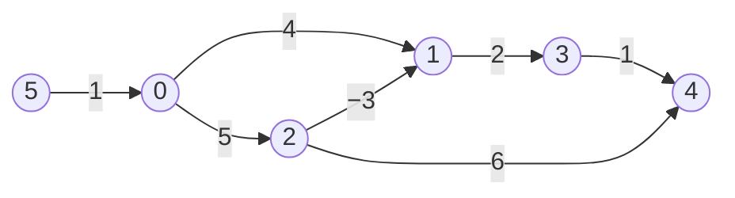
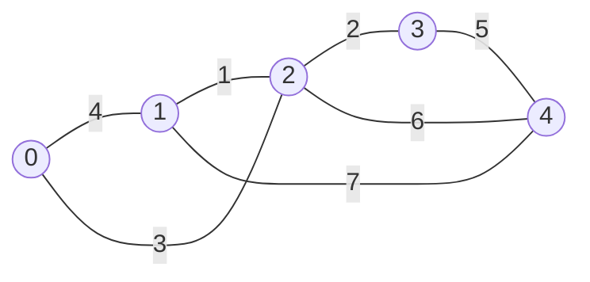

# Bellman–Ford, Floyd–Warshall and minimum spanning trees

> Data Structures & Algorithms · L3 Specialist · Weighted & advanced graphs · about 110 min · hub module `m02` ([open the hub](https://claude.ai/artifact/JfuakQWBwAvSgLi1rcuJUk))

## Why it matters
Some costs are negative (refunds, cash-back, energy won back going downhill), some questions need every pair of distances at once, and some ask for the cheapest way to connect everything rather than the cheapest route. Bellman–Ford, Floyd–Warshall and Prim's algorithm cover those three cases, and each is a short loop you can write from memory.

## Pre-question (answer before reading)
**Q:** One road on the trip map has a cash-back bonus: driving it pays you 3, so its cost is −3. Why could “always finish the closest town first” (Dijkstra) get a cost wrong, and what simpler idea always works?

<details><summary>Answer</summary>

A town finished early might later be reached more cheaply through the bonus road. The simpler idea is to relax every road, over and over. As long as no loop of roads keeps paying you, some cheapest route to each town uses at most V − 1 roads, so V − 1 rounds of relaxing every road are enough. That's Bellman–Ford.

</details>

## 🍎 Story time (kid version)
**The toy room and the treasure-map road trip: Ben's evening road check**

Ben's road-trip map has toll roads, and a few bonus roads that pay drivers (negative costs). Each evening Ben goes through his whole list of roads once. For each road he asks: does “the best cost written at its start + this road” beat the number written at its end? If so, he writes the smaller number. A best route visits each town at most once, so it has fewer roads than there are towns. After that many evenings (towns − 1), every number is right. Tara adds a test: one more evening. If any number still drops, some loop of roads pays more than it costs, and driving round it would get cheaper forever.

| In the story | In code |
|---|---|
| One evening: going through the whole list of roads | One round of Bellman–Ford: relax every edge, O(E) |
| Writing the smaller number when “start + road” beats it | Relaxation: dist[v] = min(dist[v], dist[u] + w) |
| Bonus roads that pay drivers | Negative edge weights, which Dijkstra can't handle |
| Towns − 1 evenings make every number right | V − 1 rounds: without a negative cycle, some shortest path to each vertex has at most V − 1 edges |
| A number still drops on one more evening | A V-th round that still improves means a negative cycle is reachable |

**Where the story breaks:** Ben writes new numbers as he goes, so a number written early in an evening can be used again later that same evening: one evening can add several roads to a route. That's harmless for plain cheapest routes, but for “at most k roads” (Cheapest Flights Within K Stops) each round must read a copy of the previous round's numbers.

## Key ideas (grown-up version)
- **Bellman–Ford** allows negative edge weights. Set dist[source] = 0 (∞ elsewhere), then run up to V − 1 rounds, each relaxing every edge. After round i, every vertex that has a shortest path of at most i edges has its final distance, and without a negative cycle every vertex has a shortest path of at most V − 1 edges. Stop early when a round changes nothing. O(V · E) time, O(V) extra space.
- **Negative cycles**: if a V-th round still lowers some distance, a negative cycle is reachable from the source, and no vertex reachable from that cycle has a shortest distance (it's −∞). A cycle the source can't reach never shows up; to test the whole graph, start every dist at 0, as if a new source had a 0-weight edge to every vertex.
- **At most k edges** (Cheapest Flights Within K Stops): run exactly k rounds, each reading a **copy** of the previous round's distances. Relaxing in place lets a value set early in a round be used again later in the same round, so one round can add several edges and break the limit.
- **Floyd–Warshall** gives every pair: start with d[i][j] = the edge weight (0 on the diagonal, ∞ where there's no edge), then for each k, set d[i][j] = min(d[i][j], d[i][k] + d[k][j]). After the pass for k, d[i][j] is the shortest path whose middle vertices all come from 0..k, so k must be the outermost loop. O(V³) time, O(V²) space; negative edges are fine, and a negative cycle shows up as some d[i][i] < 0.
- **Transitive closure**: the same triple loop on booleans, reach[i][j] = reach[i][j] or (reach[i][k] and reach[k][j]), answers “can i reach j?” for every pair (Course Schedule IV) in O(V³) time.
- **Minimum spanning tree (MST)**: V − 1 edges that connect every vertex of a connected, undirected, weighted graph with the least total weight. **Cut property**: split the vertices into two groups in any way; a lightest edge crossing the split belongs to some MST. Kruskal (L2, module 07) applies it to the cheapest remaining edge, with union-find, in O(E log E).
- **Prim's algorithm** grows one tree from any vertex, always adding the cheapest edge that leaves the tree (the cut property with the tree as one side). With a heap and lazy deletion: O(E log V) time and O(V + E) space. On dense graphs (E close to V²), the array version, which scans for the closest vertex outside the tree, is O(V²) and wins.
- **An MST is not a shortest-path tree**: an MST minimises the total weight of its edges; a shortest-path tree (Dijkstra's parent links) minimises each vertex's distance from one source. In a triangle with A–B 2, B–C 2 and A–C 3, the MST is A–B + B–C (total 4), yet the shortest path from A to C is the direct edge (3, not 4).

## Diagrams
**Bellman–Ford from 0: a negative edge, and a cycle that would turn negative**



_Distances from 0: 0 2 5 4 5, and 5 is unreachable. Through the −3 edge, 0 → 2 → 1 (cost 2) beats 0 → 1 (cost 4). A Dijkstra that never revisits a popped vertex would pop 1 at 4 and leave 3 at 6 and 4 at 7. Adding an edge 4 → 2 of weight −7 closes the cycle 2 → 1 → 3 → 4 → 2 with total −7: the second graph in the first code block._

**Floyd–Warshall's final matrix for the second code block (row = from, column = to)**

| from 0 | 0 | 1 | 2 | 3 |
|---|---|---|---|---|
| value | 0 | 4 | 2 | 3 |

| from 1 | 0 | 1 | 2 | 3 |
|---|---|---|---|---|
| value | 1 | 0 | **−2** | **−1** |

| from 2 | 0 | 1 | 2 | 3 |
|---|---|---|---|---|
| value | 3 | 7 | 0 | 1 |

| from 3 | 0 | 1 | 2 | 3 |
|---|---|---|---|---|
| value | ∞ | ∞ | ∞ | 0 |

_Row 1 uses the negative edge 1 → 2: 1 → 2 → 3 costs −1. Row 3 is ∞ except for itself, because 3 has no outgoing edges. Every diagonal entry is 0, so there's no negative cycle._

**Prim from 0 on the L2 Kruskal graph: the same MST, total 11**



_Prim adds 0–2 (3), 2–1 (1), 2–3 (2), then 3–4 (5); Kruskal took the same edges in weight order (1–2, 2–3, 0–2, 3–4). The shortest path from 0 to 4 is 0 → 2 → 4 (cost 9) and uses edge 2–4, which isn't in the MST; the MST's route 0 → 2 → 3 → 4 costs 10._

## Comparisons
**Shortest-path algorithms side by side**

|  | Dijkstra (heap) | Bellman–Ford | Floyd–Warshall |
|---|---|---|---|
| Answers | One source to every vertex | One source to every vertex | Every pair |
| Negative edges | No | Yes | Yes |
| Negative cycles | Not allowed (no negative edges at all) | Detects one reachable from the source | Detects any: some d[i][i] < 0 |
| Time | O((V + E) log V) | O(V · E) | O(V³) |
| Extra space | O(V + E) | O(V) | O(V²) |
| Sweet spot | Large sparse graphs, weights ≥ 0 | Negative edges; “at most k edges” | Up to a few hundred vertices; transitive closure |

**Prim or Kruskal?**

|  | Prim (heap) | Prim (array) | Kruskal (L2) |
|---|---|---|---|
| Idea | Grow one tree; add the cheapest edge leaving it | The same, scanning an array for the closest vertex outside the tree | Sort all the edges; keep each one that joins two components |
| Data structure | Min-heap with lazy deletion | Two arrays of size V | Union-find |
| Time | O(E log V) | O(V²) | O(E log E) |
| Best for | Sparse graphs as adjacency lists | Dense graphs, E close to V² | Edge lists; on a disconnected graph it gives a minimum spanning forest |

## Code (JavaScript + Python)
### The heap helper used by Prim's algorithm below
```python
import heapq                                  # a min-heap on a plain list
```

```javascript
class MinHeap {                               // JavaScript has no built-in heap
  constructor(less) { this.a = []; this.less = less; }   // less(a, b): should a come out before b?
  get size() { return this.a.length; }
  peek() { return this.a[0]; }
  push(x) {                                   // O(log n): sift up
    const a = this.a;
    a.push(x);
    let i = a.length - 1;
    while (i > 0) {
      const p = (i - 1) >> 1;                 // parent index
      if (!this.less(a[i], a[p])) break;
      [a[i], a[p]] = [a[p], a[i]];
      i = p;
    }
  }
  pop() {                                     // O(log n): sift down
    const a = this.a, top = a[0], last = a.pop();
    if (a.length) {
      a[0] = last;
      let i = 0;
      for (;;) {
        const l = 2 * i + 1, r = l + 1;
        let m = i;
        if (l < a.length && this.less(a[l], a[m])) m = l;
        if (r < a.length && this.less(a[r], a[m])) m = r;
        if (m === i) break;
        [a[i], a[m]] = [a[m], a[i]];
        i = m;
      }
    }
    return top;
  }
}
```

### Bellman–Ford with negative-cycle detection
```python
def bellman_ford(n, edges, src):
    dist = [float("inf")] * n
    dist[src] = 0
    for _ in range(n - 1):                        # V - 1 rounds
        changed = False
        for u, v, w in edges:
            if dist[u] + w < dist[v]:             # inf + w stays inf: an unreached u changes nothing
                dist[v] = dist[u] + w
                changed = True
        if not changed:
            break                                 # a quiet round: every distance is final
    for u, v, w in edges:                         # round V
        if dist[u] + w < dist[v]:
            return None                           # still improving: a reachable negative cycle
    return dist

def show(dist):
    if dist is None:
        return "negative cycle"
    return " ".join("INF" if d == float("inf") else str(d) for d in dist)

edges = [(0, 1, 4), (0, 2, 5), (2, 1, -3), (1, 3, 2), (3, 4, 1), (2, 4, 6), (5, 0, 1)]
print(show(bellman_ford(6, edges, 0)))
print(show(bellman_ford(6, edges + [(4, 2, -7)], 0)))
```

Output:
```text
0 2 5 4 5 INF
negative cycle
```

- line 7: An unreached u has dist ∞, and ∞ + w is still ∞, so it never relaxes anything. With a finite stand-in such as `10**9` you'd need an explicit check, or `10**9 + (-3)` would look like an improvement.
- line 11: If a whole round changes nothing, no later round can: stop early.
- line 14: After V − 1 rounds every shortest path has been found, so any further improvement must come from a negative cycle.

```javascript
function bellmanFord(n, edges, src) {
  const dist = new Array(n).fill(Infinity);
  dist[src] = 0;
  for (let round = 1; round < n; round++) {       // V - 1 rounds
    let changed = false;
    for (const [u, v, w] of edges) {
      if (dist[u] + w < dist[v]) {                // Infinity + w stays Infinity
        dist[v] = dist[u] + w;
        changed = true;
      }
    }
    if (!changed) break;                          // a quiet round: every distance is final
  }
  for (const [u, v, w] of edges) {                // round V
    if (dist[u] + w < dist[v]) return null;       // still improving: a reachable negative cycle
  }
  return dist;
}

const show = dist => (dist === null ? "negative cycle" : dist.map(d => (d === Infinity ? "INF" : d)).join(" "));
const edges = [[0, 1, 4], [0, 2, 5], [2, 1, -3], [1, 3, 2], [3, 4, 1], [2, 4, 6], [5, 0, 1]];
console.log(show(bellmanFord(6, edges, 0)));
console.log(show(bellmanFord(6, [...edges, [4, 2, -7]], 0)));
```

Output:
```text
0 2 5 4 5 INF
negative cycle
```

- line 7: An unreached u has dist Infinity, and Infinity + w is still Infinity, so it never relaxes anything.
- line 12: If a whole round changes nothing, no later round can: stop early.
- line 15: After V − 1 rounds every shortest path has been found, so any further improvement must come from a negative cycle.

### Floyd–Warshall: every pair, with k outermost
```python
def floyd_warshall(n, edges):
    INF = float("inf")
    d = [[0 if i == j else INF for j in range(n)] for i in range(n)]
    for u, v, w in edges:
        d[u][v] = min(d[u][v], w)                 # keep the cheapest of repeated edges
    for k in range(n):                            # allow k as a middle vertex: outermost
        for i in range(n):
            for j in range(n):
                if d[i][k] + d[k][j] < d[i][j]:
                    d[i][j] = d[i][k] + d[k][j]
    return d

def has_negative_cycle(d):
    return any(d[i][i] < 0 for i in range(len(d)))

d = floyd_warshall(4, [(0, 1, 4), (1, 2, -2), (2, 0, 3), (0, 3, 8), (2, 3, 1)])
for row in d:
    print(*("INF" if x == float("inf") else x for x in row))
print("negative cycle" if has_negative_cycle(d) else "no negative cycle")
print("negative cycle" if has_negative_cycle(floyd_warshall(3, [(0, 1, 1), (1, 2, -2), (2, 1, 1)])) else "no negative cycle")
```

Output:
```text
0 4 2 3
1 0 -2 -1
3 7 0 1
INF INF INF 0
no negative cycle
negative cycle
```

- line 6: k is the outermost loop: after its pass, d[i][j] may use any of 0..k as middle vertices.
- line 14: A negative cycle through i makes the round trip i → … → i cost less than 0.

```javascript
function floydWarshall(n, edges) {
  const d = Array.from({ length: n }, (_, i) => Array.from({ length: n }, (_, j) => (i === j ? 0 : Infinity)));
  for (const [u, v, w] of edges) d[u][v] = Math.min(d[u][v], w);   // keep the cheapest of repeated edges
  for (let k = 0; k < n; k++)                     // allow k as a middle vertex: outermost
    for (let i = 0; i < n; i++)
      for (let j = 0; j < n; j++)
        if (d[i][k] + d[k][j] < d[i][j]) d[i][j] = d[i][k] + d[k][j];
  return d;
}

const hasNegativeCycle = d => d.some((row, i) => row[i] < 0);

const d = floydWarshall(4, [[0, 1, 4], [1, 2, -2], [2, 0, 3], [0, 3, 8], [2, 3, 1]]);
for (const row of d) console.log(...row.map(x => (x === Infinity ? "INF" : x)));
console.log(hasNegativeCycle(d) ? "negative cycle" : "no negative cycle");
console.log(hasNegativeCycle(floydWarshall(3, [[0, 1, 1], [1, 2, -2], [2, 1, 1]])) ? "negative cycle" : "no negative cycle");
```

Output:
```text
0 4 2 3
1 0 -2 -1
3 7 0 1
INF INF INF 0
no negative cycle
negative cycle
```

- line 4: k is the outermost loop: after its pass, d[i][j] may use any of 0..k as middle vertices.
- line 11: A negative cycle through i makes the round trip i → … → i cost less than 0.

### Prim's MST with a heap (lazy deletion)
```python
def prim(n, edges):                               # undirected edges (u, v, w); start at 0
    graph = [[] for _ in range(n)]
    for u, v, w in edges:
        graph[u].append((w, v))
        graph[v].append((w, u))
    in_tree = [False] * n
    heap = [(0, 0, -1)]                           # (edge weight, vertex, the tree vertex it hangs from)
    total, chosen = 0, []
    while heap:
        w, u, frm = heapq.heappop(heap)
        if in_tree[u]:
            continue                              # stale: u already joined by a cheaper edge
        in_tree[u] = True
        total += w
        if frm != -1:
            chosen.append((frm, u))
        for wv, v in graph[u]:
            if not in_tree[v]:
                heapq.heappush(heap, (wv, v, u))  # a candidate edge leaving the tree
    return total, chosen

total, chosen = prim(5, [(0, 1, 4), (1, 2, 1), (0, 2, 3), (2, 3, 2), (3, 4, 5), (1, 4, 7), (2, 4, 6)])
print(total, *(f"{a}-{b}" for a, b in chosen))
```

Output:
```text
11 0-2 2-1 2-3 3-4
```

- line 10: Once stale pairs are skipped (next line), the popped edge is the cheapest one leaving the tree, so the cut property says it's safe to add.
- line 12: Lazy deletion again: an edge whose far end has already joined the tree is skipped.

```javascript
function prim(n, edges) {                         // undirected edges [u, v, w]; start at 0
  const graph = Array.from({ length: n }, () => []);
  for (const [u, v, w] of edges) {
    graph[u].push([w, v]);
    graph[v].push([w, u]);
  }
  const inTree = new Array(n).fill(false), chosen = [];
  const heap = new MinHeap((a, b) => a[0] < b[0]);   // [edge weight, vertex, the tree vertex it hangs from]
  heap.push([0, 0, -1]);
  let total = 0;
  while (heap.size) {
    const [w, u, from] = heap.pop();
    if (inTree[u]) continue;                      // stale: u already joined by a cheaper edge
    inTree[u] = true;
    total += w;
    if (from !== -1) chosen.push([from, u]);
    for (const [wv, v] of graph[u]) {
      if (!inTree[v]) heap.push([wv, v, u]);      // a candidate edge leaving the tree
    }
  }
  return [total, chosen];
}

const [total, chosen] = prim(5, [[0, 1, 4], [1, 2, 1], [0, 2, 3], [2, 3, 2], [3, 4, 5], [1, 4, 7], [2, 4, 6]]);
console.log(total, ...chosen.map(([a, b]) => `${a}-${b}`));
```

Output:
```text
11 0-2 2-1 2-3 3-4
```

- line 12: Once stale pairs are skipped (next line), the popped edge is the cheapest one leaving the tree, so the cut property says it's safe to add.
- line 13: Lazy deletion again: an edge whose far end has already joined the tree is skipped.

## Worked example
**Problem.** Flights `[from, to, price]` join n cities (every price ≥ 1). Find the cheapest price from src to dst using at most k stops, or −1 if there's no such route (LeetCode 787, Cheapest Flights Within K Stops).

1. Without the limit this is a plain shortest path. The limit is on edges: at most k stops means at most k + 1 flights.
2. If every round of Bellman–Ford adds exactly one more flight, then after round i the prices are the cheapest using at most i flights. So run exactly k + 1 rounds.
3. Each round must read a copy of the previous round's prices. In place, a price set early in a round can feed a later flight in the same round, so a route could gain several flights in one round and break the limit.
4. Dijkstra on the cities alone is wrong here: the cheapest route might have too many stops. Dijkstra over (city, flights used) states also works, with more code.
5. O((k + 1) · (n + E)) time (each round copies n prices and scans E flights) and O(n) extra space.

```python
def find_cheapest_price(n, flights, src, dst, k):
    price = [float("inf")] * n
    price[src] = 0
    for _ in range(k + 1):                        # at most k stops = at most k + 1 flights
        prev = price[:]                           # read only last round's prices
        for u, v, p in flights:
            if prev[u] + p < price[v]:
                price[v] = prev[u] + p
    return price[dst] if price[dst] < float("inf") else -1

flights = [[0, 1, 100], [1, 2, 100], [2, 3, 100], [0, 3, 500], [1, 3, 300]]
print(*(find_cheapest_price(4, flights, 0, 3, k) for k in range(3)), find_cheapest_price(4, flights, 3, 0, 2))
```

Output:
```text
500 400 300 -1
```

```javascript
function findCheapestPrice(n, flights, src, dst, k) {
  const price = new Array(n).fill(Infinity);
  price[src] = 0;
  for (let round = 0; round <= k; round++) {      // at most k stops = at most k + 1 flights
    const prev = [...price];                      // read only last round's prices
    for (const [u, v, p] of flights) {
      if (prev[u] + p < price[v]) price[v] = prev[u] + p;
    }
  }
  return price[dst] < Infinity ? price[dst] : -1;
}

const flights = [[0, 1, 100], [1, 2, 100], [2, 3, 100], [0, 3, 500], [1, 3, 300]];
console.log(...[0, 1, 2].map(k => findCheapestPrice(4, flights, 0, 3, k)), findCheapestPrice(4, flights, 3, 0, 2));
```

Output:
```text
500 400 300 -1
```

**Answer.** 500, 400, 300 and −1. With no stops, only the direct flight 0 → 3 (500) is allowed; one stop allows 0 → 1 → 3 (400); two stops allow 0 → 1 → 2 → 3 (300). There are no flights out of city 3, so 3 → 0 is −1.

## Your turn (faded example)
**Problem.** n cities are joined by two-way roads `[u, v, weight]`. Return the city that can reach the fewest other cities within `distanceThreshold`; if several tie, return the one with the largest number (LeetCode 1334, Find the City With the Smallest Number of Neighbors at a Threshold Distance).

- ✓ You need the distance between every pair of cities, and n ≤ 100, so Floyd–Warshall's O(n³), about 10⁶ steps, is fine.
- **Which loop must be outermost, and why?**
  <details><summary>Answer</summary>k, the middle city: after the pass for k, d[i][j] may use any of cities 0..k in the middle, and each pass builds on the previous pass being complete for every pair.</details>
- **How do you return the largest city number on a tie?**
  <details><summary>Answer</summary>Scan i upwards and take a city whenever its count is ≤ the best so far (≤, not <), so a later, larger city wins a tie. Or scan downwards with <.</details>
- **Time and space?**
  <details><summary>Answer</summary>O(n³) time and O(n²) space.</details>

Starter:
```python
def find_the_city(n, edges, distance_threshold):
    INF = float("inf")
    d = [[0 if i == j else INF for j in range(n)] for i in range(n)]
    for u, v, w in edges:                         # two-way roads
        d[u][v] = d[v][u] = w
    ...                                           # TODO: Floyd-Warshall with k outermost
    best_city, best_count = -1, n
    ...                                           # TODO: count each city's reachable cities; a tie goes to the larger city
    return best_city
```

```javascript
function findTheCity(n, edges, distanceThreshold) {
  const d = Array.from({ length: n }, (_, i) => Array.from({ length: n }, (_, j) => (i === j ? 0 : Infinity)));
  for (const [u, v, w] of edges) d[u][v] = d[v][u] = w;   // two-way roads
  // TODO: Floyd-Warshall with k outermost
  let bestCity = -1, bestCount = n;
  // TODO: count each city's reachable cities; a tie goes to the larger city
  return bestCity;
}
```

<details><summary>Full solution</summary>

```python
def find_the_city(n, edges, distance_threshold):
    INF = float("inf")
    d = [[0 if i == j else INF for j in range(n)] for i in range(n)]
    for u, v, w in edges:                         # two-way roads
        d[u][v] = d[v][u] = w
    for k in range(n):                            # k outermost
        for i in range(n):
            for j in range(n):
                if d[i][k] + d[k][j] < d[i][j]:
                    d[i][j] = d[i][k] + d[k][j]
    best_city, best_count = -1, n
    for i in range(n):
        count = sum(1 for j in range(n) if j != i and d[i][j] <= distance_threshold)
        if count <= best_count:                   # <=: a later, larger city wins a tie
            best_city, best_count = i, count
    return best_city

print(find_the_city(4, [[0, 1, 1], [1, 2, 5], [2, 3, 1]], 2),
      find_the_city(5, [[0, 1, 2], [1, 2, 2], [2, 3, 2], [3, 4, 1]], 3))
```

Output:
```text
3 0
```

```javascript
function findTheCity(n, edges, distanceThreshold) {
  const d = Array.from({ length: n }, (_, i) => Array.from({ length: n }, (_, j) => (i === j ? 0 : Infinity)));
  for (const [u, v, w] of edges) d[u][v] = d[v][u] = w;   // two-way roads
  for (let k = 0; k < n; k++)                     // k outermost
    for (let i = 0; i < n; i++)
      for (let j = 0; j < n; j++)
        if (d[i][k] + d[k][j] < d[i][j]) d[i][j] = d[i][k] + d[k][j];
  let bestCity = -1, bestCount = n;
  for (let i = 0; i < n; i++) {
    const count = d[i].filter((x, j) => j !== i && x <= distanceThreshold).length;
    if (count <= bestCount) {                     // <=: a later, larger city wins a tie
      bestCity = i;
      bestCount = count;
    }
  }
  return bestCity;
}

console.log(findTheCity(4, [[0, 1, 1], [1, 2, 5], [2, 3, 1]], 2),
            findTheCity(5, [[0, 1, 2], [1, 2, 2], [2, 3, 2], [3, 4, 1]], 3));
```

Output:
```text
3 0
```

</details>

## Socratic checks and quiz (answers hidden)
**1. What does this print?**

```python
flights = [(0, 1, 100), (1, 2, 100), (2, 3, 100), (0, 3, 500)]
INF = float("inf")
a = [0, INF, INF, INF]                    # relaxed in place
b = [0, INF, INF, INF]                    # relaxed from a copy
prev = b[:]
for u, v, p in flights:
    a[v] = min(a[v], a[u] + p)
    b[v] = min(b[v], prev[u] + p)
print(a[3], b[3])
```

```javascript
const flights = [[0, 1, 100], [1, 2, 100], [2, 3, 100], [0, 3, 500]];
const a = [0, Infinity, Infinity, Infinity];   // relaxed in place
const b = [0, Infinity, Infinity, Infinity];   // relaxed from a copy
const prev = [...b];
for (const [u, v, p] of flights) {
  a[v] = Math.min(a[v], a[u] + p);
  b[v] = Math.min(b[v], prev[u] + p);
}
console.log(a[3], b[3]);
```

- A. 300 500
- B. 500 500
- C. 300 300
- D. 500 300

<details><summary>Answer</summary>

300 500. In place, a[1] = 100 is used straight away for 1 → 2, then a[2] for 2 → 3: one round took three flights, so a[3] = 300. The copy only allows routes of one flight: b[3] = 500, the direct flight. With k = 0, 500 is right.

</details>

**2. What does this print?**

```python
def rounds_needed(n, edges):
    dist = [0] + [float("inf")] * (n - 1)
    rounds = 0
    for _ in range(n - 1):
        rounds += 1
        changed = False
        for u, v, w in edges:
            if dist[u] + w < dist[v]:
                dist[v] = dist[u] + w
                changed = True
        if not changed:
            break
    return rounds

chain = [(0, 1, 1), (1, 2, 1), (2, 3, 1), (3, 4, 1)]
print(rounds_needed(5, chain), rounds_needed(5, chain[::-1]))
```

```javascript
function roundsNeeded(n, edges) {
  const dist = [0, ...new Array(n - 1).fill(Infinity)];
  let rounds = 0;
  for (let r = 0; r < n - 1; r++) {
    rounds++;
    let changed = false;
    for (const [u, v, w] of edges) {
      if (dist[u] + w < dist[v]) {
        dist[v] = dist[u] + w;
        changed = true;
      }
    }
    if (!changed) break;
  }
  return rounds;
}

const chain = [[0, 1, 1], [1, 2, 1], [2, 3, 1], [3, 4, 1]];
console.log(roundsNeeded(5, chain), roundsNeeded(5, chain.toReversed()));
```

- A. 2 4
- B. 1 4
- C. 4 4
- D. 2 5

<details><summary>Answer</summary>

2 4. In path order, one round sets every distance and the second round is quiet, so it stops at 2. In reverse order each round reaches only one more vertex, so it needs all V − 1 = 4 rounds, and the loop never runs a fifth.

</details>

**3. Why must k be the outermost loop in Floyd–Warshall?**

- A. After the pass for k, d[i][j] is the shortest path using only vertices 0..k in the middle, and that pass needs the previous pass finished for every pair
- B. Putting k outermost is only faster; any loop order gives the same distances
- C. k must be outermost so that negative edges are handled
- D. The order doesn't matter as long as i comes before j

<details><summary>Answer</summary>

After the pass for k, d[i][j] is the shortest path using only vertices 0..k in the middle, and that pass needs the previous pass finished for every pair. With i or j outermost, some d[i][k] or d[k][j] is read before it has been improved by the vertices it needs, so some distances come out too big. With k outermost, the order of i and j inside is free.

</details>

**4. Which of these stay correct when some edge weights are negative (but there's no negative cycle)? (choose 3)**

- A. Bellman–Ford
- B. Floyd–Warshall
- C. Prim's minimum spanning tree algorithm
- D. Dijkstra's algorithm that never revisits a popped vertex
- E. BFS counting edges

<details><summary>Answer</summary>

Bellman–Ford, Floyd–Warshall, Prim's minimum spanning tree algorithm. Bellman–Ford and Floyd–Warshall only ever take minimums of real path costs. Prim's (and Kruskal's) algorithm only compares weights, so negative weights are fine for MSTs. Dijkstra's “popped means final” needs weights ≥ 0, and BFS ignores weights altogether.

</details>

**5. Judge each statement.**

- Bellman–Ford can stop as soon as a whole round changes nothing.
- After Floyd–Warshall, some d[i][i] < 0 means the graph has a negative cycle.
- A minimum spanning tree contains a shortest path from any one vertex to every other.
- For “at most k flights”, relaxing in place is fine because it only ever lowers prices.

<details><summary>Answer</summary>

Bellman–Ford can stop as soon as a whole round changes nothing.: Yes; After Floyd–Warshall, some d[i][i] < 0 means the graph has a negative cycle.: Yes; A minimum spanning tree contains a shortest path from any one vertex to every other.: No; For “at most k flights”, relaxing in place is fine because it only ever lowers prices.: No. A quiet round means every edge is already satisfied. A negative d[i][i] is a round trip that costs less than nothing. An MST minimises total weight, not each distance (the triangle A–B 2, B–C 2, A–C 3). In place, a lower price can come from a route with too many flights.

</details>

**6. Put Bellman–Ford with negative-cycle detection in order.**

- (put the steps in order)

<details><summary>Answer</summary>

Set dist[source] = 0 and every other dist to ∞ → Relax every edge once: one round → Repeat the rounds, up to V − 1 in total, stopping early if a round changes nothing → Run one more round over every edge → If anything still improves, report a negative cycle; otherwise dist holds the shortest distances. The extra round only means something after the V − 1 rounds, and its result decides the answer.

</details>

**7. Complete this JavaScript Floyd–Warshall with negative-cycle detection.**

```
function floydWarshall(n, edges) {
  const d = Array.from({ length: n }, (_, i) => Array.from({ length: n }, (_, j) => (i === j ? {{0}} : Infinity)));
  for (const [u, v, w] of edges) d[u][v] = Math.min(d[u][v], w);
  for (let k = 0; k < n; k++)
    for (let i = 0; i < n; i++)
      for (let j = 0; j < n; j++)
        d[i][j] = Math.min(d[i][j], {{1}});
  const negativeCycle = d.some((row, i) => row[i] {{2}} 0);
  return [d, negativeCycle];
}

```

<details><summary>Answer</summary>

0 | d[i][k] + d[k][j] | <. The diagonal starts at 0 (staying put is free), the update goes i → k → j, and a negative cycle shows up as a diagonal entry below 0. Any other start for the diagonal or other comparison flags the wrong graphs.

</details>

**8. Match each task to the technique.**


<details><summary>Answer</summary>

One source, some negative edges = Bellman–Ford: V − 1 rounds, then one check round; Every pair of distances, V ≤ 400 = Floyd–Warshall; The cheapest cable network linking every office = A minimum spanning tree (Prim or Kruskal); The cheapest flight with at most k legs = k rounds of relaxation, each reading a copy. Negative edges need Bellman–Ford; all pairs on a small graph is Floyd–Warshall; connecting everything cheaply is an MST; an edge limit is Bellman–Ford with a copy per round.

</details>

## Traps & misconceptions
- **“For at most k flights, relaxing in place is fine.”** In place, a price set earlier in a round can be reused later in the same round, so one round can add several flights. Read from a copy of the previous round's prices, and run exactly k + 1 rounds.
- **“Floyd–Warshall's three loops can go in any order.”** k, the allowed middle vertex, must be outermost: each pass needs the previous pass finished for every pair. Only the order of i and j inside is free.
- **“A big number like 10**9 is a safe ∞.”** With negative edges, `10**9 + (-5) < 10**9`, so a vertex that was never reached seems to improve its neighbours. Use `float('inf')` / `Infinity`, where ∞ + w stays ∞, or skip any u whose distance is still the stand-in.
- **“An MST gives the shortest path from the root to every vertex.”** An MST minimises the total weight of all its edges, not each distance. In the triangle A–B 2, B–C 2, A–C 3, the MST route from A to C costs 4, but the direct edge costs 3.
- **“A Bellman–Ford run from one source finds every negative cycle.”** Only the cycles it can reach. To check the whole graph, start every dist at 0, as if a new source had a 0-weight edge to every vertex.
- **“Prim's and Kruskal's algorithms need non-negative weights.”** They only compare weights, so negative weights are fine. Adding a constant c to every weight adds (V − 1) × c to every spanning tree, so the cheapest tree stays the cheapest.

## Discussion prompts
- **Why does the k-stops problem need a copy, when plain Bellman–Ford doesn't?**
  <details><summary>One good answer</summary>Plain Bellman–Ford only needs each dist to be the cost of some real route, and in-place updates just find cheap routes sooner. With a limit, round i must mean “at most i edges”. In place, a price set through edge a → b can feed edge b → c in the same round, so a route gains two edges in one round. Reading from a copy makes each round add exactly one edge.</details>
- **When would you pick Floyd–Warshall over running Dijkstra from every vertex?**
  <details><summary>One good answer</summary>Floyd–Warshall is O(V³) with tiny constants, allows negative edges and is a few lines, so it's ideal up to a few hundred vertices or on dense graphs. V runs of Dijkstra cost O(V (V + E) log V), better for large sparse graphs with weights ≥ 0. With negative edges on a large sparse graph, Johnson's algorithm reweights the edges using one Bellman–Ford run, then runs Dijkstra from every vertex.</details>

## Teach-back
**Prompt:** Explain to a junior colleague how Bellman–Ford finds shortest paths with negative edges, how it detects a negative cycle, and what changes for “at most k edges”.

Rubric:
- [ ] Each round relaxes every edge; V − 1 rounds, because a shortest path needs at most V − 1 edges
- [ ] Stop early when a round changes nothing
- [ ] A V-th round that still improves something means a reachable negative cycle
- [ ] At most k edges: exactly k rounds, each reading a copy of the previous round
- [ ] O(V · E) time and O(V) extra space

<details><summary>Model answer</summary>

Bellman–Ford starts with dist = 0 at the source and ∞ elsewhere, then relaxes every edge in rounds: for each edge u → v of weight w, if dist[u] + w < dist[v], it lowers dist[v]. After round i, every vertex with a shortest path of at most i edges has its final distance. Without a negative cycle every vertex has a shortest path of at most V − 1 edges, so V − 1 rounds are enough, and a round that changes nothing means you can stop early. If a V-th round still lowers something, a negative cycle is reachable from the source and some distances have no minimum. For “at most k edges”, run exactly k rounds and read dist[u] from a copy of the previous round, because in place one round can extend a path by several edges. It costs O(V · E) time and O(V) extra space.

</details>

## Quick Q&A (also in the SRS deck)
- **Bellman–Ford: time and extra space?** O(V · E) time and O(V) extra space.
- **How does Bellman–Ford detect a negative cycle?** If a V-th round still lowers some distance, a negative cycle is reachable from the source.
- **Why does the “at most k edges” variant read a copy?** So each round adds exactly one edge; in place, one round can add several.
- **Floyd–Warshall's update, and which loop is outermost?** d[i][j] = min(d[i][j], d[i][k] + d[k][j]), with k outermost.
- **What is the cut property?** For any split of the vertices into two groups, a lightest edge crossing the split belongs to some MST.
- **Prim's algorithm: heap version and dense version?** O(E log V) with a heap and lazy deletion; O(V²) with arrays, better when E is close to V².

## Practice problems
- [ ] [LC 787 · Cheapest Flights Within K Stops](https://leetcode.com/problems/cheapest-flights-within-k-stops/) · Medium · k + 1 rounds of Bellman–Ford, each reading a copy of the previous round
- [ ] [LC 1334 · Find the City With the Smallest Number of Neighbors at a Threshold Distance](https://leetcode.com/problems/find-the-city-with-the-smallest-number-of-neighbors-at-a-threshold-distance/) · Medium · Floyd–Warshall, then count per city; a tie goes to the larger index
- [ ] [LC 1462 · Course Schedule IV](https://leetcode.com/problems/course-schedule-iv/) · Medium · transitive closure: Floyd–Warshall on booleans (or a BFS from every course)
- [ ] [LC 399 · Evaluate Division](https://leetcode.com/problems/evaluate-division/) · Medium · edges a → b of weight a/b and b → a of b/a; multiply along a path (or Floyd–Warshall with × in place of +)
- [ ] [LC 1489 · Find Critical and Pseudo-Critical Edges in Minimum Spanning Tree](https://leetcode.com/problems/find-critical-and-pseudo-critical-edges-in-minimum-spanning-tree/) · Hard · find the MST weight; an edge is critical if leaving it out raises the weight (or disconnects), pseudo-critical if forcing it in keeps the weight

## Sources (accessed 2026-10-09)
- [cp-algorithms: Bellman–Ford algorithm](https://cp-algorithms.com/graph/bellman_ford.html)
- [cp-algorithms: Floyd–Warshall algorithm](https://cp-algorithms.com/graph/all-pair-shortest-path-floyd-warshall.html)
- [cp-algorithms: Minimum spanning tree, Prim's algorithm](https://cp-algorithms.com/graph/mst_prim.html)
- [Wikipedia: Minimum spanning tree](https://en.wikipedia.org/wiki/Minimum_spanning_tree)
