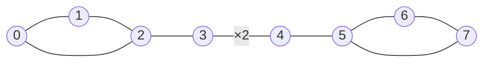
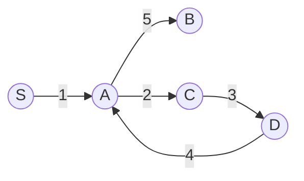

# Bridges, articulation points and Euler paths

> Data Structures & Algorithms · L3 Specialist · Weighted & advanced graphs · about 110 min · hub module `m03` ([open the hub](https://claude.ai/artifact/JfuakQWBwAvSgLi1rcuJUk))

## Why it matters
Which single cable, road or server can fail and split a network in two? One DFS answers that for every edge and every vertex at once. The opposite question, a route that uses every road exactly once (a postman's round, a chain of dominoes, a ticket itinerary), has a neat linear-time answer too.

## Pre-question (answer before reading)
**Q:** On a town's road map, which roads would cut the town in two if they were closed? Is there anything faster than closing each road in turn and checking whether the town is still connected?

<details><summary>Answer</summary>

Yes: one DFS. A road can only split the town if it lies on no loop. While exploring, record when each junction was first reached and how early its part of the search tree can reach back through a shortcut. If the junctions below a road can't reach back to the road's upper end or above it, the road is critical. That's O(V + E) instead of O(E · (V + E)).

</details>

## 🍎 Story time (kid version)
**The toy room and the treasure-map road trip: Stickers on the toy railway**

Tara and Ben build a toy railway across the toy room. Ben explores it, sticking a number on each station the first time he reaches it: 1, 2, 3… When a track leads to a station that already has a number, he notes that number: it's a shortcut back. Then each station asks: “from me, or any station Ben reached through me, what's the smallest number we can get back to with one shortcut?” If the stations behind a track can't get back to the track's near end or earlier, that track is a bridge: lift it out and the railway falls into two pieces.

| In the story | In code |
|---|---|
| A number stuck on each station when Ben first reaches it | tin[v], the DFS discovery time |
| A track to a station that already has a number | A back edge: an edge to a vertex the DFS has already visited |
| The smallest number a station, or any station reached through it, can get back to with one shortcut | low[v] = the smallest tin reachable from v's DFS subtree with one back edge |
| The stations behind a track can't get back to its near end or earlier | low[v] > tin[u]: the tree edge u–v is a bridge |
| Lifting that track splits the railway in two | Removing a bridge disconnects the graph |

**Where the story breaks:** Ben counts every track to a numbered station as a shortcut, even the track he has just arrived along. Code must skip that one track, or every station could reach back to its parent and no track would ever look like a bridge. It skips it by its edge id, not by “the station I came from”, so a second, parallel track still counts as a real shortcut.

## Key ideas (grown-up version)
- **The DFS tree**: a DFS uses some edges to reach new vertices (tree edges). In an undirected graph every other edge joins a vertex to one of its ancestors (a back edge); there are no edges across between separate branches.
- **tin and low**: tin[v] is when the DFS first reached v. low[v] is the smallest tin that v's subtree can reach with one back edge: low[v] = min(tin[v], tin[w] for each back edge v–w, low[c] for each child c).
- **Bridge**: a tree edge u–v (u the parent) is a bridge exactly when low[v] > tin[u]: nothing under v can get back to u or above without it. A bridge lies on no cycle, so back edges are never bridges.
- **Articulation point** (cut vertex): a non-root u is one when some child v has low[v] ≥ tin[u]. The root is one when it has two or more DFS children.
- **Repeated edges**: give every edge an id and skip only the edge you arrived by, not every edge back to the parent. Two parallel edges between u and v form a cycle, so neither is a bridge. O(V + E) time and space.
- **Go iterative**: Python's default recursion limit is 1,000 frames and LeetCode 1192 allows 10⁵ vertices; Node's default call stack also overflows long before 10⁵ nested calls. Keep an explicit stack of (vertex, arriving edge id, next neighbour index), and when a vertex is popped, fold its low into its parent's.
- **Euler path or circuit** (every edge exactly once): all edges must be in one connected piece. Undirected: 0 odd-degree vertices (a circuit) or exactly 2 (a path between them). Directed: either every vertex has in = out (a circuit), or the start has out − in = 1, the end has in − out = 1 and the rest are balanced (a path).
- **Hierholzer's algorithm**: walk from the start using up edges; when the top vertex has no unused edge left, pop it onto the answer; reverse at the end. With an explicit stack and each vertex's list of unused edges it's O(V + E) time and space. For the lexicographically smallest route (Reconstruct Itinerary), take each vertex's neighbours in sorted order: O(E log E).

## Diagrams
**Bridges and cut vertices (the first code example)**



_The bridges (highlighted) are 2–3 and 4–5; the cut vertices (highlighted) are 2, 3, 4 and 5. The two parallel edges 3–4 form a cycle of length 2, so neither is a bridge, yet 3 and 4 are still cut vertices._

**tin and low for that graph (DFS from 0, neighbours in edge order)**

| tin | 0 | 1 | 2 | 3 | 4 | 5 | 6 | 7 |
|---|---|---|---|---|---|---|---|---|
| value | 0 | 1 | 2 | 3 | 4 | 5 | 6 | 7 |

| low | 0 | 1 | 2 | 3 | 4 | 5 | 6 | 7 |
|---|---|---|---|---|---|---|---|---|
| value | 0 | 0 | 0 | **3** | 3 | **5** | 5 | 5 |

_low[3] = 3 > tin[2] = 2, so 2–3 is a bridge; low[5] = 5 > tin[4] = 4, so 4–5 is a bridge. The second 3–4 edge lets 4 reach back to 3, so low[4] = 3 = tin[3]: 3–4 is not a bridge, but low[4] ≥ tin[3] makes 3 a cut vertex._

**Hierholzer from S, smallest neighbour first**



_S has out − in = 1, so the path starts there. The first walk S → A → B takes A's smallest neighbour and gets stuck at B with the loop A → C → D → A unused. Backing up, A still has an edge, so the loop is walked and spliced in before B. The numbers give the order in the final path: S A C D A B._

## Comparisons
**Bridges or articulation points?**

|  | Bridge (cut edge) | Articulation point (cut vertex) |
|---|---|---|
| Removing it… | One edge: the graph splits | A vertex and its edges: the graph splits |
| Test (u the DFS parent of v) | low[v] > tin[u] | low[v] ≥ tin[u] for some child v (u not the root) |
| The DFS root | No special case | A cut vertex only with 2+ DFS children |
| Repeated edges | Two parallel edges are never bridges: skip by edge id | They don't change which vertices are cut vertices |
| Cost | O(V + E) time and space | O(V + E) time and space |

**Euler path or circuit?**

|  | Undirected | Directed |
|---|---|---|
| Circuit (ends where it starts) | Every vertex has even degree | Every vertex has in = out |
| Path (not a circuit) | Exactly 2 odd-degree vertices: start at one, end at the other | Start: out − in = 1; end: in − out = 1; the rest balanced |
| Also needed | All edges in one connected piece | All edges in one weakly connected piece |
| Build it | Hierholzer, marking each edge used once (both directions share one id) | Hierholzer, popping from each vertex's out-list |
| Cost | O(V + E) | O(V + E), or O(E log E) for the lexicographically smallest |

## Code (JavaScript + Python)
### Bridges and articulation points (recursive, for small graphs)
```python
def bridges_and_cuts(n, edges):
    graph = [[] for _ in range(n)]
    for i, (u, v) in enumerate(edges):
        graph[u].append((v, i))                   # (neighbour, edge id)
        graph[v].append((u, i))
    tin, low = [-1] * n, [0] * n
    bridges, cuts, timer = [], set(), 0

    def dfs(u, in_edge):
        nonlocal timer
        tin[u] = low[u] = timer
        timer += 1
        children = 0
        for v, eid in graph[u]:
            if eid == in_edge:
                continue                          # skip only the edge we arrived by
            if tin[v] != -1:
                low[u] = min(low[u], tin[v])      # a back edge
            else:
                children += 1
                dfs(v, eid)
                low[u] = min(low[u], low[v])
                if low[v] > tin[u]:
                    bridges.append((min(u, v), max(u, v)))
                if in_edge != -1 and low[v] >= tin[u]:
                    cuts.add(u)                   # v's subtree can't get above u
        if in_edge == -1 and children >= 2:
            cuts.add(u)                           # a root with 2+ DFS children
    for s in range(n):
        if tin[s] == -1:
            dfs(s, -1)
    return sorted(bridges), sorted(cuts)

bridges, cuts = bridges_and_cuts(8, [(0, 1), (1, 2), (2, 0), (2, 3), (3, 4), (3, 4), (4, 5), (5, 6), (6, 7), (7, 5)])
print("bridges:", *(f"{a}-{b}" for a, b in bridges), "| cut vertices:", *cuts)
```

Output:
```text
bridges: 2-3 4-5 | cut vertices: 2 3 4 5
```

- line 15: Skip by edge id, not by parent vertex: the second 3–4 edge must still count as a back edge.
- line 23: Nothing under v reaches u or above without this edge, so u–v is a bridge.
- line 26: v's subtree can't get past u, so removing u cuts it off. The root is excluded: low[v] ≥ tin[root] is always true.

```javascript
function bridgesAndCuts(n, edges) {
  const graph = Array.from({ length: n }, () => []);
  edges.forEach(([u, v], i) => {
    graph[u].push([v, i]);                        // [neighbour, edge id]
    graph[v].push([u, i]);
  });
  const tin = new Array(n).fill(-1), low = new Array(n).fill(0), bridges = [], cuts = new Set();
  let timer = 0;
  const dfs = (u, inEdge) => {
    tin[u] = low[u] = timer++;
    let children = 0;
    for (const [v, id] of graph[u]) {
      if (id === inEdge) continue;                // skip only the edge we arrived by
      if (tin[v] !== -1) low[u] = Math.min(low[u], tin[v]);   // a back edge
      else {
        children++;
        dfs(v, id);
        low[u] = Math.min(low[u], low[v]);
        if (low[v] > tin[u]) bridges.push([Math.min(u, v), Math.max(u, v)]);
        if (inEdge !== -1 && low[v] >= tin[u]) cuts.add(u);   // v's subtree can't get above u
      }
    }
    if (inEdge === -1 && children >= 2) cuts.add(u);          // a root with 2+ DFS children
  };
  for (let s = 0; s < n; s++) if (tin[s] === -1) dfs(s, -1);
  return [bridges.sort((a, b) => a[0] - b[0] || a[1] - b[1]), [...cuts].sort((a, b) => a - b)];
}

const [bridges, cuts] = bridgesAndCuts(8, [[0, 1], [1, 2], [2, 0], [2, 3], [3, 4], [3, 4], [4, 5], [5, 6], [6, 7], [7, 5]]);
console.log("bridges:", ...bridges.map(([a, b]) => `${a}-${b}`), "| cut vertices:", ...cuts);
```

Output:
```text
bridges: 2-3 4-5 | cut vertices: 2 3 4 5
```

- line 13: Skip by edge id, not by parent vertex: the second 3–4 edge must still count as a back edge.
- line 19: Nothing under v reaches u or above without this edge, so u–v is a bridge.
- line 20: v's subtree can't get past u, so removing u cuts it off. The root is excluded: low[v] ≥ tin[root] is always true.

### The iterative version: 100,000 vertices in a row, no overflow
```python
def find_bridges(n, edges):                       # low-link with an explicit stack
    graph = [[] for _ in range(n)]
    for i, (u, v) in enumerate(edges):
        graph[u].append((v, i))
        graph[v].append((u, i))
    tin, low, timer, bridges = [-1] * n, [0] * n, 0, []
    for root in range(n):
        if tin[root] != -1:
            continue
        tin[root] = low[root] = timer
        timer += 1
        stack = [[root, -1, 0]]                   # frames: [vertex, arriving edge id, next neighbour index]
        while stack:
            u, in_edge, i = stack[-1]
            if i < len(graph[u]):                 # u has a neighbour left to look at
                stack[-1][2] += 1
                v, eid = graph[u][i]
                if eid == in_edge:
                    continue
                if tin[v] != -1:
                    low[u] = min(low[u], tin[v])  # a back edge
                else:
                    tin[v] = low[v] = timer
                    timer += 1
                    stack.append([v, eid, 0])     # instead of a recursive call
            else:
                stack.pop()                       # u is finished: hand its low to the parent
                if stack:
                    p = stack[-1][0]
                    low[p] = min(low[p], low[u])
                    if low[u] > tin[p]:
                        bridges.append((p, u))
    return bridges

print(len(find_bridges(100_000, [(i, i + 1) for i in range(99_999)])))
```

Output:
```text
99999
```

- line 12: Each frame remembers where u's neighbour loop had got to, exactly what a recursive call keeps on the call stack.
- line 25: Pushing a frame replaces the recursive call. On this path a recursive DFS would be 100,000 calls deep: far past Python's default limit of 1,000 (RecursionError).
- line 27: Popping a finished vertex is the “return”: its parent folds in its low and tests the edge between them.

```javascript
function findBridges(n, edges) {                  // low-link with an explicit stack
  const graph = Array.from({ length: n }, () => []);
  edges.forEach(([u, v], i) => { graph[u].push([v, i]); graph[v].push([u, i]); });
  const tin = new Array(n).fill(-1), low = new Array(n).fill(0), bridges = [];
  let timer = 0;
  for (let root = 0; root < n; root++) {
    if (tin[root] !== -1) continue;
    tin[root] = low[root] = timer++;
    const stack = [[root, -1, 0]];                // frames: [vertex, arriving edge id, next neighbour index]
    while (stack.length) {
      const frame = stack.at(-1), [u, inEdge, i] = frame;
      if (i < graph[u].length) {                  // u has a neighbour left to look at
        frame[2]++;
        const [v, id] = graph[u][i];
        if (id === inEdge) continue;
        if (tin[v] !== -1) low[u] = Math.min(low[u], tin[v]);   // a back edge
        else {
          tin[v] = low[v] = timer++;
          stack.push([v, id, 0]);                 // instead of a recursive call
        }
      } else {
        stack.pop();                              // u is finished: hand its low to the parent
        if (stack.length) {
          const p = stack.at(-1)[0];
          low[p] = Math.min(low[p], low[u]);
          if (low[u] > tin[p]) bridges.push([p, u]);
        }
      }
    }
  }
  return bridges;
}

console.log(findBridges(100_000, Array.from({ length: 99_999 }, (_, i) => [i, i + 1])).length);
```

Output:
```text
99999
```

- line 9: Each frame remembers where u's neighbour loop had got to, exactly what a recursive call keeps on the call stack.
- line 19: Pushing a frame replaces the recursive call. On this path a recursive DFS would be 100,000 calls deep; Node's default call stack overflows long before that (RangeError).
- line 22: Popping a finished vertex is the “return”: its parent folds in its low and tests the edge between them.

### Hierholzer's algorithm: a directed Euler path
```python
def euler_path(edges):                            # directed edges (u, v); assumes an Euler path exists
    graph, bal = {}, {}
    for u, v in edges:
        graph.setdefault(u, []).append(v)
        graph.setdefault(v, [])
        bal[u] = bal.get(u, 0) + 1                # out - in
        bal[v] = bal.get(v, 0) - 1
    start = next((x for x in graph if bal[x] == 1), edges[0][0])   # out - in = 1, else anywhere
    for x in graph:
        graph[x].sort(reverse=True)               # pop() now gives the smallest neighbour
    stack, path = [start], []
    while stack:
        u = stack[-1]
        if graph[u]:
            stack.append(graph[u].pop())          # use the edge u -> v
        else:
            path.append(stack.pop())              # stuck: u's place in the path is fixed
    return path[::-1]

print(*euler_path([("S", "A"), ("A", "B"), ("A", "C"), ("C", "D"), ("D", "A")]))
```

Output:
```text
S A C D A B
```

- line 8: A path must start where out − in = 1; if every vertex is balanced it's a circuit, and any vertex with an edge will do.
- line 17: A vertex is added only once all its edges are used, so the path comes out backwards: the first vertex finished is the end.

```javascript
function eulerPath(edges) {                       // directed edges [u, v]; assumes an Euler path exists
  const graph = new Map(), bal = new Map();
  for (const [u, v] of edges) {
    if (!graph.has(u)) graph.set(u, []);
    if (!graph.has(v)) graph.set(v, []);
    graph.get(u).push(v);
    bal.set(u, (bal.get(u) ?? 0) + 1);            // out - in
    bal.set(v, (bal.get(v) ?? 0) - 1);
  }
  const start = [...graph.keys()].find(x => bal.get(x) === 1) ?? edges[0][0];   // out - in = 1, else anywhere
  for (const list of graph.values()) list.sort().reverse();   // pop() now gives the smallest neighbour
  const stack = [start], path = [];
  while (stack.length) {
    const u = stack.at(-1);
    if (graph.get(u).length) stack.push(graph.get(u).pop());   // use the edge u -> v
    else path.push(stack.pop());                  // stuck: u's place in the path is fixed
  }
  return path.reverse();
}

console.log(...eulerPath([["S", "A"], ["A", "B"], ["A", "C"], ["C", "D"], ["D", "A"]]));
```

Output:
```text
S A C D A B
```

- line 10: A path must start where out − in = 1; if every vertex is balanced it's a circuit, and any vertex with an edge will do.
- line 11: The default sort compares as strings, which is right for these letter labels. For numbers, use `list.sort((a, b) => b - a)` instead (descending, no reverse).
- line 16: A vertex is added only once all its edges are used, so the path comes out backwards: the first vertex finished is the end.

## Worked example
**Problem.** n servers are joined by two-way connections (no repeats), and every server can reach every other. Return every critical connection: one whose removal leaves some server unable to reach another (LeetCode 1192, Critical Connections in a Network; n ≤ 10⁵).

1. A critical connection is exactly a bridge: an edge on no cycle. One DFS with tin and low finds them all: tree edge u–v is a bridge when low[v] > tin[u].
2. With up to 10⁵ servers, a path-shaped network makes a recursive DFS 10⁵ calls deep, past Python's 1,000 limit and Node's default stack. So the DFS uses an explicit stack.
3. Each vertex is pushed only once, when it's discovered, so its frame (the next neighbour to look at and the edge it arrived by) can live in two arrays indexed by vertex, and the stack holds plain vertices.
4. When a vertex runs out of neighbours, pop it, fold its low into its parent's, and test low[child] > tin[parent].
5. O(V + E) time and O(V + E) space.

```python
def critical_connections(n, connections):         # the network is connected (LC 1192)
    graph = [[] for _ in range(n)]
    for i, (u, v) in enumerate(connections):
        graph[u].append((v, i))
        graph[v].append((u, i))
    tin, low = [-1] * n, [0] * n
    nxt, in_edge = [0] * n, [-1] * n              # each vertex's frame, kept in arrays
    tin[0] = low[0] = 0
    timer, stack, result = 1, [0], []
    while stack:
        u = stack[-1]
        if nxt[u] < len(graph[u]):
            v, eid = graph[u][nxt[u]]
            nxt[u] += 1
            if eid == in_edge[u]:
                continue                          # the edge we arrived by
            if tin[v] != -1:
                low[u] = min(low[u], tin[v])      # a back edge
            else:
                tin[v] = low[v] = timer
                timer += 1
                in_edge[v] = eid
                stack.append(v)
        else:
            stack.pop()                           # u is finished
            if stack:
                p = stack[-1]
                low[p] = min(low[p], low[u])
                if low[u] > tin[p]:
                    result.append([p, u])         # nothing under u gets back to p or above
    return result

conns = [[0, 1], [1, 2], [2, 0], [1, 3], [3, 4], [4, 5], [5, 3], [5, 6]]
print(*(f"{min(e)}-{max(e)}" for e in sorted(critical_connections(7, conns))))
```

Output:
```text
1-3 5-6
```

```javascript
function criticalConnections(n, connections) {    // the network is connected (LC 1192)
  const graph = Array.from({ length: n }, () => []);
  connections.forEach(([u, v], i) => { graph[u].push([v, i]); graph[v].push([u, i]); });
  const tin = new Array(n).fill(-1), low = new Array(n).fill(0);
  const nxt = new Array(n).fill(0), inEdge = new Array(n).fill(-1);   // each vertex's frame, kept in arrays
  tin[0] = low[0] = 0;
  let timer = 1;
  const stack = [0], result = [];
  while (stack.length) {
    const u = stack.at(-1);
    if (nxt[u] < graph[u].length) {
      const [v, id] = graph[u][nxt[u]++];
      if (id === inEdge[u]) continue;             // the edge we arrived by
      if (tin[v] !== -1) low[u] = Math.min(low[u], tin[v]);   // a back edge
      else {
        tin[v] = low[v] = timer++;
        inEdge[v] = id;
        stack.push(v);
      }
    } else {
      stack.pop();                                // u is finished
      if (stack.length) {
        const p = stack.at(-1);
        low[p] = Math.min(low[p], low[u]);
        if (low[u] > tin[p]) result.push([p, u]); // nothing under u gets back to p or above
      }
    }
  }
  return result;
}

const conns = [[0, 1], [1, 2], [2, 0], [1, 3], [3, 4], [4, 5], [5, 3], [5, 6]];
const found = criticalConnections(7, conns).map(([a, b]) => [Math.min(a, b), Math.max(a, b)]);
console.log(...found.sort((x, y) => x[0] - y[0] || x[1] - y[1]).map(([a, b]) => `${a}-${b}`));
```

Output:
```text
1-3 5-6
```

**Answer.** 1–3 and 5–6. The triangles 0–1–2 and 3–4–5 are cycles, so none of their edges is critical. 1–3 is the only link between the two triangles, and 5–6 is the only way to reach server 6.

## Your turn (faded example)
**Problem.** You're given `pairs[i] = [start, end]` (values up to 10⁹, up to 10⁵ pairs, and a valid answer always exists). Arrange all the pairs so that each pair's start equals the previous pair's end (LeetCode 2097, Valid Arrangement of Pairs).

- ✓ Each pair is a directed edge start → end, and a valid arrangement uses every edge once, end to start: it's an Euler path.
- **Where must the path start?**
  <details><summary>Answer</summary>At the vertex with out − in = 1, if there is one. Otherwise every vertex is balanced, the path is a circuit, and any vertex with an edge works, such as pairs[0][0].</details>
- **Why an explicit stack rather than recursion?**
  <details><summary>Answer</summary>With up to 10⁵ pairs the walk can be 10⁵ steps deep, far past Python's default recursion limit of 1,000 and Node's default call stack.</details>
- **Time and space?**
  <details><summary>Answer</summary>O(E) time on average (hash maps for the adjacency lists and balances) and O(E) space, for E pairs.</details>

Starter:
```python
def valid_arrangement(pairs):
    graph, bal = {}, {}
    for u, v in pairs:
        graph.setdefault(u, []).append(v)
        bal[u] = bal.get(u, 0) + 1                # out - in
        bal[v] = bal.get(v, 0) - 1
    start = next((x for x in bal if bal[x] == 1), pairs[0][0])   # out - in = 1, else anywhere
    stack, path = [start], []
    ...                                           # TODO: Hierholzer: follow unused edges; pop a vertex when it has none left
    path.reverse()
    return [[path[i], path[i + 1]] for i in range(len(path) - 1)]
```

```javascript
function validArrangement(pairs) {
  const graph = new Map(), bal = new Map();
  for (const [u, v] of pairs) {
    if (!graph.has(u)) graph.set(u, []);
    graph.get(u).push(v);
    bal.set(u, (bal.get(u) ?? 0) + 1);            // out - in
    bal.set(v, (bal.get(v) ?? 0) - 1);
  }
  const start = [...bal.keys()].find(x => bal.get(x) === 1) ?? pairs[0][0];   // out - in = 1, else anywhere
  const stack = [start], path = [];
  // TODO: Hierholzer: follow unused edges; pop a vertex when it has none left
  path.reverse();
  return path.slice(1).map((v, i) => [path[i], v]);
}
```

<details><summary>Full solution</summary>

```python
def valid_arrangement(pairs):
    graph, bal = {}, {}
    for u, v in pairs:
        graph.setdefault(u, []).append(v)
        bal[u] = bal.get(u, 0) + 1                # out - in
        bal[v] = bal.get(v, 0) - 1
    start = next((x for x in bal if bal[x] == 1), pairs[0][0])   # out - in = 1, else anywhere
    stack, path = [start], []
    while stack:
        u = stack[-1]
        if graph.get(u):                          # an unused edge leaves u
            stack.append(graph[u].pop())
        else:
            path.append(stack.pop())              # u has no edges left: its place is fixed
    path.reverse()
    return [[path[i], path[i + 1]] for i in range(len(path) - 1)]

print(*(f"[{a},{b}]" for a, b in valid_arrangement([[3, 7], [7, 3], [1, 3], [3, 2]])),
      "|", *(f"[{a},{b}]" for a, b in valid_arrangement([[2, 1], [1, 2]])))
```

Output:
```text
[1,3] [3,7] [7,3] [3,2] | [2,1] [1,2]
```

```javascript
function validArrangement(pairs) {
  const graph = new Map(), bal = new Map();
  for (const [u, v] of pairs) {
    if (!graph.has(u)) graph.set(u, []);
    graph.get(u).push(v);
    bal.set(u, (bal.get(u) ?? 0) + 1);            // out - in
    bal.set(v, (bal.get(v) ?? 0) - 1);
  }
  const start = [...bal.keys()].find(x => bal.get(x) === 1) ?? pairs[0][0];   // out - in = 1, else anywhere
  const stack = [start], path = [];
  while (stack.length) {
    const out = graph.get(stack.at(-1));
    if (out && out.length) stack.push(out.pop()); // an unused edge leaves the top vertex
    else path.push(stack.pop());                  // no edges left: its place is fixed
  }
  path.reverse();
  return path.slice(1).map((v, i) => [path[i], v]);
}

console.log(...validArrangement([[3, 7], [7, 3], [1, 3], [3, 2]]).map(([a, b]) => `[${a},${b}]`),
            "|", ...validArrangement([[2, 1], [1, 2]]).map(([a, b]) => `[${a},${b}]`));
```

Output:
```text
[1,3] [3,7] [7,3] [3,2] | [2,1] [1,2]
```

</details>

## Socratic checks and quiz (answers hidden)
**1. What does this print?**

```python
edges = [(0, 1), (1, 2), (2, 0), (1, 3)]
graph = [[] for _ in range(4)]
for i, (u, v) in enumerate(edges):
    graph[u].append((v, i))
    graph[v].append((u, i))
tin, low = [-1] * 4, [0] * 4
timer = 0

def dfs(u, in_edge):
    global timer
    tin[u] = low[u] = timer
    timer += 1
    for v, eid in graph[u]:
        if eid == in_edge:
            continue
        if tin[v] != -1:
            low[u] = min(low[u], tin[v])
        else:
            dfs(v, eid)
            low[u] = min(low[u], low[v])

dfs(0, -1)
print(*low)
```

```javascript
const edges = [[0, 1], [1, 2], [2, 0], [1, 3]];
const graph = [[], [], [], []];
edges.forEach(([u, v], i) => {
  graph[u].push([v, i]);
  graph[v].push([u, i]);
});
const tin = [-1, -1, -1, -1], low = [0, 0, 0, 0];
let timer = 0;

function dfs(u, inEdge) {
  tin[u] = low[u] = timer++;
  for (const [v, id] of graph[u]) {
    if (id === inEdge) continue;
    if (tin[v] !== -1) low[u] = Math.min(low[u], tin[v]);
    else {
      dfs(v, id);
      low[u] = Math.min(low[u], low[v]);
    }
  }
}

dfs(0, -1);
console.log(...low);
```

- A. 0 0 0 3
- B. 0 1 2 3
- C. 0 0 0 1
- D. 0 1 0 3

<details><summary>Answer</summary>

0 0 0 3. Vertex 2's back edge to 0 gives low[2] = 0, which flows up to 1 and 0. Vertex 3's only edge is the one it arrived by, which is skipped, so low[3] stays at tin[3] = 3 > tin[1] = 1: the edge 1–3 is a bridge. “0 0 0 1” is what you'd get by counting the arriving edge as a back edge.

</details>

**2. What does this print?**

```python
graph = {"X": ["Y", "Z"], "Y": [], "Z": ["X"]}
for x in graph:
    graph[x].sort(reverse=True)                # pop() gives the smallest
stack, path = ["X"], []
while stack:
    u = stack[-1]
    if graph[u]:
        stack.append(graph[u].pop())
    else:
        path.append(stack.pop())
print(*path[::-1])
```

```javascript
const graph = new Map([["X", ["Y", "Z"]], ["Y", []], ["Z", ["X"]]]);
for (const list of graph.values()) list.sort().reverse();   // pop() gives the smallest
const stack = ["X"], path = [];
while (stack.length) {
  const u = stack.at(-1);
  if (graph.get(u).length) stack.push(graph.get(u).pop());
  else path.push(stack.pop());
}
console.log(...path.reverse());
```

- A. X Z X Y
- B. X Y X Z
- C. X Y Z X
- D. Y X Z X

<details><summary>Answer</summary>

X Z X Y. The walk goes X → Y first (the smallest neighbour) and gets stuck, so Y is popped first and ends up last. Back at X, the loop X → Z → X is walked and popped. Reversing the pop order gives X Z X Y; forgetting to reverse would print Y X Z X.

</details>

**3. In the low-link DFS, why skip only the edge you arrived by (its id), rather than every edge back to the parent?**

- A. A second edge between the same two vertices is a real cycle; skipping by parent ignores it and reports a false bridge
- B. Skipping by id is faster, but both ways find the same bridges
- C. Edge ids make the DFS visit the vertices in sorted order
- D. Skipping by parent would make every edge look like a bridge

<details><summary>Answer</summary>

A second edge between the same two vertices is a real cycle; skipping by parent ignores it and reports a false bridge. With two edges between u and v, removing one leaves the other, so neither is a bridge. Skipping by parent throws the second edge away too, so low[v] can't reach tin[u] and u–v is reported. (Not skipping the arriving edge at all is the opposite mistake: then no edge ever looks like a bridge.)

</details>

**4. Which edges can never be bridges? (choose 3)**

- A. A back edge of the DFS
- B. An edge that lies on a cycle
- C. One of two parallel edges between the same pair of vertices
- D. The only edge at a vertex of degree 1
- E. A tree edge u–v with low[v] > tin[u]

<details><summary>Answer</summary>

A back edge of the DFS, An edge that lies on a cycle, One of two parallel edges between the same pair of vertices. A bridge lies on no cycle: a back edge closes a cycle, and two parallel edges form a cycle of length 2. The edge at a degree-1 vertex is always a bridge, and low[v] > tin[u] is exactly the bridge test.

</details>

**5. Judge each statement.**

- The DFS root is an articulation point exactly when it has two or more DFS children.
- A connected graph with exactly one vertex of odd degree has an Euler path.
- In a directed Euler path that isn't a circuit, the start vertex has out-degree − in-degree = 1.
- Both endpoints of every bridge are articulation points.

<details><summary>Answer</summary>

The DFS root is an articulation point exactly when it has two or more DFS children.: Yes; A connected graph with exactly one vertex of odd degree has an Euler path.: No; In a directed Euler path that isn't a circuit, the start vertex has out-degree − in-degree = 1.: Yes; Both endpoints of every bridge are articulation points.: No. The root has nothing above it, so only 2+ children make it a cut vertex. No graph has exactly one odd-degree vertex: the degrees add up to an even number. The start uses one more edge out than in. An endpoint of degree 1 isn't a cut vertex: removing it leaves the rest connected.

</details>

**6. Put the steps for building a directed Euler path in order.**

- (put the steps in order)

<details><summary>Answer</summary>

Count each vertex's out-degree and in-degree → Pick the start: the vertex with out − in = 1, or any vertex with an edge if all are balanced → Walk from the start with Hierholzer's stack, adding each vertex to a list when it's popped → Reverse the list; if it has fewer than E + 1 vertices, the edges weren't connected and there's no Euler path. The degrees decide the start, the start begins the walk, and the walk produces the vertices backwards.

</details>

**7. Complete this JavaScript bridge finder.**

```
function bridges(n, edges) {
  const g = Array.from({ length: n }, () => []);
  edges.forEach(([u, v], id) => { g[u].push([v, id]); g[v].push([u, id]); });
  const tin = new Array(n).fill(-1), low = new Array(n).fill(0), out = [];
  let timer = 0;
  const dfs = (u, inEdge) => {
    tin[u] = low[u] = timer++;
    for (const [v, id] of g[u]) {
      if (id === {{0}}) continue;
      if (tin[v] !== -1) low[u] = Math.min(low[u], {{1}});
      else {
        dfs(v, id);
        low[u] = Math.min(low[u], low[v]);
        if (low[v] {{2}} tin[u]) out.push(id);
      }
    }
  };
  for (let s = 0; s < n; s++) if (tin[s] === -1) dfs(s, -1);
  return out;
}

```

<details><summary>Answer</summary>

inEdge | tin[v] | >. Skip only the arriving edge (inEdge), lower low[u] with the discovery time of the vertex a back edge reaches (tin[v]), and report a bridge when the child's subtree can't reach u or above (low[v] > tin[u]).

</details>

**8. Match each question to the technique.**


<details><summary>Answer</summary>

Which cables, if cut, would split the network? = Bridges: low[v] > tin[u]; Which servers, if they failed, would split the network? = Articulation points: low[v] ≥ tin[u], or a root with 2+ children; Is there a drawing that uses every line exactly once? = Check the degrees (0 or 2 odd vertices) and that the edges are connected; Build the actual route through every ticket, smallest order first = Hierholzer's algorithm with sorted neighbours. Cut edges are bridges and cut vertices are articulation points; whether an Euler path exists is a degree-and-connectivity check, and Hierholzer builds the route itself.

</details>

## Traps & misconceptions
- **“Skip every edge that leads back to the parent.”** With two parallel edges between u and v, the second one is a real cycle. Skipping by parent vertex ignores it and reports a false bridge. Skip only the arriving edge's id.
- **“A recursive DFS is fine for 10⁵ vertices.”** On a path-shaped graph the recursion is 10⁵ calls deep. Python stops at 1,000 by default (RecursionError), and Node's default call stack overflows long before 10⁵ nested calls (RangeError). Use an explicit stack of (vertex, arriving edge id, next neighbour index).
- **“Both endpoints of a bridge are articulation points.”** Not an endpoint of degree 1: removing that vertex leaves the rest connected. In a graph with a single edge, neither endpoint is an articulation point.
- **“The root is a cut vertex when some child has low[child] ≥ tin[root].”** That's always true for the root, because tin[root] is the smallest time. The root is a cut vertex only when it has two or more DFS children.
- **“The degree conditions alone guarantee an Euler path.”** The edges must also form one connected piece (weakly connected, for a directed graph): two separate cycles have every vertex balanced but no Euler circuit. A cheap check is that Hierholzer's result has E + 1 vertices.
- **“Hierholzer's walk is the answer in the order you walk it.”** The first walk can get stuck at the end vertex before every edge is used. The answer is the order in which vertices are popped (finished), reversed, which splices each detour in at the right place.

## Discussion prompts
- **Why does low[v] > tin[u] mean the edge u–v is a bridge?**
  <details><summary>One good answer</summary>low[v] is the earliest discovery time that v's subtree can reach without using the edge from u. If it's later than tin[u], no edge leaves v's subtree for u or anything above it, so every path from that subtree to the rest of the graph uses u–v. If low[v] ≤ tin[u], some back edge closes a cycle through u–v, and removing u–v leaves the graph connected.</details>
- **Why does Hierholzer with sorted neighbours still work when the smallest choice is a dead end?**
  <details><summary>One good answer</summary>The first walk can only get stuck at the path's final vertex, the one with one more edge in than out (or back at the start, for a circuit). Hierholzer pops that vertex first, so after reversing it comes last, and every detour walked afterwards is spliced in before it. Taking the smallest unused neighbour at every step is what makes LeetCode 332's itinerary the lexicographically smallest.</details>

## Teach-back
**Prompt:** Explain to a junior colleague how one DFS finds every bridge in a network, and why you'd write it without recursion.

Rubric:
- [ ] The DFS gives each vertex a discovery time tin
- [ ] low[v]: the smallest tin reachable from v's subtree with one back edge, skipping the arriving edge by id
- [ ] A tree edge u–v is a bridge when low[v] > tin[u]
- [ ] O(V + E) time and space
- [ ] An explicit stack, because a 10⁵-deep recursion breaks Python's 1,000 limit and Node's stack

<details><summary>Model answer</summary>

Run a DFS and give each vertex a discovery time tin when you first reach it. Then compute low[v], the smallest discovery time that v or anything below it in the DFS tree can reach through one back edge, skipping the edge you arrived by. Skip it by its id, so a parallel edge still counts as a cycle. When the DFS finishes a child v of u, fold low[v] into low[u] and test the edge: if low[v] > tin[u], nothing under v can get back to u or above without this edge, so it's a bridge. Every edge is looked at twice, so it's O(V + E) time and space. Python's default recursion limit is 1,000 and LeetCode 1192 has up to 10⁵ vertices, and Node's default call stack overflows long before that depth, so I keep an explicit stack of (vertex, arriving edge id, next neighbour index) and update the parent's low whenever a vertex is popped.

</details>

## Quick Q&A (also in the SRS deck)
- **What are tin[v] and low[v]?** tin: when the DFS first reached v. low: the smallest tin that v's subtree can reach with one back edge.
- **When is a tree edge u–v a bridge?** When low[v] > tin[u].
- **When is a vertex an articulation point?** A non-root u: some child v has low[v] ≥ tin[u]. The root: it has two or more DFS children.
- **When does an undirected graph have an Euler path?** When its edges are connected and 0 (a circuit) or 2 (a path between them) vertices have odd degree.
- **Directed Euler path conditions?** The edges are connected; the start has out − in = 1, the end in − out = 1, the rest are balanced (or all balanced: a circuit).
- **In what order does Hierholzer's algorithm produce the path?** The vertices in the order they're popped from the stack, reversed.

## Practice problems
- [ ] [LC 1192 · Critical Connections in a Network](https://leetcode.com/problems/critical-connections-in-a-network/) · Hard · iterative low-link; a tree edge u–v is critical when low[v] > tin[u]
- [ ] [LC 1568 · Minimum Number of Days to Disconnect Island](https://leetcode.com/problems/minimum-number-of-days-to-disconnect-island/) · Hard · the answer is 0, 1 or 2: 0 if it isn't exactly one island; 1 if removing some single land cell changes that (try each, or find an articulation point); otherwise 2
- [ ] [LC 332 · Reconstruct Itinerary](https://leetcode.com/problems/reconstruct-itinerary/) · Hard · Hierholzer from JFK, taking each airport's destinations in sorted order; reverse the finished list
- [ ] [LC 753 · Cracking the Safe](https://leetcode.com/problems/cracking-the-safe/) · Hard · the (n − 1)-digit strings are vertices and each next digit is an edge; an Euler circuit gives the shortest string (a de Bruijn sequence)
- [ ] [LC 2097 · Valid Arrangement of Pairs](https://leetcode.com/problems/valid-arrangement-of-pairs/) · Hard · start where out − in = 1 (else anywhere), run Hierholzer with a stack, then reverse

## Sources (accessed 2026-10-09)
- [cp-algorithms: Finding bridges in a graph in O(N + M)](https://cp-algorithms.com/graph/bridge-searching.html)
- [cp-algorithms: Finding articulation points in a graph in O(N + M)](https://cp-algorithms.com/graph/cutpoints.html)
- [cp-algorithms: Finding the Eulerian path in O(M)](https://cp-algorithms.com/graph/euler_path.html)
- [Wikipedia: Eulerian path](https://en.wikipedia.org/wiki/Eulerian_path)
