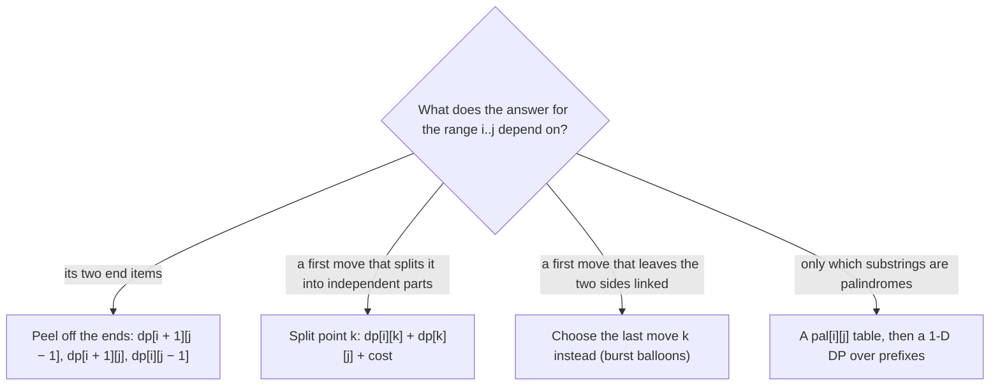

# Interval dynamic programming

> Data Structures & Algorithms · L3 Specialist · Advanced dynamic programming · about 110 min · hub module `m04` ([open the hub](https://claude.ai/artifact/JfuakQWBwAvSgLi1rcuJUk))

## Why it matters
Some problems ask for the best way to process a row of things where one choice in the middle splits the row in two: merging neighbouring piles, cutting a stick, bursting balloons, splitting a string into palindromes. Interval DP keeps one answer for every contiguous range and builds long ranges from shorter ones. NumPy's `linalg.multi_dot` uses it to choose the cheapest order for multiplying a chain of matrices.

## Pre-question (answer before reading)
**Q:** A stick 10 long must be cut at 2, 4 and 7, and each cut costs the length of the piece being cut. Does the order of the cuts matter? What smaller questions would help you choose it?

<details><summary>Answer</summary>

It matters. Cutting at 2, then 4, then 7 costs 10 + 8 + 6 = 24, but cutting at 4 first costs 10 + 4 + 6 = 20. The smaller questions are “what's the cheapest way to finish the piece between these two points?”. Each piece is a contiguous range, and once it's cut off, its cuts never affect the rest of the stick.

</details>

## 🍎 Story time (kid version)
**The toy room and the treasure-map road trip: Snipping the bunting ribbon**

Tara is making bunting for the car. Her ribbon is 10 squares long, with pen marks at 2, 4 and 7. Each snip costs one sweet per square of the piece being snipped, so the order matters. Ben prices the short stretches between marks first, then longer ones. For each stretch he tries every mark inside it as the first snip: that snip costs the stretch's length, and the two halves are shorter stretches he has already priced. For the whole ribbon, snipping at 4 first wins: 10 sweets, then 4 for the left piece and 6 for the right, 20 in all.

| In the story | In code |
|---|---|
| A stretch of ribbon between two marks | A range: dp[i][j] for the piece between points i and j |
| Trying every mark inside the stretch as the first snip | Trying every split point k between i and j |
| The first snip costs the stretch's length | The cost term pts[j] − pts[i] |
| The two halves are already priced | dp[i][k] + dp[k][j], read from shorter ranges |
| Short stretches before long ones | Filling the table by increasing length |

**Where the story breaks:** Thinking about the first move works here because, once the ribbon is cut, the two pieces never affect each other again. In burst balloons the first burst makes its two neighbours touch, so the sides stay linked, and the DP has to choose the last balloon in a range instead.

## Key ideas (grown-up version)
- **The state** dp[i][j] is the best answer for one contiguous range: a substring s[i..j], a run of piles, or the piece of stick between points i and j. There are O(n²) ranges.
- **Fill by increasing length.** A range reads only shorter ranges inside it, so loop the length from short to long, then the start i, with j fixed by the two. Memoised recursion gives the same answers in whatever order the calls ask.
- **Shape 1, peel off the ends**: dp[i][j] reads dp[i + 1][j − 1], dp[i + 1][j] or dp[i][j − 1]. s[i..j] is a palindrome when s[i] == s[j] and the inside s[i + 1..j − 1] is a palindrome or shorter than 2. O(1) work per range: O(n²) in total.
- **Shape 2, choose a split point k**: dp[i][j] = the best over k of dp[i][k] + dp[k][j] + cost(i, k, j). Merging piles, cutting a stick, triangulating a polygon and ordering a matrix chain all look like this. O(n) choices per range: O(n³) time and O(n²) space.
- **Choose the LAST action** when the first one leaves the two sides linked. In burst balloons, if k is the last balloon burst between walls i and j, its neighbours at that moment are exactly i and j, and the balloons on its two sides never meet: dp[i][j] = max over k of dp[i][k] + dp[k][j] + a[i] · a[k] · a[j].
- **Expand around centres** for palindromic substrings: grow outwards from each of the 2n − 1 centres (n letters and n − 1 gaps) while the two ends match. O(n²) time and O(1) extra space, instead of an O(n²) table.
- **Precompute an is-palindrome table** when palindromes are a building block: pal[i][j] for every range in O(n²), then a 1-D DP over prefixes reads it in O(1). Palindrome Partitioning II drops from O(n³) to O(n²) this way.
- **Read the constraints**: n up to a few hundred (300 balloons in LC 312, 50 vertices in LC 1039) and words like merge, cut, burst or split point to O(n³) interval DP. The triple loop runs about n³/6 times: 4.5 million for n = 300.

## Diagrams
**Cutting a stick 10 long at 2, 4 and 7: dp[i][j] over the points 0, 2, 4, 7, 10**

| i = 0 | 0 | 1 | 2 | 3 | 4 |
|---|---|---|---|---|---|
| value | · | 0 | 4 | 11 | 20 |

| i = 1 | 0 | 1 | 2 | 3 | 4 |
|---|---|---|---|---|---|
| value | · | · | 0 | 5 | 13 |

| i = 2 | 0 | 1 | 2 | 3 | 4 |
|---|---|---|---|---|---|
| value | · | · | · | 0 | 6 |

| i = 3 | 0 | 1 | 2 | 3 | 4 |
|---|---|---|---|---|---|
| value | · | · | · | · | 0 |

_Columns are j. dp[i][j] is the cheapest way to make every cut strictly between points i and j, so neighbouring points cost 0. Each diagonal reads only shorter ones: dp[0][4] = 10 + min(0 + 13, 4 + 6, 11 + 0) = 20, with the first cut at k = 2 (position 4)._

**Which interval transition?**



## Comparisons
**Interval DP problems at a glance**

| Problem | State | Transition | Time / space |
|---|---|---|---|
| Palindromic substrings (LC 647, 5) | A centre, no table | Grow while s[lo] == s[hi] | O(n²) / O(1) |
| Burst balloons (LC 312) | dp[i][j], walls i and j | Max over the last balloon k | O(n³) / O(n²) |
| Polygon triangulation (LC 1039) | dp[i][j], the polygon i..j | Min over the triangle (i, k, j) | O(n³) / O(n²) |
| Cutting a stick (LC 1547) | dp[i][j] over the sorted cut points | Length + min over the first cut k | O(m³) / O(m²), m = cuts + 2 |
| Palindrome partitioning II (LC 132) | pal[i][j], then cuts[j] | Min over the last palindromic piece | O(n²) / O(n²) |

**Three ways to find palindromic substrings**

|  | is-palindrome table | Expand around centres | Manacher's algorithm |
|---|---|---|---|
| Time | O(n²) | O(n²) worst case, O(n + number of palindromes) in general | O(n) |
| Extra space | O(n²) | O(1) | O(n) |
| Answers “is s[i..j] a palindrome?” later in O(1) | Yes | No | Yes, from the stored radii |
| Use it when | Other DP steps need pal[i][j] | You only count them or want the longest | n is 10⁵ or more |

## Code (JavaScript + Python)
### Palindromic substrings: expand around all 2n − 1 centres
```python
def count_palindromes(s):
    total = 0
    for c in range(2 * len(s) - 1):          # n letter centres and n - 1 gap centres
        lo, hi = c // 2, (c + 1) // 2        # even c: a letter; odd c: the gap after letter c // 2
        while lo >= 0 and hi < len(s) and s[lo] == s[hi]:
            total += 1                       # s[lo..hi] is one more palindrome
            lo, hi = lo - 1, hi + 1
    return total

def longest_palindrome(s):
    best_lo, best_hi = 0, 0                  # the best so far is s[best_lo:best_hi]
    for c in range(2 * len(s) - 1):
        lo, hi = c // 2, (c + 1) // 2
        while lo >= 0 and hi < len(s) and s[lo] == s[hi]:
            lo, hi = lo - 1, hi + 1
        if hi - lo - 1 > best_hi - best_lo:  # the last match was s[lo + 1..hi - 1]
            best_lo, best_hi = lo + 1, hi
    return s[best_lo:best_hi]

print(count_palindromes("abc"), count_palindromes("aaa"), count_palindromes("abacaba"))
print(longest_palindrome("babad"), longest_palindrome("cbbd"), longest_palindrome("forgeeksskeegfor"))
```

Output:
```text
3 6 12
bab bb geeksskeeg
```

- line 4: c // 2 and (c + 1) // 2 are equal for even c (one letter) and one apart for odd c (the gap between two letters).
- line 6: Each step outwards that still matches is one more palindrome, so counting costs nothing extra.
- line 16: After the loop, lo and hi sit one step past the match on each side, so the palindrome is s[lo + 1:hi], of length hi − lo − 1.

```javascript
function countPalindromes(s) {
  let total = 0;
  for (let c = 0; c < 2 * s.length - 1; c++) {    // n letter centres and n - 1 gap centres
    let lo = c >> 1, hi = (c + 1) >> 1;            // even c: a letter; odd c: the gap after letter c >> 1
    while (lo >= 0 && hi < s.length && s[lo] === s[hi]) {
      total++;                                     // s[lo..hi] is one more palindrome
      lo--;
      hi++;
    }
  }
  return total;
}

function longestPalindrome(s) {
  let bestLo = 0, bestHi = 0;                      // the best so far is s.slice(bestLo, bestHi)
  for (let c = 0; c < 2 * s.length - 1; c++) {
    let lo = c >> 1, hi = (c + 1) >> 1;
    while (lo >= 0 && hi < s.length && s[lo] === s[hi]) { lo--; hi++; }
    if (hi - lo - 1 > bestHi - bestLo) [bestLo, bestHi] = [lo + 1, hi];   // the last match was s[lo + 1..hi - 1]
  }
  return s.slice(bestLo, bestHi);
}

console.log(countPalindromes("abc"), countPalindromes("aaa"), countPalindromes("abacaba"));
console.log(longestPalindrome("babad"), longestPalindrome("cbbd"), longestPalindrome("forgeeksskeegfor"));
```

Output:
```text
3 6 12
bab bb geeksskeeg
```

- line 4: `c >> 1` is integer halving: the same index twice for even c, two neighbours for odd c.
- line 19: After the loop, lo and hi sit one step past the match on each side, so the palindrome is s.slice(lo + 1, hi).

### Burst balloons: k is the LAST balloon burst between walls i and j
```python
def max_coins(nums):
    a = [1] + nums + [1]                     # two walls worth 1 that are never burst
    n = len(a)
    dp = [[0] * n for _ in range(n)]         # dp[i][j]: best for the balloons strictly between i and j
    for length in range(2, n):               # length = j - i; shorter gaps first
        for i in range(n - length):
            j = i + length
            for k in range(i + 1, j):        # k = the LAST balloon burst between i and j
                coins = dp[i][k] + dp[k][j] + a[i] * a[k] * a[j]
                if coins > dp[i][j]:
                    dp[i][j] = coins
    return dp[0][n - 1]

print(max_coins([3, 1, 5, 8]), max_coins([1, 5]), max_coins([7]), max_coins([]))
```

Output:
```text
167 10 7 0
```

- line 5: Every gap reads only narrower gaps inside it, so the narrow ones are finished first.
- line 9: While k waits to be burst, it keeps its two sides apart. When it goes, its only neighbours are the walls i and j.

```javascript
function maxCoins(nums) {
  const a = [1, ...nums, 1];                       // two walls worth 1 that are never burst
  const n = a.length;
  const dp = Array.from({ length: n }, () => new Array(n).fill(0));   // dp[i][j]: balloons strictly between i and j
  for (let length = 2; length < n; length++) {     // length = j - i; shorter gaps first
    for (let i = 0; i + length < n; i++) {
      const j = i + length;
      for (let k = i + 1; k < j; k++) {            // k = the LAST balloon burst between i and j
        const coins = dp[i][k] + dp[k][j] + a[i] * a[k] * a[j];
        if (coins > dp[i][j]) dp[i][j] = coins;
      }
    }
  }
  return dp[0][n - 1];
}

console.log(maxCoins([3, 1, 5, 8]), maxCoins([1, 5]), maxCoins([7]), maxCoins([]));
```

Output:
```text
167 10 7 0
```

- line 9: While k waits to be burst, it keeps its two sides apart. When it goes, its only neighbours are the walls i and j.

### Minimum cost to cut a stick: a table over cut points, not positions
```python
def min_cost(n, cuts):
    pts = [0] + sorted(cuts) + [n]           # the cut positions, plus both ends
    m = len(pts)
    dp = [[0] * m for _ in range(m)]         # dp[i][j]: every cut strictly between pts[i] and pts[j]
    for length in range(2, m):
        for i in range(m - length):
            j = i + length
            # the first cut at pts[k] costs the whole piece; then the two pieces are separate
            dp[i][j] = pts[j] - pts[i] + min(dp[i][k] + dp[k][j] for k in range(i + 1, j))
    return dp[0][m - 1]

print(min_cost(7, [1, 3, 4, 5]), min_cost(9, [5, 6, 1, 4, 2]), min_cost(10, [2, 4, 7]))
```

Output:
```text
16 22 20
```

- line 2: n can be 10⁶, but there are at most 100 cuts. Indexing by cut points makes the work O(m³) with m = cuts + 2, whatever n is.
- line 9: Same loops as burst balloons; only the cost term differs. Here the FIRST cut splits the stick into two independent pieces.

```javascript
function minCost(n, cuts) {
  const pts = [0, ...cuts.toSorted((x, y) => x - y), n];   // the cut positions, plus both ends
  const m = pts.length;
  const dp = Array.from({ length: m }, () => new Array(m).fill(0));   // dp[i][j]: cuts strictly between pts[i] and pts[j]
  for (let length = 2; length < m; length++) {
    for (let i = 0; i + length < m; i++) {
      const j = i + length;
      let best = Infinity;
      for (let k = i + 1; k < j; k++) best = Math.min(best, dp[i][k] + dp[k][j]);   // first cut at pts[k]
      dp[i][j] = pts[j] - pts[i] + best;           // that cut costs the whole piece
    }
  }
  return dp[0][m - 1];
}

console.log(minCost(7, [1, 3, 4, 5]), minCost(9, [5, 6, 1, 4, 2]), minCost(10, [2, 4, 7]));
```

Output:
```text
16 22 20
```

- line 2: The comparator matters: the default sort compares as strings, so [9, 10].sort() gives [10, 9].
- line 9: The first cut inside the piece splits it into two pieces that never affect each other again.

## Worked example
**Problem.** Minimum Score Triangulation of Polygon (LeetCode 1039): a convex polygon's vertices have values v[0..n − 1] in order. Split it into n − 2 triangles; each triangle scores the product of its three values. Find the smallest total.

1. Look at the edge between vertices 0 and n − 1 (in general, i and j). In every triangulation it belongs to exactly one triangle, (i, k, j), for some k between them.
2. That triangle leaves two smaller polygons, i..k and k..j, which are triangulated independently. So dp[i][j] = min over i < k < j of dp[i][k] + dp[k][j] + v[i] · v[k] · v[j], with dp[i][i + 1] = 0: a single edge holds no triangle.
3. Fill by increasing j − i and read the answer from dp[0][n − 1].
4. O(n²) ranges × O(n) choices of k: O(n³) time and O(n²) space. With n ≤ 50 that's under 20,000 (i, k, j) triples.

```python
def min_score_triangulation(values):
    n = len(values)
    dp = [[0] * n for _ in range(n)]         # dp[i][j]: polygon i, i + 1, ..., j; 0 when j = i + 1
    for length in range(2, n):
        for i in range(n - length):
            j = i + length
            dp[i][j] = min(dp[i][k] + dp[k][j] + values[i] * values[k] * values[j]
                           for k in range(i + 1, j))   # the triangle on edge i-j is (i, k, j)
    return dp[0][n - 1]

print(min_score_triangulation([1, 2, 3]), min_score_triangulation([3, 7, 4, 5]),
      min_score_triangulation([1, 3, 1, 4, 1, 5]))
```

Output:
```text
6 144 13
```

```javascript
function minScoreTriangulation(values) {
  const n = values.length;
  const dp = Array.from({ length: n }, () => new Array(n).fill(0));   // dp[i][j]: polygon i..j; 0 when j = i + 1
  for (let length = 2; length < n; length++) {
    for (let i = 0; i + length < n; i++) {
      const j = i + length;
      let best = Infinity;
      for (let k = i + 1; k < j; k++)              // the triangle on edge i-j is (i, k, j)
        best = Math.min(best, dp[i][k] + dp[k][j] + values[i] * values[k] * values[j]);
      dp[i][j] = best;
    }
  }
  return dp[0][n - 1];
}

console.log(minScoreTriangulation([1, 2, 3]), minScoreTriangulation([3, 7, 4, 5]),
            minScoreTriangulation([1, 3, 1, 4, 1, 5]));
```

Output:
```text
6 144 13
```

**Answer.** 6, 144 and 13. A triangle has only one triangulation: 1 · 2 · 3 = 6. For [3, 7, 4, 5] the diagonal 0–2 gives 3 · 7 · 4 + 3 · 4 · 5 = 144 and the diagonal 1–3 gives 3 · 7 · 5 + 7 · 4 · 5 = 245, so the DP keeps 144. The hidden tests check every answer against a brute force that clips ears in every possible order.

## Your turn (faded example)
**Problem.** Palindrome Partitioning II (LeetCode 132): cut s into pieces that are all palindromes, with as few cuts as possible. “aab” needs 1 cut: “aa” | “b”.

- ✓ First build pal[i][j]: s[i..j] is a palindrome when s[i] == s[j] and the inside is shorter than 2 or a palindrome. Run i downwards so pal[i + 1][j − 1] is ready when you need it.
- **What does cuts[j] mean, and when is it 0?**
  <details><summary>Answer</summary>The fewest cuts for the prefix s[0..j]. It's 0 when s[0..j] is itself a palindrome.</details>
- **Otherwise, how do you compute cuts[j]?**
  <details><summary>Answer</summary>Every partition of s[0..j] has a last piece s[i..j], and it must be a palindrome. So cuts[j] is the minimum of cuts[i − 1] + 1 over every i ≥ 1 with pal[i][j]. i = j always qualifies, because one letter is a palindrome.</details>
- **Time and space?**
  <details><summary>Answer</summary>O(n²) time: the table, then O(j) choices for each j. O(n²) space for pal (cuts is O(n)). For n = 2,000 that's 4 million cells, where a split-point interval DP would need O(n³) time.</details>

Starter:
```python
def min_cut(s):
    n = len(s)
    pal = [[False] * n for _ in range(n)]    # pal[i][j]: is s[i..j] a palindrome?
    for i in range(n - 1, -1, -1):           # i downwards, so pal[i + 1][...] is ready
        for j in range(i, n):
            pal[i][j] = s[i] == s[j] and (j - i < 2 or pal[i + 1][j - 1])
    cuts = [0] * n                           # cuts[j]: fewest cuts for s[0..j]
    for j in range(n):
        ...                                  # TODO: 0 if s[0..j] is a palindrome, else try every last piece s[i..j]
    return cuts[n - 1]

print(min_cut("aab"))   # expect 1
```

```javascript
function minCut(s) {
  const n = s.length;
  const pal = Array.from({ length: n }, () => new Array(n).fill(false));   // pal[i][j]: is s[i..j] a palindrome?
  for (let i = n - 1; i >= 0; i--)                 // i downwards, so pal[i + 1][...] is ready
    for (let j = i; j < n; j++) pal[i][j] = s[i] === s[j] && (j - i < 2 || pal[i + 1][j - 1]);
  const cuts = new Array(n).fill(0);               // cuts[j]: fewest cuts for s[0..j]
  for (let j = 0; j < n; j++) {
    // TODO: 0 if s[0..j] is a palindrome, else try every last piece s[i..j]
  }
  return cuts[n - 1];
}

console.log(minCut("aab"));   // expect 1
```

<details><summary>Full solution</summary>

```python
def min_cut(s):
    n = len(s)
    pal = [[False] * n for _ in range(n)]    # pal[i][j]: is s[i..j] a palindrome?
    for i in range(n - 1, -1, -1):           # i downwards, so pal[i + 1][...] is ready
        for j in range(i, n):
            pal[i][j] = s[i] == s[j] and (j - i < 2 or pal[i + 1][j - 1])
    cuts = [0] * n                           # cuts[j]: fewest cuts for s[0..j]
    for j in range(n):
        if not pal[0][j]:                    # a palindromic prefix needs no cut at all
            cuts[j] = min(cuts[i - 1] + 1 for i in range(1, j + 1) if pal[i][j])   # last piece s[i..j]
    return cuts[n - 1]

print(min_cut("aab"), min_cut("a"), min_cut("abccbc"), min_cut("banana"), min_cut("abcde"))
```

Output:
```text
1 0 2 1 4
```

```javascript
function minCut(s) {
  const n = s.length;
  const pal = Array.from({ length: n }, () => new Array(n).fill(false));   // pal[i][j]: is s[i..j] a palindrome?
  for (let i = n - 1; i >= 0; i--)                 // i downwards, so pal[i + 1][...] is ready
    for (let j = i; j < n; j++) pal[i][j] = s[i] === s[j] && (j - i < 2 || pal[i + 1][j - 1]);
  const cuts = new Array(n).fill(0);               // cuts[j]: fewest cuts for s[0..j]
  for (let j = 0; j < n; j++) {
    if (pal[0][j]) continue;                       // a palindromic prefix needs no cut at all
    let best = Infinity;
    for (let i = 1; i <= j; i++) if (pal[i][j]) best = Math.min(best, cuts[i - 1] + 1);   // last piece s[i..j]
    cuts[j] = best;
  }
  return cuts[n - 1];
}

console.log(minCut("aab"), minCut("a"), minCut("abccbc"), minCut("banana"), minCut("abcde"));
```

Output:
```text
1 0 2 1 4
```

</details>

## Socratic checks and quiz (answers hidden)
**1. What does this print?**

```python
def count(s):
    total = 0
    for c in range(len(s)):              # centres on letters only
        lo = hi = c
        while lo >= 0 and hi < len(s) and s[lo] == s[hi]:
            total += 1
            lo, hi = lo - 1, hi + 1
    return total

print(count("abba"))
```

```javascript
function count(s) {
  let total = 0;
  for (let c = 0; c < s.length; c++) {   // centres on letters only
    let lo = c, hi = c;
    while (lo >= 0 && hi < s.length && s[lo] === s[hi]) { total++; lo--; hi++; }
  }
  return total;
}

console.log(count("abba"));
```

- A. 4
- B. 6
- C. 5
- D. 2

<details><summary>Answer</summary>

4. Each of the 4 letters is a palindrome, and no longer odd-length palindrome exists in “abba”. “bb” and “abba” have even length, so they're centred on gaps, which this loop never tries. With all 2n − 1 centres the count is 6.

</details>

**2. What does this print? (Merging two neighbouring piles costs the size of the new pile.)**

```python
piles = [3, 4, 5]
n = len(piles)
pre = [0]
for p in piles:
    pre.append(pre[-1] + p)              # pre[j + 1] - pre[i] = piles i..j
dp = [[0] * n for _ in range(n)]
for length in range(2, n + 1):
    for i in range(n - length + 1):
        j = i + length - 1
        dp[i][j] = min(dp[i][k] + dp[k + 1][j] for k in range(i, j)) + pre[j + 1] - pre[i]
print(dp[0][n - 1])
```

```javascript
const piles = [3, 4, 5], n = piles.length;
const pre = [0];
for (const p of piles) pre.push(pre.at(-1) + p);   // pre[j + 1] - pre[i] = piles i..j
const dp = Array.from({ length: n }, () => new Array(n).fill(0));
for (let length = 2; length <= n; length++)
  for (let i = 0; i + length <= n; i++) {
    const j = i + length - 1;
    let best = Infinity;
    for (let k = i; k < j; k++) best = Math.min(best, dp[i][k] + dp[k + 1][j]);
    dp[i][j] = best + pre[j + 1] - pre[i];
  }
console.log(dp[0][n - 1]);
```

- A. 19
- B. 21
- C. 12
- D. 24

<details><summary>Answer</summary>

19. dp[0][1] = 7 and dp[1][2] = 9. Both splits of the whole row then pay the final pile of 12: 7 + 12 = 19 (merge 3 and 4 first) or 9 + 12 = 21 (merge 4 and 5 first). The DP keeps the minimum, 19.

</details>

**3. Why does the burst balloons DP choose the LAST balloon burst between i and j, rather than the first?**

- A. When k bursts last, its neighbours are exactly i and j, and the balloons on its two sides never meet
- B. The last balloon always earns the most coins
- C. It halves the size of the table
- D. Bursting in reverse order always earns the same coins

<details><summary>Answer</summary>

When k bursts last, its neighbours are exactly i and j, and the balloons on its two sides never meet. Choosing the last balloon splits the range into two independent problems. The first burst would make its two neighbours touch, linking the sides. The table size is O(n²) either way, and the order of bursts changes the coins.

</details>

**4. Which problems have the split-point shape, dp[i][j] = the best over k of (left part + right part) + a cost? (choose 3)**

- A. Minimum score triangulation of a polygon
- B. Minimum cost to cut a stick
- C. Matrix chain multiplication
- D. Counting palindromic substrings
- E. Longest increasing subsequence

<details><summary>Answer</summary>

Minimum score triangulation of a polygon, Minimum cost to cut a stick, Matrix chain multiplication. Each one picks a split point k (a triangle's third vertex, the first cut, the last multiplication) and adds two smaller ranges. Counting palindromes only peels off the ends, and LIS is a 1-D DP over prefixes.

</details>

**5. Judge each statement.**

- Expanding around centres counts every palindromic substring in O(n²) time and O(1) extra space.
- A string of length n has n possible palindrome centres.
- If dp[i][j] reads dp[i + 1][j − 1], a loop with i going up from 0 reads cells it hasn't filled yet.
- Burst balloons with n balloons runs in O(n²) time.

<details><summary>Answer</summary>

Expanding around centres counts every palindromic substring in O(n²) time and O(1) extra space.: Yes; A string of length n has n possible palindrome centres.: No; If dp[i][j] reads dp[i + 1][j − 1], a loop with i going up from 0 reads cells it hasn't filled yet.: Yes; Burst balloons with n balloons runs in O(n²) time.: No. Each centre grows in O(n) at most, with no table. There are 2n − 1 centres, counting the gaps. Row i + 1 is filled after row i in that order. Burst balloons tries O(n) values of k for each of O(n²) ranges: O(n³).

</details>

**6. Put the bottom-up interval DP in order.**

- (put the steps in order)

<details><summary>Answer</summary>

Set the base case for the shortest ranges → Loop over the range length, shortest first → Inside it, loop over the start i and work out j from i and the length → Try every split point k between i and j and keep the best → Read the answer from dp[0][n − 1]. Each loop sits inside the one before, and every range reads only shorter, already-finished ranges. The answer is the full range, which is filled last.

</details>

**7. Complete the Python burst balloons DP.**

```
def max_coins(nums):
    a = [1] + nums + [1]
    n = len(a)
    dp = [[0] * n for _ in range(n)]
    for length in {{0}}:
        for i in range(n - length):
            j = i + length
            for k in range(i + 1, j):
                dp[i][j] = max(dp[i][j], {{1}} + {{2}})
    return dp[0][n - 1]

```

<details><summary>Answer</summary>

range(2, n) | dp[i][k] + dp[k][j] | a[i] * a[k] * a[j]. Gaps go from 2 (one balloon inside) up to the full row, n − 1, shortest first. The two sides of the last balloon k are (i, k) and (k, j), sharing k as a wall, and k earns a[i] · a[k] · a[j]: its neighbours at the end are the walls, not its original neighbours a[k − 1] and a[k + 1].

</details>

**8. Match each problem to the idea that solves it.**


<details><summary>Answer</summary>

Count palindromic substrings with O(1) extra space = Expand around each of the 2n − 1 centres; Burst balloons for the most coins = Choose the last balloon k between walls i and j; The fewest cuts so that every piece is a palindrome = A pal[i][j] table plus a 1-D cuts array; Triangulate a convex polygon at the least score = Try every triangle (i, k, j) on the edge i–j. Centres for counting, the last balloon for independence, a palindrome table for partitioning, and the triangle on a fixed edge for triangulation.

</details>

## Traps & misconceptions
- **“Fill dp[i][j] row by row, with i going up from 0.”** dp[i][j] reads row i + 1, which that order hasn't filled yet, so it silently uses the starting zeros. Loop by increasing length, or run i downwards and j upwards.
- **“In burst balloons, choose which balloon to burst first.”** After the first burst its two neighbours touch, so the left and right parts still affect each other. Choose the last balloon k between walls i and j: until it bursts, it keeps the two sides apart.
- **“A table of n² cells means O(n²) time.”** Each cell of a split-point DP tries O(n) values of k, so it's O(n³) time with O(n²) space. Only the peel-off-the-ends shape costs O(1) per cell.
- **“Cutting a stick needs a table over every position 0..n.”** n can be 10⁶, but there are at most 100 cuts. Index the table by the sorted cut points with 0 and n added: O(m³) time and O(m²) space for m = cuts + 2, whatever n is.
- **“Expanding around the n letters finds every palindrome.”** Even-length palindromes such as “abba” are centred on the gap between two letters. Try all 2n − 1 centres: n letters and n − 1 gaps.
- **“Longest palindromic substring and subsequence share a recurrence.”** A substring must be contiguous: pal[i][j] needs s[i] == s[j] and pal[i + 1][j − 1]. A subsequence may skip letters, so on a mismatch it takes max(dp[i + 1][j], dp[i][j − 1]).

## Discussion prompts
- **Why does choosing the last balloon make the two sides independent?**
  <details><summary>One good answer</summary>dp[i][j] assumes i and j are still standing while every balloon between them bursts. If k bursts last, then until that moment it stands between its left and right sides, so no balloon on one side ever becomes a neighbour of a balloon on the other. The left side is exactly the problem (i, k) and the right side is (k, j). When k finally bursts, only i and j are beside it, so it earns a[i] · a[k] · a[j]. Choosing the first burst instead makes two balloons from different sides neighbours, so the halves aren't separate problems.</details>
- **O(n³) is too slow for n = 2,000. What can you try?**
  <details><summary>One good answer</summary>First check whether the problem needs a split point at all: many palindrome problems need only an O(n²) table plus a 1-D DP. For split-point DPs whose cost depends only on i and j and satisfies the quadrangle inequality (cutting a stick does), Knuth's optimisation limits k to the range opt[i][j − 1]..opt[i + 1][j], which makes the whole DP O(n²). Otherwise look for a different state or a greedy rule, and prove it against a brute force first.</details>

## Teach-back
**Prompt:** Explain to a junior colleague how burst balloons is solved with interval DP, and why the obvious first idea fails.

Rubric:
- [ ] Pads the array with a 1 at each end, as walls that never burst
- [ ] dp[i][j] = the most coins from the balloons strictly between i and j
- [ ] Chooses the LAST balloon k to burst, so the two sides are independent
- [ ] dp[i][j] = max over k of dp[i][k] + dp[k][j] + a[i] · a[k] · a[j], filled by increasing j − i
- [ ] O(n³) time and O(n²) space

<details><summary>Model answer</summary>

Add a balloon worth 1 at each end; these walls never burst. Let dp[i][j] be the most coins from bursting every balloon strictly between positions i and j while i and j are still standing. The obvious idea, choosing the first balloon to burst, fails: its two neighbours become adjacent, so the two sides keep affecting each other. Instead choose the balloon k that bursts last in the range. Until then it separates the two sides, so they are the independent problems dp[i][k] and dp[k][j]. When k finally bursts, its neighbours are i and j, which earns a[i] · a[k] · a[j]. Take the maximum over k, fill the table by increasing gap j − i, and read the answer from dp[0][n + 1] for n balloons. There are O(n²) ranges and O(n) choices of k, so it's O(n³) time and O(n²) space.

</details>

## Quick Q&A (also in the SRS deck)
- **In what order is an interval DP table filled?** By increasing range length, because each range reads only shorter ranges inside it.
- **Burst balloons recurrence?** dp[i][j] = max over i < k < j of dp[i][k] + dp[k][j] + a[i] · a[k] · a[j], where k is the last balloon burst.
- **How many centres does expand-around-centre try?** 2n − 1: n letters for odd lengths and n − 1 gaps for even lengths.
- **Time and space of a split-point interval DP?** O(n³) time (O(n²) ranges × O(n) split points) and O(n²) space.
- **Minimum cost to cut a stick: what indexes the table?** The sorted cut positions with 0 and n added, not the positions 0..n.
- **Palindrome partitioning II in O(n²)?** Build pal[i][j]; cuts[j] = 0 if s[0..j] is a palindrome, else the minimum of cuts[i − 1] + 1 over palindromic s[i..j].

## Practice problems
- [ ] [LC 647 · Palindromic Substrings](https://leetcode.com/problems/palindromic-substrings/) · Medium · expand around all 2n − 1 centres; each step outwards that matches is one more
- [ ] [LC 5 · Longest Palindromic Substring](https://leetcode.com/problems/longest-palindromic-substring/) · Medium · the same expansion; keep the widest bounds seen
- [ ] [LC 132 · Palindrome Partitioning II](https://leetcode.com/problems/palindrome-partitioning-ii/) · Hard · the faded example: a pal[i][j] table, then cuts over prefixes
- [ ] [LC 1039 · Minimum Score Triangulation of Polygon](https://leetcode.com/problems/minimum-score-triangulation-of-polygon/) · Medium · the worked example: the triangle on edge (i, j) chooses k
- [ ] [LC 312 · Burst Balloons](https://leetcode.com/problems/burst-balloons/) · Hard · pad with 1s; k is the LAST balloon burst between i and j
- [ ] [LC 1000 · Minimum Cost to Merge Stones](https://leetcode.com/problems/minimum-cost-to-merge-stones/) · Hard · impossible unless (n − 1) % (k − 1) == 0; add the range sum when i..j can become one pile
- [ ] [LC 664 · Strange Printer](https://leetcode.com/problems/strange-printer/) · Hard · the turn that prints s[i] can stretch to a later equal letter at k: dp[i + 1][k − 1] + dp[k][j]
- [ ] [LC 1547 · Minimum Cost to Cut a Stick](https://leetcode.com/problems/minimum-cost-to-cut-a-stick/) · Hard · sort the cuts and add 0 and n; the table is over cut indexes, not positions

## Sources (accessed 2026-10-09)
- [USACO Guide: Range DP](https://usaco.guide/gold/dp-ranges)
- [Jeff Erickson, Algorithms (chapter 3, Dynamic Programming)](https://jeffe.cs.illinois.edu/teaching/algorithms/)
- [Wikipedia: Matrix chain multiplication](https://en.wikipedia.org/wiki/Matrix_chain_multiplication)
- [cp-algorithms: Knuth's optimization](https://cp-algorithms.com/dynamic_programming/knuth-optimization.html)
