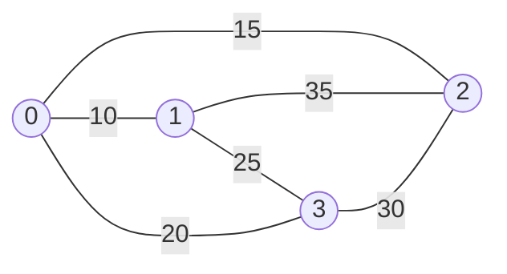

# Bitmask dynamic programming

> Data Structures & Algorithms · L3 Specialist · Advanced dynamic programming · about 110 min · hub module `m05` ([open the hub](https://claude.ai/artifact/JfuakQWBwAvSgLi1rcuJUk))

## Why it matters
When the input is tiny (n ≤ 20) but the answer depends on which items are already used, store that set as the bits of one integer and index a DP table with it. 2ⁿ sets replace n! orders. That's how the travelling salesman problem is solved exactly for small n (the Held–Karp algorithm), and how “assign every task”, “visit every node” and “split into groups” problems are cracked in contests and interviews.

## Pre-question (answer before reading)
**Q:** Eight workers each need a different job, and trying every assignment means 8! = 40,320 orders. Two partial plans have given the first four workers the same four jobs, but in different ways. What do the two plans have in common, and why does that help?

<details><summary>Answer</summary>

Their futures are identical: the last four workers must share the same four remaining jobs, whoever took which job so far. So only the cheaper of the two plans matters, and you need just one best cost for each set of used jobs: 2⁸ = 256 sets instead of 40,320 orders.

</details>

## 🍎 Story time (kid version)
**The toy room and the treasure-map road trip: The road-trip sticker card**

On the road trip, Tara and Ben want to visit the castle, the beach, the zoo and the farm, starting and ending at home, with as little driving as possible. Tara's card has four boxes, and she ticks one after each visit. Ben keeps a notebook page for every pattern of ticks and every place they could be standing, holding the shortest drive that gets there. Two routes with the same ticks that end in the same place have the same future, so he keeps only the shorter one. Four places give 16 tick patterns; even 15 places give only 32,768, against 1.3 trillion orders.

| In the story | In code |
|---|---|
| The four boxes on Tara's card | A bitmask: bit i is 1 when place i has been visited |
| Ticking a box after a visit | `mask | 1 << i` |
| A notebook page for each tick pattern and standing place | The state dp[mask][last] |
| Keeping only the shorter of two routes on the same page | dp[mask][last] = the minimum over every way to get there |
| 16 tick patterns for 4 places | 2ⁿ masks for n items |

**Where the story breaks:** Ben's card could have 40 boxes, but 2⁴⁰ × 40 pages is about 44 trillion: bitmask DP is only practical up to about n = 20. A computer's card has its own edge too: JavaScript's bit operators use 32-bit integers, so `1 << 31` is already negative.

## Key ideas (grown-up version)
- **A mask is a set**: bit i of an integer says whether item i is in it. `mask >> i & 1` tests item i, `mask | 1 << i` adds it, `mask & ~(1 << i)` removes it, and `(1 << n) - 1` is the set of all n items.
- **When it fits**: the DP must remember which of n items are used, and n is at most about 20. 2²⁰ = 1,048,576 masks; with O(n) work per mask that's about 2 × 10⁷ steps.
- **The assignment pattern**: dp[mask] = the best cost when the tasks in mask go to the first popcount(mask) people. The next person is always popcount(mask), so the state doesn't need to store it. O(2ⁿ · n) time and O(2ⁿ) space.
- **Held–Karp TSP**: dp[mask][last] = the shortest path that starts at city 0, visits exactly the cities in mask and ends at last. Extend it to each city not yet in mask, then close the tour back to 0. O(2ⁿ · n²) time and O(2ⁿ · n) space, against O(n!) for trying every order.
- **BFS over (node, mask)**: when every step costs 1 and the walk may revisit nodes, the state is where you are plus who you've seen. LC 847 has n · 2ⁿ states and runs in O(2ⁿ · (n + E)) time and O(2ⁿ · n) space.
- **Submask enumeration**: `sub = (sub - 1) & mask` steps through every submask of mask, largest first. Summed over all masks that's 3ⁿ steps, because each bit is outside the mask, in the mask only, or in both: 3¹⁴ ≈ 4.8 million for n = 14.
- **Speed and memory**: keep tables flat. In Python a list of 2ⁿ slots (or 2ⁿ · n, indexed `mask * n + last`) beats dicts and nested lists; in JavaScript typed arrays (`Int32Array`, `Float64Array`) are compact and start zero-filled. Python 3.10+ has `mask.bit_count()`; JavaScript has no popcount, so count bits with a loop or a table.
- **JavaScript bits are 32-bit**: `&`, `|`, `^` and `<<` convert their operands to 32-bit integers, so masks are safe up to n = 30. `1 << 31` is −2147483648, and `1 << 32` is 1 because the shift count is taken mod 32. Python's ints never overflow.

## Diagrams
**Every submask of 1011 (11), in the order `sub = (sub - 1) & mask` visits them**

| binary | 0 | 1 | 2 | 3 | 4 | 5 | 6 | 7 |
|---|---|---|---|---|---|---|---|---|
| value | **1011** | 1010 | 1001 | 1000 | 0011 | 0010 | 0001 | 0000 |

| decimal | 0 | 1 | 2 | 3 | 4 | 5 | 6 | 7 |
|---|---|---|---|---|---|---|---|---|
| value | 11 | 10 | 9 | 8 | 3 | 2 | 1 | 0 |

_Subtracting 1 clears the lowest set bit and sets every bit below it; `& mask` then keeps only the bits that belong to the mask. Three set bits give 2³ = 8 submasks, ending at 0._

**Held–Karp on four cities: the shortest tour is 80**



_The tour 0 → 1 → 3 → 2 → 0 costs 10 + 25 + 30 + 15 = 80. The DP closes it from dp[all][last] + dist[last][0]: last = 2 gives 65 + 15 and last = 1 gives 70 + 10, the same tour in opposite directions._

## Comparisons
**Four bitmask patterns**

| Pattern | State | Step | Time / space |
|---|---|---|---|
| Assignment (LC 1879) | dp[mask]; the next person is popcount(mask) | Give that person a free task j | O(2ⁿ · n) / O(2ⁿ) |
| Held–Karp TSP | dp[mask][last] | Drive on to a city not in mask | O(2ⁿ · n²) / O(2ⁿ · n) |
| Visit every node, unit steps (LC 847) | BFS over (node, mask) | Move along an edge and set its bit | O(2ⁿ · (n + E)) / O(2ⁿ · n) |
| Split into groups (LC 1986) | dp[mask] over the items used | Add one valid submask as a group | O(3ⁿ) / O(2ⁿ) |

**Python and JavaScript for 2²⁰ states**

|  | Python | JavaScript |
|---|---|---|
| The table | A flat list: `[INF] * (1 << n)` | A typed array: `new Float64Array(1 << n)` |
| Infinity | `float("inf")` mixes freely with ints | Fine in a `Float64Array`; an `Int32Array` stores it as 0 |
| Popcount | `mask.bit_count()` (Python 3.10+) | No built-in: loop `m &= m - 1`, or precompute a table |
| Index of the lowest set bit | `(m & -m).bit_length() - 1` | `31 - Math.clz32(m & -m)` |
| Bit operators | Unbounded ints: any n | 32-bit: safe up to n = 30 |

## Code (JavaScript + Python)
### The assignment pattern: the next person is popcount(mask)
```python
def minimum_xor_sum(nums1, nums2):
    n = len(nums1)
    INF = float("inf")
    dp = [INF] * (1 << n)                    # dp[mask]: best sum pairing nums1[:k] with the nums2 items in mask
    dp[0] = 0
    for mask in range(1 << n):               # every mask is final before it's used
        i = mask.bit_count()                 # k = popcount(mask): nums1[k] is next
        for j in range(n):
            if not mask >> j & 1:            # nums2[j] is still free
                new = mask | 1 << j
                dp[new] = min(dp[new], dp[mask] + (nums1[i] ^ nums2[j]))
    return dp[(1 << n) - 1]

print(minimum_xor_sum([1, 2], [2, 3]), minimum_xor_sum([1, 0, 3], [5, 3, 4]),
      minimum_xor_sum([72, 97, 8, 32, 15], [63, 97, 57, 60, 83]))
```

Output:
```text
2 8 152
```

- line 7: People are served in a fixed order, so the number of used tasks says whose turn it is: the state needs no person index.
- line 11: A new mask has one more bit, so it's a bigger number than mask, and the loop reaches it only after every way in has been tried.

```javascript
function minimumXorSum(nums1, nums2) {
  const n = nums1.length;
  const dp = new Float64Array(1 << n).fill(Infinity);   // dp[mask]: best sum pairing nums1[0..k-1] with mask
  dp[0] = 0;
  for (let mask = 0; mask < 1 << n; mask++) {           // every mask is final before it's used
    let i = 0;
    for (let m = mask; m; m &= m - 1) i++;              // popcount: nums1[i] is next
    for (let j = 0; j < n; j++) {
      if ((mask >> j & 1) === 0) {                      // nums2[j] is still free
        const next = mask | 1 << j;
        dp[next] = Math.min(dp[next], dp[mask] + (nums1[i] ^ nums2[j]));
      }
    }
  }
  return dp[(1 << n) - 1];
}

console.log(minimumXorSum([1, 2], [2, 3]), minimumXorSum([1, 0, 3], [5, 3, 4]),
            minimumXorSum([72, 97, 8, 32, 15], [63, 97, 57, 60, 83]));
```

Output:
```text
2 8 152
```

- line 3: A Float64Array holds Infinity; an Int32Array would silently store 0 instead.
- line 7: No popcount built-in: `m &= m - 1` clears one set bit per step.

### Held–Karp TSP: dp[mask][last] in one flat table
```python
def tsp(dist):
    n = len(dist)
    INF = float("inf")
    full = 1 << n
    dp = [INF] * (full * n)                  # dp[mask * n + last]: one flat list
    dp[1 * n + 0] = 0                        # mask {0} (= 1), standing at city 0
    for mask in range(1, full, 2):           # odd masks only: city 0 is always in the set
        for last in range(n):
            cur = dp[mask * n + last]
            if cur == INF:
                continue                     # no path visits exactly mask and ends at last
            for nxt in range(n):
                if not mask >> nxt & 1:      # drive on to a city not visited yet
                    i = (mask | 1 << nxt) * n + nxt
                    if cur + dist[last][nxt] < dp[i]:
                        dp[i] = cur + dist[last][nxt]
    return min(dp[(full - 1) * n + last] + dist[last][0] for last in range(1, n))

dist4 = [[0, 10, 15, 20], [10, 0, 35, 25], [15, 35, 0, 30], [20, 25, 30, 0]]
dist5 = [[0, 3, 4, 2, 7], [3, 0, 4, 6, 3], [4, 4, 0, 5, 8], [2, 6, 5, 0, 6], [7, 3, 8, 6, 0]]
print(tsp(dist4), tsp(dist5))
```

Output:
```text
80 19
```

- line 5: A flat list of 2ⁿ · n slots is much smaller and faster than a dict keyed by (mask, last) pairs.
- line 7: Every real path contains city 0, so even masks are never reached; stepping by 2 halves the work.
- line 17: Each complete path closes the tour by driving from its last city back to city 0.

```javascript
function tsp(dist) {
  const n = dist.length, full = 1 << n;
  const dp = new Float64Array(full * n).fill(Infinity);   // dp[mask * n + last]: one flat typed array
  dp[1 * n + 0] = 0;                                      // mask {0} (= 1), standing at city 0
  for (let mask = 1; mask < full; mask += 2) {            // odd masks only: city 0 is always in the set
    for (let last = 0; last < n; last++) {
      const cur = dp[mask * n + last];
      if (cur === Infinity) continue;                     // no path visits exactly mask and ends at last
      for (let nxt = 0; nxt < n; nxt++) {
        if ((mask >> nxt & 1) === 0) {                    // drive on to a city not visited yet
          const i = (mask | 1 << nxt) * n + nxt;
          if (cur + dist[last][nxt] < dp[i]) dp[i] = cur + dist[last][nxt];
        }
      }
    }
  }
  let best = Infinity;
  for (let last = 1; last < n; last++) best = Math.min(best, dp[(full - 1) * n + last] + dist[last][0]);
  return best;                                            // the tour closes by driving back to city 0
}

const dist4 = [[0, 10, 15, 20], [10, 0, 35, 25], [15, 35, 0, 30], [20, 25, 30, 0]];
const dist5 = [[0, 3, 4, 2, 7], [3, 0, 4, 6, 3], [4, 4, 0, 5, 8], [2, 6, 5, 0, 6], [7, 3, 8, 6, 0]];
console.log(tsp(dist4), tsp(dist5));
```

Output:
```text
80 19
```

- line 3: One Float64Array of 2ⁿ · n slots, indexed `mask * n + last`, instead of 2ⁿ small arrays.
- line 5: Every real path contains city 0, so even masks are never reached; stepping by 2 halves the work.

### Submask enumeration: the fewest work sessions in O(3ⁿ)
```python
def min_sessions(tasks, session_time):
    n = len(tasks)
    full = 1 << n
    total = [0] * full                       # total[mask]: time of the tasks in mask
    for mask in range(1, full):
        low = mask & -mask                   # the lowest set bit
        total[mask] = total[mask ^ low] + tasks[low.bit_length() - 1]
    dp = [0] + [n] * (full - 1)              # dp[mask]: fewest sessions for the tasks in mask
    for mask in range(1, full):
        sub = mask
        while sub:                           # every non-empty submask of mask
            if total[sub] <= session_time:   # sub fits in one session
                dp[mask] = min(dp[mask], dp[mask ^ sub] + 1)
            sub = (sub - 1) & mask
    return dp[full - 1]

print(min_sessions([1, 2, 3], 3), min_sessions([3, 1, 3, 1, 1], 8), min_sessions([1, 2, 3, 4, 5], 15))
```

Output:
```text
2 2 1
```

- line 6: In two's complement, `mask & -mask` keeps only the lowest set bit, so each total is O(1): O(2ⁿ) for the whole table.
- line 14: Subtracting 1 drops below sub, and `& mask` throws away bits outside the mask. Over all masks this loop runs 3ⁿ times.

```javascript
function minSessions(tasks, sessionTime) {
  const n = tasks.length, full = 1 << n;
  const total = new Int32Array(full);                   // total[mask]: time of the tasks in mask
  for (let mask = 1; mask < full; mask++) {
    const low = mask & -mask;                           // the lowest set bit
    total[mask] = total[mask ^ low] + tasks[31 - Math.clz32(low)];
  }
  const dp = new Int32Array(full).fill(n);              // dp[mask]: fewest sessions for the tasks in mask
  dp[0] = 0;
  for (let mask = 1; mask < full; mask++) {
    for (let sub = mask; sub; sub = (sub - 1) & mask) { // every non-empty submask of mask
      if (total[sub] <= sessionTime) dp[mask] = Math.min(dp[mask], dp[mask ^ sub] + 1);
    }
  }
  return dp[full - 1];
}

console.log(minSessions([1, 2, 3], 3), minSessions([3, 1, 3, 1, 1], 8), minSessions([1, 2, 3, 4, 5], 15));
```

Output:
```text
2 2 1
```

- line 6: `31 - Math.clz32(low)` turns a single bit back into its index, like Python's `bit_length() - 1`.
- line 11: The for-loop form of `sub = (sub - 1) & mask`; it stops before the empty submask 0.

## Worked example
**Problem.** Shortest Path Visiting All Nodes (LeetCode 847): an undirected, connected graph has n ≤ 12 nodes. Find the length of the shortest walk that visits every node. You may start and end anywhere and reuse nodes and edges.

1. Every edge costs 1, so BFS finds shortest walks. But a walk may pass through a node twice, so the node alone can't be the state: the state is (node, mask of the nodes seen so far).
2. The walk may start anywhere, so start from all n states (i, 1 << i) at distance 0 at once: a multi-source BFS.
3. From (u, mask), move to each neighbour v: (v, mask | 1 << v). BFS pops states in order of distance, so the first state popped with the full mask holds the answer.
4. n · 2ⁿ states, and each one scans its node's edges: O(2ⁿ · (n + E)) time and O(2ⁿ · n) space. For n = 12 that's 49,152 states.

```python
from collections import deque

def shortest_path_length(graph):
    n = len(graph)
    full = (1 << n) - 1
    dist = [-1] * (n << n)                   # dist[u << n | mask]; -1 = not reached yet
    q = deque()
    for u in range(n):                       # the walk may start anywhere: every node is a source
        dist[u << n | 1 << u] = 0
        q.append((u, 1 << u))
    while q:
        u, mask = q.popleft()
        d = dist[u << n | mask]
        if mask == full:
            return d                         # BFS pops states in order of distance
        for v in graph[u]:
            nxt = mask | 1 << v
            if dist[v << n | nxt] == -1:
                dist[v << n | nxt] = d + 1
                q.append((v, nxt))

print(shortest_path_length([[1, 2, 3], [0], [0], [0]]), shortest_path_length([[1], [0, 2, 4], [1, 3, 4], [2], [1, 2]]),
      shortest_path_length([[1], [0, 2], [1]]), shortest_path_length([[]]))
```

Output:
```text
4 4 2 0
```

```javascript
function shortestPathLength(graph) {
  const n = graph.length, full = (1 << n) - 1;
  const dist = new Int32Array(n << n).fill(-1);       // dist[u << n | mask]; -1 = not reached yet
  const qu = [], qm = [];                             // the queue: two arrays read with a head index
  for (let u = 0; u < n; u++) {                       // the walk may start anywhere: every node is a source
    dist[u << n | 1 << u] = 0;
    qu.push(u);
    qm.push(1 << u);
  }
  for (let head = 0; head < qu.length; head++) {
    const u = qu[head], mask = qm[head], d = dist[u << n | mask];
    if (mask === full) return d;                      // BFS pops states in order of distance
    for (const v of graph[u]) {
      const next = mask | 1 << v;
      if (dist[v << n | next] === -1) {
        dist[v << n | next] = d + 1;
        qu.push(v);
        qm.push(next);
      }
    }
  }
}

console.log(shortestPathLength([[1, 2, 3], [0], [0], [0]]), shortestPathLength([[1], [0, 2, 4], [1, 3, 4], [2], [1, 2]]),
            shortestPathLength([[1], [0, 2], [1]]), shortestPathLength([[]]));
```

Output:
```text
4 4 2 0
```

**Answer.** 4, 4, 2 and 0. In the star [[1, 2, 3], [0], [0], [0]] the best walk is 1 → 0 → 2 → 0 → 3: node 0 is visited three times, which is why the state must include the mask. A single node needs no steps. The hidden tests compare every answer with a brute force that tries every visiting order over all-pairs BFS distances.

## Your turn (faded example)
**Problem.** Beautiful Arrangement (LeetCode 526): count the permutations of 1..n where, at every position p (1-indexed), the number x placed there satisfies x % p == 0 or p % x == 0. n ≤ 15.

- ✓ Fill positions 1, 2, 3, … in order. Then the state only needs the set of numbers already used: a mask, with number x in bit x − 1.
- **Which position does a mask fill next?**
  <details><summary>Answer</summary>popcount(mask) + 1: the numbers in mask fill exactly the first popcount(mask) positions.</details>
- **What does dp[mask] count, and how does it move forward?**
  <details><summary>Answer</summary>The ways to fill positions 1..popcount(mask) using exactly the numbers in mask. For each unused x that suits the next position, add dp[mask] to dp[mask | 1 << (x − 1)].</details>
- **Time and space?**
  <details><summary>Answer</summary>O(2ⁿ · n) time and O(2ⁿ) space: about 500,000 steps for n = 15.</details>

Starter:
```python
def count_arrangement(n):
    dp = [0] * (1 << n)                      # dp[mask]: ways to fill positions 1..popcount(mask) with mask's numbers
    dp[0] = 1
    for mask in range(1 << n):
        if dp[mask] == 0:
            continue
        pos = mask.bit_count() + 1           # the next position to fill
        for x in range(1, n + 1):
            ...                              # TODO: if x is unused and suits pos, add dp[mask] to the bigger mask
    return dp[(1 << n) - 1]

print(count_arrangement(2))   # expect 2
```

```javascript
function countArrangement(n) {
  const dp = new Int32Array(1 << n);                  // dp[mask]: ways to fill positions 1..popcount(mask)
  dp[0] = 1;
  for (let mask = 0; mask < 1 << n; mask++) {
    if (dp[mask] === 0) continue;
    let pos = 1;
    for (let m = mask; m; m &= m - 1) pos++;          // the next position: popcount(mask) + 1
    for (let x = 1; x <= n; x++) {
      // TODO: if x is unused and suits pos, add dp[mask] to the bigger mask
    }
  }
  return dp[(1 << n) - 1];
}

console.log(countArrangement(2));   // expect 2
```

<details><summary>Full solution</summary>

```python
def count_arrangement(n):
    dp = [0] * (1 << n)                      # dp[mask]: ways to fill positions 1..popcount(mask) with mask's numbers
    dp[0] = 1
    for mask in range(1 << n):
        if dp[mask] == 0:
            continue
        pos = mask.bit_count() + 1           # the next position to fill
        for x in range(1, n + 1):
            bit = 1 << (x - 1)               # number x lives in bit x - 1
            if not mask & bit and (x % pos == 0 or pos % x == 0):
                dp[mask | bit] += dp[mask]
    return dp[(1 << n) - 1]

print(count_arrangement(2), count_arrangement(4), count_arrangement(6), count_arrangement(15))
```

Output:
```text
2 8 36 24679
```

```javascript
function countArrangement(n) {
  const dp = new Int32Array(1 << n);                  // dp[mask]: ways to fill positions 1..popcount(mask)
  dp[0] = 1;
  for (let mask = 0; mask < 1 << n; mask++) {
    if (dp[mask] === 0) continue;
    let pos = 1;
    for (let m = mask; m; m &= m - 1) pos++;          // the next position: popcount(mask) + 1
    for (let x = 1; x <= n; x++) {
      const bit = 1 << (x - 1);                       // number x lives in bit x - 1
      if ((mask & bit) === 0 && (x % pos === 0 || pos % x === 0)) dp[mask | bit] += dp[mask];
    }
  }
  return dp[(1 << n) - 1];
}

console.log(countArrangement(2), countArrangement(4), countArrangement(6), countArrangement(15));
```

Output:
```text
2 8 36 24679
```

</details>

## Socratic checks and quiz (answers hidden)
**1. What does this print?**

```python
mask = 0b1010
sub, out = mask, []
while sub:
    out.append(sub)
    sub = (sub - 1) & mask
print(*out)
```

```javascript
const mask = 0b1010, out = [];
for (let sub = mask; sub; sub = (sub - 1) & mask) out.push(sub);
console.log(...out);
```

- A. 10 8 2
- B. 10 8 2 0
- C. 2 8 10
- D. 10 9 8 2

<details><summary>Answer</summary>

10 8 2. 1010 has two set bits, so it has four submasks: 1010 (10), 1000 (8), 0010 (2) and 0000. The loop stops when sub reaches 0, so 0 isn't printed. 9 (1001) isn't a submask: `& mask` removes its lowest bit.

</details>

**2. What does this JavaScript print? (JavaScript only: Python's ints don't overflow.)**

```javascript
const n = 31;
console.log(1 << 30, 1 << n, (1 << n) - 1);
```

- A. 1073741824 -2147483648 -2147483649
- B. 1073741824 2147483648 2147483647
- C. 1073741824 -2147483648 2147483647
- D. 1073741824 0 -1

<details><summary>Answer</summary>

1073741824 -2147483648 -2147483649. `<<` works on 32-bit signed integers, so `1 << 31` sets the sign bit: −2147483648. Subtracting 1 then happens in ordinary number arithmetic, giving −2147483649 instead of the full mask 2147483647. That's why JavaScript masks stop at n = 30.

</details>

**3. Which constraint most strongly suggests bitmask DP?**

- A. n ≤ 16, and the answer depends on which items are already used
- B. n ≤ 10⁵, and the array is sorted
- C. n ≤ 500, and the answer for i..j comes from shorter ranges
- D. Values up to 10⁹, and the answer needs a modulus

<details><summary>Answer</summary>

n ≤ 16, and the answer depends on which items are already used. 2¹⁶ = 65,536 masks is small, and a mask records exactly which items are used. A sorted array of 10⁵ suggests binary search or two pointers, ranges i..j with n ≤ 500 suggest interval DP, and large values say nothing about sets.

</details>

**4. Which statements about Held–Karp on n cities are true? (choose 2)**

- A. The state is the set of visited cities plus the current city
- B. It runs in O(2ⁿ · n²) time
- C. It runs in O(n!) time, like trying every order
- D. It needs only O(n²) memory
- E. It handles n = 50 in under a second

<details><summary>Answer</summary>

The state is the set of visited cities plus the current city, It runs in O(2ⁿ · n²) time. There are 2ⁿ · n states with n choices each. The table needs O(2ⁿ · n) memory, and 2⁵⁰ masks are far beyond any computer.

</details>

**5. Judge each statement.**

- `sub = (sub - 1) & mask` visits every submask of mask, from largest to smallest.
- Enumerating all submasks of all n-bit masks takes 3ⁿ steps in total.
- In JavaScript, `1 << 32` equals 4294967296.
- An `Int32Array` filled with `Infinity` holds Infinity in every slot.

<details><summary>Answer</summary>

`sub = (sub - 1) & mask` visits every submask of mask, from largest to smallest.: Yes; Enumerating all submasks of all n-bit masks takes 3ⁿ steps in total.: Yes; In JavaScript, `1 << 32` equals 4294967296.: No; An `Int32Array` filled with `Infinity` holds Infinity in every slot.: No. Each step moves to the next smaller submask. Each bit has 3 possible states. The shift count is taken mod 32, so `1 << 32` is `1 << 0`, which is 1. An integer typed array converts Infinity to 0.

</details>

**6. Put Held–Karp in order.**

- (put the steps in order)

<details><summary>Answer</summary>

Set dp[{0}][0] = 0: the path starts at city 0, having visited only city 0 → Go through the masks in increasing order → For each reachable (mask, last), extend to every city not in mask, keeping the minimum → Close the tour: the minimum over last of dp[all][last] + dist[last][0]. The base case comes first; every transition goes from a smaller mask to a bigger one, so increasing order finishes each state before it's extended; the tour closes only once every complete path is known.

</details>

**7. Complete the Python DP for the fewest work sessions (each session holds tasks totalling at most cap).**

```
def min_sessions(tasks, cap):
    n = len(tasks)
    total = [sum(t for i, t in enumerate(tasks) if m >> i & 1) for m in range(1 << n)]
    dp = [0] + [{{0}}] * ((1 << n) - 1)
    for mask in range(1, 1 << n):
        sub = mask
        while sub:
            if total[sub] <= cap:
                dp[mask] = min(dp[mask], dp[{{1}}] + 1)
            sub = {{2}}
    return dp[(1 << n) - 1]

```

<details><summary>Answer</summary>

n | mask ^ sub | (sub - 1) & mask. n sessions always suffice, so n is a safe starting value (0 or 1 would be too optimistic). Using sub as one session leaves the tasks in `mask ^ sub`. `(sub - 1) & mask` visits every submask; the other steps skip some of them.

</details>

**8. Match each problem to its bitmask pattern.**


<details><summary>Answer</summary>

Pair two arrays one-to-one at the least total cost = dp[mask]; the next item is popcount(mask); The shortest tour through every city = dp[mask][last] (Held–Karp); The shortest walk visiting every node when each edge costs 1 = BFS over (node, mask); Split tasks into the fewest sessions = Submask enumeration, O(3ⁿ). Assignment counts used items, TSP adds the current city, unit-cost walks use BFS states, and grouping enumerates submasks.

</details>

## Traps & misconceptions
- **“Bitmask DP is fine for n = 40.”** 2⁴⁰ ≈ 1.1 × 10¹² states is far too many. Masks fit n up to about 20; for n near 40, split the items into two halves of about 2²⁰ each (meet in the middle).
- **“`1 << 31` is an ordinary positive number in JavaScript.”** Bit operators work on 32-bit signed integers, so `1 << 31` is −2147483648 and `1 << 32` is 1. JavaScript masks are safe up to n = 30; past that, use BigInt.
- **“`mask & 1 << i === 0` tests whether bit i is clear.”** Not in JavaScript: `===` binds tighter than `&`, so it means `mask & ((1 << i) === 0)`, which is always 0. Write `(mask >> i & 1) === 0`. Python groups `mask & 1 << i == 0` the way you meant, because its comparisons bind more loosely than `&`.
- **“An `Int32Array` filled with `Infinity` holds infinities.”** Integer typed arrays convert whatever they store: Infinity and NaN become 0, and 3.7 becomes 3. Use a `Float64Array` for Infinity, or a large sentinel such as 1e9 in an `Int32Array`.
- **“Enumerating every submask of every mask costs 4ⁿ.”** Each bit is outside the mask, in the mask only, or in both, so the total is 3ⁿ: about 4.8 million for n = 14, which is fine.
- **“A plain BFS over nodes solves Shortest Path Visiting All Nodes.”** The best walk may pass through a node twice, each time with a different set already seen. A visited-node check refuses the second visit, so the state must be (node, mask).

## Discussion prompts
- **Why doesn't the assignment DP store which person comes next?**
  <details><summary>One good answer</summary>People are served in a fixed order (0, 1, 2, …), so a mask with k tasks used always means persons 0..k − 1 are done, and the next person is k = popcount(mask). Storing it would add a dimension the mask already determines. The same trick works whenever one side is processed in order and only the other side's choices need remembering.</details>
- **How would you rebuild the actual tour from Held–Karp, not just its length?**
  <details><summary>One good answer</summary>Store parent[mask][last], the city before last on the best path, whenever dp improves. Pick the best final city, then walk back: step to parent[mask][last], remove last from mask, and repeat until only city 0 is left. That's O(n) extra steps, plus a parent table the same size as dp, O(2ⁿ · n).</details>

## Teach-back
**Prompt:** Explain to a junior colleague how Held–Karp solves the travelling salesman problem for 15 cities, and why it beats trying every order.

Rubric:
- [ ] The state is (the set of visited cities as a mask, the current city)
- [ ] Base case: only city 0 visited, standing at 0, cost 0
- [ ] Transition: extend to each unvisited city, keeping the minimum
- [ ] Closes the tour with the minimum of dp[all][last] + dist[last][0]
- [ ] O(2ⁿ · n²) time and O(2ⁿ · n) space, against O(n!)

<details><summary>Model answer</summary>

Trying every order of 15 cities means 14! ≈ 87 billion tours from a fixed start. Held–Karp notices that a partial route's future depends only on which cities it has visited and where it stands now, not on the order it took. So the state is dp[mask][last]: the shortest path that starts at city 0, visits exactly the cities in mask and ends at last. Start with dp[{0}][0] = 0, go through the masks in increasing order, and extend each reachable state to every city not in its mask, keeping the minimum. The tour's length is the minimum over last of dp[all][last] plus the drive from last back to 0. There are 2¹⁵ · 15 ≈ 490,000 states with 15 choices each, about 7 million steps: O(2ⁿ · n²) time and O(2ⁿ · n) space, where trying every order is O(n!).

</details>

## Quick Q&A (also in the SRS deck)
- **How do you test, add and remove item i in a mask?** Test `mask >> i & 1`, add `mask | 1 << i`, remove `mask & ~(1 << i)`.
- **Roughly the largest n for bitmask DP?** About 20: 2²⁰ ≈ 10⁶ masks.
- **Assignment DP: who is assigned next?** Person popcount(mask), the number of tasks already used.
- **Held–Karp state and cost?** dp[mask][last]; O(2ⁿ · n²) time and O(2ⁿ · n) space.
- **How do you enumerate the submasks of mask?** Start at `sub = mask` and step `sub = (sub - 1) & mask` until 0; all masks together cost 3ⁿ.
- **Why are JavaScript masks limited to n ≤ 30?** Bit operators use 32-bit signed integers: `1 << 31` is negative and `1 << 32` is 1.

## Practice problems
- [ ] [LC 526 · Beautiful Arrangement](https://leetcode.com/problems/beautiful-arrangement/) · Medium · the faded example: position popcount(mask) + 1 comes next
- [ ] [LC 698 · Partition to K Equal Sum Subsets](https://leetcode.com/problems/partition-to-k-equal-sum-subsets/) · Medium · dp[mask] = how full the current bucket is, sum(mask) % target; add a number only if it fits
- [ ] [LC 1986 · Minimum Number of Work Sessions to Finish the Tasks](https://leetcode.com/problems/minimum-number-of-work-sessions-to-finish-the-tasks/) · Medium · code block 3: a session is any submask whose total fits
- [ ] [LC 847 · Shortest Path Visiting All Nodes](https://leetcode.com/problems/shortest-path-visiting-all-nodes/) · Hard · the worked example: multi-source BFS over (node, mask)
- [ ] [LC 1879 · Minimum XOR Sum of Two Arrays](https://leetcode.com/problems/minimum-xor-sum-of-two-arrays/) · Hard · the assignment pattern: nums1[popcount(mask)] takes a free nums2[j]
- [ ] [LC 1655 · Distribute Repeating Integers](https://leetcode.com/problems/distribute-repeating-integers/) · Hard · only the counts of each value matter; dp[i][mask] over customers, trying each submask count i can cover
- [ ] [LC 1349 · Maximum Students Taking Exam](https://leetcode.com/problems/maximum-students-taking-exam/) · Hard · row by row over seat masks: no two students side by side, none on broken seats, no diagonal neighbour in the row above
- [ ] [LC 943 · Find the Shortest Superstring](https://leetcode.com/problems/find-the-shortest-superstring/) · Hard · Held–Karp where each step adds the next word minus its overlap; keep parents to rebuild the string
- [ ] [LC 1434 · Number of Ways to Wear Different Hats to Each Other](https://leetcode.com/problems/number-of-ways-to-wear-different-hats-to-each-other/) · Hard · mask over the 10 people, not the 40 hats: go hat by hat, giving each hat to at most one person

## Sources (accessed 2026-10-09)
- [cp-algorithms: Enumerating submasks of a bitmask](https://cp-algorithms.com/algebra/all-submasks.html)
- [USACO Guide: Bitmask DP](https://usaco.guide/gold/dp-bitmasks)
- [Wikipedia: Held–Karp algorithm](https://en.wikipedia.org/wiki/Held%E2%80%93Karp_algorithm)
- [MDN: Left shift (<<)](https://developer.mozilla.org/en-US/docs/Web/JavaScript/Reference/Operators/Left_shift)
