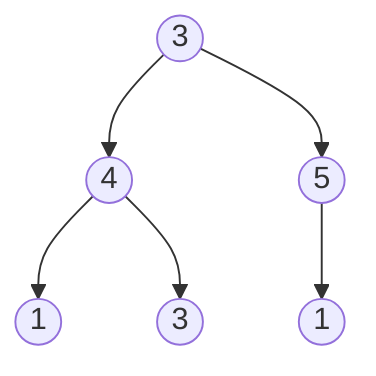
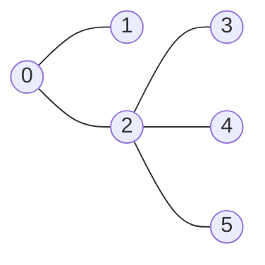
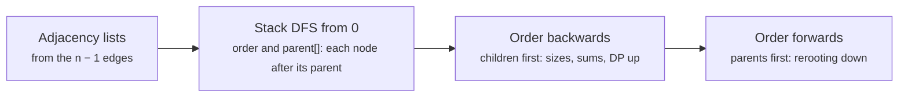

# DP on trees and rerooting

> Data Structures & Algorithms · L3 Specialist · Advanced dynamic programming · about 110 min · hub module `m06` ([open the hub](https://claude.ai/artifact/JfuakQWBwAvSgLi1rcuJUk))

## Why it matters
A tree has no cycles, so every subtree is a separate subproblem: solve the children, then combine at the parent. That one idea handles robbing houses on a tree, placing cameras and finding longest paths, and with rerooting it answers “for every node as the root” in O(n) instead of O(n²). Real inputs are edge lists with 10⁵ nodes, so the code must also survive a tree that is one long path.

## Pre-question (answer before reading)
**Q:** A tree has 100,000 nodes, and you need the sum of distances from every node to all the others. A BFS from each node is O(n²), about 10¹⁰ steps. When you move from a node to its neighbour, which distances change, and by how much?

<details><summary>Answer</summary>

Every distance changes by exactly 1: the nodes on the neighbour's side get one step closer, and all the others get one step further. If you know how many nodes are on each side (a subtree size), the neighbour's sum follows from the node's sum in O(1). That's rerooting.

</details>

## 🍎 Story time (kid version)
**The toy room and the treasure-map road trip: Where to hold the family picnic**

On the road trip, the family plans a picnic with ten cousins who live in ten villages, joined by roads with no loops. They want the village with the least total driving. Ben prices Grandma's village first: for each road he counts the cousins who live beyond it, since each of them drives that road once. Then he slides the picnic one road over. The cousins on the far side of that road now drive one road less, and everyone else drives one road more. So the new total is the old one, minus the far side, plus the rest, and Ben prices every village without asking anyone again.

| In the story | In code |
|---|---|
| Villages joined by roads with no loops | A tree: n nodes and n − 1 edges |
| How many cousins live beyond each road | size[v], the subtree sizes, counted children first |
| The total driving for a picnic at Grandma's | ans[0], the sum of distances from the root |
| Sliding the picnic one road over: the far side drives one road less, the rest one road more | ans[v] = ans[u] − size[v] + (n − size[v]) |
| Pricing every village without asking again | Rerooting: O(n) for all roots instead of O(n²) |

**Where the story breaks:** Ben can ask about a road and wait for the answer, like a recursive call. On a tree that is one chain of 100,000 villages, a recursive DFS passes Python's 1,000-frame limit (and overflows Node's stack), so the code walks a precomputed order instead.

## Key ideas (grown-up version)
- **Post-order tree DP**: each node turns its children's answers into a small summary of its own subtree and returns it to its parent. With O(1) work per child, the whole tree costs O(n) time.
- **Return a pair when the node makes a choice**: House Robber III returns (take, skip). take = val + skip(left) + skip(right); skip = max(left pair) + max(right pair). The answer is the larger value at the root.
- **Add states when the parent needs more detail**: Binary Tree Cameras returns one of 3 states: “not covered” (the parent must cover me), “covered without a camera” and “has a camera”. A missing child counts as covered without a camera.
- **General trees arrive as edge lists**: build adjacency lists, then get a DFS order and a parent array with an explicit stack. Every node appears after its parent, so the reversed order puts children before parents, and post-order DP becomes a plain loop with no recursion at all.
- **Subtree sizes and sums**: size[u] = 1 + the sizes of u's children, added into the parent while walking the order backwards: O(n). The same loop sums values, counts leaves or gathers any other subtree total.
- **Longest path through a node** joins its two longest child chains: keep the top two (LC 2246, and the tree diameter), update the best answer with top1 + top2 + 1 nodes, and return only top1 + 1 to the parent, because a path can't fork.
- **Rerooting**: compute the answer for root 0 bottom-up, then push it top-down. Moving the root from u to its child v changes the answer by an amount you can read from stored subtree data. For the sum of distances, ans[v] = ans[u] − size[v] + (n − size[v]). Two passes: O(n) time and space for all n roots.
- **Two directions**: the bottom-up pass (order reversed) carries facts about a subtree up to its parent; the rerooting pass (order forwards) carries facts about everything outside a subtree down to the child.

## Diagrams
**House Robber III on [3, 4, 5, 1, 3, null, 1]: each node returns (take, skip)**



_The leaves return (1, 0), (3, 0) and (1, 0). Node 4 returns (4, 4) and node 5 returns (5, 1). The root returns (3 + 4 + 1, 4 + 5) = (8, 9), so the best is 9: rob 4 and 5._

**Sum of distances (LeetCode 834): moving the root from 0 to 2**



_Rooted at 0, the subtree sizes are 6, 1, 4, 1, 1, 1 and ans[0] = 1 + 1 + 2 + 2 + 2 = 8. Moving the root across 0–2, the 4 nodes under 2 get one step closer and the other 2 one step further: ans[2] = 8 − 4 + 2 = 6. All answers: 8, 12, 6, 10, 10, 10._

**The iterative template for a tree given as an edge list**



## Comparisons
**Recursive or iterative tree DP?**

|  | Recursive DFS | Precomputed order (explicit stack) |
|---|---|---|
| Code | Short and natural | A few more lines: order and parent, then plain loops |
| A 10⁵-node path | Python raises RecursionError (default limit 1,000 frames); Node.js throws RangeError | Fine: the stack is an ordinary array |
| Extra memory | O(h) call frames, h = the tree's height | O(n) for the order and parent arrays |
| Use it for | Binary-tree problems with modest height | Edge lists with n up to 10⁵ or more |

**Tree DP problems at a glance**

| Problem | Each node returns | Combine at the node | Passes |
|---|---|---|---|
| House Robber III (LC 337) | (take, skip) | take = val + both skips; skip = the sum of the children's maxima | 1, bottom-up |
| Binary Tree Cameras (LC 968) | One of 3 states | A camera here if any child is not covered | 1, bottom-up |
| Longest path, different letters (LC 2246) | The longest valid chain downwards | best = top1 + top2 + 1 | 1, bottom-up |
| Distribute Coins (LC 979) | Coins − nodes in the subtree | moves += the absolute excess of each child | 1, bottom-up |
| Sum of Distances (LC 834) | Size and the sum of distances into the subtree | ans[v] = ans[u] + n − 2 · size[v] | 2: up, then down |

## Code (JavaScript + Python)
### The LeetCode tree helpers used by the binary-tree examples below
```python
from collections import deque

class TreeNode:
    def __init__(self, val=0, left=None, right=None):
        self.val, self.left, self.right = val, left, right

def build(level):                      # [3, 9, 20, None, None, 15, 7] -> tree
    if not level or level[0] is None:
        return None
    root = TreeNode(level[0])
    q, i = deque([root]), 1
    while q and i < len(level):
        node = q.popleft()
        for side in ("left", "right"):
            if i < len(level) and level[i] is not None:
                child = TreeNode(level[i])
                setattr(node, side, child)
                q.append(child)
            i += 1
    return root
```

```javascript
class TreeNode {
  constructor(val = 0, left = null, right = null) { this.val = val; this.left = left; this.right = right; }
}

function build(level) {                // [3, 9, 20, null, null, 15, 7] -> tree
  if (!level.length || level[0] === null) return null;
  const root = new TreeNode(level[0]);
  const q = [root];
  let head = 0, i = 1;
  while (head < q.length && i < level.length) {
    const node = q[head++];
    for (const side of ["left", "right"]) {
      if (i < level.length && level[i] !== null) {
        node[side] = new TreeNode(level[i]);
        q.push(node[side]);
      }
      i++;
    }
  }
  return root;
}
```

### House Robber III: every node returns (take, skip)
```python
def rob(root):
    def go(node):                            # returns (take, skip) for node's subtree
        if node is None:
            return 0, 0
        left_take, left_skip = go(node.left)
        right_take, right_skip = go(node.right)
        take = node.val + left_skip + right_skip                         # both children must be skipped
        skip = max(left_take, left_skip) + max(right_take, right_skip)   # each child is free to choose
        return take, skip
    return max(go(root))

print(rob(build([3, 2, 3, None, 3, None, 1])), rob(build([3, 4, 5, 1, 3, None, 1])),
      rob(build([4, 1, None, 2, None, 3])))
```

Output:
```text
7 9 7
```

- line 2: Recursion depth equals the tree's height: fine for these trees, but a 10⁴-node chain would pass Python's 1,000-frame limit (block 2 shows the fix).
- line 7: Robbing this node forbids robbing its children, so only their skip values can be added.
- line 8: Skipping this node frees each child to take whichever of its two values is bigger.

```javascript
function rob(root) {
  function go(node) {                                // returns [take, skip] for node's subtree
    if (node === null) return [0, 0];
    const [leftTake, leftSkip] = go(node.left);
    const [rightTake, rightSkip] = go(node.right);
    const take = node.val + leftSkip + rightSkip;                               // both children must be skipped
    const skip = Math.max(leftTake, leftSkip) + Math.max(rightTake, rightSkip); // each child is free to choose
    return [take, skip];
  }
  return Math.max(...go(root));
}

console.log(rob(build([3, 2, 3, null, 3, null, 1])), rob(build([3, 4, 5, 1, 3, null, 1])),
            rob(build([4, 1, null, 2, null, 3])));
```

Output:
```text
7 9 7
```

- line 7: Skipping this node frees each child to take whichever of its two values is bigger.

### The iterative template: DFS order, parents and subtree sizes on a 100,000-node path
```python
def tree_order(n, edges, root=0):
    adj = [[] for _ in range(n)]
    for a, b in edges:
        adj[a].append(b)
        adj[b].append(a)
    parent, order, stack = [-1] * n, [], [root]
    while stack:                             # iterative DFS: no recursion at all
        u = stack.pop()
        order.append(u)                      # every node lands after its parent
        for v in adj[u]:
            if v != parent[u]:               # in a tree, the only neighbour seen before is the parent
                parent[v] = u
                stack.append(v)
    return parent, order

def subtree_sizes(parent, order):
    size = [1] * len(order)
    for u in reversed(order):                # children before parents
        if parent[u] != -1:
            size[parent[u]] += size[u]
    return size

parent, order = tree_order(6, [(0, 1), (0, 2), (2, 3), (2, 4), (2, 5)])
print(*subtree_sizes(parent, order))

n = 100_000
parent, order = tree_order(n, [(i, i + 1) for i in range(n - 1)])   # a path: depth 99,999
size = subtree_sizes(parent, order)
print(size[0], size[1], size[n - 1], parent[n - 1])
```

Output:
```text
6 1 4 1 1 1
100000 99999 1 99998
```

- line 7: The stack replaces the call stack. It's an ordinary list, so a path 99,999 edges deep is no problem.
- line 11: A tree has no cycles, so skipping the parent is enough; general graphs would need a visited array.
- line 18: Each node appears after its parent in order, so walking it backwards finishes every child before its parent.

```javascript
function treeOrder(n, edges, root = 0) {
  const adj = Array.from({ length: n }, () => []);
  for (const [a, b] of edges) { adj[a].push(b); adj[b].push(a); }
  const parent = new Int32Array(n).fill(-1), order = [], stack = [root];
  while (stack.length) {                             // iterative DFS: no recursion at all
    const u = stack.pop();
    order.push(u);                                   // every node lands after its parent
    for (const v of adj[u]) {
      if (v !== parent[u]) {                         // in a tree, the only neighbour seen before is the parent
        parent[v] = u;
        stack.push(v);
      }
    }
  }
  return [parent, order];
}

function subtreeSizes(parent, order) {
  const size = new Int32Array(order.length).fill(1);
  for (let k = order.length - 1; k >= 0; k--) {      // children before parents
    const u = order[k];
    if (parent[u] !== -1) size[parent[u]] += size[u];
  }
  return size;
}

let [parent, order] = treeOrder(6, [[0, 1], [0, 2], [2, 3], [2, 4], [2, 5]]);
console.log(...subtreeSizes(parent, order));

const n = 100000;
[parent, order] = treeOrder(n, Array.from({ length: n - 1 }, (_, i) => [i, i + 1]));   // a path: depth 99,999
const size = subtreeSizes(parent, order);
console.log(size[0], size[1], size[n - 1], parent[n - 1]);
```

Output:
```text
6 1 4 1 1 1
100000 99999 1 99998
```

- line 4: An Int32Array is fine here: node numbers and sizes stay below 2³¹.
- line 20: Walking the order backwards finishes every child before its parent, with no recursion.

### Longest Path With Different Adjacent Characters: keep the top two child chains
```python
def longest_path(parent, s):
    n = len(parent)
    children = [[] for _ in range(n)]
    for v in range(1, n):
        children[parent[v]].append(v)
    order, stack = [], [0]
    while stack:                             # parents before children
        u = stack.pop()
        order.append(u)
        stack.extend(children[u])
    down = [1] * n                           # down[u]: nodes on the longest valid chain from u downwards
    best = 1
    for u in reversed(order):                # children before parents
        top1 = top2 = 0                      # the two longest chains that u may join
        for v in children[u]:
            if s[v] != s[u]:                 # only a child with a different letter can join u
                if down[v] > top1:
                    top1, top2 = down[v], top1
                elif down[v] > top2:
                    top2 = down[v]
        down[u] = 1 + top1                   # a chain passed up to the parent can't fork
        best = max(best, 1 + top1 + top2)    # a path may bend at u
    return best

print(longest_path([-1, 0, 0, 1, 1, 2], "abacbe"), longest_path([-1, 0, 0, 0], "aabc"),
      longest_path([-1, 0, 1, 2, 3], "ababa"), longest_path([-1], "z"))
```

Output:
```text
3 3 5 1
```

- line 6: LeetCode's parent array doesn't promise parent[v] < v, so get a real order first.
- line 17: Keep the two largest values in one pass: a new maximum pushes the old one down to second place.
- line 22: The answer bends at u and uses two chains; the value returned upwards uses only one.

```javascript
function longestPath(parent, s) {
  const n = parent.length;
  const children = Array.from({ length: n }, () => []);
  for (let v = 1; v < n; v++) children[parent[v]].push(v);
  const order = [], stack = [0];
  while (stack.length) {                             // parents before children
    const u = stack.pop();
    order.push(u);
    for (const v of children[u]) stack.push(v);
  }
  const down = new Int32Array(n).fill(1);            // down[u]: nodes on the longest valid chain from u downwards
  let best = 1;
  for (let k = n - 1; k >= 0; k--) {                 // children before parents
    const u = order[k];
    let top1 = 0, top2 = 0;                          // the two longest chains that u may join
    for (const v of children[u]) {
      if (s[v] === s[u]) continue;                   // only a child with a different letter can join u
      if (down[v] > top1) [top1, top2] = [down[v], top1];
      else if (down[v] > top2) top2 = down[v];
    }
    down[u] = 1 + top1;                              // a chain passed up to the parent can't fork
    best = Math.max(best, 1 + top1 + top2);          // a path may bend at u
  }
  return best;
}

console.log(longestPath([-1, 0, 0, 1, 1, 2], "abacbe"), longestPath([-1, 0, 0, 0], "aabc"),
            longestPath([-1, 0, 1, 2, 3], "ababa"), longestPath([-1], "z"));
```

Output:
```text
3 3 5 1
```

- line 9: A loop instead of `stack.push(...children[u])`: spreading a huge array into arguments can overflow the call stack.
- line 22: The answer bends at u and uses two chains; the value returned upwards uses only one.

## Worked example
**Problem.** Sum of Distances in Tree (LeetCode 834): a tree has n nodes (n ≤ 3 × 10⁴) and n − 1 edges. Return ans, where ans[i] is the sum of the distances from node i to every other node.

1. Root the tree at 0 and get a DFS order and a parent array with an explicit stack, so nothing recurses.
2. Pass 1, children before parents (the order backwards): size[u] = 1 + the children's sizes, and down[u] = the sum of distances from u into its subtree: each child v adds down[v] + size[v], because all size[v] of its nodes are one step further from u.
3. ans[0] = down[0]. Moving the root from u to its child v brings the size[v] nodes under v one step closer and pushes the other n − size[v] one step further: ans[v] = ans[u] − size[v] + (n − size[v]).
4. Pass 2, parents before children (the order forwards), so ans[u] is ready before its children need it. Two O(n) passes: O(n) time and space, against O(n²) for a BFS from every node.

```python
def sum_of_distances(n, edges):
    adj = [[] for _ in range(n)]
    for a, b in edges:
        adj[a].append(b)
        adj[b].append(a)
    parent, order, stack = [-1] * n, [], [0]
    while stack:                             # DFS order from root 0, no recursion
        u = stack.pop()
        order.append(u)
        for v in adj[u]:
            if v != parent[u]:
                parent[v] = u
                stack.append(v)
    size, down = [1] * n, [0] * n            # down[u]: sum of distances from u into its subtree
    for u in reversed(order):                # pass 1: children before parents
        p = parent[u]
        if p != -1:
            size[p] += size[u]
            down[p] += down[u] + size[u]     # each of the size[u] nodes is one step further from p
    ans = [0] * n
    ans[0] = down[0]
    for u in order[1:]:                      # pass 2: parents before children
        ans[u] = ans[parent[u]] - size[u] + (n - size[u])
    return ans

print(*sum_of_distances(6, [[0, 1], [0, 2], [2, 3], [2, 4], [2, 5]]))
print(*sum_of_distances(2, [[1, 0]]), *sum_of_distances(1, []))
```

Output:
```text
8 12 6 10 10 10
1 1 0
```

```javascript
function sumOfDistances(n, edges) {
  const adj = Array.from({ length: n }, () => []);
  for (const [a, b] of edges) { adj[a].push(b); adj[b].push(a); }
  const parent = new Int32Array(n).fill(-1), order = [], stack = [0];
  while (stack.length) {                             // DFS order from root 0, no recursion
    const u = stack.pop();
    order.push(u);
    for (const v of adj[u]) if (v !== parent[u]) { parent[v] = u; stack.push(v); }
  }
  const size = new Int32Array(n).fill(1);
  const down = new Float64Array(n);                  // sums reach about n^2 / 2: too big for an Int32Array
  for (let k = n - 1; k >= 0; k--) {                 // pass 1: children before parents
    const u = order[k], p = parent[u];
    if (p !== -1) {
      size[p] += size[u];
      down[p] += down[u] + size[u];                  // each of the size[u] nodes is one step further from p
    }
  }
  const ans = new Float64Array(n);
  ans[0] = down[0];
  for (let k = 1; k < n; k++) {                      // pass 2: parents before children
    const u = order[k];
    ans[u] = ans[parent[u]] - size[u] + (n - size[u]);
  }
  return ans;
}

console.log(...sumOfDistances(6, [[0, 1], [0, 2], [2, 3], [2, 4], [2, 5]]));
console.log(...sumOfDistances(2, [[1, 0]]), ...sumOfDistances(1, []));
```

Output:
```text
8 12 6 10 10 10
1 1 0
```

**Answer.** 8 12 6 10 10 10 for the six-node tree, then 1 1 for two nodes and 0 for one. Node 2 sits in the middle, so its sum is the smallest; the leaves 3, 4 and 5 are two steps from 0 and 1. The hidden tests compare every answer with a BFS from each node, and run a 10⁵-node path to show nothing recurses.

## Your turn (faded example)
**Problem.** Distribute Coins in Binary Tree (LeetCode 979): a tree of n nodes holds n coins in total. One move sends one coin between a parent and a child. Find the fewest moves that leave exactly one coin on every node.

- ✓ Think about one edge, between a node and its parent. Every coin that crosses it costs one move, and in the best plan coins cross each edge in one direction only.
- **How many coins must cross the edge above a subtree?**
  <details><summary>Answer</summary>|coins in the subtree − nodes in the subtree|, its excess. A positive excess must go up; a negative one is a shortage that must come down.</details>
- **What does each call return to its parent, and where do the moves add up?**
  <details><summary>Answer</summary>The subtree's excess: node.val − 1 + excess(left) + excess(right). At each node, add |excess(left)| + |excess(right)|, the coins crossing its two child edges.</details>
- **Time and space?**
  <details><summary>Answer</summary>O(n) time, one visit per node, and O(h) stack space for the recursion. LeetCode 979 has n ≤ 100, so recursion is safe; for a huge tree, use the order-backwards loop from block 2.</details>

Starter:
```python
def distribute_coins(root):
    moves = 0
    def excess(node):                        # coins minus nodes in node's subtree
        nonlocal moves
        if node is None:
            return 0
        left, right = excess(node.left), excess(node.right)
        ...                                  # TODO: add the moves on the two child edges, return this subtree's excess
    excess(root)
    return moves

print(distribute_coins(build([3, 0, 0])))   # expect 2
```

```javascript
function distributeCoins(root) {
  let moves = 0;
  function excess(node) {                            // coins minus nodes in node's subtree
    if (node === null) return 0;
    const left = excess(node.left), right = excess(node.right);
    // TODO: add the moves on the two child edges, return this subtree's excess
  }
  excess(root);
  return moves;
}

console.log(distributeCoins(build([3, 0, 0])));   // expect 2
```

<details><summary>Full solution</summary>

```python
def distribute_coins(root):
    moves = 0
    def excess(node):                        # coins minus nodes in node's subtree
        nonlocal moves
        if node is None:
            return 0
        left, right = excess(node.left), excess(node.right)
        moves += abs(left) + abs(right)      # that many coins cross each child's edge
        return node.val - 1 + left + right   # the node keeps one coin for itself
    excess(root)
    return moves

print(distribute_coins(build([3, 0, 0])), distribute_coins(build([0, 3, 0])),
      distribute_coins(build([1, 0, 0, None, 3])))
```

Output:
```text
2 3 4
```

```javascript
function distributeCoins(root) {
  let moves = 0;
  function excess(node) {                            // coins minus nodes in node's subtree
    if (node === null) return 0;
    const left = excess(node.left), right = excess(node.right);
    moves += Math.abs(left) + Math.abs(right);       // that many coins cross each child's edge
    return node.val - 1 + left + right;              // the node keeps one coin for itself
  }
  excess(root);
  return moves;
}

console.log(distributeCoins(build([3, 0, 0])), distributeCoins(build([0, 3, 0])),
            distributeCoins(build([1, 0, 0, null, 3])));
```

Output:
```text
2 3 4
```

</details>

## Socratic checks and quiz (answers hidden)
**1. What does this print? (`build` turns the level-order list into a tree.)**

```python
def go(node):
    if node is None:
        return 0, 0
    lt, ls = go(node.left)
    rt, rs = go(node.right)
    return node.val + ls + rs, max(lt, ls) + max(rt, rs)

print(*go(build([2, 1, 3, None, 4])))
```

```javascript
function go(node) {
  if (node === null) return [0, 0];
  const [lt, ls] = go(node.left), [rt, rs] = go(node.right);
  return [node.val + ls + rs, Math.max(lt, ls) + Math.max(rt, rs)];
}

console.log(...go(build([2, 1, 3, null, 4])));
```

- A. 6 7
- B. 7 6
- C. 9 7
- D. 6 9

<details><summary>Answer</summary>

6 7. The tree is 2 with children 1 and 3, and 4 is the right child of 1. Leaf 4 returns (4, 0), node 1 returns (1, 4) and leaf 3 returns (3, 0). The root's take is 2 + 4 + 0 = 6 (both children skipped), and its skip is max(1, 4) + max(3, 0) = 7: rob 4 and 3.

</details>

**2. What does this print?**

```python
adj = [[1, 2], [0, 3], [0], [1]]
parent, order, stack = [-1] * 4, [], [0]
while stack:
    u = stack.pop()
    order.append(u)
    for v in adj[u]:
        if v != parent[u]:
            parent[v] = u
            stack.append(v)
print(*reversed(order))
```

```javascript
const adj = [[1, 2], [0, 3], [0], [1]];
const parent = [-1, -1, -1, -1], order = [], stack = [0];
while (stack.length) {
  const u = stack.pop();
  order.push(u);
  for (const v of adj[u]) if (v !== parent[u]) { parent[v] = u; stack.push(v); }
}
console.log(...order.toReversed());
```

- A. 3 1 2 0
- B. 0 2 1 3
- C. 3 2 1 0
- D. 2 3 1 0

<details><summary>Answer</summary>

3 1 2 0. Pop 0 and push 1 and 2; pop 2 (its only neighbour is its parent); pop 1 and push 3; pop 3. The order is 0 2 1 3, and backwards it's 3 1 2 0: every child comes before its parent.

</details>

**3. A tree has 10 nodes. The root moves from u to its child v, whose subtree has 3 nodes. How does the sum of distances change?**

- A. It rises by 4
- B. It falls by 4
- C. It rises by 7
- D. It falls by 3

<details><summary>Answer</summary>

It rises by 4. The 3 nodes under v get one step closer (−3) and the other 7 get one step further (+7): ans[v] = ans[u] − 3 + 7 = ans[u] + 4.

</details>

**4. Which problems need only one bottom-up pass over the tree? (choose 3)**

- A. House Robber III
- B. Distribute Coins in Binary Tree
- C. Longest Path With Different Adjacent Characters
- D. Sum of Distances in Tree (a sum for every node)
- E. The distance to the farthest node, for every node

<details><summary>Answer</summary>

House Robber III, Distribute Coins in Binary Tree, Longest Path With Different Adjacent Characters. The first three want one answer built from subtree summaries. The last two want an answer at every node, which needs a second, rerooting pass (or O(n²) work).

</details>

**5. Judge each statement.**

- Walking a stack-based DFS order backwards visits every child before its parent.
- A recursive DFS on a 100,000-node path works in Python with the default settings.
- Rerooting gives the sum of distances for every node in O(n) time.
- House Robber III needs three states per node.

<details><summary>Answer</summary>

Walking a stack-based DFS order backwards visits every child before its parent.: Yes; A recursive DFS on a 100,000-node path works in Python with the default settings.: No; Rerooting gives the sum of distances for every node in O(n) time.: Yes; House Robber III needs three states per node.: No. Children are pushed when their parent is popped, so they land later in the order. Python stops near 1,000 frames. Rerooting is two O(n) passes. House Robber III needs two states, take and skip; Binary Tree Cameras is the one with three.

</details>

**6. Put the rerooting solution for the sum of distances in order.**

- (put the steps in order)

<details><summary>Answer</summary>

Build adjacency lists from the edges → Get a DFS order and parent array from node 0 with an explicit stack → Walk the order backwards, adding size[u] and down[u] + size[u] into the parent → Set ans[0] = down[0], then walk the order forwards with ans[v] = ans[parent] − size[v] + (n − size[v]). The DFS needs the adjacency lists, pass 1 needs the order and parents, and pass 2 needs the sizes and ans[0] from pass 1.

</details>

**7. Complete the Python rerooting solution.**

```
def sum_of_distances(n, edges):
    adj = [[] for _ in range(n)]
    for a, b in edges:
        adj[a].append(b)
        adj[b].append(a)
    parent, order, stack = [-1] * n, [], [0]
    while stack:
        u = stack.pop()
        order.append(u)
        for v in adj[u]:
            if v != parent[u]:
                parent[v] = u
                stack.append(v)
    size, down = [1] * n, [0] * n
    for u in {{0}}:
        p = parent[u]
        if p != -1:
            size[p] += size[u]
            down[p] += down[u] + {{1}}
    ans = [down[0]] * n
    for u in order[1:]:
        ans[u] = ans[parent[u]] {{2}}
    return ans

```

<details><summary>Answer</summary>

reversed(order) | size[u] | - size[u] + (n - size[u]). Pass 1 must see children before parents, so it walks the order backwards. Each of the size[u] nodes below u is one step further from p. Moving the root to u brings size[u] nodes closer and pushes n − size[u] further away.

</details>

**8. Match each problem to its tree DP move.**


<details><summary>Answer</summary>

Rob houses on a tree, never two neighbours = Return (take, skip) from every node; The longest path whose neighbouring letters differ = Keep the top two child chains at each node; The sum of distances from every node = Rerooting with subtree sizes; The fewest moves to give every node one coin = Return each subtree's excess and add its absolute value. A choice per node gives a pair, a bending path needs two chains, every-root answers need rerooting, and coin moves are counted per edge from the excess below it.

</details>

## Traps & misconceptions
- **“Recursion is fine for any tree.”** Depth equals the tree's height. A 10⁵-node path raises RecursionError in Python (default limit 1,000 frames) and RangeError in Node.js. Process a precomputed DFS order instead.
- **“Skipping a node means robbing both of its children.”** Skipping only frees the children: each takes max(take, skip). Forcing them to be robbed misses trees where the grandchildren are worth more.
- **“The longest path through a node can use its longest child chain twice.”** A path joins the two longest chains from different children (top1 + top2 + 1 nodes). The node returns only top1 + 1 to its parent, because a path can't fork.
- **“Rerooting means running the DP again from every root.”** That's O(n²). Rerooting reuses the first pass: each move across an edge is an O(1) update, so all n roots cost O(n).
- **“The rerooting pass can walk the order backwards, like the first pass.”** ans[v] needs ans[parent] first, so the second pass walks the order forwards: parents before children.
- **“Sums of distances fit in an Int32Array.”** On a 10⁵-node path they reach about 5 × 10⁹, past 2³¹ − 1. Use a plain array or a Float64Array in JavaScript (exact up to 2⁵³); Python's ints don't overflow.

## Discussion prompts
- **Why does walking the stack-based DFS order backwards put every child before its parent?**
  <details><summary>One good answer</summary>A node is appended to the order when it's popped, and its children are pushed only at that moment, so each child is popped, and appended, after its parent. The stack also finishes a whole subtree before moving on, so the order is a preorder, and reversed it's a post-order: every child, and its whole subtree, comes before its parent. That's exactly what a bottom-up DP needs.</details>
- **How would you reroot a different problem, such as the distance to the farthest node from every node?**
  <details><summary>One good answer</summary>Rerooting needs, for each node, an “up” value: the best answer using only nodes outside its subtree. The first pass stores each node's two longest downward chains. Moving from u to a child v, up[v] = 1 + max(up[u], u's longest chain that doesn't go through v): top1 of u, unless v supplied it, in which case top2. The answer at v is max(down[v], up[v]), again O(n) in total.</details>

## Teach-back
**Prompt:** Explain to a junior colleague how rerooting computes the sum of distances from every node of a tree in O(n).

Rubric:
- [ ] Roots the tree at 0 and gets a DFS order and parent array without recursion
- [ ] Pass 1, children first: size[u] and down[u], the distances into u's subtree
- [ ] ans[0] = down[0]
- [ ] Pass 2, parents first: ans[v] = ans[u] − size[v] + (n − size[v])
- [ ] O(n) time and space, against O(n²) for a BFS from every node

<details><summary>Model answer</summary>

First root the tree at node 0 and get a DFS order with an explicit stack, recording each node's parent; every node then comes after its parent. Walking that order backwards visits children before parents, so one loop computes size[u], the number of nodes in u's subtree, and down[u], the sum of distances from u to them: each child v adds down[v] + size[v], because all size[v] of its nodes are one step further from u. down[0] is the full answer for node 0. Now move the root across one edge, from u to its child v: the size[v] nodes under v get one step closer and the other n − size[v] get one step further, so ans[v] = ans[u] − size[v] + (n − size[v]). Walking the order forwards guarantees ans[u] is ready before its children need it. Both passes are O(n) time and space, against O(n²) for a BFS from every node.

</details>

## Quick Q&A (also in the SRS deck)
- **What does House Robber III return from each node?** A pair (take, skip): the best total for its subtree if the node is robbed, and if it isn't.
- **How do you avoid recursion in a tree DP on an edge list?** Get a DFS order and parent array with an explicit stack, then walk the order backwards (children before parents).
- **How is size[u] computed?** 1 + the sizes of u's children, added into the parent while walking the DFS order backwards.
- **Longest path through a node?** 1 + its two longest child chains (top1 + top2); it returns only 1 + top1 to its parent.
- **Rerooting update for the sum of distances?** ans[v] = ans[u] − size[v] + (n − size[v]) when the root moves from u to its child v.
- **Distribute Coins: how many moves cross the edge above a subtree?** |coins − nodes| in that subtree: its excess.

## Practice problems
- [ ] [LC 337 · House Robber III](https://leetcode.com/problems/house-robber-iii/) · Medium · return (take, skip) from every node; the answer is the larger pair value at the root
- [ ] [LC 979 · Distribute Coins in Binary Tree](https://leetcode.com/problems/distribute-coins-in-binary-tree/) · Medium · the faded example: each edge carries |coins − nodes| of the subtree below it
- [ ] [LC 1339 · Maximum Product of Splitted Binary Tree](https://leetcode.com/problems/maximum-product-of-splitted-binary-tree/) · Medium · one pass for subtree sums; maximise s · (total − s) before taking the modulus (BigInt in JavaScript: the product can pass 2⁵³)
- [ ] [LC 968 · Binary Tree Cameras](https://leetcode.com/problems/binary-tree-cameras/) · Hard · three states: not covered, covered without a camera, has a camera; a null child counts as covered
- [ ] [LC 2246 · Longest Path With Different Adjacent Characters](https://leetcode.com/problems/longest-path-with-different-adjacent-characters/) · Hard · code block 3: join the two longest child chains whose letters differ from the node's
- [ ] [LC 834 · Sum of Distances in Tree](https://leetcode.com/problems/sum-of-distances-in-tree/) · Hard · the worked example: sizes up, then ans[child] = ans[parent] + n − 2 · size[child]

## Sources (accessed 2026-10-09)
- [USACO Guide: DP on trees, introduction](https://usaco.guide/gold/dp-trees)
- [USACO Guide: DP on trees, solving for all roots](https://usaco.guide/gold/all-roots)
- [Antti Laaksonen, Competitive Programmer's Handbook (chapter 14, Tree algorithms)](https://cses.fi/book/book.pdf)
- [Python docs: sys.setrecursionlimit](https://docs.python.org/3/library/sys.html#sys.setrecursionlimit)
