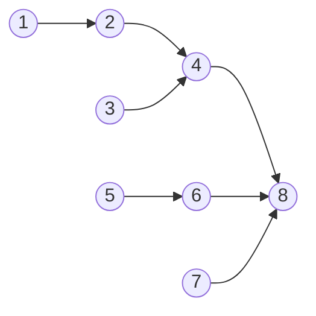

# Fenwick trees (binary indexed trees)

> Data Structures & Algorithms · L3 Specialist · Range queries · about 110 min · hub module `m08` ([open the hub](https://claude.ai/artifact/JfuakQWBwAvSgLi1rcuJUk))

## Why it matters
When an array keeps changing and you keep asking for prefix sums, a prefix-sum array must be rebuilt after every change. A Fenwick tree does each update and each prefix sum in O(log n) with about ten lines of code. With coordinate compression it also counts inversions and “smaller elements after me”, classic hard interview problems.

## Pre-question (answer before reading)
**Q:** A prefix-sum array answers range sums in O(1), but changing a[1] forces you to fix every prefix after it. Could each slot store a shorter partial sum, so that both a change and a prefix sum touch only about log₂ n slots?

<details><summary>Answer</summary>

Yes. In a Fenwick tree, slot i stores the sum of the block that ends at i and whose length is the lowest set bit of i. Any prefix splits into at most about log₂ n of these blocks, and any position lies in at most about log₂ n of them.

</details>

## 🍎 Story time (kid version)
**The toy room and the treasure-map road trip: Tara's cow-count notes**

On the road trip, Ben counts cows at each of eight stops. Tara wants quick totals like “cows up to stop 7”, but a running total at every stop means fixing all of them when Ben recounts stop 1. So she keeps eight notes, each covering a block of stops that ends at its own stop: note 4 covers stops 1–4, note 6 covers 5–6, note 7 covers just 7, and note 8 covers all eight. Cows up to stop 7? Add notes 7, 6 and 4. Ben recounts stop 3? Fix notes 3, 4 and 8, the only notes whose blocks include it. No question or fix ever touches more than four notes.

| In the story | In code |
|---|---|
| Note i covers a block of stops ending at stop i | `tree[i]` holds a[i − lowbit(i) + 1 .. i], where lowbit(i) = `i & -i` |
| Cows up to stop 7 = notes 7 + 6 + 4 | Prefix query: add `tree[i]`, then `i -= i & -i`, until i is 0 |
| Recounting stop 3 fixes notes 3, 4 and 8 | Point update: add to `tree[i]`, then `i += i & -i`, while i ≤ n |
| The stops are numbered from 1 | Fenwick trees are 1-indexed: `0 & -0` is 0, so the loops couldn't move on from 0 |
| Never more than four notes for eight stops | O(log n) per query and per update |

**Where the story breaks:** Ben's recount replaces a number, but a Fenwick update adds a change: to set a[i] to v you add v − a[i], so you keep a plain copy of the values too (as LeetCode 307 does). And “cows from stop 3 to 7” works by subtraction (the total to 7 minus the total to 2), so the same notes can't answer “the fewest cows between two stops”.

## Key ideas (grown-up version)
- **What a slot stores**: with 1-indexing, `tree[i]` holds the sum of a[i − lowbit(i) + 1 .. i], where lowbit(i) = `i & -i`, L2's trick that keeps only the lowest set bit. Slot 12 (0b1100) covers 9..12, slot 8 covers 1..8, and every odd slot covers only itself.
- **Prefix query**: `while i > 0: s += tree[i]; i -= i & -i`. Each step clears the lowest set bit, so it runs popcount(i) ≤ ⌊log₂ n⌋ + 1 times: O(log n).
- **Point update** (add delta at i): `while i <= n: tree[i] += delta; i += i & -i`. Adding the lowest set bit jumps to the next slot whose block contains i, and that bit at least doubles every time, so this is O(log n) too.
- **Range sum** = query(r) − query(l − 1). It relies on subtraction, so Fenwick trees suit sums, counts and XOR, not min or max with arbitrary updates: those need a segment tree (module 09).
- **1-indexing**: `0 & -0` is 0, so a loop at index 0 would never move. Shift 0-based positions up by one and give the array n + 1 slots: O(n) space.
- **O(n) construction**: copy the values in, then for i = 1..n add tree[i] into tree[i + (i & −i)] when that index is ≤ n. Making n separate updates costs O(n log n) instead.
- **Counting with a Fenwick tree over values**: compress the values to ranks 1..m (sort the distinct values, then map each to its position) and keep a count per rank. Walking right to left, query(rank − 1) counts the smaller values already seen (LeetCode 315); walking left to right, seen − query(rank) counts the earlier, greater ones (inversions). O(n log n) time, O(n) space.
- **Range update, point query**: keep the tree over the difference array. Add v to a[l..r] with update(l, v) and update(r + 1, −v), then read a[i] as query(i). Range update with range sum needs two Fenwick trees, or a segment tree with lazy tags.

## Diagrams
**What each slot stores when n = 8**

| slot i | 0 | 1 | 2 | 3 | 4 | 5 | 6 | 7 |
|---|---|---|---|---|---|---|---|---|
| value | 1 | 2 | 3 | 4 | 5 | 6 | 7 | 8 |

| i in binary | 0 | 1 | 2 | 3 | 4 | 5 | 6 | 7 |
|---|---|---|---|---|---|---|---|---|
| value | 0001 | 0010 | 0011 | 0100 | 0101 | 0110 | 0111 | 1000 |

| i & −i | 0 | 1 | 2 | 3 | 4 | 5 | 6 | 7 |
|---|---|---|---|---|---|---|---|---|
| value | 1 | 2 | 1 | 4 | 1 | 2 | 1 | 8 |

| covers | 0 | 1 | 2 | 3 | 4 | 5 | 6 | 7 |
|---|---|---|---|---|---|---|---|---|
| value | 1 | 1–2 | 3 | 1–4 | 5 | 5–6 | 7 | 1–8 |

_Each block has the length of i's lowest set bit and ends at i. query(7) adds the three green blocks, 7, 5–6 and 1–4, going 7 → 6 → 4 → 0 as it clears one set bit per step._

**update(3) climbs 3 → 4 → 8: each arrow adds the lowest set bit**



_Every arrow goes from i to i + (i & −i), the next slot whose block contains i. Slot 8 covers everything, so with n = 8 every update ends there, after at most four slots._

**Counting smaller elements to the right of [5, 2, 6, 1] (LeetCode 315)**

| nums | 0 | 1 | 2 | 3 |
|---|---|---|---|---|
| value | 5 | 2 | 6 | 1 |

| rank | 0 | 1 | 2 | 3 |
|---|---|---|---|---|
| value | 3 | 2 | 4 | 1 |

| smaller after | 0 | 1 | 2 | 3 |
|---|---|---|---|---|
| value | 2 | 1 | 1 | 0 |

_Walk from the right, adding each rank after its query. For 5 (rank 3), ranks 1 and 2 are already in the tree, so query(2) = 2._

## Comparisons
**Prefix-sum array, Fenwick tree or segment tree?**

|  | Prefix-sum array | Fenwick tree | Segment tree |
|---|---|---|---|
| Point update | O(n): fix every later prefix | O(log n) | O(log n) |
| Range sum | O(1) | O(log n): two prefix queries | O(log n) |
| Range min or max with updates | No | No: a minimum can't be subtracted | O(log n) |
| Range add, then read single values | O(n) per update | O(log n) over the difference array | O(log n) |
| Build | O(n) | O(n) | O(n) |
| Memory | n + 1 numbers | n + 1 numbers | 2n to 4n numbers |

**Counting with a Fenwick tree of counts (seen = values already added)**

| Problem | Direction | For each x, add to the answer | Then |
|---|---|---|---|
| Smaller after self (LeetCode 315) | Right to left | query(rank(x) − 1) | update(rank(x), 1) |
| Inversions | Left to right | seen − query(rank(x)) | update(rank(x), 1) |
| Reverse pairs (LeetCode 493) | Left to right | seen − query(rank(2x)) | update(rank(x), 1) |
| Create sorted array (LeetCode 1649) | Left to right | min(query(x − 1), seen − query(x)) | update(x, 1) |

## Code (JavaScript + Python)
### The Fenwick class used by every example below
```python
class Fenwick:                               # 1-indexed: slots 1..n hold the blocks
    def __init__(self, n):
        self.n = n
        self.tree = [0] * (n + 1)            # slot 0 is unused

    def update(self, i, delta):              # a[i] += delta, O(log n)
        while i <= self.n:
            self.tree[i] += delta
            i += i & -i                      # the next slot whose block contains i

    def query(self, i):                      # a[1] + ... + a[i], O(log n)
        s = 0
        while i > 0:
            s += self.tree[i]
            i -= i & -i                      # drop the block just added
        return s

    def range_query(self, l, r):             # a[l] + ... + a[r]
        return self.query(r) - self.query(l - 1)
```

- line 9: `i & -i` is the lowest set bit of i (L2's bit-manipulation module). Adding it jumps to the next block that covers i.
- line 15: Subtracting the lowest set bit clears it, so the loop runs once per set bit of i.

```javascript
class Fenwick {                              // 1-indexed: slots 1..n hold the blocks
  constructor(n) {
    this.n = n;
    this.tree = new Array(n + 1).fill(0);    // slot 0 is unused
  }
  update(i, delta) {                         // a[i] += delta, O(log n)
    for (; i <= this.n; i += i & -i)         // the next slot whose block contains i
      this.tree[i] += delta;
  }
  query(i) {                                 // a[1] + ... + a[i], O(log n)
    let s = 0;
    for (; i > 0; i -= i & -i)               // drop the block just added
      s += this.tree[i];
    return s;
  }
  rangeQuery(l, r) {                         // a[l] + ... + a[r]
    return this.query(r) - this.query(l - 1);
  }
}
```

- line 7: `i & -i` is the lowest set bit of i (L2's bit-manipulation module). Adding it jumps to the next block that covers i.
- line 12: Subtracting the lowest set bit clears it, so the loop runs once per set bit of i. The bitwise operators work on 32-bit integers, which is plenty for indexes.

### Point updates and range sums (LeetCode 307), with an O(n) build
```python
def build_fenwick(values):                     # O(n): each slot passes its total up once
    fw = Fenwick(len(values))
    for i, v in enumerate(values, 1):
        fw.tree[i] += v                        # slot i is now complete...
        j = i + (i & -i)
        if j <= fw.n:
            fw.tree[j] += fw.tree[i]           # ...so add it to the next block that contains it
    return fw

class NumArray:                                # LeetCode 307: a 0-based API on a 1-based tree
    def __init__(self, nums):
        self.nums = nums[:]                    # keep the values: an update needs the old one
        self.fw = build_fenwick(nums)

    def update(self, index, val):
        self.fw.update(index + 1, val - self.nums[index])   # a Fenwick update adds a change
        self.nums[index] = val

    def sum_range(self, left, right):
        return self.fw.range_query(left + 1, right + 1)

arr = NumArray([1, 3, 5, 7, 9, 11])
print("tree:", *arr.fw.tree[1:])
print(arr.sum_range(0, 2), arr.sum_range(1, 4))
arr.update(1, 2)
arr.update(4, 0)
print(arr.sum_range(0, 2), arr.sum_range(3, 5))
```

Output:
```text
tree: 1 4 5 16 9 20
9 24
8 18
```

- line 1: n separate updates would cost O(n log n); this builds the same tree in O(n).
- line 7: tree[i] is complete when the loop reaches i, because every smaller block inside it has a smaller index and was added already.
- line 16: Setting a value means adding new − old, which is why the class keeps `nums`.
- line 23: Slot 4 holds 1 + 3 + 5 + 7 = 16 and slot 6 holds 9 + 11 = 20: each slot covers lowbit(i) values ending at i.

```javascript
function buildFenwick(values) {                // O(n): each slot passes its total up once
  const fw = new Fenwick(values.length);
  for (let i = 1; i <= values.length; i++) {
    fw.tree[i] += values[i - 1];               // slot i is now complete...
    const j = i + (i & -i);
    if (j <= fw.n) fw.tree[j] += fw.tree[i];   // ...so add it to the next block that contains it
  }
  return fw;
}

class NumArray {                               // LeetCode 307: a 0-based API on a 1-based tree
  constructor(nums) {
    this.nums = [...nums];                     // keep the values: an update needs the old one
    this.fw = buildFenwick(nums);
  }
  update(index, val) {
    this.fw.update(index + 1, val - this.nums[index]);   // a Fenwick update adds a change
    this.nums[index] = val;
  }
  sumRange(left, right) {
    return this.fw.rangeQuery(left + 1, right + 1);
  }
}

const arr = new NumArray([1, 3, 5, 7, 9, 11]);
console.log("tree:", ...arr.fw.tree.slice(1));
console.log(arr.sumRange(0, 2), arr.sumRange(1, 4));
arr.update(1, 2);
arr.update(4, 0);
console.log(arr.sumRange(0, 2), arr.sumRange(3, 5));
```

Output:
```text
tree: 1 4 5 16 9 20
9 24
8 18
```

- line 1: n separate updates would cost O(n log n); this builds the same tree in O(n).
- line 6: tree[i] is complete when the loop reaches i, because every smaller block inside it has a smaller index and was added already.
- line 17: Setting a value means adding new − old, which is why the class keeps `nums`.
- line 26: Slot 4 holds 1 + 3 + 5 + 7 = 16 and slot 6 holds 9 + 11 = 20: each slot covers lowbit(i) values ending at i.

### Count of smaller numbers after self (LeetCode 315), with coordinate compression
```python
def count_smaller(nums):                        # LeetCode 315
    ranks = {v: r for r, v in enumerate(sorted(set(nums)), 1)}   # compress to 1..m
    fw = Fenwick(len(ranks))                    # counts of the values seen so far, by rank
    out = [0] * len(nums)
    for i in range(len(nums) - 1, -1, -1):      # right to left
        r = ranks[nums[i]]
        out[i] = fw.query(r - 1)                # values already seen with a smaller rank
        fw.update(r, 1)                         # now count this value too
    return out

print(*count_smaller([5, 2, 6, 1]))
print(*count_smaller([-1, -1]), "|", *count_smaller([3, -2, 7, 3, -2, 0]))
```

Output:
```text
2 1 1 0
0 0 | 3 0 3 2 0 0
```

- line 2: Only the order of the values matters, so ranks 1..m replace them: negative or huge values become small indexes. Sorting costs O(n log n).
- line 5: Going right to left, everything already in the tree lies to the right of i.
- line 7: query(r − 1) counts strictly smaller values; equal values share rank r and are left out.

```javascript
function countSmaller(nums) {                   // LeetCode 315
  const sorted = [...new Set(nums)].sort((a, b) => a - b);
  const ranks = new Map(sorted.map((v, k) => [v, k + 1]));   // compress to 1..m
  const fw = new Fenwick(sorted.length);        // counts of the values seen so far, by rank
  const out = new Array(nums.length).fill(0);
  for (let i = nums.length - 1; i >= 0; i--) {  // right to left
    const r = ranks.get(nums[i]);
    out[i] = fw.query(r - 1);                   // values already seen with a smaller rank
    fw.update(r, 1);                            // now count this value too
  }
  return out;
}

console.log(...countSmaller([5, 2, 6, 1]));
console.log(...countSmaller([-1, -1]), "|", ...countSmaller([3, -2, 7, 3, -2, 0]));
```

Output:
```text
2 1 1 0
0 0 | 3 0 3 2 0 0
```

- line 2: Sort numbers with a comparator: the default `sort` compares them as strings, so 10 would come before 9.
- line 6: Going right to left, everything already in the tree lies to the right of i.
- line 8: query(r − 1) counts strictly smaller values; equal values share rank r and are left out.

### Counting inversions in O(n log n)
```python
def count_inversions(nums):                     # pairs i < j with nums[i] > nums[j]
    ranks = {v: r for r, v in enumerate(sorted(set(nums)), 1)}
    fw = Fenwick(len(ranks))
    total = 0
    for seen, x in enumerate(nums):             # seen = values already in the tree
        r = ranks[x]
        total += seen - fw.query(r)             # earlier values greater than x
        fw.update(r, 1)
    return total

print(count_inversions([2, 4, 1, 3, 5]), count_inversions([5, 4, 3, 2, 1]),
      count_inversions([1, 1, 1]), count_inversions([]))
```

Output:
```text
3 10 0 0
```

- line 5: Left to right this time, so the tree holds exactly the values before x.
- line 7: query(r) counts the earlier values ≤ x; the rest of the seen values are greater, one inversion each.
- line 11: [5, 4, 3, 2, 1] has all 10 pairs out of order, the most for five items; equal items never form an inversion.

```javascript
function countInversions(nums) {                // pairs i < j with nums[i] > nums[j]
  const sorted = [...new Set(nums)].sort((a, b) => a - b);
  const ranks = new Map(sorted.map((v, k) => [v, k + 1]));
  const fw = new Fenwick(sorted.length);
  let total = 0;
  nums.forEach((x, seen) => {                   // seen = values already in the tree
    const r = ranks.get(x);
    total += seen - fw.query(r);                // earlier values greater than x
    fw.update(r, 1);
  });
  return total;
}

console.log(countInversions([2, 4, 1, 3, 5]), countInversions([5, 4, 3, 2, 1]),
            countInversions([1, 1, 1]), countInversions([]));
```

Output:
```text
3 10 0 0
```

- line 6: Left to right this time, so the tree holds exactly the values before x.
- line 8: query(r) counts the earlier values ≤ x; the rest of the seen values are greater, one inversion each.
- line 14: [5, 4, 3, 2, 1] has all 10 pairs out of order, the most for five items; equal items never form an inversion.

## Worked example
**Problem.** Count the reverse pairs in `nums`: pairs i < j with nums[i] > 2 × nums[j]. There are up to 5 × 10⁴ numbers, each from −2³¹ to 2³¹ − 1 (LeetCode 493, Reverse Pairs).

1. Checking every pair is O(n²), about 1.25 × 10⁹ comparisons at n = 5 × 10⁴: too slow.
2. Walk left to right. For each j, count the earlier values greater than 2 × nums[j], then add nums[j]. A Fenwick tree of counts over the values does both in O(log n).
3. The threshold 2 × nums[j] is usually not one of the values, so compress the values and the doubled values together: at most 2n distinct numbers, ranked 1..m. The earlier values greater than 2x number seen − query(rank(2x)).
4. 2 × nums[j] can reach about ±2³², which overflows 32-bit integers in C++ or Java. Python's ints and JavaScript's Numbers hold it exactly (Numbers are exact up to 2⁵³); just never pass it through a JavaScript bitwise operator. Only the ranks go through `i & -i`, and they are small.
5. O(n log n) time for the sort and the n queries and updates; O(n) space.

```python
def reverse_pairs(nums):                        # pairs i < j with nums[i] > 2 * nums[j]
    vals = sorted(set(nums) | {2 * x for x in nums})   # the values and the doubled values
    rank = {v: r for r, v in enumerate(vals, 1)}
    fw = Fenwick(len(vals))
    count = 0
    for seen, x in enumerate(nums):             # seen = earlier values in the tree
        count += seen - fw.query(rank[2 * x])   # earlier values > 2x
        fw.update(rank[x], 1)                   # then add x itself
    return count

print(reverse_pairs([1, 3, 2, 3, 1]), reverse_pairs([2, 4, 3, 5, 1]),
      reverse_pairs([-5, -5]), reverse_pairs([5, 4, 3, 2, 1]))
```

Output:
```text
2 3 1 4
```

```javascript
function reversePairs(nums) {                   // pairs i < j with nums[i] > 2 * nums[j]
  const vals = [...new Set([...nums, ...nums.map(x => 2 * x)])].sort((a, b) => a - b);
  const rank = new Map(vals.map((v, k) => [v, k + 1]));   // the values and the doubled values
  const fw = new Fenwick(vals.length);
  let count = 0;
  nums.forEach((x, seen) => {                   // seen = earlier values in the tree
    count += seen - fw.query(rank.get(2 * x));  // earlier values > 2x
    fw.update(rank.get(x), 1);                  // then add x itself
  });
  return count;
}

console.log(reversePairs([1, 3, 2, 3, 1]), reversePairs([2, 4, 3, 5, 1]),
            reversePairs([-5, -5]), reversePairs([5, 4, 3, 2, 1]));
```

Output:
```text
2 3 1 4
```

**Answer.** 2 3 1 4. LeetCode's two examples give 2 and 3. In [−5, −5], −5 > −10, so the pair counts: negatives make x > 2x possible, which is why each value is added only after its own query. O(n log n) time, O(n) space.

## Your turn (faded example)
**Problem.** Insert `instructions` one by one into an initially empty sorted container. Each insertion costs min(how many values already inserted are strictly smaller, how many are strictly greater). Return the total cost modulo 1,000,000,007. Values are between 1 and 10⁵ (LeetCode 1649, Create Sorted Array through Instructions).

- ✓ The values are between 1 and 10⁵, so they can index the Fenwick tree directly: no compression needed.
- **How many inserted values are strictly smaller than x?**
  <details><summary>Answer</summary>query(x − 1): the count of values in 1..x − 1.</details>
- **And how many are strictly greater?**
  <details><summary>Answer</summary>seen − query(x), where seen is how many values came before x. query(x) counts those ≤ x, so values equal to x count as neither.</details>
- **Time and space, and does JavaScript need BigInt for the modulus?**
  <details><summary>Answer</summary>O(n log m) time and O(m) space, with m the largest value. No BigInt: each cost is below n ≤ 10⁵, so the total stays below 10¹⁰, far under 2⁵³, and one % at the end is exact.</details>

Starter:
```python
def create_sorted_array(instructions):
    MOD = 1_000_000_007
    fw = Fenwick(max(instructions))              # values 1..10**5 index the tree directly
    total = 0
    for seen, x in enumerate(instructions):      # seen = values already inserted
        smaller = ...                            # TODO: inserted values < x
        greater = ...                            # TODO: inserted values > x
        total += min(smaller, greater)
        fw.update(x, 1)
    return total % MOD

print(create_sorted_array([1, 5, 6, 2]))         # expect 1
```

```javascript
function createSortedArray(instructions) {
  const MOD = 1_000_000_007;
  const fw = new Fenwick(instructions.reduce((m, x) => Math.max(m, x), 0));   // values index the tree
  let total = 0;
  instructions.forEach((x, seen) => {            // seen = values already inserted
    const smaller = 0;                           // TODO: inserted values < x
    const greater = 0;                           // TODO: inserted values > x
    total += Math.min(smaller, greater);
    fw.update(x, 1);
  });
  return total % MOD;
}

console.log(createSortedArray([1, 5, 6, 2]));   // expect 1
```

<details><summary>Full solution</summary>

```python
def create_sorted_array(instructions):
    MOD = 1_000_000_007
    fw = Fenwick(max(instructions))              # values 1..10**5 index the tree directly
    total = 0
    for seen, x in enumerate(instructions):      # seen = values already inserted
        smaller = fw.query(x - 1)                # inserted values < x
        greater = seen - fw.query(x)             # inserted values > x
        total += min(smaller, greater)
        fw.update(x, 1)
    return total % MOD

print(create_sorted_array([1, 5, 6, 2]), create_sorted_array([1, 2, 3, 6, 5, 4]),
      create_sorted_array([1, 3, 3, 3, 2, 4, 2, 1, 2]))
```

Output:
```text
1 3 4
```

```javascript
function createSortedArray(instructions) {
  const MOD = 1_000_000_007;
  const fw = new Fenwick(instructions.reduce((m, x) => Math.max(m, x), 0));   // values index the tree
  let total = 0;
  instructions.forEach((x, seen) => {            // seen = values already inserted
    const smaller = fw.query(x - 1);             // inserted values < x
    const greater = seen - fw.query(x);          // inserted values > x
    total += Math.min(smaller, greater);
    fw.update(x, 1);
  });
  return total % MOD;
}

console.log(createSortedArray([1, 5, 6, 2]), createSortedArray([1, 2, 3, 6, 5, 4]),
            createSortedArray([1, 3, 3, 3, 2, 4, 2, 1, 2]));
```

Output:
```text
1 3 4
```

</details>

## Socratic checks and quiz (answers hidden)
**1. What does this print?**

```python
i, path = 13, []
while i > 0:
    path.append(i)
    i -= i & -i
print(*path)
```

```javascript
let i = 13;
const path = [];
while (i > 0) {
  path.push(i);
  i -= i & -i;
}
console.log(...path);
```

- A. 13 12 8
- B. 13 14 16
- C. 13 12 10 8
- D. 13 6 3 1

<details><summary>Answer</summary>

13 12 8. 13 is 0b1101. Each step clears the lowest set bit: 1101 → 1100 (12) → 1000 (8) → 0. So query(13) adds the blocks 13, 9–12 and 1–8. 13 14 16 is the update path, which adds the lowest set bit instead.

</details>

**2. What does this print? (`Fenwick` is this module's class.)**

```python
fw = Fenwick(8)
for i, v in [(2, 5), (5, 3), (8, 1), (5, 4)]:
    fw.update(i, v)
print(fw.query(5), fw.range_query(3, 8), fw.tree[8], fw.tree[6])
```

```javascript
const fw = new Fenwick(8);
for (const [i, v] of [[2, 5], [5, 3], [8, 1], [5, 4]]) fw.update(i, v);
console.log(fw.query(5), fw.rangeQuery(3, 8), fw.tree[8], fw.tree[6]);
```

- A. 12 8 13 7
- B. 12 8 1 7
- C. 12 13 13 7
- D. 12 8 13 0

<details><summary>Answer</summary>

12 8 13 7. The values are a[2] = 5, a[5] = 3 + 4 = 7 and a[8] = 1. query(5) = 5 + 7 = 12 and range_query(3, 8) = 7 + 1 = 8. Slot 8 covers 1–8, so it holds all 13; slot 6 covers 5–6, so it holds 7.

</details>

**3. An array of 10⁵ values gets 10⁵ updates “add v to a[l..r]” mixed with 10⁵ questions “what is a[i] now?”. What is the simplest approach with O(log n) per operation?**

- A. A Fenwick tree over the difference array: update(l, v) and update(r + 1, −v), then a[i] = query(i)
- B. A plain difference array, with a running sum for every question
- C. A Fenwick tree over the values, updating every index from l to r
- D. A sorted list of the values

<details><summary>Answer</summary>

A Fenwick tree over the difference array: update(l, v) and update(r + 1, −v), then a[i] = query(i). A plain difference array makes each question O(n). Updating every index from l to r costs O((r − l + 1) log n) per update. In the difference tree, a[i] is the prefix sum of the differences.

</details>

**4. Which statements about Fenwick trees are true? (choose 3)**

- A. Slot 12 holds a[9] + a[10] + a[11] + a[12]
- B. A prefix query visits at most ⌊log₂ n⌋ + 1 slots
- C. The tree can be built in O(n)
- D. Slot 6 holds a[1] + … + a[6]
- E. It answers range-minimum queries under arbitrary updates in O(log n)

<details><summary>Answer</summary>

Slot 12 holds a[9] + a[10] + a[11] + a[12], A prefix query visits at most ⌊log₂ n⌋ + 1 slots, The tree can be built in O(n). 12 is 0b1100, so its block has length 4 and ends at 12. Slot 6 (0b110) covers only 5–6. A prefix query clears one set bit per step. A minimum can't be subtracted, so range minimum needs a segment tree.

</details>

**5. Judge each statement.**

- `update(i, v)` on a Fenwick tree sets a[i] to v.
- With 1-indexing, i & −i is the length of the block stored in slot i.
- Counting smaller elements to the right needs coordinate compression when the values can be negative or as big as 10⁹.
- A Fenwick tree over n values needs about 4n slots.

<details><summary>Answer</summary>

`update(i, v)` on a Fenwick tree sets a[i] to v.: No; With 1-indexing, i & −i is the length of the block stored in slot i.: Yes; Counting smaller elements to the right needs coordinate compression when the values can be negative or as big as 10⁹.: Yes; A Fenwick tree over n values needs about 4n slots.: No. An update adds a change; to set a value, add the difference. The block ending at i has length lowbit(i). Negative or huge values can't index an array, so ranks replace them. A Fenwick tree needs n + 1 slots; 4n is the recursive segment tree's bound.

</details>

**6. Put the steps of counting reverse pairs (LeetCode 493) with a Fenwick tree in order.**

- (put the steps in order)

<details><summary>Answer</summary>

Collect every value and every doubled value → Sort them and number them 1..m (their ranks) → For each j from left to right, add seen − query(rank(2 × nums[j])) to the count → Then add nums[j] itself with update(rank(nums[j]), 1). Ranks need the full sorted list. For each j the query must come first: if nums[j] were added before its own query, a negative nums[j] would count itself, because x > 2x when x < 0.

</details>

**7. Complete this Python Fenwick tree, written as plain functions over a list t of n + 1 slots.**

```
def add(t, n, i, d):                 # a[i] += d, 1-indexed
    while i <= n:
        t[i] += d
        i = {{0}}

def prefix(t, i):                    # a[1] + ... + a[i]
    s = 0
    while i > 0:
        s += t[i]
        i = {{1}}
    return s

def range_sum(t, l, r):              # a[l] + ... + a[r]
    return prefix(t, r) - prefix(t, {{2}})

```

<details><summary>Answer</summary>

i + (i & -i) | i - (i & -i) | l - 1. An update climbs with i + (i & −i) to the next slot whose block contains i; a query falls with i − (i & −i), clearing the lowest set bit. The range sum subtracts prefix(l − 1), so a[l] stays in.

</details>

**8. Match each problem to its Fenwick technique.**


<details><summary>Answer</summary>

Count of Smaller Numbers After Self = Right to left: query(rank − 1), then add the value; Reverse Pairs = Rank the values and the doubled values together; Add v to a[l..r], read any a[i] at any time = A Fenwick tree over the difference array; Range Sum Query - Mutable = update(i + 1, val − nums[i]) and two prefix queries. Each pattern changes what the tree stores or which way you walk; a monotonic deque answers sliding-window maxima, not these.

</details>

## Traps & misconceptions
- **“A Fenwick tree can start at index 0.”** `0 & -0` is 0, so an update at index 0 would loop forever and a query at 0 would stop at once. Use slots 1..n and shift 0-based positions up by one.
- **“`update(i, v)` sets a[i] to v.”** It adds v. To set a value, add v − a[i], which means keeping a plain copy of the array, as LeetCode 307 needs.
- **“tree[i] holds the prefix sum up to i.”** Only when i is a power of two. tree[i] covers just the lowbit(i) values ending at i: tree[6] is a[5] + a[6], and tree[7] is a[7] alone.
- **“A Fenwick tree does range minimum the same way.”** A range sum is query(r) − query(l − 1), but a minimum can't be subtracted away. With arbitrary updates, use a segment tree (module 09).
- **“Building the tree takes n updates, so O(n log n).”** Copying the values in and then adding each tree[i] once into tree[i + (i & −i)] builds the same tree in O(n).
- **“For LeetCode 493, compressing only the values is enough.”** The threshold 2 × nums[j] is usually not one of the values, so it has no rank. Compress the values and the doubled values together, or binary-search for the number of values ≤ 2 × nums[j].

## Discussion prompts
- **Why does `i += i & -i` reach every slot whose block contains i, and no others?**
  <details><summary>One good answer</summary>Adding the lowest set bit carries into a higher bit and gives the next index j > i whose block, of length lowbit(j), reaches back far enough to include i. Every slot in between has a block too short to reach back to i. The lowest set bit at least doubles each step, so there are at most ⌊log₂ n⌋ + 1 steps.</details>
- **Merge sort also counts inversions in O(n log n). When would you pick the Fenwick tree?**
  <details><summary>One good answer</summary>Merge sort needs no compression and no extra structure, and it suits a one-off count, especially if you want the array sorted anyway. The Fenwick tree counts online as items arrive, handles variants such as LeetCode 1649 (smaller and greater at every step) and 2179, and can remove an item with update(rank, −1). Both are O(n log n) time and O(n) space.</details>

## Teach-back
**Prompt:** Explain to a junior colleague what each slot of a Fenwick tree stores, why update and prefix query are O(log n), and how you would use one to count inversions.

Rubric:
- [ ] Slot i stores the sum of the lowbit(i) values ending at i, with lowbit(i) = i & −i, and the tree is 1-indexed
- [ ] Query: add tree[i], then i −= i & −i; update: add to tree[i], then i += i & −i
- [ ] Each loop runs at most about log₂ n times
- [ ] Range sum = query(r) − query(l − 1)
- [ ] Inversions: compress to ranks; for each item count the earlier, greater ones, then add it: O(n log n)

<details><summary>Model answer</summary>

A Fenwick tree keeps an array tree[1..n] in which slot i stores the sum of the block of values ending at i whose length is lowbit(i) = i & −i, the lowest set bit of i. So slot 8 holds a[1..8], slot 6 holds a[5..6] and slot 7 holds just a[7]. A prefix query adds tree[i] and then subtracts the lowest set bit from i, which clears one set bit per step, so it takes at most about log₂ n steps. An update adds the change to tree[i] and then adds the lowest set bit to i, which jumps to the next slot whose block contains i; that bit at least doubles each time, so the update is O(log n) too. A range sum is query(r) − query(l − 1). To count inversions, I compress the values to ranks 1..m, walk left to right, and for each value add seen − query(rank), the earlier values greater than it, before adding it with update(rank, 1). That's O(n log n) time and O(n) space.

</details>

## Quick Q&A (also in the SRS deck)
- **What does slot i of a Fenwick tree store?** The sum of a[i − (i & −i) + 1 .. i]: the lowbit(i) values ending at i.
- **The Fenwick update and query loops?** Update: i += i & −i while i ≤ n. Query: i −= i & −i while i > 0.
- **Range sum of a[l..r] with a Fenwick tree?** query(r) − query(l − 1).
- **Why are Fenwick trees 1-indexed?** 0 & −0 is 0, so the loops couldn't move from index 0.
- **How do you build a Fenwick tree in O(n)?** Copy the values in, then for i = 1..n add tree[i] into tree[i + (i & −i)] if that index is ≤ n.
- **Range update with point query on a Fenwick tree?** Keep the difference array in it: update(l, v) and update(r + 1, −v); then a[i] = query(i).

## Practice problems
- [ ] [LC 307 · Range Sum Query - Mutable](https://leetcode.com/problems/range-sum-query-mutable/) · Medium · code block 1: update(i + 1, val − nums[i]); keep nums to know the old value
- [ ] [LC 315 · Count of Smaller Numbers After Self](https://leetcode.com/problems/count-of-smaller-numbers-after-self/) · Hard · code block 2: compress to ranks, walk right to left, query(rank − 1)
- [ ] [LC 493 · Reverse Pairs](https://leetcode.com/problems/reverse-pairs/) · Hard · the worked example: rank the values and the doubled values together
- [ ] [LC 327 · Count of Range Sum](https://leetcode.com/problems/count-of-range-sum/) · Hard · count earlier prefix sums in [P[j] − upper, P[j] − lower]; compress P, P − lower and P − upper together
- [ ] [LC 1649 · Create Sorted Array through Instructions](https://leetcode.com/problems/create-sorted-array-through-instructions/) · Hard · the faded example: min(query(x − 1), seen − query(x)); the values index the tree directly
- [ ] [LC 2179 · Count Good Triplets in an Array](https://leetcode.com/problems/count-good-triplets-in-an-array/) · Hard · re-index nums1 by positions in nums2, then for each middle element multiply (smaller before) × (greater after)

## Sources (accessed 2026-10-09)
- [cp-algorithms: Fenwick tree](https://cp-algorithms.com/data_structures/fenwick.html)
- [Wikipedia: Fenwick tree](https://en.wikipedia.org/wiki/Fenwick_tree)
- [USACO Guide: Point update range sum](https://usaco.guide/gold/PURS)
