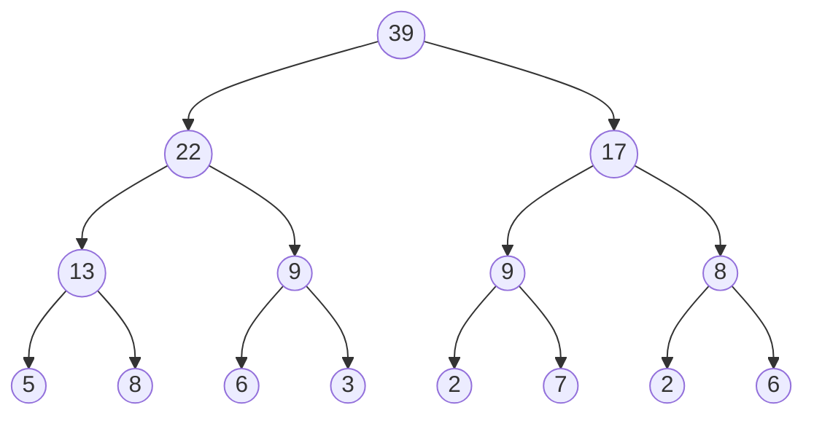
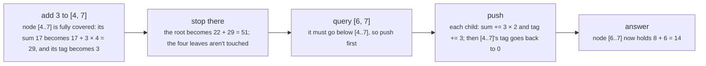

# Segment trees and lazy propagation

> Data Structures & Algorithms · L3 Specialist · Range queries · about 120 min · hub module `m09` ([open the hub](https://claude.ai/artifact/JfuakQWBwAvSgLi1rcuJUk))

## Why it matters
Range minimum with updates, “add 5 to this whole range” mixed with “what's the maximum here?”, calendars that count overlapping bookings: a segment tree answers all of them in O(log n) per operation. It's the most flexible range structure in interviews and contests, and lazy propagation is the idea that makes range updates cheap.

## Pre-question (answer before reading)
**Q:** You must add 3 to every element of a[2..900], then ask for the maximum of a[0..1000]. A Fenwick tree can't give a range maximum. How could a tree of ranges do the update without touching 899 elements?

<details><summary>Answer</summary>

Split [2, 900] into O(log n) nodes whose ranges fit inside it. Add 3 to each one's stored maximum and leave a note (a lazy tag) saying “my children still owe +3”. The note is passed down only when a later operation needs to go below that node.

</details>

## 🍎 Story time (kid version)
**The toy room and the treasure-map road trip: Tara's labelled toy-car boxes**

Tara keeps her toy cars in eight small boxes. Two small boxes sit in each medium box, two medium boxes in each large box, and both large boxes in one crate. Every box has a label showing its fastest car's speed, so “fastest in boxes 3–8?” needs just two labels: the medium box for 3–4 and the large box for 5–8. When Ben gives every car in boxes 5–8 a turbo sticker worth +2, Tara doesn't open anything. She adds 2 to the large box's label and clips on a note: “+2 owed inside.” Only when she later opens that box does she pass the note to the two boxes inside it.

| In the story | In code |
|---|---|
| Each box's label: the fastest car inside | Each node stores the max (or sum, min, gcd) of its range |
| “Fastest in 3–8?” read from two labels | A range query combines the O(log n) nodes that exactly cover the range |
| Adding 2 to the large box's label without opening it | A range update changes a fully covered node's value in O(1): max + v |
| The note “+2 owed inside” | A lazy tag: an update the node's children haven't received yet |
| Passing the note on when she opens the box | Push-down: apply the tag to both children before going below the node |

**Where the story breaks:** Tara's eight boxes nest perfectly, but real arrays rarely have a power-of-two length, so the recursive tree may need up to 4n slots (the bottom-up layout uses exactly 2n). And her note works only because “+2 for everyone” changes a label in a way she can work out from the label alone (max + 2, or total + 2 × the number of cars); an update without that property can't simply wait on a note.

## Key ideas (grown-up version)
- **What a node stores**: the combined value of its range under an associative operation, such as sum, min, max or gcd. The root covers [0, n − 1], and a node covering [lo, hi] splits at mid = (lo + hi) // 2 into [lo, mid] and [mid + 1, hi]. The height is ⌈log₂ n⌉.
- **Recursive layout**: the root is node 1 and node x's children are 2x and 2x + 1. When n isn't a power of two the indexes leave gaps, so allocate 4n slots. The recursion is only ⌈log₂ n⌉ + 1 calls deep (18 for n = 10⁵), so recursion is fine here even in Python.
- **Bottom-up layout (2n slots)**: leaves at t[n .. 2n − 1], and t[i] combines t[2i] and t[2i + 1] for i from n − 1 down to 1. An update rewrites one leaf and climbs with i //= 2; a query on the half-open [l, r) moves both ends up a level at a time, taking t[l] when l is a right child and t[r − 1] when r − 1 is a left child. It works for any n, with no recursion.
- **Costs**: build O(n); point update and range query O(log n), because a query visits at most four nodes per level. Space: exactly 2n slots bottom-up, up to 4n recursive.
- **Lazy propagation**: when an update covers a node's whole range, change the node's value at once (max + v, or sum + v × length) and record a pending tag. Before any later operation goes below that node, push the tag to both children and clear it. Range add with range sum or range max then costs O(log n) per operation, using 4n more slots for the tags.
- **Tags must compose**: two pending adds combine by adding, and a new assignment replaces whatever was pending. Assignment needs a “no tag” marker, either a flag or a value that is never assigned: heights in LeetCode 699 are at least 1, so 0 works there.
- **Huge coordinates (up to 10⁹)**: if every query is known in advance, compress the coordinates to ranks first (LeetCode 699, 850). If they arrive online (LeetCode 732), use a dynamic segment tree that creates a node only when an update first needs it: O(log C) time and at most O(log C) new nodes per operation, with C the coordinate range.
- **Add + max without push-down**: for range add with max, a tag can stay on its node for good. The node's max is its own tag plus the larger child max, and a query adds up the tags on its way down. No children are made just to hold a tag, which keeps a dynamic tree small (code block 3).

## Diagrams
**A sum segment tree over a = [5, 8, 6, 3, 2, 7, 2, 6]**



_sum(a[1..6]) = 8 + 9 + 9 + 2 = 28 comes from the four highlighted nodes instead of six leaves. Each node holds the sum of its two children: 22 = 13 + 9 covers a[0..3]._

**The same tree as a bottom-up array: t[i] = t[2i] + t[2i + 1], with the leaves at t[8..15]**

| t | 0 | 1 | 2 | 3 | 4 | 5 | 6 | 7 | 8 | 9 | 10 | 11 | 12 | 13 | 14 | 15 |
|---|---|---|---|---|---|---|---|---|---|---|---|---|---|---|---|---|
| value | – | 39 | 22 | 17 | 13 | 9 | 9 | 8 | **5** | **8** | **6** | **3** | **2** | **7** | **2** | **6** |

_With n = 8, a power of two, the array matches the recursive numbering exactly (root at 1, the children of i at 2i and 2i + 1). For other n, the bottom-up array still needs exactly 2n slots, while the recursive layout may need up to 4n._

**A lazy add of +3 on a[4..7] in the tree above, then a query on a[6..7]**



## Comparisons
**Range structures compared**

|  | Prefix sums | Fenwick tree | Segment tree | Lazy segment tree |
|---|---|---|---|---|
| Point update | O(n) | O(log n) | O(log n) | O(log n) |
| Range add | O(n) | O(log n) with point reads; two trees give range sums | One point at a time | O(log n) |
| Range sum | O(1) | O(log n) | O(log n) | O(log n) |
| Range min or max | No | No (with arbitrary updates) | O(log n) | O(log n) |
| Range assign | No | No | One point at a time | O(log n) |
| Space | n + 1 | n + 1 | 2n bottom-up, up to 4n recursive | 4n values + 4n tags |

**Huge coordinates: two ways**

|  | Coordinate compression | Dynamic segment tree |
|---|---|---|
| Needs every query in advance | Yes | No: works online |
| Tree size | O(m) for m distinct coordinates | O(q log C) nodes after q operations |
| Time per operation | O(log m) | O(log C) |
| Typical problems | LeetCode 699, 850, 218 | LeetCode 732, 731, 715 |

## Code (JavaScript + Python)
### Bottom-up segment tree: range minimum with point updates
```python
class MinSegTree:                                # bottom-up: leaves at t[n .. 2n - 1]
    def __init__(self, a):
        self.n = len(a)
        self.t = [0] * self.n + list(a)
        for i in range(self.n - 1, 0, -1):       # parents, from the bottom up: O(n)
            self.t[i] = min(self.t[2 * i], self.t[2 * i + 1])

    def update(self, i, value):                  # a[i] = value: O(log n)
        i += self.n
        self.t[i] = value
        while i > 1:
            i //= 2                              # climb to the parent and recompute it
            self.t[i] = min(self.t[2 * i], self.t[2 * i + 1])

    def query(self, l, r):                       # min of a[l..r], inclusive: O(log n)
        res = float("inf")
        l, r = l + self.n, r + self.n + 1        # half-open [l, r) over the leaves
        while l < r:
            if l & 1:                            # l is a right child: its parent sticks out left
                res = min(res, self.t[l])
                l += 1
            if r & 1:                            # r - 1 is a left child: its parent sticks out right
                r -= 1
                res = min(res, self.t[r])
            l //= 2
            r //= 2
        return res

st = MinSegTree([5, 3, 8, 6, 1, 4, 7])           # n = 7: not a power of two
print(st.query(0, 6), st.query(0, 3), st.query(5, 6))
st.update(4, 9)
st.update(1, 10)
print(st.query(0, 6), st.query(2, 4), st.query(0, 2))
```

Output:
```text
1 3 4
4 6 5
```

- line 4: The leaves fill the second half and slot 0 is never used, so the tree takes exactly 2n slots for any n.
- line 5: Node i's children are 2i and 2i + 1, so building every parent from the bottom up costs O(n).
- line 17: Both ends move to the leaf level and r becomes exclusive, so the loop works on [l, r).
- line 19: At each level the loop takes at most one node from each end, so a query touches at most about 2 log₂ n nodes.

```javascript
class MinSegTree {                               // bottom-up: leaves at t[n .. 2n - 1]
  constructor(a) {
    this.n = a.length;
    this.t = [...new Array(this.n).fill(0), ...a];
    for (let i = this.n - 1; i > 0; i--)         // parents, from the bottom up: O(n)
      this.t[i] = Math.min(this.t[2 * i], this.t[2 * i + 1]);
  }
  update(i, value) {                             // a[i] = value: O(log n)
    i += this.n;
    this.t[i] = value;
    while (i > 1) {
      i >>= 1;                                   // climb to the parent and recompute it
      this.t[i] = Math.min(this.t[2 * i], this.t[2 * i + 1]);
    }
  }
  query(l, r) {                                  // min of a[l..r], inclusive: O(log n)
    let res = Infinity;
    for (l += this.n, r += this.n + 1; l < r; l >>= 1, r >>= 1) {   // half-open [l, r) over the leaves
      if (l & 1) res = Math.min(res, this.t[l++]);   // l is a right child: its parent sticks out left
      if (r & 1) res = Math.min(res, this.t[--r]);   // r - 1 is a left child: its parent sticks out right
    }
    return res;
  }
}

const st = new MinSegTree([5, 3, 8, 6, 1, 4, 7]);   // n = 7: not a power of two
console.log(st.query(0, 6), st.query(0, 3), st.query(5, 6));
st.update(4, 9);
st.update(1, 10);
console.log(st.query(0, 6), st.query(2, 4), st.query(0, 2));
```

Output:
```text
1 3 4
4 6 5
```

- line 4: The leaves fill the second half and slot 0 is never used, so the tree takes exactly 2n slots for any n.
- line 5: Node i's children are 2i and 2i + 1, so building every parent from the bottom up costs O(n).
- line 18: Both ends move to the leaf level and r becomes exclusive, so the loop works on [l, r).
- line 19: At each level the loop takes at most one node from each end, so a query touches at most about 2 log₂ n nodes.

### Lazy propagation: range add and range sum
```python
def apply(x, lo, hi, v):                         # every element of x's range += v
    s[x] += v * (hi - lo + 1)                    # the sum grows by v times the length
    tag[x] += v                                  # and x's children still owe v

def push(x, lo, mid, hi):                        # before going below x: hand the tag down
    apply(2 * x, lo, mid, tag[x])
    apply(2 * x + 1, mid + 1, hi, tag[x])
    tag[x] = 0

def add(x, lo, hi, l, r, v):                     # a[l..r] += v
    if r < lo or hi < l: return                  # no overlap
    if l <= lo and hi <= r:                      # fully covered: apply here and stop
        apply(x, lo, hi, v)
        return
    mid = (lo + hi) // 2
    push(x, lo, mid, hi)
    add(2 * x, lo, mid, l, r, v)
    add(2 * x + 1, mid + 1, hi, l, r, v)
    s[x] = s[2 * x] + s[2 * x + 1]

def total(x, lo, hi, l, r):                      # a[l] + ... + a[r]
    if r < lo or hi < l: return 0                # no overlap
    if l <= lo and hi <= r: return s[x]          # fully covered
    mid = (lo + hi) // 2
    push(x, lo, mid, hi)
    return total(2 * x, lo, mid, l, r) + total(2 * x + 1, mid + 1, hi, l, r)

n = 8
s, tag = [0] * (4 * n), [0] * (4 * n)            # 4n sums and 4n pending adds; a starts as zeros
for l, r, v in [(0, 7, 2), (2, 5, 3), (4, 4, -1)]:
    add(1, 0, n - 1, l, r, v)                    # a becomes [2, 2, 5, 5, 4, 5, 2, 2]
print(*(total(1, 0, n - 1, l, r) for l, r in [(0, 7), (2, 3), (4, 6), (7, 7)]))
```

Output:
```text
27 10 11 2
```

- line 2: Every element in the range rises by v, so the sum rises by v × (hi − lo + 1): the node's own value is right at once.
- line 3: The tag records what the children still owe; they get it only when a later call needs them.
- line 16: Push before going below x, so both children are correct before they are read or changed. Pushing a zero tag changes nothing.
- line 29: 4n slots: with children at 2x and 2x + 1, the indexes can reach almost 4n when n isn't a power of two.

```javascript
function apply(x, lo, hi, v) {                   // every element of x's range += v
  s[x] += v * (hi - lo + 1);                     // the sum grows by v times the length
  tag[x] += v;                                   // and x's children still owe v
}

function push(x, lo, mid, hi) {                  // before going below x: hand the tag down
  apply(2 * x, lo, mid, tag[x]);
  apply(2 * x + 1, mid + 1, hi, tag[x]);
  tag[x] = 0;
}

function add(x, lo, hi, l, r, v) {               // a[l..r] += v
  if (r < lo || hi < l) return;                  // no overlap
  if (l <= lo && hi <= r) { apply(x, lo, hi, v); return; }   // fully covered: apply here and stop
  const mid = (lo + hi) >> 1;
  push(x, lo, mid, hi);
  add(2 * x, lo, mid, l, r, v);
  add(2 * x + 1, mid + 1, hi, l, r, v);
  s[x] = s[2 * x] + s[2 * x + 1];
}

function total(x, lo, hi, l, r) {                // a[l] + ... + a[r]
  if (r < lo || hi < l) return 0;                // no overlap
  if (l <= lo && hi <= r) return s[x];           // fully covered
  const mid = (lo + hi) >> 1;
  push(x, lo, mid, hi);
  return total(2 * x, lo, mid, l, r) + total(2 * x + 1, mid + 1, hi, l, r);
}

const n = 8;
let s = new Array(4 * n).fill(0), tag = new Array(4 * n).fill(0);   // 4n sums and 4n pending adds
for (const [l, r, v] of [[0, 7, 2], [2, 5, 3], [4, 4, -1]])
  add(1, 0, n - 1, l, r, v);                     // a becomes [2, 2, 5, 5, 4, 5, 2, 2]
console.log(...[[0, 7], [2, 3], [4, 6], [7, 7]].map(([l, r]) => total(1, 0, n - 1, l, r)));
```

Output:
```text
27 10 11 2
```

- line 2: Every element in the range rises by v, so the sum rises by v × (hi − lo + 1): the node's own value is right at once.
- line 3: The tag records what the children still owe; they get it only when a later call needs them.
- line 16: Push before going below x, so both children are correct before they are read or changed. Pushing a zero tag changes nothing.
- line 31: 4n slots: with children at 2x and 2x + 1, the indexes can reach almost 4n when n isn't a power of two.

### A dynamic segment tree for My Calendar III (LeetCode 732)
```python
class MyCalendarThree:                           # LeetCode 732: a dynamic segment tree
    def __init__(self):
        self.left, self.right = [0], [0]         # child ids; 0 means "not created yet"
        self.mx, self.tag = [0], [0]             # node 0 is the root, covering [0, 10**9)

    def _node(self):                             # a new node, made only when needed
        for arr in (self.left, self.right, self.mx, self.tag):
            arr.append(0)
        return len(self.mx) - 1

    def _add(self, x, lo, hi, l, r):             # +1 on [l, r); node x covers [lo, hi)
        if r <= lo or hi <= l:
            return
        if l <= lo and hi <= r:                  # fully covered: tag it and stop
            self.mx[x] += 1
            self.tag[x] += 1
            return
        if not self.left[x]:                     # first visit below x: create both children
            self.left[x], self.right[x] = self._node(), self._node()
        a, b, mid = self.left[x], self.right[x], (lo + hi) // 2
        self._add(a, lo, mid, l, r)
        self._add(b, mid, hi, l, r)
        self.mx[x] = self.tag[x] + max(self.mx[a], self.mx[b])   # the tag stays on x

    def book(self, start, end):
        self._add(0, 0, 10**9, start, end)
        return self.mx[0]                        # the root's max: the most overlaps anywhere

cal = MyCalendarThree()
print(*(cal.book(s, e) for s, e in [(10, 20), (50, 60), (10, 40), (5, 15), (5, 10), (25, 55)]))
```

Output:
```text
1 1 2 3 3 3
```

- line 4: Nothing is allocated for the 10⁹ positions up front: the tree starts as a single node.
- line 18: Nodes appear only along the paths a booking visits: O(log C) new nodes per booking, with C = 10⁹.
- line 23: With add and max, the tag can stay on its node: the node's max is its own tag plus the larger child max, so nothing is pushed and no children are made just to hold a tag.
- line 27: Only the overall maximum is asked for, so the root answers it directly. The recursion is about 31 calls deep, far below Python's limit.

```javascript
class MyCalendarThree {                          // LeetCode 732: a dynamic segment tree
  constructor() {
    this.left = [0]; this.right = [0];           // child ids; 0 means "not created yet"
    this.mx = [0]; this.tag = [0];               // node 0 is the root, covering [0, 1e9)
  }
  _node() {                                      // a new node, made only when needed
    for (const arr of [this.left, this.right, this.mx, this.tag]) arr.push(0);
    return this.mx.length - 1;
  }
  _add(x, lo, hi, l, r) {                        // +1 on [l, r); node x covers [lo, hi)
    if (r <= lo || hi <= l) return;
    if (l <= lo && hi <= r) {                    // fully covered: tag it and stop
      this.mx[x]++;
      this.tag[x]++;
      return;
    }
    if (!this.left[x]) {                         // first visit below x: create both children
      this.left[x] = this._node();
      this.right[x] = this._node();
    }
    const a = this.left[x], b = this.right[x], mid = Math.floor((lo + hi) / 2);
    this._add(a, lo, mid, l, r);
    this._add(b, mid, hi, l, r);
    this.mx[x] = this.tag[x] + Math.max(this.mx[a], this.mx[b]);   // the tag stays on x
  }
  book(start, end) {
    this._add(0, 0, 1e9, start, end);
    return this.mx[0];                           // the root's max: the most overlaps anywhere
  }
}

const cal = new MyCalendarThree();
console.log(...[[10, 20], [50, 60], [10, 40], [5, 15], [5, 10], [25, 55]].map(([s, e]) => cal.book(s, e)));
```

Output:
```text
1 1 2 3 3 3
```

- line 4: Nothing is allocated for the 10⁹ positions up front: the tree starts as a single node.
- line 17: Nodes appear only along the paths a booking visits: O(log C) new nodes per booking, with C = 10⁹.
- line 21: `Math.floor((lo + hi) / 2)` is safe for any size; `>> 1` would also work here, but only because lo + hi stays below 2³¹.
- line 24: With add and max, the tag can stay on its node: the node's max is its own tag plus the larger child max, so nothing is pushed and no children are made just to hold a tag.

## Worked example
**Problem.** Squares fall one at a time onto the x-axis. Square i has its left edge at positions[i][0] and side positions[i][1]; it lands on the highest square below it that it overlaps by a positive length (touching edges don't count), or on the ground. After each drop, report the height of the tallest stack so far. There are up to 1,000 squares, with left edges up to 10⁸ (LeetCode 699, Falling Squares).

1. Each square lands on the tallest thing under its base, so its top is the maximum height on [left, left + side) plus side; then that whole stretch becomes exactly that height. That's a range maximum followed by a range assignment.
2. Coordinates reach 10⁸ but every square is known in advance, so compress: sort the distinct edges and work on the gaps between neighbours. A square on [L, R) covers gaps idx[L] .. idx[R] − 1, so squares that only touch share no gap.
3. A segment tree over the gaps stores the maximum height, and a lazy tag means “every height here is h”. A new assignment overwrites an older tag, and heights are at least 1, so 0 can mean “no tag”.
4. After each square, the root holds the tallest stack. O(n log n) time and O(n) space for n squares; checking every earlier square instead is O(n²).

```python
def falling_squares(positions):
    edges = sorted({x for left, side in positions for x in (left, left + side)})
    idx, m = {x: i for i, x in enumerate(edges)}, len(edges) - 1   # gap i is [edges[i], edges[i + 1])
    mx, tag = [0] * (4 * m), [0] * (4 * m)       # tag 0 = nothing pending (heights are >= 1)
    def push(x):                                 # an assignment overwrites both children
        if tag[x]:
            mx[2 * x] = tag[2 * x] = mx[2 * x + 1] = tag[2 * x + 1] = tag[x]
        tag[x] = 0
    def query(x, lo, hi, l, r):                  # the max height on gaps l..r
        if r < lo or hi < l: return 0
        if l <= lo and hi <= r: return mx[x]
        push(x)
        mid = (lo + hi) // 2
        return max(query(2 * x, lo, mid, l, r), query(2 * x + 1, mid + 1, hi, l, r))
    def assign(x, lo, hi, l, r, h):              # set every height on gaps l..r to h
        if r < lo or hi < l: return
        if l <= lo and hi <= r:
            mx[x] = tag[x] = h
            return
        push(x)
        mid = (lo + hi) // 2
        assign(2 * x, lo, mid, l, r, h)
        assign(2 * x + 1, mid + 1, hi, l, r, h)
        mx[x] = max(mx[2 * x], mx[2 * x + 1])

    out = []
    for left, side in positions:
        l, r = idx[left], idx[left + side] - 1   # the gaps under this square
        assign(1, 0, m - 1, l, r, query(1, 0, m - 1, l, r) + side)   # land on the tallest thing below
        out.append(mx[1])                        # the root holds the tallest stack
    return out

print(*falling_squares([[1, 2], [2, 3], [6, 1]]), "|", *falling_squares([[100, 100], [200, 100]]))
```

Output:
```text
2 5 5 | 100 100
```

```javascript
function fallingSquares(positions) {
  const edges = [...new Set(positions.flatMap(([left, side]) => [left, left + side]))].sort((a, b) => a - b);
  const idx = new Map(edges.map((x, i) => [x, i])), m = edges.length - 1;   // gap i is [edges[i], edges[i + 1])
  const mx = new Array(4 * m).fill(0), tag = new Array(4 * m).fill(0);   // tag 0 = nothing pending
  const push = x => {                            // an assignment overwrites both children
    if (tag[x]) mx[2 * x] = tag[2 * x] = mx[2 * x + 1] = tag[2 * x + 1] = tag[x];
    tag[x] = 0;
  };
  const query = (x, lo, hi, l, r) => {           // the max height on gaps l..r
    if (r < lo || hi < l) return 0;
    if (l <= lo && hi <= r) return mx[x];
    push(x);
    const mid = (lo + hi) >> 1;
    return Math.max(query(2 * x, lo, mid, l, r), query(2 * x + 1, mid + 1, hi, l, r));
  };
  const assign = (x, lo, hi, l, r, h) => {       // set every height on gaps l..r to h
    if (r < lo || hi < l) return;
    if (l <= lo && hi <= r) { mx[x] = tag[x] = h; return; }
    push(x);
    const mid = (lo + hi) >> 1;
    assign(2 * x, lo, mid, l, r, h);
    assign(2 * x + 1, mid + 1, hi, l, r, h);
    mx[x] = Math.max(mx[2 * x], mx[2 * x + 1]);
  };

  const out = [];
  for (const [left, side] of positions) {
    const l = idx.get(left), r = idx.get(left + side) - 1;   // the gaps under this square
    assign(1, 0, m - 1, l, r, query(1, 0, m - 1, l, r) + side);   // land on the tallest thing below
    out.push(mx[1]);                             // the root holds the tallest stack
  }
  return out;
}

console.log(...fallingSquares([[1, 2], [2, 3], [6, 1]]), "|", ...fallingSquares([[100, 100], [200, 100]]));
```

Output:
```text
2 5 5 | 100 100
```

**Answer.** 2 5 5 | 100 100. The first square lands on the ground (height 2). The second overlaps it on [2, 3) and lands on top (2 + 3 = 5). The third, on [6, 7), touches nothing, so the tallest stack stays 5. In the second call the squares only touch at x = 200, so they share no gap and both stand on the ground. O(n log n) time, O(n) space.

## Your turn (faded example)
**Problem.** Finish a segment tree for range add and range maximum on a small array: `add(l, r, v)` adds v to a[l..r], and `range_max(l, r)` returns max(a[l..r]). Everything is written except the push-down step.

- ✓ Each node stores the max of its range (mx) and a pending add (tag). A fully covered node gets mx += v and tag += v, because a maximum rises by exactly v when every element does.
- **When must a tag be pushed down?**
  <details><summary>Answer</summary>Before an update or a query goes below the node, that is, whenever the range only partly overlaps it, so the children are up to date before they're used.</details>
- **What does push-down do to each child?**
  <details><summary>Answer</summary>Adds the parent's tag to the child's mx and to the child's own tag; then the parent's tag goes back to 0.</details>
- **Time and space?**
  <details><summary>Answer</summary>O(log n) per update and per query, O(n log n) to load the array with point adds (O(n) with a proper build), and O(n) space: 4n maxima and 4n tags.</details>

Starter:
```python
def push(x):                                     # hand tag[x] down to both children
    ...                                          # TODO: add tag[x] to each child's mx and tag, then clear tag[x]

def add(x, lo, hi, l, r, v):                     # a[l..r] += v
    if r < lo or hi < l: return                  # no overlap
    if l <= lo and hi <= r:                      # covered: the max rises by exactly v
        mx[x] += v
        tag[x] += v
        return
    push(x)
    mid = (lo + hi) // 2
    add(2 * x, lo, mid, l, r, v)
    add(2 * x + 1, mid + 1, hi, l, r, v)
    mx[x] = max(mx[2 * x], mx[2 * x + 1])

def range_max(x, lo, hi, l, r):                  # max(a[l..r])
    if r < lo or hi < l: return float("-inf")    # no overlap
    if l <= lo and hi <= r: return mx[x]         # fully covered
    push(x)
    mid = (lo + hi) // 2
    return max(range_max(2 * x, lo, mid, l, r), range_max(2 * x + 1, mid + 1, hi, l, r))

a = [1, 3, 2, 5, 4]
n = len(a)
mx, tag = [0] * (4 * n), [0] * (4 * n)
for i, v in enumerate(a):
    add(1, 0, n - 1, i, i, v)                    # load the array with point adds
add(1, 0, n - 1, 0, 2, 4)                        # now [5, 7, 6, 5, 4]
add(1, 0, n - 1, 3, 4, 3)                        # now [5, 7, 6, 8, 7]
print(*(range_max(1, 0, n - 1, l, r) for l, r in [(0, 2), (2, 2), (4, 4), (0, 4)]))   # expect 7 6 7 8
```

```javascript
function push(x) {                               // hand tag[x] down to both children
  // TODO: add tag[x] to each child's mx and tag, then clear tag[x]
}

function add(x, lo, hi, l, r, v) {               // a[l..r] += v
  if (r < lo || hi < l) return;                  // no overlap
  if (l <= lo && hi <= r) { mx[x] += v; tag[x] += v; return; }   // covered: the max rises by exactly v
  push(x);
  const mid = (lo + hi) >> 1;
  add(2 * x, lo, mid, l, r, v);
  add(2 * x + 1, mid + 1, hi, l, r, v);
  mx[x] = Math.max(mx[2 * x], mx[2 * x + 1]);
}

function rangeMax(x, lo, hi, l, r) {             // max(a[l..r])
  if (r < lo || hi < l) return -Infinity;        // no overlap
  if (l <= lo && hi <= r) return mx[x];          // fully covered
  push(x);
  const mid = (lo + hi) >> 1;
  return Math.max(rangeMax(2 * x, lo, mid, l, r), rangeMax(2 * x + 1, mid + 1, hi, l, r));
}

const a = [1, 3, 2, 5, 4], n = a.length;
let mx = new Array(4 * n).fill(0), tag = new Array(4 * n).fill(0);
a.forEach((v, i) => add(1, 0, n - 1, i, i, v));  // load the array with point adds
add(1, 0, n - 1, 0, 2, 4);                       // now [5, 7, 6, 5, 4]
add(1, 0, n - 1, 3, 4, 3);                       // now [5, 7, 6, 8, 7]
console.log(...[[0, 2], [2, 2], [4, 4], [0, 4]].map(([l, r]) => rangeMax(1, 0, n - 1, l, r)));   // expect 7 6 7 8
```

<details><summary>Full solution</summary>

```python
def push(x):                                     # hand tag[x] down to both children
    for c in (2 * x, 2 * x + 1):
        mx[c] += tag[x]                          # every element below c rose by tag[x]
        tag[c] += tag[x]                         # and c's own children still owe it
    tag[x] = 0

def add(x, lo, hi, l, r, v):                     # a[l..r] += v
    if r < lo or hi < l: return                  # no overlap
    if l <= lo and hi <= r:                      # covered: the max rises by exactly v
        mx[x] += v
        tag[x] += v
        return
    push(x)
    mid = (lo + hi) // 2
    add(2 * x, lo, mid, l, r, v)
    add(2 * x + 1, mid + 1, hi, l, r, v)
    mx[x] = max(mx[2 * x], mx[2 * x + 1])

def range_max(x, lo, hi, l, r):                  # max(a[l..r])
    if r < lo or hi < l: return float("-inf")    # no overlap
    if l <= lo and hi <= r: return mx[x]         # fully covered
    push(x)
    mid = (lo + hi) // 2
    return max(range_max(2 * x, lo, mid, l, r), range_max(2 * x + 1, mid + 1, hi, l, r))

a = [1, 3, 2, 5, 4]
n = len(a)
mx, tag = [0] * (4 * n), [0] * (4 * n)
for i, v in enumerate(a):
    add(1, 0, n - 1, i, i, v)                    # load the array with point adds
add(1, 0, n - 1, 0, 2, 4)                        # now [5, 7, 6, 5, 4]
add(1, 0, n - 1, 3, 4, 3)                        # now [5, 7, 6, 8, 7]
print(*(range_max(1, 0, n - 1, l, r) for l, r in [(0, 2), (2, 2), (4, 4), (0, 4)]))
```

Output:
```text
7 6 7 8
```

```javascript
function push(x) {                               // hand tag[x] down to both children
  for (const c of [2 * x, 2 * x + 1]) {
    mx[c] += tag[x];                             // every element below c rose by tag[x]
    tag[c] += tag[x];                            // and c's own children still owe it
  }
  tag[x] = 0;
}

function add(x, lo, hi, l, r, v) {               // a[l..r] += v
  if (r < lo || hi < l) return;                  // no overlap
  if (l <= lo && hi <= r) { mx[x] += v; tag[x] += v; return; }   // covered: the max rises by exactly v
  push(x);
  const mid = (lo + hi) >> 1;
  add(2 * x, lo, mid, l, r, v);
  add(2 * x + 1, mid + 1, hi, l, r, v);
  mx[x] = Math.max(mx[2 * x], mx[2 * x + 1]);
}

function rangeMax(x, lo, hi, l, r) {             // max(a[l..r])
  if (r < lo || hi < l) return -Infinity;        // no overlap
  if (l <= lo && hi <= r) return mx[x];          // fully covered
  push(x);
  const mid = (lo + hi) >> 1;
  return Math.max(rangeMax(2 * x, lo, mid, l, r), rangeMax(2 * x + 1, mid + 1, hi, l, r));
}

const a = [1, 3, 2, 5, 4], n = a.length;
let mx = new Array(4 * n).fill(0), tag = new Array(4 * n).fill(0);
a.forEach((v, i) => add(1, 0, n - 1, i, i, v));  // load the array with point adds
add(1, 0, n - 1, 0, 2, 4);                       // now [5, 7, 6, 5, 4]
add(1, 0, n - 1, 3, 4, 3);                       // now [5, 7, 6, 8, 7]
console.log(...[[0, 2], [2, 2], [4, 4], [0, 4]].map(([l, r]) => rangeMax(1, 0, n - 1, l, r)));
```

Output:
```text
7 6 7 8
```

</details>

## Socratic checks and quiz (answers hidden)
**1. What does this print?**

```python
a = [4, 1, 3, 2]
n = len(a)
t = [0] * n + a
for i in range(n - 1, 0, -1):
    t[i] = min(t[2 * i], t[2 * i + 1])
print(*t[1:])
```

```javascript
const a = [4, 1, 3, 2];
const n = a.length;
const t = [...new Array(n).fill(0), ...a];
for (let i = n - 1; i > 0; i--) t[i] = Math.min(t[2 * i], t[2 * i + 1]);
console.log(...t.slice(1));
```

- A. 1 1 2 4 1 3 2
- B. 4 1 3 2 1 2 1
- C. 1 2 1 4 1 3 2
- D. 1 1 2 1 4 2 3

<details><summary>Answer</summary>

1 1 2 4 1 3 2. The leaves sit at t[4..7] = 4 1 3 2. Then t[3] = min(3, 2) = 2, t[2] = min(4, 1) = 1 and t[1] = min(1, 2) = 1, so slots 1 to 7 read 1 1 2 4 1 3 2. Slot 0 is unused.

</details>

**2. What does this print? The tags here never move down.**

```python
mx, tag = [0] * 8, [0] * 8           # node 1 = [0, 3]; nodes 2 = [0, 1] and 3 = [2, 3]

def add(x, lo, hi, l, r, v):          # the tag stays on its node: no push-down
    if r < lo or hi < l:
        return
    if l <= lo and hi <= r:
        mx[x] += v
        tag[x] += v
        return
    mid = (lo + hi) // 2
    add(2 * x, lo, mid, l, r, v)
    add(2 * x + 1, mid + 1, hi, l, r, v)
    mx[x] = tag[x] + max(mx[2 * x], mx[2 * x + 1])

add(1, 0, 3, 0, 3, 5)
add(1, 0, 3, 2, 2, 1)
print(mx[1], mx[3], tag[1])
```

```javascript
const mx = new Array(8).fill(0), tag = new Array(8).fill(0);   // node 1 = [0, 3]; nodes 2 = [0, 1] and 3 = [2, 3]

function add(x, lo, hi, l, r, v) {    // the tag stays on its node: no push-down
  if (r < lo || hi < l) return;
  if (l <= lo && hi <= r) {
    mx[x] += v;
    tag[x] += v;
    return;
  }
  const mid = (lo + hi) >> 1;
  add(2 * x, lo, mid, l, r, v);
  add(2 * x + 1, mid + 1, hi, l, r, v);
  mx[x] = tag[x] + Math.max(mx[2 * x], mx[2 * x + 1]);
}

add(1, 0, 3, 0, 3, 5);
add(1, 0, 3, 2, 2, 1);
console.log(mx[1], mx[3], tag[1]);
```

- A. 6 1 5
- B. 6 6 5
- C. 6 6 0
- D. 1 1 5

<details><summary>Answer</summary>

6 1 5. The first add covers node 1 completely, so only node 1 changes: mx[1] = 5 and tag[1] = 5. The second add reaches leaf [2, 2] and rebuilds on the way up: mx[3] = 0 + 1 = 1, which doesn't include the parent's 5, and mx[1] = tag[1] + max(0, 1) = 6, the true maximum (a[2] = 5 + 1). The tag never moves.

</details>

**3. Coordinates go up to 10⁹, bookings arrive one at a time, and each `book(start, end)` must return the largest overlap so far (LeetCode 732). Which structure fits?**

- A. A dynamic segment tree that creates nodes only along the paths it visits
- B. A difference array over all 10⁹ positions
- C. A Fenwick tree over all 10⁹ positions
- D. A bottom-up segment tree with 2 × 10⁹ slots

<details><summary>Answer</summary>

A dynamic segment tree that creates nodes only along the paths it visits. The other three allocate memory for every position: gigabytes. Coordinate compression needs every booking in advance, but each answer is needed at once. The dynamic tree creates O(log C) nodes per booking.

</details>

**4. Which statements about lazy propagation are true? (choose 3)**

- A. A fully covered node gets the update applied to its own value straight away
- B. A tag is pushed to the children only when an operation needs to go below the node
- C. Range add with range sum costs O(log n) per operation
- D. After a range update, every leaf in the range is up to date
- E. Any update can be made lazy, even “replace each value by its square root” with range sums

<details><summary>Answer</summary>

A fully covered node gets the update applied to its own value straight away, A tag is pushed to the children only when an operation needs to go below the node, Range add with range sum costs O(log n) per operation. A lazy update stops at covered nodes, so the leaves below them stay stale until a push reaches them. Square roots don't distribute over a sum, so a node's new sum can't be computed from its old one: that update can't simply be stored as a tag.

</details>

**5. Judge each statement.**

- With the root at 1, node x's children are 2x and 2x + 1.
- The bottom-up segment tree only works when n is a power of two.
- On 10⁵ elements, a recursive segment tree recurses only about 18 calls deep.
- A range query visits O(n) nodes in the worst case.

<details><summary>Answer</summary>

With the root at 1, node x's children are 2x and 2x + 1.: Yes; The bottom-up segment tree only works when n is a power of two.: No; On 10⁵ elements, a recursive segment tree recurses only about 18 calls deep.: Yes; A range query visits O(n) nodes in the worst case.: No. That indexing is the binary-heap layout. The bottom-up tree works for any n with exactly 2n slots. The height is ⌈log₂ 10⁵⌉ = 17, so the recursion goes about 18 calls deep. A query visits at most four nodes per level, so O(log n).

</details>

**6. Put the steps for one square of Falling Squares (LeetCode 699) in order.**

- (put the steps in order)

<details><summary>Answer</summary>

Find the compressed gaps l..r under the square → Query the maximum height on gaps l..r → Add the side length to get the square's top, h → Assign h to every gap in l..r → Read the root's maximum as the tallest stack so far. Each step needs the one before: the query needs the gaps, the top needs the query, the assignment needs h, and the root is only right after the assignment. Querying after assigning would read the square's own height.

</details>

**7. Complete this JavaScript range-minimum query on a bottom-up tree (leaves at t[n .. 2n − 1]).**

```
function rangeMin(t, n, l, r) {           // min of a[l..r], inclusive
  let res = Infinity;
  for (l += {{0}}, r += n + 1; l < r; l >>= 1, r >>= 1) {
    if (l & 1) res = Math.min(res, t[{{1}}]);
    if (r & 1) res = Math.min(res, t[{{2}}]);
  }
  return res;
}

```

<details><summary>Answer</summary>

n | l++ | --r. Leaf i sits at t[i + n]. An odd l is a right child, so take t[l] and then step right (l++). An odd r means r − 1 is a left child, so step left first and take it (--r); `r--` would read t[r], which is outside the half-open range.

</details>

**8. Match each problem to its segment-tree technique.**


<details><summary>Answer</summary>

My Calendar III = A dynamic tree with range add, reading the root's max; Falling Squares = Compressed edges with range max and range assign; Range minimum with point updates = A bottom-up tree with 2n slots; Range adds mixed with range-sum queries = Lazy tags with sum += v × length. A difference array can't answer queries mixed in with the updates. Each of the other techniques is one of this module's code blocks or its worked example.

</details>

## Traps & misconceptions
- **“A segment tree has 2n − 1 nodes, so 2n slots are always enough.”** In the recursive layout (children at 2x and 2x + 1), an n that isn't a power of two leaves gaps, and the indexes can reach almost 4n. Allocate 4n, or use the bottom-up layout, which needs exactly 2n.
- **“Recursion is too deep for Python on a segment tree.”** The depth is about log₂ n: around 18 calls for n = 10⁵, and about 31 for a dynamic tree over [0, 10⁹). Python's limit of 1,000 frames is far away. (Recursion is slower than a loop in Python, which is one reason the bottom-up tree is popular.)
- **“A lazy tag means the node's own value is out of date.”** The node's value is always right; the tag records what its children still owe. Push it down before visiting them.
- **“With a lazy range add, a node's sum goes up by v.”** Every element in the node's range goes up by v, so the sum goes up by v × (hi − lo + 1). The max (or min) goes up by just v.
- **“Pending tags always combine by adding.”** Adds combine by adding, but an assignment replaces everything below it, so a new assignment overwrites the old tag. Pushing an empty assignment tag must change nothing, which is why it needs a “no tag” marker.
- **“Coordinates up to 10⁹ need an array of 4 × 10⁹ slots.”** Compress the coordinates when every query is known in advance, or create nodes only when they are needed (a dynamic segment tree): O(log C) new nodes per operation.

## Discussion prompts
- **Why does a range query visit only O(log n) nodes?**
  <details><summary>One good answer</summary>At each level, at most two visited nodes are only partly covered: the ones that contain the range's two ends. Every other visited node is either completely inside the range, so the query takes its value and stops, or completely outside, so it returns at once. That limits the work to at most four nodes per level, and there are about log₂ n levels.</details>
- **When would you pick the bottom-up 2n tree over the recursive one?**
  <details><summary>One good answer</summary>For point updates and range queries with an associative operation: it's shorter, uses exactly 2n slots and avoids recursion, which helps in Python. The recursive version is easier to extend with lazy tags, dynamic nodes, and searches such as “the first index where the prefix sum reaches x”.</details>

## Teach-back
**Prompt:** Explain to a junior colleague how a segment tree with lazy propagation adds v to a whole range and answers range sums, both in O(log n).

Rubric:
- [ ] Each node stores the sum of its range, and its two children split the range in half
- [ ] Any range splits into O(log n) fully covered nodes
- [ ] A covered node's sum grows by v × its length and it keeps a pending tag
- [ ] The tag is pushed to both children before any operation goes below the node
- [ ] O(log n) per operation, with about 4n sums plus 4n tags of space

<details><summary>Model answer</summary>

A segment tree stores, for each node, the sum of a range of the array; the root covers everything and each node's two children split its range in half, so the height is about log₂ n. Any range [l, r] splits into O(log n) nodes that lie completely inside it, so a query combines just those. For a range add, when the update covers a node's whole range, I add v × its length to the node's sum and add v to its pending tag, and I stop there instead of visiting the elements below. The tag means “every element below still needs + v”. Whenever a later update or query has to go below that node, I first push the tag down: each child's sum grows by v × its own length, each child's tag grows by v, and the parent's tag is cleared. Every operation visits only O(log n) nodes and each push is O(1), so both range add and range sum cost O(log n). The arrays take about 4n sums and 4n tags, and the recursion is only about log₂ n deep, so it's fine even in Python.

</details>

## Quick Q&A (also in the SRS deck)
- **Children of node x in the recursive layout?** 2x and 2x + 1, with the root at 1.
- **Slots for a recursive segment tree, and for the bottom-up one?** Up to 4n for the recursive one; exactly 2n for the bottom-up one.
- **What does a lazy tag mean?** An update applied to the node's whole range that its children haven't received yet.
- **Range add v on a sum node covering [lo, hi]?** sum += v × (hi − lo + 1) and tag += v.
- **Coordinates up to 10⁹, queries arriving online: which tree?** A dynamic segment tree that creates nodes only when needed: O(log C) per operation.
- **Recursion depth of a segment tree on 10⁵ elements?** About 18 calls, since the height is ⌈log₂ 10⁵⌉ = 17: safe even in Python.

## Practice problems
- [ ] [LC 731 · My Calendar II](https://leetcode.com/problems/my-calendar-ii/) · Medium · before booking, check that the max overlap on [start, end) is below 2: range max, then range add, on a dynamic tree (or keep a list of double-booked intervals)
- [ ] [LC 732 · My Calendar III](https://leetcode.com/problems/my-calendar-iii/) · Hard · code block 3: a dynamic tree with add tags; the root's max is the answer
- [ ] [LC 715 · Range Module](https://leetcode.com/problems/range-module/) · Hard · a dynamic tree with assign tags (tracked or not) and an “all tracked?” query, or a sorted list of disjoint intervals
- [ ] [LC 699 · Falling Squares](https://leetcode.com/problems/falling-squares/) · Hard · the worked example: compress the edges, then range max and range assign
- [ ] [LC 218 · The Skyline Problem](https://leetcode.com/problems/the-skyline-problem/) · Hard · compress the x's and assign heights in increasing order so taller buildings overwrite, then emit each change; or sweep with a max-heap
- [ ] [LC 850 · Rectangle Area II](https://leetcode.com/problems/rectangle-area-ii/) · Hard · sweep along x; over compressed y keep a cover count and the covered length per node (no push needed); use BigInt in JavaScript for the area products
- [ ] [LC 2286 · Booking Concert Tickets in Groups](https://leetcode.com/problems/booking-concert-tickets-in-groups/) · Hard · store the max and the total of free seats per node; gather walks down to the first row with k free, scatter fills rows from the first non-full one

## Sources (accessed 2026-10-09)
- [cp-algorithms: Segment tree](https://cp-algorithms.com/data_structures/segment_tree.html)
- [USACO Guide: Range update range query](https://usaco.guide/plat/RURQ)
- [Codeforces blog: Efficient and easy segment trees](https://codeforces.com/blog/entry/18051)
