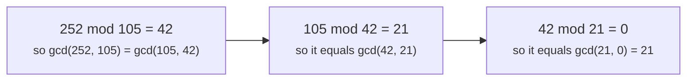

# Number theory: gcd, primes and modular arithmetic

> Data Structures & Algorithms · L3 Specialist · Strings, number theory & games · about 100 min · hub module `m11` ([open the hub](https://claude.ai/artifact/JfuakQWBwAvSgLi1rcuJUk))

## Why it matters
Hard problems hide number theory everywhere: answers “modulo 1,000,000,007”, counting with factorials, cycles that line up every lcm steps, primes for hashing. A few small tools (Euclid's gcd, a sieve, fast power and modular inverses) cover almost all of it. JavaScript needs extra care, because its numbers are exact only up to 2⁵³.

## Pre-question (answer before reading)
**Q:** You need 3¹⁰⁰⁰⁰⁰⁰⁰⁰⁰ mod 1,000,000,007. Multiplying by 3 a billion times is far too slow. How could you do it in about 60 multiplications?

<details><summary>Answer</summary>

Square repeatedly: 3, 3², 3⁴, 3⁸, … each from the one before, reducing mod 1,000,000,007 every time. Write the exponent in binary and multiply together the squares where it has a 1 bit. That's O(log e) work: about 30 squarings and at most 30 more multiplications for e = 10⁹.

</details>

## 🍎 Story time (kid version)
**The toy room and the treasure-map road trip: The rug and the clock**

Tara wants to cover the 12-by-18 playroom rug with the biggest square cushions that fit exactly. Ben has a trick: cut off the biggest square he can, 12 by 12, which leaves a 12-by-6 strip. Then 6-by-6 squares fit that strip exactly, so 6 is the answer, and he never tried 1, 2, 3, 4 or 5 one by one. Later, in the car, Tara asks what time it will be 100 hours after 9 o'clock. Ben doesn't count 100 hours: the clock only has 12 numbers, and 100 hours is 8 full turns and 4 more, so it will be 1 o'clock.

| In the story | In code |
|---|---|
| Cutting off the biggest square, again and again | Euclid's algorithm: gcd(a, b) = gcd(b, a mod b) |
| The square size that finally fits exactly (6) | The gcd: the largest number that divides both |
| Never trying 1, 2, 3… one by one | O(log min(a, b)) steps instead of O(min(a, b)) |
| The 12-hour clock wrapping round | Arithmetic modulo m: only the remainder matters |
| 100 hours is 8 full turns and 4 more | 100 mod 12 = 4, so (9 + 100) mod 12 = (9 + 4) mod 12 = 1 |

**Where the story breaks:** A clock can't divide: “half of 6 o'clock” could be 3 or 9, because 2 and 12 share a factor. Code avoids this by working modulo a prime such as 1,000,000,007, where every non-zero number has a modular inverse to divide by.

## Key ideas (grown-up version)
- **Euclid's algorithm**: gcd(a, b) = gcd(b, a mod b), stopping at gcd(a, 0) = a. The numbers shrink at least as fast as the Fibonacci numbers, so it takes O(log min(a, b)) steps. Python has `math.gcd` (any number of arguments since 3.9) and `math.lcm`; JavaScript has neither.
- **lcm** = a / gcd(a, b) × b. Divide first, so the intermediate value never exceeds the answer. Up to n there are ⌊n / a⌋ multiples of a, and inclusion–exclusion gives ⌊n / a⌋ + ⌊n / b⌋ − ⌊n / lcm(a, b)⌋ numbers divisible by a or b.
- **Extended Euclid** also finds whole numbers x and y with a·x + b·y = gcd(a, b) (Bézout's identity). When gcd(a, m) = 1, that x is the inverse of a modulo m.
- **Sieve of Eratosthenes**: cross out the multiples of each prime p, starting at p², because smaller multiples were already crossed out by smaller primes. O(n log log n) time and O(n) space. A smallest-prime-factor (spf) sieve stores each number's smallest prime factor, so factorising any x ≤ n takes O(log x) divisions.
- **Modular arithmetic**: sums, differences and products can be reduced mod m at every step. Division can't: dividing by b means multiplying by b's inverse, which exists only when gcd(b, m) = 1. That's why answers use a prime modulus such as 1,000,000,007.
- **Fast exponentiation**: square the base and halve the exponent, multiplying the result in whenever the exponent's lowest bit is 1. O(log e) multiplications. For a prime p, Fermat's little theorem gives the inverse a^(p − 2) mod p, for a not divisible by p. Python's `pow(a, e, m)` does fast power, and `pow(a, -1, m)` (3.8+) the inverse.
- **nCr mod p**: precompute factorials and inverse factorials up to n in O(n) (one inverse by Fermat, then `inv_fact[i - 1] = inv_fact[i] * i`). Each C(n, r) is then fact[n] · inv_fact[r] · inv_fact[n − r] mod p, in O(1).
- **JavaScript numbers** are exact only up to 2⁵³ ≈ 9 × 10¹⁵. Two residues near 10⁹ multiply to about 10¹⁸, so `(a * b) % p` silently loses precision: use BigInt (`BigInt(a) * BigInt(b) % 1000000007n`). JavaScript's `%` also keeps the sign of the left side (`-7 % 3` is −1, Python gives 2), so normalise with `((a % m) + m) % m`.

## Diagrams
**Euclid's algorithm on gcd(252, 105)**



**Fast power: 3¹³, with 13 = 1101 in binary (read from the right)**

| bit of 13 | 0 | 1 | 2 | 3 |
|---|---|---|---|---|
| value | 1 | 0 | 1 | 1 |

| square | 0 | 1 | 2 | 3 |
|---|---|---|---|---|
| value | 3¹ | 3² | 3⁴ | 3⁸ |

| multiply in? | 0 | 1 | 2 | 3 |
|---|---|---|---|---|
| value | yes | no | yes | yes |

_3¹³ = 3⁸ × 3⁴ × 3¹ = 6561 × 81 × 3 = 1,594,323. That's 3 squarings plus 3 multiplications into the running result, instead of 12 multiplications by 3._

## Comparisons
**Number theory in Python and JavaScript**

| Task | Python | JavaScript |
|---|---|---|
| gcd and lcm | `math.gcd`, `math.lcm` | Write your own (Euclid) |
| a^e mod m | `pow(a, e, m)` | Write modPow; use BigInt once m² can pass 2⁵³ (m above about 9 × 10⁷) |
| Inverse mod m | `pow(a, -1, m)` (3.8+) | Extended Euclid, or modPow(a, m − 2, m) for a prime m |
| n choose r | `math.comb(n, r)`, exact | A multiplicative loop in BigInt, or factorial tables mod p |
| Integer square root | `math.isqrt(n)`, exact | `Math.floor(Math.sqrt(n))`, then adjust by 1 for large n |
| −7 mod 3 | `-7 % 3` is 2 | `-7 % 3` is −1: use `((a % m) + m) % m` |
| Big integers | Built in, unlimited | BigInt (`10n ** 30n`), which can't be mixed with Number |

**Which tool answers which question?**

| Question | Tool | Cost |
|---|---|---|
| Largest common divisor, lining up cycles | gcd and lcm | O(log min(a, b)) |
| Every prime up to n | Sieve of Eratosthenes | O(n log log n) |
| Factorise many numbers up to n | Smallest-prime-factor sieve | O(n log log n) setup, O(log x) each |
| Is one number up to 10¹² prime? | Trial division up to √n | O(√n) |
| a^e mod m | Fast power | O(log e) |
| Division modulo a prime p | Multiply by the inverse (Fermat or extended Euclid) | O(log p) |
| Many C(n, r) mod p | Factorial and inverse-factorial tables | O(n) setup, O(1) each |

## Code (JavaScript + Python)
### gcd, lcm and extended Euclid
```python
def gcd(a, b):
    while b:
        a, b = b, a % b                 # gcd(a, b) = gcd(b, a mod b)
    return a

def lcm(a, b):
    return a // gcd(a, b) * b           # divide first: no oversized intermediate

def ext_gcd(a, b):                      # returns (g, x, y) with a*x + b*y == g
    if b == 0:
        return a, 1, 0
    g, x, y = ext_gcd(b, a % b)
    return g, y, x - (a // b) * y

print(gcd(252, 105), lcm(4, 6), lcm(21, 6))
g, x, y = ext_gcd(240, 46)
print(g, x, y, 240 * x + 46 * y)
```

Output:
```text
21 12 42
2 -9 47 2
```

- line 3: a % b is smaller than b, and the numbers at least halve every two steps, so the loop runs O(log min(a, b)) times.
- line 7: a // gcd(a, b) is a whole number, so the result is exact and never bigger than the lcm itself.
- line 13: Back-substitution: if b·x + (a mod b)·y = g, then a·y + b·(x − (a // b)·y) = g, because a mod b = a − (a // b)·b.

```javascript
function gcd(a, b) {
  while (b) [a, b] = [b, a % b];       // gcd(a, b) = gcd(b, a mod b)
  return a;
}

const lcm = (a, b) => (a / gcd(a, b)) * b;   // divide first: no oversized intermediate

function extGcd(a, b) {                 // returns [g, x, y] with a*x + b*y === g
  if (b === 0) return [a, 1, 0];
  const [g, x, y] = extGcd(b, a % b);
  return [g, y, x - Math.floor(a / b) * y];
}

console.log(gcd(252, 105), lcm(4, 6), lcm(21, 6));
const [g, x, y] = extGcd(240, 46);
console.log(g, x, y, 240 * x + 46 * y);
```

Output:
```text
21 12 42
2 -9 47 2
```

- line 2: a % b is smaller than b, and the numbers at least halve every two steps, so the loop runs O(log min(a, b)) times.
- line 11: `Math.floor(a / b)` is Python's `a // b` for these non-negative numbers.

### The sieve: count primes, then factorise fast
```python
import math

def count_primes(n):                    # primes strictly below n (LeetCode 204)
    if n < 3:
        return 0
    is_prime = bytearray([1]) * n
    is_prime[0] = is_prime[1] = 0
    for p in range(2, math.isqrt(n - 1) + 1):
        if is_prime[p]:
            is_prime[p * p::p] = bytes(len(range(p * p, n, p)))   # cross out from p squared
    return sum(is_prime)

def spf_sieve(n):                       # the smallest prime factor of every number up to n
    spf = list(range(n + 1))
    for p in range(2, math.isqrt(n) + 1):
        if spf[p] == p:                 # p is prime
            for q in range(p * p, n + 1, p):
                if spf[q] == q:
                    spf[q] = p
    return spf

def factorise(x, spf):                  # O(log x) divisions
    out = []
    while x > 1:
        out.append(spf[x])
        x //= spf[x]
    return out

spf = spf_sieve(1000)
print(count_primes(10), count_primes(100), count_primes(1_000_000))
print(*factorise(360, spf), "|", *factorise(997, spf))
```

Output:
```text
4 25 78498
2 2 2 3 3 5 | 997
```

- line 8: Only primes up to √(n − 1) need a pass: any composite below n has a prime factor that small.
- line 10: Every smaller multiple k·p with k < p was already crossed out by a prime factor of k, so start at p².
- line 26: Each division removes one prime factor, and a number up to x has at most log₂ x of them.

```javascript
function countPrimes(n) {               // primes strictly below n (LeetCode 204)
  if (n < 3) return 0;
  const isPrime = new Uint8Array(n).fill(1);
  isPrime[0] = isPrime[1] = 0;
  for (let p = 2; p * p < n; p++) {
    if (!isPrime[p]) continue;
    for (let q = p * p; q < n; q += p) isPrime[q] = 0;   // cross out from p squared
  }
  let count = 0;
  for (let i = 0; i < n; i++) count += isPrime[i];
  return count;
}

function spfSieve(n) {                  // the smallest prime factor of every number up to n
  const spf = Int32Array.from({ length: n + 1 }, (_, i) => i);
  for (let p = 2; p * p <= n; p++) {
    if (spf[p] !== p) continue;         // p isn't prime
    for (let q = p * p; q <= n; q += p) if (spf[q] === q) spf[q] = p;
  }
  return spf;
}

function factorise(x, spf) {            // O(log x) divisions
  const out = [];
  while (x > 1) {
    out.push(spf[x]);
    x /= spf[x];
  }
  return out;
}

const spf = spfSieve(1000);
console.log(countPrimes(10), countPrimes(100), countPrimes(1000000));
console.log(...factorise(360, spf), "|", ...factorise(997, spf));
```

Output:
```text
4 25 78498
2 2 2 3 3 5 | 997
```

- line 7: Every smaller multiple k·p with k < p was already crossed out by a prime factor of k, so start at p².
- line 27: spf[x] divides x exactly, so `x /= spf[x]` stays a whole number.

### Fast power, inverses and nCr mod p (BigInt in JavaScript)
```python
MOD = 1_000_000_007

def mod_pow(a, e, m):                   # fast power: O(log e) multiplications
    result, a = 1, a % m
    while e:
        if e & 1:
            result = result * a % m
        a = a * a % m                   # square the base, halve the exponent
        e >>= 1
    return result

def make_ncr(n, p=MOD):                 # factorial tables: O(n) setup, O(1) per query
    fact = [1] * (n + 1)
    for i in range(1, n + 1):
        fact[i] = fact[i - 1] * i % p
    inv_fact = [1] * (n + 1)
    inv_fact[n] = mod_pow(fact[n], p - 2, p)   # Fermat: a^(p-2) is a's inverse
    for i in range(n, 0, -1):
        inv_fact[i - 1] = inv_fact[i] * i % p
    def ncr(a, b):
        if b < 0 or b > a:
            return 0
        return fact[a] * inv_fact[b] % p * inv_fact[a - b] % p
    return ncr

ncr = make_ncr(100_000)
print(mod_pow(3, 10**9, MOD), mod_pow(2, MOD - 2, MOD))
print(ncr(5, 2), ncr(100_000, 50_000), ncr(3, 5))
```

Output:
```text
235939645 500000004
10 149033233 0
```

- line 8: After k steps the base is a^(2^k): squaring doubles the exponent it stands for.
- line 17: One Fermat inverse for fact[n]; every other inverse factorial then costs a single multiplication.
- line 19: 1/(i − 1)! = (1/i!) × i, so the table fills from n down to 0.
- line 27: Python's built-in `pow(2, -1, MOD)` gives the same 500000004.

```javascript
const MOD = 1000000007n;

function modPow(a, e, m) {              // fast power in BigInt: O(log e) multiplications
  let result = 1n;
  a %= m;
  while (e > 0n) {
    if (e & 1n) result = (result * a) % m;
    a = (a * a) % m;                    // square the base, halve the exponent
    e >>= 1n;
  }
  return result;
}

function makeNcr(n, p = MOD) {          // factorial tables: O(n) setup, O(1) per query
  const fact = new Array(n + 1).fill(1n);
  for (let i = 1; i <= n; i++) fact[i] = (fact[i - 1] * BigInt(i)) % p;
  const invFact = new Array(n + 1).fill(1n);
  invFact[n] = modPow(fact[n], p - 2n, p);   // Fermat: a^(p-2) is a's inverse
  for (let i = n; i > 0; i--) invFact[i - 1] = (invFact[i] * BigInt(i)) % p;
  return (a, b) => (b < 0 || b > a ? 0n : (((fact[a] * invFact[b]) % p) * invFact[a - b]) % p);
}

const ncr = makeNcr(100000);
console.log(String(modPow(3n, 10n ** 9n, MOD)), String(modPow(2n, MOD - 2n, MOD)));
console.log(String(ncr(5, 2)), String(ncr(100000, 50000)), String(ncr(3, 5)));
```

Output:
```text
235939645 500000004
10 149033233 0
```

- line 1: BigInt literals end in n. BigInt and Number can't be mixed, so every constant here is a BigInt.
- line 7: Both factors are below MOD, so the product can reach about 10¹⁸: past 2⁵³, which is why this is BigInt.
- line 24: `String()` prints a BigInt without the trailing n that console.log would show.

## Worked example
**Problem.** A digit string is “good” if every digit at an even index (0, 2, 4, …) is even and every digit at an odd index is a prime (2, 3, 5 or 7). How many good strings of length n are there, modulo 1,000,000,007, for n up to 10¹⁵? (LeetCode 1922, Count Good Numbers)

1. Each even index can hold 0, 2, 4, 6 or 8: 5 choices. Each odd index can hold 2, 3, 5 or 7: 4 choices.
2. The choices are independent, so the count is 5^(even indexes) × 4^(odd indexes), with ⌈n / 2⌉ even and ⌊n / 2⌋ odd indexes.
3. n can be 10¹⁵, so use fast power: O(log n) multiplications, reducing mod 1,000,000,007 each time.
4. In JavaScript the residues multiply to about 10¹⁸, so do the arithmetic in BigInt. (n = 10¹⁵ itself is still exact as a Number, below 2⁵³.)

```python
MOD = 1_000_000_007

def count_good_numbers(n):
    evens, odds = (n + 1) // 2, n // 2  # indexes 0, 2, 4, … and 1, 3, 5, …
    return pow(5, evens, MOD) * pow(4, odds, MOD) % MOD

print(count_good_numbers(1), count_good_numbers(4), count_good_numbers(50), count_good_numbers(10**15))
```

Output:
```text
5 400 564908303 711414395
```

```javascript
const MOD = 1000000007n;

function modPow(a, e, m) {
  let result = 1n;
  for (a %= m; e > 0n; e >>= 1n) {
    if (e & 1n) result = (result * a) % m;
    a = (a * a) % m;
  }
  return result;
}

function countGoodNumbers(n) {
  const N = BigInt(n);
  const evens = (N + 1n) / 2n, odds = N / 2n;   // BigInt division rounds down here, like //
  return (modPow(5n, evens, MOD) * modPow(4n, odds, MOD)) % MOD;
}

console.log(...[1, 4, 50, 10 ** 15].map(n => String(countGoodNumbers(n))));
```

Output:
```text
5 400 564908303 711414395
```

**Answer.** 5, 400, 564908303 and 711414395. For n = 4 there are 5 × 4 × 5 × 4 = 400 good strings. For n = 10¹⁵, each fast power needs only about 50 squarings, because 10¹⁵ < 2⁵⁰.

## Your turn (faded example)
**Problem.** Compute a^b mod 1337, where b is a huge number given as an array of its decimal digits, most significant first (LeetCode 372, Super Pow).

- ✓ If b's digits are d₁ … dₖ, then b = 10 × (the number formed by d₁ … dₖ₋₁) + dₖ.
- **So how does a^b relate to a raised to b-without-its-last-digit?**
  <details><summary>Answer</summary>a^b = (a^rest)^10 × a^(dₖ). Keep a running result: raise it to the 10th power, then multiply by a to the next digit.</details>
- **Why can't Fermat's little theorem shrink b here?**
  <details><summary>Answer</summary>1337 = 7 × 191 isn't prime, so a^(p − 1) ≡ 1 doesn't apply. The digit-by-digit method works for any modulus.</details>
- **Time?**
  <details><summary>Answer</summary>O(k) for k digits: each step is two fast powers with exponents of at most 10.</details>

Starter:
```python
def super_pow(a, b, m=1337):
    result = 1
    for d in b:                         # b's digits, most significant first
        ...                             # TODO: result = result^10 * a^d, all mod m
    return result
```

```javascript
function superPow(a, b, m = 1337) {
  let result = 1;
  for (const d of b) {                  // b's digits, most significant first
    // TODO: result = result^10 * a^d, all mod m
  }
  return result;
}
```

<details><summary>Full solution</summary>

```python
def super_pow(a, b, m=1337):
    result = 1
    for d in b:                         # b's digits, most significant first
        result = pow(result, 10, m) * pow(a, d, m) % m
    return result

print(super_pow(2, [3]), super_pow(2, [1, 0]), super_pow(1, [4, 3, 3, 8, 5, 2]), super_pow(2147483647, [2, 0, 0]))
```

Output:
```text
8 1024 1 1198
```

```javascript
function modPow(a, e, m) {              // m = 1337, so every product stays tiny
  let result = 1;
  for (a %= m; e > 0; e >>= 1) {
    if (e & 1) result = (result * a) % m;
    a = (a * a) % m;
  }
  return result;
}

function superPow(a, b, m = 1337) {
  let result = 1;
  for (const d of b) result = (modPow(result, 10, m) * modPow(a, d, m)) % m;   // most significant first
  return result;
}

console.log(superPow(2, [3]), superPow(2, [1, 0]), superPow(1, [4, 3, 3, 8, 5, 2]), superPow(2147483647, [2, 0, 0]));
```

Output:
```text
8 1024 1 1198
```

</details>

## Socratic checks and quiz (answers hidden)
**1. What does this print?**

```python
def gcd(a, b):
    while b:
        a, b = b, a % b
    return a

print(gcd(48, 18), gcd(17, 5), 48 // gcd(48, 18) * 18)
```

```javascript
function gcd(a, b) {
  while (b) [a, b] = [b, a % b];
  return a;
}

console.log(gcd(48, 18), gcd(17, 5), (48 / gcd(48, 18)) * 18);
```

- A. 6 1 144
- B. 6 1 864
- C. 3 1 144
- D. 6 5 144

<details><summary>Answer</summary>

6 1 144. 48 mod 18 = 12, 18 mod 12 = 6, 12 mod 6 = 0, so gcd(48, 18) = 6. 17 and 5 share no factor. lcm(48, 18) = 48 / 6 × 18 = 144; 864 is just 48 × 18.

</details>

**2. What does this JavaScript print?**

```javascript
console.log(-7 % 3, ((-7 % 3) + 3) % 3, 2 ** 53 + 1 === 2 ** 53);
```

- A. -1 2 true
- B. 2 2 false
- C. -1 2 false
- D. 2 -1 true

<details><summary>Answer</summary>

-1 2 true. JavaScript's % keeps the sign of the left side, so −7 % 3 is −1, and adding 3 then taking % 3 normalises it to 2. 2⁵³ + 1 can't be stored exactly, so it rounds back to 2⁵³ and the comparison is true. Python would print 2 for -7 % 3.

</details>

**3. What is the inverse of 3 modulo 7?**

- A. 5
- B. 4
- C. 3
- D. 2

<details><summary>Answer</summary>

5. 3 × 5 = 15 = 2 × 7 + 1. Fermat agrees: 3^(7 − 2) = 243, and 243 mod 7 = 5.

</details>

**4. Which statements about working modulo 1,000,000,007 are true? (choose 2)**

- A. Sums and products can be reduced at every step
- B. Every non-zero residue has an inverse, because 1,000,000,007 is prime
- C. Division can be done by dividing first and reducing afterwards
- D. JavaScript Numbers multiply two residues exactly
- E. Differences never need fixing up in any language

<details><summary>Answer</summary>

Sums and products can be reduced at every step, Every non-zero residue has an inverse, because 1,000,000,007 is prime. Division needs a modular inverse; exact division of the residues doesn't work. Two residues can multiply to about 10¹⁸, past 2⁵³. In JavaScript, a difference can come out negative and must be normalised.

</details>

**5. Judge each statement.**

- `math.gcd(0, 5)` is 5.
- The sieve of Eratosthenes runs in O(n log log n) time.
- Fermat's little theorem gives inverses modulo 1337.
- lcm(4, 6) is 24.

<details><summary>Answer</summary>

`math.gcd(0, 5)` is 5.: Yes; The sieve of Eratosthenes runs in O(n log log n) time.: Yes; Fermat's little theorem gives inverses modulo 1337.: No; lcm(4, 6) is 24.: No. gcd(0, b) = b. The sieve's work is n × (1/2 + 1/3 + 1/5 + …) over the primes, which is O(n log log n). 1337 = 7 × 191 isn't prime. lcm(4, 6) = 12; 24 is just 4 × 6.

</details>

**6. Put the steps for answering many C(n, r) mod p queries in order.**

- (put the steps in order)

<details><summary>Answer</summary>

Build fact[i] = fact[i − 1] × i mod p for i up to n → Compute inv_fact[n] = fact[n]^(p − 2) mod p → Fill inv_fact[i − 1] = inv_fact[i] × i mod p, from n down to 1 → Answer each query as fact[n] × inv_fact[r] × inv_fact[n − r] mod p. The single Fermat inverse needs fact[n]; the downward fill starts from inv_fact[n]; and every query reads both tables.

</details>

**7. Complete the Python sieve so it returns every prime below n.**

```
def primes_below(n):
    is_prime = [True] * n
    is_prime[0] = is_prime[1] = False
    p = 2
    while p * p < n:
        if is_prime[p]:
            for q in range({{0}}, n, {{1}}):
                is_prime[q] = False
        p += 1
    return [i for i in range(n) if is_prime[i]]

```

<details><summary>Answer</summary>

p * p | p. Start at p² (smaller multiples are already crossed out) and step by p. Starting at p would cross out the prime itself.

</details>

**8. Match each question to its tool.**


<details><summary>Answer</summary>

The gcd of two numbers = Euclid's algorithm, O(log n); Every prime up to 10⁷ = Sieve of Eratosthenes, O(n log log n); 3^(10¹⁸) mod p = Fast power, O(log e); Division modulo a prime = Multiply by the inverse a^(p − 2). Each tool turns a hopeless brute force (counting, trying, multiplying a billion times) into a few logarithmic or near-linear steps.

</details>

## Traps & misconceptions
- **“`(a * b) % p` is safe in JavaScript.”** Only while a × b stays below 2⁵³. Two residues mod 1,000,000,007 can multiply to about 10¹⁸, which rounds silently. Use BigInt, or a modulus below about 9 × 10⁷.
- **“`%` always gives a remainder from 0 to m − 1.”** In Python, yes. In JavaScript, `%` keeps the sign of the left side: `-7 % 3` is −1. After a subtraction, normalise with `((a % m) + m) % m`.
- **“You can divide modulo m the normal way.”** Plain division breaks: multiply by the inverse instead, a^(p − 2) mod p for a prime p (Fermat), or extended Euclid when gcd(a, m) = 1. If a and m share a factor, no inverse exists.
- **“The sieve must cross out the multiples of p starting from 2p.”** That works, but starting at p² is enough: every smaller multiple k·p with k < p was already crossed out by a prime factor of k. The cost is O(n log log n) either way.
- **“lcm(a, b) = a × b / gcd(a, b) is always fine in code.”** Mathematically, yes, but a × b can overflow a fixed-size integer (or pass 2⁵³ in JavaScript) even when the lcm fits. Divide first: a / gcd(a, b) × b.
- **“Fermat's little theorem gives an inverse for any modulus.”** Only for a prime modulus p, and only for a not divisible by p. For a composite like 1337 = 7 × 191, use extended Euclid, and only when gcd(a, m) = 1.

## Discussion prompts
- **Why do so many problems ask for the answer modulo 1,000,000,007?**
  <details><summary>One good answer</summary>The true answer is astronomically large, and the modulus keeps every intermediate value small. 1,000,000,007 is prime, so every non-zero number has an inverse and division works. It's also below 2³⁰, so the sum of two residues fits a 32-bit int and their product fits a 64-bit int. JavaScript's 53-bit-exact numbers fall in between, which is why products need BigInt.</details>
- **When is trial division good enough for primality?**
  <details><summary>One good answer</summary>When you test a few numbers up to about 10¹²: trying divisors up to √n is O(√n), about 10⁶ steps. For many queries up to n, build a sieve once. For single numbers near 10¹⁸, a deterministic Miller–Rabin test with fixed bases is the standard tool (beyond this module).</details>

## Teach-back
**Prompt:** Explain to a junior colleague how to compute a^e mod m quickly, and how that gives a modular inverse.

Rubric:
- [ ] Square the base and halve the exponent; multiply into the result when the lowest bit is 1
- [ ] O(log e) multiplications, reducing mod m every time
- [ ] Fermat: for a prime p, a^(p − 2) mod p is the inverse of a (a not divisible by p)
- [ ] A composite modulus needs extended Euclid, and gcd(a, m) = 1
- [ ] Mentions JavaScript's 2⁵³ limit and BigInt, or Python's built-in pow

<details><summary>Model answer</summary>

Write the exponent in binary. Keep a running result, starting at 1, and a base that you square at every step: a, a², a⁴, a⁸ and so on. Whenever the exponent's lowest bit is 1, multiply the result by the current base; then halve the exponent. Reducing mod m after every multiplication keeps the numbers small, and there are only O(log e) steps, about 30 for an exponent of 10⁹. For a prime modulus p, Fermat's little theorem says a^(p − 1) ≡ 1, so a^(p − 2) is the inverse of a, as long as p doesn't divide a. For a composite modulus, use the extended Euclidean algorithm instead, which works only when a and m share no factor. In Python, `pow(a, e, m)` and `pow(a, -1, m)` do all of this; in JavaScript, do the multiplications in BigInt, because two residues near 10⁹ multiply past 2⁵³.

</details>

## Quick Q&A (also in the SRS deck)
- **What does Euclid's algorithm compute, and how fast?** gcd(a, b), using gcd(b, a mod b): O(log min(a, b)) steps.
- **How do you compute lcm(a, b) safely?** a / gcd(a, b) × b: divide first.
- **Why does the sieve start crossing out at p²?** Every smaller multiple k·p (k < p) was already crossed out by a prime factor of k.
- **How do you divide by b modulo a prime p?** Multiply by b^(p − 2) mod p (Fermat), for b not divisible by p.
- **How do you answer many C(n, r) mod p quickly?** Precompute factorials and inverse factorials in O(n); then C(n, r) = fact[n] · inv_fact[r] · inv_fact[n − r].
- **Why is `(a * b) % 1000000007` risky in JavaScript?** The product can pass 2⁵³ and lose precision: use BigInt.

## Practice problems
- [ ] [LC 1979 · Find Greatest Common Divisor of Array](https://leetcode.com/problems/find-greatest-common-divisor-of-array/) · Easy · the gcd of the smallest and largest values
- [ ] [LC 1071 · Greatest Common Divisor of Strings](https://leetcode.com/problems/greatest-common-divisor-of-strings/) · Easy · if s + t == t + s, the answer is the prefix of length gcd(len(s), len(t)); otherwise there is none
- [ ] [LC 204 · Count Primes](https://leetcode.com/problems/count-primes/) · Medium · the sieve; count the primes strictly below n
- [ ] [LC 172 · Factorial Trailing Zeroes](https://leetcode.com/problems/factorial-trailing-zeroes/) · Medium · count the factors of 5: n // 5 + n // 25 + n // 125 + …
- [ ] [LC 372 · Super Pow](https://leetcode.com/problems/super-pow/) · Medium · the faded example: digit by digit, result^10 × a^digit mod 1337
- [ ] [LC 1922 · Count Good Numbers](https://leetcode.com/problems/count-good-numbers/) · Medium · the worked example: 5^⌈n/2⌉ × 4^⌊n/2⌋ with fast power
- [ ] [LC 2513 · Minimize the Maximum of Two Arrays](https://leetcode.com/problems/minimize-the-maximum-of-two-arrays/) · Medium · binary search on the answer; count with ⌊x / d⌋ and inclusion–exclusion through lcm
- [ ] [LC 149 · Max Points on a Line](https://leetcode.com/problems/max-points-on-a-line/) · Hard · for each point, reduce every slope (dy, dx) by their gcd and fix the sign, then count with a hash map

## Sources (accessed 2026-10-09)
- [cp-algorithms: Euclidean algorithm for computing the GCD](https://cp-algorithms.com/algebra/euclid-algorithm.html)
- [cp-algorithms: Sieve of Eratosthenes](https://cp-algorithms.com/algebra/sieve-of-eratosthenes.html)
- [cp-algorithms: Binary exponentiation](https://cp-algorithms.com/algebra/binary-exp.html)
- [cp-algorithms: Modular multiplicative inverse](https://cp-algorithms.com/algebra/module-inverse.html)
- [MDN: BigInt](https://developer.mozilla.org/en-US/docs/Web/JavaScript/Reference/Global_Objects/BigInt)
