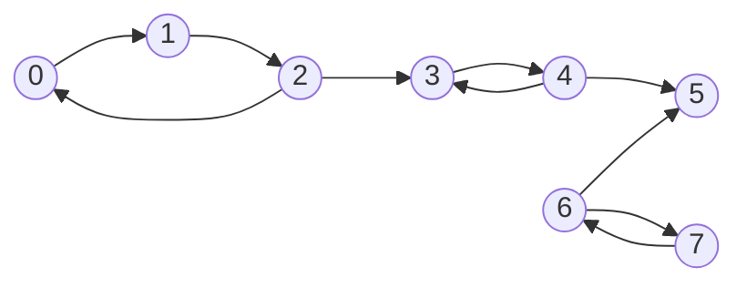
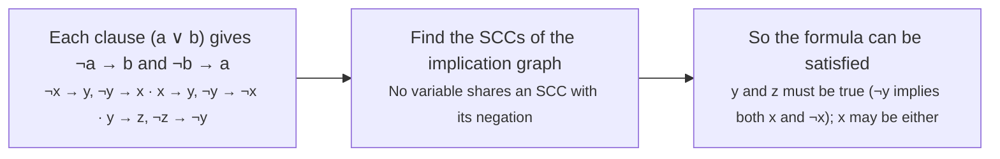

# Strongly connected components and 2-SAT

> Data Structures & Algorithms · L4 Expert · Flows, matching & graph structure · about 110 min · hub module `m01` ([open the hub](https://claude.ai/artifact/DxduaMdo2n5kqrt3We8PPZ))

## Why it matters
In a directed graph, “can A reach B and B reach A?” splits the vertices into strongly connected components. Collapsing each one to a single node turns any directed graph into a DAG: the first step in deadlock detection, compiler call-graph analysis and web crawling, and the engine behind a surprisingly powerful logic solver, 2-SAT.

## Pre-question (answer before reading)
**Q:** In a one-way road network, call a group of towns “mutually reachable” if you can drive from any of them to any other. If you shrink each group to a single dot, can the shrunk map contain a cycle?

<details><summary>Answer</summary>

No. If two shrunk dots sat on a cycle, every town in both groups could reach every other, so they would have been one group all along. The shrunk map, the condensation, is always a DAG.

</details>

## 🍎 Story time (kid version)
**The toy room and the treasure-map road trip: Ben's one-way slides**

In the playground every slide and ladder goes only one way. Ben finds he can get from the red tower to the blue tower and climb back again, so he paints them the same colour: they're one club. The green tower can be reached from the club, but there's no way back up, so it gets its own colour. Once every tower is painted, Tara draws one dot per colour, with arrows between colours. Her drawing never has a loop: a loop would have joined those colours into one club.

| In the story | In code |
|---|---|
| One-way slides and ladders | Directed edges |
| Towers you can reach and climb back from | A strongly connected component: every vertex reaches every other |
| Painting each club one colour | Labelling every vertex with its component |
| One dot per colour, arrows between colours | The condensation graph |
| Tara's drawing never loops | The condensation is always a DAG |

**Where the story breaks:** Ben looks at the whole playground at once, but code finds the clubs with depth-first search and low-link values (or a second search on the reversed graph). And 2-SAT uses the same clubs on true/false statements, where the bad sign is a statement and its opposite landing in the same club.

## Key ideas (grown-up version)
- **Strongly connected component (SCC)**: a maximal set of vertices in which every vertex can reach every other. Every directed graph splits into SCCs in exactly one way; a vertex on no cycle is an SCC on its own.
- **The condensation** has one node per SCC and an edge between two SCCs whenever any edge joins them. It is always a DAG, so DAG tools apply: topological order, DP along that order, reachability counts.
- **Kosaraju's algorithm**: DFS the graph and record each vertex when it finishes; then DFS the reversed graph, taking vertices in decreasing finishing time. Each tree of the second pass is one SCC, and they come out in topological order of the condensation. Two passes, O(V + E).
- **Tarjan's algorithm**: one DFS with discovery times and low-link values, as for L3's bridges, plus a stack of vertices. Only edges to vertices still on the stack lower low[u]. When a vertex finishes with low[u] = tin[u], it's the root of an SCC: pop the stack down to it. O(V + E), and the SCCs come out in reverse topological order.
- **Stay iterative**: both algorithms are depth-first, and a path of 10⁵ vertices is 10⁵ calls deep, past Python's 1,000-frame limit and Node's stack. Keep an explicit stack of [vertex, next edge index], as the prelude does.
- **2-SAT**: a formula of clauses (a ∨ b), each with two literals. Each clause becomes two implications, ¬a → b and ¬b → a. The formula can be satisfied exactly when no variable x lands in the same SCC as ¬x. Encode literal x as 2x and ¬x as 2x + 1, so negation is `^ 1`.
- **Reading off a solution**: set x true when x's component comes later than ¬x's in topological order. With Tarjan's numbering (sinks first) that is comp[x] < comp[¬x]. The whole solve is O(n + m) for n variables and m clauses.
- **Functional graphs**: when every vertex has at most one outgoing edge (LeetCode 2360, 2127), each component holds at most one cycle with trees hanging into it. A walk that timestamps each vertex finds every cycle in O(n), with no general SCC algorithm.

## Diagrams
**Four SCCs: {0, 1, 2}, {3, 4}, {5} and {6, 7}**



_The highlighted edges join different SCCs. Shrinking each SCC to one node leaves the DAG {0, 1, 2} → {3, 4} → {5} ← {6, 7}: no cycle can run between components._

**2-SAT on (x ∨ y) ∧ (¬x ∨ y) ∧ (¬y ∨ z)**



## Comparisons
**Kosaraju or Tarjan?**

|  | Kosaraju | Tarjan |
|---|---|---|
| Passes | Two: the graph, then the reversed graph | One |
| Extra memory | The reversed graph: O(V + E) | A vertex stack and low values: O(V) |
| Order of the SCCs it outputs | Topological order of the condensation | Reverse topological order |
| Easiest to get right | Yes: two plain DFS passes | Trickier: the on-stack check |
| Time | O(V + E) | O(V + E) |

**Where SCCs and 2-SAT show up**

| Problem shape | Technique | Cost |
|---|---|---|
| Which vertices can all reach each other? | SCCs (Tarjan or Kosaraju) | O(V + E) |
| The best path value in a graph with cycles (collect every coin in a room) | SCCs, then DP over the condensation | O(V + E) |
| Can every vertex reach every other? | One SCC, or two BFS runs from vertex 0 (graph and reversed graph) | O(V + E) |
| Choose one of two options per item under pairwise rules | 2-SAT | O(n + m) |
| Every vertex has at most one outgoing edge | Walk and timestamp: each component has at most one cycle | O(n) |

## Code (JavaScript + Python)
### The SCC finder used by every example below (Tarjan, with an explicit stack)
```python
def tarjan_scc(n, edges):                 # (count, comp); components numbered in reverse topological order
    graph = [[] for _ in range(n)]
    for u, v in edges:
        graph[u].append(v)
    tin, low, comp = [-1] * n, [0] * n, [-1] * n
    on_stack, stack = [False] * n, []
    timer = count = 0
    for s in range(n):
        if tin[s] != -1:
            continue
        tin[s] = low[s] = timer
        timer += 1
        stack.append(s)
        on_stack[s] = True
        work = [[s, 0]]                   # [vertex, next edge index]: an explicit call stack
        while work:
            u, i = work[-1]
            if i < len(graph[u]):
                work[-1][1] += 1
                v = graph[u][i]
                if tin[v] == -1:          # tree edge: "call" v
                    tin[v] = low[v] = timer
                    timer += 1
                    stack.append(v)
                    on_stack[v] = True
                    work.append([v, 0])
                elif on_stack[v]:         # an edge back into the current component
                    low[u] = min(low[u], tin[v])
            else:                         # u is finished: "return" to its parent
                work.pop()
                if work:
                    p = work[-1][0]
                    low[p] = min(low[p], low[u])
                if low[u] == tin[u]:      # u is the root of an SCC: pop the whole SCC
                    while True:
                        w = stack.pop()
                        on_stack[w] = False
                        comp[w] = count
                        if w == u:
                            break
                    count += 1
    return count, comp
```

```javascript
function tarjanScc(n, edges) {            // [count, comp]; components numbered in reverse topological order
  const graph = Array.from({ length: n }, () => []);
  for (const [u, v] of edges) graph[u].push(v);
  const tin = new Array(n).fill(-1), low = new Array(n).fill(0), comp = new Array(n).fill(-1);
  const onStack = new Array(n).fill(false), stack = [];
  let timer = 0, count = 0;
  for (let s = 0; s < n; s++) {
    if (tin[s] !== -1) continue;
    tin[s] = low[s] = timer++;
    stack.push(s);
    onStack[s] = true;
    const work = [[s, 0]];                // [vertex, next edge index]: an explicit call stack
    while (work.length) {
      const top = work[work.length - 1], u = top[0];
      if (top[1] < graph[u].length) {
        const v = graph[u][top[1]++];
        if (tin[v] === -1) {              // tree edge: "call" v
          tin[v] = low[v] = timer++;
          stack.push(v);
          onStack[v] = true;
          work.push([v, 0]);
        } else if (onStack[v]) low[u] = Math.min(low[u], tin[v]);   // an edge back into the current component
      } else {                            // u is finished: "return" to its parent
        work.pop();
        if (work.length) {
          const p = work[work.length - 1][0];
          low[p] = Math.min(low[p], low[u]);
        }
        if (low[u] === tin[u]) {          // u is the root of an SCC: pop the whole SCC
          let w;
          do {
            w = stack.pop();
            onStack[w] = false;
            comp[w] = count;
          } while (w !== u);
          count++;
        }
      }
    }
  }
  return [count, comp];
}
```

### Tarjan in action: SCC labels, the condensation, and a 100,000-vertex cycle
```python
edges = [(0, 1), (1, 2), (2, 0), (2, 3), (3, 4), (4, 3), (4, 5), (6, 5), (6, 7), (7, 6)]
count, comp = tarjan_scc(8, edges)
print(count, *comp)
dag = sorted({(comp[u], comp[v]) for u, v in edges if comp[u] != comp[v]})
print(*(f"{a}->{b}" for a, b in dag))

n = 100_000
ring = [(i, i + 1) for i in range(n - 1)] + [(n - 1, 0)]   # one huge cycle
print(tarjan_scc(n, ring)[0])
```

Output:
```text
4 2 2 2 1 1 0 3 3
1->0 2->1 3->0
1
```

- line 3: {5} is found first (it's a sink), then {3, 4}, then {0, 1, 2}, then {6, 7}: reverse topological order.
- line 4: Every edge of the condensation goes from a bigger component number to a smaller one, which is what reverse topological numbering means.
- line 9: 100,000 levels deep, yet no recursion: the prelude's explicit stack does the work.

```javascript
const edges = [[0, 1], [1, 2], [2, 0], [2, 3], [3, 4], [4, 3], [4, 5], [6, 5], [6, 7], [7, 6]];
const [count, comp] = tarjanScc(8, edges);
console.log(count, ...comp);
const dag = [...new Set(edges.filter(([u, v]) => comp[u] !== comp[v]).map(([u, v]) => `${comp[u]}->${comp[v]}`))].sort();
console.log(...dag);

const n = 100000;
const ring = Array.from({ length: n - 1 }, (_, i) => [i, i + 1]).concat([[n - 1, 0]]);   // one huge cycle
console.log(tarjanScc(n, ring)[0]);
```

Output:
```text
4 2 2 2 1 1 0 3 3
1->0 2->1 3->0
1
```

- line 3: {5} is found first (it's a sink), then {3, 4}, then {0, 1, 2}, then {6, 7}: reverse topological order.
- line 4: A Set of strings removes the duplicate component edges; the sort puts them in a fixed order.
- line 9: 100,000 levels deep, yet no recursion: the prelude's explicit stack does the work.

### Kosaraju: two passes, components in topological order
```python
def kosaraju(n, edges):
    graph, rev = [[] for _ in range(n)], [[] for _ in range(n)]
    for u, v in edges:
        graph[u].append(v)
        rev[v].append(u)
    order, seen = [], [False] * n
    for s in range(n):                    # pass 1: record vertices by finishing time
        if seen[s]:
            continue
        seen[s] = True
        work = [[s, 0]]
        while work:
            u, i = work[-1]
            if i < len(graph[u]):
                work[-1][1] += 1
                v = graph[u][i]
                if not seen[v]:
                    seen[v] = True
                    work.append([v, 0])
            else:
                work.pop()
                order.append(u)           # u's search is done: record it
    comp, count = [-1] * n, 0
    for s in reversed(order):             # pass 2: the reversed graph, latest finisher first
        if comp[s] != -1:
            continue
        comp[s] = count
        stack = [s]
        while stack:
            u = stack.pop()
            for v in rev[u]:
                if comp[v] == -1:
                    comp[v] = count
                    stack.append(v)
        count += 1
    return count, comp

edges = [(0, 1), (1, 2), (2, 0), (2, 3), (3, 4), (4, 3), (4, 5), (6, 5), (6, 7), (7, 6)]
print(*kosaraju(8, edges)[1])
```

Output:
```text
1 1 1 2 2 3 0 0
```

- line 22: A vertex is recorded when its search is done. Each component's last-recorded vertex comes after every vertex of the components it can reach, so the very last one lies in a source component.
- line 24: The latest finisher sits in a source component of the condensation. In the reversed graph that component is a sink, so this search stays inside it.

```javascript
function kosaraju(n, edges) {
  const graph = Array.from({ length: n }, () => []), rev = Array.from({ length: n }, () => []);
  for (const [u, v] of edges) {
    graph[u].push(v);
    rev[v].push(u);
  }
  const order = [], seen = new Array(n).fill(false);
  for (let s = 0; s < n; s++) {           // pass 1: record vertices by finishing time
    if (seen[s]) continue;
    seen[s] = true;
    const work = [[s, 0]];
    while (work.length) {
      const top = work[work.length - 1], u = top[0];
      if (top[1] < graph[u].length) {
        const v = graph[u][top[1]++];
        if (!seen[v]) {
          seen[v] = true;
          work.push([v, 0]);
        }
      } else {
        work.pop();
        order.push(u);                    // u's search is done: record it
      }
    }
  }
  const comp = new Array(n).fill(-1);
  let count = 0;
  for (let k = order.length - 1; k >= 0; k--) {   // pass 2: the reversed graph, latest finisher first
    const s = order[k];
    if (comp[s] !== -1) continue;
    comp[s] = count;
    const stack = [s];
    while (stack.length) {
      const u = stack.pop();
      for (const v of rev[u]) if (comp[v] === -1) { comp[v] = count; stack.push(v); }
    }
    count++;
  }
  return [count, comp];
}

const edges = [[0, 1], [1, 2], [2, 0], [2, 3], [3, 4], [4, 3], [4, 5], [6, 5], [6, 7], [7, 6]];
console.log(...kosaraju(8, edges)[1]);
```

Output:
```text
1 1 1 2 2 3 0 0
```

- line 22: A vertex is recorded when its search is done. Each component's last-recorded vertex comes after every vertex of the components it can reach, so the very last one lies in a source component.
- line 28: The latest finisher sits in a source component of the condensation. In the reversed graph that component is a sink, so this search stays inside it.

### 2-SAT with the SCC finder
```python
def two_sat(n, clauses):                  # literal 2*x means x, 2*x + 1 means not x
    edges = []
    for a, b in clauses:                  # (a or b) gives: not a -> b, and not b -> a
        edges.append((a ^ 1, b))
        edges.append((b ^ 1, a))
    _, comp = tarjan_scc(2 * n, edges)
    result = []
    for x in range(n):
        if comp[2 * x] == comp[2 * x + 1]:
            return None                   # x and not x imply each other
        result.append(comp[2 * x] < comp[2 * x + 1])
    return result

X, NOT_X, Y, NOT_Y, Z, NOT_Z = 0, 1, 2, 3, 4, 5
sol = two_sat(3, [(X, Y), (NOT_X, Y), (NOT_Y, Z)])
print(*("T" if v else "F" for v in sol))
print(two_sat(1, [(X, X), (NOT_X, NOT_X)]) is None)
```

Output:
```text
T T T
True
```

- line 4: If a is false, the clause forces b, and if b is false it forces a: two implications per clause.
- line 11: Tarjan numbers sinks first, so a smaller number means later in topological order. Choosing the later of x and ¬x as true never lets a true literal imply a false one.
- line 17: (x ∨ x) forces x and (¬x ∨ ¬x) forces ¬x, so x and ¬x end up in one SCC: no assignment exists.

```javascript
function twoSat(n, clauses) {             // literal 2*x means x, 2*x + 1 means not x
  const edges = [];
  for (const [a, b] of clauses) {         // (a or b) gives: not a -> b, and not b -> a
    edges.push([a ^ 1, b]);
    edges.push([b ^ 1, a]);
  }
  const [, comp] = tarjanScc(2 * n, edges);
  const result = [];
  for (let x = 0; x < n; x++) {
    if (comp[2 * x] === comp[2 * x + 1]) return null;   // x and not x imply each other
    result.push(comp[2 * x] < comp[2 * x + 1]);
  }
  return result;
}

const [X, NOT_X, Y, NOT_Y, Z, NOT_Z] = [0, 1, 2, 3, 4, 5];
const sol = twoSat(3, [[X, Y], [NOT_X, Y], [NOT_Y, Z]]);
console.log(...sol.map(v => (v ? "T" : "F")));
console.log(twoSat(1, [[X, X], [NOT_X, NOT_X]]) === null ? "True" : "False");
```

Output:
```text
T T T
True
```

- line 4: If a is false, the clause forces b, and if b is false it forces a: two implications per clause.
- line 11: Tarjan numbers sinks first, so a smaller number means later in topological order. Choosing the later of x and ¬x as true never lets a true literal imply a false one.
- line 19: (x ∨ x) forces x and (¬x ∨ ¬x) forces ¬x, so x and ¬x end up in one SCC: no assignment exists.

## Worked example
**Problem.** Rooms joined by one-way tunnels each hold some coins. You may start anywhere, walk through tunnels as long as you like, and collect each room's coins the first time you enter it. What is the most you can collect? (CSES 1686, Coin Collector)

1. Inside an SCC you can visit every room and come back, so one SCC behaves like one big room worth the sum of its coins.
2. Shrink the SCCs: the condensation is a DAG, so the walk becomes a path in a DAG and no room is entered twice by accident.
3. DP in reverse topological order: best[c] = value[c] + the largest best[d] over the components d that c points to (or just value[c]).
4. The answer is the largest best[c]. Tarjan plus one pass over the edges: O(V + E).

```python
def max_coins(n, edges, coins):
    count, comp = tarjan_scc(n, edges)
    value = [0] * count
    for v in range(n):
        value[comp[v]] += coins[v]
    out = [[] for _ in range(count)]
    for u, v in edges:
        if comp[u] != comp[v]:
            out[comp[u]].append(comp[v])
    best = value[:]
    for c in range(count):                # Tarjan's order: every successor has a smaller number
        for d in out[c]:
            best[c] = max(best[c], value[c] + best[d])
    return max(best)

edges = [(0, 1), (1, 2), (2, 0), (2, 3), (3, 4), (4, 3), (4, 5), (6, 5), (6, 7), (7, 6)]
print(max_coins(8, edges, [1, 2, 3, 4, 5, 6, 7, 8]), max_coins(4, [(0, 1), (2, 3)], [5, 1, 2, 9]))
```

Output:
```text
21 11
```

```javascript
function maxCoins(n, edges, coins) {
  const [count, comp] = tarjanScc(n, edges);
  const value = new Array(count).fill(0);
  for (let v = 0; v < n; v++) value[comp[v]] += coins[v];
  const out = Array.from({ length: count }, () => []);
  for (const [u, v] of edges) if (comp[u] !== comp[v]) out[comp[u]].push(comp[v]);
  const best = [...value];
  for (let c = 0; c < count; c++)         // Tarjan's order: every successor has a smaller number
    for (const d of out[c]) best[c] = Math.max(best[c], value[c] + best[d]);
  return Math.max(...best);
}

const edges = [[0, 1], [1, 2], [2, 0], [2, 3], [3, 4], [4, 3], [4, 5], [6, 5], [6, 7], [7, 6]];
console.log(maxCoins(8, edges, [1, 2, 3, 4, 5, 6, 7, 8]), maxCoins(4, [[0, 1], [2, 3]], [5, 1, 2, 9]));
```

Output:
```text
21 11
```

**Answer.** 21 and 11. In the first graph, {0, 1, 2} (6 coins) → {3, 4} (9) → {5} (6) gives 21, and so does {6, 7} (15) → {5} (6). In the second, the best is room 2 then room 3: 2 + 9 = 11.

## Your turn (faded example)
**Problem.** Every node has at most one outgoing edge: edges[i] is the node i points to, or −1. Return the length of the longest cycle, or −1 if there's none (LeetCode 2360, Longest Cycle in a Graph).

- ✓ With at most one way out of each node, a walk from a node never branches: it either stops at −1, runs into a node seen on an earlier walk, or comes back to a node seen on this walk.
- **What should you store for each node the first time any walk reaches it?**
  <details><summary>Answer</summary>The global step number at that moment (a timestamp). Steps keep counting across walks, so a stamp at or after this walk's first step means the node was reached on this walk, and meeting it again closes a cycle.</details>
- **When the walk returns to a node it saw earlier on this walk, how long is the cycle?**
  <details><summary>Answer</summary>The current step number minus that node's timestamp.</details>
- **Time and space?**
  <details><summary>Answer</summary>O(n) time, because every node is stamped once and each walk stops at the first stamped node, and O(n) space for the stamps.</details>

Starter:
```python
def longest_cycle(edges):
    n = len(edges)
    stamp = [-1] * n                      # the step at which a node was first reached
    step, best = 0, -1
    for s in range(n):
        start = step                      # steps from here on belong to this walk
        u = s
        while u != -1 and stamp[u] == -1:
            stamp[u] = step
            step += 1
            u = edges[u]
        ...                               # TODO: did the walk stop at a node from this walk?
    return best
```

```javascript
function longestCycle(edges) {
  const n = edges.length, stamp = new Array(n).fill(-1);   // the step at which a node was first reached
  let step = 0, best = -1;
  for (let s = 0; s < n; s++) {
    const start = step;                   // steps from here on belong to this walk
    let u = s;
    while (u !== -1 && stamp[u] === -1) {
      stamp[u] = step++;
      u = edges[u];
    }
    // TODO: did the walk stop at a node from this walk?
  }
  return best;
}
```

<details><summary>Full solution</summary>

```python
def longest_cycle(edges):
    n = len(edges)
    stamp = [-1] * n                      # the step at which a node was first reached
    step, best = 0, -1
    for s in range(n):
        start = step                      # steps from here on belong to this walk
        u = s
        while u != -1 and stamp[u] == -1:
            stamp[u] = step
            step += 1
            u = edges[u]
        if u != -1 and stamp[u] >= start:  # back to a node from this same walk
            best = max(best, step - stamp[u])
    return best

print(longest_cycle([3, 3, 4, 2, 3]), longest_cycle([2, -1, 3, 1]), longest_cycle([1, 0, 0, 4, 5, 6, 3]))
```

Output:
```text
3 -1 4
```

```javascript
function longestCycle(edges) {
  const n = edges.length, stamp = new Array(n).fill(-1);   // the step at which a node was first reached
  let step = 0, best = -1;
  for (let s = 0; s < n; s++) {
    const start = step;                   // steps from here on belong to this walk
    let u = s;
    while (u !== -1 && stamp[u] === -1) {
      stamp[u] = step++;
      u = edges[u];
    }
    if (u !== -1 && stamp[u] >= start) best = Math.max(best, step - stamp[u]);   // back to a node from this walk
  }
  return best;
}

console.log(longestCycle([3, 3, 4, 2, 3]), longestCycle([2, -1, 3, 1]), longestCycle([1, 0, 0, 4, 5, 6, 3]));
```

Output:
```text
3 -1 4
```

</details>

## Socratic checks and quiz (answers hidden)
**1. What does this print? (`tarjan_scc` / `tarjanScc` is this module's helper.)**

```python
count, comp = tarjan_scc(5, [(0, 1), (1, 0), (1, 2), (2, 3), (3, 2), (3, 4)])
same = lambda a, b: "yes" if comp[a] == comp[b] else "no"
print(count, same(0, 1), same(1, 2), same(2, 3))
```

```javascript
const [count, comp] = tarjanScc(5, [[0, 1], [1, 0], [1, 2], [2, 3], [3, 2], [3, 4]]);
const same = (a, b) => (comp[a] === comp[b] ? "yes" : "no");
console.log(count, same(0, 1), same(1, 2), same(2, 3));
```

- A. 3 yes no yes
- B. 2 yes yes yes
- C. 5 no no no
- D. 3 yes yes no

<details><summary>Answer</summary>

3 yes no yes. {0, 1} and {2, 3} are 2-cycles, and 4 is alone: 3 SCCs. 1 reaches 2, but 2 can't get back to 1, so they're in different components.

</details>

**2. What does this print?**

```python
lit = lambda v, neg=False: 2 * v + (1 if neg else 0)
a, b = lit(0), lit(1, neg=True)          # the clause (x0 or not x1)
print(a ^ 1, b, b ^ 1, a)                # the edges: (not a) -> b and (not b) -> a
```

```javascript
const lit = (v, neg = false) => 2 * v + (neg ? 1 : 0);
const a = lit(0), b = lit(1, true);       // the clause (x0 or not x1)
console.log(a ^ 1, b, b ^ 1, a);          // the edges: (not a) -> b and (not b) -> a
```

- A. 1 3 2 0
- B. 0 3 2 1
- C. 1 2 3 0
- D. 1 3 0 2

<details><summary>Answer</summary>

1 3 2 0. x0 is literal 0 and ¬x1 is literal 3. Negation flips the last bit: ¬x0 is 1 and x1 is 2. So the edges are 1 → 3 (¬x0 → ¬x1) and 2 → 0 (x1 → x0).

</details>

**3. Which statement about the condensation of a directed graph is always true?**

- A. It's a DAG
- B. It's a tree
- C. It has one node per cycle of the graph
- D. It's strongly connected

<details><summary>Answer</summary>

It's a DAG. A cycle between components would merge them, so there's none. It needn't be a tree (two components can both point to a third), and one SCC can contain many cycles.

</details>

**4. Which statements about Tarjan's algorithm are true? (choose 2)**

- A. It finds every SCC in one depth-first search, in O(V + E)
- B. It outputs the SCCs in reverse topological order of the condensation
- C. It needs the reversed graph
- D. Any edge to an already-visited vertex lowers low[u]
- E. It works only on acyclic graphs

<details><summary>Answer</summary>

It finds every SCC in one depth-first search, in O(V + E), It outputs the SCCs in reverse topological order of the condensation. Kosaraju is the one that needs the reversed graph. Only edges to vertices still on the stack lower low[u]. And a DAG is the dull case: every SCC is a single vertex.

</details>

**5. Judge each statement.**

- In 2-SAT, the clause (a ∨ b) becomes the implications ¬a → b and ¬b → a.
- A 2-SAT formula has no solution whenever x can reach ¬x.
- Kosaraju's algorithm needs two depth-first passes.
- If every vertex has exactly one outgoing edge, every weakly connected component contains exactly one cycle.

<details><summary>Answer</summary>

In 2-SAT, the clause (a ∨ b) becomes the implications ¬a → b and ¬b → a.: Yes; A 2-SAT formula has no solution whenever x can reach ¬x.: No; Kosaraju's algorithm needs two depth-first passes.: Yes; If every vertex has exactly one outgoing edge, every weakly connected component contains exactly one cycle.: Yes. Each clause forbids both literals being false, which is exactly those two implications. x → ¬x only forces x false; the contradiction needs both directions. Kosaraju runs once on the graph and once on its reverse. With exactly one way out of each vertex, every walk ends in a cycle, and a component can't hold two.

</details>

**6. Put the steps of solving 2-SAT in order.**

- (put the steps in order)

<details><summary>Answer</summary>

Turn each clause (a ∨ b) into the implications ¬a → b and ¬b → a → Find the SCCs of the implication graph → If some x shares an SCC with ¬x, report that there's no solution → Otherwise set each x from the order of the components of x and ¬x. The SCCs need the graph, the check needs the SCCs, and the assignment is only safe once the check has passed.

</details>

**7. Complete the Python 2-SAT solver (`tarjan_scc` is this module's helper).**

```
def solve(n, clauses):                     # literal 2*x means x, 2*x + 1 means not x
    edges = []
    for a, b in clauses:
        edges.append((a ^ 1, {{0}}))
        edges.append(({{1}}, a))
    count, comp = tarjan_scc(2 * n, edges)
    if any(comp[2 * x] == comp[2 * x + 1] for x in range(n)):
        return None
    return [comp[2 * x] {{2}} comp[2 * x + 1] for x in range(n)]

```

<details><summary>Answer</summary>

b | b ^ 1 | <. (a ∨ b) means ¬a → b and ¬b → a. Tarjan numbers sinks first, so x is true when its component number is smaller than ¬x's.

</details>

**8. Match each problem to its technique.**


<details><summary>Answer</summary>

Which vertices can all reach each other? = Strongly connected components; Collect the most coins in a graph with cycles = SCCs, then DP over the condensation; Pick one of two options per item under pairwise rules = 2-SAT on the implication graph; Every node has at most one outgoing edge = A walk with timestamps finds each cycle. SCCs answer mutual reachability, the condensation turns cycles into a DAG for DP, 2-SAT is SCCs on literals, and a functional graph needs only a timestamped walk.

</details>

## Traps & misconceptions
- **“Any edge to a visited vertex can lower low[u] in Tarjan's algorithm.”** Only edges to vertices still on the stack count. An edge into a component that's already finished is a cross edge between components; letting it lower low[u] would merge SCCs that aren't mutually reachable.
- **“The condensation can contain a cycle.”** Never: a cycle through two components would make every vertex in them mutually reachable, so they would be one SCC.
- **“Kosaraju's second pass runs on the original graph.”** It runs on the reversed graph, taking vertices in decreasing finishing time. On the original graph the search would spill out of a source component into everything it reaches.
- **“A recursive SCC algorithm is fine for 10⁵ vertices.”** A path of 10⁵ vertices recurses 10⁵ deep: RecursionError in Python and a stack overflow in Node.js. Keep an explicit stack of [vertex, next edge index].
- **“2-SAT has no solution as soon as x can reach ¬x.”** x → ¬x alone only forces x to be false. There's no solution only when x and ¬x are in the same SCC, so each forces the other.
- **“3-SAT can be solved the same way.”** A clause of three literals doesn't turn into implications between single literals, and 3-SAT is NP-complete. The SCC trick works only when every clause has at most two literals.

## Discussion prompts
- **Why does the 2-SAT rule “make true whichever of x and ¬x comes later in topological order” work?**
  <details><summary>One good answer</summary>Implications only point forwards in topological order. If x comes after ¬x, then x, which we make true, can only imply literals even later, and ¬x, which is false, sits earlier, where it can't be implied by a true literal. Doing this for every variable at once stays consistent because the implication graph is symmetric: whenever a → b, also ¬b → ¬a.</details>
- **Where do SCCs show up outside contests?**
  <details><summary>One good answer</summary>Deadlock detection (processes waiting on each other form a cycle, an SCC of the wait-for graph), compilers (mutually recursive functions form an SCC of the call graph and are analysed together), package managers (dependency cycles), and the web graph, which has a giant strongly connected core.</details>

## Teach-back
**Prompt:** Explain to a junior colleague what a strongly connected component is, and how 2-SAT uses SCCs to decide whether a set of either-or rules can all be satisfied.

Rubric:
- [ ] In an SCC every vertex reaches every other; the SCCs split the vertices
- [ ] The condensation of the SCCs is a DAG
- [ ] Tarjan or Kosaraju finds them in O(V + E)
- [ ] Each clause (a ∨ b) becomes ¬a → b and ¬b → a
- [ ] No solution exactly when some x and ¬x share an SCC

<details><summary>Model answer</summary>

In a directed graph, an SCC is a largest group of vertices that can all reach each other. Every vertex belongs to exactly one, and if you shrink each SCC to a single node you get the condensation, which is always a DAG, because a cycle between two groups would have merged them. Tarjan's algorithm finds all SCCs in one depth-first search with low-link values, and Kosaraju's in two, both in O(V + E). 2-SAT asks whether you can satisfy rules of the form “a or b”. Each rule becomes two implications: if a is false then b must be true, and if b is false then a must be. Build that implication graph over the literals and find its SCCs. If some variable and its negation land in the same SCC, each forces the other, so there's no solution. Otherwise you can read a solution off the topological order: make true whichever of x and ¬x comes later. The whole thing is linear in the number of variables and rules.

</details>

## Quick Q&A (also in the SRS deck)
- **What is a strongly connected component?** A maximal set of vertices in a directed graph where every vertex can reach every other.
- **What shape is the condensation of a directed graph?** Always a DAG: one node per SCC.
- **In Tarjan's algorithm, which edges lower low[u]?** Tree edges (through the child's low) and edges to vertices still on the stack; edges into finished components don't.
- **How does Kosaraju's algorithm find the SCCs?** DFS for finishing times, then DFS on the reversed graph in decreasing finishing time; each tree is an SCC.
- **How does 2-SAT turn a clause (a ∨ b) into edges?** ¬a → b and ¬b → a.
- **When does a 2-SAT formula have no solution?** When some variable x is in the same SCC as ¬x.

## Practice problems
- [ ] [LC 802 · Find Eventual Safe States](https://leetcode.com/problems/find-eventual-safe-states/) · Medium · a node is safe if it can't reach a cycle: peel nodes with no way out on the reversed graph, or use SCCs
- [ ] [LC 2360 · Longest Cycle in a Graph](https://leetcode.com/problems/longest-cycle-in-a-graph/) · Hard · the faded example: one outgoing edge per node, so a timestamped walk finds every cycle
- [ ] [LC 2127 · Maximum Employees to Be Invited to a Meeting](https://leetcode.com/problems/maximum-employees-to-be-invited-to-a-meeting/) · Hard · a functional graph: take the longest cycle, or the sum over 2-cycles of each pair plus its two longest arms
- [ ] [CSES 1682 · Flight Routes Check](https://cses.fi/problemset/task/1682) · BFS from city 1 in the graph and in the reversed graph; print the first city either one misses
- [ ] [CSES 1683 · Planets and Kingdoms](https://cses.fi/problemset/task/1683) · label the SCCs: the prelude's Tarjan, numbered from 1
- [ ] [CSES 1686 · Coin Collector](https://cses.fi/problemset/task/1686) · the worked example: SCCs, then DP over the condensation
- [ ] [CSES 1684 · Giant Pizza](https://cses.fi/problemset/task/1684) · 2-SAT: each family member's two wishes form one clause

## Sources (accessed 2026-10-09)
- [cp-algorithms: Strongly connected components and the condensation graph](https://cp-algorithms.com/graph/strongly-connected-components.html)
- [cp-algorithms: 2-SAT](https://cp-algorithms.com/graph/2SAT.html)
- [Wikipedia: Tarjan's strongly connected components algorithm](https://en.wikipedia.org/wiki/Tarjan%27s_strongly_connected_components_algorithm)
- [CSES Problem Set (graph algorithms section)](https://cses.fi/problemset/)
