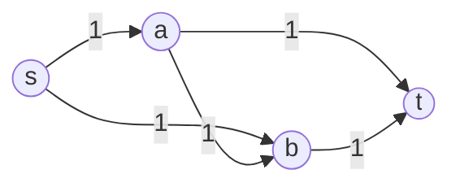
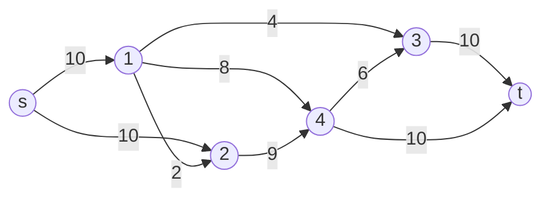

# Maximum flow and minimum cut

> Data Structures & Algorithms · L4 Expert · Flows, matching & graph structure · about 120 min · hub module `m02` ([open the hub](https://claude.ai/artifact/DxduaMdo2n5kqrt3We8PPZ))

## Why it matters
How much data can a network push from a server to a client, and which few links would an attacker have to cut to stop it? Those are one question, maximum flow, and its mirror image, the minimum cut. Problems that look nothing like pipes (disjoint routes, seating plans, choosing projects that need costly tools) are solved by building the right network and running one flow algorithm.

## Pre-question (answer before reading)
**Q:** Pipes carry water from a reservoir to a town, each up to some litres a second. You could also close pipes to cut the town off. How does the most water you can send compare with the smallest total capacity of pipes you'd have to close?

<details><summary>Answer</summary>

They're equal. Every litre has to cross any set of pipes that cuts the town off, so the flow can't beat the cheapest cut, and the max-flow min-cut theorem says the best flow always reaches it. Finding one gives you the other.

</details>

## 🍎 Story time (kid version)
**The toy room and the treasure-map road trip: Tara's marble run**

Tara builds a marble run from a top bucket to a bottom bucket, and each tube fits only so many marbles a minute. Ben keeps finding routes with room to spare and pours more marbles down them. When he gets stuck, he takes back part of an earlier choice: fewer marbles down one tube frees room to send them a better way. When no route has space left, Tara points to a few full tubes. Block just those and nothing reaches the bottom, and their sizes add up to exactly the marbles a minute Ben is sending.

| In the story | In code |
|---|---|
| Tubes, each fitting so many marbles a minute | Directed edges with capacities |
| The top and bottom buckets | The source s and the sink t |
| A route with room to spare | An augmenting path in the residual graph |
| Taking back marbles from an earlier tube | Pushing flow along a reverse residual edge, which cancels earlier flow |
| The full tubes Tara would block | A minimum cut, whose capacity equals the maximum flow |

**Where the story breaks:** Ben picks routes by luck, but fast algorithms pick shortest routes first, and that choice is what bounds their running time. And “taking back” is only bookkeeping: a reverse residual edge isn't a real tube running uphill, just a record that earlier flow may be cancelled.

## Key ideas (grown-up version)
- **Flow network**: a directed graph with a capacity c(u, v) ≥ 0 on each edge, a source s and a sink t. A flow puts 0 ≤ f(u, v) ≤ c(u, v) on every edge, and each vertex except s and t passes on exactly what it receives. The flow's value is the net amount leaving s.
- **Residual graph**: an edge with flow f can take c − f more, and it can also give back up to f, which is a reverse edge with capacity f. Store each edge beside its reverse (indexes e and e ^ 1), so pushing x units is cap[e] −= x and cap[e ^ 1] += x.
- **Augmenting paths (Ford–Fulkerson)**: while the residual graph has an s–t path, push its bottleneck along it. Reverse edges let a later path undo an earlier bad choice. With integer capacities each push adds at least 1, so there are at most F pushes for a maximum flow F, each O(V + E).
- **Edmonds–Karp and Dinic**: augmenting along shortest paths (by edge count) caps the number of rounds whatever the capacities. Edmonds–Karp takes one BFS path at a time, O(V E²). Dinic sets BFS levels, then saturates every shortest path at once (a blocking flow) with current-arc pointers: O(V² E) in general and O(E √V) for unit-capacity bipartite matching.
- **Max-flow min-cut theorem**: an s–t cut splits the vertices into S, containing s, and T, containing t; its capacity is the total capacity of edges from S to T. Every flow is at most every cut, and the maximum flow equals the minimum cut. After a maximum flow, the vertices s still reaches in the residual graph are the S side of a minimum cut.
- **Integer capacities give integer flows**: then a maximum flow exists with a whole number on every edge, and augmenting-path algorithms find one. That's what lets flow count things: disjoint routes, seated students, matched pairs.
- **Modelling tricks**: an undirected edge becomes two directed edges; a vertex capacity splits v into v_in → v_out; several sources or sinks hang off a super source and a super sink; edge-disjoint paths are a max flow with every capacity 1 (Menger's theorem).
- **Min cut as a model (project selection)**: to choose items with profits, costs and “a needs b” rules, add s → item for each profit, item → t for each cost and a → b with an infinite capacity. The best total is the sum of all profits minus the minimum cut, and the chosen items are the cut's S side.

## Diagrams
**Why reverse edges matter (every capacity is 1)**



_If the first path is s → a → b → t (highlighted), no second path uses forward edges alone. The residual graph has a reverse edge b → a, so s → b → a → t cancels the flow on a → b and the total reaches 2. Dinic avoids this path from the start: a → b doesn't lead to the next BFS level._

**Maximum flow 19 (s = 0, t = 5) and the minimum cut that proves it**



_After the maximum flow, s still reaches only vertex 2 in the residual graph, so S = {s, 2}. The edges leaving S are s → 1 (10) and 2 → 4 (9): 19 in total, so no flow can beat 19. Cutting just before t (3 → t and 4 → t) costs 20, one more than the minimum._

## Comparisons
**Which max-flow algorithm?**

|  | Ford–Fulkerson (any path) | Edmonds–Karp | Dinic |
|---|---|---|---|
| Path choice | Any augmenting path, often by DFS | A shortest path (BFS), one per round | All shortest paths per round: a blocking flow |
| Time | O(E · F) with integer capacities, F the flow value | O(V E²) | O(V² E); O(E √V) for unit-capacity matching |
| Use it when | The flow value is small | You want short, safe code | Graphs are large or the flow is big |

**Modelling tricks**

| Need | Build | Why it works |
|---|---|---|
| An undirected edge {u, v} of capacity c | u → v and v → u, each of capacity c | Opposite flows cancel, so an optimal flow never needs both |
| Vertex v carries at most c | v_in → v_out with capacity c | All flow through v must cross that one edge |
| Several sources or sinks | A super source → each source, each sink → a super sink | One s–t flow now covers them all |
| Count routes that share no edge | Capacity 1 on every edge | An integer flow of k splits into k such routes (Menger) |
| Choose items with profits, costs and “a needs b” rules | s → profit item, cost item → t, a → b with ∞ | Each finite cut is a valid choice, and its capacity is the profit lost |

## Code (JavaScript + Python)
### The max-flow solver used by every example below (Dinic's algorithm, no recursion)
```python
class MaxFlow:                                  # Dinic's algorithm
    def __init__(self, n):
        self.n, self.adj = n, [[] for _ in range(n)]
        self.to, self.cap = [], []              # edge e and its reverse e ^ 1 sit side by side

    def add_edge(self, u, v, c):
        self.adj[u].append(len(self.to)); self.to.append(v); self.cap.append(c)
        self.adj[v].append(len(self.to)); self.to.append(u); self.cap.append(0)

    def _levels(self, s):                       # BFS distances from s using edges with spare capacity
        level = [-1] * self.n
        level[s], q = 0, [s]
        for u in q:
            for e in self.adj[u]:
                if self.cap[e] > 0 and level[self.to[e]] < 0:
                    level[self.to[e]] = level[u] + 1
                    q.append(self.to[e])
        return level

    def _next_edge(self, u, level, it):         # first usable edge out of u, or -1
        while it[u] < len(self.adj[u]):
            e = self.adj[u][it[u]]
            if self.cap[e] > 0 and level[self.to[e]] == level[u] + 1:
                return e
            it[u] += 1
        return -1

    def max_flow(self, s, t):
        flow = 0
        while (level := self._levels(s))[t] >= 0:
            it = [0] * self.n                   # current-arc pointers: dead edges stay skipped
            while True:                         # one shortest augmenting path per pass
                path, u = [], s
                while u != t:
                    e = self._next_edge(u, level, it)
                    if e >= 0:
                        path.append(e)
                        u = self.to[e]
                    elif u == s:
                        break                   # s is stuck: this level graph is used up
                    else:
                        u = self.to[path.pop() ^ 1]   # back to the tail of the last edge
                        it[u] += 1                    # and never try that edge again this round
                if u != t:
                    break
                f = min(self.cap[e] for e in path)
                for e in path:
                    self.cap[e] -= f
                    self.cap[e ^ 1] += f
                flow += f
        return flow

    def source_side(self, s):                   # after max_flow: what s still reaches is a min cut's side
        return [d >= 0 for d in self._levels(s)]
```

```javascript
class MaxFlow {                                 // Dinic's algorithm
  constructor(n) {
    this.n = n;
    this.adj = Array.from({ length: n }, () => []);
    this.to = []; this.cap = [];                // edge e and its reverse e ^ 1 sit side by side
  }
  addEdge(u, v, c) {
    this.adj[u].push(this.to.length); this.to.push(v); this.cap.push(c);
    this.adj[v].push(this.to.length); this.to.push(u); this.cap.push(0);
  }
  levels(s) {                                   // BFS distances from s using edges with spare capacity
    const level = new Array(this.n).fill(-1), q = [s];
    level[s] = 0;
    for (let h = 0; h < q.length; h++) {
      const u = q[h];
      for (const e of this.adj[u]) {
        if (this.cap[e] > 0 && level[this.to[e]] < 0) {
          level[this.to[e]] = level[u] + 1;
          q.push(this.to[e]);
        }
      }
    }
    return level;
  }
  nextEdge(u, level, it) {                      // first usable edge out of u, or -1
    for (; it[u] < this.adj[u].length; it[u]++) {
      const e = this.adj[u][it[u]];
      if (this.cap[e] > 0 && level[this.to[e]] === level[u] + 1) return e;
    }
    return -1;
  }
  maxFlow(s, t) {
    let flow = 0, level;
    while ((level = this.levels(s))[t] >= 0) {
      const it = new Array(this.n).fill(0);     // current-arc pointers: dead edges stay skipped
      for (;;) {                                // one shortest augmenting path per pass
        const path = [];
        let u = s;
        while (u !== t) {
          const e = this.nextEdge(u, level, it);
          if (e >= 0) { path.push(e); u = this.to[e]; continue; }
          if (u === s) break;                   // s is stuck: this level graph is used up
          u = this.to[path.pop() ^ 1];          // back to the tail of the last edge
          it[u]++;                              // and never try that edge again this round
        }
        if (u !== t) break;
        let f = Infinity;
        for (const e of path) f = Math.min(f, this.cap[e]);
        for (const e of path) { this.cap[e] -= f; this.cap[e ^ 1] += f; }
        flow += f;
      }
    }
    return flow;
  }
  sourceSide(s) {                               // after maxFlow: what s still reaches is a min cut's side
    return this.levels(s).map(d => d >= 0);
  }
}
```

### Dinic on a small network, and the minimum cut that proves the answer
```python
edges = [(0, 1, 10), (0, 2, 10), (1, 2, 2), (1, 3, 4), (1, 4, 8), (2, 4, 9), (4, 3, 6), (3, 5, 10), (4, 5, 10)]
g = MaxFlow(6)
for u, v, c in edges:
    g.add_edge(u, v, c)
print(g.max_flow(0, 5))
side = g.source_side(0)
print(*(v for v in range(6) if side[v]))
cut = [(u, v, c) for u, v, c in edges if side[u] and not side[v]]
print(*(f"{u}->{v}" for u, v, c in cut), "=", sum(c for u, v, c in cut))
```

Output:
```text
19
0 2
0->1 2->4 = 19
```

- line 5: Two Dinic rounds (BFS levels, then a blocking flow) reach 19; a third BFS finds no path to t.
- line 6: One more BFS on the residual graph: s reaches only vertex 2, because s → 1 and 2 → 4 are full.
- line 9: The edges from S to the rest add up to the flow. That equality is the proof that 19 is the maximum.

```javascript
const edges = [[0, 1, 10], [0, 2, 10], [1, 2, 2], [1, 3, 4], [1, 4, 8], [2, 4, 9], [4, 3, 6], [3, 5, 10], [4, 5, 10]];
const g = new MaxFlow(6);
for (const [u, v, c] of edges) g.addEdge(u, v, c);
console.log(g.maxFlow(0, 5));
const side = g.sourceSide(0);
console.log(...[0, 1, 2, 3, 4, 5].filter(v => side[v]));
const cut = edges.filter(([u, v]) => side[u] && !side[v]);
console.log(...cut.map(([u, v]) => `${u}->${v}`), "=", cut.reduce((sum, [, , c]) => sum + c, 0));
```

Output:
```text
19
0 2
0->1 2->4 = 19
```

- line 4: Two Dinic rounds (BFS levels, then a blocking flow) reach 19; a third BFS finds no path to t.
- line 5: One more BFS on the residual graph: s reaches only vertex 2, because s → 1 and 2 → 4 are full.
- line 8: The edges from S to the rest add up to the flow. That equality is the proof that 19 is the maximum.

### Disjoint routes: unit capacities, recovering the routes, and splitting vertices
```python
def disjoint_routes(n, edges, s, t):          # routes that share no edge
    g = MaxFlow(n)
    for u, v in edges:
        g.add_edge(u, v, 1)
    k = g.max_flow(s, t)
    out = [[] for _ in range(n)]
    for i, (u, v) in enumerate(edges):
        if g.cap[2 * i] == 0:                 # a full unit edge carries one route
            out[u].append(v)
    routes = []
    for _ in range(k):
        route = [s]
        while route[-1] != t:
            route.append(out[route[-1]].pop())   # follow a used edge and spend it
        routes.append(route)
    return routes

def vertex_disjoint(n, edges, s, t):          # routes that share no vertex except s and t
    g = MaxFlow(2 * n)                        # v_in = v, v_out = v + n
    for v in range(n):
        g.add_edge(v, v + n, 1)               # each vertex can carry one route
    for u, v in edges:
        g.add_edge(u + n, v, 1)
    return g.max_flow(s + n, t)

edges = [(0, 1), (0, 2), (1, 3), (2, 3), (3, 4), (3, 5), (4, 6), (5, 6)]
routes = disjoint_routes(7, edges, 0, 6)
print(len(routes))
for r in routes:
    print(*r)
print(vertex_disjoint(7, edges, 0, 6))
```

Output:
```text
2
0 2 3 5 6
0 1 3 4 6
1
```

- line 8: With capacity 1, an original edge with no capacity left carries exactly one unit of flow.
- line 14: Every vertex but s and t has as many used edges in as out, so a walk from s can't get stuck before t.
- line 21: Splitting v into v_in → v_out with capacity 1 lets at most one route pass through v.
- line 24: Start at s's out-copy and stop at t's in-copy, so s and t themselves have no limit.

```javascript
function disjointRoutes(n, edges, s, t) {     // routes that share no edge
  const g = new MaxFlow(n);
  for (const [u, v] of edges) g.addEdge(u, v, 1);
  const k = g.maxFlow(s, t);
  const out = Array.from({ length: n }, () => []);
  edges.forEach(([u, v], i) => {
    if (g.cap[2 * i] === 0) out[u].push(v);   // a full unit edge carries one route
  });
  const routes = [];
  for (let r = 0; r < k; r++) {
    const route = [s];
    while (route.at(-1) !== t) route.push(out[route.at(-1)].pop());   // follow a used edge and spend it
    routes.push(route);
  }
  return routes;
}

function vertexDisjoint(n, edges, s, t) {     // routes that share no vertex except s and t
  const g = new MaxFlow(2 * n);               // v_in = v, v_out = v + n
  for (let v = 0; v < n; v++) g.addEdge(v, v + n, 1);   // each vertex can carry one route
  for (const [u, v] of edges) g.addEdge(u + n, v, 1);
  return g.maxFlow(s + n, t);
}

const edges = [[0, 1], [0, 2], [1, 3], [2, 3], [3, 4], [3, 5], [4, 6], [5, 6]];
const routes = disjointRoutes(7, edges, 0, 6);
console.log(routes.length);
for (const r of routes) console.log(...r);
console.log(vertexDisjoint(7, edges, 0, 6));
```

Output:
```text
2
0 2 3 5 6
0 1 3 4 6
1
```

- line 7: With capacity 1, an original edge with no capacity left carries exactly one unit of flow.
- line 12: Every vertex but s and t has as many used edges in as out, so a walk from s can't get stuck before t.
- line 20: Splitting v into v_in → v_out with capacity 1 lets at most one route pass through v.
- line 22: Start at s's out-copy and stop at t's in-copy, so s and t themselves have no limit.

### Min cut as a model: choosing projects that need tools
```python
def best_selection(weights, needs):           # needs (a, b): choosing a forces b
    n = len(weights)
    s, t = n, n + 1
    big = sum(abs(w) for w in weights) + 1    # more than any finite cut: an exact "infinity"
    g = MaxFlow(n + 2)
    for i, w in enumerate(weights):
        if w > 0:
            g.add_edge(s, i, w)               # cut it = give up this profit
        elif w < 0:
            g.add_edge(i, t, -w)              # cut it = pay this cost
    for a, b in needs:
        g.add_edge(a, b, big)                 # never cut: a on the chosen side drags b along
    best = sum(w for w in weights if w > 0) - g.max_flow(s, t)
    side = g.source_side(s)
    return best, [i for i in range(n) if side[i]]

names = ["A", "B", "C", "X", "Y", "Z"]         # projects A, B, C; tools X, Y, Z
best, chosen = best_selection([10, 6, 2, -5, -8, -3], [(0, 3), (0, 4), (1, 4), (2, 5)])
print(best, *(names[i] for i in chosen))
```

Output:
```text
3 A B X Y
```

- line 4: Any number bigger than every finite cut works as infinity. Cutting a “needs” edge would then cost more than cutting every profit and cost edge, so no minimum cut does it.
- line 12: If a is chosen (on s's side) and b isn't, this edge crosses the cut and the cut can't be minimum.
- line 13: The cut counts profits given up plus costs paid, so subtracting it from all profits leaves the best total.

```javascript
function bestSelection(weights, needs) {      // needs [a, b]: choosing a forces b
  const n = weights.length, s = n, t = n + 1;
  const big = weights.reduce((sum, w) => sum + Math.abs(w), 0) + 1;   // more than any finite cut: an exact "infinity"
  const g = new MaxFlow(n + 2);
  weights.forEach((w, i) => {
    if (w > 0) g.addEdge(s, i, w);            // cut it = give up this profit
    else if (w < 0) g.addEdge(i, t, -w);      // cut it = pay this cost
  });
  for (const [a, b] of needs) g.addEdge(a, b, big);   // never cut: a on the chosen side drags b along
  const profit = weights.filter(w => w > 0).reduce((sum, w) => sum + w, 0);
  const best = profit - g.maxFlow(s, t);
  const side = g.sourceSide(s);
  return [best, weights.map((w, i) => i).filter(i => side[i])];
}

const names = ["A", "B", "C", "X", "Y", "Z"];  // projects A, B, C; tools X, Y, Z
const [best, chosen] = bestSelection([10, 6, 2, -5, -8, -3], [[0, 3], [0, 4], [1, 4], [2, 5]]);
console.log(best, ...chosen.map(i => names[i]));
```

Output:
```text
3 A B X Y
```

- line 3: Any number bigger than every finite cut works as infinity. Cutting a “needs” edge would then cost more than cutting every profit and cost edge, so no minimum cut does it.
- line 9: If a is chosen (on s's side) and b isn't, this edge crosses the cut and the cut can't be minimum.
- line 11: The cut counts profits given up plus costs paid, so subtracting it from all profits leaves the best total.

## Worked example
**Problem.** A city has n crossings and m two-way streets. Close as few streets as possible so that no route joins crossing 1 and crossing n, and list the streets you close. (CSES 1695, Police Chase; crossings are numbered from 0 below.)

1. Closing streets so that 1 and n are separated is a cut. With capacity 1 per street, the cut's capacity is the number of streets closed, so we want a minimum cut.
2. A two-way street becomes two directed edges, u → v and v → u, each of capacity 1. Flows in opposite directions would cancel, so this changes nothing.
3. Run max flow from the first crossing to the last. Its value k is the answer, by the max-flow min-cut theorem.
4. Take the side S that the first crossing still reaches in the residual graph. The streets with exactly one end in S are k streets whose closing separates the two crossings. Dinic: O(V² E) time and O(V + E) space, quick for n ≤ 500 and m ≤ 1000.

```python
def police_chase(n, streets):                 # separate crossing 0 from crossing n - 1
    g = MaxFlow(n)
    for u, v in streets:
        g.add_edge(u, v, 1)                   # a two-way street is two one-way edges
        g.add_edge(v, u, 1)
    k = g.max_flow(0, n - 1)
    side = g.source_side(0)
    return k, [(u, v) for u, v in streets if side[u] != side[v]]

streets = [(0, 1), (0, 2), (0, 3), (1, 2), (2, 3), (1, 4), (3, 6), (4, 5), (4, 6), (4, 7), (5, 6), (5, 7), (6, 7)]
k, closed = police_chase(8, streets)
print(k, *(f"{u}-{v}" for u, v in closed))
```

Output:
```text
2 1-4 3-6
```

```javascript
function policeChase(n, streets) {            // separate crossing 0 from crossing n - 1
  const g = new MaxFlow(n);
  for (const [u, v] of streets) {
    g.addEdge(u, v, 1);                       // a two-way street is two one-way edges
    g.addEdge(v, u, 1);
  }
  const k = g.maxFlow(0, n - 1);
  const side = g.sourceSide(0);
  return [k, streets.filter(([u, v]) => side[u] !== side[v])];
}

const streets = [[0, 1], [0, 2], [0, 3], [1, 2], [2, 3], [1, 4], [3, 6], [4, 5], [4, 6], [4, 7], [5, 6], [5, 7], [6, 7]];
const [k, closed] = policeChase(8, streets);
console.log(k, ...closed.map(([u, v]) => `${u}-${v}`));
```

Output:
```text
2 1-4 3-6
```

**Answer.** 2 streets: 1–4 and 3–6. Crossings 0–3 are joined by five streets and 4–7 by six, but only these two run between the groups, and two routes (0 → 1 → 4 → 7 and 0 → 3 → 6 → 7) share no street, so no single closure can work.

## Your turn (faded example)
**Problem.** n students each list the exam rooms they may sit in, and room j has seats[j] seats. Seat as many students as possible. Build the network and return the number seated.

- ✓ Make one unit of flow mean one seated student, travelling s → student → room → t.
- **Which edges, with which capacities?**
  <details><summary>Answer</summary>s → each student (capacity 1), student → each room on their list (capacity 1), and room j → t (capacity seats[j]).</details>
- **Why does the maximum flow describe a real seating plan, not fractions of students?**
  <details><summary>Answer</summary>Every capacity is an integer, so there's an integer maximum flow and Dinic finds one: each student's edges carry 0 or 1, which says which room (if any) that student gets.</details>
- **Time and space?**
  <details><summary>Answer</summary>The network has V = n + r + 2 vertices and E = n + P + r edges, where r is the number of rooms and P the number of allowed student–room pairs: O(V + E) space. The flow is at most n and each augmenting path costs O(V + E), so even plain augmenting paths take O(n (V + E)) time; Dinic is usually faster.</details>

Starter:
```python
def seat_students(n, seats, can_sit):        # can_sit[i]: the rooms student i may use
    s = n + len(seats)                        # students 0..n-1, then the rooms, then s and t
    t = s + 1
    g = MaxFlow(t + 1)
    ...                                       # TODO: s -> student, student -> room, room -> t
    return g.max_flow(s, t)
```

```javascript
function seatStudents(n, seats, canSit) {     // canSit[i]: the rooms student i may use
  const s = n + seats.length, t = s + 1;      // students 0..n-1, then the rooms, then s and t
  const g = new MaxFlow(t + 1);
  // TODO: s -> student, student -> room, room -> t
  return g.maxFlow(s, t);
}
```

<details><summary>Full solution</summary>

```python
def seat_students(n, seats, can_sit):        # can_sit[i]: the rooms student i may use
    s = n + len(seats)                        # students 0..n-1, then the rooms, then s and t
    t = s + 1
    g = MaxFlow(t + 1)
    for i in range(n):
        g.add_edge(s, i, 1)                   # each student sits at most once
        for j in can_sit[i]:
            g.add_edge(i, n + j, 1)
    for j, c in enumerate(seats):
        g.add_edge(n + j, t, c)               # room j takes at most seats[j] students
    return g.max_flow(s, t)

print(seat_students(4, [1, 2], [[0], [0, 1], [0], [1]]), seat_students(3, [1], [[0], [0], []]))
```

Output:
```text
3 1
```

```javascript
function seatStudents(n, seats, canSit) {     // canSit[i]: the rooms student i may use
  const s = n + seats.length, t = s + 1;      // students 0..n-1, then the rooms, then s and t
  const g = new MaxFlow(t + 1);
  for (let i = 0; i < n; i++) {
    g.addEdge(s, i, 1);                       // each student sits at most once
    for (const j of canSit[i]) g.addEdge(i, n + j, 1);
  }
  seats.forEach((c, j) => g.addEdge(n + j, t, c));   // room j takes at most seats[j] students
  return g.maxFlow(s, t);
}

console.log(seatStudents(4, [1, 2], [[0], [0, 1], [0], [1]]), seatStudents(3, [1], [[0], [0], []]));
```

Output:
```text
3 1
```

</details>

## Socratic checks and quiz (answers hidden)
**1. What does this print? (`MaxFlow` is this module's Dinic solver; edge i is stored at index 2i and its reverse at 2i + 1.)**

```python
g = MaxFlow(4)                              # s = 0, a = 1, b = 2, t = 3
for u, v in [(0, 1), (0, 2), (1, 2), (1, 3), (2, 3)]:
    g.add_edge(u, v, 1)
print(g.max_flow(0, 3), g.cap[4], g.cap[5])
```

```javascript
const g = new MaxFlow(4);                   // s = 0, a = 1, b = 2, t = 3
for (const [u, v] of [[0, 1], [0, 2], [1, 2], [1, 3], [2, 3]]) g.addEdge(u, v, 1);
console.log(g.maxFlow(0, 3), g.cap[4], g.cap[5]);
```

- A. 2 1 0
- B. 2 0 1
- C. 1 0 1
- D. 2 1 1

<details><summary>Answer</summary>

2 1 0. Edge 2 is a → b, stored at index 4 with its reverse at 5. BFS gives s level 0, a and b level 1 and t level 2, so a → b doesn't go up a level and Dinic never uses it: the flow is 2 along s → a → t and s → b → t, a → b keeps its capacity 1 and its reverse stays at 0.

</details>

**2. What does this print?**

```python
g = MaxFlow(4)
for u, v, c in [(0, 1, 3), (0, 2, 2), (1, 2, 5), (1, 3, 2), (2, 3, 3)]:
    g.add_edge(u, v, c)
f = g.max_flow(0, 3)
side = g.source_side(0)
print(f, *(v for v in range(4) if side[v]))
```

```javascript
const g = new MaxFlow(4);
for (const [u, v, c] of [[0, 1, 3], [0, 2, 2], [1, 2, 5], [1, 3, 2], [2, 3, 3]]) g.addEdge(u, v, c);
const f = g.maxFlow(0, 3);
const side = g.sourceSide(0);
console.log(f, ...[0, 1, 2, 3].filter(v => side[v]));
```

- A. 5 0
- B. 5 0 1 2
- C. 4 0 1
- D. 5 0 1

<details><summary>Answer</summary>

5 0. Both {0} (3 + 2) and {0, 1, 2} (2 + 3) are minimum cuts of capacity 5. A maximum flow fills both edges out of 0, so the residual search from 0 reaches nothing else: it reports the minimum cut closest to s.

</details>

**3. After a maximum flow, which set of edges is guaranteed to be a minimum cut?**

- A. The edges from the vertices s still reaches in the residual graph to all the others
- B. Every edge whose flow equals its capacity
- C. The edges of the last augmenting path
- D. The edges with the smallest capacities

<details><summary>Answer</summary>

The edges from the vertices s still reaches in the residual graph to all the others. The residual search gives a cut whose edges are all full, so its capacity equals the flow. Full edges in general are too many (some lie inside S or T), and the last path or the smallest capacities have nothing to do with the cut.

</details>

**4. Which statements are true? (choose 2)**

- A. With integer capacities there is a maximum flow that is a whole number on every edge
- B. Edmonds–Karp takes O(V E²) time whatever the capacities are
- C. Ford–Fulkerson with any choice of paths takes O(V E²) time
- D. Some flow can exceed the capacity of some s–t cut
- E. A network has exactly one minimum cut

<details><summary>Answer</summary>

With integer capacities there is a maximum flow that is a whole number on every edge, Edmonds–Karp takes O(V E²) time whatever the capacities are. Integer capacities give an integer maximum flow (each augmentation adds a whole number), and shortest augmenting paths bound Edmonds–Karp at O(V E²). Arbitrary paths can need a number of augmentations that grows with the flow value. No flow beats any cut, and the previous question showed two minimum cuts in one network.

</details>

**5. Judge each statement.**

- Every s–t flow is at most the capacity of every s–t cut.
- An undirected edge of capacity c can be modelled as two directed edges of capacity c.
- Giving every edge capacity 1 and running max flow counts routes that share no vertex.
- If the residual graph has no s–t path, the current flow is maximum.

<details><summary>Answer</summary>

Every s–t flow is at most the capacity of every s–t cut.: Yes; An undirected edge of capacity c can be modelled as two directed edges of capacity c.: Yes; Giving every edge capacity 1 and running max flow counts routes that share no vertex.: No; If the residual graph has no s–t path, the current flow is maximum.: Yes. All flow must cross every cut, so no flow beats any cut. Opposite flows on the two directed edges cancel, so the model is exact. Unit edge capacities count edge-disjoint routes, which may share a vertex; vertex-disjoint routes need split vertices. And with no augmenting path left, the residual search finds a cut equal to the flow, so the flow is maximum.

</details>

**6. Put the steps for finding a minimum cut in order.**

- (put the steps in order)

<details><summary>Answer</summary>

Build the network, storing each edge beside its reverse residual edge → Run a maximum flow from s to t → Search from s using only edges that still have spare capacity → Report the edges from the reached vertices to the unreached ones. The flow needs the network, the residual search needs the finished flow, and the cut is read from the search.

</details>

**7. Complete the Python function that counts routes from s to t sharing no vertex except s and t (`MaxFlow` is this module's solver).**

```
def vertex_disjoint(n, edges, s, t):
    g = MaxFlow(2 * n)                        # v_in = v, v_out = v + n
    for v in range(n):
        g.add_edge(v, v + n, 1)               # one route through each vertex
    for u, v in edges:
        g.add_edge({{0}}, 1)
    return g.max_flow({{1}})

```

<details><summary>Answer</summary>

u + n, v | s + n, t. An edge u → v leaves u's out-copy (u + n) and enters v's in-copy (v). The flow starts at s's out-copy and ends at t's in-copy, so the capacity-1 split edges limit only the inner vertices.

</details>

**8. Match each problem to the network that solves it.**


<details><summary>Answer</summary>

Fewest roads to close so that two towns are separated = A minimum cut: max flow, then the residual search; Most routes from s to t that share no road = Max flow with every capacity 1; Most routes from s to t that share no town = Split each town into in → out with capacity 1; Choose profitable projects that need costly tools = s → project, tool → t, project → tool with ∞. Separating is a cut, sharing no road is unit edge capacities, sharing no town needs vertex capacities, and project selection is a min cut with infinite edges for the rules. Dijkstra finds one cheapest path, not a set of routes.

</details>

## Traps & misconceptions
- **“Once flow is on an edge, it stays there.”** Augmenting paths may use reverse residual edges, which cancel earlier flow. Without them a bad first path can block the true maximum, as in the first diagram.
- **“The minimum cut is every edge that ends up full.”** Plenty of full edges are in no minimum cut. Search from s in the residual graph; the cut is the edges from the vertices it reaches to the others.
- **“Ford–Fulkerson is fast whatever paths it picks.”** With arbitrary paths it can need F augmentations for a flow of value F, which may be enormous, and with irrational capacities it may never stop. Shortest augmenting paths (Edmonds–Karp, Dinic) give bounds that don't depend on the capacities.
- **“Capacity 1 on every edge gives vertex-disjoint routes.”** That gives edge-disjoint routes, which may share a vertex. For vertex-disjoint routes, split each vertex into v_in → v_out with capacity 1.
- **“Flow values never overflow in JavaScript.”** Numbers are exact only up to 2⁵³ ≈ 9 × 10¹⁵. A flow of up to 1,000 edges × 10⁹ = 10¹² is safe, but bigger totals need BigInt. Python's integers never overflow.
- **“Any large constant works as infinity.”** It must be larger than every finite cut, for example the sum of all |capacities| plus 1. Too small, and the cut may slice through a “never cut” edge and give a wrong answer.

## Discussion prompts
- **Why can no flow be larger than any cut, and why does the maximum flow reach the minimum cut?**
  <details><summary>One good answer</summary>Every unit of flow starts in S (at s) and ends in T (at t), so the net flow across a cut, flow from S to T minus flow back, is the flow's value, and it can't exceed the capacity of the S → T edges. When no augmenting path is left, let S be what s still reaches in the residual graph: every edge from S to T is full and every edge from T to S is empty, so that cut's capacity equals the flow, and both must be optimal.</details>
- **Where is maximum flow used outside contests?**
  <details><summary>One good answer</summary>Network throughput and resilience (how many links an attacker must cut), image segmentation (pixels as vertices, with a minimum cut separating foreground from background), baseball elimination, airline crew and sports scheduling, and supply-chain planning. Min-cost flow, the next module's tool, adds prices to the same networks.</details>

## Teach-back
**Prompt:** Explain to a junior colleague what maximum flow and minimum cut are, why the residual graph needs reverse edges, and how you'd count routes that share no road.

Rubric:
- [ ] A flow obeys capacities and conservation; its value is what leaves s
- [ ] Augmenting paths push their bottleneck; reverse edges let earlier flow be undone
- [ ] Max flow equals min cut; the residual search from s gives the cut
- [ ] Dinic: BFS levels plus blocking flows, O(V² E)
- [ ] Edge-disjoint routes are max flow with unit capacities; split vertices for vertex-disjoint

<details><summary>Model answer</summary>

A flow network has a capacity on every edge, and a flow sends as much as possible from a source to a sink without breaking any capacity, with every other vertex passing on exactly what it receives. We grow the flow along augmenting paths in the residual graph, which shows the spare capacity of each edge and, as reverse edges, how much flow could be sent back. Those reverse edges matter: they let a later path undo an earlier bad choice. Dinic's algorithm sets BFS levels and pushes flow only along level-increasing edges, which gives O(V² E). When no augmenting path is left, the vertices the source still reaches form a cut whose edges are all full, so the maximum flow equals the minimum cut. To count routes that share no road, give every road capacity 1: the maximum flow is the number of such routes, and following the used edges recovers them. If routes mustn't share a crossing either, split each crossing into an in-node and an out-node joined by an edge of capacity 1.

</details>

## Quick Q&A (also in the SRS deck)
- **What does the max-flow min-cut theorem say?** The largest s–t flow equals the smallest total capacity of edges whose removal separates s from t.
- **What is a residual edge?** Spare capacity c − f forwards, or flow f that can be sent back along the reverse edge.
- **How do you find a minimum cut after a maximum flow?** Search from s in the residual graph; the cut is the edges from the reached vertices to the rest.
- **How fast is Dinic's algorithm?** O(V² E) in general; O(E √V) for unit-capacity bipartite matching.
- **How do you limit how much flow passes through a vertex?** Split it into v_in → v_out with that capacity.
- **How many s–t routes share no edge?** The maximum flow when every edge has capacity 1 (Menger's theorem).

## Practice problems
- [ ] [CSES 1694 · Download Speed](https://cses.fi/problemset/task/1694) · plain max flow; capacities up to 10⁹ give answers up to about 10¹², still exact in a JavaScript Number
- [ ] [CSES 1695 · Police Chase](https://cses.fi/problemset/task/1695) · the worked example: unit capacities both ways, then list the streets leaving the residual side of crossing 1
- [ ] [CSES 1711 · Distinct Routes](https://cses.fi/problemset/task/1711) · unit capacities, then walk the full edges from room 1 to print each route (code block 2)

## Sources (accessed 2026-10-09)
- [cp-algorithms: Maximum flow, Ford–Fulkerson and Edmonds–Karp](https://cp-algorithms.com/graph/edmonds_karp.html)
- [cp-algorithms: Maximum flow, Dinic's algorithm](https://cp-algorithms.com/graph/dinic.html)
- [Wikipedia: Max-flow min-cut theorem](https://en.wikipedia.org/wiki/Max-flow_min-cut_theorem)
- [Wikipedia: Closure problem (choosing a set closed under “needs” rules, by minimum cut)](https://en.wikipedia.org/wiki/Closure_problem)
- [Jeff Erickson, Algorithms, chapters 10–11: maximum flows, minimum cuts and their applications (free)](https://jeffe.cs.illinois.edu/teaching/algorithms/)
