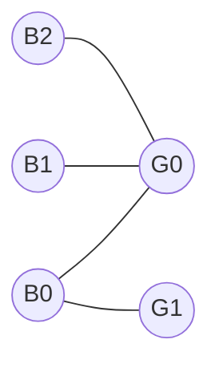

# Bipartite matching and the assignment problem

> Data Structures & Algorithms · L4 Expert · Flows, matching & graph structure · about 120 min · hub module `m03` ([open the hub](https://claude.ai/artifact/DxduaMdo2n5kqrt3We8PPZ))

## Why it matters
Pairing riders with drivers, students with projects, or video detections with the objects being tracked is a bipartite matching, and once each pair has a cost it becomes the assignment problem, solved exactly in O(n³). Matching also hides behind covering questions (Kőnig's theorem), path covers of a DAG and cheapest shipping plans, so recognising it turns several hard-looking puzzles into one standard tool.

## Pre-question (answer before reading)
**Q:** Four volunteers each list the stalls they can run, and each stall needs one volunteer. You've placed three of them first-come first-served, and every stall the fourth can run is taken. Must you leave the fourth without a stall?

<details><summary>Answer</summary>

Not yet. Someone already placed may be able to move to another stall on their list, freeing one for the fourth volunteer, and that move may itself need someone else to move. Searching for such a chain of moves, an augmenting path, is exactly how matching algorithms grow a matching.

</details>

## 🍎 Story time (kid version)
**The toy room and the treasure-map road trip: Tara's rocking horses**

At Tara's party there are four rocking horses, and each child will only ride certain ones. Ben seats children one by one. When a new child's favourite horses are all taken, he doesn't give up: he asks a seated child to move to another horse they like, and if that horse is taken too, that rider moves on, and so on. When the chain ends at a free horse, everyone moves along one step and the new child gets a seat. When nobody else can be seated, Tara finds a few children and horses that every possible pairing touches, exactly as many as the children riding.

| In the story | In code |
|---|---|
| Children and horses | The two sides of a bipartite graph |
| “This child likes that horse” | An edge between the two sides |
| Children riding, one per horse | A matching: edges that share no vertex |
| The chain of moves ending at a free horse | An augmenting path: flipping it adds one pair |
| The few children and horses every pairing touches | A minimum vertex cover, the same size as a maximum matching (Kőnig) |

**Where the story breaks:** Ben sees the whole party at once, while the algorithm finds each chain by a depth-first search from the new child. And real assignments usually have costs or scores, which “likes or doesn't like” ignores; those need the Hungarian algorithm or min-cost flow below.

## Key ideas (grown-up version)
- **Bipartite matching**: the vertices split into a left and a right side and every edge joins the two sides. A matching is a set of edges with no shared vertex; a maximum matching has as many edges as possible, and a perfect one covers every vertex.
- **Augmenting paths (Berge's theorem)**: a path between two unmatched vertices whose edges alternate unmatched, matched, unmatched… Flipping it (matched edges become unmatched and the reverse) adds one pair. A matching is maximum exactly when no augmenting path exists.
- **Kuhn's algorithm**: for each left vertex, look for an augmenting path by depth-first search: try each right neighbour; if it's free, take it; if not, ask its partner to move. One search per left vertex: O(V E) time, O(V) extra space. An explicit stack keeps long chains safe (code block 1 builds one 2,000 moves long).
- **Matching as flow**: s → each left vertex, left → right for every allowed pair, each right vertex → t, all with capacity 1. The maximum flow is the maximum matching, and Dinic on this network, like Hopcroft–Karp, takes O(E √V).
- **Kőnig's theorem**: in a bipartite graph, a minimum vertex cover has exactly as many vertices as a maximum matching has edges. Search from every unmatched left vertex, along any edge to the right and along matched edges back; the cover is the left vertices not reached plus the right vertices reached, and everything else is a maximum independent set of V − matching vertices.
- **The assignment problem**: n workers, n jobs and a cost for each pair; find the perfect matching of least total cost. The Hungarian algorithm keeps potentials with cost[i][j] − u[i] − v[j] ≥ 0 and adds one row at a time along zero-reduced-cost edges: O(n³) time, O(n) space beyond the matrix. To maximise a score, negate it.
- **Min-cost flow**: each edge has a capacity and a cost per unit; send k units from s to t as cheaply as possible. Successive shortest paths push along the cheapest residual path each time, where a reverse edge has the negated cost (sending back refunds). Bellman–Ford copes with those negative costs, and if no negative cycle exists at the start none ever appears: O(k · V E) time.
- **Spot the model**: “pair up” is a matching; “fewest rows and columns covering every 1” is a vertex cover (Kőnig); “fewest paths covering a DAG” is V minus a matching; “cheapest pairing” is the Hungarian algorithm; “cheapest way to ship k units” is min-cost flow.

## Diagrams
**An augmenting path (CSES 1696's sample, numbered from 0)**



_When boy 1 arrives, boy 0 holds girl 0. The highlighted path B1 – G0 – B0 – G1 runs free edge, matched edge, free edge between two unmatched vertices; flipping it pairs B1 with G0 and B0 with G1. Boy 2 then finds no such path, because G0's partner has nowhere else to go, so the maximum is 2._

**Fewest rows and columns covering every 1 (Kőnig's theorem)**

| row 0 | 0 | 1 | 2 | 3 |
|---|---|---|---|---|
| value | **1** | **1** | 0 | 0 |

| row 1 | 0 | 1 | 2 | 3 |
|---|---|---|---|---|
| value | **1** | 0 | 0 | 0 |

| row 2 | 0 | 1 | 2 | 3 |
|---|---|---|---|---|
| value | **1** | 0 | 0 | 0 |

| row 3 | 0 | 1 | 2 | 3 |
|---|---|---|---|---|
| value | 0 | **1** | **1** | **1** |

_Rows 0 and 3 plus column 0 cover every 1 with three lines. Three is the fewest: the 1s at (0, 1), (1, 0) and (3, 2) share no row or column, so no line covers two of them. Those three cells are a maximum matching between rows and columns (code block 2)._

**An assignment problem: worker i doing job j costs cost[i][j]**

| worker 0 | 0 | 1 | 2 |
|---|---|---|---|
| value | 4 | **1** | 3 |

| worker 1 | 0 | 1 | 2 |
|---|---|---|---|
| value | **2** | 0 | 5 |

| worker 2 | 0 | 1 | 2 |
|---|---|---|---|
| value | 3 | 2 | **2** |

_Workers 0 and 1 both have their cheapest job in column 1, so taking each worker's minimum fails. The best assignment (highlighted) costs 1 + 2 + 2 = 5; the diagonal costs 4 + 0 + 2 = 6._

## Comparisons
**Matching and assignment: which tool?**

| Problem | Algorithm | Time |
|---|---|---|
| Maximum bipartite matching | Kuhn: one augmenting-path search per left vertex | O(V E) |
| Maximum bipartite matching on large graphs | Hopcroft–Karp, or Dinic on the unit network | O(E √V) |
| Minimum vertex cover or maximum independent set (bipartite) | Kőnig: read them off a maximum matching | The matching, plus O(V + E) |
| Cheapest perfect assignment, n × n | The Hungarian algorithm | O(n³) |
| Send k units through capacities at least cost | Min-cost flow by successive shortest paths | O(k · V E) with Bellman–Ford |

**What a maximum matching tells you**

| In this graph | The quantity | Equals |
|---|---|---|
| Bipartite | Minimum vertex cover | The maximum matching (Kőnig) |
| Bipartite | Maximum independent set | V − the maximum matching |
| Any graph without isolated vertices | Minimum edge cover | V − the maximum matching (Gallai) |
| A DAG, split into out-copies and in-copies | Fewest vertex-disjoint paths covering every vertex | V − the maximum matching |

## Code (JavaScript + Python)
### The helpers used below: Kuhn's matching and the Hungarian algorithm (no recursion)
```python
def max_matching(n_left, n_right, adj):         # Kuhn; adj[u]: the right vertices left vertex u may take
    match_l, match_r, size = [-1] * n_left, [-1] * n_right, 0
    for root in range(n_left):
        seen = [False] * n_right
        stack, via, free = [[root, 0]], [], -1  # left vertices on the path, right vertices between them
        while stack and free < 0:
            u, i = stack[-1]
            if i == len(adj[u]):                # u has nothing left to try: step back
                stack.pop()
                if via:
                    via.pop()
                continue
            stack[-1][1] += 1
            v = adj[u][i]
            if seen[v]:
                continue
            seen[v] = True
            if match_r[v] < 0:
                free = v                        # a free right vertex ends an augmenting path
            else:
                via.append(v)
                stack.append([match_r[v], 0])   # ask v's partner to move instead
        if free >= 0:                           # flip the path: each left vertex takes the next right vertex
            for (u, _), v in zip(stack, via + [free]):
                match_l[u], match_r[v] = v, u
            size += 1
    return size, match_l, match_r

def assignment(cost):                           # Hungarian; n x m costs, n <= m: (least total, column per row)
    n, m = len(cost), len(cost[0])
    u, v = [0] * (n + 1), [0] * (m + 1)         # potentials, 1-based: cost - u[i] - v[j] stays >= 0
    p, way = [0] * (m + 1), [0] * (m + 1)       # p[j]: the row holding column j (0 = none)
    for i in range(1, n + 1):
        p[0], j0 = i, 0                         # park the new row on the dummy column 0
        minv, used = [float("inf")] * (m + 1), [False] * (m + 1)
        while True:                             # a Dijkstra-like search over reduced costs
            used[j0] = True
            i0, delta, j1 = p[j0], float("inf"), 0
            for j in range(1, m + 1):
                if not used[j]:
                    cur = cost[i0 - 1][j - 1] - u[i0] - v[j]
                    if cur < minv[j]:
                        minv[j], way[j] = cur, j0
                    if minv[j] < delta:
                        delta, j1 = minv[j], j
            for j in range(m + 1):              # shift the potentials: a new zero-cost edge appears
                if used[j]:
                    u[p[j]] += delta
                    v[j] -= delta
                else:
                    minv[j] -= delta
            j0 = j1
            if p[j0] == 0:                      # a free column: this row's search is over
                break
        while j0:                               # flip the alternating path back to column 0
            j1 = way[j0]
            p[j0] = p[j1]
            j0 = j1
    col = [0] * n
    for j in range(1, m + 1):
        if p[j]:
            col[p[j] - 1] = j - 1
    return -v[0], col
```

```javascript
function maxMatching(nLeft, nRight, adj) {      // Kuhn; adj[u]: the right vertices left vertex u may take
  const matchL = new Array(nLeft).fill(-1), matchR = new Array(nRight).fill(-1);
  let size = 0;
  for (let root = 0; root < nLeft; root++) {
    const seen = new Array(nRight).fill(false);
    const stack = [[root, 0]], via = [];        // left vertices on the path, right vertices between them
    let free = -1;
    while (stack.length && free < 0) {
      const top = stack[stack.length - 1], u = top[0];
      if (top[1] === adj[u].length) { stack.pop(); via.pop(); continue; }   // nothing left to try: step back
      const v = adj[u][top[1]++];
      if (seen[v]) continue;
      seen[v] = true;
      if (matchR[v] < 0) free = v;              // a free right vertex ends an augmenting path
      else { via.push(v); stack.push([matchR[v], 0]); }   // ask v's partner to move instead
    }
    if (free >= 0) {                            // flip the path: each left vertex takes the next right vertex
      via.push(free);
      stack.forEach(([u], k) => { matchL[u] = via[k]; matchR[via[k]] = u; });
      size++;
    }
  }
  return [size, matchL, matchR];
}

function assignment(cost) {                     // Hungarian; n x m costs, n <= m: [least total, column per row]
  const n = cost.length, m = cost[0].length;
  const u = new Array(n + 1).fill(0), v = new Array(m + 1).fill(0);   // potentials, 1-based
  const p = new Array(m + 1).fill(0), way = new Array(m + 1).fill(0); // p[j]: the row holding column j (0 = none)
  for (let i = 1; i <= n; i++) {
    p[0] = i;                                   // park the new row on the dummy column 0
    let j0 = 0;
    const minv = new Array(m + 1).fill(Infinity), used = new Array(m + 1).fill(false);
    do {                                        // a Dijkstra-like search over reduced costs
      used[j0] = true;
      const i0 = p[j0];
      let delta = Infinity, j1 = 0;
      for (let j = 1; j <= m; j++) {
        if (used[j]) continue;
        const cur = cost[i0 - 1][j - 1] - u[i0] - v[j];
        if (cur < minv[j]) { minv[j] = cur; way[j] = j0; }
        if (minv[j] < delta) { delta = minv[j]; j1 = j; }
      }
      for (let j = 0; j <= m; j++) {            // shift the potentials: a new zero-cost edge appears
        if (used[j]) { u[p[j]] += delta; v[j] -= delta; } else minv[j] -= delta;
      }
      j0 = j1;
    } while (p[j0] !== 0);                      // a free column: this row's search is over
    do {                                        // flip the alternating path back to column 0
      const j1 = way[j0];
      p[j0] = p[j1];
      j0 = j1;
    } while (j0);
  }
  const col = new Array(n).fill(0);
  for (let j = 1; j <= m; j++) if (p[j]) col[p[j] - 1] = j - 1;
  return [0 - v[0], col];                       // 0 - x rather than -x, so a zero total is never -0
}
```

### Kuhn's algorithm: a small dance, and a chain 2,000 moves long
```python
pairs = [(0, 0), (0, 1), (1, 0), (2, 0)]          # CSES 1696's sample from 0: (boy, girl)
adj = [[] for _ in range(3)]
for b, g in pairs:
    adj[b].append(g)
size, match_l, match_r = max_matching(3, 2, adj)
print(size, *(f"{b}-{g}" for b, g in enumerate(match_l) if g >= 0))

n = 2000                                          # the last left vertex sets off 2,000 moves
chain = [[i, i + 1] for i in range(n - 1)] + [[0]]
print(max_matching(n, n, chain)[0])
```

Output:
```text
2 0-1 1-0
2000
```

- line 6: Boy 0 takes girl 0, then moves to girl 1 so that boy 1 can have girl 0. Boy 2's only girl is taken by someone who can't move.
- line 9: Left i likes right i first, then right i + 1. The last vertex likes only right 0, so every earlier vertex has to shift along by one.
- line 10: That last search is 2,000 levels deep: past Python's recursion limit, but fine with the explicit stack.

```javascript
const pairs = [[0, 0], [0, 1], [1, 0], [2, 0]];   // CSES 1696's sample from 0: [boy, girl]
const adj = [[], [], []];
for (const [b, g] of pairs) adj[b].push(g);
const [size, matchL] = maxMatching(3, 2, adj);
console.log(size, ...matchL.flatMap((g, b) => (g >= 0 ? [`${b}-${g}`] : [])));

const n = 2000;                                   // the last left vertex sets off 2,000 moves
const chain = Array.from({ length: n - 1 }, (_, i) => [i, i + 1]).concat([[0]]);
console.log(maxMatching(n, n, chain)[0]);
```

Output:
```text
2 0-1 1-0
2000
```

- line 5: Boy 0 takes girl 0, then moves to girl 1 so that boy 1 can have girl 0. Boy 2's only girl is taken by someone who can't move.
- line 8: Left i likes right i first, then right i + 1. The last vertex likes only right 0, so every earlier vertex has to shift along by one.
- line 9: That last search is 2,000 levels deep. Node.js could recurse that far, but a chain of 10⁵ would overflow its stack; the explicit stack never does.

### Kőnig's theorem: the fewest rows and columns covering every 1
```python
def min_vertex_cover(n_left, n_right, adj):       # Konig: as many vertices as the maximum matching has edges
    size, match_l, match_r = max_matching(n_left, n_right, adj)
    seen_l = [m < 0 for m in match_l]             # start from every unmatched left vertex
    seen_r = [False] * n_right
    stack = [u for u in range(n_left) if seen_l[u]]
    while stack:                                  # alternate: any edge to the right, the matched edge back
        u = stack.pop()
        for v in adj[u]:
            if not seen_r[v]:
                seen_r[v] = True
                w = match_r[v]                    # always matched, or the matching wasn't maximum
                if not seen_l[w]:
                    seen_l[w] = True
                    stack.append(w)
    return [u for u in range(n_left) if not seen_l[u]], [v for v in range(n_right) if seen_r[v]]

grid = ["1100", "1000", "1000", "0111"]           # rows on the left, columns on the right
adj = [[c for c in range(4) if row[c] == "1"] for row in grid]
rows, cols = min_vertex_cover(4, 4, adj)
print(len(rows) + len(cols), *(f"row{r}" for r in rows), *(f"col{c}" for c in cols))
```

Output:
```text
3 row0 row3 col0
```

- line 3: These are the left vertices with no partner. The search from them can never find a free right vertex, or the matching wouldn't be maximum.
- line 15: Each matched pair gives exactly one vertex to the cover: its left end if the search missed it, otherwise its right end.
- line 18: A 1 at (r, c) is an edge from row r to column c, so a vertex cover is a set of rows and columns that covers every 1.

```javascript
function minVertexCover(nLeft, nRight, adj) {     // Konig: as many vertices as the maximum matching has edges
  const [, matchL, matchR] = maxMatching(nLeft, nRight, adj);
  const seenL = matchL.map(m => m < 0);           // start from every unmatched left vertex
  const seenR = new Array(nRight).fill(false);
  const stack = [...seenL.keys()].filter(u => seenL[u]);
  while (stack.length) {                          // alternate: any edge to the right, the matched edge back
    const u = stack.pop();
    for (const v of adj[u]) {
      if (seenR[v]) continue;
      seenR[v] = true;
      const w = matchR[v];                        // always matched, or the matching wasn't maximum
      if (!seenL[w]) { seenL[w] = true; stack.push(w); }
    }
  }
  return [[...seenL.keys()].filter(u => !seenL[u]), [...seenR.keys()].filter(v => seenR[v])];
}

const grid = ["1100", "1000", "1000", "0111"];    // rows on the left, columns on the right
const adj = grid.map(row => [...row].flatMap((ch, c) => (ch === "1" ? [c] : [])));
const [rows, cols] = minVertexCover(4, 4, adj);
console.log(rows.length + cols.length, ...rows.map(r => `row${r}`), ...cols.map(c => `col${c}`));
```

Output:
```text
3 row0 row3 col0
```

- line 3: These are the left vertices with no partner. The search from them can never find a free right vertex, or the matching wouldn't be maximum.
- line 15: Each matched pair gives exactly one vertex to the cover: its left end if the search missed it, otherwise its right end.
- line 19: A 1 at (r, c) is an edge from row r to column c, so a vertex cover is a set of rows and columns that covers every 1.

### Min-cost flow: the cheapest way to send k units
```python
from collections import deque

def min_cost_flow(n, edges, s, t, k):             # edges (u, v, capacity, cost per unit): send up to k units
    to, cap, cost, adj = [], [], [], [[] for _ in range(n)]
    for u, v, c, w in edges:
        adj[u].append(len(to)); to.append(v); cap.append(c); cost.append(w)
        adj[v].append(len(to)); to.append(u); cap.append(0); cost.append(-w)   # sending back refunds the cost
    sent = total = 0
    while sent < k:
        dist, prev, queued = [None] * n, [-1] * n, [False] * n
        dist[s], q = 0, deque([s])
        while q:                                  # Bellman-Ford with a queue: refunds are negative costs
            u = q.popleft()
            queued[u] = False
            for e in adj[u]:
                v = to[e]
                if cap[e] > 0 and (dist[v] is None or dist[u] + cost[e] < dist[v]):
                    dist[v], prev[v] = dist[u] + cost[e], e
                    if not queued[v]:
                        queued[v] = True
                        q.append(v)
        if dist[t] is None:
            break                                 # no room left: fewer than k units fit
        push, v = k - sent, t
        while v != s:                             # the cheapest path's bottleneck
            push = min(push, cap[prev[v]])
            v = to[prev[v] ^ 1]
        v = t
        while v != s:
            cap[prev[v]] -= push
            cap[prev[v] ^ 1] += push
            v = to[prev[v] ^ 1]
        sent, total = sent + push, total + push * dist[t]
    return sent, total

edges = [(0, 1, 2, 1), (0, 2, 1, 5), (1, 2, 1, 1), (1, 3, 1, 6), (2, 3, 2, 1)]
for k in (2, 3, 5):
    print(*min_cost_flow(4, edges, 0, 3, k))
```

Output:
```text
2 9
3 16
3 16
```

- line 7: The reverse edge starts empty and carries the negated cost: undoing a unit of flow gives its cost back.
- line 12: A queue-based Bellman–Ford (SPFA) handles the negative refund costs, which plain Dijkstra can't.
- line 33: The total is the push times the path's cost. The successive path costs never go down: 3, then 6, then 7 here.

```javascript
function minCostFlow(n, edges, s, t, k) {         // edges [u, v, capacity, cost per unit]: send up to k units
  const to = [], cap = [], cost = [], adj = Array.from({ length: n }, () => []);
  for (const [u, v, c, w] of edges) {
    adj[u].push(to.length); to.push(v); cap.push(c); cost.push(w);
    adj[v].push(to.length); to.push(u); cap.push(0); cost.push(-w);   // sending back refunds the cost
  }
  let sent = 0, total = 0;
  while (sent < k) {
    const dist = new Array(n).fill(Infinity), prev = new Array(n).fill(-1), queued = new Array(n).fill(false);
    dist[s] = 0;
    const q = [s];
    for (let h = 0; h < q.length; h++) {          // Bellman-Ford with a queue: refunds are negative costs
      const u = q[h];
      queued[u] = false;
      for (const e of adj[u]) {
        const v = to[e];
        if (cap[e] > 0 && dist[u] + cost[e] < dist[v]) {
          dist[v] = dist[u] + cost[e];
          prev[v] = e;
          if (!queued[v]) { queued[v] = true; q.push(v); }
        }
      }
    }
    if (dist[t] === Infinity) break;              // no room left: fewer than k units fit
    let push = k - sent;
    for (let v = t; v !== s; v = to[prev[v] ^ 1]) push = Math.min(push, cap[prev[v]]);   // the cheapest path's bottleneck
    for (let v = t; v !== s; v = to[prev[v] ^ 1]) { cap[prev[v]] -= push; cap[prev[v] ^ 1] += push; }
    sent += push;
    total += push * dist[t];
  }
  return [sent, total];
}

const edges = [[0, 1, 2, 1], [0, 2, 1, 5], [1, 2, 1, 1], [1, 3, 1, 6], [2, 3, 2, 1]];
for (const k of [2, 3, 5]) console.log(...minCostFlow(4, edges, 0, 3, k));
```

Output:
```text
2 9
3 16
3 16
```

- line 5: The reverse edge starts empty and carries the negated cost: undoing a unit of flow gives its cost back.
- line 12: A queue-based Bellman–Ford (SPFA) handles the negative refund costs, which plain Dijkstra can't.
- line 29: The total is the push times the path's cost. The successive path costs never go down: 3, then 6, then 7 here.

## Worked example
**Problem.** A 3 × 3 grid holds 9 stones, several of them sometimes in one cell. A move shifts one stone to an edge-neighbouring cell. Find the fewest moves that leave exactly one stone in every cell. (LeetCode 2850, Minimum Moves to Spread Stones Over Grid)

1. Stones never block each other, so moving a stone from (r1, c1) to (r2, c2) costs exactly the Manhattan distance |r1 − r2| + |c1 − c2|.
2. List every surplus stone separately (a cell with 3 stones gives two) and every empty cell. There are equally many of each, because 9 stones fill 9 cells.
3. Each surplus stone ends in a different empty cell, and the cost is the distance: that's an assignment problem on a k × k matrix with k ≤ 8.
4. The Hungarian algorithm solves it in O(k³) time and O(k²) space. Trying all k! orders would also pass on a 3 × 3 grid, but the assignment view scales to bigger boards.

```python
def min_moves(grid):
    extra, empty = [], []
    for r in range(3):
        for c in range(3):
            extra += [(r, c)] * max(0, grid[r][c] - 1)   # each surplus stone separately
            if grid[r][c] == 0:
                empty.append((r, c))
    if not empty:
        return 0
    cost = [[abs(a - x) + abs(b - y) for x, y in empty] for a, b in extra]
    return assignment(cost)[0]

print(min_moves([[1, 1, 0], [1, 1, 1], [1, 2, 1]]), min_moves([[1, 3, 0], [1, 0, 0], [1, 0, 3]]))
```

Output:
```text
3 4
```

```javascript
function minMoves(grid) {
  const extra = [], empty = [];
  for (let r = 0; r < 3; r++) {
    for (let c = 0; c < 3; c++) {
      for (let k = 1; k < grid[r][c]; k++) extra.push([r, c]);   // each surplus stone separately
      if (grid[r][c] === 0) empty.push([r, c]);
    }
  }
  if (empty.length === 0) return 0;
  const cost = extra.map(([a, b]) => empty.map(([x, y]) => Math.abs(a - x) + Math.abs(b - y)));
  return assignment(cost)[0];
}

console.log(minMoves([[1, 1, 0], [1, 1, 1], [1, 2, 1]]), minMoves([[1, 3, 0], [1, 0, 0], [1, 0, 3]]));
```

Output:
```text
3 4
```

**Answer.** 3 and 4. In the first grid the one surplus stone, at (2, 1), must reach the empty cell (0, 2): 2 + 1 = 3 moves. In the second, the two surplus stones at (0, 1) go to (0, 2) and (1, 1), and the two at (2, 2) go to (1, 2) and (2, 1): one move each, 4 in all.

## Your turn (faded example)
**Problem.** m students and m mentors each answered the same n yes/no questions. A pair's score is the number of answers they share. Pair every student with a different mentor to make the total score as large as possible. (LeetCode 1947, Maximum Compatibility Score Sum)

- ✓ Every student gets exactly one mentor and every mentor one student: a perfect matching, and the total score should be as large as possible.
- **How do you get the largest total from an algorithm that finds the smallest?**
  <details><summary>Answer</summary>Negate every score (or use n − score, which keeps costs non-negative). The cheapest assignment of the negated scores is the best assignment of the scores, and the answer is minus its cost.</details>
- **Which other method works because m ≤ 8?**
  <details><summary>Answer</summary>Bitmask DP over the set of mentors already taken (L3's module 5): O(2^m · m) time after scoring. The Hungarian algorithm keeps working for m in the hundreds.</details>
- **Time and space?**
  <details><summary>Answer</summary>Scoring every pair takes O(m² n) time and O(m²) space; the Hungarian algorithm then adds O(m³) time.</details>

Starter:
```python
def max_compatibility(students, mentors):
    score = [[sum(a == b for a, b in zip(s, m)) for m in mentors] for s in students]
    ...                                           # TODO: turn the scores into costs and call assignment
```

```javascript
function maxCompatibility(students, mentors) {
  const score = students.map(s => mentors.map(m => s.filter((a, i) => a === m[i]).length));
  // TODO: turn the scores into costs and call assignment
}
```

<details><summary>Full solution</summary>

```python
def max_compatibility(students, mentors):
    score = [[sum(a == b for a, b in zip(s, m)) for m in mentors] for s in students]
    total, _ = assignment([[-x for x in row] for row in score])   # least negated score = most score
    return -total

print(max_compatibility([[1, 1, 0], [1, 0, 1], [0, 0, 1]], [[1, 0, 0], [0, 0, 1], [1, 1, 0]]),
      max_compatibility([[0, 0], [0, 0], [0, 0]], [[1, 1], [1, 1], [1, 1]]))
```

Output:
```text
8 0
```

```javascript
function maxCompatibility(students, mentors) {
  const score = students.map(s => mentors.map(m => s.filter((a, i) => a === m[i]).length));
  const [total] = assignment(score.map(row => row.map(x => -x)));   // least negated score = most score
  return 0 - total;                           // not -total: in JavaScript -0 prints as "-0"
}

console.log(maxCompatibility([[1, 1, 0], [1, 0, 1], [0, 0, 1]], [[1, 0, 0], [0, 0, 1], [1, 1, 0]]),
  maxCompatibility([[0, 0], [0, 0], [0, 0]], [[1, 1], [1, 1], [1, 1]]));
```

Output:
```text
8 0
```

</details>

## Socratic checks and quiz (answers hidden)
**1. What does this print? (`max_matching` / `maxMatching` is this module's Kuhn helper.)**

```python
size, match_l, _ = max_matching(4, 3, [[0], [0], [0, 1, 2], [2]])
print(size, *match_l)
```

```javascript
const [size, matchL] = maxMatching(4, 3, [[0], [0], [0, 1, 2], [2]]);
console.log(size, ...matchL);
```

- A. 3 0 -1 1 2
- B. 3 -1 0 1 2
- C. 4 0 1 2 3
- D. 2 0 -1 1 -1

<details><summary>Answer</summary>

3 0 -1 1 2. Left 0 takes right 0. Left 1 likes only right 0, and left 0 has nowhere else to go, so left 1 stays unmatched (−1). Left 2 tries right 0 (its partner can't move), then takes right 1, and left 3 takes right 2: three pairs.

</details>

**2. What does this print? (`assignment` is this module's Hungarian helper.)**

```python
total, col = assignment([[7, 5, 9], [3, 6, 2], [8, 4, 6]])
print(total, *col)
```

```javascript
const [total, col] = assignment([[7, 5, 9], [3, 6, 2], [8, 4, 6]]);
console.log(total, ...col);
```

- A. 13 0 2 1
- B. 11 1 2 1
- C. 14 1 0 2
- D. 19 0 1 2

<details><summary>Answer</summary>

13 0 2 1. Row 0 takes column 0 (7), row 1 column 2 (2) and row 2 column 1 (4): 13. Each row's minimum gives 5 + 2 + 4 = 11 but uses column 1 twice, 14 is the second-best assignment, and the diagonal costs 19.

</details>

**3. A bipartite graph has 20 vertices, and its maximum matching has 6 edges. How many vertices does a largest independent set have (no two of them joined by an edge)?**

- A. 14
- B. 6
- C. 8
- D. 10

<details><summary>Answer</summary>

14. By Kőnig's theorem a minimum vertex cover has 6 vertices, and everything outside a minimum vertex cover is a maximum independent set: 20 − 6 = 14. Taking 8 = 20 − 2 × 6 removes both ends of every matched edge, which is more than you need.

</details>

**4. Which statements are true? (choose 2)**

- A. Kuhn's algorithm runs one augmenting-path search per left vertex, O(V E) in total
- B. In a bipartite graph, a minimum vertex cover has as many vertices as a maximum matching has edges
- C. A matching that never moves anyone once paired is always maximum
- D. Kőnig's theorem holds in every graph, bipartite or not
- E. The Hungarian algorithm needs every cost to be different

<details><summary>Answer</summary>

Kuhn's algorithm runs one augmenting-path search per left vertex, O(V E) in total, In a bipartite graph, a minimum vertex cover has as many vertices as a maximum matching has edges. Kuhn's searches are O(E) each, one per left vertex, and Kőnig's theorem is the second statement. Never moving anyone can block a better pairing, Kőnig fails in a triangle, and repeated costs are fine for the Hungarian algorithm.

</details>

**5. Judge each statement.**

- An augmenting path starts and ends at unmatched vertices and alternates unmatched and matched edges.
- A maximum matching can still be grown by one edge along an augmenting path.
- A maximum bipartite matching equals the maximum flow of the unit-capacity network s → left → right → t.
- To maximise a total score with an algorithm that minimises, you can negate every score.

<details><summary>Answer</summary>

An augmenting path starts and ends at unmatched vertices and alternates unmatched and matched edges.: Yes; A maximum matching can still be grown by one edge along an augmenting path.: No; A maximum bipartite matching equals the maximum flow of the unit-capacity network s → left → right → t.: Yes; To maximise a total score with an algorithm that minimises, you can negate every score.: Yes. That is the definition of an augmenting path. By Berge's theorem a maximum matching has no augmenting path left. Each unit of flow is one matched pair, and capacity 1 on s → u and v → t stops any vertex being used twice. Negating turns the largest total into the smallest.

</details>

**6. Put the steps of one augmentation in Kuhn's algorithm in order.**

- (put the steps in order)

<details><summary>Answer</summary>

Start a search from a left vertex that has no partner yet → Try a right neighbour; if it's taken, continue the search from its partner → Reach a right vertex that is free → Flip the path: each left vertex on it takes the next right vertex. The search starts at the new vertex, moves through partners until it meets a free right vertex, and only then can the path be flipped.

</details>

**7. Complete the Python function that finds the fewest vertex-disjoint paths covering every vertex of a DAG (`max_matching` is this module's helper; vertices are 0..n-1).**

```
def min_path_cover(n, edges):
    adj = [[] for _ in range(n)]                  # left copy = where a path leaves u, right copy = where it enters v
    for u, v in edges:
        adj[u].append({{0}})
    size, _, _ = max_matching(n, n, adj)
    return {{1}}

```

<details><summary>Answer</summary>

v | n - size. Edge u → v joins left copy u to right copy v. Every matched edge glues two paths into one, so starting from n one-vertex paths, a maximum matching leaves n − size paths.

</details>

**8. Match each problem to the tool that solves it.**


<details><summary>Answer</summary>

Pair as many students as possible with projects they like = Maximum bipartite matching (Kuhn or Hopcroft–Karp); Fewest rows and columns that cover every 1 in a grid = A minimum vertex cover, via Kőnig's theorem; Assign n workers to n jobs at least total cost = The Hungarian algorithm, O(n³); Ship k parcels through capacitated routes at least cost = Min-cost flow by successive shortest paths. Pairing is matching, covering every 1 with lines is a vertex cover in the row–column graph, cheapest perfect pairing is the assignment problem, and capacities with costs need min-cost flow. Union–find only tracks connectivity.

</details>

## Traps & misconceptions
- **“Pairing each person with the first free partner gives a maximum matching.”** A first-come choice can block someone else, as boy 0 does in the diagram. Only a search for augmenting paths, which may move several people one step each, guarantees the maximum.
- **“Kőnig's theorem holds in any graph.”** Only in bipartite graphs. In a triangle the maximum matching has 1 edge, but every vertex cover needs 2 vertices; general graphs need Edmonds' blossom algorithm for matching.
- **“Kuhn's `seen` array can be shared by every search.”** Clear it whenever the matching changes. Keeping it after a failed search is a safe speed-up, but after an augmentation a right vertex that was a dead end may now lead to a free one.
- **“Giving every worker their cheapest job solves the assignment problem.”** Two workers may want the same job, as workers 0 and 1 do in the diagram. The Hungarian algorithm trades off globally in O(n³); trying all n! orders is hopeless beyond n ≈ 10.
- **“Min-cost flow can use plain Dijkstra.”** Reverse residual edges have negative costs, which break Dijkstra. Use Bellman–Ford (or its queue version, SPFA), or Dijkstra with potentials (Johnson's trick) that make every reduced cost non-negative.
- **“The fewest paths covering a DAG needs a search over all path choices.”** Split each vertex into an out-copy and an in-copy and match out-copies to in-copies along the edges. Each matched edge joins two paths into one, so the answer is V minus the maximum matching.

## Discussion prompts
- **Why does Kőnig's construction give a vertex cover exactly as big as the matching?**
  <details><summary>One good answer</summary>Let Z be what the alternating search reaches from the unmatched left vertices. An edge from a reached left vertex always leads to a reached right vertex, so every edge has its left end outside Z or its right end inside Z, and the cover (left vertices outside Z plus right vertices inside Z) touches it. Every cover vertex is matched: unmatched left vertices are all in Z, and a reached right vertex is matched or there'd be an augmenting path. And no matched pair gives both ends, because reaching a right vertex always reaches its partner too. So the cover has exactly one vertex per matched edge, and no cover can be smaller than a matching.</details>
- **Where do matching and assignment show up in real systems?**
  <details><summary>One good answer</summary>Ride-hailing and delivery platforms match drivers to requests, often as a batched assignment problem; ad systems assign slots to bidders; video tracking assigns each new detection to an existing track with the Hungarian algorithm; and timetabling assigns exams to rooms. Residency and school admissions use stable matching, which is a different problem: it respects everyone's preferences rather than a single total score.</details>

## Teach-back
**Prompt:** Explain to a junior colleague how Kuhn's algorithm finds a maximum matching, what Kőnig's theorem says, and when you'd use the Hungarian algorithm or min-cost flow instead.

Rubric:
- [ ] A matching shares no vertex; an augmenting path alternates free and matched edges
- [ ] Flipping an augmenting path adds one pair; when none is left the matching is maximum
- [ ] Kuhn: one DFS per left vertex, O(V E)
- [ ] Kőnig: in a bipartite graph, minimum vertex cover = maximum matching
- [ ] Costs need the Hungarian algorithm (O(n³)) or min-cost flow

<details><summary>Model answer</summary>

A matching pairs vertices from the two sides of a bipartite graph so that nobody is in two pairs. Kuhn's algorithm takes the left vertices one at a time and searches for an augmenting path: try each right neighbour, and if it's taken, ask its partner to move to another of their options, and so on until someone reaches a free vertex. Flipping that path adds one pair without losing any, and when no such path exists the matching is maximum, so one search per left vertex gives O(V E) overall. Kőnig's theorem says that in a bipartite graph the fewest vertices touching every edge equals the size of a maximum matching, and an alternating search from the unmatched vertices finds that cover, which is how “fewest lines covering every 1 in a grid” is solved. Once every pair has a cost, plain matching isn't enough: for a cheapest perfect pairing on an n × n matrix I'd use the Hungarian algorithm in O(n³), and when there are capacities or k units to ship I'd use min-cost flow with successive shortest paths.

</details>

## Quick Q&A (also in the SRS deck)
- **What is an augmenting path?** A path between two unmatched vertices whose edges alternate unmatched and matched; flipping it adds one pair.
- **How fast is Kuhn's algorithm?** O(V E): one augmenting-path search per left vertex.
- **What does Kőnig's theorem say?** In a bipartite graph, a minimum vertex cover has as many vertices as a maximum matching has edges.
- **How big is a maximum independent set in a bipartite graph?** V minus the size of a maximum matching.
- **What does the Hungarian algorithm solve, and how fast?** The cheapest perfect assignment on an n × n cost matrix, in O(n³).
- **Why can't min-cost flow use plain Dijkstra?** Reverse residual edges have negative costs; use Bellman–Ford, SPFA or Dijkstra with potentials.

## Practice problems
- [ ] [CSES 1696 · School Dance](https://cses.fi/problemset/task/1696) · maximum bipartite matching, then print the pairs (Kuhn, or Dinic on the unit network)
- [ ] [CSES 2129 · Task Assignment](https://cses.fi/problemset/task/2129) · the Hungarian algorithm on the n × n cost matrix (n ≤ 200), then print who gets which task
- [ ] [CSES 2121 · Parcel Delivery](https://cses.fi/problemset/task/2121) · min-cost flow for k units (code block 3); print −1 when fewer than k fit
- [ ] [CSES 2130 · Distinct Routes II](https://cses.fi/problemset/task/2130) · unit capacities and cost 1 per teleporter: min-cost flow for k units, then walk the used edges to print each day's route
- [ ] [LC 1947 · Maximum Compatibility Score Sum](https://leetcode.com/problems/maximum-compatibility-score-sum/) · Medium · the faded example: score every student–mentor pair, then a maximum-score assignment (bitmask DP also works for m ≤ 8)
- [ ] [LC 2850 · Minimum Moves to Spread Stones Over Grid](https://leetcode.com/problems/minimum-moves-to-spread-stones-over-grid/) · Medium · the worked example: each surplus stone to a different empty cell, cost = Manhattan distance

## Sources (accessed 2026-10-09)
- [cp-algorithms: Kuhn's algorithm for maximum bipartite matching](https://cp-algorithms.com/graph/kuhn_maximum_bipartite_matching.html)
- [cp-algorithms: Hungarian algorithm for the assignment problem](https://cp-algorithms.com/graph/hungarian-algorithm.html)
- [cp-algorithms: Minimum-cost flow (successive shortest paths)](https://cp-algorithms.com/graph/min_cost_flow.html)
- [Wikipedia: Kőnig's theorem (graph theory)](https://en.wikipedia.org/wiki/K%C5%91nig%27s_theorem_(graph_theory))
- [Jeff Erickson, Algorithms, chapter 11: applications of flows and cuts (free)](https://jeffe.cs.illinois.edu/teaching/algorithms/)
