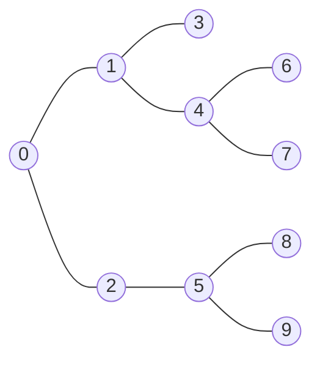

# Binary lifting, LCA and Euler tours

> Data Structures & Algorithms · L4 Expert · Trees, strings & advanced structures · about 115 min · hub module `m04` ([open the hub](https://claude.ai/artifact/DxduaMdo2n5kqrt3We8PPZ))

## Why it matters
Family trees, file systems, org charts and routing trees all ask the same questions: who is the k-th ancestor, which is the lowest common boss of two people, how far apart are two nodes, what's the total in this subtree? After O(n log n) preparation, binary lifting answers each in O(log n), and an Euler tour turns every subtree into an array range, so L3's Fenwick and segment trees apply to trees too.

## Pre-question (answer before reading)
**Q:** To find someone's 1,000,000th ancestor in a family tree you could step up one parent at a time. If every person also noted their 2nd, 4th, 8th, … ancestor, how many steps would you need?

<details><summary>Answer</summary>

Seven. Write 1,000,000 in binary (11110100001001000000) and make one jump for each of its seven 1 bits; nobody needs more than 20 stored jumps, because 2²⁰ > 10⁶. That table of power-of-two jumps is binary lifting.

</details>

## 🍎 Story time (kid version)
**The toy room and the treasure-map road trip: Ben's shortcut cards**

On the road trip, every village has a sign pointing to the next village towards home. Ben gets bored and makes shortcut cards: from each village, the village 1, 2, 4 and 8 stops nearer home. To go back 13 stops he uses the 8 card, then the 4, then the 1: three jumps instead of thirteen. When Tara asks where her route home first meets his, they both jump to the same distance from home, then keep taking the biggest jumps that don't land them in the same village. One more single step, and they're standing in the village where their routes meet.

| In the story | In code |
|---|---|
| The sign to the next village towards home | parent[v], with home as the root |
| Shortcut cards for 1, 2, 4 and 8 stops | up[j][v], the 2^j-th ancestor, built as up[j − 1][up[j − 1][v]] |
| Going back 13 stops with the 8, 4 and 1 cards | The k-th ancestor in O(log k): one jump per 1 bit of k |
| Both jumping to the same distance from home | Lift the deeper vertex until the depths match |
| The biggest jumps that don't land in the same village | Lift both while their ancestors differ; the LCA is then one step up |

**Where the story breaks:** A road home is a single path, but a tree branches; the cards work because every village still has exactly one way home. And the cards cost memory: about log₂ n per village, O(n log n) in all, which is the price of O(log n) answers.

## Key ideas (grown-up version)
- **The jump table**: up[0][v] is v's parent, and up[j][v] = up[j − 1][up[j − 1][v]] is its 2^j-th ancestor, two jumps of half the size. Point the root at itself so that jumps past it stay put. Building LOG = ⌈log₂ n⌉ levels takes O(n log n) time and memory.
- **k-th ancestor**: write k in binary and jump 2^j for every 1 bit j, in any order: O(log k). If k is more than v's depth, there's no such ancestor.
- **Lowest common ancestor (LCA)**: lift the deeper vertex to the other's depth. If they meet, that's the LCA. Otherwise, for j from high to low, jump both whenever up[j][a] ≠ up[j][b]; at the end they are distinct children of the LCA, so it is up[0][a]. O(log n) per query.
- **Distances and paths**: dist(a, b) = depth[a] + depth[b] − 2 · depth[LCA(a, b)]. With weights, keep the root distance instead of the depth. And anything that combines along a path (a sum, a maximum, counts of each weight) can ride along: store it per jump, or as a prefix from the root.
- **Euler tour (preorder) flattening**: number the vertices in DFS order with tin[v], and let tout[v] be the next number after v's subtree. Then v's subtree is exactly the range [tin[v], tout[v]), and “is a an ancestor of b?” is tin[a] ≤ tin[b] < tout[a], in O(1).
- **Subtree and path queries**: with the tour, a Fenwick tree gives point update + subtree sum in O(log n). Adding val[v] over v's whole range instead (+val at tin, −val at tout) makes the point value at tin[u] the sum on the root-to-u path.
- **Stay iterative**: a path-shaped tree is as deep as it is long, so the depth search and the tour use an explicit stack (~v marks “leave v”), as the prelude does.
- **Functional graphs too**: when every node has exactly one successor (CSES 1750), the same table answers “where am I after k steps?” in O(log k), even though the graph has cycles and no root.

## Diagrams
**LCA(6, 3) = 1, and dist(6, 3) = 3 + 2 − 2 × 1 = 3**



_6 is at depth 3 and 3 at depth 2, so 6 is lifted one step to 4. Then 4 and 3 differ, but every jump from them lands on the same vertex, so no jump is taken and the LCA is their parent, 1._

**The jump table for the tree above: row j holds each vertex's 2^j-th ancestor**

| v | 0 | 1 | 2 | 3 | 4 | 5 | 6 | 7 | 8 | 9 |
|---|---|---|---|---|---|---|---|---|---|---|
| value | 0 | 1 | 2 | 3 | 4 | 5 | 6 | 7 | 8 | 9 |

| up[0] | 0 | 1 | 2 | 3 | 4 | 5 | 6 | 7 | 8 | 9 |
|---|---|---|---|---|---|---|---|---|---|---|
| value | 0 | 0 | 0 | 1 | 1 | 2 | **4** | 4 | 5 | 5 |

| up[1] | 0 | 1 | 2 | 3 | 4 | 5 | 6 | 7 | 8 | 9 |
|---|---|---|---|---|---|---|---|---|---|---|
| value | 0 | 0 | 0 | 0 | 0 | 0 | **1** | 1 | 2 | 2 |

| up[2] | 0 | 1 | 2 | 3 | 4 | 5 | 6 | 7 | 8 | 9 |
|---|---|---|---|---|---|---|---|---|---|---|
| value | 0 | 0 | 0 | 0 | 0 | 0 | **0** | 0 | 0 | 0 |

| up[3] | 0 | 1 | 2 | 3 | 4 | 5 | 6 | 7 | 8 | 9 |
|---|---|---|---|---|---|---|---|---|---|---|
| value | 0 | 0 | 0 | 0 | 0 | 0 | 0 | 0 | 0 | 0 |

_Each row comes from the one above: up[1][6] = up[0][up[0][6]] = up[0][4] = 1. The root points to itself, so jumps past it stay at 0. With n = 10, LOG = 4 levels, since 2⁴ = 16 > 9._

**The Euler tour (preorder) of the same tree: every subtree is one block**

| vertex | 0 | 1 | 2 | 3 | 4 | 5 | 6 | 7 | 8 | 9 |
|---|---|---|---|---|---|---|---|---|---|---|
| value | 0 | **1** | **3** | **4** | **6** | **7** | 2 | 5 | 8 | 9 |

_Vertex 1's subtree {1, 3, 4, 6, 7} sits at positions tin[1] = 1 up to tout[1] = 6 (not included). So a subtree sum is a range sum, and a Fenwick tree answers it with point updates in O(log n)._

## Comparisons
**Tree queries: which tool?**

| Question | Technique | Cost per query |
|---|---|---|
| k-th ancestor | Binary lifting: one jump per 1 bit of k | O(log n) |
| LCA and distance | Binary lifting, then depth[a] + depth[b] − 2 · depth[LCA] | O(log n) |
| LCA, many queries, fastest | Euler tour + sparse table on depths (range minimum) | O(1) after O(n log n) |
| Subtree sum with point updates | Euler tour + Fenwick tree | O(log n) |
| Root-to-v path sum with point updates | Euler tour + a range-add Fenwick tree | O(log n) |
| Max or count along a path, no updates | Binary lifting with a value per jump, or prefix counts from the root | O(log n), or O(alphabet) |

## Code (JavaScript + Python)
### The rooted tree used by every example below: depths, the jump table and an Euler tour (no recursion)
```python
class Tree:                                     # rooted at 0; up[j][v] is v's 2^j-th ancestor (the root's is itself)
    def __init__(self, n, edges):
        adj = [[] for _ in range(n)]
        for u, v in edges:
            adj[u].append(v)
            adj[v].append(u)
        self.LOG = max(1, (n - 1).bit_length())     # 2^LOG is more than any depth
        parent, self.depth = [0] * n, [0] * n
        self.tin, self.tout = [0] * n, [0] * n      # v's subtree is the positions [tin[v], tout[v])
        seen, stack, timer = [False] * n, [0], 0
        seen[0] = True
        while stack:                                # preorder without recursion; ~v marks "leave v"
            v = stack.pop()
            if v < 0:
                self.tout[~v] = timer
                continue
            self.tin[v] = timer
            timer += 1
            stack.append(~v)
            for w in reversed(adj[v]):              # reversed, so children are visited in order
                if not seen[w]:
                    seen[w] = True
                    parent[w], self.depth[w] = v, self.depth[v] + 1
                    stack.append(w)
        self.up = [parent]
        for j in range(1, self.LOG):
            prev = self.up[-1]
            self.up.append([prev[prev[v]] for v in range(n)])   # two jumps of 2^(j-1)

    def kth_ancestor(self, v, k):                   # -1 if v has fewer than k ancestors
        if k > self.depth[v]:
            return -1
        j = 0
        while k:
            if k & 1:
                v = self.up[j][v]
            k >>= 1
            j += 1
        return v

    def lca(self, a, b):
        if self.depth[a] < self.depth[b]:
            a, b = b, a
        a = self.kth_ancestor(a, self.depth[a] - self.depth[b])   # lift a to b's depth
        if a == b:
            return a
        for j in range(self.LOG - 1, -1, -1):       # biggest jumps first, while the ancestors differ
            if self.up[j][a] != self.up[j][b]:
                a, b = self.up[j][a], self.up[j][b]
        return self.up[0][a]

    def dist(self, a, b):
        return self.depth[a] + self.depth[b] - 2 * self.depth[self.lca(a, b)]

    def is_ancestor(self, a, b):                    # is a an ancestor of b, or b itself?
        return self.tin[a] <= self.tin[b] < self.tout[a]
```

```javascript
class Tree {                                    // rooted at 0; up[j][v] is v's 2^j-th ancestor (the root's is itself)
  constructor(n, edges) {
    const adj = Array.from({ length: n }, () => []);
    for (const [u, v] of edges) { adj[u].push(v); adj[v].push(u); }
    this.LOG = Math.max(1, 32 - Math.clz32(n - 1));   // 2^LOG is more than any depth
    const parent = new Array(n).fill(0);
    this.depth = new Array(n).fill(0);
    this.tin = new Array(n).fill(0);
    this.tout = new Array(n).fill(0);               // v's subtree is the positions [tin[v], tout[v])
    const seen = new Array(n).fill(false), stack = [0];
    seen[0] = true;
    let timer = 0;
    while (stack.length) {                          // preorder without recursion; ~v marks "leave v"
      const v = stack.pop();
      if (v < 0) { this.tout[~v] = timer; continue; }
      this.tin[v] = timer++;
      stack.push(~v);
      for (let i = adj[v].length - 1; i >= 0; i--) {   // reversed, so children are visited in order
        const w = adj[v][i];
        if (!seen[w]) { seen[w] = true; parent[w] = v; this.depth[w] = this.depth[v] + 1; stack.push(w); }
      }
    }
    this.up = [parent];
    for (let j = 1; j < this.LOG; j++) {
      const prev = this.up[j - 1];
      this.up.push(prev.map(p => prev[p]));         // two jumps of 2^(j-1)
    }
  }
  kthAncestor(v, k) {                               // -1 if v has fewer than k ancestors
    if (k > this.depth[v]) return -1;
    for (let j = 0; k > 0; j++, k >>= 1) if (k & 1) v = this.up[j][v];
    return v;
  }
  lca(a, b) {
    if (this.depth[a] < this.depth[b]) [a, b] = [b, a];
    a = this.kthAncestor(a, this.depth[a] - this.depth[b]);   // lift a to b's depth
    if (a === b) return a;
    for (let j = this.LOG - 1; j >= 0; j--) {       // biggest jumps first, while the ancestors differ
      if (this.up[j][a] !== this.up[j][b]) { a = this.up[j][a]; b = this.up[j][b]; }
    }
    return this.up[0][a];
  }
  dist(a, b) {
    return this.depth[a] + this.depth[b] - 2 * this.depth[this.lca(a, b)];
  }
  isAncestor(a, b) {                                // is a an ancestor of b, or b itself?
    return this.tin[a] <= this.tin[b] && this.tin[b] < this.tout[a];
  }
}
```

### Binary lifting: ancestors, LCAs and distances, and a 100,000-deep tree
```python
edges = [(0, 1), (0, 2), (1, 3), (1, 4), (2, 5), (4, 6), (4, 7), (5, 8), (5, 9)]
t = Tree(10, edges)
print(t.kth_ancestor(7, 1), t.kth_ancestor(7, 2), t.kth_ancestor(7, 3), t.kth_ancestor(7, 4))
print(t.lca(6, 3), t.lca(6, 7), t.lca(8, 3), t.dist(6, 9))

n = 100_000
path = Tree(n, [(i, i + 1) for i in range(n - 1)])  # a single path: depth 99,999
print(path.kth_ancestor(n - 1, n - 2), path.lca(n - 1, 50_000), path.dist(12, 99_000))
```

Output:
```text
4 1 0 -1
1 4 0 6
1 50000 98988
```

- line 3: 7's ancestors are 4, 1 and 0. It has only three, so the 4th ancestor is −1.
- line 4: LCA(8, 3) = 0: they are in different subtrees of the root. dist(6, 9) = 3 + 3 − 2 × 0 = 6 edges.
- line 7: Building the tree is a loop, not recursion, so a 100,000-vertex path is fine; the table has 17 levels, since 2¹⁷ > 99,999.
- line 8: Each answer takes at most 17 jumps, while walking up parent by parent would take up to 99,998 steps.

```javascript
const edges = [[0, 1], [0, 2], [1, 3], [1, 4], [2, 5], [4, 6], [4, 7], [5, 8], [5, 9]];
const t = new Tree(10, edges);
console.log(t.kthAncestor(7, 1), t.kthAncestor(7, 2), t.kthAncestor(7, 3), t.kthAncestor(7, 4));
console.log(t.lca(6, 3), t.lca(6, 7), t.lca(8, 3), t.dist(6, 9));

const n = 100000;
const path = new Tree(n, Array.from({ length: n - 1 }, (_, i) => [i, i + 1]));   // a single path: depth 99,999
console.log(path.kthAncestor(n - 1, n - 2), path.lca(n - 1, 50000), path.dist(12, 99000));
```

Output:
```text
4 1 0 -1
1 4 0 6
1 50000 98988
```

- line 3: 7's ancestors are 4, 1 and 0. It has only three, so the 4th ancestor is −1.
- line 4: LCA(8, 3) = 0: they are in different subtrees of the root. dist(6, 9) = 3 + 3 − 2 × 0 = 6 edges.
- line 7: Building the tree is a loop, not recursion, so a 100,000-vertex path is fine; the table has 17 levels, since 2¹⁷ > 99,999.
- line 8: Each answer takes at most 17 jumps, while walking up parent by parent would take up to 99,998 steps.

### Euler tour + Fenwick tree: subtree sums and root-path sums with updates
```python
class Fenwick:
    def __init__(self, n):
        self.t = [0] * (n + 1)
    def add(self, i, x):                          # position i, from 0
        i += 1
        while i < len(self.t):
            self.t[i] += x
            i += i & -i
    def prefix(self, i):                          # the sum of positions 0 .. i - 1
        s = 0
        while i > 0:
            s += self.t[i]
            i -= i & -i
        return s

t = Tree(10, [(0, 1), (0, 2), (1, 3), (1, 4), (2, 5), (4, 6), (4, 7), (5, 8), (5, 9)])
val = [5, 3, 4, 1, 2, 6, 7, 1, 2, 3]
sub, path = Fenwick(10), Fenwick(11)

def change(v, delta):
    sub.add(t.tin[v], delta)                      # one point per vertex
    path.add(t.tin[v], delta)                     # val[v] counts for every vertex in v's subtree
    path.add(t.tout[v], -delta)

for v in range(10):
    change(v, val[v])
subtree = lambda v: sub.prefix(t.tout[v]) - sub.prefix(t.tin[v])
to_root = lambda v: path.prefix(t.tin[v] + 1)
print(subtree(1), subtree(4), to_root(7))
change(4, 10 - val[4])                            # set vertex 4's value to 10
print(subtree(1), subtree(4), to_root(7))
```

Output:
```text
14 10 11
22 18 19
```

- line 21: A point at tin[v] for the subtree sums; for the path sums, +delta on v's whole range [tin[v], tout[v]) as two point updates.
- line 27: The subtree is the contiguous block [tin[v], tout[v]): two prefix sums give its total.
- line 28: The value at tin[u] adds up val[v] for every v whose range contains u, which is exactly u's ancestors and u itself.
- line 30: Vertex 4's value goes from 2 to 10: one change, three Fenwick updates, O(log n) each.

```javascript
class Fenwick {
  constructor(n) { this.t = new Array(n + 1).fill(0); }
  add(i, x) { for (i++; i < this.t.length; i += i & -i) this.t[i] += x; }   // position i, from 0
  prefix(i) { let s = 0; for (; i > 0; i -= i & -i) s += this.t[i]; return s; }   // the sum of positions 0 .. i - 1
}

const t = new Tree(10, [[0, 1], [0, 2], [1, 3], [1, 4], [2, 5], [4, 6], [4, 7], [5, 8], [5, 9]]);
const val = [5, 3, 4, 1, 2, 6, 7, 1, 2, 3];
const sub = new Fenwick(10), path = new Fenwick(11);

function change(v, delta) {
  sub.add(t.tin[v], delta);                       // one point per vertex
  path.add(t.tin[v], delta);                      // val[v] counts for every vertex in v's subtree
  path.add(t.tout[v], -delta);
}

for (let v = 0; v < 10; v++) change(v, val[v]);
const subtree = v => sub.prefix(t.tout[v]) - sub.prefix(t.tin[v]);
const toRoot = v => path.prefix(t.tin[v] + 1);
console.log(subtree(1), subtree(4), toRoot(7));
change(4, 10 - val[4]);                           // set vertex 4's value to 10
console.log(subtree(1), subtree(4), toRoot(7));
```

Output:
```text
14 10 11
22 18 19
```

- line 12: A point at tin[v] for the subtree sums; for the path sums, +delta on v's whole range [tin[v], tout[v]) as two point updates.
- line 18: The subtree is the contiguous block [tin[v], tout[v]): two prefix sums give its total.
- line 19: The value at tin[u] adds up val[v] for every v whose range contains u, which is exactly u's ancestors and u itself.
- line 21: Vertex 4's value goes from 2 to 10: one change, three Fenwick updates, O(log n) each.

### Binary lifting with a payload: the heaviest edge on a path
```python
def heaviest_on_paths(n, edges, queries):         # edges (u, v, w); for each (a, b), the largest w on the path
    t = Tree(n, [(u, v) for u, v, _ in edges])
    w_up = [0] * n                                # the weight of the edge from v to its parent
    for u, v, w in edges:
        w_up[v if t.up[0][v] == u and v != 0 else u] = w
    mx = [w_up]                                   # mx[j][v]: the heaviest edge on v's 2^j jump
    for j in range(1, t.LOG):
        prev, up = mx[-1], t.up[j - 1]
        mx.append([max(prev[v], prev[up[v]]) for v in range(n)])   # first half, then second half
    out = []
    for a, b in queries:
        best = 0
        if t.depth[a] < t.depth[b]:
            a, b = b, a
        diff, j = t.depth[a] - t.depth[b], 0
        while diff:                               # lift a, keeping the max of every jump
            if diff & 1:
                best, a = max(best, mx[j][a]), t.up[j][a]
            diff, j = diff >> 1, j + 1
        if a != b:
            for j in range(t.LOG - 1, -1, -1):
                if t.up[j][a] != t.up[j][b]:
                    best = max(best, mx[j][a], mx[j][b])
                    a, b = t.up[j][a], t.up[j][b]
            best = max(best, w_up[a], w_up[b])    # the last two edges into the LCA
        out.append(best)
    return out

edges = [(0, 1, 4), (0, 2, 2), (1, 3, 7), (1, 4, 1), (2, 5, 3), (4, 6, 5), (4, 7, 2), (5, 8, 9), (5, 9, 1)]
print(*heaviest_on_paths(10, edges, [(6, 3), (7, 9), (8, 8), (6, 7)]))
```

Output:
```text
7 4 0 5
```

- line 5: Each edge belongs to its lower end: v if u is v's parent, otherwise u. The root has no parent edge and keeps 0.
- line 9: A 2^j jump is two 2^(j−1) jumps, so its heaviest edge is the larger of the two halves.
- line 25: After the loop a and b are the two children of the LCA on the path, so their parent edges are the last two edges.

```javascript
function heaviestOnPaths(n, edges, queries) {     // edges [u, v, w]; for each [a, b], the largest w on the path
  const t = new Tree(n, edges.map(([u, v]) => [u, v]));
  const wUp = new Array(n).fill(0);               // the weight of the edge from v to its parent
  for (const [u, v, w] of edges) wUp[t.up[0][v] === u && v !== 0 ? v : u] = w;
  const mx = [wUp];                               // mx[j][v]: the heaviest edge on v's 2^j jump
  for (let j = 1; j < t.LOG; j++) {
    const prev = mx[j - 1], up = t.up[j - 1];
    mx.push(prev.map((m, v) => Math.max(m, prev[up[v]])));   // first half, then second half
  }
  return queries.map(([a, b]) => {
    let best = 0;
    if (t.depth[a] < t.depth[b]) [a, b] = [b, a];
    for (let diff = t.depth[a] - t.depth[b], j = 0; diff > 0; diff >>= 1, j++) {   // lift a, keeping the max
      if (diff & 1) { best = Math.max(best, mx[j][a]); a = t.up[j][a]; }
    }
    if (a !== b) {
      for (let j = t.LOG - 1; j >= 0; j--) {
        if (t.up[j][a] !== t.up[j][b]) {
          best = Math.max(best, mx[j][a], mx[j][b]);
          a = t.up[j][a]; b = t.up[j][b];
        }
      }
      best = Math.max(best, wUp[a], wUp[b]);      // the last two edges into the LCA
    }
    return best;
  });
}

const edges = [[0, 1, 4], [0, 2, 2], [1, 3, 7], [1, 4, 1], [2, 5, 3], [4, 6, 5], [4, 7, 2], [5, 8, 9], [5, 9, 1]];
console.log(...heaviestOnPaths(10, edges, [[6, 3], [7, 9], [8, 8], [6, 7]]));
```

Output:
```text
7 4 0 5
```

- line 4: Each edge belongs to its lower end: v if u is v's parent, otherwise u. The root has no parent edge and keeps 0.
- line 8: A 2^j jump is two 2^(j−1) jumps, so its heaviest edge is the larger of the two halves.
- line 23: After the loop a and b are the two children of the LCA on the path, so their parent edges are the last two edges.

## Worked example
**Problem.** A tree has n nodes and weighted edges, with weights from 1 to 26. For each query (a, b), find the fewest edge weights you must change so that every edge on the path from a to b has the same weight. Queries are independent. (LeetCode 2846, Minimum Edge Weight Equilibrium Queries in a Tree)

1. Keep the most common weight on the path and change the rest: the answer is the path length minus the largest count of one weight.
2. Store cnt[v][w], the number of edges of weight w on the path from the root to v. Children copy their parent's counts and add their own edge, in O(26) each.
3. The path from a to b climbs to their LCA c and back down, so the count of weight w on it is cnt[a][w] + cnt[b][w] − 2 · cnt[c][w], and its length is depth[a] + depth[b] − 2 · depth[c].
4. Preparation: O(26 n + n log n) time and space. Each query: one LCA in O(log n) plus 26 counts, so O(log n + 26).

```python
def min_operations_queries(n, edges, queries):
    t = Tree(n, [(u, v) for u, v, _ in edges])
    weight = {}
    for u, v, w in edges:
        weight[u, v] = weight[v, u] = w
    cnt = [[0] * 27 for _ in range(n)]            # cnt[v][w]: edges of weight w from the root to v
    for v in sorted(range(n), key=lambda v: t.tin[v]):   # preorder: parents before children
        if v != 0:
            p = t.up[0][v]
            cnt[v] = cnt[p][:]
            cnt[v][weight[p, v]] += 1
    out = []
    for a, b in queries:
        c = t.lca(a, b)
        length = t.depth[a] + t.depth[b] - 2 * t.depth[c]
        most = max(cnt[a][w] + cnt[b][w] - 2 * cnt[c][w] for w in range(1, 27))
        out.append(length - most)
    return out

print(*min_operations_queries(7, [[0, 1, 1], [1, 2, 1], [2, 3, 1], [3, 4, 2], [4, 5, 2], [5, 6, 2]], [[0, 3], [3, 6], [2, 6], [0, 6]]))
print(*min_operations_queries(8, [[1, 2, 6], [1, 3, 4], [2, 4, 6], [2, 5, 3], [3, 6, 6], [3, 0, 8], [7, 0, 2]], [[4, 6], [0, 4], [6, 5], [7, 4]]))
```

Output:
```text
0 0 1 3
1 2 2 3
```

```javascript
function minOperationsQueries(n, edges, queries) {
  const t = new Tree(n, edges.map(([u, v]) => [u, v]));
  const weight = new Map();
  for (const [u, v, w] of edges) { weight.set(u * n + v, w); weight.set(v * n + u, w); }
  const cnt = Array.from({ length: n }, () => new Array(27).fill(0));   // cnt[v][w]: edges of weight w from the root to v
  const order = [...Array(n).keys()].sort((x, y) => t.tin[x] - t.tin[y]);   // preorder: parents before children
  for (const v of order) {
    if (v === 0) continue;
    const p = t.up[0][v];
    cnt[v] = [...cnt[p]];
    cnt[v][weight.get(p * n + v)]++;
  }
  return queries.map(([a, b]) => {
    const c = t.lca(a, b);
    const length = t.depth[a] + t.depth[b] - 2 * t.depth[c];
    let most = 0;
    for (let w = 1; w <= 26; w++) most = Math.max(most, cnt[a][w] + cnt[b][w] - 2 * cnt[c][w]);
    return length - most;
  });
}

console.log(...minOperationsQueries(7, [[0, 1, 1], [1, 2, 1], [2, 3, 1], [3, 4, 2], [4, 5, 2], [5, 6, 2]], [[0, 3], [3, 6], [2, 6], [0, 6]]));
console.log(...minOperationsQueries(8, [[1, 2, 6], [1, 3, 4], [2, 4, 6], [2, 5, 3], [3, 6, 6], [3, 0, 8], [7, 0, 2]], [[4, 6], [0, 4], [6, 5], [7, 4]]));
```

Output:
```text
0 0 1 3
1 2 2 3
```

**Answer.** 0 0 1 3, then 1 2 2 3. In the first tree, 0 → 3 uses three weight-1 edges and 3 → 6 three weight-2 edges, so nothing changes; 2 → 6 has one 1 and three 2s (change 1), and 0 → 6 has three of each (change 3).

## Your turn (faded example)
**Problem.** Design a class for a tree of n nodes given as a parent array (parent[0] = −1 for the root) that answers “the k-th ancestor of node, or −1” quickly, for up to 5 × 10⁴ queries. (LeetCode 1483, Kth Ancestor of a Tree Node)

- ✓ Store every node's 2^j-th ancestor for each j. Level 0 is the parent array, and −1 means “no such ancestor”.
- **How do you build level j from level j − 1?**
  <details><summary>Answer</summary>Two jumps of 2^(j−1): up[j][v] = up[j − 1][up[j − 1][v]], keeping −1 when the first jump already left the tree. Check for −1 before indexing: in Python, up[j − 1][−1] would quietly read the last node.</details>
- **How does a query use the table?**
  <details><summary>Answer</summary>Write k in binary and make one jump per 1 bit, lowest bit first; stop with −1 as soon as you fall off the root, or straight away if k needs more levels than the table has.</details>
- **Time and space?**
  <details><summary>Answer</summary>O(n log n) to build and store the table, then O(log k) per query: at most 16 jumps for n ≤ 5 × 10⁴, since 2¹⁶ > 5 × 10⁴.</details>

Starter:
```python
class TreeAncestor:
    def __init__(self, n, parent):                # parent[0] == -1
        self.up = [parent[:]]                     # up[j][v]: v's 2^j-th ancestor, or -1
        for j in range(1, max(1, n.bit_length())):
            ...                                   # TODO: build level j from level j - 1

    def get_kth_ancestor(self, node, k):
        ...                                       # TODO: one jump per 1 bit of k
```

```javascript
class TreeAncestor {
  constructor(n, parent) {                        // parent[0] === -1
    this.up = [[...parent]];                      // up[j][v]: v's 2^j-th ancestor, or -1
    for (let j = 1; j < Math.max(1, 32 - Math.clz32(n)); j++) {
      // TODO: build level j from level j - 1
    }
  }
  getKthAncestor(node, k) {
    // TODO: one jump per 1 bit of k
  }
}
```

<details><summary>Full solution</summary>

```python
class TreeAncestor:
    def __init__(self, n, parent):                # parent[0] == -1
        self.up = [parent[:]]                     # up[j][v]: v's 2^j-th ancestor, or -1
        for j in range(1, max(1, n.bit_length())):
            prev = self.up[-1]
            self.up.append([-1 if prev[v] == -1 else prev[prev[v]] for v in range(n)])

    def get_kth_ancestor(self, node, k):
        if k >= 1 << len(self.up):                # more ancestors than any node has
            return -1
        j = 0
        while k and node != -1:
            if k & 1:
                node = self.up[j][node]
            k >>= 1
            j += 1
        return node

ta = TreeAncestor(7, [-1, 0, 0, 1, 1, 2, 2])
print(ta.get_kth_ancestor(3, 1), ta.get_kth_ancestor(5, 2), ta.get_kth_ancestor(6, 3))
```

Output:
```text
1 0 -1
```

```javascript
class TreeAncestor {
  constructor(n, parent) {                        // parent[0] === -1
    this.up = [[...parent]];                      // up[j][v]: v's 2^j-th ancestor, or -1
    for (let j = 1; j < Math.max(1, 32 - Math.clz32(n)); j++) {
      const prev = this.up[j - 1];
      this.up.push(prev.map(p => (p === -1 ? -1 : prev[p])));
    }
  }
  getKthAncestor(node, k) {
    if (k >= 2 ** this.up.length) return -1;      // more ancestors than any node has
    for (let j = 0; k > 0 && node !== -1; j++, k >>= 1) if (k & 1) node = this.up[j][node];
    return node;
  }
}

const ta = new TreeAncestor(7, [-1, 0, 0, 1, 1, 2, 2]);
console.log(ta.getKthAncestor(3, 1), ta.getKthAncestor(5, 2), ta.getKthAncestor(6, 3));
```

Output:
```text
1 0 -1
```

</details>

## Socratic checks and quiz (answers hidden)
**1. What does this print? (`Tree` is this module's helper, built on the tree in the diagram.)**

```python
t = Tree(10, [(0, 1), (0, 2), (1, 3), (1, 4), (2, 5), (4, 6), (4, 7), (5, 8), (5, 9)])
print(t.kth_ancestor(8, 2), t.lca(6, 7), t.lca(3, 9), t.dist(6, 9))
```

```javascript
const t = new Tree(10, [[0, 1], [0, 2], [1, 3], [1, 4], [2, 5], [4, 6], [4, 7], [5, 8], [5, 9]]);
console.log(t.kthAncestor(8, 2), t.lca(6, 7), t.lca(3, 9), t.dist(6, 9));
```

- A. 2 4 0 6
- B. 5 4 0 6
- C. 2 1 0 5
- D. 2 4 1 6

<details><summary>Answer</summary>

2 4 0 6. 8's parent is 5 and its grandparent 2. 6 and 7 are both children of 4. 3 and 9 sit in different subtrees of the root, so their LCA is 0, and dist(6, 9) = 3 + 3 − 2 × 0 = 6.

</details>

**2. What does this print?**

```python
t = Tree(10, [(0, 1), (0, 2), (1, 3), (1, 4), (2, 5), (4, 6), (4, 7), (5, 8), (5, 9)])
yn = lambda b: "yes" if b else "no"
print(t.tin[4], t.tout[4], yn(t.is_ancestor(1, 7)), yn(t.is_ancestor(2, 7)))
```

```javascript
const t = new Tree(10, [[0, 1], [0, 2], [1, 3], [1, 4], [2, 5], [4, 6], [4, 7], [5, 8], [5, 9]]);
const yn = b => (b ? "yes" : "no");
console.log(t.tin[4], t.tout[4], yn(t.isAncestor(1, 7)), yn(t.isAncestor(2, 7)));
```

- A. 3 6 yes no
- B. 3 5 yes no
- C. 4 6 yes yes
- D. 3 6 no no

<details><summary>Answer</summary>

3 6 yes no. The preorder is 0, 1, 3, 4, 6, 7, 2, 5, 8, 9, so 4 is at position 3 and its subtree {4, 6, 7} fills positions 3, 4 and 5: tout[4] = 6. 7's position 5 lies inside 1's range [1, 6) but not inside 2's range [6, 10).

</details>

**3. How much memory does a binary lifting table need for a tree with n vertices?**

- A. O(n log n)
- B. O(n)
- C. O(n²)
- D. O(log n)

<details><summary>Answer</summary>

O(n log n). There are about log₂ n levels, each with one entry per vertex. O(n) is only the parent array, and O(n²) would be a full ancestor matrix.

</details>

**4. Which statements are true? (choose 2)**

- A. In an Euler tour (preorder), every subtree is a contiguous range of positions
- B. After O(n log n) preparation, binary lifting answers each LCA query in O(log n)
- C. Binary lifting only works on binary trees
- D. The LCA of a and b is always a or b
- E. dist(a, b) = depth[a] + depth[b] − depth[LCA(a, b)]

<details><summary>Answer</summary>

In an Euler tour (preorder), every subtree is a contiguous range of positions, After O(n log n) preparation, binary lifting answers each LCA query in O(log n). Preorder makes each subtree one block, and binary lifting is O(n log n) to build and O(log n) per query. The “binary” is about jump sizes, not the tree; the LCA is a or b only when one is an ancestor of the other; and the depth of the LCA must be subtracted twice.

</details>

**5. Judge each statement.**

- up[j][v] = up[j − 1][up[j − 1][v]].
- To find the k-th ancestor, make one jump for each 1 bit of k.
- In the LCA loop, jump both vertices whenever their 2^j-th ancestors are equal.
- With an Euler tour, a Fenwick tree can change one vertex and sum a whole subtree in O(log n) each.

<details><summary>Answer</summary>

up[j][v] = up[j − 1][up[j − 1][v]].: Yes; To find the k-th ancestor, make one jump for each 1 bit of k.: Yes; In the LCA loop, jump both vertices whenever their 2^j-th ancestors are equal.: No; With an Euler tour, a Fenwick tree can change one vertex and sum a whole subtree in O(log n) each.: Yes. A 2^j jump is two 2^(j−1) jumps. The bits of k say which powers of two add up to k. Equal ancestors may be far above the LCA, so you jump only while they differ. And a subtree is a range in the tour, which suits a Fenwick tree.

</details>

**6. Put the steps for answering LCA queries in order.**

- (put the steps in order)

<details><summary>Answer</summary>

Find every vertex's parent and depth with one search from the root → Build up[j] for j = 1, 2, … from the level below → For a query, lift the deeper vertex to the other's depth → Jump both up, biggest jumps first, while their ancestors differ, then take one parent step. The table needs the parents, the lifting needs the table, and the final jumps need both vertices at the same depth.

</details>

**7. Complete the Python LCA function (`up` and `depth` come from this module's `Tree`).**

```
def lca(up, depth, a, b):
    if depth[a] < depth[b]:
        a, b = b, a
    diff = depth[a] - depth[b]
    for j in range(len(up)):
        if diff >> j & 1:
            a = {{0}}
    if a == b:
        return a
    for j in range(len(up) - 1, -1, -1):
        if {{1}}:
            a, b = up[j][a], up[j][b]
    return {{2}}

```

<details><summary>Answer</summary>

up[j][a] | up[j][a] != up[j][b] | up[0][a]. Lifting uses a's own jumps, one per 1 bit of the depth difference. Both vertices jump only while their ancestors differ, so they stop just below the LCA, which is then a's parent.

</details>

**8. Match each question to the technique that answers it.**


<details><summary>Answer</summary>

The k-th boss of an employee, for many queries = Binary lifting: one jump per 1 bit of k; The distance between two tree nodes, for many queries = depth[a] + depth[b] − 2 · depth[LCA]; The total in a subtree, with point updates = An Euler tour plus a Fenwick tree; The heaviest edge on a tree path = Binary lifting with a maximum stored per jump. Ancestors are jumps, distances come from depths and the LCA, subtrees become ranges in the tour, and a path maximum rides along with the jumps. Dijkstra from every node would be far slower and isn't needed in a tree.

</details>

## Traps & misconceptions
- **“Recursion is fine for the depths and the Euler tour.”** A path-shaped tree of 2 × 10⁵ vertices is 2 × 10⁵ calls deep, far past Python's limit and risky in Node.js. Use an explicit stack, as the prelude does, or BFS order.
- **“⌊log₂ n⌋ levels are always enough.”** Depths reach n − 1, and k = n − 1 needs bit ⌊log₂(n − 1)⌋. For n = 9, ⌊log₂ 9⌋ = 3 levels can't make a jump of 8. Use the bit length of n − 1 (and at least 1).
- **“In the LCA loop, jump while the two ancestors are equal.”** Equal ancestors only mean the jump reached some common ancestor, maybe far above the lowest one. Jump only while they differ; then the LCA is one parent step above either vertex.
- **“dist(a, b) = depth[a] + depth[b] − depth[LCA].”** Both depths include the path from the root to the LCA, so subtract it twice: depth[a] + depth[b] − 2 · depth[LCA].
- **“A subtree isn't a range, so subtree sums need a walk of the subtree.”** In preorder every subtree is the contiguous block [tin[v], tout[v]), so any range structure applies: O(log n) per update or query.
- **“Marking the root's parent as −1 is safe in the jump table.”** Then a careless up[j − 1][−1] in Python reads the last vertex without any error. Point the root at itself, as the prelude does, or test for −1 before every jump, as the faded example does.

## Discussion prompts
- **Why does the LCA loop work?**
  <details><summary>One good answer</summary>After lifting, a and b are at the same depth, and their ancestors at any given height are equal at or above the LCA and different below it. Going from the biggest jump down and taking a jump only when the ancestors differ is a binary search for the highest pair of different ancestors, and their common parent is the LCA.</details>
- **What other ways are there to answer LCA queries?**
  <details><summary>One good answer</summary>An Euler tour that records a vertex each time the search passes it (2n − 1 entries) turns LCA into a range minimum over depths, which a sparse table answers in O(1) after O(n log n) preparation (module 6). Tarjan's offline algorithm answers all queries together with union–find in near-linear time. And heavy–light decomposition splits paths into O(log n) ranges, which supports path updates as well.</details>

## Teach-back
**Prompt:** Explain to a junior colleague how binary lifting finds the k-th ancestor and the lowest common ancestor, and how an Euler tour turns subtree questions into range questions.

Rubric:
- [ ] up[j][v] is the 2^j-th ancestor, built from the level below in O(n log n)
- [ ] k-th ancestor: one jump per 1 bit of k
- [ ] LCA: match the depths, jump both while the ancestors differ, then one parent step
- [ ] dist = depth[a] + depth[b] − 2 · depth[LCA]
- [ ] Euler tour: a subtree is the range [tin, tout), so Fenwick and segment trees apply

<details><summary>Model answer</summary>

Binary lifting stores, for every vertex, its parent, its grandparent, its 4th ancestor and so on: up[j][v] is the 2^j-th ancestor, and each level is two jumps of the level below, so the whole table takes O(n log n). To go up k steps, I write k in binary and make one jump per 1 bit, which is O(log k). For the lowest common ancestor I first lift the deeper vertex to the same depth; if they meet, that's the answer. Otherwise I try jumps from the biggest down and take one only when it lands the two vertices on different ancestors, and at the end the LCA is the parent of either. With depths, the distance is depth[a] + depth[b] − 2 · depth[LCA]. For subtree questions I number vertices in DFS preorder: each subtree becomes one contiguous range [tin, tout), so a Fenwick tree gives subtree sums with point updates in O(log n). Everything is iterative, because a tree can be a path 10⁵ deep.

</details>

## Quick Q&A (also in the SRS deck)
- **What does up[j][v] store, and how is it built?** v's 2^j-th ancestor: up[j][v] = up[j − 1][up[j − 1][v]].
- **How do you find the k-th ancestor with binary lifting?** Jump 2^j for every 1 bit j of k: O(log k).
- **How do you get the distance between two tree nodes?** depth[a] + depth[b] − 2 · depth[LCA(a, b)].
- **What does a subtree look like in an Euler tour?** The contiguous range [tin[v], tout[v]).
- **What do binary lifting's preparation and queries cost?** O(n log n) time and memory to build; O(log n) per query.
- **How do you get root-to-v path sums with point updates?** Add val[v] over [tin[v], tout[v]) in a Fenwick tree; the path sum is the value at tin[v].

## Practice problems
- [ ] [LC 1483 · Kth Ancestor of a Tree Node](https://leetcode.com/problems/kth-ancestor-of-a-tree-node/) · Hard · the faded example: a jump table with −1 for “off the tree”
- [ ] [LC 2846 · Minimum Edge Weight Equilibrium Queries in a Tree](https://leetcode.com/problems/minimum-edge-weight-equilibrium-queries-in-a-tree/) · Hard · the worked example: per-weight counts from the root, combined at the LCA
- [ ] [CSES 1687 · Company Queries I](https://cses.fi/problemset/task/1687) · the k-th boss: binary lifting, −1 if the chain is too short
- [ ] [CSES 1688 · Company Queries II](https://cses.fi/problemset/task/1688) · the lowest common boss: LCA by binary lifting
- [ ] [CSES 1135 · Distance Queries](https://cses.fi/problemset/task/1135) · depth[a] + depth[b] − 2 · depth[LCA]
- [ ] [CSES 1137 · Subtree Queries](https://cses.fi/problemset/task/1137) · Euler tour + Fenwick tree (code block 2); sums need 64-bit integers, fine in Python and below 2⁵³ in JavaScript
- [ ] [CSES 1138 · Path Queries](https://cses.fi/problemset/task/1138) · root-to-node sums: add each value over its subtree range (code block 2)
- [ ] [CSES 1139 · Distinct Colors](https://cses.fi/problemset/task/1139) · flatten with the Euler tour, then count distinct values per range offline (module 6), or merge small sets into large ones
- [ ] [CSES 1750 · Planets Queries I](https://cses.fi/problemset/task/1750) · one successor per planet: the same jump table answers “where after k steps?” in O(log k)

## Sources (accessed 2026-10-09)
- [cp-algorithms: Lowest common ancestor with binary lifting](https://cp-algorithms.com/graph/lca_binary_lifting.html)
- [cp-algorithms: Lowest common ancestor via an Euler tour and range minimum](https://cp-algorithms.com/graph/lca.html)
- [USACO Guide: Euler tour technique](https://usaco.guide/gold/tree-euler)
- [USACO Guide: Binary jumping](https://usaco.guide/plat/binary-jump)
- [CSES Problem Set (tree algorithms section)](https://cses.fi/problemset/)
