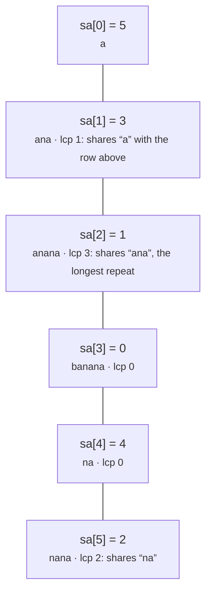

# Suffix arrays and the LCP array

> Data Structures & Algorithms · L4 Expert · Trees, strings & advanced structures · about 115 min · hub module `m05` ([open the hub](https://claude.ai/artifact/DxduaMdo2n5kqrt3We8PPZ))

## Why it matters
Genome search tools, full-text indexes and compressors (the Burrows–Wheeler transform behind bzip2) all start by sorting every suffix of a text. A suffix array does that, and with its LCP array one structure answers “how many distinct substrings?”, “what's the longest repeat?”, “where does this pattern occur?” and “what do these two texts have in common?”.

## Pre-question (answer before reading)
**Q:** Write down every suffix of “banana” (banana, anana, nana, ana, na, a) and sort them alphabetically. Which two neighbours in the sorted list share the longest start, and what does that shared start tell you about the word?

<details><summary>Answer</summary>

“ana” and “anana” share “ana”, the longest start shared by any two neighbours. A substring that occurs twice is a shared start of two suffixes, and the longest such start always turns up between neighbours, so “ana” is the longest repeated substring.

</details>

## 🍎 Story time (kid version)
**The toy room and the treasure-map road trip: Tara's word-tail cards**

Tara writes “banana” on a strip and cuts off one letter at a time from the front, keeping every tail: banana, anana, nana, ana, na and a. Then she sorts the cards like a dictionary. Now cards that start the same way sit next to each other, so Ben only compares neighbours: “ana” and “anana” share three letters, so “ana” must appear in the word twice. To find a word in the pile, they open it in the middle and keep halving it, just like looking something up in a dictionary.

| In the story | In code |
|---|---|
| The tail cards of “banana” | The suffixes s[i:], one for each start position i |
| Sorting the cards like a dictionary | The suffix array: the start positions in sorted order |
| Letters shared by neighbouring cards | The LCP array: the longest common prefix of sorted neighbours |
| “ana” and “anana” share three letters | A repeated substring is a common prefix of two suffixes |
| Halving the pile to find a word | Binary search over the suffix array: O(m log n) for a pattern of length m |

**Where the story breaks:** Tara sorts six short cards letter by letter, but a text of 10⁵ letters has 10⁵ suffixes averaging 5 × 10⁴ letters, so comparing whole suffixes is far too slow. The algorithms below sort by ranks of doubling prefix lengths, comparing two numbers instead of two strings.

## Key ideas (grown-up version)
- **Suffix array**: sa lists the start positions of all n suffixes in sorted order. Every substring is a prefix of some suffix, so substring questions become questions about neighbouring suffixes. The array is unique, because no two suffixes are equal.
- **Prefix doubling**: rank suffixes by their first character, then repeatedly sort by the pair (rank of the first k items, rank of the next k items), which ranks the first 2k items. After at most ⌈log₂ n⌉ rounds every rank differs. With a comparison sort that's O(n log² n); counting sort makes it O(n log n), and SA-IS builds it in O(n).
- **LCP array**: lcp[i] is the length of the longest common prefix of the suffixes at sa[i − 1] and sa[i]. For two suffixes further apart in sa, the common prefix is the minimum of the lcp values between them, so the closest pairs are always neighbours.
- **Kasai's algorithm**: visit suffixes in text order. If suffix p shares h characters with its sorted predecessor, suffix p + 1 shares at least h − 1 with its own, so h never restarts from 0: it rises at most 2n times in total, O(n) time and space.
- **Counting and repeats**: there are n(n + 1)/2 substring positions, and suffix sa[i] repeats lcp[i] prefixes already seen, so the number of distinct substrings is n(n + 1)/2 − Σ lcp. The longest repeated substring has length max(lcp); one that occurs at least k times is the best minimum over k − 1 neighbouring lcp values.
- **Pattern search**: the suffixes starting with a pattern p form one contiguous block of sa. Two binary searches find its ends in O(m log n) for |p| = m, and the block's size is the number of occurrences.
- **Several strings at once**: join a + # + b with a separator that occurs in neither. The longest common substring is the best lcp between neighbours that come from different strings; for many strings, slide a window over sa that contains every string (LeetCode 1923).
- **Language notes**: Python compares strings by code point and JavaScript by UTF-16 unit, which differ only beyond the Basic Multilingual Plane (emoji). Both work on lists of integers too: the prelude accepts either.

## Diagrams
**The sorted suffixes of “banana”: the suffix array and the LCP array**



**Prefix doubling on “banana”: each round ranks twice as many characters**

| s | 0 | 1 | 2 | 3 | 4 | 5 |
|---|---|---|---|---|---|---|
| value | b | a | n | a | n | a |

| 1 char | 0 | 1 | 2 | 3 | 4 | 5 |
|---|---|---|---|---|---|---|
| value | 1 | 0 | 2 | 0 | 2 | 0 |

| 2 chars | 0 | 1 | 2 | 3 | 4 | 5 |
|---|---|---|---|---|---|---|
| value | 2 | 1 | 3 | 1 | 3 | 0 |

| 4 chars | 0 | 1 | 2 | 3 | 4 | 5 |
|---|---|---|---|---|---|---|
| value | 3 | 2 | 5 | 1 | 4 | 0 |

_Each round sorts the pairs (rank now, rank k places later): suffix 1's 4-character rank comes from the pair (rank of “an”, rank of “an”). After the 4-character round all six ranks differ, so they're final, and listing positions by rank gives sa = 5 3 1 0 4 2._

## Comparisons
**Suffix array, suffix automaton or rolling hash?**

|  | Suffix array + LCP | Suffix automaton | Rolling hash (L3) |
|---|---|---|---|
| Build time | O(n log² n) here; O(n log n) with radix sort; O(n) with SA-IS | O(n) for a fixed alphabet | O(n) |
| Memory | Two integer arrays | Up to 2n states with their transitions | One prefix-hash array |
| Exact? | Yes | Yes | No: collisions are possible, though rare |
| Best for | Distinct substrings, repeats, k-th substring, pattern blocks | Counting occurrences, building online | Equality checks and binary search on a length |

**What the suffix array and LCP array answer**

| Question | How | Cost after building |
|---|---|---|
| Number of distinct substrings | n(n + 1)/2 − Σ lcp | O(n) |
| Longest repeated substring | The largest lcp value | O(n) |
| All occurrences of a pattern of length m | Two binary searches for its block of suffixes | O(m log n), plus one step per occurrence |
| Longest common substring of a and b | A suffix array of a + # + b; best lcp between neighbours from different strings | O(n + m) |
| k-th smallest distinct substring | Walk sa: suffix sa[i] adds n − sa[i] − lcp[i] new ones | O(n) |
| Longest substring occurring at least k times | Sliding-window minimum over k − 1 neighbouring lcp values | O(n) |

## Code (JavaScript + Python)
### The suffix array (prefix doubling) and the LCP array (Kasai), used by every example below
```python
def suffix_array(s):                            # s: a str, or a list of non-negative ints
    n = len(s)
    if n == 0:
        return []
    rank = [ord(c) for c in s] if isinstance(s, str) else list(s)
    sa, k = list(range(n)), 1
    while True:
        key = lambda i: (rank[i], rank[i + k] if i + k < n else -1)   # (first k items, next k items)
        sa.sort(key=key)
        new = [0] * n
        for j in range(1, n):
            new[sa[j]] = new[sa[j - 1]] + (key(sa[j]) != key(sa[j - 1]))
        rank = new                              # ranks now describe the first 2k items
        if rank[sa[-1]] == n - 1:               # every rank differs: fully sorted
            return sa
        k *= 2

def lcp_array(s, sa):                           # Kasai: lcp[i] = LCP of suffixes sa[i - 1] and sa[i]; lcp[0] = 0
    n = len(s)
    rank = [0] * n
    for i, p in enumerate(sa):
        rank[p] = i
    lcp, h = [0] * n, 0
    for p in range(n):                          # suffixes in text order, so h falls by at most 1 per step
        if rank[p] == 0:
            h = 0
            continue
        q = sa[rank[p] - 1]                     # the suffix just before p in sorted order
        while p + h < n and q + h < n and s[p + h] == s[q + h]:
            h += 1
        lcp[rank[p]] = h
        h = max(h - 1, 0)
    return lcp
```

```javascript
function suffixArray(s) {                       // s: a string, or an array of non-negative integers
  const n = s.length;
  if (n === 0) return [];
  let rank = typeof s === "string" ? Array.from({ length: n }, (_, i) => s.charCodeAt(i)) : [...s];
  const sa = [...Array(n).keys()];
  for (let k = 1; ; k *= 2) {
    const second = i => (i + k < n ? rank[i + k] : -1);
    const cmp = (a, b) => rank[a] - rank[b] || second(a) - second(b);   // (first k items, next k items)
    sa.sort(cmp);
    const next = new Array(n).fill(0);
    for (let j = 1; j < n; j++) next[sa[j]] = next[sa[j - 1]] + (cmp(sa[j - 1], sa[j]) < 0 ? 1 : 0);
    rank = next;                                // ranks now describe the first 2k items
    if (rank[sa[n - 1]] === n - 1) return sa;   // every rank differs: fully sorted
  }
}

function lcpArray(s, sa) {                      // Kasai: lcp[i] = LCP of suffixes sa[i - 1] and sa[i]; lcp[0] = 0
  const n = s.length, rank = new Array(n).fill(0), lcp = new Array(n).fill(0);
  sa.forEach((p, i) => { rank[p] = i; });
  let h = 0;
  for (let p = 0; p < n; p++) {                 // suffixes in text order, so h falls by at most 1 per step
    if (rank[p] === 0) { h = 0; continue; }
    const q = sa[rank[p] - 1];                  // the suffix just before p in sorted order
    while (p + h < n && q + h < n && s[p + h] === s[q + h]) h++;
    lcp[rank[p]] = h;
    h = Math.max(h - 1, 0);
  }
  return lcp;
}
```

### The suffix array and LCP array of “banana”, and what they tell you
```python
s = "banana"
sa = suffix_array(s)
lcp = lcp_array(s, sa)
print(*sa)
print(*lcp)
n = len(s)
print(n * (n + 1) // 2 - sum(lcp))              # distinct substrings
i = max(range(n), key=lambda i: lcp[i])
print(s[sa[i]:sa[i] + lcp[i]])                  # the longest repeated substring
```

Output:
```text
5 3 1 0 4 2
0 1 3 0 0 2
15
ana
```

- line 4: a, ana, anana, banana, na, nana: the starts of the suffixes in that order.
- line 5: lcp[2] = 3: “ana” (from 3) and “anana” (from 1) share three letters.
- line 7: 21 substring positions minus 6 repeats: suffix sa[i] repeats exactly lcp[i] prefixes of earlier suffixes.

```javascript
const s = "banana";
const sa = suffixArray(s);
const lcp = lcpArray(s, sa);
console.log(...sa);
console.log(...lcp);
const n = s.length;
console.log(n * (n + 1) / 2 - lcp.reduce((a, b) => a + b, 0));   // distinct substrings
const i = lcp.indexOf(Math.max(...lcp));
console.log(s.slice(sa[i], sa[i] + lcp[i]));    // the longest repeated substring
```

Output:
```text
5 3 1 0 4 2
0 1 3 0 0 2
15
ana
```

- line 4: a, ana, anana, banana, na, nana: the starts of the suffixes in that order.
- line 5: lcp[2] = 3: “ana” (from 3) and “anana” (from 1) share three letters.
- line 7: 21 substring positions minus 6 repeats: suffix sa[i] repeats exactly lcp[i] prefixes of earlier suffixes.

### Every occurrence of a pattern: two binary searches over the suffix array
```python
def find_all(s, sa, p):                         # every start of p in s, in O(|p| log n)
    def first(strict):                          # the first suffix whose first |p| letters are >= p (> p if strict)
        lo, hi = 0, len(sa)
        while lo < hi:
            mid = (lo + hi) // 2
            head = s[sa[mid]:sa[mid] + len(p)]
            if head < p or (strict and head == p):
                lo = mid + 1
            else:
                hi = mid
        return lo
    return sorted(sa[first(False):first(True)])

s = "abracadabra"
sa = suffix_array(s)
for p in ["abra", "a", "cad", "bad"]:
    hits = find_all(s, sa, p)
    print(p, len(hits), *hits)
```

Output:
```text
abra 2 0 7
a 5 0 3 5 7 10
cad 1 4
bad 0
```

- line 6: Cutting each suffix to |p| letters makes every suffix that starts with p compare equal to p: they form one block.
- line 12: The block runs from the first suffix ≥ p to the first suffix > p. Its size is the number of occurrences.
- line 18: “bad” isn't in the text: both searches stop at the same place, an empty block.

```javascript
function findAll(s, sa, p) {                    // every start of p in s, in O(|p| log n)
  const first = strict => {                     // the first suffix whose first |p| letters are >= p (> p if strict)
    let lo = 0, hi = sa.length;
    while (lo < hi) {
      const mid = (lo + hi) >> 1, head = s.slice(sa[mid], sa[mid] + p.length);
      if (head < p || (strict && head === p)) lo = mid + 1;
      else hi = mid;
    }
    return lo;
  };
  return sa.slice(first(false), first(true)).sort((a, b) => a - b);
}

const s = "abracadabra";
const sa = suffixArray(s);
for (const p of ["abra", "a", "cad", "bad"]) {
  const hits = findAll(s, sa, p);
  console.log(p, hits.length, ...hits);
}
```

Output:
```text
abra 2 0 7
a 5 0 3 5 7 10
cad 1 4
bad 0
```

- line 5: Cutting each suffix to |p| letters makes every suffix that starts with p compare equal to p: they form one block.
- line 11: The block runs from the first suffix ≥ p to the first suffix > p. Its size is the number of occurrences.
- line 18: “bad” isn't in the text: both searches stop at the same place, an empty block.

### The longest common substring of two strings (or two arrays)
```python
def longest_common(a, b, sep):                  # a, b: strs or lists; sep (same type) occurs in neither
    s = a + sep + b
    sa = suffix_array(s)
    lcp = lcp_array(s, sa)
    best, at = 0, 0
    for i in range(1, len(s)):
        if (sa[i] < len(a)) != (sa[i - 1] < len(a)) and lcp[i] > best:   # neighbours from different inputs
            best, at = lcp[i], sa[i]
    return s[at:at + best]

print(longest_common("xabxac", "abcabxabcd", "#"))
print(*longest_common([1, 2, 3, 2, 1], [3, 2, 1, 4, 7], [8]))   # LeetCode 718's first example
```

Output:
```text
abxa
3 2 1
```

- line 2: The separator can't be part of a common prefix of a suffix from a and one from b, so no match runs across the join.
- line 7: Two suffixes from different inputs share a common substring of length lcp[i]; the best such pair is always adjacent in sa.
- line 12: For integer arrays, a separator bigger than every value works, like 8 here.

```javascript
function longestCommon(a, b, sep) {             // a, b: strings or arrays; sep (same type) occurs in neither
  const s = typeof a === "string" ? a + sep + b : [...a, ...sep, ...b];
  const sa = suffixArray(s), lcp = lcpArray(s, sa);
  let best = 0, at = 0;
  for (let i = 1; i < s.length; i++) {
    if ((sa[i] < a.length) !== (sa[i - 1] < a.length) && lcp[i] > best) { best = lcp[i]; at = sa[i]; }   // neighbours from different inputs
  }
  return s.slice(at, at + best);
}

console.log(longestCommon("xabxac", "abcabxabcd", "#"));
console.log(...longestCommon([1, 2, 3, 2, 1], [3, 2, 1, 4, 7], [8]));   // LeetCode 718's first example
```

Output:
```text
abxa
3 2 1
```

- line 2: The separator can't be part of a common prefix of a suffix from a and one from b, so no match runs across the join.
- line 6: Two suffixes from different inputs share a common substring of length lcp[i]; the best such pair is always adjacent in sa.
- line 12: For integer arrays, a separator bigger than every value works, like 8 here.

## Worked example
**Problem.** List the distinct substrings of a string in alphabetical order. Which one is k-th? (CSES 2108, Substring Order I: n ≤ 10⁵, so listing all O(n²) substrings is out.)

1. Every substring is a prefix of a suffix, and walking the suffixes in sorted order meets the substrings in sorted order too: a suffix's prefixes come in order of length.
2. Suffix sa[i] shares its first lcp[i] prefixes with the suffix before it, so only lengths lcp[i] + 1 up to n − sa[i] are new: n − sa[i] − lcp[i] new substrings.
3. Walk sa, subtracting each suffix's count of new substrings from k. When k fits inside a suffix's new ones, the answer is that suffix's prefix of length lcp[i] + k.
4. O(n log² n) for the suffix array here, then O(n) for the walk; O(n) extra space.

```python
def kth_distinct(s, k):                         # the k-th smallest distinct substring (k from 1)
    sa = suffix_array(s)
    lcp = lcp_array(s, sa)
    for i, p in enumerate(sa):
        new = len(s) - p - lcp[i]               # prefixes of this suffix not seen in an earlier one
        if k <= new:
            return s[p:p + lcp[i] + k]
        k -= new
    return ""                                   # fewer than k distinct substrings

print(kth_distinct("babaacbaab", 10), kth_distinct("banana", 1), kth_distinct("banana", 15))
```

Output:
```text
aba a nana
```

```javascript
function kthDistinct(s, k) {                    // the k-th smallest distinct substring (k from 1)
  const sa = suffixArray(s), lcp = lcpArray(s, sa);
  for (let i = 0; i < sa.length; i++) {
    const fresh = s.length - sa[i] - lcp[i];    // prefixes of this suffix not seen in an earlier one
    if (k <= fresh) return s.slice(sa[i], sa[i] + lcp[i] + k);
    k -= fresh;
  }
  return "";                                    // fewer than k distinct substrings
}

console.log(kthDistinct("babaacbaab", 10), kthDistinct("banana", 1), kthDistinct("banana", 15));
```

Output:
```text
aba a nana
```

**Answer.** “aba” for CSES's sample (“babaacbaab” has 43 distinct substrings, and the 10th in order is “aba”), then “a” and “nana” for “banana”: “a” comes first, and “nana” is the last of its 15.

## Your turn (faded example)
**Problem.** Find the longest substring that occurs at least k times (k ≥ 2), counting overlapping occurrences. For example, “abab” occurs three times in “abababab”.

- ✓ The k suffixes that start with a repeated substring are k neighbours in the suffix array, and what they all share is the minimum of the k − 1 lcp values between them.
- **So what are you maximising?**
  <details><summary>Answer</summary>The minimum of every window of k − 1 consecutive lcp values, lcp[i − k + 2 .. i], over all i. For k = 2 that's just max(lcp).</details>
- **How do you get every window's minimum in O(n)?**
  <details><summary>Answer</summary>A monotonic deque of indexes (L3's sliding-window minimum): drop from the back while the new value is no bigger, drop from the front when an index leaves the window, and read the minimum at the front.</details>
- **Time and space?**
  <details><summary>Answer</summary>O(n log² n) for the suffix array here, then O(n) for the window pass; O(n) extra space.</details>

Starter:
```python
from collections import deque

def longest_k_times(s, k):                      # the longest substring occurring at least k times (k >= 2)
    sa = suffix_array(s)
    lcp = lcp_array(s, sa)
    best, at = 0, 0
    ...                                         # TODO: the minimum of every window lcp[i - k + 2 .. i]
    return s[at:at + best]
```

```javascript
function longestKTimes(s, k) {                  // the longest substring occurring at least k times (k >= 2)
  const sa = suffixArray(s), lcp = lcpArray(s, sa);
  let best = 0, at = 0;
  // TODO: the minimum of every window lcp[i - k + 2 .. i]
  return s.slice(at, at + best);
}
```

<details><summary>Full solution</summary>

```python
from collections import deque

def longest_k_times(s, k):                      # the longest substring occurring at least k times (k >= 2)
    sa = suffix_array(s)
    lcp = lcp_array(s, sa)
    best, at = 0, 0
    dq = deque()                                # indexes into lcp with rising values: the minimum is at dq[0]
    for i in range(1, len(s)):
        while dq and lcp[dq[-1]] >= lcp[i]:
            dq.pop()
        dq.append(i)
        if dq[0] <= i - (k - 1):
            dq.popleft()                        # it left the window lcp[i - k + 2 .. i]
        if i >= k - 1 and lcp[dq[0]] > best:
            best, at = lcp[dq[0]], sa[i]
    return s[at:at + best]

print(longest_k_times("banana", 2), longest_k_times("banana", 3), longest_k_times("abababab", 3))
```

Output:
```text
ana a abab
```

```javascript
function longestKTimes(s, k) {                  // the longest substring occurring at least k times (k >= 2)
  const sa = suffixArray(s), lcp = lcpArray(s, sa);
  let best = 0, at = 0;
  const dq = [];                                // indexes into lcp with rising values: the minimum is at dq[head]
  let head = 0;
  for (let i = 1; i < s.length; i++) {
    while (dq.length > head && lcp[dq[dq.length - 1]] >= lcp[i]) dq.pop();
    dq.push(i);
    if (dq[head] <= i - (k - 1)) head++;        // it left the window lcp[i - k + 2 .. i]
    if (i >= k - 1 && lcp[dq[head]] > best) { best = lcp[dq[head]]; at = sa[i]; }
  }
  return s.slice(at, at + best);
}

console.log(longestKTimes("banana", 2), longestKTimes("banana", 3), longestKTimes("abababab", 3));
```

Output:
```text
ana a abab
```

</details>

## Socratic checks and quiz (answers hidden)
**1. What does this print? (`suffix_array` / `suffixArray` and `lcp_array` / `lcpArray` are this module's helpers.)**

```python
s = "abab"
sa = suffix_array(s)
print(*sa, "|", *lcp_array(s, sa))
```

```javascript
const s = "abab";
const sa = suffixArray(s);
console.log(...sa, "|", ...lcpArray(s, sa));
```

- A. 2 0 3 1 | 0 2 0 1
- B. 0 2 1 3 | 0 2 0 1
- C. 2 0 3 1 | 0 2 1 0
- D. 2 0 1 3 | 0 2 0 1

<details><summary>Answer</summary>

2 0 3 1 | 0 2 0 1. The sorted suffixes are ab (2), abab (0), b (3) and bab (1). Neighbours share 2 (ab / abab), 0 (abab / b) and 1 (b / bab), and lcp[0] is 0 by definition.

</details>

**2. What does this print?**

```python
def distinct(s):
    sa = suffix_array(s)
    n = len(s)
    return n * (n + 1) // 2 - sum(lcp_array(s, sa))

print(distinct("aaaa"), distinct("abcd"))
```

```javascript
function distinct(s) {
  const sa = suffixArray(s), n = s.length;
  return n * (n + 1) / 2 - lcpArray(s, sa).reduce((a, b) => a + b, 0);
}

console.log(distinct("aaaa"), distinct("abcd"));
```

- A. 4 10
- B. 10 10
- C. 4 4
- D. 6 10

<details><summary>Answer</summary>

4 10. “aaaa” has only a, aa, aaa and aaaa: its LCP array is 0 1 2 3, and 10 − 6 = 4. In “abcd” no two suffixes share a first letter, so all 10 substrings differ.

</details>

**3. Why does Kasai's algorithm run in O(n) time?**

- A. The match length h falls by at most 1 between consecutive text positions, so it rises at most 2n times in total
- B. It compares each suffix only with the next suffix in the text
- C. It compares suffixes in O(1) with hashing
- D. The LCP array is always sorted

<details><summary>Answer</summary>

The match length h falls by at most 1 between consecutive text positions, so it rises at most 2n times in total. h starts each step at least at the previous value minus 1 and never exceeds n, so the total number of increases is at most 2n. Kasai compares sorted neighbours, not text neighbours, uses no hashing, and the LCP array isn't sorted.

</details>

**4. Which statements are true? (choose 2)**

- A. The number of distinct substrings is n(n + 1)/2 minus the sum of the LCP array
- B. The longest repeated substring has length max(lcp)
- C. A string can have more than one suffix array
- D. Plain binary search over the suffix array finds a pattern of length m in O(m + log n)
- E. Neighbours in the suffix array always start at neighbouring positions in the text

<details><summary>Answer</summary>

The number of distinct substrings is n(n + 1)/2 minus the sum of the LCP array, The longest repeated substring has length max(lcp). Each suffix repeats lcp[i] earlier prefixes, and the best pair of suffixes is adjacent. Suffixes are all different, so the order is unique; plain binary search costs O(m log n) (O(m + log n) needs extra LCP tables); and “a” and “ana” are neighbours in banana's array but start at 5 and 3.

</details>

**5. Judge each statement.**

- Every substring is a prefix of some suffix.
- For two suffixes that aren't neighbours in sa, the common prefix is the minimum lcp value between them.
- Kasai's algorithm must visit the suffixes in suffix-array order to stay linear.
- Prefix doubling with a comparison sort takes O(n log² n) time.

<details><summary>Answer</summary>

Every substring is a prefix of some suffix.: Yes; For two suffixes that aren't neighbours in sa, the common prefix is the minimum lcp value between them.: Yes; Kasai's algorithm must visit the suffixes in suffix-array order to stay linear.: No; Prefix doubling with a comparison sort takes O(n log² n) time.: Yes. s[i:j] is the start of the suffix s[i:]. Between two sorted suffixes, every neighbouring pair shares at least their common prefix, and one pair shares no more. Kasai visits suffixes in text order: that's what lets h carry over. And ⌈log₂ n⌉ rounds of an O(n log n) sort give O(n log² n).

</details>

**6. Put the steps of building a suffix array by prefix doubling in order.**

- (put the steps in order)

<details><summary>Answer</summary>

Rank every suffix by its first character → Sort the suffixes by the pair (rank of the first k characters, rank of the next k) → Give equal pairs equal new ranks, so ranks now describe the first 2k characters → Double k and repeat until every rank is different. Each round sorts by pairs of the previous round's ranks, so the starting ranks come first, and the stopping test needs the new ranks.

</details>

**7. Complete the Python version of Kasai's algorithm.**

```
def kasai(s, sa):
    n = len(s)
    rank = [0] * n
    for i, p in enumerate(sa):
        rank[p] = i
    lcp, h = [0] * n, 0
    for p in range(n):
        if rank[p] == 0:
            h = 0
            continue
        q = {{0}}
        while p + h < n and q + h < n and s[p + h] == s[q + h]:
            h += 1
        lcp[rank[p]] = h
        {{1}}
    return lcp

```

<details><summary>Answer</summary>

sa[rank[p] - 1] | h = max(h - 1, 0). Each suffix is compared with the suffix just before it in sorted order, and the next text position can start from one less than the match just found (never below 0).

</details>

**8. Match each question to how the suffix array answers it.**


<details><summary>Answer</summary>

How many different substrings does s have? = n(n + 1)/2 − the sum of the LCP array; The longest substring that appears twice = The largest LCP value; Every place a pattern occurs = Two binary searches for its block of suffixes; The longest substring common to two strings = The suffix array of a + # + b, neighbours from different strings. Distinct substrings subtract the repeats, a repeat is a shared prefix of neighbours, a pattern's occurrences are one sorted block, and a common substring is a shared prefix of a suffix from each string. Sorting the characters loses their order.

</details>

## Traps & misconceptions
- **“Sorting the suffixes with an ordinary string sort is fine.”** One comparison can cost O(n), so the sort costs O(n² log n) in the worst case (try “aaaa…”), and storing every suffix takes O(n²) memory. Prefix doubling compares two ranks in O(1) instead.
- **“The LCP array compares each suffix with the next one in the text.”** lcp[i] compares sa[i − 1] and sa[i], neighbours in sorted order. Kasai only visits the suffixes in text order, which is what keeps the work linear.
- **“The longest repeat needs every pair of suffixes compared.”** Two suffixes share at most what every neighbouring pair between them shares, so the best pair is always adjacent: the answer is max(lcp).
- **“Any separator will do when joining two strings.”** It must occur in neither string, or a common prefix can run across the join. Use a character outside the alphabet, or, for arrays of numbers, a value bigger than any element.
- **“The k-th distinct substring needs every substring listed and sorted.”** There are O(n²) of them. Walking the suffix array instead, suffix sa[i] adds exactly n − sa[i] − lcp[i] new ones, already in sorted order.
- **“Python and JavaScript always sort strings the same way.”** Python compares code points and JavaScript compares UTF-16 units. They agree on ASCII and on most text, but characters such as emoji can sort differently; arrays of code points behave the same in both.

## Discussion prompts
- **Why can Kasai's algorithm start from h − 1 when it moves from suffix p to suffix p + 1?**
  <details><summary>One good answer</summary>If suffix p shares h ≥ 1 characters with the suffix q just before it in sorted order, then dropping the first character, suffix p + 1 shares h − 1 characters with suffix q + 1, and q + 1 sorts before p + 1. Whatever sits just before p + 1 in sorted order lies between them, so it shares at least h − 1 characters as well. So h never restarts from 0, and in total it rises at most 2n times.</details>
- **Suffix array, suffix automaton or hashing: which should you reach for?**
  <details><summary>One good answer</summary>Rolling hashes are quickest to write and pair well with binary search on a length (L3), but carry a small chance of collision. A suffix array with its LCP array is exact and compact, and one structure answers distinct counts, repeats, k-th substrings and pattern blocks. A suffix automaton is linear and strong at counting occurrences online, but harder to get right. In an interview, explain the suffix array; in a contest, use whichever you can type correctly from memory.</details>

## Teach-back
**Prompt:** Explain to a junior colleague what a suffix array and an LCP array are, how you'd build them, and two questions they answer.

Rubric:
- [ ] The suffix array lists suffix starts in sorted order
- [ ] Prefix doubling sorts by pairs of ranks: O(n log² n), or O(n log n) with radix sort
- [ ] lcp[i] is the common prefix of sorted neighbours; Kasai builds it in O(n)
- [ ] Distinct substrings = n(n + 1)/2 − Σ lcp
- [ ] Longest repeat = max lcp; a pattern's occurrences are one block, found by binary search

<details><summary>Model answer</summary>

Take every suffix of a string and sort them: the suffix array is just their start positions in sorted order. I'd build it by prefix doubling: rank each suffix by its first character, then repeatedly sort by the pair of ranks of the first k and the next k characters, which ranks 2k characters, until every rank differs; that's O(n log² n) with a normal sort. The LCP array stores, for each pair of neighbours in that order, how many characters they share, and Kasai's algorithm fills it in O(n) because the shared length drops by at most one as you move along the text. Since every substring is a prefix of some suffix, these two arrays answer a lot: the number of distinct substrings is n(n + 1)/2 minus the sum of the LCP array, the longest repeated substring has length max(lcp), and all occurrences of a pattern form one block of the suffix array that two binary searches find in O(m log n).

</details>

## Quick Q&A (also in the SRS deck)
- **What is a suffix array?** The start positions of all suffixes, in sorted order.
- **What does lcp[i] hold?** The length of the longest common prefix of the suffixes at sa[i − 1] and sa[i].
- **How many distinct substrings does a string have?** n(n + 1)/2 minus the sum of its LCP array.
- **How fast is Kasai's algorithm, and why?** O(n): the shared length h falls by at most 1 per step, so it rises at most 2n times.
- **How do you find every occurrence of a pattern with a suffix array?** Binary search for the block of suffixes that start with it: O(m log n).
- **How do you find the longest common substring of a and b?** Build the suffix array of a + # + b and take the best lcp between neighbours from different strings.

## Practice problems
- [ ] [CSES 2105 · Distinct Substrings](https://cses.fi/problemset/task/2105) · n(n + 1)/2 minus the sum of the LCP array (code block 1)
- [ ] [CSES 2106 · Repeating Substring](https://cses.fi/problemset/task/2106) · the largest LCP value and where it occurs; print −1 when it is 0
- [ ] [CSES 2108 · Substring Order I](https://cses.fi/problemset/task/2108) · the worked example: suffix sa[i] adds n − sa[i] − lcp[i] new substrings, in order
- [ ] [CSES 2109 · Substring Order II](https://cses.fi/problemset/task/2109) · now repeats count: each new prefix in suffix-array order occurs once per suffix in the block that shares it, a block the LCP array bounds
- [ ] [CSES 2110 · Substring Distribution](https://cses.fi/problemset/task/2110) · suffix sa[i] adds one new substring of each length from lcp[i] + 1 to n − sa[i]: a difference array over lengths
- [ ] [CSES 1110 · Minimal Rotation](https://cses.fi/problemset/task/1110) · the smallest suffix of s + s that starts in the first half, cut to n letters (or Booth's algorithm in O(n))
- [ ] [LC 1163 · Last Substring in Lexicographical Order](https://leetcode.com/problems/last-substring-in-lexicographical-order/) · Hard · the answer is the largest suffix, the last entry of the suffix array (an O(n) two-pointer method also exists)
- [ ] [LC 718 · Maximum Length of Repeated Subarray](https://leetcode.com/problems/maximum-length-of-repeated-subarray/) · Medium · the longest common subarray: a suffix array over a + [separator] + b (code block 3); O(nm) DP also works
- [ ] [LC 1923 · Longest Common Subpath](https://leetcode.com/problems/longest-common-subpath/) · Hard · many paths: join them with distinct separators, then slide a window over the suffix array that covers every path and take its minimum LCP; or binary search with rolling hashes

## Sources (accessed 2026-10-09)
- [cp-algorithms: Suffix array](https://cp-algorithms.com/string/suffix-array.html)
- [cp-algorithms: Suffix automaton](https://cp-algorithms.com/string/suffix-automaton.html)
- [Wikipedia: LCP array (with Kasai's algorithm)](https://en.wikipedia.org/wiki/LCP_array)
- [USACO Guide: Suffix array](https://usaco.guide/adv/suffix-array)
- [CSES Problem Set (string algorithms section)](https://cses.fi/problemset/)
