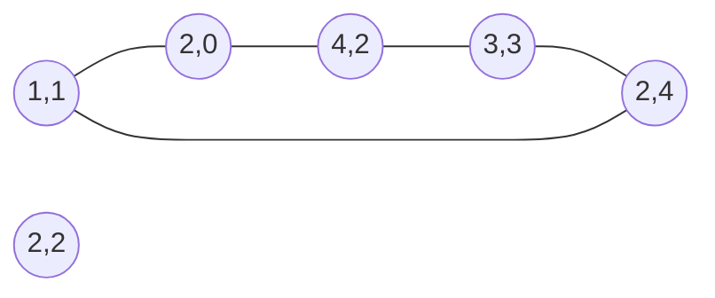

# Computational geometry with exact arithmetic

> Data Structures & Algorithms · L4 Expert · Geometry & mathematics · about 120 min · hub module `m07` ([open the hub](https://claude.ai/artifact/DxduaMdo2n5kqrt3We8PPZ))

## Why it matters
Maps, games, robots, chip layouts and delivery zones all ask geometric questions: which side of this road is the point, do two paths cross, what's the area of this plot, which posts form the outer fence? One tool, the cross product, answers nearly all of them, and with integer coordinates it answers them exactly. Floating point is where most geometry bugs come from.

## Pre-question (answer before reading)
**Q:** You walk from A to B and then on to C. Without measuring any angle, how can you tell whether you turned left or right at B?

<details><summary>Answer</summary>

Compute the cross product (B − A) × (C − B) = (Bx − Ax)(Cy − By) − (By − Ay)(Cx − Bx). Positive means a left (anticlockwise) turn, negative a right turn, and zero means A, B and C lie on one line. It needs only multiplication and subtraction, so with integer coordinates the answer is exact.

</details>

## 🍎 Story time (kid version)
**The toy room and the treasure-map road trip: Tara's string fence**

Tara hammers pegs into a board and wants one loop of string around them all. She starts at the leftmost peg and works along the bottom, asking at each peg: “Do I turn left here?” Whenever the string would bend inwards with a right turn, she unhooks the last peg, because a peg that dents the fence inwards can't be on the outside. Then she does the top the same way. Ben works out the board's area by adding up thin triangles from one corner, some counted as plus and some as minus.

| In the story | In code |
|---|---|
| Pegs on the board | Points with integer coordinates |
| “Do I turn left here?” | The sign of the cross product of the last two steps |
| Unhooking a peg that dents the fence inwards | The monotone chain pops points that make a right (clockwise) turn |
| Doing the bottom, then the top | Building the lower hull and the upper hull separately |
| Adding thin triangles, some plus, some minus | The shoelace formula: the sum of signed cross products, halved |

**Where the story breaks:** Tara sees by eye which pegs are outside, but code decides every turn by the cross product's sign, including the awkward pegs exactly in line (cross product 0), where you must choose whether points on an edge count. And her board is small: with coordinates up to 10⁹ a cross product reaches about 8 × 10¹⁸, far past what a JavaScript Number holds exactly, so JavaScript needs BigInt.

## Key ideas (grown-up version)
- **The cross product**: cross(o, a, b) = (aₓ − oₓ)(b_y − o_y) − (a_y − o_y)(bₓ − oₓ). Positive: o → a → b turns left (anticlockwise); negative: right; zero: the three points are in line. It's also twice the signed area of the triangle o, a, b.
- **Stay exact**: with integer coordinates every test here needs only +, − and ×, so compare the signs of integers and never divide. Floating point can flip a nearly-zero sign. Python's integers never overflow; JavaScript Numbers are exact only up to 2⁵³, so cross products of coordinates beyond about 3 × 10⁷ need BigInt, as the helper uses.
- **Segment intersection**: segments p1p2 and p3p4 cross properly when p1 and p2 lie strictly on opposite sides of line p3p4 and p3 and p4 strictly on opposite sides of line p1p2. Otherwise they meet only if an endpoint is in line with the other segment (orientation 0) and lies within it.
- **Polygon area (shoelace)**: twice the signed area is Σ cross(0, pᵢ, pᵢ₊₁) around the polygon, positive when the vertices run anticlockwise. Pick's theorem links area to lattice points: A = I + B/2 − 1, where B, the lattice points on the boundary, is Σ gcd(|Δx|, |Δy|) over the edges.
- **Point in polygon**: first check whether p lies on an edge (orientation 0 and within it). Otherwise cast a ray to the right and count the edges it crosses, counting an edge only when its ends are on different sides of the ray's line (a half-open rule, so a vertex on the ray counts once): odd means inside. O(n) per point.
- **Convex hull (Andrew's monotone chain)**: sort the points by (x, y); build the lower hull left to right, popping the last point while it fails to make a left turn; build the upper hull right to left the same way; join them. O(n log n) time for the sort, O(n) for the chains and O(n) space. Pop on ≤ 0 to keep corners only, or on < 0 to keep points lying on the edges too.
- **When floating point is unavoidable**: distances, angles, circle intersections and optimisation problems (LeetCode 1515) have irrational answers. Then compare with a tolerance (|a − b| < ε), and keep exact integer tests wherever the inputs allow.
- **The usual traps**: duplicate points, all points on one line, a polygon listed clockwise instead of anticlockwise, and points exactly on an edge. Test each of them on purpose.

## Diagrams
**The shoelace formula on the notched polygon of code block 3**

| edge | 0 | 1 | 2 | 3 | 4 |
|---|---|---|---|---|---|
| value | A→B | B→C | C→D | D→E | E→A |

| from | 0 | 1 | 2 | 3 | 4 |
|---|---|---|---|---|---|
| value | (0,0) | (6,0) | (6,4) | (3,2) | (0,4) |

| cross | 0 | 1 | 2 | 3 | 4 |
|---|---|---|---|---|---|
| value | 0 | **24** | 0 | **12** | 0 |

_Each edge adds cross(0, pᵢ, pᵢ₊₁) = xᵢ·yᵢ₊₁ − yᵢ·xᵢ₊₁. The total, 36, is twice the area: the 6 × 4 rectangle (24) minus the notch triangle (6) is 18. A clockwise listing would give −36._

**The fence around LeetCode 587's first example**



_Five trees are on the fence and (2, 2) is inside. Going round anticlockwise from (1, 1) every turn is a left turn or straight on: (3, 3) lies exactly on the edge from (4, 2) to (2, 4), so the cross product there is 0, and LeetCode counts it as on the fence._

## Comparisons
**Geometry questions with integer coordinates**

| Question | Exact test | Cost |
|---|---|---|
| Which side of line AB is P? | The sign of cross(A, B, P) | O(1) |
| Do segments AB and CD meet? | Four orientations, plus on-segment checks when one is 0 | O(1) |
| Twice the area of a polygon | Σ cross(0, pᵢ, pᵢ₊₁), the shoelace formula | O(n) |
| Is P inside a simple polygon? | An on-edge check, then ray casting | O(n) |
| Lattice points inside a polygon | Pick's theorem: A = I + B/2 − 1, with B = Σ gcd(|Δx|, |Δy|) | O(n log C) |
| The convex hull | Andrew's monotone chain | O(n log n) |

**Which number type?**

| Type | Exact up to | Use it for |
|---|---|---|
| Python int | Any size | Every test here, with nothing extra |
| JavaScript Number | 2⁵³ ≈ 9 × 10¹⁵, so coordinates up to about 3 × 10⁷ | Small coordinates only |
| JavaScript BigInt | Any size | Cross products of coordinates up to 10⁹ and beyond |
| float / Number for real values | About 15–16 significant digits, rounded | Distances, angles and other irrational results, compared with a tolerance |

## Code (JavaScript + Python)
### The exact predicates used by every example below
```python
def cross(o, a, b):                             # (a - o) x (b - o): > 0 left turn, < 0 right turn, 0 in line
    return (a[0] - o[0]) * (b[1] - o[1]) - (a[1] - o[1]) * (b[0] - o[0])

def orient(o, a, b):                            # the sign of the cross product: 1, -1 or 0
    c = cross(o, a, b)
    return (c > 0) - (c < 0)

def on_segment(a, b, p):                        # p is in line with a and b: is it between them?
    return min(a[0], b[0]) <= p[0] <= max(a[0], b[0]) and min(a[1], b[1]) <= p[1] <= max(a[1], b[1])
```

```javascript
function cross(o, a, b) {                       // (a - o) x (b - o) as an exact BigInt: > 0 left, < 0 right, 0 in line
  const ox = BigInt(o[0]), oy = BigInt(o[1]);
  return (BigInt(a[0]) - ox) * (BigInt(b[1]) - oy) - (BigInt(a[1]) - oy) * (BigInt(b[0]) - ox);
}

function orient(o, a, b) {                      // the sign of the cross product: 1, -1 or 0
  const c = cross(o, a, b);
  return c > 0n ? 1 : c < 0n ? -1 : 0;
}

function onSegment(a, b, p) {                   // p is in line with a and b: is it between them?
  return Math.min(a[0], b[0]) <= p[0] && p[0] <= Math.max(a[0], b[0]) && Math.min(a[1], b[1]) <= p[1] && p[1] <= Math.max(a[1], b[1]);
}
```

### Turns, and why JavaScript needs BigInt for big coordinates
```python
print(orient((0, 0), (4, 0), (4, 3)), orient((0, 0), (4, 0), (4, -3)), orient((0, 0), (2, 2), (5, 5)))

a, b = (999_999_999, 999_999_998), (999_999_998, 999_999_997)
as_float = float(a[0]) * float(b[1]) - float(a[1]) * float(b[0])   # what a JavaScript Number computes
print(int(as_float), cross((0, 0), a, b))
print(orient((0, 0), a, b))
```

Output:
```text
1 -1 0
0 -1
-1
```

- line 1: (4, 3) is to the left of the line from (0, 0) to (4, 0), (4, −3) to the right, and (5, 5) is on the line through (2, 2).
- line 4: Each product is about 10¹⁸, where doubles are 128 apart, so both round to the same value and the difference comes out as 0.
- line 6: The exact answer is −1: a right turn that floating point calls a straight line.

```javascript
console.log(orient([0, 0], [4, 0], [4, 3]), orient([0, 0], [4, 0], [4, -3]), orient([0, 0], [2, 2], [5, 5]));

const a = [999999999, 999999998], b = [999999998, 999999997];
const asNumber = a[0] * b[1] - a[1] * b[0];     // plain Numbers: rounded above 2^53
console.log(asNumber, String(cross([0, 0], a, b)));
console.log(orient([0, 0], a, b));
```

Output:
```text
1 -1 0
0 -1
-1
```

- line 1: (4, 3) is to the left of the line from (0, 0) to (4, 0), (4, −3) to the right, and (5, 5) is on the line through (2, 2).
- line 4: Each product is about 10¹⁸, where doubles are 128 apart, so both round to the same value and the difference comes out as 0.
- line 6: The exact answer is −1: a right turn that floating point calls a straight line.

### Segment intersection, including touching and overlapping
```python
def intersect(p1, p2, p3, p4):                # do segments p1p2 and p3p4 share at least one point?
    d1, d2 = orient(p3, p4, p1), orient(p3, p4, p2)
    d3, d4 = orient(p1, p2, p3), orient(p1, p2, p4)
    if d1 * d2 < 0 and d3 * d4 < 0:
        return True                           # each segment straddles the other's line
    return ((d1 == 0 and on_segment(p3, p4, p1)) or (d2 == 0 and on_segment(p3, p4, p2)) or
            (d3 == 0 and on_segment(p1, p2, p3)) or (d4 == 0 and on_segment(p1, p2, p4)))

tests = [((0, 0), (4, 4), (0, 4), (4, 0)), ((0, 0), (2, 2), (3, 3), (5, 5)), ((0, 0), (3, 3), (3, 3), (5, 1)),
         ((0, 0), (4, 0), (1, 1), (3, 2)), ((0, 0), (4, 0), (2, 0), (6, 0))]
print(*("yes" if intersect(*t) else "no" for t in tests))
```

Output:
```text
yes no yes no yes
```

- line 4: Opposite signs for both pairs of endpoints: a proper crossing, with the meeting point strictly inside both segments.
- line 6: An orientation of 0 means an endpoint is on the other segment's line; the bounding-box check says whether it is on the segment itself.
- line 10: The second pair is in one line but doesn't overlap; the third pair touches at (3, 3); the last pair overlaps on [2, 4].

```javascript
function intersect(p1, p2, p3, p4) {          // do segments p1p2 and p3p4 share at least one point?
  const d1 = orient(p3, p4, p1), d2 = orient(p3, p4, p2);
  const d3 = orient(p1, p2, p3), d4 = orient(p1, p2, p4);
  if (d1 * d2 < 0 && d3 * d4 < 0) return true;   // each segment straddles the other's line
  return (d1 === 0 && onSegment(p3, p4, p1)) || (d2 === 0 && onSegment(p3, p4, p2)) ||
    (d3 === 0 && onSegment(p1, p2, p3)) || (d4 === 0 && onSegment(p1, p2, p4));
}

const tests = [[[0, 0], [4, 4], [0, 4], [4, 0]], [[0, 0], [2, 2], [3, 3], [5, 5]], [[0, 0], [3, 3], [3, 3], [5, 1]],
  [[0, 0], [4, 0], [1, 1], [3, 2]], [[0, 0], [4, 0], [2, 0], [6, 0]]];
console.log(...tests.map(t => (intersect(...t) ? "yes" : "no")));
```

Output:
```text
yes no yes no yes
```

- line 4: Opposite signs for both pairs of endpoints: a proper crossing, with the meeting point strictly inside both segments.
- line 5: An orientation of 0 means an endpoint is on the other segment's line; the bounding-box check says whether it is on the segment itself.
- line 10: The second pair is in one line but doesn't overlap; the third pair touches at (3, 3); the last pair overlaps on [2, 4].

### Polygon area (shoelace) and point in polygon (ray casting)
```python
def area2(poly):                              # twice the signed area: > 0 when listed anticlockwise
    return sum(cross((0, 0), poly[i], poly[(i + 1) % len(poly)]) for i in range(len(poly)))

def locate(poly, p):                          # "INSIDE", "OUTSIDE" or "BOUNDARY"
    inside = False
    for i in range(len(poly)):
        a, b = poly[i], poly[(i + 1) % len(poly)]
        o = orient(a, b, p)
        if o == 0 and on_segment(a, b, p):
            return "BOUNDARY"
        if (a[1] > p[1]) != (b[1] > p[1]) and (o > 0) == (b[1] > a[1]):
            inside = not inside               # this edge crosses the ray going right from p
    return "INSIDE" if inside else "OUTSIDE"

poly = [(0, 0), (6, 0), (6, 4), (3, 2), (0, 4)]   # a rectangle with a notch cut from the top
print(area2(poly))
print(*(locate(poly, p) for p in [(3, 1), (3, 3), (6, 2), (3, 2), (7, 1), (1, 3)]))
```

Output:
```text
36
INSIDE OUTSIDE BOUNDARY BOUNDARY OUTSIDE INSIDE
```

- line 2: Each term is twice the signed area of the triangle from the origin to one edge; the parts outside the polygon cancel out.
- line 11: The half-open test counts an edge only when exactly one end is above p, so a vertex on the ray is counted once and flat edges never.
- line 16: 36 is twice the area: the 6 × 4 rectangle minus the notch triangle is 24 − 6 = 18.
- line 17: (3, 3) sits inside the notch, so it's outside the polygon; (3, 2) is the notch's tip, a vertex, so it's on the boundary.

```javascript
function area2(poly) {                        // twice the signed area: > 0 when listed anticlockwise
  return poly.reduce((s, p, i) => s + cross([0, 0], p, poly[(i + 1) % poly.length]), 0n);
}

function locate(poly, p) {                    // "INSIDE", "OUTSIDE" or "BOUNDARY"
  let inside = false;
  for (let i = 0; i < poly.length; i++) {
    const a = poly[i], b = poly[(i + 1) % poly.length], o = orient(a, b, p);
    if (o === 0 && onSegment(a, b, p)) return "BOUNDARY";
    if ((a[1] > p[1]) !== (b[1] > p[1]) && (o > 0) === (b[1] > a[1])) inside = !inside;   // crosses the ray to the right
  }
  return inside ? "INSIDE" : "OUTSIDE";
}

const poly = [[0, 0], [6, 0], [6, 4], [3, 2], [0, 4]];   // a rectangle with a notch cut from the top
console.log(String(area2(poly)));
console.log(...[[3, 1], [3, 3], [6, 2], [3, 2], [7, 1], [1, 3]].map(p => locate(poly, p)));
```

Output:
```text
36
INSIDE OUTSIDE BOUNDARY BOUNDARY OUTSIDE INSIDE
```

- line 2: Each term is twice the signed area of the triangle from the origin to one edge; the parts outside the polygon cancel out.
- line 10: The half-open test counts an edge only when exactly one end is above p, so a vertex on the ray is counted once and flat edges never.
- line 16: 36 is twice the area: the 6 × 4 rectangle minus the notch triangle is 24 − 6 = 18.
- line 17: (3, 3) sits inside the notch, so it's outside the polygon; (3, 2) is the notch's tip, a vertex, so it's on the boundary.

## Worked example
**Problem.** Trees stand at integer points in a garden. Fence them in with the shortest rope that encloses every tree, and list every tree that lies on the fence, including trees exactly on a straight stretch of it. (LeetCode 587, Erect the Fence)

1. The shortest enclosing rope is the convex hull. Sort the trees by x, then y: the lower hull runs left to right, the upper hull right to left, and together they form the fence.
2. Along a chain, a right turn (cross < 0) means the middle tree bends the fence inwards, so pop it. A cross product of 0 means a tree on a straight stretch, and this problem wants those, so pop only on < 0.
3. The two chains share their end points, and when all the trees are in one line both chains contain every tree, so combine them with a set.
4. O(n log n) for the sort plus O(n) for the chains (each tree is pushed and popped at most once per chain), and O(n) space.

```python
def outer_trees(trees):                       # every tree on the fence, straight stretches included
    pts = sorted(set(map(tuple, trees)))
    if len(pts) <= 2:
        return pts
    def chain(seq):
        out = []
        for p in seq:
            while len(out) >= 2 and cross(out[-2], out[-1], p) < 0:   # pop right turns only
                out.pop()
            out.append(p)
        return out
    return sorted(set(chain(pts) + chain(pts[::-1])))   # both chains hold the ends; a set drops repeats

print(*(f"{x},{y}" for x, y in outer_trees([[1, 1], [2, 2], [2, 0], [2, 4], [3, 3], [4, 2]])))
print(*(f"{x},{y}" for x, y in outer_trees([[1, 2], [2, 2], [4, 2]])))
```

Output:
```text
1,1 2,0 2,4 3,3 4,2
1,2 2,2 4,2
```

```javascript
function outerTrees(trees) {                  // every tree on the fence, straight stretches included
  const key = p => p[0] * 1000 + p[1];
  const pts = [...new Map(trees.map(p => [key(p), p])).values()].sort((a, b) => a[0] - b[0] || a[1] - b[1]);
  if (pts.length <= 2) return pts;
  const chain = seq => {
    const out = [];
    for (const p of seq) {
      while (out.length >= 2 && cross(out[out.length - 2], out[out.length - 1], p) < 0n) out.pop();   // pop right turns only
      out.push(p);
    }
    return out;
  };
  const both = [...chain(pts), ...chain([...pts].reverse())];   // both chains hold the ends; a Map drops repeats
  return [...new Map(both.map(p => [key(p), p])).values()].sort((a, b) => a[0] - b[0] || a[1] - b[1]);
}

console.log(...outerTrees([[1, 1], [2, 2], [2, 0], [2, 4], [3, 3], [4, 2]]).map(([x, y]) => `${x},${y}`));
console.log(...outerTrees([[1, 2], [2, 2], [4, 2]]).map(([x, y]) => `${x},${y}`));
```

Output:
```text
1,1 2,0 2,4 3,3 4,2
1,2 2,2 4,2
```

**Answer.** Five trees for the first garden: (2, 2) is inside, and (3, 3) is on the straight stretch from (4, 2) to (2, 4). In the second garden all three trees are in one line, so the fence is that line and every tree is on it.

## Your turn (faded example)
**Problem.** A circle (radius, xCenter, yCenter) and an axis-aligned rectangle (x1, y1) to (x2, y2) are given with integer values. Do they share any point? (LeetCode 1401, Circle and Rectangle Overlapping)

- ✓ They overlap exactly when the rectangle's point nearest the circle's centre lies within the radius.
- **How do you find the rectangle's point nearest the centre?**
  <details><summary>Answer</summary>Clamp each coordinate on its own: nx = min(max(xCenter, x1), x2), and the same for y. If the centre is inside the rectangle, the nearest point is the centre itself.</details>
- **Why compare squared distances?**
  <details><summary>Answer</summary>dx² + dy² ≤ r² needs no square root, so with integers the comparison is exact; a square root would bring floating point in for no reason.</details>
- **Time and space?**
  <details><summary>Answer</summary>O(1) time and O(1) space.</details>

Starter:
```python
def check_overlap(radius, xc, yc, x1, y1, x2, y2):
    ...                                       # TODO: the rectangle's point nearest (xc, yc), then compare
```

```javascript
function checkOverlap(radius, xc, yc, x1, y1, x2, y2) {
  // TODO: the rectangle's point nearest (xc, yc), then compare
}
```

<details><summary>Full solution</summary>

```python
def check_overlap(radius, xc, yc, x1, y1, x2, y2):
    nx = min(max(xc, x1), x2)                 # the rectangle's nearest point: clamp each axis
    ny = min(max(yc, y1), y2)
    return (nx - xc) ** 2 + (ny - yc) ** 2 <= radius ** 2   # no square root, so it stays exact

cases = [(1, 0, 0, 1, -1, 3, 1), (1, 1, 1, 1, -3, 2, -1), (1, 0, 0, -1, 0, 0, 1)]
print(*("yes" if check_overlap(*c) else "no" for c in cases))
```

Output:
```text
yes no yes
```

```javascript
function checkOverlap(radius, xc, yc, x1, y1, x2, y2) {
  const nx = Math.min(Math.max(xc, x1), x2);    // the rectangle's nearest point: clamp each axis
  const ny = Math.min(Math.max(yc, y1), y2);
  return (nx - xc) ** 2 + (ny - yc) ** 2 <= radius ** 2;   // no square root, so it stays exact
}

const cases = [[1, 0, 0, 1, -1, 3, 1], [1, 1, 1, 1, -3, 2, -1], [1, 0, 0, -1, 0, 0, 1]];
console.log(...cases.map(c => (checkOverlap(...c) ? "yes" : "no")));
```

Output:
```text
yes no yes
```

</details>

## Socratic checks and quiz (answers hidden)
**1. What does this print? (`cross` and `orient` are this module's helpers; in JavaScript `cross` returns a BigInt.)**

```python
print(cross((1, 1), (4, 2), (2, 5)), cross((0, 0), (3, 3), (6, 6)), orient((0, 0), (0, 5), (-2, 1)))
```

```javascript
console.log(String(cross([1, 1], [4, 2], [2, 5])), String(cross([0, 0], [3, 3], [6, 6])), orient([0, 0], [0, 5], [-2, 1]));
```

- A. 11 0 1
- B. -11 0 1
- C. 11 0 -1
- D. 13 0 1

<details><summary>Answer</summary>

11 0 1. (3)(4) − (1)(1) = 11. (3, 3) and (6, 6) are on one line through the origin, so 0. For the last, (0)(1) − (5)(−2) = 10 > 0: going up the y-axis, (−2, 1) is on the left.

</details>

**2. What does this print?**

```python
area2 = lambda poly: sum(cross((0, 0), poly[i], poly[(i + 1) % len(poly)]) for i in range(len(poly)))
print(area2([(0, 0), (4, 0), (0, 3)]), area2([(0, 0), (0, 2), (2, 2), (2, 0)]))
```

```javascript
const area2 = poly => poly.reduce((s, p, i) => s + cross([0, 0], p, poly[(i + 1) % poly.length]), 0n);
console.log(String(area2([[0, 0], [4, 0], [0, 3]])), String(area2([[0, 0], [0, 2], [2, 2], [2, 0]])));
```

- A. 12 -8
- B. 6 4
- C. 12 8
- D. 6 -4

<details><summary>Answer</summary>

12 -8. The triangle has area 6 and is listed anticlockwise, so twice its signed area is 12. The 2 × 2 square is listed clockwise (up, right, down), so it gives −8, minus twice its area.

</details>

**3. In the monotone chain, why is a point popped when the last two edges make a right turn?**

- A. A point at a right turn of the lower chain lies inside the hull, so it can't be a corner of the fence
- B. Right turns make the chain longer than needed but don't change the hull
- C. It removes duplicate points
- D. It keeps the points sorted by angle

<details><summary>Answer</summary>

A point at a right turn of the lower chain lies inside the hull, so it can't be a corner of the fence. Walking the lower hull left to right, the fence must keep turning left. A right turn means the middle point is above the segment joining its neighbours, so it's inside. Duplicates are removed before, and the chain is sorted by x, not by angle.

</details>

**4. Which statements are true? (choose 2)**

- A. With integer coordinates, the orientation test needs only multiplication and subtraction, so it is exact
- B. Andrew's monotone chain builds a convex hull in O(n log n)
- C. Comparing slopes with floating-point division is a safe collinearity test
- D. The shoelace formula works only for convex polygons
- E. JavaScript Numbers hold cross products of coordinates up to 10⁹ exactly

<details><summary>Answer</summary>

With integer coordinates, the orientation test needs only multiplication and subtraction, so it is exact, Andrew's monotone chain builds a convex hull in O(n log n). Integer products and differences are exact, and the hull costs one sort plus linear chains. Division brings rounding (and vertical lines break slopes), the shoelace formula works for any simple polygon, and those products reach 4 × 10¹⁸, past 2⁵³.

</details>

**5. Judge each statement.**

- cross(o, a, b) > 0 means o → a → b turns anticlockwise (left).
- The shoelace sum is positive when the vertices are listed clockwise.
- Two segments that touch only at an endpoint count as intersecting.
- A ray-casting test must handle points on an edge separately.

<details><summary>Answer</summary>

cross(o, a, b) > 0 means o → a → b turns anticlockwise (left).: Yes; The shoelace sum is positive when the vertices are listed clockwise.: No; Two segments that touch only at an endpoint count as intersecting.: Yes; A ray-casting test must handle points on an edge separately.: Yes. Positive cross means a left turn. The shoelace sum is positive for anticlockwise order and negative for clockwise. Touching at an endpoint shares a point, so it counts. And a point on an edge gives an orientation of 0, which the crossing count can't classify, so it is checked first.

</details>

**6. Put the steps of Andrew's monotone chain in order.**

- (put the steps in order)

<details><summary>Answer</summary>

Sort the points by x, then by y → Build the lower hull left to right, popping while the last turn isn't a left turn → Build the upper hull right to left in the same way → Join the two chains, dropping each one's last point (it starts the other chain). Both chains walk the sorted order, the upper one backwards, and the join needs both chains finished.

</details>

**7. Complete the Python convex hull that keeps corners only, in anticlockwise order (`cross` is this module's helper).**

```
def hull(points):
    pts = sorted(set(points))
    if len(pts) <= 2:
        return pts
    def chain(seq):
        out = []
        for p in seq:
            while len(out) >= 2 and {{0}}:
                out.pop()
            out.append(p)
        return out
    lower, upper = chain(pts), chain({{1}})
    return lower[:-1] + upper[:-1]

```

<details><summary>Answer</summary>

cross(out[-2], out[-1], p) <= 0 | pts[::-1]. Popping on ≤ 0 removes right turns and points in line, leaving corners only, and the upper hull walks the same sorted points backwards. Popping on < 0 would keep points on the edges, and skipping the reversal would rebuild the lower hull.

</details>

**8. Match each question to its test.**


<details><summary>Answer</summary>

Which side of line AB is point P? = The sign of cross(A, B, P); Do two segments cross? = Four orientation tests, plus on-segment checks for zeros; What is a polygon's area? = Half the sum of cross products of consecutive vertices; What is the smallest convex fence around all the points? = Andrew's monotone chain, O(n log n). Side, crossing, area and hull are all built from the cross product. Dijkstra finds shortest paths in graphs, not fences.

</details>

## Traps & misconceptions
- **“Floating point is fine for geometry.”** Rounding can flip the sign of a nearly-zero cross product, calling three points in line a turn or the reverse (code block 1). With integer coordinates, keep everything in integers and compare signs.
- **“A JavaScript Number holds any cross product of 10⁹ coordinates.”** Differences reach 2 × 10⁹ and products 4 × 10¹⁸, far past 2⁵³ ≈ 9 × 10¹⁵. Use BigInt, as the helper does, or Python's exact integers.
- **“Two segments intersect exactly when their orientations differ.”** That's only a proper crossing. Touching at an endpoint, an endpoint on the other segment, and overlapping in one line all give an orientation of 0 and need the on-segment check.
- **“The shoelace formula gives the area.”** It gives twice the signed area: halve it and take the absolute value. The sign is useful in itself: positive means the vertices run anticlockwise.
- **“A convex hull never includes points in line.”** It depends on the question. Pop on ≤ 0 to keep corners only; pop on < 0 to keep points on the edges, as LeetCode 587 wants, and check the case where every point is on one line.
- **“Ray casting just counts every edge the ray touches.”** A ray through a vertex would count it twice and a horizontal edge would confuse the count. Count an edge only when its ends lie on different sides of the ray's line (a half-open rule), and check the boundary first.

## Discussion prompts
- **Why does the sign of the cross product tell left from right?**
  <details><summary>One good answer</summary>(a − o) × (b − o) = |a − o| · |b − o| · sin θ, where θ is the angle turning from the first vector to the second. sin θ is positive for an anticlockwise turn, negative for a clockwise one and zero when the points are in line. The same value is twice the signed area of the triangle o, a, b, which is why the shoelace formula is a sum of cross products.</details>
- **Where does exact geometry matter in real systems?**
  <details><summary>One good answer</summary>Mapping and GIS tools (is this address inside a delivery zone?), CAD and chip layout, game collision checks and robot path planning run these tests millions of times. Libraries such as CGAL, and Jonathan Shewchuk's robust predicates, exist because floating-point orientation tests fail on nearly-collinear inputs; with integer coordinates, exact integer arithmetic avoids the problem altogether.</details>

## Teach-back
**Prompt:** Explain to a junior colleague how the cross product answers “left or right?”, and how it gives segment intersection, polygon area and the convex hull.

Rubric:
- [ ] The sign of cross(o, a, b): left, right or in line
- [ ] Integers keep it exact; JavaScript needs BigInt past 2⁵³
- [ ] Segments: four orientations, plus on-segment checks when one is 0
- [ ] Shoelace: half the sum of cross products, with the sign giving the direction
- [ ] Monotone chain: sort, build the lower and upper hulls, pop right turns, O(n log n)

<details><summary>Model answer</summary>

For three points o, a and b, the cross product (a − o) × (b − o) is positive when o → a → b turns left, negative when it turns right and zero when they're in line, and it needs only multiplication and subtraction, so with integer coordinates it's exact. In JavaScript I'd compute it with BigInt, because coordinates near 10⁹ give products near 10¹⁸, past 2⁵³. Two segments cross properly when each one's endpoints are on opposite sides of the other's line; if an orientation is zero, I also check whether that endpoint lies within the other segment. Twice a polygon's signed area is the sum of the cross products of consecutive vertices, the shoelace formula. And for the convex hull I sort the points, build the lower hull left to right and the upper hull right to left, popping the last point whenever it doesn't make a left turn: O(n log n) for the sort.

</details>

## Quick Q&A (also in the SRS deck)
- **What does the sign of cross(o, a, b) mean?** Positive: a left (anticlockwise) turn; negative: a right turn; zero: the points are in line.
- **How do you get a polygon's area from its vertices?** The shoelace formula: half the absolute value of the sum of cross products of consecutive vertices.
- **When do two segments intersect?** When each straddles the other's line, or an endpoint is in line with the other segment and lies within it.
- **How fast is Andrew's monotone chain?** O(n log n) for the sort; the chains themselves take O(n).
- **Why use BigInt for geometry in JavaScript?** Cross products of coordinates up to 10⁹ reach about 8 × 10¹⁸, past 2⁵³.
- **How do you test whether a point is inside a polygon?** Check the edges for the boundary, then cast a ray and count crossings: odd means inside.

## Practice problems
- [ ] [LC 1037 · Valid Boomerang](https://leetcode.com/problems/valid-boomerang/) · Easy · three points are a boomerang exactly when their cross product isn't 0
- [ ] [LC 812 · Largest Triangle Area](https://leetcode.com/problems/largest-triangle-area/) · Easy · the largest |cross| / 2 over all triples; O(n³) is fine for n ≤ 50
- [ ] [LC 1401 · Circle and Rectangle Overlapping](https://leetcode.com/problems/circle-and-rectangle-overlapping/) · Medium · the faded example: clamp the centre into the rectangle and compare squared distances
- [ ] [LC 587 · Erect the Fence](https://leetcode.com/problems/erect-the-fence/) · Hard · the worked example: a monotone chain that keeps trees on straight stretches
- [ ] [LC 1515 · Best Position for a Service Centre](https://leetcode.com/problems/best-position-for-a-service-centre/) · Hard · the geometric median has no exact formula: shrink a search step around the best point (or iterate Weiszfeld's method), with floating point and a tolerance
- [ ] [CSES 2189 · Point Location Test](https://cses.fi/problemset/task/2189) · LEFT, RIGHT or TOUCH from the sign of one cross product
- [ ] [CSES 2190 · Line Segment Intersection](https://cses.fi/problemset/task/2190) · code block 2, with coordinates up to 10⁹: BigInt in JavaScript
- [ ] [CSES 2191 · Polygon Area](https://cses.fi/problemset/task/2191) · print twice the area: the absolute shoelace sum
- [ ] [CSES 2192 · Point in Polygon](https://cses.fi/problemset/task/2192) · code block 3: the boundary check first, then ray casting
- [ ] [CSES 2193 · Polygon Lattice Points](https://cses.fi/problemset/task/2193) · Pick's theorem: B = Σ gcd(|Δx|, |Δy|), then I = A − B/2 + 1, working with 2A to stay in integers
- [ ] [CSES 2195 · Convex Hull](https://cses.fi/problemset/task/2195) · a monotone chain that keeps points on the hull's edges

## Sources (accessed 2026-10-09)
- [cp-algorithms: Oriented area of a triangle](https://cp-algorithms.com/geometry/oriented-triangle-area.html)
- [cp-algorithms: Check if two segments intersect](https://cp-algorithms.com/geometry/check-segments-intersection.html)
- [cp-algorithms: Area of a simple polygon](https://cp-algorithms.com/geometry/area-of-simple-polygon.html)
- [cp-algorithms: Convex hull construction](https://cp-algorithms.com/geometry/convex-hull.html)
- [Antti Laaksonen, Competitive Programmer's Handbook (free PDF), chapter 29: geometry](https://cses.fi/book/book.pdf)
