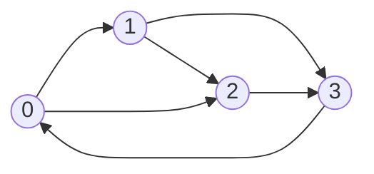

# Matrix exponentiation, counting and probability

> Data Structures & Algorithms · L4 Expert · Geometry & mathematics · about 115 min · hub module `m08` ([open the hub](https://claude.ai/artifact/DxduaMdo2n5kqrt3We8PPZ))

## Why it matters
“How many ways…?” and “what's the chance…?” questions fill interviews and contests, and they often ask about n = 10¹⁸, far too many steps to simulate. A DP that moves between a fixed set of states each step is a matrix, and repeated squaring jumps n steps in O(log n). Add a few counting rules and linearity of expectation, and a whole family of problems reduces to a small table and a power.

## Pre-question (answer before reading)
**Q:** The Fibonacci rule is f(n) = f(n − 1) + f(n − 2). Can you get from the pair (f(n − 1), f(n − 2)) to the pair (f(n), f(n − 1)) by multiplying by one fixed 2 × 2 table of numbers?

<details><summary>Answer</summary>

Yes: [[1, 1], [1, 0]] times (f(n − 1), f(n − 2)) gives (f(n − 1) + f(n − 2), f(n − 1)) = (f(n), f(n − 1)). So n steps are that matrix to the n-th power, and squaring it repeatedly reaches f(10¹⁸) in about 60 squarings.

</details>

## 🍎 Story time (kid version)
**The toy room and the treasure-map road trip: Ben's doubling machine**

Ben has a toy machine that turns today's pair of numbers into tomorrow's pair, always by the same rule. To jump far ahead, he builds a second machine that does two days at once by running the first one twice, then a four-day machine from two two-day machines, then eight, sixteen and so on. To jump 13 days he chains the 8-day, 4-day and 1-day machines. Tara points out that the rule must be the same every day, or the machines couldn't be reused.

| In the story | In code |
|---|---|
| Today's pair of numbers | The state vector, such as (f(n), f(n − 1)) |
| The machine that does one day | The transition matrix C |
| A two-day machine made of two one-day machines | C² = C × C: squaring |
| Chaining the 8-, 4- and 1-day machines for 13 days | C¹³ = C⁸ · C⁴ · C¹, from the binary digits of 13 |
| The rule must be the same every day | Only linear recurrences with fixed coefficients become a fixed matrix |

**Where the story breaks:** Ben's machines handle small numbers, but these values grow exponentially, so code works modulo 10⁹ + 7, and a product of two residues reaches about 10¹⁸: past 2⁵³, so JavaScript needs BigInt. And each matrix product costs O(d³) for d states, so the trick only pays when there are few states and n is huge.

## Key ideas (grown-up version)
- **Linear recurrences as matrices**: if f(n) = c₁f(n − 1) + … + c_d f(n − d) with fixed coefficients, keep the last d values in a vector. One step is a fixed d × d matrix C (the companion matrix), so n steps are Cⁿ applied to the starting vector.
- **Repeated squaring**: as with numbers in L3, Cⁿ needs about log₂ n squarings and at most as many extra products, chosen by the 1 bits of n. Each product of d × d matrices is O(d³), so the total is O(d³ log n) time and O(d²) space: about 60 squarings of a 2 × 2 matrix for F(10¹⁸).
- **Counting walks**: with A[u][v] the number of edges u → v, entry (s, t) of Aᵏ is the number of walks from s to t with exactly k edges. Swap (+, ×) for (min, +) and the same power gives the cheapest walk with exactly k edges (CSES 1724).
- **A DP over a few states is a matrix**: when every step moves between the same small set of states (the digit a knight stands on, the last vowel written, absences and lates so far), the transitions form a matrix, and n steps of the DP become one matrix power when n is huge.
- **Counting tools**: stars and bars puts n identical items into m boxes in C(n + m − 1, m − 1) ways; inclusion–exclusion counts what avoids every bad property, such as derangements, D(n) = (n − 1)(D(n − 1) + D(n − 2)); Catalan numbers C(2m, m) / (m + 1) count balanced bracket strings of length 2m.
- **Probability DP**: a state's probability is the sum, over the states that lead to it, of their probability times the step's probability. When each state draws on a sliding range of earlier states (LeetCode 837), keep a running window sum: O(n) instead of O(n × window).
- **Expected values**: linearity of expectation, E[X + Y] = E[X] + E[Y], holds even when X and Y depend on each other, so an expected count is the sum of the individual events' probabilities. Expected steps follow their own DP: E[state] = 1 + Σ p · E[next state].
- **Staying exact**: answers modulo 10⁹ + 7 need BigInt products in JavaScript; a probability p / q “modulo M” is p · q^(M − 2) mod M for a prime M (Fermat); floating-point probabilities are printed to the required decimals and never compared with ==.

## Diagrams
**Repeated squaring of the Fibonacci matrix M = [[1, 1], [1, 0]]**

| M¹ | 0 | 1 | 2 | 3 |
|---|---|---|---|---|
| value | 1 | 1 | 1 | 0 |

| M² | 0 | 1 | 2 | 3 |
|---|---|---|---|---|
| value | 2 | 1 | 1 | 1 |

| M⁴ | 0 | 1 | 2 | 3 |
|---|---|---|---|---|
| value | 5 | 3 | 3 | 2 |

| M⁸ | 0 | 1 | 2 | 3 |
|---|---|---|---|---|
| value | 34 | 21 | 21 | 13 |

| M¹³ | 0 | 1 | 2 | 3 |
|---|---|---|---|---|
| value | 377 | **233** | 233 | 144 |

_Each row lists a matrix's four entries (top-left, top-right, bottom-left, bottom-right), and squaring doubles the power: M⁸ = (M⁴)². Since 13 = 8 + 4 + 1, M¹³ = M⁸ · M⁴ · M¹, and its top-right entry is F(13) = 233: three squarings and two extra products instead of twelve multiplications._

**Counting walks from 0 to 3 with the adjacency matrix (code block 2)**



_Walks from 0 to 3: none with 1 edge, two with 2 (0 → 1 → 3 and 0 → 2 → 3), one with 3 (0 → 1 → 2 → 3), none with 4, and four each with 5 and 6 edges. Those are the top-right entries of A¹ to A⁶; A^(10⁹) takes about 30 squarings._

## Comparisons
**From a DP to a matrix power**

| Problem | State | Matrix | Cost for huge n |
|---|---|---|---|
| Fibonacci numbers (CSES 1722) | (F(n), F(n − 1)) | 2 × 2 | O(log n) |
| Throwing Dice (CSES 1096) | The last 6 counts | 6 × 6 | O(6³ log n) |
| Knight Dialer (LeetCode 935) | The digit the knight is on | 10 × 10 | O(10³ log n) |
| Walks with exactly k edges (CSES 1723) | The vertex you're on | V × V adjacency | O(V³ log k) |
| Cheapest walk with exactly k edges (CSES 1724) | The vertex you're on | V × V with (min, +) | O(V³ log k) |

**Which counting tool?**

| Question | Tool | Formula |
|---|---|---|
| n identical items into m boxes | Stars and bars | C(n + m − 1, m − 1) |
| Arrangements where nothing stays in its place | Inclusion–exclusion (derangements) | D(n) = (n − 1)(D(n − 1) + D(n − 2)) |
| Balanced bracket strings of length 2m | Catalan numbers | C(2m, m) / (m + 1) |
| The expected number of events that happen | Linearity of expectation | Σ P(event i) |
| A probability p / q modulo a prime M | Fermat's inverse | p · q^(M − 2) mod M |

## Code (JavaScript + Python)
### Matrix multiplication and power modulo 10⁹ + 7, used by every example below (BigInt in JavaScript)
```python
MOD = 10**9 + 7

def mat_mul(A, B):                              # (A x B) mod MOD
    C = [[0] * len(B[0]) for _ in range(len(A))]
    for i, row in enumerate(A):
        for k, a in enumerate(row):
            if a:
                Bk, Ci = B[k], C[i]
                for j in range(len(Bk)):
                    Ci[j] = (Ci[j] + a * Bk[j]) % MOD
    return C

def mat_pow(M, e):                              # M^e mod MOD by repeated squaring: O(d^3 log e)
    R = [[int(i == j) for j in range(len(M))] for i in range(len(M))]
    while e:
        if e & 1:
            R = mat_mul(R, M)
        M = mat_mul(M, M)
        e >>= 1
    return R
```

```javascript
const MOD = 1000000007n;

function matMul(A, B) {                         // (A x B) mod MOD; entries are BigInt
  const C = Array.from({ length: A.length }, () => new Array(B[0].length).fill(0n));
  for (let i = 0; i < A.length; i++) {
    for (let k = 0; k < B.length; k++) {
      const a = A[i][k];
      if (a === 0n) continue;
      for (let j = 0; j < B[k].length; j++) C[i][j] = (C[i][j] + a * B[k][j]) % MOD;
    }
  }
  return C;
}

function matPow(M, e) {                         // M^e mod MOD by repeated squaring; e is a BigInt
  let R = M.map((row, i) => row.map((_, j) => (i === j ? 1n : 0n)));
  for (; e > 0n; e >>= 1n) {
    if (e & 1n) R = matMul(R, M);
    M = matMul(M, M);
  }
  return R;
}
```

### Fibonacci by matrix power, up to n = 10¹⁸
```python
def fib(n):                                   # [[1, 1], [1, 0]]^n = [[F(n + 1), F(n)], [F(n), F(n - 1)]]
    return mat_pow([[1, 1], [1, 0]], n)[0][1]

print(fib(10), fib(50), fib(10**18))
```

Output:
```text
55 586268941 209783453
```

- line 1: Multiplying (F(n − 1), F(n − 2)) by this matrix gives (F(n), F(n − 1)), so its powers carry the whole sequence.
- line 4: F(50) = 12,586,269,025, and 586,268,941 is its remainder modulo 10⁹ + 7. n = 10¹⁸ takes 60 squarings.

```javascript
const fib = n => matPow([[1n, 1n], [1n, 0n]], BigInt(n))[0][1];   // [[F(n + 1), F(n)], [F(n), F(n - 1)]]

console.log(String(fib(10)), String(fib(50)), String(fib(10n ** 18n)));
```

Output:
```text
55 586268941 209783453
```

- line 1: Multiplying (F(n − 1), F(n − 2)) by this matrix gives (F(n), F(n − 1)), so its powers carry the whole sequence.
- line 3: F(50) = 12,586,269,025, and 586,268,941 is its remainder modulo 10⁹ + 7. n = 10¹⁸ takes 60 squarings.

### Walks with exactly k edges: powers of the adjacency matrix
```python
def count_walks(n, edges, k):                 # walks of exactly k edges from 0 to n - 1 (CSES 1723)
    A = [[0] * n for _ in range(n)]
    for u, v in edges:
        A[u][v] += 1                          # parallel edges count separately
    return mat_pow(A, k)[0][n - 1]

edges = [(0, 1), (0, 2), (1, 3), (2, 3), (3, 0), (1, 2)]
print(*(count_walks(4, edges, k) for k in range(1, 7)), count_walks(4, edges, 10**9))
```

Output:
```text
0 2 1 0 4 4 456615956
```

- line 4: A[u][v] counts the edges from u to v, so one row times one column sums the ways through every middle vertex.
- line 5: Entry [0][n − 1] of A^k counts the walks of exactly k edges from 0 to n − 1, revisits allowed.
- line 8: k = 10⁹ costs about 30 squarings of a 4 × 4 matrix, not 10⁹ steps of the DP.

```javascript
function countWalks(n, edges, k) {            // walks of exactly k edges from 0 to n - 1 (CSES 1723)
  const A = Array.from({ length: n }, () => new Array(n).fill(0n));
  for (const [u, v] of edges) A[u][v] += 1n;  // parallel edges count separately
  return matPow(A, BigInt(k))[0][n - 1];
}

const edges = [[0, 1], [0, 2], [1, 3], [2, 3], [3, 0], [1, 2]];
console.log(...[1, 2, 3, 4, 5, 6].map(k => String(countWalks(4, edges, k))), String(countWalks(4, edges, 10 ** 9)));
```

Output:
```text
0 2 1 0 4 4 456615956
```

- line 3: A[u][v] counts the edges from u to v, so one row times one column sums the ways through every middle vertex.
- line 4: Entry [0][n − 1] of A^k counts the walks of exactly k edges from 0 to n − 1, revisits allowed.
- line 8: k = 10⁹ costs about 30 squarings of a 4 × 4 matrix, not 10⁹ steps of the DP.

### A probability DP with a sliding window: New 21 Game
```python
def new21_game(n, k, max_pts):                # P(final score <= n): draw 1..max_pts at random while the score is < k
    if k == 0 or n >= k - 1 + max_pts:
        return 1.0                            # every possible final score is <= n
    dp = [0.0] * (n + 1)
    dp[0], window, ans = 1.0, 1.0, 0.0        # window: the total probability of the last max_pts drawing scores
    for s in range(1, n + 1):
        dp[s] = window / max_pts              # reach s from any of them with one draw
        if s < k:
            window += dp[s]                   # s still draws, so it feeds later scores
        else:
            ans += dp[s]                      # the game stops at s
        if 0 <= s - max_pts < k:
            window -= dp[s - max_pts]         # that score is now too far back to reach s + 1
    return ans

print(*(f"{new21_game(*c):.5f}" for c in [(10, 1, 10), (6, 1, 10), (21, 17, 10)]))
```

Output:
```text
1.00000 0.60000 0.73278
```

- line 3: The highest possible final score is k − 1 + max_pts, so if that's still ≤ n, the answer is certainly 1.
- line 7: Each of the last max_pts drawing scores reaches s with probability 1/max_pts: one division instead of a loop.
- line 12: Adding the newest score and dropping the oldest keeps the window right in O(1), so the whole DP is O(n).

```javascript
function new21Game(n, k, maxPts) {            // P(final score <= n): draw 1..maxPts at random while the score is < k
  if (k === 0 || n >= k - 1 + maxPts) return 1;   // every possible final score is <= n
  const dp = new Array(n + 1).fill(0);
  dp[0] = 1;
  let window = 1, ans = 0;                    // window: the total probability of the last maxPts drawing scores
  for (let s = 1; s <= n; s++) {
    dp[s] = window / maxPts;                  // reach s from any of them with one draw
    if (s < k) window += dp[s];               // s still draws, so it feeds later scores
    else ans += dp[s];                        // the game stops at s
    if (s - maxPts >= 0 && s - maxPts < k) window -= dp[s - maxPts];   // too far back to reach s + 1
  }
  return ans;
}

console.log(...[[10, 1, 10], [6, 1, 10], [21, 17, 10]].map(c => new21Game(...c).toFixed(5)));
```

Output:
```text
1.00000 0.60000 0.73278
```

- line 2: The highest possible final score is k − 1 + maxPts, so if that's still ≤ n, the answer is certainly 1.
- line 7: Each of the last maxPts drawing scores reaches s with probability 1/maxPts: one division instead of a loop.
- line 10: Adding the newest score and dropping the oldest keeps the window right in O(1), so the whole DP is O(n).

## Worked example
**Problem.** A chess knight stands on a phone keypad (1–9 in three rows, 0 below 8) and dials a digit every time it lands. How many distinct numbers of length n can it dial, modulo 10⁹ + 7? (LeetCode 935, Knight Dialer)

1. The state is the digit the knight is on. From each digit it can move only to fixed digits: 1 → 6 or 8, 4 → 0, 3 or 9, 5 → nowhere, and so on.
2. Write those moves as a 10 × 10 matrix T with T[d][e] = 1 when the knight can jump from d to e. Then numbers of length n are walks with n − 1 moves.
3. The count is the sum of every entry of T^(n − 1): any start digit, any end digit. A plain DP over n steps also works for LeetCode's n ≤ 5000; the matrix power handles n = 10¹⁸.
4. O(10³ log n) time with the matrix, or O(10 n) with the DP; O(10²) space.

```python
MOVES = {0: [4, 6], 1: [6, 8], 2: [7, 9], 3: [4, 8], 4: [0, 3, 9], 5: [], 6: [0, 1, 7], 7: [2, 6], 8: [1, 3], 9: [2, 4]}

def knight_dialer(n):                         # numbers of length n that the knight can dial
    T = [[0] * 10 for _ in range(10)]
    for d, nxt in MOVES.items():
        for e in nxt:
            T[d][e] = 1                       # one knight move from d to e
    P = mat_pow(T, n - 1)
    return sum(map(sum, P)) % MOD             # every start digit, every end digit

print(knight_dialer(1), knight_dialer(2), knight_dialer(3131))
```

Output:
```text
10 20 136006598
```

```javascript
const MOVES = [[4, 6], [6, 8], [7, 9], [4, 8], [0, 3, 9], [], [0, 1, 7], [2, 6], [1, 3], [2, 4]];

function knightDialer(n) {                    // numbers of length n that the knight can dial
  const T = Array.from({ length: 10 }, () => new Array(10).fill(0n));
  MOVES.forEach((nxt, d) => { for (const e of nxt) T[d][e] = 1n; });   // one knight move from d to e
  const P = matPow(T, BigInt(n - 1));
  return P.flat().reduce((a, b) => a + b, 0n) % MOD;   // every start digit, every end digit
}

console.log(String(knightDialer(1)), String(knightDialer(2)), String(knightDialer(3131)));
```

Output:
```text
10 20 136006598
```

**Answer.** 10, 20 and 136006598. With one digit the knight dials any of the 10 keys; with two, the 20 knight moves on the keypad (5 has none); and 3131 digits give LeetCode's third example, after about 12 squarings of the matrix.

## Your turn (faded example)
**Problem.** Count the ways to tile a 2 × n board with 2 × 1 dominoes (either way round) and L-shaped trominoes (any rotation), modulo 10⁹ + 7, for n up to 10¹⁵. (LeetCode 790, Domino and Tromino Tiling, asks up to n = 1000.)

- ✓ Small boards give f(0) = 1, f(1) = 1, f(2) = 2 and f(3) = 5, and the cases of how the left end is covered lead to f(n) = 2f(n − 1) + f(n − 3).
- **Which vector and matrix turn this into a matrix power?**
  <details><summary>Answer</summary>The vector (f(n), f(n − 1), f(n − 2)) comes from (f(n − 1), f(n − 2), f(n − 3)) through C = [[2, 0, 1], [1, 0, 0], [0, 1, 0]]: the first row is the recurrence, the others shift the values down.</details>
- **How do you get f(n) from C?**
  <details><summary>Answer</summary>Start from (f(2), f(1), f(0)) = (2, 1, 1) and apply C^(n − 2): f(n) is the first row of C^(n − 2) times (2, 1, 1).</details>
- **Time and space?**
  <details><summary>Answer</summary>O(3³ log n) time and O(1) space, about 50 squarings for n = 10¹⁵; the plain DP is O(n).</details>

Starter:
```python
def num_tilings(n):                           # 2 x n board, dominoes and L-trominoes, mod 10^9 + 7
    if n <= 2:
        return [1, 1, 2][n]
    C = [[2, 0, 1], [1, 0, 0], [0, 1, 0]]     # (f(n), f(n-1), f(n-2)) from (f(n-1), f(n-2), f(n-3))
    ...                                       # TODO: apply C^(n - 2) to (f(2), f(1), f(0))
```

```javascript
function numTilings(n) {                      // 2 x n board, dominoes and L-trominoes, mod 10^9 + 7
  if (n <= 2) return [1n, 1n, 2n][n];
  const C = [[2n, 0n, 1n], [1n, 0n, 0n], [0n, 1n, 0n]];   // (f(n), f(n-1), f(n-2)) from (f(n-1), f(n-2), f(n-3))
  // TODO: apply C^(n - 2) to (f(2), f(1), f(0))
}
```

<details><summary>Full solution</summary>

```python
def num_tilings(n):                           # 2 x n board, dominoes and L-trominoes, mod 10^9 + 7
    if n <= 2:
        return [1, 1, 2][n]
    C = [[2, 0, 1], [1, 0, 0], [0, 1, 0]]     # (f(n), f(n-1), f(n-2)) from (f(n-1), f(n-2), f(n-3))
    P = mat_pow(C, n - 2)
    return (P[0][0] * 2 + P[0][1] * 1 + P[0][2] * 1) % MOD   # the first row times (f(2), f(1), f(0))

print(num_tilings(3), num_tilings(1), num_tilings(30), num_tilings(10**15))
```

Output:
```text
5 1 312342182 658481614
```

```javascript
function numTilings(n) {                      // 2 x n board, dominoes and L-trominoes, mod 10^9 + 7
  if (n <= 2) return [1n, 1n, 2n][n];
  const C = [[2n, 0n, 1n], [1n, 0n, 0n], [0n, 1n, 0n]];   // (f(n), f(n-1), f(n-2)) from (f(n-1), f(n-2), f(n-3))
  const P = matPow(C, BigInt(n) - 2n);
  return (P[0][0] * 2n + P[0][1] + P[0][2]) % MOD;   // the first row times (f(2), f(1), f(0))
}

console.log(String(numTilings(3)), String(numTilings(1)), String(numTilings(30)), String(numTilings(10n ** 15n)));
```

Output:
```text
5 1 312342182 658481614
```

</details>

## Socratic checks and quiz (answers hidden)
**1. What does this print? (`mat_pow` / `matPow` is this module's helper.)**

```python
P = mat_pow([[1, 1], [1, 0]], 5)
print(*P[0], *P[1])
```

```javascript
const P = matPow([[1n, 1n], [1n, 0n]], 5n);
console.log(...P.flat().map(String));
```

- A. 8 5 5 3
- B. 5 3 3 2
- C. 13 8 8 5
- D. 8 5 3 2

<details><summary>Answer</summary>

8 5 5 3. The n-th power of [[1, 1], [1, 0]] is [[F(n + 1), F(n)], [F(n), F(n − 1)]], so the 5th power is [[8, 5], [5, 3]]. The 4th power would be 5 3 3 2, and the 6th 13 8 8 5.

</details>

**2. What does this print?**

```python
A = [[0, 1, 1], [1, 0, 1], [1, 1, 0]]       # a triangle: every pair of vertices joined
A2, A3 = mat_pow(A, 2), mat_pow(A, 3)
print(A2[0][0], A3[0][0], A3[0][1])
```

```javascript
const A = [[0n, 1n, 1n], [1n, 0n, 1n], [1n, 1n, 0n]];   // a triangle: every pair of vertices joined
const A2 = matPow(A, 2n), A3 = matPow(A, 3n);
console.log(String(A2[0][0]), String(A3[0][0]), String(A3[0][1]));
```

- A. 2 2 3
- B. 2 3 2
- C. 1 2 3
- D. 2 0 3

<details><summary>Answer</summary>

2 2 3. Walks of 2 edges from 0 back to 0 go out and back: 0 → 1 → 0 and 0 → 2 → 0. Of 3 edges, 0 → 1 → 2 → 0 and 0 → 2 → 1 → 0. From 0 to 1 in 3 edges: 0 → 1 → 0 → 1, 0 → 2 → 0 → 1 and 0 → 1 → 2 → 1.

</details>

**3. For an adjacency matrix A, what does entry (s, t) of Aᵏ count?**

- A. The walks from s to t that use exactly k edges
- B. The shortest paths from s to t of length k
- C. The simple paths from s to t with at most k edges
- D. The edges between s and t

<details><summary>Answer</summary>

The walks from s to t that use exactly k edges. Each matrix product sums over a middle vertex, so k products count every sequence of k edges from s to t, revisits included. Shortest paths need (min, +), “at most k” needs a sum of powers, and A itself counts edges.

</details>

**4. Which statements are true? (choose 2)**

- A. A linear recurrence of order d can be evaluated at huge n with a d × d matrix power in O(d³ log n)
- B. Linearity of expectation holds even when the variables depend on each other
- C. Matrix power works for any recurrence, including f(n) = f(n − 1)²
- D. In JavaScript, products of two values below 10⁹ + 7 are exact as Numbers
- E. A probability p / q is stored modulo M as p · q mod M

<details><summary>Answer</summary>

A linear recurrence of order d can be evaluated at huge n with a d × d matrix power in O(d³ log n), Linearity of expectation holds even when the variables depend on each other. Repeated squaring of the companion matrix gives O(d³ log n), and E[X + Y] = E[X] + E[Y] needs no independence. Squaring isn't linear, those products reach about 10¹⁸, and dividing by q means multiplying by its inverse, q^(M − 2), not by q.

</details>

**5. Judge each statement.**

- There are C(n + m − 1, m − 1) ways to put n identical apples into m baskets.
- The expected number of fair coin flips until the first head is 2.
- Multiplying two k × k matrices the usual way takes O(k²) time.
- In New 21 Game, the probabilities of the last max_pts drawing scores can be kept as a running window sum.

<details><summary>Answer</summary>

There are C(n + m − 1, m − 1) ways to put n identical apples into m baskets.: Yes; The expected number of fair coin flips until the first head is 2.: Yes; Multiplying two k × k matrices the usual way takes O(k²) time.: No; In New 21 Game, the probabilities of the last max_pts drawing scores can be kept as a running window sum.: Yes. Stars and bars: arrange n stars and m − 1 bars. The waiting time for a probability-½ event has mean 1/½ = 2. The usual product computes k² entries of k terms each, O(k³). And the window sum is what makes New 21 Game O(n).

</details>

**6. Put the steps of evaluating a linear recurrence with a matrix power in order.**

- (put the steps in order)

<details><summary>Answer</summary>

Write the state as a vector of the last d values → Build the d × d matrix that maps one vector to the next → Raise the matrix to the needed power by repeated squaring → Multiply the result by the starting vector and read off f(n). The matrix needs the vector's layout, the power needs the matrix, and the answer needs both the power and the starting values.

</details>

**7. Complete the Python matrix power (`mat_mul` is this module's helper).**

```
def power(M, e):
    R = [[int(i == j) for j in range(len(M))] for i in range(len(M))]
    while e:
        if {{0}}:
            R = mat_mul(R, M)
        M = {{1}}
        e >>= 1
    return R

```

<details><summary>Answer</summary>

e & 1 | mat_mul(M, M). Multiply the result in when the lowest bit of e is 1, then square M so it stands for the next bit. Squaring R instead, or never squaring, gives the wrong powers.

</details>

**8. Match each problem to its tool.**


<details><summary>Answer</summary>

The n-th Fibonacci number for n = 10¹⁸, mod 10⁹ + 7 = A 2 × 2 matrix power; Walks of exactly k edges from s to t = Entry (s, t) of the adjacency matrix to the k-th power; Ways to give n identical apples to m children = Stars and bars: C(n + m − 1, m − 1); The chance that a card game ends with a score ≤ n = A probability DP with a sliding window sum. A huge n with a fixed linear rule is a matrix power, walk counts are adjacency powers, identical items in boxes are stars and bars, and the card game is a probability DP. Dijkstra finds one cheapest path, not counts or chances.

</details>

## Traps & misconceptions
- **“Matrix power works for any recurrence.”** Only for linear ones with fixed coefficients, such as f(n) = 2f(n − 1) + f(n − 3). f(n) = f(n − 1)², or a coefficient that depends on n, doesn't fit one fixed matrix.
- **“JavaScript Numbers are fine for products modulo 10⁹ + 7.”** Two residues multiply to about 10¹⁸, past 2⁵³, so the low digits are lost before the % runs. Use BigInt, as the helper does, or split each multiplication into smaller parts.
- **“An answer for n = 10¹⁸ needs 10¹⁸ steps.”** Repeated squaring needs only about log₂ n ≈ 60 squarings and at most 60 extra products: O(d³ log n) for d states.
- **“Expected values need independent events.”** Linearity of expectation holds for any random variables: E[X + Y] = E[X] + E[Y]. That's why an expected count is just the sum of each event's probability, dependent or not.
- **“Each probability state must sum all max_pts predecessors.”** When the predecessors form a sliding range, keep a running window sum: add the newest state, subtract the one leaving. O(n × max_pts) becomes O(n).
- **“Floating-point probabilities can be compared with ==.”** They're rounded. Print the required decimals or compare with a tolerance, and when a problem wants p · q⁻¹ mod M, work in modular arithmetic instead.

## Discussion prompts
- **Why does a matrix power compute a linear recurrence?**
  <details><summary>One good answer</summary>Collect the last d values into a vector. One step of the recurrence is a fixed linear map from one vector to the next, which is a d × d matrix C, so n steps are Cⁿ. Matrix multiplication is associative, so Cⁿ can be built by repeated squaring in O(log n) products of O(d³) each.</details>
- **Where do these techniques appear outside contests?**
  <details><summary>One good answer</summary>Markov chains (PageRank is the long-run result of repeatedly applying a transition matrix), reliability and queueing models, game odds, path counting in networks, and population or finance models defined by linear recurrences. Linearity of expectation is also a classic interview tool: a random permutation has, on average, exactly one fixed point, whatever its length.</details>

## Teach-back
**Prompt:** Explain to a junior colleague how matrix exponentiation computes a linear recurrence for huge n, and how a probability DP with a sliding window works.

Rubric:
- [ ] The last d values form a vector, and one step is a fixed d × d matrix
- [ ] Repeated squaring gives Cⁿ in O(d³ log n)
- [ ] Aᵏ counts walks with exactly k edges
- [ ] Probability DP: each state from earlier states, with a running window sum
- [ ] Exactness: modular arithmetic with BigInt in JavaScript; floats with a tolerance

<details><summary>Model answer</summary>

If a sequence follows a fixed linear rule, like f(n) = 2f(n − 1) + f(n − 3), I keep the last few values in a vector, and one step of the rule becomes multiplication by a fixed small matrix. Doing n steps is that matrix to the n-th power, and repeated squaring computes it with about log₂ n multiplications, so even n = 10¹⁸ takes around 60 squarings, at O(d³) each for d values. The same idea counts walks: entry (s, t) of the adjacency matrix to the k-th power is the number of walks of exactly k edges. For probabilities, I write a DP where each state's chance is the sum of the chances of the states that lead to it, times the step's chance; if every state draws on a sliding range of earlier ones, I keep a running window sum so each step is O(1). In JavaScript the modular products need BigInt, and I never compare floating-point probabilities with ==.

</details>

## Quick Q&A (also in the SRS deck)
- **What does entry (s, t) of Aᵏ count, for an adjacency matrix A?** The walks from s to t with exactly k edges.
- **How fast is a d-term linear recurrence at n with a matrix power?** O(d³ log n).
- **What does linearity of expectation say?** E[X + Y] = E[X] + E[Y] for any random variables, dependent or not.
- **How many ways can n identical items go into m boxes?** C(n + m − 1, m − 1): stars and bars.
- **How is a probability p / q stored modulo a prime M?** p · q^(M − 2) mod M, using Fermat's little theorem for the inverse of q.
- **Why does JavaScript need BigInt for matrix powers modulo 10⁹ + 7?** A product of two residues reaches about 10¹⁸, past 2⁵³.

## Practice problems
- [ ] [LC 1137 · N-th Tribonacci Number](https://leetcode.com/problems/n-th-tribonacci-number/) · Easy · a 3 × 3 matrix power, or three rolling variables for n ≤ 37
- [ ] [LC 790 · Domino and Tromino Tiling](https://leetcode.com/problems/domino-and-tromino-tiling/) · Medium · the faded example: f(n) = 2f(n − 1) + f(n − 3)
- [ ] [LC 935 · Knight Dialer](https://leetcode.com/problems/knight-dialer/) · Medium · the worked example: a 10 × 10 knight-move matrix
- [ ] [LC 837 · New 21 Game](https://leetcode.com/problems/new-21-game/) · Medium · a probability DP with a running window sum (code block 3)
- [ ] [LC 688 · Knight Probability in Chessboard](https://leetcode.com/problems/knight-probability-in-chessboard/) · Medium · a probability DP over (moves left, square): each move sends 1/8 to every landing square, on the board or off it
- [ ] [LC 808 · Soup Servings](https://leetcode.com/problems/soup-servings/) · Medium · memoise over the amounts left in units of 25 ml; for large n the answer is within 10⁻⁵ of 1, so a cut-off keeps the memo small
- [ ] [LC 1220 · Count Vowels Permutation](https://leetcode.com/problems/count-vowels-permutation/) · Hard · a 5 × 5 matrix of which vowel may follow which; a DP in O(5n) also passes
- [ ] [LC 552 · Student Attendance Record II](https://leetcode.com/problems/student-attendance-record-ii/) · Hard · states (absences so far, current run of lates): 6 states, a DP in O(n) or a 6 × 6 matrix power
- [ ] [CSES 1722 · Fibonacci Numbers](https://cses.fi/problemset/task/1722) · code block 1, for n up to 10¹⁸
- [ ] [CSES 1096 · Throwing Dice](https://cses.fi/problemset/task/1096) · f(n) = f(n − 1) + … + f(n − 6): a 6 × 6 matrix power for n up to 10¹⁸
- [ ] [CSES 1723 · Graph Paths I](https://cses.fi/problemset/task/1723) · code block 2: one power of the adjacency matrix
- [ ] [CSES 1724 · Graph Paths II](https://cses.fi/problemset/task/1724) · the same power with (min, +) in place of (+, ×): the cheapest walk with exactly k edges
- [ ] [CSES 1716 · Distributing Apples](https://cses.fi/problemset/task/1716) · stars and bars, with factorials and inverses modulo 10⁹ + 7 (L3)
- [ ] [CSES 1725 · Dice Probability](https://cses.fi/problemset/task/1725) · a probability DP over (dice thrown, sum), printed to six decimals

## Sources (accessed 2026-10-09)
- [cp-algorithms: Binary exponentiation (including matrices and linear recurrences)](https://cp-algorithms.com/algebra/binary-exp.html)
- [cp-algorithms: Fibonacci numbers](https://cp-algorithms.com/algebra/fibonacci-numbers.html)
- [cp-algorithms: Number of paths of fixed length](https://cp-algorithms.com/graph/fixed_length_paths.html)
- [cp-algorithms: Stars and bars](https://cp-algorithms.com/combinatorics/stars_and_bars.html)
- [Antti Laaksonen, Competitive Programmer's Handbook (free PDF), chapters 22–24: combinatorics, matrices and probability](https://cses.fi/book/book.pdf)
