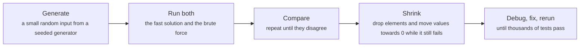
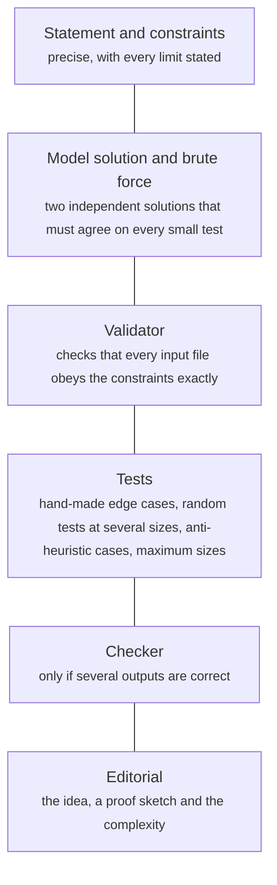

# Stress testing, problem setting and teaching

> Data Structures & Algorithms · L4 Expert · Expert technique & teaching · about 110 min · hub module `m10` ([open the hub](https://claude.ai/artifact/DxduaMdo2n5kqrt3We8PPZ))

## Why it matters
At expert level a clever idea is worth nothing if one edge case breaks it, and a wrong answer on a hidden test scores zero. Stress testing (a slow but obviously correct brute force, a seeded random generator and a loop that compares them) finds those bugs in seconds. Setting a problem turns the same discipline around, and teaching is the final test of whether you really own an idea.

## Pre-question (answer before reading)
**Q:** Your fast solution passes all the examples, but the judge says “Wrong answer on test 17” and won't show the test. How could you find a failing input yourself, quickly, without guessing?

<details><summary>Answer</summary>

Write a slow solution that is obviously correct, generate thousands of small random inputs, and run both until they disagree. The first disagreement is a failing input you can read; shrink it to the smallest version that still fails, and the bug usually becomes obvious.

</details>

## 🍎 Story time (kid version)
**The toy room and the treasure-map road trip: Ben's answer checker**

Ben has a quick way to add up big piles of numbers in his head, and Tara doesn't trust it. So she writes out a hundred little sums on cards, using small numbers she can check slowly on her fingers. They race through the cards: Ben answers fast, Tara checks slowly. On card 37 the answers differ. Tara crosses out numbers one by one while the answers still disagree, until only two numbers are left, and now Ben can see exactly where his trick goes wrong.

| In the story | In code |
|---|---|
| Ben's quick way of adding | The fast solution under test |
| Tara checking slowly on her fingers | The brute force: slow but obviously correct |
| A hundred little sums with small numbers | A generator of small random inputs |
| Racing through the cards until card 37 differs | Comparing both solutions until the first disagreement |
| Crossing out numbers while they still disagree | Shrinking the failing input to a minimal one |

**Where the story breaks:** Tara picks her cards by hand, but code uses a seeded random generator, so the same cards come back every run and a failure can be replayed exactly. And small cards miss some bugs: overflow and time limits only show up with huge values and huge sizes, so those need their own tests.

## Key ideas (grown-up version)
- **Stress testing**: run the fast solution and an obviously correct brute force on thousands of small random inputs and stop at the first disagreement. It finds most wrong-answer bugs in seconds, long before a judge or an interviewer does.
- **The brute force is the oracle**: write it straight from the definition, sharing no helpers with the fast code, and don't worry about speed: O(n³) or exponential is fine for n ≤ 8. For tiny sizes you can even test every input exhaustively.
- **Generators**: tiny sizes and tiny value ranges (0 to 3) make duplicates, ties and edge cases common, and a failing case stays readable. Add special shapes on purpose: empty, n = 1, all equal, sorted, reversed, and values at the limits.
- **Reproducibility**: seed the generator and print the seed or the input of every failure. Python's random module takes a seed, but JavaScript's Math.random can't be seeded, so the helper ports mulberry32 to both languages: the same seed gives the same tests in each.
- **Shrinking**: a failing input is easiest to debug when it's minimal. Keep dropping an element or moving a value towards 0 while the test still fails (delta debugging). Property-based testing libraries such as Hypothesis (Python) and fast-check (JavaScript) do this automatically.
- **Small tests miss some bugs**: overflow and precision errors need values at the top of the range (a JavaScript Number loses digits past 2⁵³), and time-limit or recursion-depth problems need inputs at the maximum size. Give those their own generators.
- **Problem setting**: a statement, exact constraints, a model solution, a brute force, a validator that checks every input file, generators, edge and anti-heuristic tests, a checker when several answers are accepted, and an editorial that proves the solution. Run the wrong solutions you can think of to make sure the tests reject them.
- **Teaching and practice**: explain the idea in one sentence, work a small example, say why it's correct and what it costs, then hand over a faded example and name the first trap. Practise on your own code too: stress test your L3 answers to LeetCode 862 and 1044 and this level's templates (Dinic, the suffix array, the convex hull trick) before relying on them.

## Diagrams
**The stress-testing loop**



**What a problem setter ships**



## Comparisons
**Which tests catch which bugs?**

| Kind of test | Catches | Example |
|---|---|---|
| Tiny random inputs with tiny values | Logic errors, off-by-one, ties | Arrays of length ≤ 8 with values 0 to 3 |
| Every input up to a small size | Rare small patterns that random tests skip | All arrays of length ≤ 3 over {0, 1, 2} |
| Hand-made edge cases | Forgotten special cases | n = 1, empty, all equal, sorted, reversed |
| Extreme values | Overflow and precision | Values near 10⁹ or 10¹⁸; products past 2⁵³ in JavaScript |
| Large inputs | Time limits and recursion depth | n at the maximum, a path-shaped tree |
| Anti-heuristic cases | Plausible but wrong ideas | A case built so that the greedy choice fails |

## Code (JavaScript + Python)
### A seeded random generator (identical in Python and JavaScript) and a shrinker, used below
```python
def mulberry32(seed):                           # a tiny seeded generator of floats in [0, 1), same as the JavaScript one
    state = seed & 0xFFFFFFFF
    def rand():
        nonlocal state
        state = (state + 0x6D2B79F5) & 0xFFFFFFFF
        t = ((state ^ (state >> 15)) * (state | 1)) & 0xFFFFFFFF
        t = (t ^ (t + (((t ^ (t >> 7)) * (t | 61)) & 0xFFFFFFFF))) & 0xFFFFFFFF
        return ((t ^ (t >> 14)) & 0xFFFFFFFF) / 4294967296
    return rand

def make_randint(seed):                         # randint(lo, hi), both ends included
    rand = mulberry32(seed)
    return lambda lo, hi: lo + int(rand() * (hi - lo + 1))

def shrink(a, fails):                           # simplify a failing list while it keeps failing
    while True:
        drops = [a[:i] + a[i + 1:] for i in range(len(a))]
        moves = [a[:i] + [a[i] - (1 if a[i] > 0 else -1)] + a[i + 1:] for i in range(len(a)) if a[i] != 0]
        nxt = next((b for b in drops + moves if b and fails(b)), None)   # drop an element, or move a value towards 0
        if nxt is None:
            return a                            # nothing simpler still fails: a is minimal
        a = nxt
```

```javascript
function mulberry32(seed) {                     // a tiny seeded generator of floats in [0, 1), same as the Python one
  return function () {
    seed = (seed + 0x6D2B79F5) | 0;
    let t = Math.imul(seed ^ (seed >>> 15), 1 | seed);
    t = (t + Math.imul(t ^ (t >>> 7), 61 | t)) ^ t;
    return ((t ^ (t >>> 14)) >>> 0) / 4294967296;
  };
}

function makeRandint(seed) {                    // randint(lo, hi), both ends included
  const rand = mulberry32(seed);
  return (lo, hi) => lo + Math.floor(rand() * (hi - lo + 1));
}

function shrink(a, fails) {                     // simplify a failing array while it keeps failing
  for (;;) {
    const drops = a.map((_, i) => [...a.slice(0, i), ...a.slice(i + 1)]);
    const moves = a.flatMap((x, i) => (x === 0 ? [] : [[...a.slice(0, i), x - Math.sign(x), ...a.slice(i + 1)]]));
    const next = [...drops, ...moves].find(b => b.length > 0 && fails(b));   // drop an element, or move a value towards 0
    if (next === undefined) return a;           // nothing simpler still fails: a is minimal
    a = next;
  }
}
```

### A stress test finds a bug, and shrinking makes it obvious
```python
def max_subarray_buggy(a):                    # Kadane, but best starts at 0: wrong when every value is negative
    best = cur = 0
    for x in a:
        cur = max(x, cur + x)
        best = max(best, cur)
    return best

def brute(a):                                 # the definition: try every subarray
    return max(sum(a[i:j]) for i in range(len(a)) for j in range(i + 1, len(a) + 1))

randint = make_randint(42)
for test in range(1, 1001):
    a = [randint(-5, 5) for _ in range(randint(1, 6))]
    if max_subarray_buggy(a) != brute(a):
        print("test", test, "fails on", *a)
        print("fast says", max_subarray_buggy(a), "but the brute force says", brute(a))
        print("shrunk to", *shrink(a, lambda b: max_subarray_buggy(b) != brute(b)))
        break
```

Output:
```text
test 6 fails on -5 -3 -5 -3
fast says 0 but the brute force says -3
shrunk to -1
```

- line 2: The bug: best starts at 0, so an array of negative numbers reports 0, the sum of an empty subarray the problem doesn't allow.
- line 11: Seed 42 gives the same 1,000 tests every run, and the same tests in both languages.
- line 13: Small sizes (1 to 6) and small values (−5 to 5) make an all-negative array likely within a few tests.
- line 17: Shrinking drops elements and moves values towards 0 while the test still fails: [−1] is the smallest failing input.

```javascript
function maxSubarrayBuggy(a) {                // Kadane, but best starts at 0: wrong when every value is negative
  let best = 0, cur = 0;
  for (const x of a) {
    cur = Math.max(x, cur + x);
    best = Math.max(best, cur);
  }
  return best;
}

function brute(a) {                           // the definition: try every subarray
  let best = -Infinity;
  for (let i = 0; i < a.length; i++) for (let j = i + 1; j <= a.length; j++) best = Math.max(best, a.slice(i, j).reduce((s, x) => s + x, 0));
  return best;
}

const randint = makeRandint(42);
for (let test = 1; test <= 1000; test++) {
  const a = Array.from({ length: randint(1, 6) }, () => randint(-5, 5));
  if (maxSubarrayBuggy(a) !== brute(a)) {
    console.log("test", test, "fails on", ...a);
    console.log("fast says", maxSubarrayBuggy(a), "but the brute force says", brute(a));
    console.log("shrunk to", ...shrink(a, b => maxSubarrayBuggy(b) !== brute(b)));
    break;
  }
}
```

Output:
```text
test 6 fails on -5 -3 -5 -3
fast says 0 but the brute force says -3
shrunk to -1
```

- line 2: The bug: best starts at 0, so an array of negative numbers reports 0, the sum of an empty subarray the problem doesn't allow.
- line 16: Seed 42 gives the same 1,000 tests every run, and the same tests in both languages.
- line 18: Small sizes (1 to 6) and small values (−5 to 5) make an all-negative array likely within a few tests.
- line 22: Shrinking drops elements and moves values towards 0 while the test still fails: [−1] is the smallest failing input.

### Extreme values catch what small tests miss: a precision bug
```python
def mulmod_double(a, b, m):                   # what (a * b) % m computes with JavaScript Numbers (doubles)
    return int(float(a) * float(b) % m)

randint = make_randint(2026)
m = 10**9 + 7
for test in range(1, 1001):
    big = randint(0, 1)                       # half the tests use values near the top of the range
    a = randint(10**9 - 1000, m - 1) if big else randint(0, 1000)
    b = randint(10**9 - 1000, m - 1) if big else randint(0, 1000)
    if mulmod_double(a, b, m) != a * b % m:
        print("test", test, "fails:", a, "*", b, "gives", mulmod_double(a, b, m), "instead of", a * b % m)
        break
```

Output:
```text
test 2 fails: 999999153 * 999999223 gives 669593 instead of 669536
```

- line 2: float(a) * float(b) is the same rounded double a JavaScript Number gives, so Python can reproduce the bug exactly.
- line 7: With values only up to 1,000 the products stay below 2⁵³ and every test passes, hiding the bug.
- line 10: The product is about 10¹⁸, where doubles are 128 apart, so the remainder comes out wrong by 57.

```javascript
const mulmodDouble = (a, b, m) => (a * b) % m;   // plain Numbers: the product is rounded above 2^53

const randint = makeRandint(2026);
const m = 1000000007;
for (let test = 1; test <= 1000; test++) {
  const big = randint(0, 1);                  // half the tests use values near the top of the range
  const a = big ? randint(1e9 - 1000, m - 1) : randint(0, 1000);
  const b = big ? randint(1e9 - 1000, m - 1) : randint(0, 1000);
  const exact = Number((BigInt(a) * BigInt(b)) % BigInt(m));
  if (mulmodDouble(a, b, m) !== exact) {
    console.log("test", test, "fails:", a, "*", b, "gives", mulmodDouble(a, b, m), "instead of", exact);
    break;
  }
}
```

Output:
```text
test 2 fails: 999999153 * 999999223 gives 669593 instead of 669536
```

- line 1: a * b is rounded to the nearest double before % runs, so the low digits are already gone.
- line 6: With values only up to 1,000 the products stay below 2⁵³ and every test passes, hiding the bug.
- line 9: BigInt gives the exact remainder to compare against.

### A validator for a problem you set
```python
import re

INT = re.compile(r"-?(0|[1-9][0-9]*)")        # a plain integer: no plus sign, no leading zeros

def validate(text, n_max=200_000, v_max=10**9):   # "OK", or the first broken rule
    if not text.endswith("\n"):
        return "the file must end with a newline"
    lines = text[:-1].split("\n")
    if len(lines) != 2:
        return f"expected 2 lines, found {len(lines)}"
    if not INT.fullmatch(lines[0]):
        return "line 1: n is not a plain integer"
    n = int(lines[0])
    if not 1 <= n <= n_max:
        return f"n = {n} is out of [1, {n_max}]"
    parts = lines[1].split(" ")
    if "" in parts:
        return "line 2: extra or missing spaces"
    if len(parts) != n:
        return f"line 2: expected {n} numbers, found {len(parts)}"
    for i, p in enumerate(parts, 1):
        if not INT.fullmatch(p):
            return f'a[{i}] = "{p}" is not a plain integer'
        if not 1 <= int(p) <= v_max:
            return f"a[{i}] = {p} is out of [1, {v_max}]"
    return "OK"

for t in ["3\n1 2 3\n", "3\n1 2\n", "2\n5 1000000001\n", "0\n\n", "2\n1  2\n", "2\n01 2\n", "2\n1 2"]:
    print(validate(t))
```

Output:
```text
OK
line 2: expected 3 numbers, found 2
a[2] = 1000000001 is out of [1, 1000000000]
n = 0 is out of [1, 200000]
line 2: extra or missing spaces
a[1] = "01" is not a plain integer
the file must end with a newline
```

- line 3: Plain integers only: “+5”, “05” and “5.0” are rejected, because some contestants' parsers would read them differently.
- line 8: Splitting on newlines and counting lines catches extra blank lines as well as missing ones.
- line 17: An empty piece means two spaces in a row, or a space at the start or end of the line.
- line 28: Each input breaks one rule, and the validator names the first rule it breaks.

```javascript
const INT = /^-?(0|[1-9][0-9]*)$/;            // a plain integer: no plus sign, no leading zeros

function validate(text, nMax = 200000, vMax = 1e9) {   // "OK", or the first broken rule
  if (!text.endsWith("\n")) return "the file must end with a newline";
  const lines = text.slice(0, -1).split("\n");
  if (lines.length !== 2) return `expected 2 lines, found ${lines.length}`;
  if (!INT.test(lines[0])) return "line 1: n is not a plain integer";
  const n = Number(lines[0]);
  if (n < 1 || n > nMax) return `n = ${n} is out of [1, ${nMax}]`;
  const parts = lines[1].split(" ");
  if (parts.includes("")) return "line 2: extra or missing spaces";
  if (parts.length !== n) return `line 2: expected ${n} numbers, found ${parts.length}`;
  for (let i = 0; i < n; i++) {
    if (!INT.test(parts[i])) return `a[${i + 1}] = "${parts[i]}" is not a plain integer`;
    const v = Number(parts[i]);
    if (v < 1 || v > vMax) return `a[${i + 1}] = ${parts[i]} is out of [1, ${vMax}]`;
  }
  return "OK";
}

for (const t of ["3\n1 2 3\n", "3\n1 2\n", "2\n5 1000000001\n", "0\n\n", "2\n1  2\n", "2\n01 2\n", "2\n1 2"]) console.log(validate(t));
```

Output:
```text
OK
line 2: expected 3 numbers, found 2
a[2] = 1000000001 is out of [1, 1000000000]
n = 0 is out of [1, 200000]
line 2: extra or missing spaces
a[1] = "01" is not a plain integer
the file must end with a newline
```

- line 1: Plain integers only: “+5”, “05” and “5.0” are rejected, because some contestants' parsers would read them differently.
- line 5: Splitting on newlines and counting lines catches extra blank lines as well as missing ones.
- line 11: An empty piece means two spaces in a row, or a space at the start or end of the line.
- line 21: Each input breaks one rule, and the validator names the first rule it breaks.

## Worked example
**Problem.** Implement atoi: skip leading spaces, read an optional + or −, then digits until the first non-digit, and clamp the result to the 32-bit range [−2³¹, 2³¹ − 1]; anything else gives 0. Then prove your parser right by stress testing it. (LeetCode 8, String to Integer (atoi))

1. Write the rules down in order: spaces, at most one sign, digits, then clamp. Most wrong answers break exactly one rule, often silently (a second sign, a space after the sign, a leading zero).
2. Implement each rule as one small loop or check, and cap the value at 2³¹ while reading, so it never grows without limit (a JavaScript Number would start losing digits past 2⁵³).
3. Write an independent reference: the regular expression ^ *([+-]?[0-9]+) captures exactly the text the rules read, and an exact integer conversion does the rest.
4. Stress test with random strings over a tiny alphabet (space, +, −, digits, a letter, a dot) plus long digit runs for overflow. The parser is O(n) time and O(1) space.

```python
def my_atoi(s):                               # LeetCode 8, following the rules literally
    i, n = 0, len(s)
    while i < n and s[i] == " ":
        i += 1                                # 1. skip leading spaces (spaces only)
    sign = 1
    if i < n and s[i] in "+-":
        sign = -1 if s[i] == "-" else 1       # 2. at most one sign
        i += 1
    num = 0
    while i < n and "0" <= s[i] <= "9":       # 3. digits until the first non-digit
        num = min(num * 10 + ord(s[i]) - 48, 2**31)   # cap at 2^31 so the number never runs away
        i += 1
    return max(-2**31, min(2**31 - 1, sign * num))   # 4. clamp to the 32-bit range

print(*(my_atoi(s) for s in ["42", "   -042", "1337c0d3", "0-1", "words and 987", "-91283472332", "+-12", "   +0 123"]))
```

Output:
```text
42 -42 1337 0 0 -2147483648 0 0
```

```javascript
function myAtoi(s) {                          // LeetCode 8, following the rules literally
  let i = 0;
  const n = s.length;
  while (i < n && s[i] === " ") i++;          // 1. skip leading spaces (spaces only)
  let sign = 1;
  if (i < n && (s[i] === "+" || s[i] === "-")) { sign = s[i] === "-" ? -1 : 1; i++; }   // 2. at most one sign
  let num = 0;
  while (i < n && s[i] >= "0" && s[i] <= "9") {   // 3. digits until the first non-digit
    num = Math.min(num * 10 + (s.charCodeAt(i) - 48), 2 ** 31);   // cap at 2^31 so the number never runs away
    i++;
  }
  return Math.max(-(2 ** 31), Math.min(2 ** 31 - 1, sign * num));   // 4. clamp to the 32-bit range
}

console.log(...["42", "   -042", "1337c0d3", "0-1", "words and 987", "-91283472332", "+-12", "   +0 123"].map(myAtoi));
```

Output:
```text
42 -42 1337 0 0 -2147483648 0 0
```

**Answer.** 42, −42 (the leading zero is just a digit), 1337 (reading stops at “c”), 0 (stops at the “−”), 0 (no number at the start), −2147483648 (clamped), 0 (two signs) and 0 (“+0”, then the space ends the number).

## Your turn (faded example)
**Problem.** A fast inversion counter (merge sort, O(n log n)) is given. Write the brute force and the stress test that would catch a bug in it, and run 500 tests.

- ✓ The fast code counts pairs i < j with a[i] > a[j] while merging. Your job is the test, not a new algorithm.
- **What should the brute force be?**
  <details><summary>Answer</summary>The definition itself: two nested loops counting every pair i < j with a[i] > a[j]. O(n²) is fine for arrays of length ≤ 8; being obviously right matters more than speed.</details>
- **Which inputs find bugs fastest?**
  <details><summary>Answer</summary>Many tiny arrays (length 0 to 8) with tiny values (0 to 3), so equal values, sorted runs and reversed runs turn up constantly. Equal values are where a < versus ≤ mistake in the merge would hide.</details>
- **What should the loop print?**
  <details><summary>Answer</summary>Nothing until something fails; then the test number and the exact input, so the failure can be replayed and shrunk. If all pass, one summary line.</details>

Starter:
```python
def count_inversions(a):                      # merge sort: (pairs i < j with a[i] > a[j], sorted copy)
    if len(a) <= 1:
        return 0, a
    mid = len(a) // 2
    inv_l, left = count_inversions(a[:mid])
    inv_r, right = count_inversions(a[mid:])
    merged, i, j, inv = [], 0, 0, inv_l + inv_r
    while i < len(left) and j < len(right):
        if left[i] <= right[j]:
            merged.append(left[i])
            i += 1
        else:
            merged.append(right[j])
            j += 1
            inv += len(left) - i              # right[j] jumps ahead of every left value still waiting
    return inv, merged + left[i:] + right[j:]

def brute(a):
    ...                                       # TODO: count the pairs straight from the definition

randint = make_randint(7)
...                                           # TODO: 500 tiny random arrays; print the first failure, or a summary
```

```javascript
function countInversions(a) {                 // merge sort: [pairs i < j with a[i] > a[j], sorted copy]
  if (a.length <= 1) return [0, a];
  const mid = a.length >> 1;
  const [invL, left] = countInversions(a.slice(0, mid)), [invR, right] = countInversions(a.slice(mid));
  const merged = [];
  let i = 0, j = 0, inv = invL + invR;
  while (i < left.length && j < right.length) {
    if (left[i] <= right[j]) merged.push(left[i++]);
    else { merged.push(right[j++]); inv += left.length - i; }   // right[j] jumps ahead of every left value still waiting
  }
  return [inv, [...merged, ...left.slice(i), ...right.slice(j)]];
}

function brute(a) {
  // TODO: count the pairs straight from the definition
}

const randint = makeRandint(7);
// TODO: 500 tiny random arrays; print the first failure, or a summary
```

<details><summary>Full solution</summary>

```python
def count_inversions(a):                      # merge sort: (pairs i < j with a[i] > a[j], sorted copy)
    if len(a) <= 1:
        return 0, a
    mid = len(a) // 2
    inv_l, left = count_inversions(a[:mid])
    inv_r, right = count_inversions(a[mid:])
    merged, i, j, inv = [], 0, 0, inv_l + inv_r
    while i < len(left) and j < len(right):
        if left[i] <= right[j]:
            merged.append(left[i])
            i += 1
        else:
            merged.append(right[j])
            j += 1
            inv += len(left) - i              # right[j] jumps ahead of every left value still waiting
    return inv, merged + left[i:] + right[j:]

def brute(a):                                 # the definition, nothing clever
    return sum(1 for i in range(len(a)) for j in range(i + 1, len(a)) if a[i] > a[j])

randint = make_randint(7)
for test in range(1, 501):
    a = [randint(0, 3) for _ in range(randint(0, 8))]
    if count_inversions(a)[0] != brute(a):
        print("test", test, "fails on", *a)
        break
else:
    print("500 tests passed")
```

Output:
```text
500 tests passed
```

```javascript
function countInversions(a) {                 // merge sort: [pairs i < j with a[i] > a[j], sorted copy]
  if (a.length <= 1) return [0, a];
  const mid = a.length >> 1;
  const [invL, left] = countInversions(a.slice(0, mid)), [invR, right] = countInversions(a.slice(mid));
  const merged = [];
  let i = 0, j = 0, inv = invL + invR;
  while (i < left.length && j < right.length) {
    if (left[i] <= right[j]) merged.push(left[i++]);
    else { merged.push(right[j++]); inv += left.length - i; }   // right[j] jumps ahead of every left value still waiting
  }
  return [inv, [...merged, ...left.slice(i), ...right.slice(j)]];
}

function brute(a) {                           // the definition, nothing clever
  let count = 0;
  for (let i = 0; i < a.length; i++) for (let j = i + 1; j < a.length; j++) if (a[i] > a[j]) count++;
  return count;
}

const randint = makeRandint(7);
let failed = false;
for (let test = 1; test <= 500 && !failed; test++) {
  const a = Array.from({ length: randint(0, 8) }, () => randint(0, 3));
  if (countInversions(a)[0] !== brute(a)) { console.log("test", test, "fails on", ...a); failed = true; }
}
if (!failed) console.log("500 tests passed");
```

Output:
```text
500 tests passed
```

</details>

## Socratic checks and quiz (answers hidden)
**1. What does this print?**

```python
from itertools import product
buggy = lambda a: all(a[i] < a[i + 1] for i in range(len(a) - 1))    # "is it sorted?"
right = lambda a: all(a[i] <= a[i + 1] for i in range(len(a) - 1))
first = next(a for n in range(4) for a in product(range(3), repeat=n) if buggy(a) != right(a))
print(*first)
```

```javascript
const buggy = a => a.every((x, i) => i === 0 || a[i - 1] < x);   // "is it sorted?"
const right = a => a.every((x, i) => i === 0 || a[i - 1] <= x);
let first = null;
for (let n = 0; n < 4 && !first; n++) {
  for (let code = 0; code < 3 ** n && !first; code++) {
    const a = Array.from({ length: n }, (_, i) => Math.floor(code / 3 ** (n - 1 - i)) % 3);
    if (buggy(a) !== right(a)) first = a;
  }
}
console.log(...first);
```

- A. 0 0
- B. 0 1
- C. 1 0
- D. 0 0 0

<details><summary>Answer</summary>

0 0. Inputs are tried by length, then in order: (), (0), (1), (2), then (0, 0). For (0, 0) the buggy check says “not sorted” because 0 < 0 is false, while the right one says “sorted”. Every shorter input agrees.

</details>

**2. What does this print? (`shrink` is this module's helper: it tries dropping an element first, then moving a value one step towards 0.)**

```python
print(*shrink([4, 9, 2], lambda b: sum(b) >= 10))
```

```javascript
console.log(...shrink([4, 9, 2], b => b.reduce((s, x) => s + x, 0) >= 10));
```

- A. 8 2
- B. 9 2
- C. 10
- D. 4 9 2

<details><summary>Answer</summary>

8 2. Dropping 4 leaves [9, 2] (sum 11, still failing). Dropping either of those no longer fails, so values move: [8, 2] still sums to 10. From there [7, 2] and [8, 1] both sum to 9, so [8, 2] is minimal.

</details>

**3. What matters most about the brute force in a stress test?**

- A. It's obviously correct, even if it's very slow
- B. It's fast enough for the full constraints
- C. It shares helper functions with the fast solution
- D. It uses random numbers

<details><summary>Answer</summary>

It's obviously correct, even if it's very slow. The brute force is the oracle, so trust is everything and speed doesn't matter on tiny inputs. Sharing helpers would hide shared bugs, and the randomness belongs in the generator.

</details>

**4. Which statements are true? (choose 2)**

- A. Small random inputs with small value ranges find most wrong-answer bugs quickly
- B. Printing the seed or the input of a failing test makes it reproducible
- C. A stress test that passes 10,000 cases proves the solution correct
- D. The brute force should reuse the fast solution's helpers to save time
- E. Math.random can be seeded in JavaScript

<details><summary>Answer</summary>

Small random inputs with small value ranges find most wrong-answer bugs quickly, Printing the seed or the input of a failing test makes it reproducible. Tiny inputs hit edge cases often, and a seed lets you replay a failure. Passing tests is evidence, not proof; shared helpers hide shared bugs; and Math.random takes no seed.

</details>

**5. Judge each statement.**

- Shrinking keeps simplifying a failing input while it still fails.
- A validator checks that test inputs obey the problem's constraints.
- If the fast and slow solutions agree on random tests, n = 1 needs no separate test.
- The same seeded generator produces the same tests every run.

<details><summary>Answer</summary>

Shrinking keeps simplifying a failing input while it still fails.: Yes; A validator checks that test inputs obey the problem's constraints.: Yes; If the fast and slow solutions agree on random tests, n = 1 needs no separate test.: No; The same seeded generator produces the same tests every run.: Yes. Shrinking stops at a minimal failing case. A validator guards the test files themselves. Random tests may never produce n = 1 or other special shapes, so add them by hand. And a fixed seed means a fixed sequence.

</details>

**6. Put the steps of stress testing in order.**

- (put the steps in order)

<details><summary>Answer</summary>

Write an obviously correct brute force → Write a seeded generator of small random inputs → Run both solutions on thousands of inputs until they disagree → Shrink the failing input, then debug the fast solution on it. The loop needs the oracle and the generator, and only a failure gives you something to shrink and debug.

</details>

**7. Complete the Python stress-test loop.**

```
def first_failure(fast, slow, gen, tries):
    for t in range(1, tries + 1):
        case = {{0}}
        if {{1}}:
            return t, case
    return None

```

<details><summary>Answer</summary>

gen() | fast(case) != slow(case). Each try needs a fresh input from the generator, and a test fails when the two answers differ.

</details>

**8. Match each part of a testing setup to its job.**


<details><summary>Answer</summary>

An obviously correct but slow solution = The brute force, used as the oracle; Small random inputs, replayable from a seed = The generator; Checks that every test input obeys the constraints = The validator; Turns a long failing input into a minimal one = Shrinking. The oracle judges answers, the generator supplies inputs, the validator guards the inputs, and shrinking simplifies a failure. The time limit is a constraint, not a testing tool.

</details>

## Traps & misconceptions
- **“It passes the examples, so it's right.”** Examples are chosen to explain the problem, not to break solutions. Stress test against a brute force on thousands of small inputs, and add hand-made edge cases.
- **“Big random tests are the best tests.”** Big inputs find time-limit problems, but a wrong answer on a 10⁵-element input is nearly impossible to debug. Tiny sizes and tiny value ranges hit edge cases far more often, and the failing case is readable.
- **“The brute force can reuse the fast solution's helpers.”** Then a bug in a shared helper appears in both and the test passes anyway. The oracle must be independent and obviously correct, even if it's O(n³) or exponential.
- **“Math.random is fine for reproducible tests.”** It can't be seeded. Use a small seeded generator, such as the helper's mulberry32, and print the seed or the input of every failure.
- **“10,000 passing random tests prove the solution correct.”** They're evidence, not proof: some bugs need huge values (code block 2) or rare structures. Combine stress tests with a written proof idea and hand-made edge cases.
- **“A problem's tests only need random inputs.”** Setters add edge cases (n = 1, all equal, maximum values), anti-heuristic cases that break plausible wrong ideas, maximum-size tests, and a validator run on every input file.

## Discussion prompts
- **What makes a good test set when you set a problem?**
  <details><summary>One good answer</summary>Hand-made edge cases (the smallest sizes, all values equal, sorted and reversed, the maximum values for overflow), random tests at several sizes, cases designed to defeat each plausible wrong idea (a greedy, a missing modulo, deep recursion), and maximum-size tests for timing. A validator checks every input, the model solution and the brute force agree on everything small, and known wrong solutions are run to confirm the tests reject them.</details>
- **Why does teaching a topic improve your own understanding?**
  <details><summary>One good answer</summary>Explaining forces you to recall the idea without notes, put the steps in order and notice the gaps, which are exactly the parts you'd fumble in an interview. A good explanation states the idea in one sentence, works a small example, says why it's correct and what it costs, and names the trap a beginner hits first.</details>

## Teach-back
**Prompt:** Explain to a junior colleague how to stress test a solution, and how to turn a failing random test into something they can debug.

Rubric:
- [ ] An independent, obviously correct brute force
- [ ] A seeded generator of small random inputs with tiny value ranges
- [ ] Compare on thousands of inputs and stop at the first difference
- [ ] Shrink the failing case to a minimal one
- [ ] Extreme-value and edge-case tests too; passing tests is evidence, not proof

<details><summary>Model answer</summary>

First I write a brute force straight from the problem's definition, sharing nothing with my fast solution, and I don't care how slow it is. Then I write a generator that makes small random inputs, say up to eight elements with values from 0 to 3, so duplicates and edge cases come up all the time, and I seed it so every run produces the same tests. A loop runs both solutions on thousands of inputs and stops at the first disagreement, printing the input. I shrink that input, dropping elements and moving values towards zero while it still fails, until I have a tiny case I can trace by hand. Small tests miss overflow and timing problems, so I also run a few tests at the largest values and sizes. Passing all of that is strong evidence, not a proof, so I still write down why the solution is correct.

</details>

## Quick Q&A (also in the SRS deck)
- **What are the parts of a stress test?** A brute force, a seeded random generator, the fast solution, and a loop that compares them.
- **Why use small inputs in stress tests?** Small sizes and value ranges hit edge cases often, and a failing case stays readable.
- **How do you make random tests reproducible?** Seed the generator and print the seed or the input of every failure.
- **What does shrinking do?** It keeps simplifying a failing input while it still fails, leaving a minimal counterexample.
- **What does a validator do?** It checks that every test input obeys the problem's constraints exactly.
- **How do you check that you really understand an algorithm?** Explain it to someone: the idea, an example, why it's correct and what it costs.

## Practice problems
- [ ] [LC 8 · String to Integer (atoi)](https://leetcode.com/problems/string-to-integer-atoi/) · Medium · the worked example: a rule-by-rule parser, stress tested against a regular expression
- [ ] [LC 65 · Valid Number](https://leetcode.com/problems/valid-number/) · Hard · a small state machine for numbers like “-1.5e+10”; stress test it against a regular expression on random strings
- [ ] [LC 468 · Validate IP Address](https://leetcode.com/problems/validate-ip-address/) · Medium · edge cases galore (leading zeros, empty groups, “::”): write the rules out, then stress test them
- [ ] [LC 227 · Basic Calculator II](https://leetcode.com/problems/basic-calculator-ii/) · Medium · a stack of terms; stress test against Python's eval with // on random expressions (all operands are non-negative, so // truncates like the problem asks)
- [ ] [LC 10 · Regular Expression Matching](https://leetcode.com/problems/regular-expression-matching/) · Hard · DP over (i, j); stress test against Python's re.fullmatch or a JavaScript RegExp on random short patterns

## Sources (accessed 2026-10-09)
- [Hypothesis: property-based testing for Python](https://hypothesis.readthedocs.io/)
- [fast-check: property-based testing for JavaScript](https://fast-check.dev/)
- [Codeforces Polygon: the problem-preparation system (validators, generators, checkers)](https://polygon.codeforces.com/)
- [Python documentation: the random module (seeding)](https://docs.python.org/3/library/random.html)
