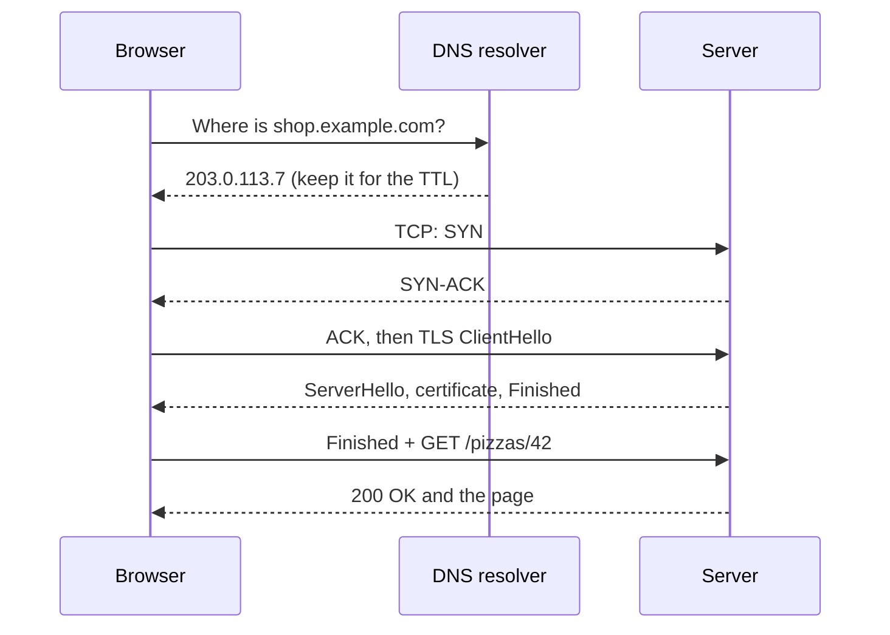
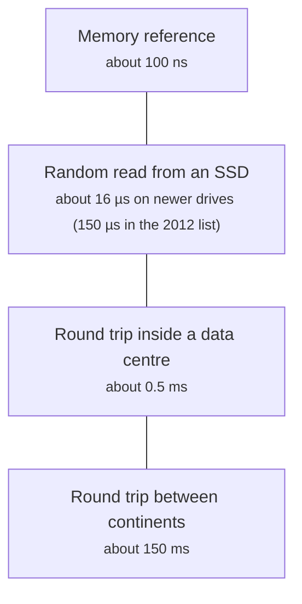

# Client-server and networking: how a request travels

> System Design · L1 Foundation · The request path: networking, proxies and APIs · about 90 min · hub module `m01` ([open the hub](https://claude.ai/artifact/5FDy46yNwWT8pPPZwQUGP9))

## Why it matters
Every system design starts with one request travelling from a phone to a server and back. Most of the time a user waits isn't spent in your code at all: it's DNS lookups, handshakes and the speed of light. Knowing which steps cost a round trip, and roughly how long one takes, is the first estimate in every design.

## Pre-question (answer before reading)
**Q:** Your server answers in 5 ms, yet a user on another continent waits about 600 ms for the first byte of your page. Where could the other 595 ms be going?

<details><summary>Answer</summary>

Mostly round trips. A DNS lookup, the TCP handshake, the TLS handshake and then the request itself each need at least one trip across the ocean and back, about 150 ms each. Fewer round trips (reused connections, TLS 1.3, HTTP/3, a server nearer the user) help far more than a faster server.

</details>

## 🍎 Story time (kid version)
**Pizza Town and the family road trip: Tara phones Luigi's**

Tara wants a pizza from Luigi's. She doesn't know the number, so she looks it up in the town phone book and writes it on her hand for later. She calls, says “Hello, can you hear me?” and waits for “Yes, I can hear you!” before ordering anything. Then she and Luigi agree on a secret code word, so nobody listening in can change the order. Only then does she order, and Luigi reads it back. Ben notices that calling Luigi's other shop, in the next town, takes longer: every hello has to travel there and back.

| In the story | In a real system |
|---|---|
| Looking up Luigi's number in the phone book | DNS turns a name like shop.example.com into an IP address |
| Writing the number on her hand for later | Caching the DNS answer for its time to live (TTL) |
| “Can you hear me?” — “Yes, I can hear you!” | The TCP handshake: one round trip before any data |
| Agreeing on a secret code word | The TLS handshake: keys for encryption, one more round trip with TLS 1.3 |
| Every hello travelling to the next town and back | Round-trip time (RTT): distance sets a floor on latency |

**Where the story breaks:** A phone call is one conversation at a time, but a browser opens several connections and HTTP/2 sends many requests over one. And the code word isn't agreed in the open: TLS uses a key exchange, so someone who hears every message still can't work out the key.

## Key ideas (grown-up version)
- **The request path**: the browser turns a name into an IP address (DNS), opens a connection to that address (TCP), secures it (TLS), then sends an HTTP request and reads the response. Every step that waits for the other side costs at least one round trip.
- **DNS**: a recursive resolver asks a root server, then the top-level domain's servers (such as .com), then the domain's own authoritative servers, and caches each answer for its TTL. A cached answer comes back in about a millisecond; a cold lookup can take tens of milliseconds or more.
- **TCP and UDP**: TCP gives a reliable, ordered byte stream and starts with a three-way handshake, one round trip before any data. UDP sends independent datagrams with no handshake and no delivery promise; it suits DNS queries, voice, video and games, and it carries QUIC.
- **HTTP**: a request (method, path, headers, optional body) and a response (status code, headers, body). HTTP/1.1 sends one request at a time on a connection (keep-alive lets the next request reuse it), HTTP/2 multiplexes many requests over one TCP connection, and HTTP/3 runs over QUIC on UDP.
- **TLS**: HTTPS is HTTP inside TLS, which encrypts the whole HTTP message and proves the server's identity with a certificate. TLS 1.3 needs one round trip to set up a new connection (TLS 1.2 needed two) and can resume a recent one with none.
- **Latency and bandwidth**: latency is how long one trip takes; bandwidth is how much fits through each second. Light in optical fibre covers about 200 km per millisecond, so a 6,000 km distance means a round trip of at least about 60 ms, whatever the bandwidth.
- **Latency numbers to know**: roughly 100 ns for a memory reference, 16–150 µs for a random SSD read (newer drives are faster), about 0.5 ms for a round trip inside a data centre and about 150 ms between continents. Each step is 30 to 300 times the one before, so where data lives decides how fast you can be.
- **Cutting round trips**: reuse connections (keep-alive, HTTP/2), cache DNS answers, use TLS 1.3 or HTTP/3, and serve from somewhere near the user (a CDN, module 6). Removing a round trip usually helps more than a faster server.

## Diagrams
**A cold HTTPS request with TLS 1.3: three round trips before the first byte**



_After the DNS answer: one round trip for TCP, one for TLS 1.3 and one for the request itself. A reused connection skips straight to the GET; HTTP/3 merges the TCP and TLS round trips into one._

**Latency numbers, roughly (Jeff Dean's list, updated by Colin Scott)**



_Each step is 30 to 300 times slower than the one before. Treat these as orders of magnitude for estimates, not measurements of your system._

## Comparisons
**TCP, UDP and QUIC**

|  | TCP | UDP | QUIC (under HTTP/3) |
|---|---|---|---|
| Setting up | Three-way handshake: 1 round trip, then TLS | Nothing: just send | 1 round trip including TLS 1.3; 0 when resuming |
| Delivery | Reliable: lost data is sent again | Best effort: datagrams can be lost or reordered | Reliable, per stream |
| One lost packet | Stalls everything behind it | Affects only that datagram | Stalls only its own stream |
| Typical use | Web over HTTP/1.1 and HTTP/2, databases, SSH | DNS queries, voice and video calls, games | HTTP/3 |

**HTTP versions**

|  | HTTP/1.1 | HTTP/2 | HTTP/3 |
|---|---|---|---|
| Runs over | TCP | TCP | QUIC, over UDP |
| Requests per connection | One at a time (keep-alive reuses the connection) | Many at once, multiplexed | Many at once, as independent streams |
| Message format | Text | Binary frames | Binary frames |
| Head-of-line blocking | A slow response holds up the next one | A lost TCP packet holds up every stream | Only the stream that lost data waits |

## Code (JavaScript + Python)
### The latency model used by the first example and the quiz
```python
def time_to_first_byte(rtt, server, dns=0, new_conn=True, tls="1.3", http3=False):
    """Milliseconds until the first byte of the response arrives."""
    t = dns                                     # 0 when the name is already cached
    if new_conn:
        if http3:
            t += rtt                            # QUIC sets up transport and TLS 1.3 together: 1 round trip
        else:
            t += rtt                            # the TCP three-way handshake
            t += rtt if tls == "1.3" else 2 * rtt   # TLS 1.3 needs 1 round trip, TLS 1.2 needed 2
    return t + rtt + server                     # the request goes out, the first byte comes back
```

```javascript
function timeToFirstByte(rtt, server, { dns = 0, newConn = true, tls = "1.3", http3 = false } = {}) {
  // milliseconds until the first byte of the response arrives
  let t = dns;                                  // 0 when the name is already cached
  if (newConn) {
    if (http3) t += rtt;                        // QUIC sets up transport and TLS 1.3 together: 1 round trip
    else {
      t += rtt;                                 // the TCP three-way handshake
      t += tls === "1.3" ? rtt : 2 * rtt;       // TLS 1.3 needs 1 round trip, TLS 1.2 needed 2
    }
  }
  return t + rtt + server;                      // the request goes out, the first byte comes back
}
```

### Where the time goes: a latency budget for one request
```python
far = dict(rtt=150, server=5, dns=60)         # a user on another continent
print("cold, TLS 1.2:", time_to_first_byte(**far, tls="1.2"), "ms")
print("cold, TLS 1.3:", time_to_first_byte(**far), "ms")
print("cold, HTTP/3:", time_to_first_byte(**far, http3=True), "ms")
print("warm connection:", time_to_first_byte(150, 5, new_conn=False), "ms")
print("nearby user, cold:", time_to_first_byte(10, 5, dns=20), "ms")
```

Output:
```text
cold, TLS 1.2: 665 ms
cold, TLS 1.3: 515 ms
cold, HTTP/3: 365 ms
warm connection: 155 ms
nearby user, cold: 55 ms
```

- line 2: 60 ms of DNS, then four round trips of 150 ms (TCP, two for TLS 1.2, the request) and 5 ms of work: the server is under 1% of the wait.
- line 3: TLS 1.3 saves a whole round trip: 150 ms for this user, for free.
- line 5: A warm connection skips DNS and both handshakes: one round trip plus the server's 5 ms.
- line 6: The same request from 10 ms away: distance, not code, made the far user wait ten times longer.

```javascript
const far = { dns: 60 };                      // a user on another continent: rtt 150 ms, server 5 ms
console.log("cold, TLS 1.2:", timeToFirstByte(150, 5, { ...far, tls: "1.2" }), "ms");
console.log("cold, TLS 1.3:", timeToFirstByte(150, 5, far), "ms");
console.log("cold, HTTP/3:", timeToFirstByte(150, 5, { ...far, http3: true }), "ms");
console.log("warm connection:", timeToFirstByte(150, 5, { newConn: false }), "ms");
console.log("nearby user, cold:", timeToFirstByte(10, 5, { dns: 20 }), "ms");
```

Output:
```text
cold, TLS 1.2: 665 ms
cold, TLS 1.3: 515 ms
cold, HTTP/3: 365 ms
warm connection: 155 ms
nearby user, cold: 55 ms
```

- line 2: 60 ms of DNS, then four round trips of 150 ms (TCP, two for TLS 1.2, the request) and 5 ms of work: the server is under 1% of the wait.
- line 3: TLS 1.3 saves a whole round trip: 150 ms for this user, for free.
- line 5: A warm connection skips DNS and both handshakes: one round trip plus the server's 5 ms.
- line 6: The same request from 10 ms away: distance, not code, made the far user wait ten times longer.

### What a URL and an HTTP request look like inside
```python
from urllib.parse import urlsplit, parse_qs

url = urlsplit("https://shop.example.com:8443/pizzas/42?size=large&extra=olives")
print(url.scheme, url.hostname, url.port, url.path, parse_qs(url.query)["size"][0])

raw = "GET /pizzas/42 HTTP/1.1\r\nHost: shop.example.com\r\nAccept: application/json\r\nConnection: keep-alive\r\n\r\n"
head, body = raw.split("\r\n\r\n", 1)         # a blank line ends the headers
request_line, *header_lines = head.split("\r\n")
method, path, version = request_line.split(" ")
headers = {k.lower(): v for k, v in (line.split(": ", 1) for line in header_lines)}
print(method, path, version, headers["host"], headers["connection"], len(body))
```

Output:
```text
https shop.example.com 8443 /pizzas/42 large
GET /pizzas/42 HTTP/1.1 shop.example.com keep-alive 0
```

- line 4: The scheme picks the protocol and default port (443 for https); here the port is given explicitly, and the query string carries the options.
- line 6: HTTP/1.1 is plain text: a request line, header lines ending in \r\n, then an empty line. With HTTPS this text travels encrypted inside TLS.
- line 10: Header names are case-insensitive, so code compares them in lower case.

```javascript
const url = new URL("https://shop.example.com:8443/pizzas/42?size=large&extra=olives");
console.log(url.protocol.slice(0, -1), url.hostname, url.port, url.pathname, url.searchParams.get("size"));

const raw = "GET /pizzas/42 HTTP/1.1\r\nHost: shop.example.com\r\nAccept: application/json\r\nConnection: keep-alive\r\n\r\n";
const cut = raw.indexOf("\r\n\r\n");          // a blank line ends the headers
const [requestLine, ...headerLines] = raw.slice(0, cut).split("\r\n");
const body = raw.slice(cut + 4);
const [method, path, version] = requestLine.split(" ");
const headers = Object.fromEntries(headerLines.map(line => { const i = line.indexOf(": "); return [line.slice(0, i).toLowerCase(), line.slice(i + 2)]; }));
console.log(method, path, version, headers.host, headers.connection, body.length);
```

Output:
```text
https shop.example.com 8443 /pizzas/42 large
GET /pizzas/42 HTTP/1.1 shop.example.com keep-alive 0
```

- line 2: The scheme picks the protocol and default port (443 for https); here the port is given explicitly, and the query string carries the options.
- line 4: HTTP/1.1 is plain text: a request line, header lines ending in \r\n, then an empty line. With HTTPS this text travels encrypted inside TLS.
- line 9: Header names are case-insensitive, so code compares them in lower case.

### Latency numbers and the speed of light
```python
LATENCY_NS = {                                # rough orders of magnitude, not measurements
    "memory reference": 100,
    "SSD random read": 16_000,
    "round trip in a data centre": 500_000,
    "round trip between continents": 150_000_000,
}
for name, ns in LATENCY_NS.items():
    print(f"{name}: {ns / 1e6:g} ms = {ns // 100:,} memory references")

def min_rtt_ms(km):                           # light in fibre covers about 200 km per millisecond
    return 2 * km // 200

print(min_rtt_ms(1_000), min_rtt_ms(6_000), min_rtt_ms(20_000))
```

Output:
```text
memory reference: 0.0001 ms = 1 memory references
SSD random read: 0.016 ms = 160 memory references
round trip in a data centre: 0.5 ms = 5,000 memory references
round trip between continents: 150 ms = 1,500,000 memory references
10 60 200
```

- line 8: One trip between continents costs as much time as 1.5 million memory references: keep chatty work close together.
- line 11: Out and back: twice the distance, at about 200 km per millisecond in glass.
- line 13: 20,000 km is about the furthest two points on Earth can be, so no round trip by fibre can beat about 200 ms there.

```javascript
const LATENCY_NS = {                          // rough orders of magnitude, not measurements
  "memory reference": 100,
  "SSD random read": 16000,
  "round trip in a data centre": 500000,
  "round trip between continents": 150000000,
};
for (const [name, ns] of Object.entries(LATENCY_NS)) {
  console.log(`${name}: ${ns / 1e6} ms = ${Math.floor(ns / 100).toLocaleString("en-US")} memory references`);
}

const minRttMs = km => Math.floor((2 * km) / 200);   // light in fibre covers about 200 km per millisecond

console.log(minRttMs(1000), minRttMs(6000), minRttMs(20000));
```

Output:
```text
memory reference: 0.0001 ms = 1 memory references
SSD random read: 0.016 ms = 160 memory references
round trip in a data centre: 0.5 ms = 5,000 memory references
round trip between continents: 150 ms = 1,500,000 memory references
10 60 200
```

- line 8: One trip between continents costs as much time as 1.5 million memory references: keep chatty work close together.
- line 11: Out and back: twice the distance, at about 200 km per millisecond in glass.
- line 13: 20,000 km is about the furthest two points on Earth can be, so no round trip by fibre can beat about 200 ms there.

## Worked example
**Problem.** A 2 MB page is served over HTTPS (TLS 1.3, a new connection) to a user with an 80 ms round-trip time and 20 Mbit/s of bandwidth; DNS takes 40 ms and the server 20 ms. Estimate the load time. Then which helps more: halving the round-trip time or doubling the bandwidth? And for a 20 KB page?

1. Time to the first byte: DNS 40 + TCP 80 + TLS 80 + request 80 + server 20 = 300 ms.
2. Transfer: 2 MB is 16 million bits; at 20 Mbit/s that's 0.8 s = 800 ms. Total about 1,100 ms (ignoring TCP slow start, which only adds time).
3. Halving the RTT saves 3 × 40 = 120 ms; doubling the bandwidth saves 400 ms. For a big page, bandwidth wins.
4. For 20 KB the transfer is only 8 ms, so the round trips are almost everything: halving the RTT saves 120 ms of 308, doubling the bandwidth saves 4 ms. Most web requests are small, so latency usually rules.

```python
def page_load_ms(size_bytes, rtt, mbps, dns=40, server=20):
    first_byte = dns + rtt + rtt + rtt + server   # DNS, TCP, TLS 1.3, then the request
    transfer = size_bytes * 8 / (mbps * 1000)     # bits / (bits per millisecond); ignores TCP slow start
    return round(first_byte + transfer)

for size in (2_000_000, 20_000):
    print(size, page_load_ms(size, 80, 20), page_load_ms(size, 40, 20), page_load_ms(size, 80, 40))
```

Output:
```text
2000000 1100 980 700
20000 308 188 304
```

```javascript
function pageLoadMs(sizeBytes, rtt, mbps, dns = 40, server = 20) {
  const firstByte = dns + rtt + rtt + rtt + server;   // DNS, TCP, TLS 1.3, then the request
  const transfer = (sizeBytes * 8) / (mbps * 1000);   // bits / (bits per millisecond); ignores TCP slow start
  return Math.round(firstByte + transfer);
}

for (const size of [2000000, 20000]) console.log(size, pageLoadMs(size, 80, 20), pageLoadMs(size, 40, 20), pageLoadMs(size, 80, 40));
```

Output:
```text
2000000 1100 980 700
20000 308 188 304
```

**Answer.** About 1,100 ms for the 2 MB page: halving the RTT gives 980 ms, doubling the bandwidth 700 ms. For the 20 KB page, 308 ms falls to 188 ms with half the RTT but only to 304 ms with double the bandwidth.

## Your turn (faded example)
**Problem.** A resolver caches DNS answers for their TTL. Finish `resolve(name, now)` so that a fresh cached answer is returned without asking upstream, and count the upstream queries for a sequence of lookups.

- ✓ Each answer comes with a TTL in seconds; the resolver may reuse it until that much time has passed.
- **What should the cache store for each name?**
  <details><summary>Answer</summary>The IP address and the time it expires (now + TTL), so a later lookup can check freshness with one comparison.</details>
- **When is a cached answer still fresh?**
  <details><summary>Answer</summary>While its expiry time is later than now. At or after the expiry, ask upstream again and store the new expiry.</details>
- **What does a short TTL buy and cost?**
  <details><summary>Answer</summary>A short TTL lets a change (moving to a new server) reach users quickly, but every resolver asks again more often: more upstream queries and slower cold lookups. Lookups themselves are O(1) time with O(names) memory.</details>

Starter:
```python
class DnsCache:                               # a resolver's cache: answers live for their TTL
    def __init__(self, upstream):
        self.upstream, self.entries, self.queries = upstream, {}, 0

    def resolve(self, name, now):
        ...                                   # TODO: return a fresh cached answer, or ask upstream and remember the expiry
```

```javascript
class DnsCache {                              // a resolver's cache: answers live for their TTL
  constructor(upstream) { this.upstream = upstream; this.entries = new Map(); this.queries = 0; }
  resolve(name, now) {
    // TODO: return a fresh cached answer, or ask upstream and remember the expiry
  }
}
```

<details><summary>Full solution</summary>

```python
class DnsCache:                               # a resolver's cache: answers live for their TTL
    def __init__(self, upstream):
        self.upstream, self.entries, self.queries = upstream, {}, 0

    def resolve(self, name, now):
        hit = self.entries.get(name)
        if hit and hit[1] > now:
            return hit[0]                     # still fresh: no upstream query
        ip, ttl = self.upstream[name]
        self.queries += 1
        self.entries[name] = (ip, now + ttl)  # remember when it expires
        return ip

upstream = {"shop.example.com": ("203.0.113.7", 300), "cdn.example.com": ("198.51.100.4", 60)}
cache = DnsCache(upstream)
lookups = [(0, "shop"), (10, "cdn"), (50, "shop"), (75, "cdn"), (200, "cdn"), (299, "shop"), (300, "shop"), (360, "cdn")]
for now, short in lookups:
    cache.resolve(short + ".example.com", now)
print(len(lookups), "lookups,", cache.queries, "upstream queries")
```

Output:
```text
8 lookups, 6 upstream queries
```

```javascript
class DnsCache {                              // a resolver's cache: answers live for their TTL
  constructor(upstream) { this.upstream = upstream; this.entries = new Map(); this.queries = 0; }
  resolve(name, now) {
    const hit = this.entries.get(name);
    if (hit && hit[1] > now) return hit[0];   // still fresh: no upstream query
    const [ip, ttl] = this.upstream[name];
    this.queries++;
    this.entries.set(name, [ip, now + ttl]);  // remember when it expires
    return ip;
  }
}

const upstream = { "shop.example.com": ["203.0.113.7", 300], "cdn.example.com": ["198.51.100.4", 60] };
const cache = new DnsCache(upstream);
const lookups = [[0, "shop"], [10, "cdn"], [50, "shop"], [75, "cdn"], [200, "cdn"], [299, "shop"], [300, "shop"], [360, "cdn"]];
for (const [now, short] of lookups) cache.resolve(`${short}.example.com`, now);
console.log(lookups.length, "lookups,", cache.queries, "upstream queries");
```

Output:
```text
8 lookups, 6 upstream queries
```

</details>

## Socratic checks and quiz (answers hidden)
**1. What does this print? (`time_to_first_byte` / `timeToFirstByte` is this module's latency model.)**

```python
print(time_to_first_byte(100, 10, dns=30),
      time_to_first_byte(100, 10, new_conn=False),
      time_to_first_byte(100, 10, dns=30, http3=True))
```

```javascript
console.log(timeToFirstByte(100, 10, { dns: 30 }),
  timeToFirstByte(100, 10, { newConn: false }),
  timeToFirstByte(100, 10, { dns: 30, http3: true }));
```

- A. 340 110 240
- B. 440 110 240
- C. 340 210 240
- D. 340 110 340

<details><summary>Answer</summary>

340 110 240. A cold TLS 1.3 request is DNS 30 + TCP 100 + TLS 100 + request 100 + server 10 = 340. A warm connection is just 100 + 10. HTTP/3 merges the two handshakes into one round trip: 30 + 100 + 110 = 240.

</details>

**2. What does this print?**

```python
raw = "POST /orders HTTP/1.1\r\nHost: a.example\r\nContent-Length: 10\r\n\r\nsize=large"
head, body = raw.split("\r\n\r\n", 1)
request_line, *lines = head.split("\r\n")
headers = dict(line.split(": ", 1) for line in lines)
print(*request_line.split(" ")[:2], headers["Content-Length"], len(body))
```

```javascript
const raw = "POST /orders HTTP/1.1\r\nHost: a.example\r\nContent-Length: 10\r\n\r\nsize=large";
const cut = raw.indexOf("\r\n\r\n"), body = raw.slice(cut + 4);
const [requestLine, ...lines] = raw.slice(0, cut).split("\r\n");
const headers = Object.fromEntries(lines.map(line => line.split(": ")));
console.log(...requestLine.split(" ").slice(0, 2), headers["Content-Length"], body.length);
```

- A. POST /orders 10 10
- B. POST /orders 10 0
- C. GET /orders 10 10
- D. POST orders 10 10

<details><summary>Answer</summary>

POST /orders 10 10. The request line gives the method and the path. Everything after the empty line is the body, “size=large”, which is 10 characters, matching the Content-Length header.

</details>

**3. Which transport suits a live video call best?**

- A. UDP (or QUIC on top of it): a frame that arrives late is useless, so waiting to resend it in order only adds delay
- B. TCP, because it guarantees that every packet arrives
- C. HTTP/1.1, because it's the web's protocol
- D. DNS, because it's the fastest lookup

<details><summary>Answer</summary>

UDP (or QUIC on top of it): a frame that arrives late is useless, so waiting to resend it in order only adds delay. Real-time media would rather skip a lost frame than stall the whole stream, which is TCP's behaviour. HTTP runs on top of a transport, and DNS finds addresses rather than carrying video.

</details>

**4. Which statements are true? (choose 2)**

- A. A new HTTPS connection over TCP with TLS 1.3 needs about three round trips before the first byte (TCP, TLS, then the request)
- B. Reusing a connection skips the TCP and TLS handshakes
- C. More bandwidth lowers the round-trip time
- D. DNS answers are never cached
- E. HTTP/2 needs UDP

<details><summary>Answer</summary>

A new HTTPS connection over TCP with TLS 1.3 needs about three round trips before the first byte (TCP, TLS, then the request), Reusing a connection skips the TCP and TLS handshakes. The handshakes and the request each cost a round trip, and keep-alive or HTTP/2 reuse an open connection. Bandwidth doesn't change the time for one trip, DNS answers are cached for their TTL, and HTTP/2 runs over TCP (HTTP/3 is the one over QUIC on UDP).

</details>

**5. Judge each statement.**

- Light in fibre sets a floor on latency: 6,000 km away, a round trip can't take much less than 60 ms.
- HTTPS encrypts the request's path and headers as well as its body.
- A DNS record's TTL says how long resolvers may keep the answer cached.
- TLS 1.3 needs two round trips to set up a new connection.

<details><summary>Answer</summary>

Light in fibre sets a floor on latency: 6,000 km away, a round trip can't take much less than 60 ms.: Yes; HTTPS encrypts the request's path and headers as well as its body.: Yes; A DNS record's TTL says how long resolvers may keep the answer cached.: Yes; TLS 1.3 needs two round trips to set up a new connection.: No. 12,000 km there and back at about 200 km per millisecond is 60 ms. TLS wraps the whole HTTP message. The TTL is exactly the caching time. And TLS 1.3 needs one round trip (TLS 1.2 needed two).

</details>

**6. Put the steps of a first HTTPS request in order.**

- (put the steps in order)

<details><summary>Answer</summary>

Resolve the host name to an IP address with DNS → Open a TCP connection with the three-way handshake → Set up TLS: agree keys and check the server's certificate → Send the HTTP request and read the response. You need the address to connect, the connection to run TLS over, and TLS before any encrypted request can go out.

</details>

**7. Complete the Python DNS cache lookup.**

```
def resolve(cache, upstream, name, now):
    hit = cache.get(name)
    if hit and {{0}}:
        return hit[0]
    ip, ttl = upstream[name]
    cache[name] = (ip, {{1}})
    return ip

```

<details><summary>Answer</summary>

hit[1] > now | now + ttl. An answer is fresh while its stored expiry time is still in the future, and the expiry to store is the current time plus the TTL.

</details>

**8. Match each protocol to its job.**


<details><summary>Answer</summary>

Turns a host name into an IP address = DNS; A reliable, ordered byte stream that starts with a handshake = TCP; Encrypts traffic and proves the server's identity = TLS; Methods, paths, headers and status codes = HTTP. Each layer does one job on top of the one below. SMTP sends email, which isn't part of loading a web page.

</details>

## Traps & misconceptions
- **“More bandwidth makes every page faster.”** Bandwidth only shortens the transfer. Small requests are dominated by round trips, which bandwidth doesn't change: for a 20 KB page, doubling bandwidth saved 4 ms while halving the RTT saved 120 ms.
- **“A faster server fixes slow first loads.”** For a distant user the server's 5 ms is under 1% of the wait. Cut round trips instead: reuse connections, use TLS 1.3 or HTTP/3, and serve from nearer the user.
- **“UDP is just a worse TCP.”** UDP skips the handshake and never stalls behind a lost packet, which is what real-time voice, video and games want. QUIC builds reliability on top of UDP for HTTP/3.
- **“HTTPS hides which site you're visiting.”** TLS encrypts the path, headers and body, but the hostname can still show in the DNS lookup and in the TLS handshake's server name (unless encrypted DNS and Encrypted Client Hello are used).
- **“A DNS change takes effect straight away.”** Resolvers keep cached answers until their TTL runs out, so some users reach the old address for that long. Lower the TTL well before a planned move.
- **“Keep-alive and HTTP/2 do the same thing.”** Keep-alive reuses a connection for one request after another; HTTP/2 multiplexes many requests at once over one connection, so a slow response doesn't hold up the others at the HTTP level.

## Discussion prompts
- **Why does HTTP/3 run over UDP instead of TCP?**
  <details><summary>One good answer</summary>QUIC builds its own reliability and congestion control on top of UDP. That lets it set up transport and TLS 1.3 in a single round trip (zero when resuming), keep one lost packet from stalling unrelated streams, and keep a connection alive when a phone switches from Wi-Fi to mobile data. And because it runs in ordinary programs rather than in the operating system's kernel, it can be improved without waiting for every operating system to change.</details>
- **What happens when you type a URL and press Enter?**
  <details><summary>One good answer</summary>The browser parses the URL, finds the IP address for the host name (from its cache, the operating system's, or a DNS resolver), opens a TCP connection and sets up TLS (or does both in one go with QUIC), checks the server's certificate, and sends an HTTP request. The server, often behind a load balancer and maybe a CDN, returns a response with a status code, headers and HTML, and the browser parses it and fetches the images, styles and scripts it refers to, reusing connections where it can.</details>

## Teach-back
**Prompt:** Explain to a junior colleague what happens between pressing Enter on a URL and the first byte of the page arriving, and where the time goes.

Rubric:
- [ ] DNS turns the host name into an IP address, often from a cache
- [ ] TCP handshake, then TLS handshake, then the request: each at least one round trip
- [ ] Round-trip time is limited by distance (about 200 km per millisecond in fibre)
- [ ] Reused connections, TLS 1.3 and HTTP/3 cut round trips
- [ ] Bandwidth matters for big transfers, latency for small ones

<details><summary>Model answer</summary>

First the browser needs an IP address for the host name, so it asks DNS, which is usually answered from a cache and otherwise walks from a root server to the domain's own name servers. Then it opens a TCP connection, which costs one round trip for the handshake, and sets up TLS on top, one more round trip with TLS 1.3, during which the server proves who it is with a certificate. Only then does the HTTP request go out, and the first byte of the response comes back after one more round trip plus the server's own time. A round trip can't beat the speed of light in fibre, about 200 km per millisecond, so for a user far away those three or four trips dominate the wait. Reusing connections, TLS 1.3, HTTP/3 and servers close to the user cut the trips, and bandwidth only matters once the response is large.

</details>

## Quick Q&A (also in the SRS deck)
- **What does DNS do?** It turns a host name into an IP address; resolvers cache each answer for its TTL.
- **How many round trips does a new HTTPS connection with TLS 1.3 take before the first byte?** Three: TCP handshake, TLS handshake, then the request (plus any DNS lookup).
- **When would you choose UDP over TCP?** When late data is useless, as in voice, video and games, or for small queries such as DNS.
- **What's the difference between latency and bandwidth?** Latency is the time for one trip; bandwidth is how much data fits through per second.
- **How fast does light travel in optical fibre?** About 200 km per millisecond, so 6,000 km away means a round trip of at least about 60 ms.
- **What does HTTP/2 add over HTTP/1.1?** Many requests multiplexed over one connection, in binary frames.

## Practice problems
- [ ] [Exercise · Time each step with curl](https://curl.se/docs/manpage.html) · curl -w with time_namelookup, time_connect, time_appconnect and time_starttransfer, against a site near you and one far away; explain each gap
- [ ] [Exercise · Watch a TTL count down](https://www.cloudflare.com/learning/dns/what-is-dns/) · look a name up twice with dig or nslookup, a minute apart, and compare the TTLs; then read how resolvers walk from the root
- [ ] [Exercise · Your browser's network panel](https://developer.chrome.com/docs/devtools/network) · load a page cold and then warm; compare the DNS, connection, TLS and waiting times for the first request
- [ ] [Reference · Latency numbers, year by year](https://colin-scott.github.io/personal_website/research/interactive_latency.html) · slide the year and watch which numbers change (disks, networks) and which don't (the speed of light)

## Sources (accessed 2026-10-09)
- [RFC 9110: HTTP Semantics](https://www.rfc-editor.org/rfc/rfc9110)
- [RFC 8446: The Transport Layer Security (TLS) Protocol Version 1.3](https://www.rfc-editor.org/rfc/rfc8446)
- [RFC 9000: QUIC, a UDP-based multiplexed and secure transport](https://www.rfc-editor.org/rfc/rfc9000)
- [MDN: An overview of HTTP](https://developer.mozilla.org/en-US/docs/Web/HTTP/Overview)
- [Colin Scott: Latency numbers every programmer should know (interactive)](https://colin-scott.github.io/personal_website/research/interactive_latency.html)
