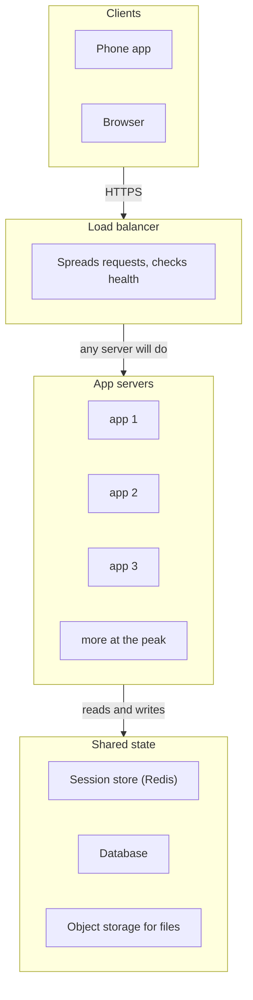

# Scaling up and out: stateless services and the bottleneck

> System Design · L1 Foundation · Scaling, availability and load balancing · about 90 min · hub module `m02` ([open the hub](https://claude.ai/artifact/5FDy46yNwWT8pPPZwQUGP9))

## Why it matters
When traffic grows you can buy a bigger machine or add more machines. Adding machines only works if any server can answer any request, which means moving state out of the servers, and it only helps the tier that's actually the limit. These three ideas decide most scaling answers in interviews and in real systems.

## Pre-question (answer before reading)
**Q:** One app server handles 500 requests per second flat out. Peak traffic is 1,800 requests per second, and every request makes one query to a database that tops out at 2,000 queries per second. How many app servers would you run, and what breaks next?

<details><summary>Answer</summary>

Four servers could just carry 1,800 requests per second at 90% busy, but you'd run six to keep each under about 70% busy at the peak, and seven if the peak must survive one server failing. The database is then 90% busy at the peak: it's the next bottleneck, and no number of app servers lifts its 2,000 ceiling.

</details>

## 🍎 Story time (kid version)
**Pizza Town and the family road trip: Luigi's gets busy**

Luigi's pizza shop is getting busy. First he buys a bigger oven, but the biggest oven in the catalogue is very expensive, and when it breaks, nobody gets pizza. So he hires three more cooks, each with an ordinary oven. At first each cook remembers their own customers' orders, so when Tara comes back to add a drink, she has to find the same cook. Luigi pins every order to one big board that all the cooks can read, so any cook can help anyone. Still, the queue is long: everyone pays at the single till. Ben says, “More cooks won't help now. We need a second till.”

| In the story | In a real system |
|---|---|
| Buying a bigger oven | Vertical scaling: one bigger machine, with a ceiling and a single point of failure |
| More cooks, each with an ordinary oven | Horizontal scaling: more servers sharing the work |
| Each cook remembering their own customers | Session state in one server's memory, which forces sticky sessions |
| One order board every cook can read | A shared session store, so the servers are stateless |
| The single till everyone queues at | The bottleneck: the tier with the least capacity caps the whole system |

**Where the story breaks:** Real servers don't slow down because they're tired: they slow down because requests queue as they near 100% busy. And the board isn't free: every cook reading it is a network call to a shared store, which itself has to scale and stay up.

## Key ideas (grown-up version)
- **Vertical scaling (scaling up)**: move to a bigger machine with more CPU, more memory or faster disks. No code changes and no new kinds of failure, so it's often the right first step. But there's a largest machine you can buy or rent, an upgrade can mean downtime, and one machine is still a single point of failure.
- **Horizontal scaling (scaling out)**: add more machines and spread the requests across them with a load balancer (module 4). For work that splits cleanly, capacity grows roughly in step with the number of servers, and losing one server loses only part of the capacity. The price is more moving parts, and the rule in the next point.
- **Stateless services**: a server keeps nothing about a user between requests, so any server can answer any request, and servers can be added, removed or replaced at any time. The state still exists: it moves to a shared store (a database, an in-memory store such as Redis, object storage for files) or into a signed token that the client sends back.
- **Sticky sessions**: the load balancer sends each user back to the same server, so state can stay in that server's memory. It works as a stopgap, but the load gets uneven, a server can't be taken out without logging its users out, and a crash loses every session on it.
- **The bottleneck sets the pace**: every request passes through every tier, so the system's throughput is the smallest tier capacity (servers × requests per second per server). Scaling any other tier adds cost, not throughput. Find the bottleneck, fix it, then look again: it moves.
- **Amdahl's law**: if a share p of the work can be spread over n machines, the speed-up is 1 / ((1 − p) + p/n). The serial part caps it: with 90% of the work parallel, the speed-up can never reach 10×, and 10 machines give about 5.3×.
- **Little's law**: requests in flight = arrival rate × time each one spends in the system (L = λW). 1,000 requests a second at 200 ms each means about 200 in flight, and each needs a worker thread or connection somewhere. When a dependency slows down, W grows and so does L, at the same traffic.
- **Headroom and N+1**: response time climbs steeply as a server nears 100% busy, because requests queue. Size for the peak, not the average, keep each server at about 60–70% busy at the peak (a rule of thumb), and add one spare (N+1) so the peak still fits when any one server fails.

## Diagrams
**A stateless web tier: any app server can answer any request**



_The app servers keep nothing between requests, so the load balancer can send each request anywhere, and servers can be added or replaced freely. The shared tier holds all the state, so it now has to scale and stay up._

**Capacity in requests per second as app servers are added (500 each, one database at 2,000)**

| app servers | 0 | 1 | 2 | 3 | 4 |
|---|---|---|---|---|---|
| value | 2 | 3 | 4 | 5 | 8 |

| app tier | 0 | 1 | 2 | 3 | 4 |
|---|---|---|---|---|---|
| value | **1000** | **1500** | **2000** | 2500 | 4000 |

| database | 0 | 1 | 2 | 3 | 4 |
|---|---|---|---|---|---|
| value | 2000 | 2000 | **2000** | **2000** | **2000** |

| system | 0 | 1 | 2 | 3 | 4 |
|---|---|---|---|---|---|
| value | 1000 | 1500 | 2000 | 2000 | 2000 |

_Up to 4 servers the app tier sets the pace; at 4 the two tiers tie, and from then on the single database does. Servers 5 to 8 add cost but no throughput: the database is what to scale next, for example with a cache (module 5) or read replicas._

## Comparisons
**Scaling up or scaling out**

|  | Vertical (scale up) | Horizontal (scale out) |
|---|---|---|
| What changes | A bigger machine | More machines behind a load balancer |
| Code changes | Usually none | Servers must be stateless |
| Limit | The largest machine available | The next bottleneck, often the database |
| When one machine fails | Everything is down until it's back or replaced | The others carry on with less capacity |
| Good first choice for | Databases and apps that are hard to split | Stateless web and API servers |

**Where session state can live**

|  | Server memory (sticky sessions) | Shared store (such as Redis) | Signed token (in a cookie) |
|---|---|---|---|
| Any server can answer | No: only the server that has it | Yes | Yes |
| Survives a server restart | No | Yes, if the store stays up | Yes |
| Log a user out straight away | Yes, on that server | Yes: delete the session | No: it's valid until it expires (unless you keep a deny-list) |
| Cost per request | None | A network round trip to the store | Checking a signature; the token travels with every request |

## Code (JavaScript + Python)
### Two capacity helpers used by the examples and the quiz
```python
import math

def servers_needed(peak_rps, per_server_rps, max_busy_pct=70):
    """Fewest servers that carry the peak with each at most max_busy_pct busy."""
    return math.ceil(peak_rps * 100 / (per_server_rps * max_busy_pct))

def bottleneck(tiers):
    """Each tier is (name, servers, requests per second per server); the smallest capacity sets the pace."""
    name, count, per_server = min(tiers, key=lambda t: t[1] * t[2])
    return name, count * per_server
```

```javascript
function serversNeeded(peakRps, perServerRps, maxBusyPct = 70) {
  // fewest servers that carry the peak with each at most maxBusyPct busy
  return Math.ceil((peakRps * 100) / (perServerRps * maxBusyPct));
}

function bottleneck(tiers) {
  // each tier is [name, servers, requests per second per server]; the smallest capacity sets the pace
  let best = tiers[0];
  for (const t of tiers) if (t[1] * t[2] < best[1] * best[2]) best = t;
  return [best[0], best[1] * best[2]];
}
```

### Scaling out until the bottleneck moves
```python
peak = 1_800                                  # requests per second at the busiest minute
app = servers_needed(peak, 500)               # one app server manages 500 req/s flat out
print("app servers for the peak:", app)

for count in (2, 3, 5, 8):
    tiers = [("load balancer", 1, 20_000), ("app", count, 500), ("database", 1, 2_000)]
    name, cap = bottleneck(tiers)
    print(count, "app servers ->", cap, "req/s, limited by the", name)
print(f"database busy at peak: {peak * 100 // 2_000}%")
```

Output:
```text
app servers for the peak: 6
2 app servers -> 1000 req/s, limited by the app
3 app servers -> 1500 req/s, limited by the app
5 app servers -> 2000 req/s, limited by the database
8 app servers -> 2000 req/s, limited by the database
database busy at peak: 90%
```

- line 2: 1,800 ÷ (500 × 70%) = 5.1, rounded up to 6, so each server stays at most 70% busy at the peak.
- line 6: Each tier is (name, servers, requests per second per server). The load balancer is nowhere near its limit.
- line 8: With 2 or 3 servers the app tier is the limit; with 5 or 8 it's the database, so the extra servers buy nothing.
- line 9: At the peak the single database is 90% busy: it, not the app tier, is what to scale next.

```javascript
const peak = 1800;                            // requests per second at the busiest minute
const app = serversNeeded(peak, 500);         // one app server manages 500 req/s flat out
console.log("app servers for the peak:", app);

for (const count of [2, 3, 5, 8]) {
  const tiers = [["load balancer", 1, 20000], ["app", count, 500], ["database", 1, 2000]];
  const [name, cap] = bottleneck(tiers);
  console.log(count, "app servers ->", cap, "req/s, limited by the", name);
}
console.log(`database busy at peak: ${Math.floor((peak * 100) / 2000)}%`);
```

Output:
```text
app servers for the peak: 6
2 app servers -> 1000 req/s, limited by the app
3 app servers -> 1500 req/s, limited by the app
5 app servers -> 2000 req/s, limited by the database
8 app servers -> 2000 req/s, limited by the database
database busy at peak: 90%
```

- line 2: 1,800 ÷ (500 × 70%) = 5.1, rounded up to 6, so each server stays at most 70% busy at the peak.
- line 6: Each tier is [name, servers, requests per second per server]. The load balancer is nowhere near its limit.
- line 8: With 2 or 3 servers the app tier is the limit; with 5 or 8 it's the database, so the extra servers buy nothing.
- line 10: At the peak the single database is 90% busy: it, not the app tier, is what to scale next.

### Why servers must be stateless: a cart behind a round-robin load balancer
```python
class StatefulServer:
    def __init__(self):
        self.carts = {}                       # lives in this server's memory only
    def add(self, user, item):
        self.carts.setdefault(user, []).append(item)
        return len(self.carts[user])

class StatelessServer:
    def __init__(self, store):
        self.store = store                    # shared by every server (think Redis or a database)
    def add(self, user, item):
        self.store.setdefault(user, []).append(item)
        return len(self.store[user])

def shop(servers, items):                     # round robin: request i goes to server i mod n
    return [servers[i % len(servers)].add("tara", item) for i, item in enumerate(items)]

items = ["pizza", "cola", "salad", "cake"]
print("stateful: ", *shop([StatefulServer() for _ in range(3)], items))
shared = {}
print("stateless:", *shop([StatelessServer(shared) for _ in range(3)], items))
```

Output:
```text
stateful:  1 1 1 2
stateless: 1 2 3 4
```

- line 3: Each server has its own carts, so what Tara added on one server is invisible to the others.
- line 10: Every server points at the same store, so it doesn't matter which one answers.
- line 19: Tara's cart seems to keep resetting: her first three requests land on three different servers, and only the fourth comes back to the first.
- line 21: With one shared store, every server sees the whole cart: 1, 2, 3, then 4 items.

```javascript
class StatefulServer {
  constructor() { this.carts = new Map(); }   // lives in this server's memory only
  add(user, item) {
    if (!this.carts.has(user)) this.carts.set(user, []);
    this.carts.get(user).push(item);
    return this.carts.get(user).length;
  }
}

class StatelessServer {
  constructor(store) { this.store = store; }  // shared by every server (think Redis or a database)
  add(user, item) {
    if (!this.store.has(user)) this.store.set(user, []);
    this.store.get(user).push(item);
    return this.store.get(user).length;
  }
}

const shop = (servers, items) => items.map((item, i) => servers[i % servers.length].add("tara", item));  // round robin

const items = ["pizza", "cola", "salad", "cake"];
console.log("stateful: ", ...shop([0, 1, 2].map(() => new StatefulServer()), items));
const shared = new Map();
console.log("stateless:", ...shop([0, 1, 2].map(() => new StatelessServer(shared)), items));
```

Output:
```text
stateful:  1 1 1 2
stateless: 1 2 3 4
```

- line 2: Each server has its own carts, so what Tara added on one server is invisible to the others.
- line 11: Every server points at the same store, so it doesn't matter which one answers.
- line 22: Tara's cart seems to keep resetting: her first three requests land on three different servers, and only the fourth comes back to the first.
- line 24: With one shared store, every server sees the whole cart: 1, 2, 3, then 4 items.

### Little's law and Amdahl's law in numbers
```python
def in_flight(rps, latency_ms):               # Little's law: L = arrival rate x time in the system
    return rps * latency_ms // 1000

def speedup(parallel_pct, n):                 # Amdahl's law: the serial share never speeds up
    return 100 / (100 - parallel_pct + parallel_pct / n)

for latency in (200, 400):
    busy = in_flight(1_000, latency)
    print(f"{latency} ms -> {busy} in flight -> {math.ceil(busy / 64)} servers of 64 workers")
for n in (2, 10, 100, 1_000_000):
    print(f"{n} machines: {speedup(90, n):.2f}x")
```

Output:
```text
200 ms -> 200 in flight -> 4 servers of 64 workers
400 ms -> 400 in flight -> 7 servers of 64 workers
2 machines: 1.82x
10 machines: 5.26x
100 machines: 9.17x
1000000 machines: 10.00x
```

- line 2: 1,000 requests a second, each taking 0.2 s, means about 200 are being served at any moment.
- line 9: Double the latency and the requests in flight double too: 7 servers instead of 4 at the same traffic, even if their CPUs sit idle while they wait.
- line 11: With 10% of the work serial: 1.82× on 2 machines, 5.26× on 10, and it creeps towards 10× but never passes it.

```javascript
const inFlight = (rps, latencyMs) => Math.floor((rps * latencyMs) / 1000);       // Little's law: L = arrival rate x time in the system
const speedup = (parallelPct, n) => 100 / (100 - parallelPct + parallelPct / n);  // Amdahl's law: the serial share never speeds up

for (const latency of [200, 400]) {
  const busy = inFlight(1000, latency);
  console.log(`${latency} ms -> ${busy} in flight -> ${Math.ceil(busy / 64)} servers of 64 workers`);
}
for (const n of [2, 10, 100, 1000000]) console.log(`${n} machines: ${speedup(90, n).toFixed(2)}x`);
```

Output:
```text
200 ms -> 200 in flight -> 4 servers of 64 workers
400 ms -> 400 in flight -> 7 servers of 64 workers
2 machines: 1.82x
10 machines: 5.26x
100 machines: 9.17x
1000000 machines: 10.00x
```

- line 1: 1,000 requests a second, each taking 0.2 s, means about 200 are being served at any moment.
- line 6: Double the latency and the requests in flight double too: 7 servers instead of 4 at the same traffic, even if their CPUs sit idle while they wait.
- line 8: With 10% of the work serial: 1.82× on 2 machines, 5.26× on 10, and it creeps towards 10× but never passes it.

## Worked example
**Problem.** An API gets 4.32 million requests a day, and its busiest minute runs at 4× the daily average. One server handles 150 requests per second at full CPU and has 32 worker threads, and an average request takes 250 ms. Every server must stay at most 70% busy at the peak, even with one server down. How many servers do you need, and are 32 workers enough? What if the average latency rises to 500 ms?

1. Average: 4,320,000 requests ÷ 86,400 seconds = 50 per second. The busiest minute runs at 4×: 200 requests per second.
2. At most 70% busy, one server carries 0.7 × 150 = 105 requests per second, so the peak needs ⌈200 ÷ 105⌉ = 2 servers.
3. N+1: run 3, so that losing any one still leaves the 2 the peak needs.
4. Little's law: 200 requests per second × 0.25 s = 50 requests in flight, which fit in the 2 × 32 = 64 workers left after a failure. At 500 ms, 100 are in flight and don't fit: requests queue although the CPU looks fine. Cut the latency or give each server more workers (or non-blocking I/O). Check concurrency as well as CPU.

```python
def plan(daily_requests, peak_factor, per_server_rps, latency_ms, workers, max_busy_pct=70):
    peak = daily_requests * peak_factor // 86_400              # requests per second at the peak
    n = servers_needed(peak, per_server_rps, max_busy_pct) + 1  # N+1: survive one failure
    busy = peak * latency_ms // 1000                           # Little's law: requests in flight
    enough = busy <= (n - 1) * workers                         # check with one server down
    return peak, n, busy, "yes" if enough else "no"

print(*plan(4_320_000, 4, 150, 250, 32))
print(*plan(4_320_000, 4, 150, 500, 32))
print(*plan(4_320_000, 4, 150, 500, 64))
```

Output:
```text
200 3 50 yes
200 3 100 no
200 3 100 yes
```

```javascript
function plan(dailyRequests, peakFactor, perServerRps, latencyMs, workers, maxBusyPct = 70) {
  const peak = Math.floor((dailyRequests * peakFactor) / 86400);   // requests per second at the peak
  const n = serversNeeded(peak, perServerRps, maxBusyPct) + 1;     // N+1: survive one failure
  const busy = Math.floor((peak * latencyMs) / 1000);              // Little's law: requests in flight
  const enough = busy <= (n - 1) * workers;                        // check with one server down
  return [peak, n, busy, enough ? "yes" : "no"];
}

console.log(...plan(4320000, 4, 150, 250, 32));
console.log(...plan(4320000, 4, 150, 500, 32));
console.log(...plan(4320000, 4, 150, 500, 64));
```

Output:
```text
200 3 50 yes
200 3 100 no
200 3 100 yes
```

**Answer.** 200 requests per second at the peak, 3 servers (2 for the peak plus one spare) and 50 requests in flight, which fit in the 64 workers of the 2 servers left after a failure. At 500 ms the 100 requests in flight don't fit, so the answer becomes “no” until each server has 64 workers or the latency comes back down.

## Your turn (faded example)
**Problem.** Instead of keeping sessions on a server, the app gives the browser a signed token: the user name and an expiry time, plus an HMAC signature made with a secret key that every app server shares. Finish `verify(token, now)` so that it returns the user only if the signature matches and the token hasn't expired.

- ✓ `sign` builds the payload user.expires and appends its HMAC-SHA256 signature in hex, so the token is user.expires.signature.
- **What must verify check, and in what order?**
  <details><summary>Answer</summary>First that the signature matches the payload: recompute the HMAC with the shared key and compare. Only then trust the user and the expiry inside it, and refuse the token if the expiry time has passed.</details>
- **Why compare signatures with hmac.compare_digest or crypto.timingSafeEqual rather than ==?**
  <details><summary>Answer</summary>An ordinary comparison can stop at the first character that differs, so its timing can leak how much of a forged signature is right. A constant-time comparison takes the same time either way.</details>
- **What does this design buy, and what does it cost?**
  <details><summary>Answer</summary>No server stores anything, so any server can check any request in microseconds: O(token length) time and no server memory. But a token can't be cancelled before it expires without a shared deny-list, the secret key has to be rotated with care, and the token travels with every request.</details>

Starter:
```python
import hmac, hashlib

SECRET = b"rotate-me-regularly"               # shared by every app server, never sent to the client

def sign(user, expires):
    payload = f"{user}.{expires}"
    mac = hmac.new(SECRET, payload.encode(), hashlib.sha256).hexdigest()
    return f"{payload}.{mac}"

def verify(token, now):
    ...                                       # TODO: the user if the signature matches and now < expires, else None
```

```javascript
const crypto = require("node:crypto");
const SECRET = "rotate-me-regularly";         // shared by every app server, never sent to the client

function sign(user, expires) {
  const payload = `${user}.${expires}`;
  return `${payload}.${crypto.createHmac("sha256", SECRET).update(payload).digest("hex")}`;
}

function verify(token, now) {
  // TODO: the user if the signature matches and now < expires, else null
}
```

<details><summary>Full solution</summary>

```python
import hmac, hashlib

SECRET = b"rotate-me-regularly"               # shared by every app server, never sent to the client

def sign(user, expires):
    payload = f"{user}.{expires}"
    mac = hmac.new(SECRET, payload.encode(), hashlib.sha256).hexdigest()
    return f"{payload}.{mac}"

def verify(token, now):
    payload, _, mac = token.rpartition(".")
    good = hmac.new(SECRET, payload.encode(), hashlib.sha256).hexdigest()
    if not hmac.compare_digest(mac, good):
        return None                           # changed on the way, or signed with another key
    user, expires = payload.rsplit(".", 1)
    return user if now < int(expires) else None   # an expired token is refused too

token = sign("tara", 1_000)
tampered = [token.replace("tara", "ben"), token.replace("1000", "9999")]
results = [verify(token, 500), verify(token, 1_000)] + [verify(t, 500) for t in tampered]
print(*(r or "refused" for r in results))
```

Output:
```text
tara refused refused refused
```

```javascript
const crypto = require("node:crypto");
const SECRET = "rotate-me-regularly";         // shared by every app server, never sent to the client

function sign(user, expires) {
  const payload = `${user}.${expires}`;
  return `${payload}.${crypto.createHmac("sha256", SECRET).update(payload).digest("hex")}`;
}

function verify(token, now) {
  const cut = token.lastIndexOf(".");
  const payload = token.slice(0, cut), mac = Buffer.from(token.slice(cut + 1));
  const good = Buffer.from(crypto.createHmac("sha256", SECRET).update(payload).digest("hex"));
  if (mac.length !== good.length || !crypto.timingSafeEqual(mac, good)) return null;  // changed, or another key
  const dot = payload.lastIndexOf(".");
  return now < Number(payload.slice(dot + 1)) ? payload.slice(0, dot) : null;          // an expired token is refused too
}

const token = sign("tara", 1000);
const tampered = [token.replace("tara", "ben"), token.replace("1000", "9999")];
const results = [verify(token, 500), verify(token, 1000), ...tampered.map(t => verify(t, 500))];
console.log(...results.map(r => r ?? "refused"));
```

Output:
```text
tara refused refused refused
```

</details>

## Socratic checks and quiz (answers hidden)
**1. What does this print? (`servers_needed` / `serversNeeded` and `bottleneck` are this module's helpers.)**

```python
print(servers_needed(1_000, 200), servers_needed(1_000, 200, 100),
      bottleneck([("app", 4, 300), ("cache", 1, 5_000), ("db", 2, 500)])[0])
```

```javascript
console.log(serversNeeded(1000, 200), serversNeeded(1000, 200, 100),
  bottleneck([["app", 4, 300], ["cache", 1, 5000], ["db", 2, 500]])[0]);
```

- A. 8 5 db
- B. 5 5 db
- C. 8 5 app
- D. 7 5 db

<details><summary>Answer</summary>

8 5 db. At 70% busy each server carries 140 requests per second, and 1,000 ÷ 140 = 7.1 rounds up to 8. At 100% it's exactly 5. The tiers carry 1,200, 5,000 and 1,000 requests per second, so the database is the limit.

</details>

**2. What does this print?**

```python
rps, latency_ms = 400, 250
in_flight = rps * latency_ms // 1000
print(in_flight, math.ceil(in_flight / 16), math.ceil(in_flight * 2 / 16))
```

```javascript
const rps = 400, latencyMs = 250;
const inFlight = Math.floor((rps * latencyMs) / 1000);
console.log(inFlight, Math.ceil(inFlight / 16), Math.ceil((inFlight * 2) / 16));
```

- A. 100 7 13
- B. 100 6 12
- C. 1600 100 200
- D. 100 7 14

<details><summary>Answer</summary>

100 7 13. 250 ms is a quarter of a second, so 400 requests a second means 100 in flight (Little's law). 100 ÷ 16 = 6.25 rounds up to 7 servers of 16 workers. At double the latency 200 are in flight, and 12.5 rounds up to 13, not 14: round after doubling, not before.

</details>

**3. Your app keeps each user's shopping cart in the web server's memory. You add a second server behind a round-robin load balancer. What happens, and what's the best fix?**

- A. Carts seem to empty and refill as requests alternate between servers; move carts to a shared store (or a signed token) so any server can answer
- B. Nothing changes, because the load balancer copies memory between the servers
- C. The app gets twice as fast, so nothing needs fixing
- D. Carts are fine, but the database is overloaded, so add a read replica

<details><summary>Answer</summary>

Carts seem to empty and refill as requests alternate between servers; move carts to a shared store (or a signed token) so any server can answer. Each server only sees the items added through it, so the cart a user sees depends on which server answers. A load balancer forwards requests; it doesn't copy memory. The fix is to make the servers stateless.

</details>

**4. Which changes make a web tier easier to scale out? (choose 2)**

- A. Keep sessions in a shared store such as Redis instead of server memory
- B. Keep uploaded files in shared object storage instead of on each server's local disk
- C. Pin every user to one server with sticky sessions
- D. Give each server its own copy of the database, updated separately
- E. Move to the largest machine available

<details><summary>Answer</summary>

Keep sessions in a shared store such as Redis instead of server memory, Keep uploaded files in shared object storage instead of on each server's local disk. Shared sessions and shared file storage let any server answer any request. Sticky sessions keep the state in memory (with all its problems), separate database copies drift apart, and a bigger machine is scaling up, not out.

</details>

**5. Judge each statement.**

- With 10% of the work serial, no number of machines gives a 10× speed-up.
- Adding app servers raises throughput even when the database is the bottleneck.
- By Little's law, 500 requests per second at 100 ms each means about 50 requests in flight.
- A server at 50% CPU can always take twice its traffic with the same response time.

<details><summary>Answer</summary>

With 10% of the work serial, no number of machines gives a 10× speed-up.: Yes; Adding app servers raises throughput even when the database is the bottleneck.: No; By Little's law, 500 requests per second at 100 ms each means about 50 requests in flight.: Yes; A server at 50% CPU can always take twice its traffic with the same response time.: No. Amdahl's law: the speed-up creeps towards 1 ÷ 0.1 = 10 but never reaches it. Throughput is capped by the slowest tier. 500 × 0.1 s = 50. And queueing makes response times climb steeply as a server nears 100% busy, and another resource may run out first.

</details>

**6. Put the steps of sizing a web tier in order.**

- (put the steps in order)

<details><summary>Answer</summary>

Divide the requests per day by 86,400 to get the average per second → Multiply by the peak factor to get the peak requests per second → Divide by what one server carries at the target utilisation, and round up → Add one server so that the peak still fits when any one fails (N+1). Each step uses the result of the one before: the average gives the peak, the peak gives the server count, and the spare is added to that count.

</details>

**7. Complete the JavaScript function that sizes servers by concurrency.**

```
function serversForConcurrency(rps, latencyMs, workersPerServer) {
  const inFlight = {{0}};
  return {{1}};
}

```

<details><summary>Answer</summary>

(rps * latencyMs) / 1000 | Math.ceil(inFlight / workersPerServer). Little's law with the latency in seconds gives the requests in flight, and rounding up is the only safe choice: rounding down or to the nearest leaves some requests without a worker.

</details>

**8. Match each idea to its name.**


<details><summary>Answer</summary>

One bigger machine with more CPU and memory = Vertical scaling; More machines sharing the work behind a load balancer = Horizontal scaling; Any server can answer any request = Stateless service; Requests in flight = arrival rate × time in the system = Little's law. Sticky sessions are the opposite of statelessness: they tie each user to one server so that state can stay in its memory.

</details>

## Traps & misconceptions
- **“Vertical scaling is always the wrong answer.”** A bigger machine is often the simplest and cheapest first step: no code changes and no distributed-systems problems. It's wrong only when you hit the ceiling, can't afford the downtime of an upgrade, or must survive that one machine failing.
- **“Adding servers always adds capacity.”** Only at the bottleneck tier. Once the database is the limit, more app servers add cost, not throughput, and can make things worse by opening more database connections.
- **“Sticky sessions make a stateful app scalable.”** They spread users across servers, but the load gets uneven, a server can't be taken out without logging its users out, and a crash loses every session on it. Moving the state to a shared store or a signed token is the real fix.
- **“At 50% CPU a server can take twice the traffic with the same response time.”** Requests queue more and more as a server nears 100% busy: in the simplest queueing model, the average wait in the queue at 90% busy is 9 times the wait at 50%. And another resource (memory, worker threads, connections) may run out first.
- **“Stateless means the system has no state.”** The state still exists; it lives somewhere shared (a database, a cache, a signed token on the client) instead of in one server's memory. That shared place now has to scale and stay up.
- **“Ten servers make a job ten times faster.”** Only the part that runs in parallel speeds up. With 10% of the work serial, Amdahl's law keeps the speed-up below 10× however many machines you add, and 10 machines give about 5.3×.

## Discussion prompts
- **When would you scale up instead of out?**
  <details><summary>One good answer</summary>When the work is hard to split: a relational database of moderate size, an older app that keeps state in memory, or a job that needs a lot of memory in one place. Scaling up buys time with no code changes. You still plan for its ceiling (the largest machine available) and for failure (a standby copy), and you move to scaling out when the next size up is too costly or one big machine is too big a risk.</details>
- **Where should session state live in a horizontally scaled web app?**
  <details><summary>One good answer</summary>Out of the app servers' memory. Common choices are a shared in-memory store such as Redis (fast and supports expiry, but one more system to run and keep available), the database (simple but slower), or a signed token in a cookie (no server storage at all, but it can't be cancelled before it expires without a deny-list, and it's sent with every request). Sticky sessions are a stopgap, not a design.</details>

## Teach-back
**Prompt:** Explain to a junior colleague how you'd take a single-server web app to ten servers, and what you'd have to change first.

Rubric:
- [ ] Scaling up first can be fine, but it has a ceiling and a single point of failure
- [ ] Scaling out needs a load balancer and stateless servers
- [ ] Session state moves to a shared store or a signed token
- [ ] Throughput is set by the bottleneck tier, often the database
- [ ] Leave headroom at the peak and plan for one server failing (N+1)

<details><summary>Model answer</summary>

The quickest win is often a bigger machine, but that has a ceiling and leaves one box whose failure takes everything down, so for real growth you add servers behind a load balancer. Before that works, the servers must be stateless: anything kept in memory between requests, such as sessions, carts or uploaded files, has to move to a shared store, a database or object storage, or into a signed token, so that any server can answer any request. Sticky sessions would hide the problem but give uneven load and lost sessions on a crash. Then I'd measure: the whole system only goes as fast as its slowest tier, and once the web tier scales, that's usually the database, so it gets a cache or read replicas next. I'd size for the peak, keep each server at about 70% busy there, and add one spare so a failure doesn't hurt. Finally I'd check concurrency with Little's law, because slow downstream calls tie up workers even when the CPU looks idle.

</details>

## Quick Q&A (also in the SRS deck)
- **What is vertical scaling?** Making one machine bigger (more CPU, memory, faster disks): simple, but with a ceiling and a single point of failure.
- **What is horizontal scaling?** Adding more machines that share the work, usually behind a load balancer.
- **What makes a service stateless?** It keeps nothing about a user between requests, so any server can answer any request.
- **What does Little's law say?** Requests in flight = arrival rate × time each one spends in the system (L = λW).
- **What does Amdahl's law say?** The serial part caps the speed-up: with a share p of the work parallel, the speed-up stays below 1/(1 − p).
- **What is N+1 redundancy?** One more server than the peak needs, so losing any one still carries the load.

## Practice problems
- [ ] [Exercise · Check an app against factor VI](https://12factor.net/processes) · list where an app you know keeps sessions, uploads and caches, and move each one out of the process on paper
- [ ] [Exercise · Why the default session store doesn't scale](https://expressjs.com/en/resources/middleware/session.html) · read the warning about MemoryStore, then sketch the same app with a shared session store behind a load balancer
- [ ] [Exercise · How an autoscaler picks a server count](https://kubernetes.io/docs/tasks/run-application/horizontal-pod-autoscale/) · work through its replica formula for 4 replicas at 90% CPU with a 60% target, then compare it with servers_needed
- [ ] [Reference · Amdahl's law](https://en.wikipedia.org/wiki/Amdahl%27s_law) · sketch the speed-up for 50%, 90% and 99% parallel work as machines are added; where does each curve flatten?

## Sources (accessed 2026-10-09)
- [The Twelve-Factor App: VI. Processes](https://12factor.net/processes)
- [Kubernetes: Horizontal Pod Autoscaling](https://kubernetes.io/docs/tasks/run-application/horizontal-pod-autoscale/)
- [Google SRE book: Handling overload](https://sre.google/sre-book/handling-overload/)
- [Wikipedia: Little's law](https://en.wikipedia.org/wiki/Little%27s_law)
- [Wikipedia: Amdahl's law](https://en.wikipedia.org/wiki/Amdahl%27s_law)
