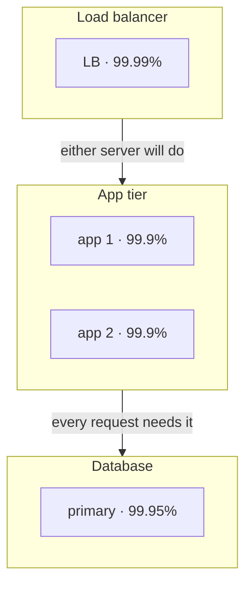
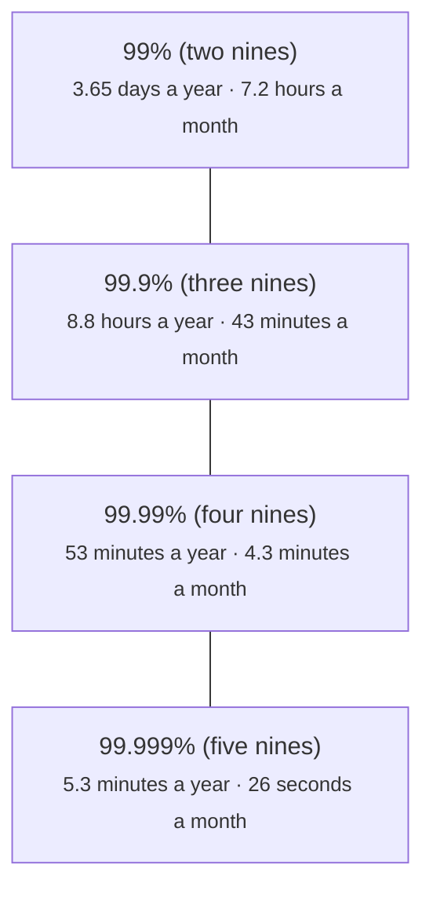
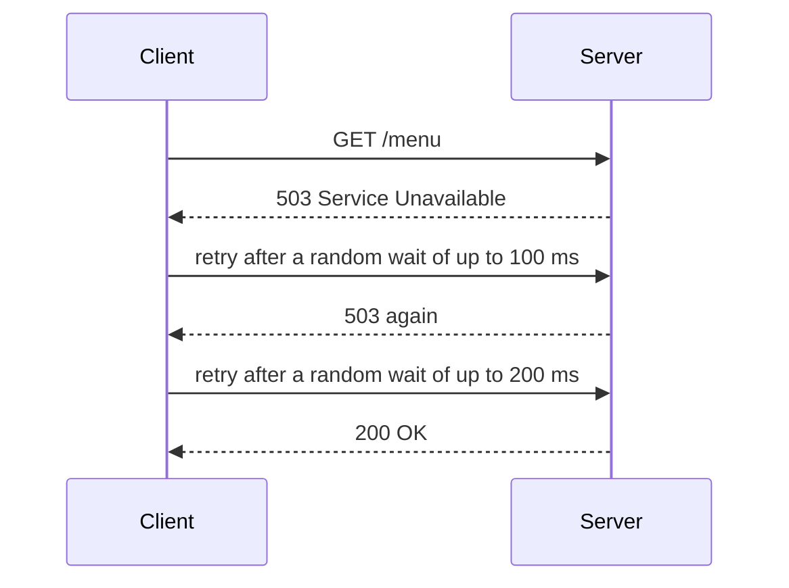

# Availability: nines, redundancy and failing well

> System Design · L1 Foundation · Scaling, availability and load balancing · about 95 min · hub module `m03` ([open the hub](https://claude.ai/artifact/5FDy46yNwWT8pPPZwQUGP9))

## Why it matters
Disks, servers and whole data centres fail, so the question is never whether parts break but how the system behaves when they do. Availability depends on how the parts are wired: parts in a chain multiply their availabilities down, while spare copies side by side multiply the chances of failure down. Add timeouts and careful retries, and you have the reliability basics every design review asks about.

## Pre-question (answer before reading)
**Q:** A request passes through a load balancer, an app server and a database, each available 99.9% of the time. What's the availability of the whole path? And if you add a second app server, either of which will do, what does the app tier become?

<details><summary>Answer</summary>

In a chain all three must be up, so 0.999³ ≈ 99.7%: about 26 hours down a year instead of 8.8. Two independent app servers fail together only 0.001² of the time, so the app tier becomes 99.9999%. But the path is still a chain, and the single load balancer and database now limit it.

</details>

## 🍎 Story time (kid version)
**Pizza Town and the family road trip: Bridges on the way to Grandma's**

On the road trip to Grandma's, the family must cross three rivers, one after another. If any bridge is closed, they can't get there: the trip needs every river crossing open. At the widest river there are two bridges side by side. If one is closed, Dad takes the other, so they're stuck there only if both are closed on the same day. At Grandma's, Tara phones Luigi's, but the line is busy. She tries again after one minute, then two, then four. Ben points out that if the whole street rang back at exactly the same moment, the line would stay busy, so everyone should wait a slightly different time.

| In the story | In a real system |
|---|---|
| Three rivers to cross, one after another | Parts in series: every one must be up, so their availabilities multiply |
| Two bridges side by side over the widest river | Redundant copies in parallel: the tier works while any copy is up |
| Stuck only if both bridges close on the same day | Independent copies fail together rarely: down only (1 − a)² of the time |
| Trying again after one, two, then four minutes | Retries with exponential backoff |
| Everyone waiting a slightly different time | Jitter: random waits so retries don't arrive in waves |

**Where the story breaks:** Real failures are often not independent: one flood can close both bridges, just as one power cut can stop two servers in the same rack. The parallel formula assumes independence, so spread copies across failure domains and treat its answer as a best case.

## Key ideas (grown-up version)
- **Availability**: the share of time, or of requests, for which the system does its job. Each extra nine cuts the allowed downtime tenfold: 99.9% allows about 8.8 hours a year (43 minutes in a 30-day month), 99.99% about 53 minutes a year.
- **SLI, SLO and SLA**: an SLI is what you measure (say, the share of requests answered successfully within 300 ms), an SLO is your target for it (99.9% over 30 days), and an SLA is a contract with users that says what happens, often service credits, if you miss it. An SLA is usually set looser than the internal SLO, so the team hears about trouble first.
- **Error budget**: 100% minus the SLO. At 99.9% you may fail 0.1% of requests, about 43 minutes of full outage in 30 days. While budget is left, you can ship changes faster; when it's spent, reliability work comes first.
- **Parts in series multiply**: if a request needs every part, availability = a₁ × a₂ × … × aₙ, which is lower than the weakest part. Three parts at 99.9% give about 99.7%: every dependency you add costs availability.
- **Copies in parallel**: if any one of n independent copies will do, the tier is down only when all are: availability = 1 − (1 − a)ⁿ. Two copies at 99.9% give 99.9999%. That's why every tier that matters gets at least two copies, leaving no single point of failure.
- **Correlated failures**: the parallel formula assumes copies fail independently, but servers in one rack, one data centre or one region can fail together (power, network, a bad deploy). Spread copies across failure domains such as availability zones, and treat the formula as a best case.
- **Failover**: redundancy needs a way to switch: health checks to notice a failure and a load balancer or failover process to stop using the broken copy. Active-active copies all serve traffic; active-passive keeps a standby that takes over, which takes time and must be tested.
- **Timeouts and retries**: always set a timeout, or one slow dependency ties up every worker. Retry only errors that may pass (timeouts, 503s), only for operations that are safe to repeat, a few times, with exponential backoff and jitter. Retries at every layer multiply: three layers that each try 3 times can send 3 × 3 × 3 = 27 attempts to the bottom for one user request.

## Diagrams
**Series and parallel in one path**



_The app tier alone is 1 − 0.001² = 99.9999%. The path multiplies the tiers: 0.9999 × 0.999999 × 0.9995 ≈ 99.94%, so the single database is now the weakest link._

**What the nines allow (365-day year, 30-day month)**



_Each extra nine allows a tenth of the downtime, and usually costs far more than the one before._

**Retrying with exponential backoff and full jitter**



_The ceiling doubles after each failure, and each wait is random below it, so clients that failed together don't come back together. If the attempts run out first, the client gives up and reports the error._

## Comparisons
**SLI, SLO, SLA and the error budget**

|  | What it is | Example | Who uses it |
|---|---|---|---|
| SLI | A measurement of the service | Share of requests answered successfully in under 300 ms | Engineers, on dashboards and alerts |
| SLO | A target for an SLI over a window | 99.9% of requests over 30 days | The team and its stakeholders |
| SLA | A contract with consequences | Below 99.5% in a month, customers get service credits | Customers and the business |
| Error budget | What the SLO lets you fail | 0.1% of requests: about 43 minutes of full outage in 30 days | The team, to decide when to slow down |

**Two ways to run redundant copies**

|  | Active-active | Active-passive (standby) |
|---|---|---|
| Who serves traffic | Every copy, all the time | Only the active copy; the standby waits |
| When a copy fails | The others take its share, if they have headroom | Failover promotes the standby, which takes seconds to minutes |
| Typical use | Stateless app servers, load balancers | Databases with one writable primary |
| Watch out for | Every copy needs spare capacity for the lost share | A standby that's never tested may not work when needed |

## Code (JavaScript + Python)
### Availability helpers and the seeded random generator used below
```python
def serial(*parts):
    """Every part must be up: multiply their availabilities."""
    up = 1.0
    for a in parts:
        up *= a
    return up

def parallel(a, copies):
    """Up while at least one of `copies` independent copies is up."""
    down = 1.0
    for _ in range(copies):
        down *= 1 - a                           # every copy down at the same moment
    return 1 - down

def downtime_per_year(a):
    """Hours a year the system is down at availability a (365 days = 8,760 hours)."""
    return (1 - a) * 8760

def mulberry32(seed):                           # a tiny seeded random generator, same as the JavaScript one
    state = seed & 0xFFFFFFFF
    def rand():
        nonlocal state
        state = (state + 0x6D2B79F5) & 0xFFFFFFFF
        t = ((state ^ (state >> 15)) * (state | 1)) & 0xFFFFFFFF
        t = (t ^ (t + (((t ^ (t >> 7)) * (t | 61)) & 0xFFFFFFFF))) & 0xFFFFFFFF
        return ((t ^ (t >> 14)) & 0xFFFFFFFF) / 4294967296
    return rand
```

```javascript
function serial(...parts) {
  // every part must be up: multiply their availabilities
  let up = 1;
  for (const a of parts) up *= a;
  return up;
}

function parallel(a, copies) {
  // up while at least one of `copies` independent copies is up
  let down = 1;
  for (let i = 0; i < copies; i++) down *= 1 - a;   // every copy down at the same moment
  return 1 - down;
}

function downtimePerYear(a) {
  // hours a year the system is down at availability a (365 days = 8,760 hours)
  return (1 - a) * 8760;
}

function mulberry32(seed) {                     // a tiny seeded random generator, same as the Python one
  return function () {
    seed = (seed + 0x6D2B79F5) | 0;
    let t = Math.imul(seed ^ (seed >>> 15), 1 | seed);
    t = (t + Math.imul(t ^ (t >>> 7), 61 | t)) ^ t;
    return ((t ^ (t >>> 14)) >>> 0) / 4294967296;
  };
}
```

### The nines, series and parallel
```python
for label, a in (("99%", 0.99), ("99.9%", 0.999), ("99.99%", 0.9999), ("99.999%", 0.99999)):
    print(f"{label}: {downtime_per_year(a):.1f} h a year, {(1 - a) * 720 * 60:.1f} min a month")

one_each = serial(0.999, 0.999, 0.999)        # load balancer -> app -> database, one of each
app_pair = serial(0.999, parallel(0.999, 2), 0.999)
all_pairs = serial(*[parallel(0.999, 2)] * 3)
print(f"{one_each * 100:.4f}% {app_pair * 100:.4f}% {all_pairs * 100:.4f}%")
```

Output:
```text
99%: 87.6 h a year, 432.0 min a month
99.9%: 8.8 h a year, 43.2 min a month
99.99%: 0.9 h a year, 4.3 min a month
99.999%: 0.1 h a year, 0.4 min a month
99.7003% 99.8000% 99.9997%
```

- line 2: Each extra nine cuts the downtime tenfold: 99.9% still allows about 8.8 hours a year, or 43 minutes a month.
- line 4: Three parts in a chain at 99.9% each: only 99.7% for the path, about 26 hours down a year.
- line 5: Doubling only the app tier barely helps (99.80%): the load balancer and the database are still single points of failure.
- line 6: With every tier doubled, each tier is 99.9999% and the path reaches 99.9997%, if the copies fail independently.

```javascript
for (const [label, a] of [["99%", 0.99], ["99.9%", 0.999], ["99.99%", 0.9999], ["99.999%", 0.99999]]) {
  console.log(`${label}: ${downtimePerYear(a).toFixed(1)} h a year, ${((1 - a) * 720 * 60).toFixed(1)} min a month`);
}

const oneEach = serial(0.999, 0.999, 0.999);  // load balancer -> app -> database, one of each
const appPair = serial(0.999, parallel(0.999, 2), 0.999);
const allPairs = serial(...Array(3).fill(parallel(0.999, 2)));
console.log(`${(oneEach * 100).toFixed(4)}% ${(appPair * 100).toFixed(4)}% ${(allPairs * 100).toFixed(4)}%`);
```

Output:
```text
99%: 87.6 h a year, 432.0 min a month
99.9%: 8.8 h a year, 43.2 min a month
99.99%: 0.9 h a year, 4.3 min a month
99.999%: 0.1 h a year, 0.4 min a month
99.7003% 99.8000% 99.9997%
```

- line 2: Each extra nine cuts the downtime tenfold: 99.9% still allows about 8.8 hours a year, or 43 minutes a month.
- line 5: Three parts in a chain at 99.9% each: only 99.7% for the path, about 26 hours down a year.
- line 6: Doubling only the app tier barely helps (99.80%): the load balancer and the database are still single points of failure.
- line 7: With every tier doubled, each tier is 99.9999% and the path reaches 99.9997%, if the copies fail independently.

### Checking the maths with a seeded simulation, and what a shared cause does
```python
def simulate(tiers, hours, seed=1):
    """Each tier is (availability, copies, shared): shared is the chance one cause stops every copy."""
    rand = mulberry32(seed)
    down_hours = 0
    for _ in range(hours):
        up = True
        for a, copies, shared in tiers:
            common = rand() < shared                         # a rack power cut, a bad deploy, a zone outage
            alive = sum(rand() < a for _ in range(copies))   # each copy's own luck
            up = up and not common and alive > 0
        down_hours += 0 if up else 1
    return down_hours

one = (0.999, 1, 0)                           # a single load balancer or database
designs = [("one app server", [one, one, one]),
           ("two app servers", [one, (0.999, 2, 0), one]),
           ("two on one power supply", [one, (0.999, 2, 0.001), one])]
for name, tiers in designs:
    model = 1 - serial(*[parallel(a, copies) for a, copies, _ in tiers])
    print(f"{name}: {simulate(tiers, 100_000)} hours down in 100,000; independent model: {model * 100_000:.0f}")
```

Output:
```text
one app server: 305 hours down in 100,000; independent model: 300
two app servers: 212 hours down in 100,000; independent model: 200
two on one power supply: 301 hours down in 100,000; independent model: 200
```

- line 8: One draw decides whether a shared cause hits the whole tier this hour, whatever the copies' own luck.
- line 9: Each copy is up with probability a, independently of the others.
- line 20: Close to the model for independent copies (the small gaps are chance), until a shared cause appears: on one power supply the pair is down about as often as a single server.

```javascript
function simulate(tiers, hours, seed = 1) {
  // each tier is [availability, copies, shared]: shared is the chance one cause stops every copy
  const rand = mulberry32(seed);
  let downHours = 0;
  for (let h = 0; h < hours; h++) {
    let up = true;
    for (const [a, copies, shared] of tiers) {
      const common = rand() < shared;                            // a rack power cut, a bad deploy, a zone outage
      let alive = 0;
      for (let c = 0; c < copies; c++) if (rand() < a) alive++;  // each copy's own luck
      up = up && !common && alive > 0;
    }
    if (!up) downHours++;
  }
  return downHours;
}

const one = [0.999, 1, 0];                    // a single load balancer or database
const designs = [["one app server", [one, one, one]],
  ["two app servers", [one, [0.999, 2, 0], one]],
  ["two on one power supply", [one, [0.999, 2, 0.001], one]]];
for (const [name, tiers] of designs) {
  const model = 1 - serial(...tiers.map(([a, copies]) => parallel(a, copies)));
  console.log(`${name}: ${simulate(tiers, 100000)} hours down in 100,000; independent model: ${(model * 100000).toFixed(0)}`);
}
```

Output:
```text
one app server: 305 hours down in 100,000; independent model: 300
two app servers: 212 hours down in 100,000; independent model: 200
two on one power supply: 301 hours down in 100,000; independent model: 200
```

- line 8: One draw decides whether a shared cause hits the whole tier this hour, whatever the copies' own luck.
- line 10: Each copy is up with probability a, independently of the others.
- line 24: Close to the model for independent copies (the small gaps are chance), until a shared cause appears: on one power supply the pair is down about as often as a single server.

### Backoff, jitter and how retries multiply
```python
def backoff_ms(attempt, base=100, cap=2_000):  # exponential: 100, 200, 400 ... capped at 2 s
    return min(cap, base * 2 ** attempt)

print("waits:", *(backoff_ms(n) for n in range(6)))

rand = mulberry32(42)
for label, jitter in (("no jitter", False), ("full jitter", True)):
    slots = [0] * 11                          # 100 ms slots from 0 to 1,000 ms
    for _ in range(1_000):                    # 1,000 clients failed at the same moment
        wait = int(rand() * 1_000) if jitter else 1_000   # full jitter: anywhere in [0, 1,000)
        slots[wait // 100] += 1
    print(f"{label}: the busiest 100 ms gets {max(slots)} of 1,000 retries")

print("attempts at the bottom of 3 layers that each try 3 times:", 3 ** 3)
```

Output:
```text
waits: 100 200 400 800 1600 2000
no jitter: the busiest 100 ms gets 1000 of 1,000 retries
full jitter: the busiest 100 ms gets 116 of 1,000 retries
attempts at the bottom of 3 layers that each try 3 times: 27
```

- line 4: The ceiling doubles after each failure and stops at the cap, so a struggling server gets more breathing room each time.
- line 10: Without jitter all 1,000 clients come back in the same instant, a wave that can knock an overloaded server down again.
- line 12: With full jitter the same retries are spread across the whole second, about a tenth in each 100 ms.
- line 14: Retries multiply across layers, so retry at one layer only, with a small cap.

```javascript
const backoffMs = (attempt, base = 100, cap = 2000) => Math.min(cap, base * 2 ** attempt);  // exponential: 100, 200, 400 ... capped at 2 s

console.log("waits:", ...Array.from({ length: 6 }, (_, n) => backoffMs(n)));

const rand = mulberry32(42);
for (const [label, jitter] of [["no jitter", false], ["full jitter", true]]) {
  const slots = new Array(11).fill(0);        // 100 ms slots from 0 to 1,000 ms
  for (let c = 0; c < 1000; c++) {            // 1,000 clients failed at the same moment
    const wait = jitter ? Math.floor(rand() * 1000) : 1000;   // full jitter: anywhere in [0, 1,000)
    slots[Math.floor(wait / 100)]++;
  }
  console.log(`${label}: the busiest 100 ms gets ${Math.max(...slots)} of 1,000 retries`);
}

console.log("attempts at the bottom of 3 layers that each try 3 times:", 3 ** 3);
```

Output:
```text
waits: 100 200 400 800 1600 2000
no jitter: the busiest 100 ms gets 1000 of 1,000 retries
full jitter: the busiest 100 ms gets 116 of 1,000 retries
attempts at the bottom of 3 layers that each try 3 times: 27
```

- line 3: The ceiling doubles after each failure and stops at the cap, so a struggling server gets more breathing room each time.
- line 9: Without jitter all 1,000 clients come back in the same instant, a wave that can knock an overloaded server down again.
- line 12: With full jitter the same retries are spread across the whole second, about a tenth in each 100 ms.
- line 15: Retries multiply across layers, so retry at one layer only, with a small cap.

## Worked example
**Problem.** A checkout path runs through a load balancer (99.99%), two app servers (99.9% each, either will do) and one database (99.95%). The target is 99.95% for the whole path. Does design A meet it? Design B replaces the single database with a primary and a standby that fails over automatically; failover isn't instant, so assume the pair reaches 99.99% rather than the ideal 1 − 0.0005². Does B meet it, and how many minutes a 30-day month does each design allow?

1. The path is up only when the load balancer, the app tier and the database are all up, so multiply the tiers.
2. The app tier is down only when both servers are: 1 − 0.001² = 99.9999%. It's no longer the problem.
3. Design A: 0.9999 × 0.999999 × 0.9995 ≈ 99.940%, about 26 minutes down a month. The target allows 0.05% of 43,200 minutes = 21.6, so A misses it, and the single database is why.
4. Design B: 0.9999 × 0.999999 × 0.9999 ≈ 99.980%, under 9 minutes a month, so B meets it. Fix the weakest link first, and remember these are best cases that assume independent failures.

```python
def path(parts):                              # parts: (availability, copies), one after another
    return serial(*[parallel(a, copies) for a, copies in parts])

lb, apps, db, db_pair = (0.9999, 1), (0.999, 2), (0.9995, 1), (0.9999, 1)
for name, parts in (("A", [lb, apps, db]), ("B", [lb, apps, db_pair])):
    a = path(parts)
    met = "yes" if a >= 0.9995 else "no"
    print(f"{name}: {a * 100:.3f}%, {(1 - a) * 43_200:.1f} min down a month, target met: {met}")
```

Output:
```text
A: 99.940%, 26.0 min down a month, target met: no
B: 99.980%, 8.7 min down a month, target met: yes
```

```javascript
const path = parts => serial(...parts.map(([a, copies]) => parallel(a, copies)));   // parts: [availability, copies], one after another

const lb = [0.9999, 1], apps = [0.999, 2], db = [0.9995, 1], dbPair = [0.9999, 1];
for (const [name, parts] of [["A", [lb, apps, db]], ["B", [lb, apps, dbPair]]]) {
  const a = path(parts);
  const met = a >= 0.9995 ? "yes" : "no";
  console.log(`${name}: ${(a * 100).toFixed(3)}%, ${((1 - a) * 43200).toFixed(1)} min down a month, target met: ${met}`);
}
```

Output:
```text
A: 99.940%, 26.0 min down a month, target met: no
B: 99.980%, 8.7 min down a month, target met: yes
```

**Answer.** Design A reaches about 99.940%, roughly 26 minutes down a month, and misses the 99.95% target (21.6 minutes). Design B reaches about 99.980%, under 9 minutes a month, and meets it: improving the weakest link, the single database, is what mattered.

## Your turn (faded example)
**Problem.** Finish `call_with_retries(op, max_attempts, rand)`: call `op()`; if it raises a timeout, wait a random time below min(cap, base × 2^attempt) (full jitter) and try again, up to `max_attempts` calls in all. Return the result and the list of waits; re-raise the error when the attempts run out, and never retry other errors.

- ✓ Retry only errors that may pass (timeouts, 503s), and only operations that are safe to repeat; module 8's idempotency keys make writes safe to retry.
- **How long is the wait before retry number n (counting from 0)?**
  <details><summary>Answer</summary>Random between 0 and min(cap, base × 2ⁿ): 100 ms, then 200, then 400, and so on up to the cap, so a struggling server gets more breathing room each time.</details>
- **What should happen after the last attempt fails, or on an error that isn't a timeout?**
  <details><summary>Answer</summary>Raise it to the caller straight away. Retrying a bad request or a bug can't help, and the caller decides what to show or log once the attempts run out.</details>
- **What does this cost?**
  <details><summary>Answer</summary>Up to max_attempts calls per request, plus the waits: O(max_attempts) time, and O(max_attempts) memory for the list of waits. Retries add load exactly when a service struggles, so keep the cap small and retry at one layer only.</details>

Starter:
```python
class Flaky:                                  # times out on the first `failures` calls, then succeeds
    def __init__(self, failures):
        self.failures = failures
    def __call__(self):
        if self.failures > 0:
            self.failures -= 1
            raise TimeoutError("timed out")
        return "ok"

def call_with_retries(op, max_attempts, rand, base=100, cap=2_000):
    waits = []                                # the waits we would sleep for, in ms
    ...                                       # TODO: try op(); on TimeoutError wait with full jitter and retry
```

```javascript
class TimeoutError extends Error {}

function flaky(failures) {                    // times out on the first `failures` calls, then succeeds
  return () => {
    if (failures > 0) { failures--; throw new TimeoutError("timed out"); }
    return "ok";
  };
}

function callWithRetries(op, maxAttempts, rand, base = 100, cap = 2000) {
  const waits = [];                           // the waits we would sleep for, in ms
  // TODO: try op(); on TimeoutError wait with full jitter and retry
}
```

<details><summary>Full solution</summary>

```python
class Flaky:                                  # times out on the first `failures` calls, then succeeds
    def __init__(self, failures):
        self.failures = failures
    def __call__(self):
        if self.failures > 0:
            self.failures -= 1
            raise TimeoutError("timed out")
        return "ok"

def call_with_retries(op, max_attempts, rand, base=100, cap=2_000):
    waits = []                                # the waits we would sleep for, in ms
    for attempt in range(max_attempts):
        try:
            return op(), waits
        except TimeoutError:                  # only retry errors that may pass
            if attempt == max_attempts - 1:
                raise                         # out of attempts: let the caller decide
            waits.append(int(rand() * min(cap, base * 2 ** attempt)))   # full jitter

rand = mulberry32(3)
result, waits = call_with_retries(Flaky(3), 5, rand)
print(result, "after waits of", *waits, "ms")
try:
    call_with_retries(Flaky(9), 4, rand)
except TimeoutError:
    print("gave up after 4 attempts")
```

Output:
```text
ok after waits of 72 7 182 ms
gave up after 4 attempts
```

```javascript
class TimeoutError extends Error {}

function flaky(failures) {                    // times out on the first `failures` calls, then succeeds
  return () => {
    if (failures > 0) { failures--; throw new TimeoutError("timed out"); }
    return "ok";
  };
}

function callWithRetries(op, maxAttempts, rand, base = 100, cap = 2000) {
  const waits = [];                           // the waits we would sleep for, in ms
  for (let attempt = 0; attempt < maxAttempts; attempt++) {
    try {
      return [op(), waits];
    } catch (err) {
      if (!(err instanceof TimeoutError) || attempt === maxAttempts - 1) throw err;   // not retryable, or out of attempts
      waits.push(Math.floor(rand() * Math.min(cap, base * 2 ** attempt)));          // full jitter
    }
  }
}

const rand = mulberry32(3);
const [result, waits] = callWithRetries(flaky(3), 5, rand);
console.log(result, "after waits of", ...waits, "ms");
try {
  callWithRetries(flaky(9), 4, rand);
} catch (err) {
  console.log("gave up after 4 attempts");
}
```

Output:
```text
ok after waits of 72 7 182 ms
gave up after 4 attempts
```

</details>

## Socratic checks and quiz (answers hidden)
**1. What does this print? (`serial` and `parallel` are this module's helpers.)**

```python
print(f"{serial(0.99, 0.99) * 100:.2f} {parallel(0.99, 2) * 100:.2f} {serial(0.99, parallel(0.9, 3)) * 100:.2f}")
```

```javascript
console.log(`${(serial(0.99, 0.99) * 100).toFixed(2)} ${(parallel(0.99, 2) * 100).toFixed(2)} ${(serial(0.99, parallel(0.9, 3)) * 100).toFixed(2)}`);
```

- A. 98.01 99.99 98.90
- B. 99.00 99.99 98.90
- C. 98.01 99.98 98.90
- D. 98.01 99.99 99.90

<details><summary>Answer</summary>

98.01 99.99 98.90. Two parts in series at 99%: 0.99² = 98.01%. Two copies in parallel are down only when both are: 1 − 0.01² = 99.99%. Three copies at 90% make 99.9%, which in series with a 99% part gives 98.90%.

</details>

**2. What does this print? (Backoff waits for seven attempts, then the worst-case attempts when 2 layers each try 4 times.)**

```python
print(*(min(1_000, 50 * 2 ** n) for n in range(7)), 4 ** 2)
```

```javascript
console.log(...Array.from({ length: 7 }, (_, n) => Math.min(1000, 50 * 2 ** n)), 4 ** 2);
```

- A. 50 100 200 400 800 1000 1000 16
- B. 50 100 200 400 800 1600 3200 16
- C. 50 100 200 400 800 1000 1000 8
- D. 100 200 400 800 1000 1000 1000 16

<details><summary>Answer</summary>

50 100 200 400 800 1000 1000 16. The waits double from 50 ms and stop at the 1,000 ms cap. Two layers that each make up to 4 attempts can send 4 × 4 = 16 calls to the bottom layer for one request, not 4 + 4 = 8.

</details>

**3. A team runs two app servers for redundancy, both in the same rack on one power supply. What's the main flaw?**

- A. One power failure stops both, so the pair is much less available than 1 − (1 − a)² suggests
- B. Two servers are always less available than one
- C. A load balancer can only send traffic to one server at a time
- D. Redundant servers double the error budget

<details><summary>Answer</summary>

One power failure stops both, so the pair is much less available than 1 − (1 − a)² suggests. The parallel formula assumes independent failures; a shared power supply is a common cause that takes both down together. More copies never lower availability by themselves, load balancers spread traffic across many servers, and the error budget comes from the SLO, not the server count.

</details>

**4. Which practices stop retries from making an outage worse? (choose 2)**

- A. Exponential backoff with jitter between attempts
- B. A small cap on attempts, retrying at one layer only
- C. Retrying straight away so users wait less
- D. Retrying every error, including 400 Bad Request
- E. Removing timeouts so that calls never fail

<details><summary>Answer</summary>

Exponential backoff with jitter between attempts, A small cap on attempts, retrying at one layer only. Backoff with jitter spreads the retries out, and a small cap at one layer stops them multiplying. Instant retries arrive in waves, a 400 will fail again however often it's sent, and without timeouts slow calls tie up every worker.

</details>

**5. Judge each statement.**

- Three parts in series at 99.9% each give about 99.7% for the whole path.
- Two independent copies at 99.9% each give 99.9999% for the tier.
- An SLA is usually set stricter than the team's internal SLO.
- An SLO of 99.9% over 30 days allows about 43 minutes of full outage.

<details><summary>Answer</summary>

Three parts in series at 99.9% each give about 99.7% for the whole path.: Yes; Two independent copies at 99.9% each give 99.9999% for the tier.: Yes; An SLA is usually set stricter than the team's internal SLO.: No; An SLO of 99.9% over 30 days allows about 43 minutes of full outage.: Yes. 0.999³ ≈ 0.997. Two copies: 1 − 0.001² = 0.999999. An SLA is usually looser than the SLO, so the team notices problems before customers are owed anything. And 0.1% of 43,200 minutes is 43.2.

</details>

**6. Put the steps of handling a failed call in order.**

- (put the steps in order)

<details><summary>Answer</summary>

Wait for the response, up to the timeout → Check that the error is one that may pass, such as a timeout or a 503 → Wait a random time below the current backoff ceiling → Retry the call, and double the ceiling for the next failure. You can only judge the error once the call has failed or timed out, you only wait if the error is worth retrying, and the retry comes after the wait.

</details>

**7. Complete the Python function for the availability of a tier with redundant copies.**

```
def tier_availability(a, copies):
    down = 1.0
    for _ in range(copies):
        down {{0}}
    return {{1}}

```

<details><summary>Answer</summary>

*= 1 - a | 1 - down. The tier is down only when every copy is down, which happens with probability (1 − a)ⁿ, so the availability is 1 minus that.

</details>

**8. Match each term to its meaning.**


<details><summary>Answer</summary>

What you measure, such as the share of fast, successful requests = SLI; The target for that measurement over a window = SLO; A contract with consequences if the target is missed = SLA; The failures the target still allows = Error budget. Failover is switching to a standby copy when the active one fails, a way to protect the SLO rather than a measure of it.

</details>

## Traps & misconceptions
- **“Two servers make the service twice as available.”** Availability can't double; what shrinks is the chance of being down. Two independent 99% servers are down together only 0.01% of the time, so the pair reaches 99.99%, if they really fail independently.
- **“Our servers are 99.99%, so the service is 99.99%.”** A request crosses many parts in series (DNS, load balancer, app, database, a payment provider) and their availabilities multiply. Five parts at 99.99% give about 99.95% before anything else goes wrong.
- **“Two copies in the same rack are redundant.”** A power or network failure in that rack takes both down together. Spread copies across failure domains (racks, availability zones, regions), or the parallel formula overstates your availability.
- **“Retrying straight away is the quickest way to recover.”** Instant retries from many clients arrive together and can keep an overloaded server down. Wait with exponential backoff, add jitter, and cap the number of attempts.
- **“Retry every failed request.”** Only errors that may pass (timeouts, 503s) and operations that are safe to repeat. Retrying a payment that actually went through can charge twice unless the API supports idempotency keys (module 8), and retrying a 400 Bad Request can never help.
- **“100% availability is the right target.”** Each extra nine costs far more and slows down change, and users reach you through networks and devices that are less reliable than that anyway. Pick the SLO users need, and spend the error budget on shipping.

## Discussion prompts
- **How would you keep a web app with one database running if a whole availability zone fails?**
  <details><summary>One good answer</summary>Run the stateless app servers in at least two zones behind a load balancer that spans them, with enough headroom that either zone can carry the peak. Run the database as a primary in one zone with a standby in another that's kept up to date and promoted automatically, and test that failover regularly. Keep sessions and files in services that are themselves replicated across zones. Then look for the remaining single points: DNS, configuration and the deploy tooling.</details>
- **Why can retries make an outage worse, and what do you do about it?**
  <details><summary>One good answer</summary>When a service is overloaded, every failed request comes back as more requests, so the load rises exactly when capacity is short, and retries at several layers multiply. Set timeouts, retry at one layer with a small cap, use exponential backoff with jitter, and add a circuit breaker that stops calling a dependency that keeps failing, so it has room to recover.</details>

## Teach-back
**Prompt:** Explain to a junior colleague how you'd estimate the availability of a three-tier web app, and how you'd raise it.

Rubric:
- [ ] Parts in series multiply, so every dependency lowers availability
- [ ] Copies in parallel are down only when all are down: 1 − (1 − a)ⁿ
- [ ] The formula assumes independent failures, so spread copies across zones
- [ ] Find the weakest link and fix it first
- [ ] Timeouts, a few retries with backoff and jitter, and tested failover

<details><summary>Model answer</summary>

I'd draw the request path and give each part an availability. Parts a request needs one after another multiply, so three parts at 99.9% give about 99.7%, and every new dependency lowers the total. A tier with spare copies is down only when all of them are, so two independent servers at 99.9% give 99.9999%. That makes the weakest link easy to find: usually the single database or a third-party API, so that's where redundancy or a standby with automatic failover goes first. The parallel maths assumes copies fail independently, so I'd put them in different availability zones and treat the result as a best case. Finally I'd make failures cheap: timeouts on every call, a few retries with exponential backoff and jitter at one layer, and failover that's actually tested.

</details>

## Quick Q&A (also in the SRS deck)
- **Downtime allowed by 99.9% availability?** About 8.8 hours a year, or 43 minutes in a 30-day month.
- **Availability of parts in series?** The product of their availabilities: 0.999 × 0.999 × 0.999 ≈ 99.7%.
- **Availability of n independent copies in parallel?** 1 − (1 − a)ⁿ: two copies at 99.9% give 99.9999%.
- **What is an error budget?** 100% minus the SLO: the failures you may spend on change and risk in the window.
- **Why add jitter to retries?** So clients that failed together don't retry together in synchronised waves.
- **SLI vs SLO vs SLA?** What you measure, the target you set for it, and a contract with consequences for users.

## Practice problems
- [ ] [Exercise · Read a real SLA](https://cloud.google.com/compute/sla) · find the monthly uptime percentages and the credits below them, and turn each percentage into minutes per month
- [ ] [Exercise · Set an SLO and its error budget](https://sre.google/workbook/implementing-slos/) · pick a service you use, choose one SLI and a 30-day SLO, and work out the error budget in minutes and in failed requests at 100 requests per second
- [ ] [Exercise · Timeouts, retries and backoff with jitter](https://aws.amazon.com/builders-library/timeouts-retries-and-backoff-with-jitter/) · read why retries multiply across layers, then add a retry budget to this module's call_with_retries
- [ ] [Exercise · Map your failure domains](https://docs.aws.amazon.com/AWSEC2/latest/UserGuide/using-regions-availability-zones.html) · sketch a two-zone version of the module's three-tier app and list what still fails if one zone goes down

## Sources (accessed 2026-10-09)
- [Google SRE book: Embracing risk](https://sre.google/sre-book/embracing-risk/)
- [Google SRE book: Service level objectives](https://sre.google/sre-book/service-level-objectives/)
- [Google SRE workbook: Implementing SLOs](https://sre.google/workbook/implementing-slos/)
- [Amazon Builders' Library: Timeouts, retries and backoff with jitter](https://aws.amazon.com/builders-library/timeouts-retries-and-backoff-with-jitter/)
- [AWS Architecture Blog: Exponential backoff and jitter](https://aws.amazon.com/blogs/architecture/exponential-backoff-and-jitter/)
