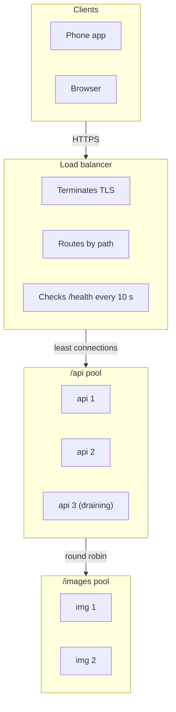
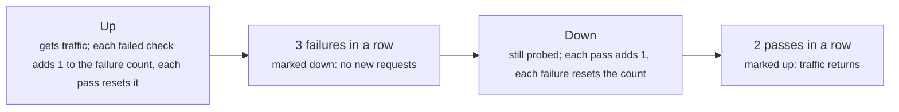

# Load balancing: spreading requests and routing around failure

> System Design · L1 Foundation · Scaling, availability and load balancing · about 95 min · hub module `m04` ([open the hub](https://claude.ai/artifact/5FDy46yNwWT8pPPZwQUGP9))

## Why it matters
A load balancer is the front door of every horizontally scaled service. It decides which server gets each request and stops sending traffic to servers that are failing. The algorithm it uses, and how its health checks decide that a server is up or down, change how evenly the load spreads and how quickly the system recovers from a failure.

## Pre-question (answer before reading)
**Q:** Three servers sit behind a round-robin load balancer. One of them is twice as powerful as the others, and some requests take a hundred times longer than others. What goes wrong with plain round robin, and what would you use instead?

<details><summary>Answer</summary>

Round robin gives every server the same number of requests, so the big server sits half idle while the small ones queue, and a server that happens to get several slow requests falls behind whatever its size. Weighted round robin (2 : 1 : 1) fixes the size difference; least connections sends each request to the server with the fewest in flight, which adapts to slow requests.

</details>

## 🍎 Story time (kid version)
**Pizza Town and the family road trip: Ben at the counter**

At Luigi's, Ben stands at the counter and hands each new order to the next cook in turn: Ana, then Bo, then Cy, then Ana again. Ana is twice as fast as the others, so Ben starts giving her two orders for every one he gives the others. Some pizzas take much longer than others, so Ben also glances at how many pizzas each cook already has and picks the least busy one. Every few minutes he asks each cook, “Are you OK?” If a cook doesn't answer twice in a row, Ben stops sending them orders until they've answered “OK” twice again.

| In the story | In a real system |
|---|---|
| Handing orders to Ana, Bo and Cy in turn | Round robin: each server gets the next request in rotation |
| Two orders for Ana for every one to the others | Weighted round robin: shares in proportion to capacity |
| Picking the cook with the fewest pizzas on the go | Least connections: the server with the fewest requests in flight |
| Asking “Are you OK?” every few minutes | Health checks: a regular probe of each server |
| Two missed answers to stop, two good ones to start again | Down and up thresholds, which stop a flaky server flapping in and out |

**Where the story breaks:** Ben sees every order, but real systems often run several load balancers, each seeing only its own share of the traffic, so “least busy” is each one's local guess. And a cook who answers “OK” might still burn every pizza: a health check only proves what it actually tests.

## Key ideas (grown-up version)
- **What a load balancer does**: it gives clients one address, spreads requests across a pool of servers, stops sending to servers that fail their health checks, and lets you add or remove servers without clients noticing. Common extras are TLS termination, reusing connections to the servers, and limits on request size and rate.
- **Layer 4 and layer 7**: a layer 4 (transport) load balancer forwards TCP or UDP connections by address and port without reading them: fast, and it works for any protocol. A layer 7 (application) load balancer understands HTTP: it can route by path, host or header, terminate TLS and retry a request, at the cost of more work per request.
- **Round robin and weighted round robin**: round robin hands requests to the servers in turn, which is fair when the servers and the requests are alike. Weighted round robin gives each server a share in proportion to its weight, for pools that mix machine sizes.
- **Least connections**: send each request to the server with the fewest requests in flight. It adapts when some requests are slow or some servers are slower, because a busy server collects connections and stops being picked. A cheaper relative, the power of two choices, samples two servers at random and uses the less loaded one.
- **Hashing for affinity**: routing by a hash of a key (a user ID, the client's IP address) sends the same key to the same server, which keeps that server's cache warm. But hash mod N moves most keys when N changes; consistent hashing (L2) moves only about 1/N of them.
- **Health checks**: the load balancer probes each server every few seconds, with a TCP connection or an HTTP request to a path such as /health. A server is marked down after several failures in a row and up again after several passes, so one slow answer doesn't flap it in and out. Passive checks also watch real traffic for errors.
- **What a health check should prove**: that the server can do useful work (it's running, and it can reach what only it needs) without failing every server at once when one shared dependency has a blip, which would turn a partial outage into a total one.
- **No single point of failure in front**: the load balancer must be redundant too: a pair sharing a floating address, several behind DNS, or a managed load balancer that runs across zones. And drain a server before removing it: no new requests, while the ones in flight finish.

## Diagrams
**A layer 7 load balancer routing by path, with health checks**



_Each pool has its own algorithm. A draining server gets no new requests while the ones it holds finish; a server that fails three checks in a row is taken out until it passes two._

**A health check's two thresholds**



_Two thresholds instead of one stop a server that fails one check in three from flapping in and out of the pool._

## Comparisons
**Choosing an algorithm**

| Algorithm | How it picks | Good when | Weak when |
|---|---|---|---|
| Round robin | The next server in turn | Servers and requests are alike | Request times vary, or servers differ in size |
| Weighted round robin | In turn, in proportion to weights | Servers differ in size | Request times vary a lot |
| Least connections | Fewest requests in flight | Request times vary (slow reports, uploads) | Many balancers each see only part of the load |
| Hash of a key | hash(key) picks the server | A server's cache or session should see the same key again | The pool changes size (with mod N), or one key is very hot |

**Layer 4 or layer 7**

|  | Layer 4 (transport) | Layer 7 (application) |
|---|---|---|
| Sees | Addresses and ports of TCP or UDP connections | Whole HTTP requests: method, path, headers |
| Can route by | Address and port | Path, host, header, cookie |
| TLS | Usually passes it through | Usually terminates it |
| Typical use | Any protocol, very high throughput, databases | Web apps and APIs, path-based routing, retries |

## Code (JavaScript + Python)
### A stable string hash and the health-check state machine used below
```python
def fnv1a(key):                                 # a small, stable 32-bit string hash, same in both languages
    h = 0x811C9DC5
    for byte in key.encode():
        h = ((h ^ byte) * 0x01000193) & 0xFFFFFFFF
    return h

def health_states(probes, fall=3, rise=2):
    """probes: '+' passed, '-' failed. Down after `fall` failures in a row, up after `rise` passes in a row."""
    healthy, streak, states = True, 0, []
    for p in probes:
        ok = p == "+"
        if ok == healthy:
            streak = 0                          # agrees with the current state: reset the count
        else:
            streak += 1                         # one more result pointing the other way
            if streak == (rise if ok else fall):
                healthy, streak = ok, 0         # enough in a row: switch
        states.append("U" if healthy else "D")
    return "".join(states)
```

```javascript
function fnv1a(key) {                           // a small, stable 32-bit string hash, same in both languages
  let h = 0x811c9dc5;
  for (const byte of Buffer.from(key)) h = Math.imul(h ^ byte, 0x01000193) >>> 0;
  return h;
}

function healthStates(probes, fall = 3, rise = 2) {
  // probes: "+" passed, "-" failed. Down after `fall` failures in a row, up after `rise` passes in a row
  let healthy = true, streak = 0, states = "";
  for (const p of probes) {
    const ok = p === "+";
    if (ok === healthy) streak = 0;             // agrees with the current state: reset the count
    else if (++streak === (ok ? rise : fall)) { // one more result pointing the other way
      healthy = ok; streak = 0;                 // enough in a row: switch
    }
    states += healthy ? "U" : "D";
  }
  return states;
}
```

### Round robin or least connections when some requests are slow
```python
def simulate(policy, durations, servers=3):
    """One request arrives per tick; returns each server's peak number of requests in flight."""
    ends = [[] for _ in range(servers)]       # finish times of each server's requests in flight
    peaks = [0] * servers
    for t, d in enumerate(durations):
        for e in ends:
            e[:] = [x for x in e if x > t]    # finished requests leave
        s = policy(t, [len(e) for e in ends])
        ends[s].append(t + d)
        peaks[s] = max(peaks[s], len(ends[s]))
    return peaks

round_robin = lambda t, active: t % len(active)
least_conn = lambda t, active: active.index(min(active))   # ties go to the lowest index

durations = [20 if i % 3 == 0 else 1 for i in range(60)]   # every third request is a slow report
print("round robin:", *simulate(round_robin, durations))
print("least connections:", *simulate(least_conn, durations))
```

Output:
```text
round robin: 7 1 1
least connections: 3 3 2
```

- line 13: Round robin ignores load: request i always goes to server i mod 3.
- line 14: Least connections looks at what each server holds right now.
- line 17: Every slow report lands on server 0, because they arrive every third request: up to 7 in flight there while the others hold 1.
- line 18: Least connections spreads the slow reports out: no server holds more than 3 at once.

```javascript
function simulate(policy, durations, servers = 3) {
  // one request arrives per tick; returns each server's peak number of requests in flight
  const ends = Array.from({ length: servers }, () => []);   // finish times of each server's requests in flight
  const peaks = new Array(servers).fill(0);
  durations.forEach((d, t) => {
    for (let s = 0; s < servers; s++) ends[s] = ends[s].filter(x => x > t);   // finished requests leave
    const s = policy(t, ends.map(e => e.length));
    ends[s].push(t + d);
    peaks[s] = Math.max(peaks[s], ends[s].length);
  });
  return peaks;
}

const roundRobin = (t, active) => t % active.length;
const leastConn = (t, active) => active.indexOf(Math.min(...active));   // ties go to the lowest index

const durations = Array.from({ length: 60 }, (_, i) => (i % 3 === 0 ? 20 : 1));   // every third request is a slow report
console.log("round robin:", ...simulate(roundRobin, durations));
console.log("least connections:", ...simulate(leastConn, durations));
```

Output:
```text
round robin: 7 1 1
least connections: 3 3 2
```

- line 14: Round robin ignores load: request i always goes to server i mod 3.
- line 15: Least connections looks at what each server holds right now.
- line 18: Every slow report lands on server 0, because they arrive every third request: up to 7 in flight there while the others hold 1.
- line 19: Least connections spreads the slow reports out: no server holds more than 3 at once.

### Health checks: thresholds stop flapping
```python
probes = "++-+--+---++-++"                    # one check every 10 s: '+' passed, '-' failed
jumpy = health_states(probes, fall=1, rise=1)
calm = health_states(probes, fall=3, rise=2)
changes = lambda s: sum(a != b for a, b in zip(s, s[1:]))
print("probes:", probes)
print("fall 1, rise 1:", jumpy, "changes:", changes(jumpy))
print("fall 3, rise 2:", calm, "changes:", changes(calm))
interval, fall = 10, 3
print(f"a dead server is dropped {interval * (fall - 1)} to {interval * fall} s after it dies")
```

Output:
```text
probes: ++-+--+---++-++
fall 1, rise 1: UUDUDDUDDDUUDUU changes: 8
fall 3, rise 2: UUUUUUUUUDDUUUU changes: 2
a dead server is dropped 20 to 30 s after it dies
```

- line 2: With thresholds of 1 the state simply copies the last probe, so every blip flips the server in or out.
- line 3: Three failures to go down and two passes to come back: isolated failures are ignored.
- line 6: 8 changes of state in 15 checks: the pool keeps losing and regaining this server.
- line 9: The price of calm: a dead server keeps getting requests until its third failed check, 20 to 30 seconds after it dies.

```javascript
const probes = "++-+--+---++-++";             // one check every 10 s: "+" passed, "-" failed
const jumpy = healthStates(probes, 1, 1);
const calm = healthStates(probes, 3, 2);
const changes = s => [...s].filter((c, i) => i > 0 && c !== s[i - 1]).length;
console.log("probes:", probes);
console.log("fall 1, rise 1:", jumpy, "changes:", changes(jumpy));
console.log("fall 3, rise 2:", calm, "changes:", changes(calm));
const interval = 10, fall = 3;
console.log(`a dead server is dropped ${interval * (fall - 1)} to ${interval * fall} s after it dies`);
```

Output:
```text
probes: ++-+--+---++-++
fall 1, rise 1: UUDUDDUDDDUUDUU changes: 8
fall 3, rise 2: UUUUUUUUUDDUUUU changes: 2
a dead server is dropped 20 to 30 s after it dies
```

- line 2: With thresholds of 1 the state simply copies the last probe, so every blip flips the server in or out.
- line 3: Three failures to go down and two passes to come back: isolated failures are ignored.
- line 6: 8 changes of state in 15 checks: the pool keeps losing and regaining this server.
- line 9: The price of calm: a dead server keeps getting requests until its third failed check, 20 to 30 seconds after it dies.

### Hashing keys to servers, and what mod N does when the pool changes
```python
keys = [f"user-{i}" for i in range(10_000)]
counts = [0] * 4
for k in keys:
    counts[fnv1a(k) % 4] += 1
print("keys per server:", *counts)

for old_n, new_n in ((4, 5), (5, 4), (10, 11)):
    moved = sum(fnv1a(k) % old_n != fnv1a(k) % new_n for k in keys)
    print(f"{old_n} -> {new_n} servers: {moved * 100 // len(keys)}% of keys move; the minimum is {100 // max(old_n, new_n)}%")
```

Output:
```text
keys per server: 2501 2499 2499 2501
4 -> 5 servers: 80% of keys move; the minimum is 20%
5 -> 4 servers: 80% of keys move; the minimum is 20%
10 -> 11 servers: 90% of keys move; the minimum is 9%
```

- line 5: A good hash spreads the keys evenly: about 2,500 per server.
- line 8: A key stays put only if its hash leaves the same remainder for both pool sizes.
- line 9: Adding one server should move only the new server's fair share; mod N moves four to ten times that, emptying caches across the whole pool.

```javascript
const keys = Array.from({ length: 10000 }, (_, i) => `user-${i}`);
const counts = [0, 0, 0, 0];
for (const k of keys) counts[fnv1a(k) % 4]++;
console.log("keys per server:", ...counts);

for (const [oldN, newN] of [[4, 5], [5, 4], [10, 11]]) {
  const moved = keys.filter(k => fnv1a(k) % oldN !== fnv1a(k) % newN).length;
  console.log(`${oldN} -> ${newN} servers: ${Math.floor((moved * 100) / keys.length)}% of keys move; the minimum is ${Math.floor(100 / Math.max(oldN, newN))}%`);
}
```

Output:
```text
keys per server: 2501 2499 2499 2501
4 -> 5 servers: 80% of keys move; the minimum is 20%
5 -> 4 servers: 80% of keys move; the minimum is 20%
10 -> 11 servers: 90% of keys move; the minimum is 9%
```

- line 4: A good hash spreads the keys evenly: about 2,500 per server.
- line 7: A key stays put only if its hash leaves the same remainder for both pool sizes.
- line 8: Adding one server should move only the new server's fair share; mod N moves four to ten times that, emptying caches across the whole pool.

## Worked example
**Problem.** A pool has two big servers (900 requests per second each at full load) and three small ones (300 each), behind weighted round robin with weights 3, 3, 1, 1, 1. Peak traffic is 2,000 requests per second. How busy is each server at the peak? What happens if one big server fails, and how would you fix it?

1. Weighted round robin hands out requests in proportion to the weights: a big server gets 3 of every 9 requests, a small one 1 of every 9.
2. At 2,000 requests per second a big server gets about 667 (74% of its 900) and a small one about 222 (74% of its 300). Weights in proportion to capacity keep every server equally busy.
3. If big-1 fails, its share is spread by weight over the rest: 1,000 for big-2 and 333 for each small server, 111% of their capacity. The 1,800 requests per second that remain can't carry a 2,000 peak, so everything slows down together.
4. Plan for losing the biggest server: with a third big server the pool still runs at 74% when one fails. The shares take O(n) time to work out for n servers; integer arithmetic avoids rounding surprises.

```python
def shares(peak, pool):
    """pool: (name, weight, capacity) per server; weighted round robin splits the peak by weight."""
    total = sum(w for _, w, _ in pool)
    return [(name, peak * w // total, peak * w * 100 // (total * cap)) for name, w, cap in pool]

big = lambda n: (f"big-{n}", 3, 900)
small = lambda n: (f"small-{n}", 1, 300)
designs = (("all up", [big(1), big(2), small(1), small(2), small(3)]),
           ("big-1 down", [big(2), small(1), small(2), small(3)]),
           ("big-3 added, big-1 down", [big(2), big(3), small(1), small(2), small(3)]))
for label, pool in designs:
    print(f"{label}:", *(f"{name} {rps}/s {pct}%" for name, rps, pct in shares(2_000, pool)))
```

Output:
```text
all up: big-1 666/s 74% big-2 666/s 74% small-1 222/s 74% small-2 222/s 74% small-3 222/s 74%
big-1 down: big-2 1000/s 111% small-1 333/s 111% small-2 333/s 111% small-3 333/s 111%
big-3 added, big-1 down: big-2 666/s 74% big-3 666/s 74% small-1 222/s 74% small-2 222/s 74% small-3 222/s 74%
```

```javascript
function shares(peak, pool) {
  // pool: [name, weight, capacity] per server; weighted round robin splits the peak by weight
  const total = pool.reduce((sum, [, w]) => sum + w, 0);
  return pool.map(([name, w, cap]) => [name, Math.floor((peak * w) / total), Math.floor((peak * w * 100) / (total * cap))]);
}

const big = n => [`big-${n}`, 3, 900];
const small = n => [`small-${n}`, 1, 300];
const designs = [["all up", [big(1), big(2), small(1), small(2), small(3)]],
  ["big-1 down", [big(2), small(1), small(2), small(3)]],
  ["big-3 added, big-1 down", [big(2), big(3), small(1), small(2), small(3)]]];
for (const [label, pool] of designs) {
  console.log(`${label}:`, ...shares(2000, pool).map(([name, rps, pct]) => `${name} ${rps}/s ${pct}%`));
}
```

Output:
```text
all up: big-1 666/s 74% big-2 666/s 74% small-1 222/s 74% small-2 222/s 74% small-3 222/s 74%
big-1 down: big-2 1000/s 111% small-1 333/s 111% small-2 333/s 111% small-3 333/s 111%
big-3 added, big-1 down: big-2 666/s 74% big-3 666/s 74% small-1 222/s 74% small-2 222/s 74% small-3 222/s 74%
```

**Answer.** With everything up, every server runs at about 74% of its capacity. When big-1 fails, each remaining server is pushed to about 111%, because 1,800 requests per second of capacity can't carry a 2,000 peak. Adding a third big server brings the pool back to 74% even with one big server down.

## Your turn (faded example)
**Problem.** Plain weighted round robin with weights a = 5, b = 1, c = 1 sends a, a, a, a, a, then b and c: right on average, but in bursts. Finish `next_server()` for smooth weighted round robin (the algorithm NGINX uses): on every pick, add each server's weight to its current value, pick the server with the largest current value (the first one on a tie), and subtract the total of all weights from the winner.

- ✓ Each server keeps a current value, starting at 0; the total of the weights is fixed.
- **What does every server earn on each pick?**
  <details><summary>Answer</summary>Its weight is added to its current value, so a heavy server climbs faster and is picked more often.</details>
- **Why subtract the total from the winner?**
  <details><summary>Answer</summary>It pays back exactly what all servers earned together on that pick, so the sum of the current values stays 0. The winner drops below the others and waits its turn, which interleaves the picks: over each run of `total` picks every server is picked exactly `weight` times.</details>
- **What does a pick cost?**
  <details><summary>Answer</summary>O(n) time for n servers and O(n) memory for the current values: fine for the tens of servers behind one load balancer.</details>

Starter:
```python
class SmoothWeightedRR:
    def __init__(self, weights):              # weights: [(name, weight), ...] in a fixed order
        self.names = [n for n, _ in weights]
        self.weights = [w for _, w in weights]
        self.current = [0] * len(weights)
        self.total = sum(self.weights)

    def next_server(self):
        ...                                   # TODO: everyone earns their weight; the largest wins and pays the total
```

```javascript
class SmoothWeightedRR {
  constructor(weights) {                      // weights: [[name, weight], ...] in a fixed order
    this.names = weights.map(([n]) => n);
    this.weights = weights.map(([, w]) => w);
    this.current = new Array(weights.length).fill(0);
    this.total = this.weights.reduce((x, y) => x + y, 0);
  }
  nextServer() {
    // TODO: everyone earns their weight; the largest wins and pays the total
  }
}
```

<details><summary>Full solution</summary>

```python
class SmoothWeightedRR:
    def __init__(self, weights):              # weights: [(name, weight), ...] in a fixed order
        self.names = [n for n, _ in weights]
        self.weights = [w for _, w in weights]
        self.current = [0] * len(weights)
        self.total = sum(self.weights)

    def next_server(self):
        for i, w in enumerate(self.weights):
            self.current[i] += w              # everyone earns their weight
        best = max(range(len(self.current)), key=lambda i: self.current[i])   # the first of the largest
        self.current[best] -= self.total      # the winner pays back the total
        return self.names[best]

weights = [("a", 5), ("b", 1), ("c", 1)]
rr = SmoothWeightedRR(weights)
print("smooth:", *(rr.next_server() for _ in range(7)))
print("plain: ", *(name for name, w in weights for _ in range(w)))
```

Output:
```text
smooth: a a b a c a a
plain:  a a a a a b c
```

```javascript
class SmoothWeightedRR {
  constructor(weights) {                      // weights: [[name, weight], ...] in a fixed order
    this.names = weights.map(([n]) => n);
    this.weights = weights.map(([, w]) => w);
    this.current = new Array(weights.length).fill(0);
    this.total = this.weights.reduce((x, y) => x + y, 0);
  }
  nextServer() {
    this.weights.forEach((w, i) => { this.current[i] += w; });   // everyone earns their weight
    let best = 0;
    for (let i = 1; i < this.current.length; i++) if (this.current[i] > this.current[best]) best = i;   // the first of the largest
    this.current[best] -= this.total;         // the winner pays back the total
    return this.names[best];
  }
}

const weights = [["a", 5], ["b", 1], ["c", 1]];
const rr = new SmoothWeightedRR(weights);
console.log("smooth:", ...Array.from({ length: 7 }, () => rr.nextServer()));
console.log("plain: ", ...weights.flatMap(([name, w]) => Array(w).fill(name)));
```

Output:
```text
smooth: a a b a c a a
plain:  a a a a a b c
```

</details>

## Socratic checks and quiz (answers hidden)
**1. What does this print?**

```python
active = [2, 0, 1]                          # requests in flight on servers 0, 1, 2
picks = []
for _ in range(4):
    s = active.index(min(active))           # fewest in flight; ties go to the lowest index
    active[s] += 1
    picks.append(s)
print(*picks, *active)
```

```javascript
const active = [2, 0, 1];                   // requests in flight on servers 0, 1, 2
const picks = [];
for (let k = 0; k < 4; k++) {
  const s = active.indexOf(Math.min(...active));   // fewest in flight; ties go to the lowest index
  active[s]++;
  picks.push(s);
}
console.log(...picks, ...active);
```

- A. 1 1 2 0 3 2 2
- B. 1 2 0 1 3 2 2
- C. 1 1 2 2 2 2 3
- D. 0 1 2 0 3 2 2

<details><summary>Answer</summary>

1 1 2 0 3 2 2. Server 1 starts empty, so it takes the first request; it then ties with server 2 at 1, and the lower index wins again. Next server 2 is the only one at 1, and finally all three are at 2, so server 0 wins the tie. The counts end at 3, 2, 2.

</details>

**2. What does this print? (`health_states` / `healthStates` is this module's helper: down after `fall` failures in a row, up after `rise` passes.)**

```python
print(health_states("+--+---+++", fall=3, rise=2))
```

```javascript
console.log(healthStates("+--+---+++", 3, 2));
```

- A. UUUUUUDDUU
- B. UDDUDDDUUU
- C. UUUUUUDDDU
- D. UUUUUUDUUU

<details><summary>Answer</summary>

UUUUUUDDUU. The first two failures are reset by the pass at position 4. The next three failures in a row take the server down at position 7. It needs two passes to come back, so it's still down at position 8 and up at 9.

</details>

**3. Requests to your API take anything from 5 ms to 5 s, and all the servers are the same size. Which algorithm keeps the load most even?**

- A. Least connections: a server busy with slow requests collects connections and stops being picked
- B. Round robin: every server gets the same number of requests
- C. Hashing the client's IP address: each client always goes to the same server
- D. Weighted round robin with equal weights

<details><summary>Answer</summary>

Least connections: a server busy with slow requests collects connections and stops being picked. Round robin, and weighted round robin with equal weights (which is the same thing), count requests rather than load, so slow requests can pile up on one server. Hashing pins clients to servers whatever their load.

</details>

**4. Which are good practices for health checks? (choose 2)**

- A. Mark a server down only after several failed checks in a row
- B. Check what this server needs to do useful work, without failing every server when one shared dependency has a blip
- C. Make the health check run the whole checkout flow, including the payment provider
- D. Check once an hour to save load
- E. Return 200 from /health as soon as the process starts, before it has loaded its configuration

<details><summary>Answer</summary>

Mark a server down only after several failed checks in a row, Check what this server needs to do useful work, without failing every server when one shared dependency has a blip. Thresholds stop flapping, and checks should prove useful work without coupling every server to a shared dependency. A full checkout check fails every server when the payment provider has a blip, hourly checks leave dead servers in the pool for an hour, and passing before the configuration is loaded sends traffic to a server that can't serve it.

</details>

**5. Judge each statement.**

- A layer 7 load balancer can send /api and /images to different pools of servers.
- A layer 4 load balancer reads HTTP headers to choose a server.
- Going from 4 to 5 servers with hash mod N moves about 80% of the keys.
- The load balancer itself never needs redundancy.

<details><summary>Answer</summary>

A layer 7 load balancer can send /api and /images to different pools of servers.: Yes; A layer 4 load balancer reads HTTP headers to choose a server.: No; Going from 4 to 5 servers with hash mod N moves about 80% of the keys.: Yes; The load balancer itself never needs redundancy.: No. Layer 7 understands HTTP, so it can route by path. Layer 4 sees only addresses and ports. A key stays put under mod N only when its hash leaves the same remainder for 4 and 5, about 1 key in 5. And a single load balancer is a single point of failure.

</details>

**6. Put the steps of taking a server out for maintenance in order.**

- (put the steps in order)

<details><summary>Answer</summary>

Mark the server as draining, so the load balancer sends it no new requests → Wait for its requests in flight to finish, or for a drain timeout → Stop the server and do the maintenance → Start it and let it pass its health checks before it gets traffic again. Draining comes first so no new work arrives, the work in flight must finish before the server stops, and the server must be running again before it can pass a health check.

</details>

**7. Complete the Python function for weighted least connections (fewest requests in flight per unit of weight; the lowest index on a tie), using whole numbers only.**

```
def weighted_least_conn(active, weights):
    best = 0
    for s in range(1, len(active)):
        if active[s] * {{0}} < active[best] * {{1}}:
            best = s
    return best

```

<details><summary>Answer</summary>

weights[best] | weights[s]. Comparing active[s] ÷ weights[s] with active[best] ÷ weights[best] is the same as cross-multiplying: active[s] × weights[best] < active[best] × weights[s], with no division and no rounding.

</details>

**8. Match each algorithm to how it picks a server.**


<details><summary>Answer</summary>

Hands requests to the servers in turn = Round robin; Gives bigger servers a bigger share = Weighted round robin; Sends each request to the server with the fewest in flight = Least connections; Sends the same key to the same server = Hash-based routing. A health check decides which servers are in the pool; the algorithms decide which of those gets each request.

</details>

## Traps & misconceptions
- **“Round robin spreads the load evenly.”** It spreads the number of requests evenly. If requests differ in cost or servers differ in size, the load doesn't: one server can end up with every slow request. Least connections or weights fix that.
- **“A health check that returns 200 proves the server works.”** It proves the health check works. A shallow check can pass while the server fails real requests, so check what real requests need, and watch real error rates too (passive checks).
- **“Health checks should test every dependency.”** If every server's check fails when one shared dependency, such as the database, has a blip, the load balancer removes every server at once and a partial outage becomes a total one. Check what taking this one server out would actually fix.
- **“Mark a server down on its first failed check.”** Then one dropped packet flaps it out and back in. Use thresholds: several failures in a row to go down, several passes in a row to come back.
- **“The load balancer can't fail.”** It's a server too. Run a redundant pair or a managed load balancer spread across zones, or it's the single point of failure in front of all your redundancy.
- **“Hashing users to servers is free stickiness.”** With hash mod N, adding or removing one server sends most users to a different server, emptying their caches at once. Consistent hashing (L2) moves only about 1/N of them.

## Discussion prompts
- **Layer 4 or layer 7 load balancing for a web app with an API and static files?**
  <details><summary>One good answer</summary>Usually layer 7: it can terminate TLS once, route /api to the app servers and /static to a file service or CDN, add headers, and retry safe requests on another server. Layer 4 is simpler and faster per connection and works for any protocol, so it's common in front of databases, for traffic that isn't HTTP, or as a first tier in front of a fleet of layer 7 proxies.</details>
- **How do you deploy a new version behind a load balancer without dropping requests?**
  <details><summary>One good answer</summary>Roll through the servers one or a few at a time: mark a server as draining so it gets no new requests, wait for its requests in flight to finish, stop it, deploy, start it, and send it traffic only once it passes its health checks. Keep enough capacity that the pool carries the peak with those servers out, and watch the error rate as you go so you can stop and roll back.</details>

## Teach-back
**Prompt:** Explain to a junior colleague how a load balancer decides where each request goes, and how it notices that a server has failed.

Rubric:
- [ ] Round robin is fair only when servers and requests are alike
- [ ] Weights for different server sizes; least connections for uneven request times
- [ ] Health checks with down and up thresholds
- [ ] A check proves useful work but doesn't fail every server over one shared dependency
- [ ] The load balancer itself must be redundant; drain servers before removing them

<details><summary>Model answer</summary>

The load balancer gives clients one address and picks a server from the pool for each request. Round robin takes them in turn, which is fair when every server is the same size and every request costs about the same. If the servers differ, weights give the bigger ones a bigger share; if request times vary, least connections sends each request to the server with the fewest in flight, so a server stuck on slow requests stops being picked. To notice failures it probes every server every few seconds, takes one out after several failed checks in a row and brings it back after several passes, so one blip doesn't make it flap. The check should prove the server can do useful work, without failing every server at once when a shared database has a hiccup. And the load balancer itself runs as a redundant pair or a managed service across zones, and servers are drained before they're removed.

</details>

## Quick Q&A (also in the SRS deck)
- **What does round robin do?** Sends each new request to the next server in turn.
- **When is least connections better than round robin?** When request times vary: a server busy with slow requests collects connections and stops being picked.
- **Layer 4 or layer 7?** Layer 4 forwards TCP or UDP connections without reading them; layer 7 understands HTTP and can route by path, host or header.
- **Why does a health check need thresholds?** So one failed or slow probe doesn't flap a server out of the pool and back in.
- **What does hash mod N do when N changes?** It moves most keys to a different server: about 80% when going from 4 servers to 5.
- **What is connection draining?** Sending a server no new requests while its requests in flight finish, before it's removed.

## Practice problems
- [ ] [Exercise · How NGINX balances load](https://nginx.org/en/docs/http/load_balancing.html) · find round robin, least_conn and ip_hash, and the weight and max_fails settings; map each one to this module
- [ ] [Exercise · Health check settings in a managed load balancer](https://docs.aws.amazon.com/elasticloadbalancing/latest/application/target-group-health-checks.html) · find the interval and the healthy and unhealthy thresholds, and work out how long a dead server keeps getting requests with the defaults
- [ ] [Exercise · Least request and the power of two choices](https://www.envoyproxy.io/docs/envoy/latest/intro/arch_overview/upstream/load_balancing/load_balancers) · read how Envoy's least request picks between random choices, then add it as a policy to this module's simulate
- [ ] [Reading · Load balancing in a data centre at scale](https://sre.google/sre-book/load-balancing-datacenter/) · compare simple round robin, least-loaded round robin and weighted round robin, and what went wrong with each

## Sources (accessed 2026-10-09)
- [NGINX: Using nginx as HTTP load balancer](https://nginx.org/en/docs/http/load_balancing.html)
- [Google SRE book: Load balancing in the datacenter](https://sre.google/sre-book/load-balancing-datacenter/)
- [Envoy: Supported load balancers](https://www.envoyproxy.io/docs/envoy/latest/intro/arch_overview/upstream/load_balancing/load_balancers)
- [AWS: Health checks for Application Load Balancer target groups](https://docs.aws.amazon.com/elasticloadbalancing/latest/application/target-group-health-checks.html)
