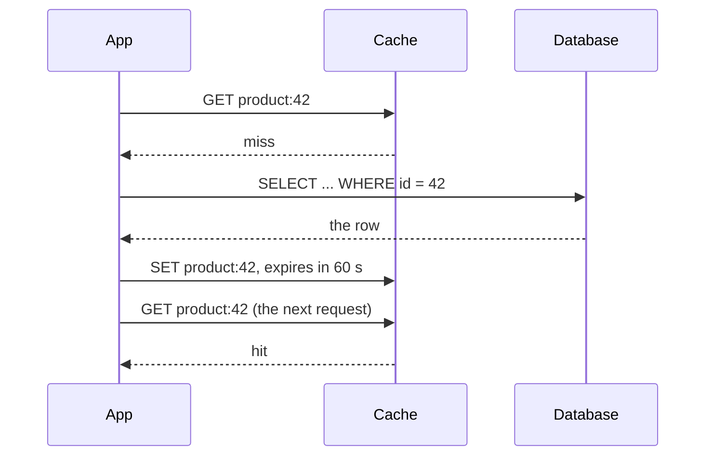
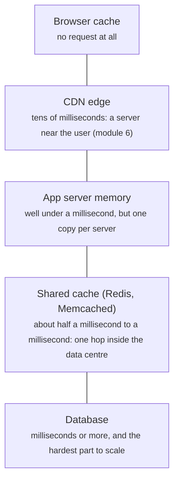

# Caching: hit ratios, expiry and eviction

> System Design · L1 Foundation · Caching and storage · about 100 min · hub module `m05` ([open the hub](https://claude.ai/artifact/5FDy46yNwWT8pPPZwQUGP9))

## Why it matters
A cache keeps a copy of data somewhere faster and closer, so most reads never reach the slow, expensive store: at a 90% hit ratio the database sees a tenth of the reads. But every cache raises the questions interviewers love: what happens on a miss, when does a copy go stale, what goes when the cache is full, and what happens when a popular entry expires?

## Pre-question (answer before reading)
**Q:** Your database answers a read in 10 ms and your cache in 1 ms. With a 90% hit ratio, what's the average read time, and how many reads a second reach the database at 5,000 reads a second? What if the hit ratio drops to 80%?

<details><summary>Answer</summary>

Every read checks the cache, and the 10% that miss also pay the database: 1 + 0.1 × 10 = 2 ms on average, with 500 reads a second reaching the database. At 80% it's 3 ms and 1,000 database reads a second: a ten-point drop in hit ratio doubles the database load.

</details>

## 🍎 Story time (kid version)
**Pizza Town and the family road trip: The jars on Luigi's counter**

Luigi keeps the toppings he uses most in small jars on the counter, and everything else in the big freezer in the basement. Grabbing a jar takes a second; a trip downstairs takes a minute. The counter only fits five jars, so when he needs a sixth, he takes back the jar he hasn't touched for the longest time. Fresh basil only lasts a day, so each morning he throws out yesterday's and fetches new. One busy evening the olive jar runs empty, and all four cooks run down to the basement at once. Ben suggests that next time only one cook goes, and the others wait for him.

| In the story | In a real system |
|---|---|
| Jars on the counter, the freezer in the basement | A small, fast cache in front of a big, slow database |
| Grabbing a jar or a trip downstairs | A cache hit or a cache miss |
| Taking back the jar untouched for the longest | LRU eviction: when full, drop the least recently used entry |
| Basil that only lasts a day | A time to live (TTL): entries expire and are fetched again |
| All four cooks running downstairs at once | A cache stampede when a popular entry expires; one fetch with the others waiting fixes it |

**Where the story breaks:** Luigi can see when the basil has gone bad, but a cache can't tell that its copy is stale: it serves the old value until the TTL runs out or someone invalidates it. Choosing a TTL is choosing how stale you can afford to be.

## Key ideas (grown-up version)
- **Why cache**: keep a copy of data that's read often in something faster (memory, or a server closer to the user). Each hit skips the slow path, so the database does less work and users wait less. Caching pays when reads repeat and a slightly old answer is acceptable.
- **Hit ratio and effective latency**: hit ratio = hits ÷ lookups. Average read time = cache time + (1 − hit ratio) × database time, since every read checks the cache and the misses also go to the database. Database load = (1 − hit ratio) × reads, so going from 90% to 95% halves it.
- **Cache-aside (lazy loading)**: the app checks the cache and, on a miss, reads the database and stores the result. Only data that's asked for gets cached, and a cache failure just means slower reads. The first read of each item is always a miss.
- **Writes: invalidate, write-through, write-back**: with cache-aside, a write goes to the database and then deletes the cached copy, so the next read fetches fresh data. Write-through updates the cache and the database together (fresh reads, slower writes). Write-back writes to the cache now and the database later (fast writes, but they're lost if the cache fails first).
- **TTL**: every entry expires after a time to live, which bounds how stale it can get and clears out entries nobody reads. Short TTLs mean fresher data but more misses; long TTLs mean more hits but older data. Choose per kind of data: seconds for stock levels, hours for a product description.
- **Eviction**: a full cache must drop something. LRU (least recently used) drops the entry untouched for the longest and suits most workloads; LFU (least frequently used) keeps long-term favourites; FIFO and random are simpler. LRU takes O(1) time per operation with a hash map and a doubly linked list.
- **Stampedes and hot keys**: when a popular entry expires, many requests miss at once and all hit the database (a cache stampede). Fixes: let one request refresh the entry while the others wait or get the old value, add a little random jitter to TTLs so entries don't expire together, and refresh hot entries before they expire.
- **Where caches live**: in the browser, at a CDN (module 6), in each app server's memory (fastest, but every server has its own copy), or in a shared cache such as Redis or Memcached (one copy for all servers, one network hop away). Large systems use several layers.

## Diagrams
**A cache-aside read: miss, load, then hit**



_Only the first read pays for the database. Every later read within the TTL is a hit, until the entry expires or a write deletes it._

**LRU with room for 3, accessing A B C A B D A (least recent on the left)**

| A · miss | 0 |
|---|---|
| value | **A** |

| B · miss | 0 | 1 |
|---|---|---|
| value | A | **B** |

| C · miss | 0 | 1 | 2 |
|---|---|---|---|
| value | A | B | **C** |

| A · hit | 0 | 1 | 2 |
|---|---|---|---|
| value | B | C | A |

| B · hit | 0 | 1 | 2 |
|---|---|---|---|
| value | C | A | B |

| D · miss | 0 | 1 | 2 |
|---|---|---|---|
| value | A | B | **D** |

| A · hit | 0 | 1 | 2 |
|---|---|---|---|
| value | B | D | A |

_A hit moves the key to the most recent end. When D arrives the cache is full, so C, untouched for the longest, is evicted: 4 misses and 3 hits._

**Where caches live, from nearest the user (rules of thumb)**



_Each layer catches what it can and passes the rest down. The further down a read goes, the more it costs._

## Comparisons
**What happens on a write**

|  | Cache-aside + invalidate | Write-through | Write-back |
|---|---|---|---|
| On a write | Write the database, then delete the cached copy | Write the cache and the database together | Write the cache now, the database later |
| The next read | Misses and loads the new value | Fresh straight away | Fresh, from the cache |
| If the cache fails | Reads get slower; nothing is lost | Reads get slower; nothing is lost | Writes not yet flushed are lost |
| Good for | Most read-heavy apps | Data that's read soon after it's written | Very write-heavy data where losing a little is acceptable |

**Eviction policies**

| Policy | Evicts | Good at | Weak at |
|---|---|---|---|
| LRU | The least recently used entry | Most workloads, where recent means likely again | One big scan can flush every hot entry |
| LFU | The least frequently used entry | Stable favourites | Slow to adapt when popularity shifts |
| FIFO | The oldest inserted entry | Simple and cheap | Evicts hot entries just because they're old |
| TTL only | Whatever has expired | Bounding staleness | Doesn't limit memory on its own |

## Code (JavaScript + Python)
### A fake clock, a database that counts its reads, and the seeded random generator
```python
class Clock:                                    # a fake clock, so the examples are exact and instant
    def __init__(self):
        self.now = 0
    def advance(self, seconds):
        self.now += seconds

class SlowDatabase:                             # stands in for the real store; counts every read
    def __init__(self, rows):
        self.rows, self.reads = dict(rows), 0
    def get(self, key):
        self.reads += 1
        return self.rows.get(key)

def mulberry32(seed):                           # a tiny seeded random generator, same as the JavaScript one
    state = seed & 0xFFFFFFFF
    def rand():
        nonlocal state
        state = (state + 0x6D2B79F5) & 0xFFFFFFFF
        t = ((state ^ (state >> 15)) * (state | 1)) & 0xFFFFFFFF
        t = (t ^ (t + (((t ^ (t >> 7)) * (t | 61)) & 0xFFFFFFFF))) & 0xFFFFFFFF
        return ((t ^ (t >> 14)) & 0xFFFFFFFF) / 4294967296
    return rand
```

```javascript
class Clock {                                   // a fake clock, so the examples are exact and instant
  constructor() { this.now = 0; }
  advance(seconds) { this.now += seconds; }
}

class SlowDatabase {                            // stands in for the real store; counts every read
  constructor(rows) { this.rows = new Map(Object.entries(rows)); this.reads = 0; }
  get(key) { this.reads++; return this.rows.has(key) ? this.rows.get(key) : null; }
}

function mulberry32(seed) {                     // a tiny seeded random generator, same as the Python one
  return function () {
    seed = (seed + 0x6D2B79F5) | 0;
    let t = Math.imul(seed ^ (seed >>> 15), 1 | seed);
    t = (t + Math.imul(t ^ (t >>> 7), 61 | t)) ^ t;
    return ((t ^ (t >>> 14)) >>> 0) / 4294967296;
  };
}
```

### Hit ratio decides latency and database load
```python
def avg_read_ms(hit_pct, cache_ms=1, db_ms=10):
    return cache_ms + (100 - hit_pct) * db_ms / 100   # every read checks the cache; misses also pay the database

for pct in (0, 50, 80, 90, 95, 99):
    print(f"hit {pct}%: {avg_read_ms(pct):.2f} ms on average, {5_000 * (100 - pct) // 100} database reads/s")
```

Output:
```text
hit 0%: 11.00 ms on average, 5000 database reads/s
hit 50%: 6.00 ms on average, 2500 database reads/s
hit 80%: 3.00 ms on average, 1000 database reads/s
hit 90%: 2.00 ms on average, 500 database reads/s
hit 95%: 1.50 ms on average, 250 database reads/s
hit 99%: 1.10 ms on average, 50 database reads/s
```

- line 2: A miss costs more than no cache at all (11 ms against 10): the cache only pays when the hit ratio is decent.
- line 5: Every five points of hit ratio near the top halve or more the database's reads: 500 at 90%, 250 at 95%, 50 at 99%.

```javascript
const avgReadMs = (hitPct, cacheMs = 1, dbMs = 10) => cacheMs + ((100 - hitPct) * dbMs) / 100;   // every read checks the cache; misses also pay the database

for (const pct of [0, 50, 80, 90, 95, 99]) {
  console.log(`hit ${pct}%: ${avgReadMs(pct).toFixed(2)} ms on average, ${Math.floor((5000 * (100 - pct)) / 100)} database reads/s`);
}
```

Output:
```text
hit 0%: 11.00 ms on average, 5000 database reads/s
hit 50%: 6.00 ms on average, 2500 database reads/s
hit 80%: 3.00 ms on average, 1000 database reads/s
hit 90%: 2.00 ms on average, 500 database reads/s
hit 95%: 1.50 ms on average, 250 database reads/s
hit 99%: 1.10 ms on average, 50 database reads/s
```

- line 1: A miss costs more than no cache at all (11 ms against 10): the cache only pays when the hit ratio is decent.
- line 4: Every five points of hit ratio near the top halve or more the database's reads: 500 at 90%, 250 at 95%, 50 at 99%.

### Cache-aside with a TTL, and the stale read a missing invalidation causes
```python
class CacheAside:
    def __init__(self, db, clock, ttl):
        self.db, self.clock, self.ttl = db, clock, ttl
        self.entries = {}                     # key -> (value, expires_at)
        self.hits = self.misses = 0

    def get(self, key):
        hit = self.entries.get(key)
        if hit and hit[1] > self.clock.now:   # present and not expired
            self.hits += 1
            return hit[0]
        self.misses += 1
        value = self.db.get(key)              # miss: read the database
        self.entries[key] = (value, self.clock.now + self.ttl)
        return value

    def invalidate(self, key):                # call after writing the database
        self.entries.pop(key, None)

clock = Clock()
db = SlowDatabase({"menu": "v1", "price": 9})
cache = CacheAside(db, clock, ttl=60)
for _ in range(3):
    cache.get("menu")                         # one miss, then two hits
clock.advance(61)
cache.get("menu")                             # expired: a miss again
print("hits", cache.hits, "misses", cache.misses, "database reads", db.reads)

before = cache.get("price")
db.rows["price"] = 10                         # someone updates the database...
stale = cache.get("price")                    # ...but the cache still holds the old copy
cache.invalidate("price")
print("price:", before, stale, cache.get("price"))
```

Output:
```text
hits 2 misses 2 database reads 2
price: 9 9 10
```

- line 9: An entry counts only while its expiry time is still in the future.
- line 13: Cache-aside: on a miss the app itself reads the database and stores the result with a fresh expiry.
- line 27: Four reads of the menu cost two database reads: the first, and one after the TTL ran out.
- line 33: Without the invalidation the cache would have served the old price of 9 until the TTL ran out.

```javascript
class CacheAside {
  constructor(db, clock, ttl) {
    this.db = db; this.clock = clock; this.ttl = ttl;
    this.entries = new Map();                 // key -> [value, expiresAt]
    this.hits = 0; this.misses = 0;
  }
  get(key) {
    const hit = this.entries.get(key);
    if (hit && hit[1] > this.clock.now) {     // present and not expired
      this.hits++;
      return hit[0];
    }
    this.misses++;
    const value = this.db.get(key);           // miss: read the database
    this.entries.set(key, [value, this.clock.now + this.ttl]);
    return value;
  }
  invalidate(key) { this.entries.delete(key); }   // call after writing the database
}

const clock = new Clock();
const db = new SlowDatabase({ menu: "v1", price: 9 });
const cache = new CacheAside(db, clock, 60);
for (let i = 0; i < 3; i++) cache.get("menu");   // one miss, then two hits
clock.advance(61);
cache.get("menu");                            // expired: a miss again
console.log("hits", cache.hits, "misses", cache.misses, "database reads", db.reads);

const before = cache.get("price");
db.rows.set("price", 10);                     // someone updates the database...
const stale = cache.get("price");             // ...but the cache still holds the old copy
cache.invalidate("price");
console.log("price:", before, stale, cache.get("price"));
```

Output:
```text
hits 2 misses 2 database reads 2
price: 9 9 10
```

- line 9: An entry counts only while its expiry time is still in the future.
- line 14: Cache-aside: on a miss the app itself reads the database and stores the result with a fresh expiry.
- line 27: Four reads of the menu cost two database reads: the first, and one after the TTL ran out.
- line 33: Without the invalidation the cache would have served the old price of 9 until the TTL ran out.

### LRU against FIFO on skewed traffic, and diminishing returns
```python
from collections import OrderedDict

def hit_ratio(requests, capacity, policy):
    cache, hits = OrderedDict(), 0
    for key in requests:
        if key in cache:
            hits += 1
            if policy == "lru":
                cache.move_to_end(key)        # used just now: the most recent end
        else:
            cache[key] = True
            if len(cache) > capacity:
                cache.popitem(last=False)     # evict the oldest: least recently used (LRU) or first in (FIFO)
    return hits * 100 // len(requests)

rand = mulberry32(11)
requests = []
for _ in range(20_000):                       # 80% of requests go to 200 hot keys, the rest to 800 others
    hot = rand() < 0.8
    requests.append(int(rand() * 200) if hot else 200 + int(rand() * 800))
for capacity in (50, 100, 200, 400, 800):
    print(f"{capacity} entries: LRU {hit_ratio(requests, capacity, 'lru')}%, FIFO {hit_ratio(requests, capacity, 'fifo')}%")
```

Output:
```text
50 entries: LRU 15%, FIFO 15%
100 entries: LRU 30%, FIFO 29%
200 entries: LRU 57%, FIFO 51%
400 entries: LRU 82%, FIFO 73%
800 entries: LRU 92%, FIFO 91%
```

- line 9: The only difference between the two policies: LRU moves a key to the recent end on every hit.
- line 13: Both evict from the old end; for LRU that's the least recently used key, for FIFO simply the oldest arrival.
- line 21: Up to the 200 hot keys the hit ratio grows in step with the size; past them each doubling buys less (400 to 800 adds 10 points). LRU's lead over FIFO is biggest around the size of the hot set.

```javascript
function hitRatio(requests, capacity, policy) {
  const cache = new Map();
  let hits = 0;
  for (const key of requests) {
    if (cache.has(key)) {
      hits++;
      if (policy === "lru") { cache.delete(key); cache.set(key, true); }   // used just now: the most recent end
    } else {
      cache.set(key, true);
      if (cache.size > capacity) cache.delete(cache.keys().next().value);  // evict the oldest: least recently used (LRU) or first in (FIFO)
    }
  }
  return Math.floor((hits * 100) / requests.length);
}

const rand = mulberry32(11);
const requests = [];
for (let i = 0; i < 20000; i++) {             // 80% of requests go to 200 hot keys, the rest to 800 others
  const hot = rand() < 0.8;
  requests.push(hot ? Math.floor(rand() * 200) : 200 + Math.floor(rand() * 800));
}
for (const capacity of [50, 100, 200, 400, 800]) {
  console.log(`${capacity} entries: LRU ${hitRatio(requests, capacity, "lru")}%, FIFO ${hitRatio(requests, capacity, "fifo")}%`);
}
```

Output:
```text
50 entries: LRU 15%, FIFO 15%
100 entries: LRU 30%, FIFO 29%
200 entries: LRU 57%, FIFO 51%
400 entries: LRU 82%, FIFO 73%
800 entries: LRU 92%, FIFO 91%
```

- line 7: The only difference between the two policies: LRU moves a key to the recent end on every hit.
- line 10: Both evict from the old end; for LRU that's the least recently used key, for FIFO simply the oldest arrival.
- line 22: Up to the 200 hot keys the hit ratio grows in step with the size; past them each doubling buys less (400 to 800 adds 10 points). LRU's lead over FIFO is biggest around the size of the hot set.

## Worked example
**Problem.** (LeetCode 1797, Design Authentication Manager) Tokens expire `time_to_live` seconds after they're generated or renewed. `generate(token, now)` creates one, `renew(token, now)` extends only an unexpired token, and `count_unexpired_tokens(now)` counts the live ones. A token that expires at time t is gone before anything else happens at t, and times only increase. Run: TTL 5; renew aaa at 1; generate aaa at 2; count at 6; generate bbb at 7; renew aaa at 8; renew bbb at 10; count at 15.

1. Store each token's expiry time; a token is alive while its expiry is later than now, so one expiring at 7 is already gone at 7.
2. renew acts only on a live token: drop the expired ones first, then set now + TTL if the token is still there.
3. Counting by scanning every token costs O(n). But the TTL is fixed and time only moves forward, so tokens expire in the order their expiry times were set: a queue of (expiry, token) is already sorted, and expired tokens are always at its front.
4. A renewal leaves its old queue entry behind, so skip entries whose time no longer matches the token's current expiry (lazy deletion). Each entry leaves the queue once, so every call is O(1) amortised, with O(calls) memory for the queue (a real cache trims it).

```python
class AuthenticationManager:
    def __init__(self, time_to_live):
        self.ttl = time_to_live
        self.expiry = {}                      # token -> when it expires
        self.queue, self.head = [], 0         # (expires_at, token) in expiry order, since the TTL is fixed

    def _expire(self, now):
        while self.head < len(self.queue) and self.queue[self.head][0] <= now:
            at, token = self.queue[self.head]
            if self.expiry.get(token) == at:  # skip entries a renewal has replaced
                del self.expiry[token]
            self.head += 1

    def generate(self, token_id, now):
        self._expire(now)
        self.expiry[token_id] = now + self.ttl
        self.queue.append((now + self.ttl, token_id))

    def renew(self, token_id, now):
        self._expire(now)
        if token_id in self.expiry:           # unexpired tokens only
            self.expiry[token_id] = now + self.ttl
            self.queue.append((now + self.ttl, token_id))

    def count_unexpired_tokens(self, now):
        self._expire(now)
        return len(self.expiry)

auth = AuthenticationManager(5)
auth.renew("aaa", 1)                          # no such token yet: ignored
auth.generate("aaa", 2)                       # expires at 7
first = auth.count_unexpired_tokens(6)
auth.generate("bbb", 7)                       # aaa expires at 7, before anything else at 7
auth.renew("aaa", 8)                          # already expired: ignored
auth.renew("bbb", 10)                         # now expires at 15
print(first, auth.count_unexpired_tokens(15))
```

Output:
```text
1 0
```

```javascript
class AuthenticationManager {
  constructor(timeToLive) {
    this.ttl = timeToLive;
    this.expiry = new Map();                  // token -> when it expires
    this.queue = []; this.head = 0;           // [expiresAt, token] in expiry order, since the TTL is fixed
  }
  expire(now) {
    while (this.head < this.queue.length && this.queue[this.head][0] <= now) {
      const [at, token] = this.queue[this.head];
      if (this.expiry.get(token) === at) this.expiry.delete(token);   // skip entries a renewal has replaced
      this.head++;
    }
  }
  generate(tokenId, now) {
    this.expire(now);
    this.expiry.set(tokenId, now + this.ttl);
    this.queue.push([now + this.ttl, tokenId]);
  }
  renew(tokenId, now) {
    this.expire(now);
    if (this.expiry.has(tokenId)) {           // unexpired tokens only
      this.expiry.set(tokenId, now + this.ttl);
      this.queue.push([now + this.ttl, tokenId]);
    }
  }
  countUnexpiredTokens(now) {
    this.expire(now);
    return this.expiry.size;
  }
}

const auth = new AuthenticationManager(5);
auth.renew("aaa", 1);                         // no such token yet: ignored
auth.generate("aaa", 2);                      // expires at 7
const first = auth.countUnexpiredTokens(6);
auth.generate("bbb", 7);                      // aaa expires at 7, before anything else at 7
auth.renew("aaa", 8);                         // already expired: ignored
auth.renew("bbb", 10);                        // now expires at 15
console.log(first, auth.countUnexpiredTokens(15));
```

Output:
```text
1 0
```

**Answer.** It prints 1 0. At time 6 only aaa is alive (it expires at 7). aaa expires at 7, so renewing it at 8 does nothing; bbb, renewed at 10, expires at 15, so it's already gone when the count runs at 15.

## Your turn (faded example)
**Problem.** (LeetCode 146, LRU Cache) Finish `get` and `put` so that both run in O(1): `get(key)` returns the value or −1, `put(key, value)` inserts or updates, and when the cache goes over capacity, the least recently used key is evicted. The hash map and the doubly linked list with two sentinels are given.

- ✓ The map finds a key's node in O(1); the list keeps the order of use, with the most recent just after `head` and the least recent just before `tail`.
- **What does get do besides returning the value?**
  <details><summary>Answer</summary>It moves the node to the front, because the key was just used. A missing key returns −1 and changes nothing.</details>
- **What does put do, and when does it evict?**
  <details><summary>Answer</summary>It removes any old node for the key, puts a new node at the front and records it in the map. If the map is now over capacity, it unlinks the node just before `tail`, the least recently used, and deletes its key from the map.</details>
- **What does each operation cost?**
  <details><summary>Answer</summary>O(1) time for get and put, a map lookup plus a few pointer changes, and O(capacity) memory.</details>

Starter:
```python
class Node:
    def __init__(self, key=None, value=None):
        self.key, self.value, self.prev, self.next = key, value, None, None

class LRUCache:
    def __init__(self, capacity):
        self.capacity, self.map = capacity, {}
        self.head, self.tail = Node(), Node() # sentinels: head.next is the most recent, tail.prev the least
        self.head.next, self.tail.prev = self.tail, self.head

    def _unlink(self, node):
        node.prev.next, node.next.prev = node.next, node.prev

    def _push_front(self, node):
        node.prev, node.next = self.head, self.head.next
        self.head.next.prev = node
        self.head.next = node

    def get(self, key):
        ...                                   # TODO: -1 if missing; otherwise move to the front and return the value

    def put(self, key, value):
        ...                                   # TODO: replace any old node, push to the front, evict tail.prev if over capacity
```

```javascript
class LRUCache {
  constructor(capacity) {
    this.capacity = capacity; this.map = new Map();
    this.head = { next: null }; this.tail = { prev: null };   // sentinels: head.next is the most recent, tail.prev the least
    this.head.next = this.tail; this.tail.prev = this.head;
  }
  unlink(node) { node.prev.next = node.next; node.next.prev = node.prev; }
  pushFront(node) {
    node.prev = this.head; node.next = this.head.next;
    this.head.next.prev = node;
    this.head.next = node;
  }
  get(key) {
    // TODO: -1 if missing; otherwise move to the front and return the value
  }
  put(key, value) {
    // TODO: replace any old node, push to the front, evict tail.prev if over capacity
  }
}
```

<details><summary>Full solution</summary>

```python
class Node:
    def __init__(self, key=None, value=None):
        self.key, self.value, self.prev, self.next = key, value, None, None

class LRUCache:
    def __init__(self, capacity):
        self.capacity, self.map = capacity, {}
        self.head, self.tail = Node(), Node() # sentinels: head.next is the most recent, tail.prev the least
        self.head.next, self.tail.prev = self.tail, self.head

    def _unlink(self, node):
        node.prev.next, node.next.prev = node.next, node.prev

    def _push_front(self, node):
        node.prev, node.next = self.head, self.head.next
        self.head.next.prev = node
        self.head.next = node

    def get(self, key):
        node = self.map.get(key)
        if node is None:
            return -1
        self._unlink(node)
        self._push_front(node)                # used just now: the most recent
        return node.value

    def put(self, key, value):
        if key in self.map:
            self._unlink(self.map[key])
        node = Node(key, value)
        self.map[key] = node
        self._push_front(node)
        if len(self.map) > self.capacity:
            lru = self.tail.prev              # the least recently used
            self._unlink(lru)
            del self.map[lru.key]

cache = LRUCache(2)
cache.put(1, 1)
cache.put(2, 2)
a = cache.get(1)                              # 1 is now the most recent
cache.put(3, 3)                               # evicts 2
b = cache.get(2)
cache.put(4, 4)                               # evicts 1
print(a, b, cache.get(1), cache.get(3), cache.get(4))
```

Output:
```text
1 -1 -1 3 4
```

```javascript
class LRUCache {
  constructor(capacity) {
    this.capacity = capacity; this.map = new Map();
    this.head = { next: null }; this.tail = { prev: null };   // sentinels: head.next is the most recent, tail.prev the least
    this.head.next = this.tail; this.tail.prev = this.head;
  }
  unlink(node) { node.prev.next = node.next; node.next.prev = node.prev; }
  pushFront(node) {
    node.prev = this.head; node.next = this.head.next;
    this.head.next.prev = node;
    this.head.next = node;
  }
  get(key) {
    const node = this.map.get(key);
    if (node === undefined) return -1;
    this.unlink(node);
    this.pushFront(node);                     // used just now: the most recent
    return node.value;
  }
  put(key, value) {
    if (this.map.has(key)) this.unlink(this.map.get(key));
    const node = { key, value, prev: null, next: null };
    this.map.set(key, node);
    this.pushFront(node);
    if (this.map.size > this.capacity) {
      const lru = this.tail.prev;             // the least recently used
      this.unlink(lru);
      this.map.delete(lru.key);
    }
  }
}

const cache = new LRUCache(2);
cache.put(1, 1);
cache.put(2, 2);
const a = cache.get(1);                       // 1 is now the most recent
cache.put(3, 3);                              // evicts 2
const b = cache.get(2);
cache.put(4, 4);                              // evicts 1
console.log(a, b, cache.get(1), cache.get(3), cache.get(4));
```

Output:
```text
1 -1 -1 3 4
```

</details>

## Socratic checks and quiz (answers hidden)
**1. What does this print?**

```python
reads, hit_pct, cache_ms, db_ms = 2_000, 95, 1, 20
print(f"{cache_ms + (100 - hit_pct) * db_ms / 100:.1f}", reads * (100 - hit_pct) // 100)
```

```javascript
const reads = 2000, hitPct = 95, cacheMs = 1, dbMs = 20;
console.log((cacheMs + ((100 - hitPct) * dbMs) / 100).toFixed(1), Math.floor((reads * (100 - hitPct)) / 100));
```

- A. 2.0 100
- B. 1.0 100
- C. 2.0 1900
- D. 20.0 100

<details><summary>Answer</summary>

2.0 100. Every read pays 1 ms for the cache, and the 5% that miss also pay 20 ms: 1 + 0.05 × 20 = 2.0 ms. 5% of 2,000 reads is 100 a second reaching the database.

</details>

**2. What does this print?**

```python
from collections import OrderedDict
cache = OrderedDict()
for key in "ABCBADB":
    if key in cache:
        cache.move_to_end(key)
    else:
        cache[key] = True
        if len(cache) > 3:
            cache.popitem(last=False)
print(*cache)
```

```javascript
const cache = new Map();
for (const key of "ABCBADB") {
  if (cache.has(key)) { cache.delete(key); cache.set(key, true); }
  else {
    cache.set(key, true);
    if (cache.size > 3) cache.delete(cache.keys().next().value);
  }
}
console.log(...cache.keys());
```

- A. A D B
- B. B A D
- C. D A B
- D. C B A

<details><summary>Answer</summary>

A D B. After A B C the hits on B and A leave the order C, B, A. D doesn't fit, so C, the least recently used, goes: B, A, D. The final hit on B moves it to the end: A D B.

</details>

**3. A product page is read 50,000 times a second, and its price changes a few times a day. A page showing a price a few seconds old is fine, but nobody may be charged a stale price. What's the best caching plan?**

- A. Cache product pages with a short TTL and delete the entry when the price changes, but read the price from the database at checkout
- B. Cache nothing, because prices change
- C. Cache everything for 24 hours to get the best hit ratio
- D. Cache only the checkout, where correctness matters most

<details><summary>Answer</summary>

Cache product pages with a short TTL and delete the entry when the price changes, but read the price from the database at checkout. The pages can be slightly stale, so cache them, with invalidation to keep the window short. The checkout must be exact, so it reads the source of truth. Caching nothing wastes 50,000 reads a second, a 24-hour TTL shows wrong prices for hours, and the checkout is exactly where a stale copy does harm.

</details>

**4. Which help against a cache stampede on a popular key? (choose 2)**

- A. Let one request rebuild the entry while the others wait for it or use the old value
- B. Add a little random jitter to TTLs so many keys don't expire at the same moment
- C. Lower the popular key's TTL to one second
- D. Clear the whole cache whenever the key expires
- E. Send every miss to the database twice, to be safe

<details><summary>Answer</summary>

Let one request rebuild the entry while the others wait for it or use the old value, Add a little random jitter to TTLs so many keys don't expire at the same moment. One rebuild instead of thousands, and expiries spread out in time, stop the database being hit all at once. A one-second TTL makes the key expire, and stampede, far more often; clearing the whole cache turns one miss into millions; and doubling the misses doubles the load.

</details>

**5. Judge each statement.**

- With cache-aside, the first read of each key is a miss.
- Raising the hit ratio from 90% to 95% halves the reads that reach the database.
- A TTL guarantees that readers never see stale data.
- Write-back caching can lose recent writes if the cache fails before they reach the database.

<details><summary>Answer</summary>

With cache-aside, the first read of each key is a miss.: Yes; Raising the hit ratio from 90% to 95% halves the reads that reach the database.: Yes; A TTL guarantees that readers never see stale data.: No; Write-back caching can lose recent writes if the cache fails before they reach the database.: Yes. Cache-aside only stores what has been read. The misses fall from 10% to 5% of reads. A TTL only limits how long stale data can live. And write-back holds writes in the cache until it flushes them.

</details>

**6. Put the steps of changing a price with cache-aside in order.**

- (put the steps in order)

<details><summary>Answer</summary>

Check that the new price is valid → Write the new price to the database → Delete the product's entry from the cache → The next read misses and loads the new price into the cache. Only a valid price is written; the cache entry is deleted after the database write, so a read in between can't reload the old value for good; and the next read can only load the new price once the old entry is gone.

</details>

**7. Complete the JavaScript LRU access function (a Map keeps keys in insertion order, oldest first).**

```
function lruAccess(cache, key, capacity) {
  if (cache.has(key)) {
    {{0}};
    return "hit";
  }
  cache.set(key, true);
  if (cache.size > capacity) cache.delete({{1}});
  return "miss";
}

```

<details><summary>Answer</summary>

cache.delete(key); cache.set(key, true) | cache.keys().next().value. Setting an existing key doesn't move it in a Map, so a hit must delete and re-insert the key to make it the most recent. The least recently used key is then the first one in insertion order.

</details>

**8. Match each description to its name.**


<details><summary>Answer</summary>

Write the database, then delete the cached copy = Cache-aside invalidation; Update the cache and the database in the same step = Write-through; Write to the cache now and to the database later = Write-back; Drop the entry unused for the longest = LRU eviction. A TTL expires entries by age: it's neither a way to handle writes nor a rule for choosing what to drop from a full cache.

</details>

## Traps & misconceptions
- **“A cache makes every read faster.”** Only hits are faster; a miss pays for the cache check and then the database. With a low hit ratio a cache adds latency and cost, so measure the hit ratio before celebrating.
- **“A bigger cache is always worth it.”** Returns shrink: on skewed traffic the first entries catch most of the hits, and each doubling adds less. Size the cache to the hot set, then weigh any further gain against the memory it costs.
- **“Update the cache first, then the database.”** If the database write then fails, the cache holds a value that was never saved, and two racing writers can leave the older value cached. The usual order is: write the database, then delete the cached copy, so the next read loads the new value.
- **“TTLs keep the cache consistent.”** A TTL only bounds staleness: until it runs out, readers can see an old value. If stale data is unacceptable (a balance, stock at checkout), invalidate on every write or don't cache it.
- **“LRU is always the best eviction policy.”** It suits most workloads, but one big scan, such as a nightly report that reads every row once, can flush every hot entry. LFU or scan-resistant policies keep long-term favourites.
- **“A cache stampede is the database's fault.”** The cache causes it: many requests miss the same popular key at the same moment. Let one request refresh it while the others wait or use the old value, and add jitter to TTLs so keys don't expire together.

## Discussion prompts
- **Should each app server cache in its own memory, or should they share Redis?**
  <details><summary>One good answer</summary>A local cache is fastest (no network hop) and there's no extra system to run, but every server holds its own copy: more memory in total, a lower hit ratio per server, and copies that go stale at different times after a write. A shared cache gives one copy and one hit ratio, at the cost of a network round trip (about half a millisecond inside a data centre) and a system that must scale and stay up. Many systems use both: a tiny local cache with a short TTL for the hottest keys, in front of a shared one.</details>
- **How do you stop a cache serving stale data after a write?**
  <details><summary>One good answer</summary>Write the database first, then delete (rather than update) the cached key, so the next read loads the fresh value, and keep a TTL as a safety net in case a delete is lost. For data that must never be stale, read it from the database, or use write-through so the cache changes in the same step as the database. Even then, with several copies a short window of staleness is usually possible, so decide which data can live with it.</details>

## Teach-back
**Prompt:** Explain to a junior colleague how cache-aside works, and how you'd choose the TTL and the eviction policy.

Rubric:
- [ ] Check the cache; on a miss read the database and store the result
- [ ] The hit ratio drives both latency and database load
- [ ] On a write, update the database and delete the cached copy
- [ ] The TTL bounds staleness and is chosen per kind of data
- [ ] LRU eviction when full, and protection against stampedes on hot keys

<details><summary>Model answer</summary>

With cache-aside the app asks the cache first; on a hit it's done, and on a miss it reads the database and stores the result in the cache for next time. The hit ratio decides everything: every read pays for the cache check, and only the misses reach the database, so going from 90% to 95% halves the database's reads. Writes go to the database first, and then the cached copy is deleted, so the next read loads the new value. The TTL is a promise about staleness: seconds for things like stock levels, hours for things that rarely change, and it also clears out entries nobody reads. When the cache is full, LRU drops whatever hasn't been used for the longest, which suits most traffic. And for very popular keys I'd make sure only one request rebuilds an expired entry, and add jitter to TTLs so they don't all expire together.

</details>

## Quick Q&A (also in the SRS deck)
- **What is a cache hit ratio?** Hits ÷ lookups: the share of reads the cache answers.
- **Average read time with a cache?** Cache time + (1 − hit ratio) × database time: every read checks the cache, and misses also go to the database.
- **What is cache-aside?** The app checks the cache and, on a miss, reads the database and stores the result in the cache.
- **What does a TTL do?** It expires an entry after a set time, which bounds how stale it can get.
- **How does LRU eviction work?** When the cache is full, it drops the entry that hasn't been used for the longest.
- **What is a cache stampede?** Many requests missing the same popular key at once, and all of them hitting the database.

## Practice problems
- [ ] [LC 146 · LRU Cache](https://leetcode.com/problems/lru-cache/) · Medium · the module's faded example: a hash map plus a doubly linked list, with sentinels at both ends
- [ ] [LC 1797 · Design Authentication Manager](https://leetcode.com/problems/design-authentication-manager/) · Medium · the worked example: with a fixed TTL, expiry order is insertion order
- [ ] [LC 460 · LFU Cache](https://leetcode.com/problems/lfu-cache/) · Hard · LFU Cache: one LRU list per use count, plus the current minimum count
- [ ] [Exercise · Choose eviction policies in Redis](https://redis.io/docs/latest/develop/reference/eviction/) · list the eviction policies, then pick one for a session store and one for a page cache, and say why
- [ ] [Reading · Leases against stampedes at scale](https://www.usenix.org/conference/nsdi13/technical-sessions/presentation/nishtala) · read how Facebook's memcache used leases to stop thundering herds and stale sets

## Sources (accessed 2026-10-09)
- [Redis: Key eviction](https://redis.io/docs/latest/develop/reference/eviction/)
- [Scaling Memcache at Facebook (NSDI 2013)](https://www.usenix.org/conference/nsdi13/technical-sessions/presentation/nishtala)
- [AWS whitepaper: Database caching strategies using Redis](https://docs.aws.amazon.com/whitepapers/latest/database-caching-strategies-using-redis/welcome.html)
- [Python docs: functools.lru_cache](https://docs.python.org/3/library/functools.html#functools.lru_cache)
