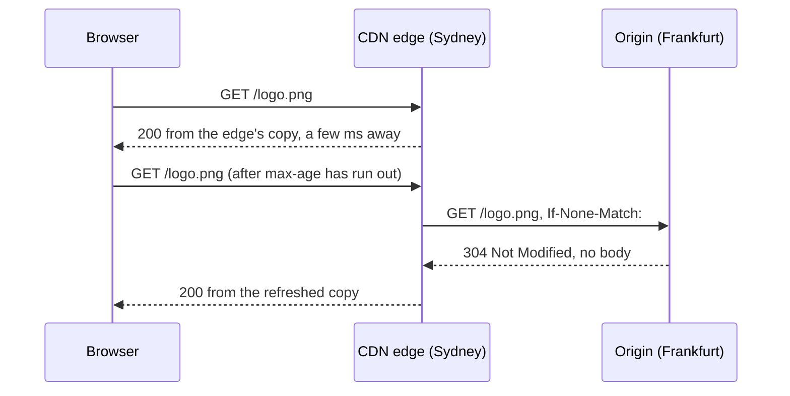
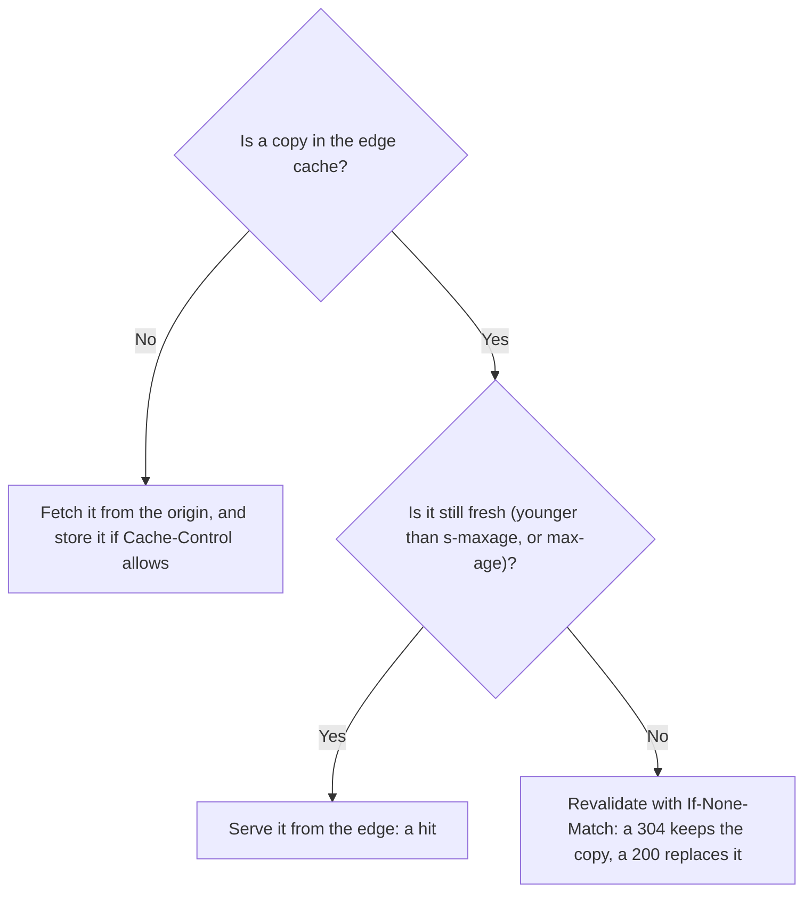
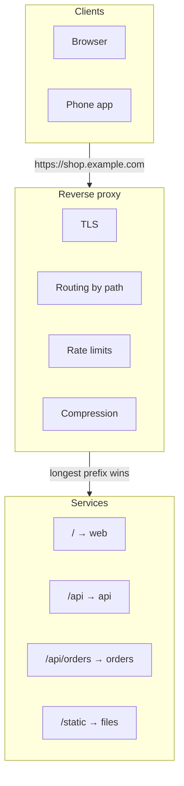

# CDNs and proxies: caching at the edge

> System Design · L1 Foundation · The request path: networking, proxies and APIs · about 90 min · hub module `m06` ([open the hub](https://claude.ai/artifact/5FDy46yNwWT8pPPZwQUGP9))

## Why it matters
On a busy site most requests never reach the origin servers: a CDN answers them from copies held near the user. And between users and servers sit proxies that route, secure and cache traffic. Knowing what an edge may cache, for how long, and how it checks that a copy is still current cuts both the user's wait and the origin's load.

## Pre-question (answer before reading)
**Q:** Your site serves a 200 KB image to users worldwide from one server in Frankfurt, and a user in Sydney waits about 300 ms for every round trip. What would a CDN change, and how would the CDN know when its copy is out of date?

<details><summary>Answer</summary>

The CDN keeps a copy on an edge server near Sydney, so after the first request the image comes from a few milliseconds away, and Frankfurt sees only the occasional miss. The response's Cache-Control header says how long the copy is fresh; after that the edge revalidates it with the origin using its ETag, and gets a tiny 304 Not Modified if nothing has changed.

</details>

## 🍎 Story time (kid version)
**Pizza Town and the family road trip: Luigi's kiosks**

Luigi's is so popular that he opens little kiosks all over town, each with a fridge of ready slices. Tara now buys her slice at the kiosk round the corner instead of crossing town. Every tray has a card saying “sell until 6 pm, then check”. At 6 pm the kiosk phones Luigi: “Is the margherita still recipe number 7?” If it is, Luigi just says “Same as before!”, and the kiosk keeps selling without a new delivery. At the shop itself, Ben answers every call and passes it on: pizza orders to the pizza kitchen, dessert orders to the dessert kitchen. Callers never need the kitchens' own numbers.

| In the story | In a real system |
|---|---|
| Kiosks all over town with ready slices | CDN edge servers near users, holding cached copies |
| Buying round the corner instead of crossing town | Shorter round trips, and less load on the origin server |
| “Sell until 6 pm, then check” | Cache-Control: max-age, how long a copy stays fresh |
| “Still recipe number 7?” — “Same as before!” | Revalidation with an ETag, answered by 304 Not Modified |
| Ben passing each call to the right kitchen | A reverse proxy routing requests by path to backend services |

**Where the story breaks:** A real slice goes stale on its own; a cached file never changes by itself. It only becomes out of date when the origin publishes a new version, which is why the check is “still recipe 7?” and not “has it gone off?”.

## Key ideas (grown-up version)
- **What a CDN does**: a content delivery network runs edge servers in many cities. Users are sent to a nearby edge (by DNS or anycast routing), which answers from cached copies of the origin's responses. Users get shorter round trips, the origin gets far fewer requests, and the CDN's spare capacity soaks up spikes and some attacks.
- **What a CDN can cache**: static files (images, scripts, styles, video segments) are the easy win. Whole pages and API responses can be cached too if they're the same for everyone, or vary only by a few headers. Personal or fast-changing responses usually go through to the origin.
- **Cache-Control**: the origin's response headers say what may be cached and for how long. max-age=N lets any cache reuse the response for N seconds; s-maxage=N overrides it for shared caches such as CDNs; private allows only the user's browser to store it; no-cache allows storing but requires a check with the origin before each reuse; no-store forbids storing it at all.
- **Revalidation: ETag and 304**: when a cached copy goes stale, the cache asks the origin with If-None-Match and the ETag it holds (or If-Modified-Since and a date). If nothing changed, the origin answers 304 Not Modified with no body, and the copy is fresh again: one round trip, but almost no bytes.
- **Versioned file names**: put a hash of a static file's contents in its name (app.3f9a1c.js) and cache it for a year. A new release refers to new names, so no user ever sees a stale mix of old and new files, and nothing needs purging. Short TTLs and purges are for content whose URL can't change.
- **Offload**: the CDN's hit ratio is the share of requests answered at the edge. At 95% the origin sees a twentieth of the requests. Short TTLs, personal pages and a long tail of rarely requested files all lower it, and a bad Cache-Control header can send the whole load back to the origin.
- **Forward and reverse proxies**: a forward proxy acts for clients going out, such as a company proxy that filters and logs. A reverse proxy acts for servers: clients talk to it as if it were the server, and it routes each request to a backend, terminates TLS, compresses, caches and limits rates. Load balancers, API gateways and CDN edges are all reverse proxies.
- **Routing in a reverse proxy**: rules map host names and path prefixes to backend pools, and the longest matching prefix wins (/api/orders is more specific than /api). One public address can front many services, which can then be moved or split without clients noticing.

## Diagrams
**A hit at the edge, then a revalidation once the copy is stale**



_Most requests end at the edge. A stale copy costs one long round trip to the origin, but a 304 carries no body, so the image isn't sent again._

**Can the edge answer by itself?**



**A reverse proxy in front of several services**



_Clients see one address. Behind it, each path prefix goes to its own pool, so a service can move or split without any client changing._

## Comparisons
**Cache-Control directives you'll use most**

| Directive | Meaning | Typical use |
|---|---|---|
| max-age=N | Any cache may reuse it for N seconds | Versioned files: a year (31536000) |
| s-maxage=N | Shared caches such as CDNs use N instead of max-age | Pages: a minute in browsers, ten at the CDN |
| private | Only the user's browser may store it | Account pages, baskets |
| no-cache | May be stored, but must be revalidated before each reuse | Pages that must always be current |
| no-store | Must not be stored anywhere | Bank statements, one-time codes |
| immutable | Won't change while fresh, so don't revalidate on reload | Files with a hash in their name |

**Forward or reverse proxy**

|  | Forward proxy | Reverse proxy |
|---|---|---|
| Acts for | Clients | Servers |
| Set up by | The client side: a company network or a browser setting | The owner of the service |
| Typical jobs | Filtering, logging and caching outgoing traffic | Routing, TLS, load balancing, caching, rate limits |
| Examples | A company web proxy | NGINX, Envoy, a cloud load balancer, a CDN edge |

## Code (JavaScript + Python)
### Reading Cache-Control, as a shared cache such as a CDN would
```python
def parse_cache_control(header):
    """'public, max-age=600, s-maxage=3600' -> {'public': True, 'max-age': 600, 's-maxage': 3600}"""
    out = {}
    for part in header.split(","):
        name, _, value = part.strip().partition("=")
        if name:
            out[name.lower()] = int(value) if value.isdigit() else True
    return out

def shared_cache_ttl(header):
    """Seconds a shared cache may reuse the response without asking the origin (0 = always ask, or never store)."""
    cc = parse_cache_control(header)
    if "no-store" in cc or "private" in cc or "no-cache" in cc:
        return 0
    return cc.get("s-maxage", cc.get("max-age", 0))   # s-maxage overrides max-age for shared caches
```

```javascript
function parseCacheControl(header) {
  // "public, max-age=600, s-maxage=3600" -> { public: true, "max-age": 600, "s-maxage": 3600 }
  const out = {};
  for (const part of header.split(",")) {
    const [name, value = ""] = part.trim().split("=", 2);
    if (name) out[name.toLowerCase()] = /^\d+$/.test(value) ? Number(value) : true;
  }
  return out;
}

function sharedCacheTtl(header) {
  // seconds a shared cache may reuse the response without asking the origin (0 = always ask, or never store)
  const cc = parseCacheControl(header);
  if ("no-store" in cc || "private" in cc || "no-cache" in cc) return 0;
  return cc["s-maxage"] ?? cc["max-age"] ?? 0;          // s-maxage overrides max-age for shared caches
}
```

### What a CDN may do with each response
```python
headers = [
    "public, max-age=31536000, immutable",    # app.3f9a1c.js: versioned, so cache it for a year
    "public, max-age=60, s-maxage=600",       # a product page: browsers 1 minute, the CDN 10
    "private, max-age=300",                   # the user's own basket: their browser only
    "no-store",                               # a bank statement: never stored
    "no-cache",                               # stored, but checked with the origin every time
]
for h in headers:
    print(f"{shared_cache_ttl(h):>8} s  <-  {h}")
```

Output:
```text
31536000 s  <-  public, max-age=31536000, immutable
     600 s  <-  public, max-age=60, s-maxage=600
       0 s  <-  private, max-age=300
       0 s  <-  no-store
       0 s  <-  no-cache
```

- line 2: A file whose name changes with its contents can be cached for a year (31,536,000 seconds): a new version gets a new URL.
- line 3: s-maxage gives the CDN its own, longer lifetime, while browsers check back after a minute.
- line 4: private keeps a personal response out of shared caches; only this user's browser may store it.
- line 6: no-cache doesn't mean “don't store”: it means “check with the origin before every reuse”. no-store is the one that forbids storing.

```javascript
const headers = [
  "public, max-age=31536000, immutable",      // app.3f9a1c.js: versioned, so cache it for a year
  "public, max-age=60, s-maxage=600",         // a product page: browsers 1 minute, the CDN 10
  "private, max-age=300",                     // the user's own basket: their browser only
  "no-store",                                 // a bank statement: never stored
  "no-cache",                                 // stored, but checked with the origin every time
];
for (const h of headers) console.log(`${String(sharedCacheTtl(h)).padStart(8)} s  <-  ${h}`);
```

Output:
```text
31536000 s  <-  public, max-age=31536000, immutable
     600 s  <-  public, max-age=60, s-maxage=600
       0 s  <-  private, max-age=300
       0 s  <-  no-store
       0 s  <-  no-cache
```

- line 2: A file whose name changes with its contents can be cached for a year (31,536,000 seconds): a new version gets a new URL.
- line 3: s-maxage gives the CDN its own, longer lifetime, while browsers check back after a minute.
- line 4: private keeps a personal response out of shared caches; only this user's browser may store it.
- line 6: no-cache doesn't mean “don't store”: it means “check with the origin before every reuse”. no-store is the one that forbids storing.

### An edge cache with revalidation, and the stale window after a change
```python
class Edge:
    """A CDN edge: serves fresh copies, and revalidates stale ones with the origin."""
    def __init__(self, origin):
        self.origin, self.store = origin, {}  # url -> (body, etag, fresh_until)
        self.hits = self.revalidated = self.fetched = 0

    def get(self, url, now):
        copy = self.store.get(url)
        if copy and now < copy[2]:
            self.hits += 1                    # fresh: no trip to the origin
            return copy[0]
        status, body, etag, ttl = self.origin(url, copy[1] if copy else None)
        if status == 304:
            self.revalidated += 1             # unchanged: keep the body, renew the freshness
            body = copy[0]
        else:
            self.fetched += 1                 # a full response
        self.store[url] = (body, etag, now + ttl)
        return body

versions = {"/logo.png": 1}                   # the origin's current version of each file

def origin(url, if_none_match):               # answers like an HTTP server with ETags
    etag = f'"v{versions[url]}"'
    if if_none_match == etag:
        return 304, None, etag, 60            # Not Modified: no body
    return 200, f"logo v{versions[url]}", etag, 60

edge, old_after_change = Edge(origin), 0
for now in range(600):                        # one request a second for ten minutes
    if now == 330:
        versions["/logo.png"] = 2             # a new logo is published
    if edge.get("/logo.png", now) == "logo v1" and now >= 330:
        old_after_change += 1
print(edge.hits, "hits,", edge.revalidated, "revalidated (304),", edge.fetched, "full fetches (200)")
print("requests served the old logo after the change:", old_after_change)
```

Output:
```text
590 hits, 8 revalidated (304), 2 full fetches (200)
requests served the old logo after the change: 30
```

- line 9: Fresh means younger than the TTL: the edge answers alone, and the origin never hears about it.
- line 12: A stale copy is checked with the origin, sending the ETag it holds.
- line 14: 304: the copy is still right, so the edge keeps its body and only renews the freshness.
- line 36: From 330 s until the copy's next check at 360 s the edge serves the old logo: a TTL is a promise about staleness.

```javascript
class Edge {
  // a CDN edge: serves fresh copies, and revalidates stale ones with the origin
  constructor(origin) {
    this.origin = origin; this.store = new Map();   // url -> [body, etag, freshUntil]
    this.hits = 0; this.revalidated = 0; this.fetched = 0;
  }
  get(url, now) {
    const copy = this.store.get(url);
    if (copy && now < copy[2]) { this.hits++; return copy[0]; }   // fresh: no trip to the origin
    let [status, body, etag, ttl] = this.origin(url, copy ? copy[1] : null);
    if (status === 304) {
      this.revalidated++;                     // unchanged: keep the body, renew the freshness
      body = copy[0];
    } else this.fetched++;                    // a full response
    this.store.set(url, [body, etag, now + ttl]);
    return body;
  }
}

const versions = { "/logo.png": 1 };          // the origin's current version of each file

function origin(url, ifNoneMatch) {           // answers like an HTTP server with ETags
  const etag = `"v${versions[url]}"`;
  if (ifNoneMatch === etag) return [304, null, etag, 60];   // Not Modified: no body
  return [200, `logo v${versions[url]}`, etag, 60];
}

const edge = new Edge(origin);
let oldAfterChange = 0;
for (let now = 0; now < 600; now++) {         // one request a second for ten minutes
  if (now === 330) versions["/logo.png"] = 2; // a new logo is published
  if (edge.get("/logo.png", now) === "logo v1" && now >= 330) oldAfterChange++;
}
console.log(edge.hits, "hits,", edge.revalidated, "revalidated (304),", edge.fetched, "full fetches (200)");
console.log("requests served the old logo after the change:", oldAfterChange);
```

Output:
```text
590 hits, 8 revalidated (304), 2 full fetches (200)
requests served the old logo after the change: 30
```

- line 9: Fresh means younger than the TTL: the edge answers alone, and the origin never hears about it.
- line 10: A stale copy is checked with the origin, sending the ETag it holds.
- line 12: 304: the copy is still right, so the edge keeps its body and only renews the freshness.
- line 35: From 330 s until the copy's next check at 360 s the edge serves the old logo: a TTL is a promise about staleness.

### A reverse proxy's routing table: the longest prefix wins
```python
ROUTES = {"/": "web", "/api": "api", "/api/orders": "orders", "/static": "files"}

def route(path):
    best = ""
    for prefix in ROUTES:
        matches = path == prefix or path.startswith(prefix.rstrip("/") + "/")   # whole path segments only
        if matches and len(prefix) > len(best):
            best = prefix
    return ROUTES[best] if best else None

for path in ("/menu", "/api", "/api/menu", "/api/orders/42", "/apis", "/static/app.3f9a1c.js"):
    print(path, "->", route(path))
```

Output:
```text
/menu -> web
/api -> api
/api/menu -> api
/api/orders/42 -> orders
/apis -> web
/static/app.3f9a1c.js -> files
```

- line 6: Match whole path segments: /api must not capture /apis.
- line 7: Several prefixes can match; the longest is the most specific, so it wins.
- line 12: /apis isn't under /api, so it falls back to the catch-all /.

```javascript
const ROUTES = { "/": "web", "/api": "api", "/api/orders": "orders", "/static": "files" };

function route(path) {
  let best = "";
  for (const prefix of Object.keys(ROUTES)) {
    const matches = path === prefix || path.startsWith(prefix.replace(/\/+$/, "") + "/");   // whole path segments only
    if (matches && prefix.length > best.length) best = prefix;
  }
  return best ? ROUTES[best] : null;
}

for (const path of ["/menu", "/api", "/api/menu", "/api/orders/42", "/apis", "/static/app.3f9a1c.js"]) {
  console.log(path, "->", route(path));
}
```

Output:
```text
/menu -> web
/api -> api
/api/menu -> api
/api/orders/42 -> orders
/apis -> web
/static/app.3f9a1c.js -> files
```

- line 6: Match whole path segments: /api must not capture /apis.
- line 7: Several prefixes can match; the longest is the most specific, so it wins.
- line 12: /apis isn't under /api, so it falls back to the catch-all /.

## Worked example
**Problem.** A news site serves 20,000 requests a second at its peak: 70% for static files (versioned, with a 99% edge hit ratio), 25% for article pages (cached for 60 seconds, 90% hit ratio) and 5% for personal API calls, which can't be cached. How many requests a second reach the origin? And what happens if a bad deploy sends article pages with max-age=0?

1. Split the traffic by how cacheable it is: 14,000 static, 5,000 article and 1,000 personal requests a second.
2. Only misses reach the origin: 1% of 14,000 = 140, 10% of 5,000 = 500, and all 1,000 personal calls.
3. That's 1,640 requests a second, about 8% of the traffic: the CDN absorbs over 90%, so the origin is sized for about 1,640, plus headroom for a bad day at the CDN.
4. With max-age=0 on articles, all 5,000 article requests a second go to the origin: 6,140 in total, nearly four times as much. Cache headers are part of capacity planning, so test them like code. The arithmetic is O(classes).

```python
def origin_rps(total_rps, classes):
    """classes: (name, share %, edge hit ratio %); requests per second that reach the origin, per class."""
    return {name: total_rps * share * (100 - hit) // 10_000 for name, share, hit in classes}

normal = [("static files", 70, 99), ("article pages", 25, 90), ("personal API", 5, 0)]
broken = [normal[0], ("article pages", 25, 0), normal[2]]   # max-age=0 shipped by mistake
for label, classes in (("normal", normal), ("articles uncached", broken)):
    per_class = origin_rps(20_000, classes)
    total = sum(per_class.values())
    print(f"{label}: {total} req/s reach the origin ({total * 100 // 20_000}% of traffic):", *per_class.values())
```

Output:
```text
normal: 1640 req/s reach the origin (8% of traffic): 140 500 1000
articles uncached: 6140 req/s reach the origin (30% of traffic): 140 5000 1000
```

```javascript
function originRps(totalRps, classes) {
  // classes: [name, share %, edge hit ratio %]; requests per second that reach the origin, per class
  return Object.fromEntries(classes.map(([name, share, hit]) => [name, Math.floor((totalRps * share * (100 - hit)) / 10000)]));
}

const normal = [["static files", 70, 99], ["article pages", 25, 90], ["personal API", 5, 0]];
const broken = [normal[0], ["article pages", 25, 0], normal[2]];   // max-age=0 shipped by mistake
for (const [label, classes] of [["normal", normal], ["articles uncached", broken]]) {
  const perClass = originRps(20000, classes);
  const total = Object.values(perClass).reduce((a, b) => a + b, 0);
  console.log(`${label}: ${total} req/s reach the origin (${Math.floor((total * 100) / 20000)}% of traffic):`, ...Object.values(perClass));
}
```

Output:
```text
normal: 1640 req/s reach the origin (8% of traffic): 140 500 1000
articles uncached: 6140 req/s reach the origin (30% of traffic): 140 5000 1000
```

**Answer.** Normally 1,640 requests a second (about 8% of the traffic) reach the origin: 140 for static files, 500 for articles and 1,000 personal API calls. With the article caching lost it jumps to 6,140 (about 30%), nearly four times the load the origin was sized for.

## Your turn (faded example)
**Problem.** Make the origin answer conditional requests. Finish `handle(headers, body)`: compute the ETag of the body, and if the request's If-None-Match header lists that ETag (or is *), answer 304 with no body; otherwise answer 200 with the body, its ETag and a Cache-Control header.

- ✓ The origin needs a validator that changes whenever the content does: here, a short hash of the body as the ETag.
- **When may the origin answer 304?**
  <details><summary>Answer</summary>When If-None-Match contains the current ETag (it can be a comma-separated list) or is *: the client's copy is still right, so the origin sends 304 Not Modified with the ETag and no body.</details>
- **What does the CDN or browser do with a 304?**
  <details><summary>Answer</summary>It keeps the body it already has, updates the stored headers, and treats the copy as fresh again for another max-age.</details>
- **What does revalidation save, and what doesn't it?**
  <details><summary>Answer</summary>It saves the bytes of the body and often the work of building it, but not the round trip: the request still crosses the network. Hashing the body costs O(size) on the origin, so busy origins store each ETag rather than recompute it.</details>

Starter:
```python
import hashlib

def etag_of(body):                            # a validator: a short hash of the exact content
    return '"' + hashlib.sha256(body.encode()).hexdigest()[:16] + '"'

def handle(headers, body):
    """Answer a GET for `body`, honouring If-None-Match. Returns (status, response headers, body sent)."""
    ...                                       # TODO: 304 with no body if the ETag matches, else 200 with the body
```

```javascript
const crypto = require("node:crypto");

function etagOf(body) {                       // a validator: a short hash of the exact content
  return '"' + crypto.createHash("sha256").update(body).digest("hex").slice(0, 16) + '"';
}

function handle(headers, body) {
  // answer a GET for `body`, honouring If-None-Match; returns [status, response headers, body sent]
  // TODO: 304 with no body if the ETag matches, else 200 with the body
}
```

<details><summary>Full solution</summary>

```python
import hashlib

def etag_of(body):                            # a validator: a short hash of the exact content
    return '"' + hashlib.sha256(body.encode()).hexdigest()[:16] + '"'

def handle(headers, body):
    """Answer a GET for `body`, honouring If-None-Match. Returns (status, response headers, body sent)."""
    tag = etag_of(body)
    sent = headers.get("if-none-match", "")
    if sent.strip() == "*" or tag in [t.strip() for t in sent.split(",")]:
        return 304, {"etag": tag}, ""         # unchanged: no body at all
    return 200, {"etag": tag, "cache-control": "max-age=60"}, body

page = "<h1>Menu</h1>" * 1000                 # a 13,000-character page
status, hdrs, sent = handle({}, page)
print(status, len(sent), "bytes")
status, _, sent = handle({"if-none-match": hdrs["etag"]}, page)
print(status, len(sent), "bytes")
status, _, sent = handle({"if-none-match": hdrs["etag"]}, page.replace("Menu", "Menu!"))
print(status, len(sent), "bytes")
```

Output:
```text
200 13000 bytes
304 0 bytes
200 14000 bytes
```

```javascript
const crypto = require("node:crypto");

function etagOf(body) {                       // a validator: a short hash of the exact content
  return '"' + crypto.createHash("sha256").update(body).digest("hex").slice(0, 16) + '"';
}

function handle(headers, body) {
  // answer a GET for `body`, honouring If-None-Match; returns [status, response headers, body sent]
  const tag = etagOf(body);
  const sent = headers["if-none-match"] ?? "";
  if (sent.trim() === "*" || sent.split(",").map(t => t.trim()).includes(tag)) {
    return [304, { etag: tag }, ""];          // unchanged: no body at all
  }
  return [200, { etag: tag, "cache-control": "max-age=60" }, body];
}

const page = "<h1>Menu</h1>".repeat(1000);    // a 13,000-character page
let [status, hdrs, sent] = handle({}, page);
console.log(status, sent.length, "bytes");
[status, , sent] = handle({ "if-none-match": hdrs.etag }, page);
console.log(status, sent.length, "bytes");
[status, , sent] = handle({ "if-none-match": hdrs.etag }, page.replaceAll("Menu", "Menu!"));
console.log(status, sent.length, "bytes");
```

Output:
```text
200 13000 bytes
304 0 bytes
200 14000 bytes
```

</details>

## Socratic checks and quiz (answers hidden)
**1. What does this print? (`shared_cache_ttl` / `sharedCacheTtl` is this module's helper.)**

```python
print(shared_cache_ttl("public, max-age=300"), shared_cache_ttl("public, max-age=300, s-maxage=30"),
      shared_cache_ttl("private, max-age=300"), shared_cache_ttl("max-age=0"))
```

```javascript
console.log(sharedCacheTtl("public, max-age=300"), sharedCacheTtl("public, max-age=300, s-maxage=30"),
  sharedCacheTtl("private, max-age=300"), sharedCacheTtl("max-age=0"));
```

- A. 300 30 0 0
- B. 300 300 300 0
- C. 300 30 300 0
- D. 300 300 0 0

<details><summary>Answer</summary>

300 30 0 0. max-age applies when there's no s-maxage; s-maxage overrides it for shared caches, even when it's shorter; private keeps the response out of shared caches altogether; and max-age=0 means it's stale at once.

</details>

**2. What does this print?**

```python
ttl, fresh_until, trips = 60, 0, 0
for now in (0, 30, 59, 60, 61, 119, 120):
    if now >= fresh_until:                  # missing or stale: ask the origin
        trips += 1
        fresh_until = now + ttl
print(trips, fresh_until)
```

```javascript
let ttl = 60, freshUntil = 0, trips = 0;
for (const now of [0, 30, 59, 60, 61, 119, 120]) {
  if (now >= freshUntil) {                  // missing or stale: ask the origin
    trips++;
    freshUntil = now + ttl;
  }
}
console.log(trips, freshUntil);
```

- A. 3 180
- B. 2 120
- C. 4 180
- D. 3 181

<details><summary>Answer</summary>

3 180. The origin is asked at 0 (nothing stored), at 60 (fresh only while now < 60) and at 120, and after the last trip the copy is fresh until 180. The requests at 30, 59, 61 and 119 are hits.

</details>

**3. A shop serves each user's basket page with `Cache-Control: public, max-age=600`. What's the risk?**

- A. A shared cache such as the CDN may serve one shopper's basket to another for up to 10 minutes; it should be private or no-store
- B. Browsers will refuse to show the page
- C. The page will be revalidated with the origin on every request
- D. There's none: public only affects browsers

<details><summary>Answer</summary>

A shared cache such as the CDN may serve one shopper's basket to another for up to 10 minutes; it should be private or no-store. public allows any cache, including shared ones, to store the response and reuse it for anyone asking for that URL. Browsers show it fine, max-age=600 means no revalidation for 10 minutes, and public is exactly what lets shared caches keep it.

</details>

**4. Which responses are good candidates for long caching at the CDN? (choose 2)**

- A. /static/app.3f9a1c.js, whose name changes with every release
- B. A product photo whose URL includes its version number
- C. /account/orders for the signed-in user
- D. /checkout/payment
- E. An API response with a stock level that changes every second

<details><summary>Answer</summary>

/static/app.3f9a1c.js, whose name changes with every release, A product photo whose URL includes its version number. Versioned URLs never change their content, so they can be cached for a year. Account and checkout pages are personal, and a stock level that changes every second would be stale almost at once.

</details>

**5. Judge each statement.**

- s-maxage overrides max-age for shared caches such as a CDN.
- no-cache forbids a cache from storing the response.
- A 304 Not Modified response carries no body.
- With a 60-second lifetime, some users can see an old version for up to a minute after a change.

<details><summary>Answer</summary>

s-maxage overrides max-age for shared caches such as a CDN.: Yes; no-cache forbids a cache from storing the response.: No; A 304 Not Modified response carries no body.: Yes; With a 60-second lifetime, some users can see an old version for up to a minute after a change.: Yes. s-maxage exists exactly to give shared caches their own lifetime. no-cache allows storing but forces revalidation; no-store forbids storing. A 304 says “use what you have”, so it has no body. And a copy fetched just before a change stays fresh for its whole lifetime.

</details>

**6. Put the steps of a CDN revalidation in order.**

- (put the steps in order)

<details><summary>Answer</summary>

A request arrives for a copy whose max-age has run out → The edge asks the origin, sending If-None-Match with its stored ETag → The origin compares the ETag and answers 304 Not Modified → The edge marks its copy fresh again and serves it. Revalidation only starts once a stale copy is requested; the origin can only compare an ETag it has been sent; and the edge can only renew its copy after the 304 arrives.

</details>

**7. Complete the Python routing function: the longest matching prefix wins.**

```
def route(path, routes):
    best = ""
    for prefix in routes:
        if (path == prefix or path.startswith(prefix.rstrip("/") + "/")) and {{0}}:
            best = prefix
    return {{1}}

```

<details><summary>Answer</summary>

len(prefix) > len(best) | routes[best] if best else None. Keep a matching prefix only if it's longer than the best so far, and return the backend for the best prefix (or None if nothing matched). Taking every match in turn would depend on the order of the table.

</details>

**8. Match each description to its name.**


<details><summary>Answer</summary>

Acts for clients going out to the internet = Forward proxy; Sits in front of servers and routes requests to them = Reverse proxy; Serves cached copies from servers near users = CDN edge; Tells caches how long a response stays fresh = Cache-Control: max-age. An ETag identifies a version so that a stale copy can be revalidated; it doesn't say how long a copy stays fresh.

</details>

## Traps & misconceptions
- **“A CDN is only for images.”** Anything that's the same for many users can be served from the edge: scripts, styles, video segments, whole pages and public API responses. The trick is to separate personal data from shared data so the shared part can be cached.
- **“no-cache means don't cache.”** no-cache allows storing the response but requires a check with the origin before each reuse. no-store is the directive that forbids storing it at all.
- **“Purging the CDN is how to ship a new version.”** Purges take time to reach every edge and are easy to get wrong. Put a content hash in static file names and cache them for a year; a release then points at new names, and old copies are simply never asked for again.
- **“A 304 is free.”** It saves the body, not the round trip: the request still travels to the origin and back. For small files that are requested often, a longer max-age saves more than revalidation does.
- **“A personal page can be cached at the CDN if its URL is the same for everyone.”** Then the edge serves one user's page to the next user who asks for that URL. Mark personal responses private or no-store, and keep personal data out of shared caches.
- **“A reverse proxy is just a forward proxy pointing the other way.”** They serve different owners. A forward proxy acts for clients going out (filtering, logging); a reverse proxy acts for servers (routing, TLS, caching, rate limits). Clients choose to use a forward proxy; they usually don't know a reverse proxy is there.

## Discussion prompts
- **What would you put behind a CDN for an online shop, and with what cache settings?**
  <details><summary>One good answer</summary>Versioned static files (scripts, styles, images) with public, a max-age of a year and immutable. Product and category pages, which are the same for everyone, with a short shared lifetime (an s-maxage of a minute or a few), deleted from the cache when a product changes, and stale-while-revalidate to hide the refreshes. Basket, account and checkout responses as private or no-store, straight to the origin. Then watch the CDN hit ratio and the origin's load after every change to the headers.</details>
- **Why put a reverse proxy in front of app servers, even without a CDN?**
  <details><summary>One good answer</summary>It gives one public entry point that terminates TLS, routes paths to different services, balances load, compresses responses and enforces timeouts, request-size limits and rate limits, and it can cache. The app servers stay private, can move or split without clients noticing, and don't each need their own certificates and protections.</details>

## Teach-back
**Prompt:** Explain to a junior colleague how a CDN decides whether it can answer a request itself, and what happens when its copy is old.

Rubric:
- [ ] Edge servers near users hold copies, which cuts latency and origin load
- [ ] Cache-Control (max-age, s-maxage, private, no-store) says what may be cached and for how long
- [ ] A stale copy is revalidated with If-None-Match and an ETag, getting 304 if unchanged
- [ ] Versioned file names avoid stale mixes and purges
- [ ] Personal responses stay out of shared caches

<details><summary>Model answer</summary>

A CDN has servers in many cities, and each user is sent to a nearby one. When a request arrives, the edge looks for a stored copy; if there isn't one, it fetches the response from the origin and keeps it if the Cache-Control header allows. While the copy is younger than its s-maxage, or max-age, the edge answers by itself, which is fast for the user and costs the origin nothing. Once it's stale, the edge asks the origin with If-None-Match and the ETag it holds; if nothing changed, the origin answers 304 with no body and the copy is good for another lifetime, otherwise a fresh 200 replaces it. For static files the best trick is a content hash in the file name with a year-long lifetime, so a new release simply uses new names. Anything personal is marked private or no-store, so a shared cache never hands one user's page to another.

</details>

## Quick Q&A (also in the SRS deck)
- **What does a CDN do?** Serves cached copies of the origin's responses from edge servers near the users.
- **max-age or s-maxage?** max-age applies to every cache; s-maxage overrides it for shared caches such as CDNs.
- **no-cache or no-store?** no-cache: may be stored, but must be revalidated before each reuse. no-store: never stored.
- **What does 304 Not Modified mean?** The cached copy is still current: no body is sent, and the cache reuses what it has.
- **Why put a hash in static file names?** Each version gets its own URL, so it can be cached for a year without anyone seeing a stale copy.
- **Forward or reverse proxy?** A forward proxy acts for clients going out; a reverse proxy sits in front of servers and acts for them.

## Practice problems
- [ ] [Exercise · Read the cache headers of a real site](https://developer.chrome.com/docs/devtools/network/reference) · open a big site, find a versioned script, a page and an API call, and note each one's Cache-Control and whether it came from a cache
- [ ] [Exercise · HTTP caching, step by step](https://developer.mozilla.org/en-US/docs/Web/HTTP/Caching) · work through freshness, validation and cache busting, then choose headers for a shop's static files, product pages and basket
- [ ] [Exercise · What a CDN caches by default](https://developers.cloudflare.com/cache/concepts/default-cache-behavior/) · list which files are cached by default and what decides it, then say what you'd change for a news site
- [ ] [Exercise · Route by path with a real reverse proxy](https://docs.nginx.com/nginx/admin-guide/web-server/reverse-proxy/) · find proxy_pass and how location blocks pick a backend, and compare them with this module's route()

## Sources (accessed 2026-10-09)
- [RFC 9111: HTTP Caching](https://www.rfc-editor.org/rfc/rfc9111)
- [MDN: HTTP caching](https://developer.mozilla.org/en-US/docs/Web/HTTP/Caching)
- [MDN: Cache-Control](https://developer.mozilla.org/en-US/docs/Web/HTTP/Headers/Cache-Control)
- [Cloudflare: What is a CDN?](https://www.cloudflare.com/learning/cdn/what-is-a-cdn/)
- [NGINX: Reverse proxy](https://docs.nginx.com/nginx/admin-guide/web-server/reverse-proxy/)
