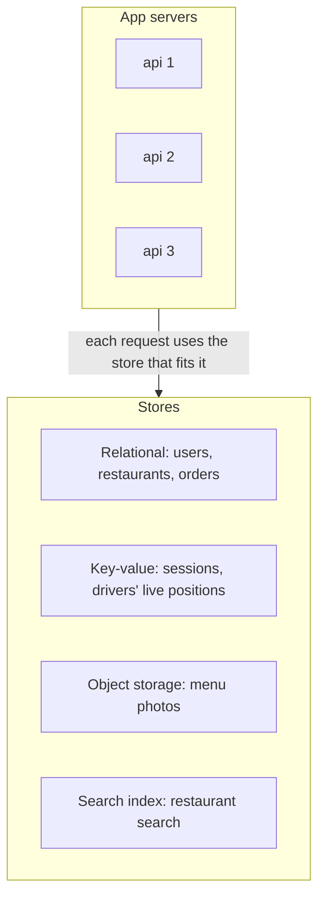
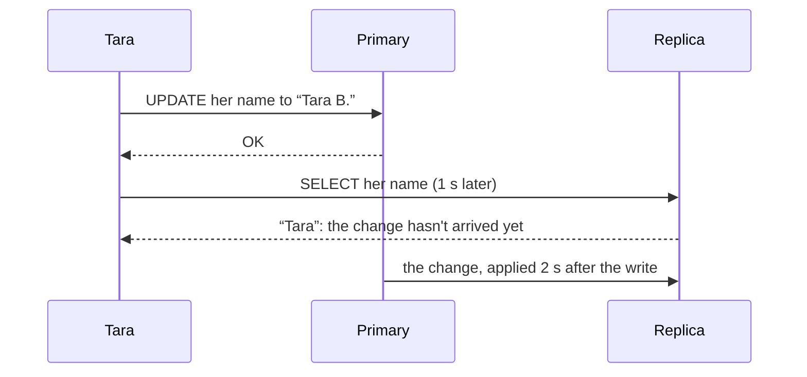

# Choosing storage: SQL, NoSQL and object storage

> System Design · L1 Foundation · Caching and storage · about 100 min · hub module `m07` ([open the hub](https://claude.ai/artifact/5FDy46yNwWT8pPPZwQUGP9))

## Why it matters
Every design needs somewhere to keep its data, and that choice shapes everything after it. Relational databases give you queries, joins and transactions; key-value and document stores trade some of that for simple, predictable scaling; object storage keeps files cheaply and almost without limit. Choosing well starts from the access patterns: what you read, by which key, and how often.

## Pre-question (answer before reading)
**Q:** A food-delivery app stores users, restaurants, orders, drivers' live positions and menu photos. Which would you put in a relational database, which in a key-value store and which in object storage? And what question do you ask first?

<details><summary>Answer</summary>

First ask how each kind of data is read and written. Users, restaurants and orders need transactions and many kinds of query, so a relational database suits them. Live positions are written and read by one key at high volume, which suits a key-value store. Photos are large files: put them in object storage, keep only their key and details in the database, and serve them through a CDN.

</details>

## 🍎 Story time (kid version)
**Pizza Town and the family road trip: Luigi's three kinds of records**

Luigi keeps three kinds of records. The order book has neat columns: who ordered, what, when, and whether they've paid. He can add up a whole day or find every order from Tara. Each recipe lives on its own card in a box, filed under the pizza's name, so he can grab one in a second, though he can't easily ask “which recipes use olives?”. Photos of every pizza go in a big storeroom, each box with a number, and the order book only notes the box number. The drivers get a copy of the order book every few minutes, so their copy is sometimes a little behind.

| In the story | In a real system |
|---|---|
| The order book with neat columns | A relational database: tables, rows and columns, queried with SQL |
| Adding up a day, or finding every order from Tara | Queries with filters, grouping and joins, made fast by indexes |
| Recipe cards filed under the pizza's name | A key-value or document store: fast lookups by key, few other queries |
| Photos in numbered storeroom boxes | Object storage, with only each object's key kept in the database |
| The drivers' copy, a few minutes behind | A read replica, and its replication lag |

**Where the story breaks:** Luigi copies his book by hand every few minutes; a real replica follows the primary continuously and is usually well under a second behind. But it can still lag, so someone who has just written something may not see it there.

## Key ideas (grown-up version)
- **Start from the access patterns**: before choosing a store, list the reads and writes: which data, looked up by which key, filtered or sorted how, how often, and how much of it. The store that serves the most important patterns cheaply wins, not the most fashionable one.
- **Relational databases (SQL)**: tables with a fixed schema, joins across them, and ACID transactions, in which a group of changes happens completely or not at all and sees a consistent state. They suit users, orders, payments and anything you'll query in many ways. One primary scales up a long way, and caches and read replicas take it further.
- **Indexes**: an index (usually a B-tree) lets the database find rows by a column without scanning the whole table: about O(log n) per lookup instead of O(n). Every index speeds up some reads but slows writes, which must update it too, and takes space, so index what your frequent queries filter, join and sort on.
- **Key-value and wide-column stores**: you get, put and delete by key. A partition key decides which machine holds an item, and a sort key orders the items within one partition key, so “a user's orders by date” is one fast range read. Lookups stay fast at any scale, but a query the keys don't support needs another table or index that you maintain.
- **Document stores**: each record is a JSON-like document, so data that's read together (an order and its lines) can live in one document. A flexible schema suits products that change fast; joins across documents are weaker, so design documents around how they're read.
- **Object storage**: files such as images, videos and backups go in an object store (Amazon S3, Azure Blob Storage, Google Cloud Storage): cheap, durable, almost unlimited, and read or written whole, by key, over HTTP. Keep each object's key and details in the database, and serve popular objects through a CDN.
- **Read replicas and replication lag**: a replica copies the primary's changes and serves reads, multiplying read capacity. Copying is usually asynchronous, so a replica can be behind and a user who has just saved something may not see it there. Read a user's own recent writes from the primary.
- **More than one store**: large systems use several stores, each for what it does best: a relational database for orders, a cache for sessions, a search index for text search, object storage for files. Every extra store is one more thing to run, secure and keep in step, so add one only for a clear need.

## Diagrams
**Several stores behind one food-delivery app**



_Orders need transactions and flexible queries; positions need huge volumes of simple writes by key; photos need cheap space; search needs text matching. One store rarely does all four well._

**Replication lag: a user reads from a replica just after writing**



_The replica is still correct, just behind. Sending a user's reads to the primary for a few seconds after they write (read your own writes) hides the lag from the one person who would notice it._

**A rough first guess, before you check the access patterns**

| | few, known queries | many, changing queries |
|---|---|---|
| **huge scale** | Key-value or wide-column: partitioned by key; plan every query up front | Sharded or distributed SQL: queries and transactions at scale, at a price in complexity |
| **moderate scale** | Almost anything works: often a key-value store, or a table in the main database | Relational database: the safe default; add caches and read replicas as you grow |

## Comparisons
**Four kinds of store**

|  | Relational | Key-value / wide-column | Document | Object storage |
|---|---|---|---|---|
| Data | Tables with a fixed schema | Items under a key, plus a sort key | JSON-like documents | Files of any size |
| Queries | Any SQL: filters, joins, grouping | By key, or a key and a sort-key range | By key, and by indexed fields | By key, and listing by prefix |
| Transactions | Across tables (ACID) | Usually per item; some across a few | Per document; some across documents | None: objects are replaced whole |
| Grows by | Bigger machine, replicas, then sharding | More partitions | More shards | Practically without limit |
| Typical use | Users, orders, payments | Sessions, carts, events, feeds | Catalogues, profiles | Images, video, backups |

## Code (JavaScript + Python)
### The stable string hash used to pick a partition
```python
def fnv1a(key):                                 # a small, stable 32-bit string hash, same in both languages
    h = 0x811C9DC5
    for byte in key.encode():
        h = ((h ^ byte) * 0x01000193) & 0xFFFFFFFF
    return h
```

```javascript
function fnv1a(key) {                           // a small, stable 32-bit string hash, same in both languages
  let h = 0x811c9dc5;
  for (const byte of Buffer.from(key)) h = Math.imul(h ^ byte, 0x01000193) >>> 0;
  return h;
}
```

### A relational table: grouping, an index and a transaction (SQLite)
```python
import sqlite3

db = sqlite3.connect(":memory:")
db.execute("CREATE TABLE orders (id INTEGER PRIMARY KEY, customer TEXT, pizza TEXT, price INTEGER)")
rows = [("tara", "margherita", 9), ("ben", "pepperoni", 11), ("tara", "veggie", 10), ("ana", "margherita", 9)]
db.executemany("INSERT INTO orders (customer, pizza, price) VALUES (?, ?, ?)", rows)
db.commit()
for customer, n, total in db.execute("SELECT customer, COUNT(*), SUM(price) FROM orders GROUP BY customer ORDER BY customer"):
    print(customer, n, total)

def plan(sql):                                # does SQLite use an index for this query?
    steps = " ".join(row[3] for row in db.execute("EXPLAIN QUERY PLAN " + sql))
    return "uses the index" if "INDEX" in steps else "scans the whole table"

query = "SELECT * FROM orders WHERE customer = 'tara'"
print("before:", plan(query))
db.execute("CREATE INDEX orders_by_customer ON orders (customer)")
print("after:", plan(query))

try:
    with db:                                  # a transaction: all of it or none of it
        db.execute("UPDATE orders SET price = price - 2 WHERE customer = 'tara'")
        raise RuntimeError("payment failed")  # something goes wrong half way
except RuntimeError:
    pass
print("tara still pays", db.execute("SELECT SUM(price) FROM orders WHERE customer = 'tara'").fetchone()[0])
```

Output:
```text
ana 1 9
ben 1 11
tara 2 19
before: scans the whole table
after: uses the index
tara still pays 19
```

- line 8: One query groups the rows by customer and adds them up: the kind of question a relational database answers well.
- line 16: Without an index, finding Tara's orders means reading every row: fine for 4 rows, slow for 40 million.
- line 18: With the index, SQLite jumps straight to Tara's rows, at the cost of updating the index on every insert.
- line 21: `with db` runs the block as one transaction: the error rolls the update back, so Tara's total is untouched.

```javascript
const { DatabaseSync } = require("node:sqlite");   // built in from Node.js 22.13 (with an experimental warning)

const db = new DatabaseSync(":memory:");
db.exec("CREATE TABLE orders (id INTEGER PRIMARY KEY, customer TEXT, pizza TEXT, price INTEGER)");
const insert = db.prepare("INSERT INTO orders (customer, pizza, price) VALUES (?, ?, ?)");
for (const row of [["tara", "margherita", 9], ["ben", "pepperoni", 11], ["tara", "veggie", 10], ["ana", "margherita", 9]]) insert.run(...row);
for (const r of db.prepare("SELECT customer, COUNT(*) AS n, SUM(price) AS total FROM orders GROUP BY customer ORDER BY customer").all()) {
  console.log(r.customer, r.n, r.total);
}

function plan(sql) {                          // does SQLite use an index for this query?
  const steps = db.prepare("EXPLAIN QUERY PLAN " + sql).all().map(row => row.detail).join(" ");
  return steps.includes("INDEX") ? "uses the index" : "scans the whole table";
}

const query = "SELECT * FROM orders WHERE customer = 'tara'";
console.log("before:", plan(query));
db.exec("CREATE INDEX orders_by_customer ON orders (customer)");
console.log("after:", plan(query));

try {
  db.exec("BEGIN");                           // a transaction: all of it or none of it
  db.exec("UPDATE orders SET price = price - 2 WHERE customer = 'tara'");
  throw new Error("payment failed");          // something goes wrong half way
} catch (err) {
  db.exec("ROLLBACK");
}
console.log("tara still pays", db.prepare("SELECT SUM(price) AS s FROM orders WHERE customer = 'tara'").get().s);
```

Output:
```text
ana 1 9
ben 1 11
tara 2 19
before: scans the whole table
after: uses the index
tara still pays 19
```

- line 7: One query groups the rows by customer and adds them up: the kind of question a relational database answers well.
- line 17: Without an index, finding Tara's orders means reading every row: fine for 4 rows, slow for 40 million.
- line 19: With the index, SQLite jumps straight to Tara's rows, at the cost of updating the index on every insert.
- line 26: ROLLBACK undoes everything since BEGIN, so the failed payment leaves Tara's total untouched.

### Partition keys, sort keys and a hot key
```python
class KVTable:
    """Items live on partition hash(pk) % N; within one partition key they're read in sort-key order."""
    def __init__(self, partitions):
        self.parts = [{} for _ in range(partitions)]

    def _home(self, pk):
        return self.parts[fnv1a(pk) % len(self.parts)]

    def put(self, pk, sk, value):
        self._home(pk).setdefault(pk, {})[sk] = value

    def query(self, pk, start, end):          # one partition key, a range of sort keys
        items = self._home(pk).get(pk, {})
        return [items[sk] for sk in sorted(items) if start <= sk < end]

table = KVTable(4)
for user, when, pizza in [("tara", "2026-10-01T12:30", "margherita"), ("tara", "2026-10-03T19:05", "veggie"),
                          ("ben", "2026-10-02T18:00", "pepperoni"), ("tara", "2026-09-28T13:10", "hawaiian")]:
    table.put(user, when, pizza)
print("tara in October:", *table.query("tara", "2026-10-01", "2026-11-01"))

loads = [0] * 4
for i in range(10_000):                       # 30% of requests are for one very popular key
    key = "celebrity" if i % 10 < 3 else f"user-{i}"
    loads[fnv1a(key) % 4] += 1
print("requests per partition:", *loads)
```

Output:
```text
tara in October: margherita veggie
requests per partition: 1751 1750 4749 1750
```

- line 7: The partition key alone decides where an item lives, so all of one user's orders sit together.
- line 14: A real store keeps each partition sorted on disk; sorting here keeps the example short.
- line 20: ISO dates sort as text in time order, so “Tara's October orders” is one range on one partition.
- line 26: Every request for one key goes to one partition, however many there are: that partition does far more work than the others.

```javascript
class KVTable {
  // items live on partition hash(pk) % N; within one partition key they're read in sort-key order
  constructor(partitions) { this.parts = Array.from({ length: partitions }, () => new Map()); }
  home(pk) { return this.parts[fnv1a(pk) % this.parts.length]; }
  put(pk, sk, value) {
    const part = this.home(pk);
    if (!part.has(pk)) part.set(pk, new Map());
    part.get(pk).set(sk, value);
  }
  query(pk, start, end) {                     // one partition key, a range of sort keys
    const items = this.home(pk).get(pk) ?? new Map();
    return [...items.keys()].sort().filter(sk => start <= sk && sk < end).map(sk => items.get(sk));
  }
}

const table = new KVTable(4);
for (const [user, when, pizza] of [["tara", "2026-10-01T12:30", "margherita"], ["tara", "2026-10-03T19:05", "veggie"],
  ["ben", "2026-10-02T18:00", "pepperoni"], ["tara", "2026-09-28T13:10", "hawaiian"]]) {
  table.put(user, when, pizza);
}
console.log("tara in October:", ...table.query("tara", "2026-10-01", "2026-11-01"));

const loads = [0, 0, 0, 0];
for (let i = 0; i < 10000; i++) {             // 30% of requests are for one very popular key
  const key = i % 10 < 3 ? "celebrity" : `user-${i}`;
  loads[fnv1a(key) % 4]++;
}
console.log("requests per partition:", ...loads);
```

Output:
```text
tara in October: margherita veggie
requests per partition: 1751 1750 4749 1750
```

- line 4: The partition key alone decides where an item lives, so all of one user's orders sit together.
- line 12: A real store keeps each partition sorted on disk; sorting here keeps the example short.
- line 21: ISO dates sort as text in time order, so “Tara's October orders” is one range on one partition.
- line 28: Every request for one key goes to one partition, however many there are: that partition does far more work than the others.

### Replication lag, and reading your own writes
```python
class ReplicatedStore:
    """One primary, and a replica that applies each write `lag` seconds after it happened."""
    def __init__(self, lag):
        self.lag, self.primary, self.log = lag, {}, []   # log: (time, key, value) in write order

    def write(self, now, key, value):
        self.primary[key] = value
        self.log.append((now, key, value))

    def read_replica(self, now, key):
        value = None
        for t, k, v in self.log:              # the replica has applied every write at least `lag` old
            if k == key and t + self.lag <= now:
                value = v
        return value

store = ReplicatedStore(lag=2)
store.write(0, "tara:name", "Tara")
store.write(10, "tara:name", "Tara B.")       # she edits her profile at t = 10
for now in (10, 11, 12):
    print(now, "replica:", store.read_replica(now, "tara:name"), "| primary:", store.primary["tara:name"])

last_write = {"tara": 10}                     # when each user last wrote
def read_for(user, now, key, window=5):
    if now - last_write.get(user, -10**9) < window:
        return store.primary[key]             # a recent writer reads from the primary
    return store.read_replica(now, key)       # everyone else reads the replica
print("at 11, tara sees:", read_for("tara", 11, "tara:name"), "| ben sees:", read_for("ben", 11, "tara:name"))
```

Output:
```text
10 replica: Tara | primary: Tara B.
11 replica: Tara | primary: Tara B.
12 replica: Tara B. | primary: Tara B.
at 11, tara sees: Tara B. | ben sees: Tara
```

- line 13: The replica only knows writes that are at least `lag` seconds old: it's behind, not wrong.
- line 21: For two seconds after the edit, anyone reading the replica still sees the old name.
- line 25: Read your own writes: for a few seconds after writing, a user's reads go to the primary.
- line 28: Tara sees her change at once; Ben sees the old name for another second, which nobody will notice.

```javascript
class ReplicatedStore {
  // one primary, and a replica that applies each write `lag` seconds after it happened
  constructor(lag) { this.lag = lag; this.primary = new Map(); this.log = []; }   // log: [time, key, value] in write order
  write(now, key, value) {
    this.primary.set(key, value);
    this.log.push([now, key, value]);
  }
  readReplica(now, key) {
    let value = null;
    for (const [t, k, v] of this.log) {       // the replica has applied every write at least `lag` old
      if (k === key && t + this.lag <= now) value = v;
    }
    return value;
  }
}

const store = new ReplicatedStore(2);
store.write(0, "tara:name", "Tara");
store.write(10, "tara:name", "Tara B.");      // she edits her profile at t = 10
for (const now of [10, 11, 12]) {
  console.log(now, "replica:", store.readReplica(now, "tara:name"), "| primary:", store.primary.get("tara:name"));
}

const lastWrite = new Map([["tara", 10]]);    // when each user last wrote
function readFor(user, now, key, window = 5) {
  if (now - (lastWrite.get(user) ?? -1e9) < window) return store.primary.get(key);   // a recent writer reads from the primary
  return store.readReplica(now, key);         // everyone else reads the replica
}
console.log("at 11, tara sees:", readFor("tara", 11, "tara:name"), "| ben sees:", readFor("ben", 11, "tara:name"));
```

Output:
```text
10 replica: Tara | primary: Tara B.
11 replica: Tara | primary: Tara B.
12 replica: Tara B. | primary: Tara B.
at 11, tara sees: Tara B. | ben sees: Tara
```

- line 11: The replica only knows writes that are at least `lag` seconds old: it's behind, not wrong.
- line 21: For two seconds after the edit, anyone reading the replica still sees the old name.
- line 26: Read your own writes: for a few seconds after writing, a user's reads go to the primary.
- line 29: Tara sees her change at once; Ben sees the old name for another second, which nobody will notice.

## Worked example
**Problem.** (LeetCode 981, Time Based Key-Value Store) `set(key, value, timestamp)` stores a version (timestamps for set only increase), and `get(key, timestamp)` returns the value of the latest version at or before that time, or an empty string if there's none. Run: set foo = bar at 1; get foo at 1 and at 3; set foo = bar2 at 4; get foo at 4, at 5 and at 0.

1. Keep every version of each key with its timestamp. Because set is called with increasing timestamps, appending keeps each key's list sorted, just like a sort key in a key-value store.
2. get(key, t) wants the latest version at or before t: the last timestamp ≤ t, which a binary search finds.
3. bisect_right (or the hand-written search in JavaScript) gives the first position whose timestamp is greater than t; the answer is just before it, and there's none if that position is 0.
4. set is O(1) amortised and get is O(log v) for v versions of the key, with O(total sets) memory. Stores that keep history, and databases that keep several versions of a row for consistent reads, answer “as of time t” in a similar way.

```python
import bisect

class TimeMap:                                # each key keeps its history, oldest first
    def __init__(self):
        self.times, self.values = {}, {}      # key -> timestamps, key -> values, in step

    def set(self, key, value, timestamp):     # timestamps only increase, so appending keeps them sorted
        self.times.setdefault(key, []).append(timestamp)
        self.values.setdefault(key, []).append(value)

    def get(self, key, timestamp):
        i = bisect.bisect_right(self.times.get(key, []), timestamp)   # first version after `timestamp`
        return self.values[key][i - 1] if i else ""                  # the latest at or before it

tm = TimeMap()
tm.set("foo", "bar", 1)
answers = [tm.get("foo", 1), tm.get("foo", 3)]
tm.set("foo", "bar2", 4)
answers += [tm.get("foo", 4), tm.get("foo", 5), tm.get("foo", 0) or "(none)"]
print(*answers)
```

Output:
```text
bar bar bar2 bar2 (none)
```

```javascript
class TimeMap {                               // each key keeps its history, oldest first
  constructor() { this.times = new Map(); this.values = new Map(); }   // key -> timestamps, key -> values, in step
  set(key, value, timestamp) {                // timestamps only increase, so pushing keeps them sorted
    if (!this.times.has(key)) { this.times.set(key, []); this.values.set(key, []); }
    this.times.get(key).push(timestamp);
    this.values.get(key).push(value);
  }
  get(key, timestamp) {
    const ts = this.times.get(key) ?? [];
    let lo = 0, hi = ts.length;               // find the first version after `timestamp`
    while (lo < hi) {
      const mid = (lo + hi) >> 1;
      if (ts[mid] <= timestamp) lo = mid + 1; else hi = mid;
    }
    return lo ? this.values.get(key)[lo - 1] : "";   // the latest at or before it
  }
}

const tm = new TimeMap();
tm.set("foo", "bar", 1);
const answers = [tm.get("foo", 1), tm.get("foo", 3)];
tm.set("foo", "bar2", 4);
answers.push(tm.get("foo", 4), tm.get("foo", 5), tm.get("foo", 0) || "(none)");
console.log(...answers);
```

Output:
```text
bar bar bar2 bar2 (none)
```

**Answer.** It prints bar bar bar2 bar2 (none). At 1 and 3 the latest version is bar (set at 1); at 4 and 5 it's bar2 (set at 4); and at 0 there's no version yet, so get returns an empty string.

## Your turn (faded example)
**Problem.** (LeetCode 706, Design HashMap) A key-value store is a hash table spread over machines. Build the single-machine version without a built-in dictionary: `put(key, value)`, `get(key)` (−1 if missing) and `remove(key)`, for integer keys from 0 to 1,000,000, using an array of buckets.

- ✓ Pick a bucket from the key (key mod the number of buckets). Keys that collide share a bucket, kept as a short list of [key, value] pairs.
- **What does put do when the key is already there?**
  <details><summary>Answer</summary>It overwrites that pair's value in place; otherwise it appends a new pair to the bucket.</details>
- **How does a distributed key-value store use the same idea?**
  <details><summary>Answer</summary>The bucket becomes a partition on its own machine: hash the key to find the machine, then look inside it. That's why keys must spread evenly, and why one very hot key overloads one partition.</details>
- **What does each operation cost?**
  <details><summary>Answer</summary>O(1 + n/b) on average for n keys in b buckets, so O(1) while buckets stay short, with O(n + b) memory. With 1,009 buckets and LeetCode's at most 10,000 calls, a bucket holds about 10 pairs at worst on average.</details>

Starter:
```python
class MyHashMap:
    def __init__(self, buckets=1009):
        self.buckets = [[] for _ in range(buckets)]   # each bucket: a short list of [key, value] pairs

    def _bucket(self, key):
        return self.buckets[key % len(self.buckets)]

    def put(self, key, value):
        ...                                   # TODO: overwrite the pair if the key is there, else append it

    def get(self, key):
        ...                                   # TODO: the value, or -1

    def remove(self, key):
        ...                                   # TODO: drop the pair if it's there
```

```javascript
class MyHashMap {
  constructor(buckets = 1009) { this.buckets = Array.from({ length: buckets }, () => []); }   // each bucket: [key, value] pairs
  bucket(key) { return this.buckets[key % this.buckets.length]; }
  put(key, value) {
    // TODO: overwrite the pair if the key is there, else append it
  }
  get(key) {
    // TODO: the value, or -1
  }
  remove(key) {
    // TODO: drop the pair if it's there
  }
}
```

<details><summary>Full solution</summary>

```python
class MyHashMap:
    def __init__(self, buckets=1009):
        self.buckets = [[] for _ in range(buckets)]   # each bucket: a short list of [key, value] pairs

    def _bucket(self, key):
        return self.buckets[key % len(self.buckets)]

    def put(self, key, value):
        bucket = self._bucket(key)
        for pair in bucket:
            if pair[0] == key:
                pair[1] = value               # an existing key: overwrite
                return
        bucket.append([key, value])

    def get(self, key):
        for k, v in self._bucket(key):
            if k == key:
                return v
        return -1

    def remove(self, key):
        bucket = self._bucket(key)
        for i, pair in enumerate(bucket):
            if pair[0] == key:
                bucket[i] = bucket[-1]        # move the last pair into the gap: O(1)
                bucket.pop()
                return

m = MyHashMap()
m.put(1, 1)
m.put(2, 2)
answers = [m.get(1), m.get(3)]
m.put(2, 1)
answers.append(m.get(2))
m.remove(2)
answers.append(m.get(2))
print(*answers)
```

Output:
```text
1 -1 1 -1
```

```javascript
class MyHashMap {
  constructor(buckets = 1009) { this.buckets = Array.from({ length: buckets }, () => []); }   // each bucket: [key, value] pairs
  bucket(key) { return this.buckets[key % this.buckets.length]; }
  put(key, value) {
    const bucket = this.bucket(key);
    for (const pair of bucket) {
      if (pair[0] === key) { pair[1] = value; return; }   // an existing key: overwrite
    }
    bucket.push([key, value]);
  }
  get(key) {
    for (const [k, v] of this.bucket(key)) if (k === key) return v;
    return -1;
  }
  remove(key) {
    const bucket = this.bucket(key);
    const i = bucket.findIndex(pair => pair[0] === key);
    if (i >= 0) { bucket[i] = bucket.at(-1); bucket.pop(); }   // move the last pair into the gap: O(1)
  }
}

const m = new MyHashMap();
m.put(1, 1);
m.put(2, 2);
const answers = [m.get(1), m.get(3)];
m.put(2, 1);
answers.push(m.get(2));
m.remove(2);
answers.push(m.get(2));
console.log(...answers);
```

Output:
```text
1 -1 1 -1
```

</details>

## Socratic checks and quiz (answers hidden)
**1. What does this print?**

```python
rows = {"2026-10-03": "veggie", "2026-09-28": "hawaiian", "2026-10-01": "margherita", "2026-10-31": "pepperoni"}
print(*(rows[k] for k in sorted(rows) if "2026-10-01" <= k < "2026-10-31"))
```

```javascript
const rows = { "2026-10-03": "veggie", "2026-09-28": "hawaiian", "2026-10-01": "margherita", "2026-10-31": "pepperoni" };
console.log(...Object.keys(rows).sort().filter(k => "2026-10-01" <= k && k < "2026-10-31").map(k => rows[k]));
```

- A. margherita veggie
- B. margherita veggie pepperoni
- C. veggie margherita
- D. hawaiian margherita veggie

<details><summary>Answer</summary>

margherita veggie. Sorted, the keys run 09-28, 10-01, 10-03, 10-31. The range includes its start and excludes its end, so only 10-01 and 10-03 qualify, in date order.

</details>

**2. What does this print?**

```python
log = [(0, "v1"), (10, "v2"), (14, "v3")]   # (time written on the primary, value)
lag = 3
print(*(next(v for t, v in reversed(log) if t + lag <= now) for now in (11, 13, 17)))
```

```javascript
const log = [[0, "v1"], [10, "v2"], [14, "v3"]];   // [time written on the primary, value]
const lag = 3;
console.log(...[11, 13, 17].map(now => [...log].reverse().find(([t]) => t + lag <= now)[1]));
```

- A. v1 v2 v3
- B. v2 v2 v3
- C. v2 v3 v3
- D. v1 v1 v3

<details><summary>Answer</summary>

v1 v2 v3. At 11 the replica has applied writes up to time 8, so it still shows v1. At 13 it has the write from 10 (v2), and at 17 the one from 14 (v3).

</details>

**3. Users of a social app upload 5 MB photos. Where should the photo bytes go?**

- A. Object storage, with each photo's key and details in the database and a CDN in front
- B. A binary column in the main relational database
- C. The cache, so reads are fast
- D. The local disk of whichever app server received the upload

<details><summary>Answer</summary>

Object storage, with each photo's key and details in the database and a CDN in front. Object storage is built for large, durable files and the CDN serves them near users. In the database they bloat backups and replicas; a cache can evict them at any time; and a local disk ties each photo to one server, which breaks statelessness.

</details>

**4. When is a relational database the better fit? (choose 2)**

- A. Orders and payments that must change together in one transaction
- B. Data you'll query in many ways, including ways you can't predict yet
- C. Billions of session lookups by one key, with no other queries
- D. Storing 4K video files
- E. A cache of rendered pages

<details><summary>Answer</summary>

Orders and payments that must change together in one transaction, Data you'll query in many ways, including ways you can't predict yet. Transactions across tables and flexible SQL queries are a relational database's strengths. Simple lookups at huge volume suit a key-value store, video belongs in object storage, and rendered pages in a cache or CDN.

</details>

**5. Judge each statement.**

- An index can turn a full table scan into a lookup of about O(log n).
- Every extra index makes writes faster.
- All items with the same partition key live on the same partition.
- An asynchronous replica can return data that's slightly out of date.

<details><summary>Answer</summary>

An index can turn a full table scan into a lookup of about O(log n).: Yes; Every extra index makes writes faster.: No; All items with the same partition key live on the same partition.: Yes; An asynchronous replica can return data that's slightly out of date.: Yes. A B-tree index finds rows without reading the whole table. Indexes slow writes, which must update them. The partition key alone decides placement. And an asynchronous replica can be behind the primary.

</details>

**6. Put the steps of a photo upload in order.**

- (put the steps in order)

<details><summary>Answer</summary>

The app asks the API for an upload URL → The app uploads the bytes straight to object storage → The API records the photo's key and details in the database → Other users load the photo through the CDN, using the key from the database. The upload needs the URL first; the API records the photo only once its bytes are stored, so it never points at a missing object; and other users can only find it through the database record.

</details>

**7. Complete the JavaScript function that sends recent writers to the primary (read your own writes).**

```
function chooseServer(user, now, lastWrite, windowSeconds) {
  return {{0}} < windowSeconds ? {{1}} : "replica";
}

```

<details><summary>Answer</summary>

now - (lastWrite.get(user) ?? -Infinity) | "primary". The time since the user's last write decides: within the window, read from the primary so they see their own change. A user who has never written gets −Infinity as the last write, so the gap is infinite and they read the replica.

</details>

**8. Match each kind of store to what it's best at.**


<details><summary>Answer</summary>

Tables, joins and transactions = Relational database; Get and put by key, at huge scale = Key-value store; JSON-like records read and written whole = Document store; Large files read and written whole over HTTP = Object storage. A read replica isn't a kind of store: it's a copy of a database that serves reads.

</details>

## Traps & misconceptions
- **“NoSQL scales and SQL doesn't.”** One relational primary on good hardware handles a lot, caches and read replicas take it further, and many relational databases can be sharded. NoSQL stores scale out more easily for simple key lookups, in exchange for fewer kinds of query and weaker transactions.
- **“Keep images in the database, so everything's in one place.”** Large files bloat the database, its backups and its replicas, and every image read ties up a database connection streaming bytes. Put files in object storage and keep only their key and details in the database.
- **“Add an index on every column.”** Each index speeds up the queries that use it but slows every insert and update, which must maintain it too, and takes space. Index what your frequent queries filter, join and sort on, and check the query plan.
- **“A read replica always has the latest data.”** Copying is usually asynchronous, so a replica can lag behind the primary, from milliseconds to much longer under heavy load. Read a user's own recent writes from the primary.
- **“A document store means no schema to think about.”** The schema moves into the application: every reader must cope with every shape a document has ever had. Design documents around how they're read, and version them.
- **“More partitions fix a hot key.”** Every request for one partition key lands on the same partition, however many there are. Cache the hot key, spread it across several keys (for example with a numbered suffix), or redesign the key.

## Discussion prompts
- **SQL or NoSQL for a new product?**
  <details><summary>One good answer</summary>Start from the access patterns and the consistency you need. If the data is relational (users, orders, payments), needs transactions, and will be queried in ways you can't predict yet, a relational database is the safe default, and it scales further than most products ever need. Choose a key-value or wide-column store when the access patterns are few, known and huge in volume (sessions, events, a feed per user), and a document store when records are read and written whole and their shape changes often. Many systems end up with more than one.</details>
- **How do you keep large files out of the request path?**
  <details><summary>One good answer</summary>Let clients upload them straight to object storage, usually with a short-lived signed URL that the API hands out. Store only the object's key and details in the database, and serve the files through a CDN. The app servers never stream the bytes, the database stays small, and the object store's durability and capacity do the heavy lifting.</details>

## Teach-back
**Prompt:** Explain to a junior colleague how you'd choose where to store the data for a photo-sharing app.

Rubric:
- [ ] List the access patterns first
- [ ] Relational database for users, follows and comments, with transactions and indexes
- [ ] Object storage for the photos, with keys and details in the database and a CDN in front
- [ ] A key-value store or cache for sessions and per-user feeds
- [ ] Read replicas for read load, with reads of your own writes going to the primary

<details><summary>Model answer</summary>

I'd start by listing how the data is used: users sign up and log in, follow each other, upload photos, read a feed, and comment. Users, follows and comments are related and need transactions and flexible queries, so they go in a relational database, with indexes on what the common queries filter by, such as a photo's comments by time. The photos themselves go in object storage, uploaded straight from the app with a signed URL, with only their key and details in the database and a CDN in front for reads. Sessions and ready-made feeds are read by one key at high volume, so a key-value store or cache suits them. As reads grow, read replicas take load off the primary, but a user's reads just after they post go to the primary so they see their own photo. Each extra store has to earn its place.

</details>

## Quick Q&A (also in the SRS deck)
- **First question when choosing a database?** What are the access patterns: which data, looked up how, how often, and how much of it?
- **What does an index cost?** Faster reads on its columns, but slower writes and extra space.
- **Partition key and sort key?** The partition key picks where an item lives; the sort key orders the items within one partition key.
- **Where should images and videos live?** In object storage, with the key and details in the database and a CDN in front.
- **What is replication lag?** How far a replica is behind the primary; reads from it can be out of date.
- **What does the A in ACID mean?** Atomicity: a transaction's changes happen completely or not at all.

## Practice problems
- [ ] [LC 981 · Time Based Key-Value Store](https://leetcode.com/problems/time-based-key-value-store/) · Medium · the worked example: each key's history, and a binary search on timestamps
- [ ] [LC 706 · Design HashMap](https://leetcode.com/problems/design-hashmap/) · Easy · the faded example: buckets of short lists, chosen by key mod the bucket count
- [ ] [LC 1146 · Snapshot Array](https://leetcode.com/problems/snapshot-array/) · Medium · Snapshot Array: keep each index's history and binary-search the snapshot id, like reading “as of” a time
- [ ] [Exercise · Read a query plan](https://www.sqlite.org/eqp.html) · run EXPLAIN QUERY PLAN on this module's orders table with and without the index, then add one for a query on pizza and price
- [ ] [Exercise · Design keys for a key-value table](https://docs.aws.amazon.com/amazondynamodb/latest/developerguide/bp-partition-key-design.html) · choose partition and sort keys for “a user's orders by date” and “today's orders for a restaurant”, and find the hot key
- [ ] [Reading · What object storage is](https://docs.aws.amazon.com/AmazonS3/latest/userguide/Welcome.html) · find buckets, keys, the size limit for one object, and how presigned URLs let clients upload directly

## Sources (accessed 2026-10-09)
- [SQLite: EXPLAIN QUERY PLAN](https://www.sqlite.org/eqp.html)
- [Python docs: sqlite3](https://docs.python.org/3/library/sqlite3.html)
- [Node.js docs: SQLite (node:sqlite)](https://nodejs.org/api/sqlite.html)
- [PostgreSQL docs: Indexes](https://www.postgresql.org/docs/current/indexes.html)
- [AWS: Designing partition keys in DynamoDB](https://docs.aws.amazon.com/amazondynamodb/latest/developerguide/bp-partition-key-design.html)
