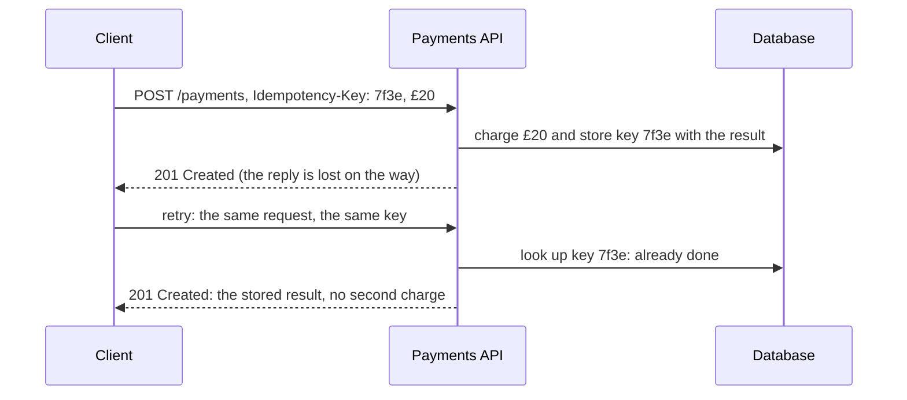

# APIs: REST, pagination and idempotency

> System Design · L1 Foundation · The request path: networking, proxies and APIs · about 95 min · hub module `m08` ([open the hub](https://claude.ai/artifact/5FDy46yNwWT8pPPZwQUGP9))

## Why it matters
An API is the contract between your system and everyone who uses it, and it's hard to change once clients depend on it. Good APIs name resources clearly, use HTTP methods and status codes the way clients expect, page through large results safely and make retries harmless. Those four habits come up in almost every design interview.

## Pre-question (answer before reading)
**Q:** A payment API times out after the client sends “charge Tara £20”, and the client retries. How do you make sure Tara is charged once, not twice?

<details><summary>Answer</summary>

The client creates an idempotency key, a unique ID for this one payment, and sends it with the request and with every retry. The server stores the key with the result of the first attempt, and a retry with the same key gets that stored result instead of a second charge.

</details>

## 🍎 Story time (kid version)
**Pizza Town and the family road trip: Order slips at Luigi's**

Luigi's takes orders on paper slips. Each slip says what you want: “GET me the menu”, “POST a new order”, “DELETE order 12”. Luigi answers with a number everyone knows: 200 means “here you go”, 404 means “no such order”. One day Tara hands in her order, but the shop is noisy and she isn't sure Luigi heard, so she hands in the same slip again. Because she wrote her own slip number at the top, Luigi sees he's already cooking slip 57 and doesn't make a second pizza. When Ben asks for all the orders from last year, Luigi gives him one page at a time with a bookmark in it.

| In the story | In a real system |
|---|---|
| Slips saying GET, POST or DELETE | HTTP methods acting on resources: GET reads, POST creates, DELETE removes |
| 200 for “here you go”, 404 for “no such order” | Status codes that clients can act on without reading the message |
| Handing in the same slip twice | A client retrying after a timeout |
| Tara's own slip number at the top | An idempotency key: a retry gets the first result, not a second order |
| One page at a time, with a bookmark | Cursor pagination: each page says where the next one starts |

**Where the story breaks:** Luigi recognises Tara's slip by eye; a server must store every idempotency key with its result, long enough to cover retries. And two copies can arrive at the same moment, so it must also cope with a key whose first request is still being processed.

## Key ideas (grown-up version)
- **Resources and methods**: a REST-style API names things with nouns in the path (/orders, /orders/42) and uses HTTP methods as the verbs: GET reads, POST creates, PUT replaces, PATCH changes part, DELETE removes. GET must never change anything, so caches, crawlers and retries can call it freely.
- **Status codes**: 2xx means success (200 OK, 201 Created with a Location header, 204 No Content); 4xx means the client must change something (400 Bad Request, 401 not signed in, 403 not allowed, 404 Not Found, 409 Conflict, 429 Too Many Requests); 5xx means the server failed (500, 503 Service Unavailable). Clients, retries and monitoring all depend on them, so be exact.
- **Idempotent methods**: an operation is idempotent if doing it twice leaves the server in the same state as doing it once. GET, PUT and DELETE are idempotent by definition, so they're safe to retry; POST isn't, which is why create endpoints need idempotency keys.
- **Idempotency keys**: the client creates a unique key for each logical operation and sends it with the request and every retry, often in an Idempotency-Key header. The server stores the key with the first result and replays that result for any repeat, so a timeout followed by a retry can't create or charge twice.
- **Offset pagination**: ?limit=20&offset=40 is simple and lets users jump to page 3. But the database still reads and throws away every earlier row, so deep pages get slow, and rows added or removed between requests shift the pages, so items repeat or go missing.
- **Cursor pagination**: each page returns an opaque cursor that encodes where it ended (the last item's sort key), and the next request asks for the items after it. Deep pages are as fast as the first (an index seek), and new rows don't disturb what's been read. The price: no jumping straight to page 50.
- **Versioning and compatibility**: clients can't all update at once, so only add to a published API: new optional fields and new endpoints are safe; removing, renaming or retyping fields isn't. Breaking changes get a new version (/v2/ or a header), and the old one is retired slowly.
- **REST, gRPC and GraphQL**: REST over JSON is the common default for public APIs. gRPC (binary Protocol Buffers over HTTP/2) suits fast, typed calls between your own services. GraphQL lets a client ask for exactly the fields it needs in one request, at the cost of harder caching and more work on the server.

## Diagrams
**A retried payment with an idempotency key: charged once**



_The key must be stored with the result before the reply goes out, and keys are kept for long enough to cover every retry (often a day)._

**A newest-first feed, paged 3 at a time, while a new post (11) arrives**

| page 1 | 0 | 1 | 2 |
|---|---|---|---|
| value | 10 | 9 | 8 |

| new post | 0 |
|---|---|
| value | **11** |

| offset = 3 | 0 | 1 | 2 |
|---|---|---|---|
| value | **8** | 7 | 6 |

| after cursor 8 | 0 | 1 | 2 |
|---|---|---|---|
| value | 7 | 6 | 5 |

_The new post pushes everything down one place, so offset 3 now starts at 8, which the reader has already seen. The cursor asks for posts older than 8, which is unaffected._

## Comparisons
**HTTP methods**

| Method | Does | Idempotent | Typical status codes |
|---|---|---|---|
| GET | Reads a resource | Yes, and safe: changes nothing | 200, 404 |
| POST | Creates a resource or runs an action | No | 201 with a Location header, 400 |
| PUT | Replaces the resource at that path | Yes | 200 or 204; 201 if it created it |
| PATCH | Changes part of a resource | Not guaranteed | 200, 409 |
| DELETE | Removes it | Yes | 204, 404 |

**Offset or cursor pagination**

|  | Offset (?offset=40&limit=20) | Cursor (?after=<token>&limit=20) |
|---|---|---|
| Jump to page 50 | Yes | No: only the next page (sometimes the previous) |
| Cost of a deep page | Reads and skips every earlier row | An index seek: as fast as page 1 |
| New rows while paging | Items repeat or go missing | No repeats or gaps |
| Good for | Small lists that rarely change, admin tables | Feeds, timelines, big exports |

## Code (JavaScript + Python)
### A tiny REST API and its status codes
```python
import itertools, re

orders, ids = {}, itertools.count(1)

def handle(method, path, body=None):
    """A tiny REST API over a dict: returns the status code and the response body."""
    m = re.fullmatch(r"/orders(?:/(\d+))?", path)
    if not m:
        return 404, None                      # no such resource
    oid = int(m.group(1)) if m.group(1) else None
    if oid is None and method == "POST":
        if not body or "pizza" not in body:
            return 400, None                  # the client must fix the request
        oid = next(ids)
        orders[oid] = {"id": oid, **body}
        return 201, orders[oid]               # Created (with Location: /orders/<id>)
    if oid is None and method == "GET":
        return 200, list(orders.values())
    if oid is not None and method == "GET":
        return (200, orders[oid]) if oid in orders else (404, None)
    if oid is not None and method == "DELETE":
        return (204, None) if orders.pop(oid, None) else (404, None)
    return 405, None                          # this path doesn't support that method

calls = [("POST", "/orders", {"pizza": "margherita"}), ("POST", "/orders", {"pizza": "veggie"}),
         ("GET", "/orders/1", None), ("GET", "/orders/9", None), ("DELETE", "/orders/1", None),
         ("DELETE", "/orders/1", None), ("PATCH", "/orders", None), ("POST", "/orders", {}), ("GET", "/menu", None)]
print(*(handle(method, path, body)[0] for method, path, body in calls))
```

Output:
```text
201 201 200 404 204 404 405 400 404
```

- line 7: One pattern covers the collection (/orders) and one item (/orders/42): nouns in the path, the method as the verb.
- line 13: A bad request is the client's problem: 400 tells it to fix the request rather than retry it.
- line 16: 201 Created, with the new order; a real API also sends a Location header pointing at /orders/<id>.
- line 22: Deleting twice gives 204 then 404, yet DELETE is still idempotent: the server ends in the same state, the order gone.

```javascript
const orders = new Map();
let nextId = 1;

function handle(method, path, body = null) {
  // a tiny REST API over a Map: returns [status code, response body]
  const m = /^\/orders(?:\/(\d+))?$/.exec(path);
  if (!m) return [404, null];                 // no such resource
  const id = m[1] ? Number(m[1]) : null;
  if (id === null && method === "POST") {
    if (!body || !("pizza" in body)) return [400, null];   // the client must fix the request
    const order = { id: nextId++, ...body };
    orders.set(order.id, order);
    return [201, order];                      // Created (with Location: /orders/<id>)
  }
  if (id === null && method === "GET") return [200, [...orders.values()]];
  if (id !== null && method === "GET") return orders.has(id) ? [200, orders.get(id)] : [404, null];
  if (id !== null && method === "DELETE") return orders.delete(id) ? [204, null] : [404, null];
  return [405, null];                         // this path doesn't support that method
}

const calls = [["POST", "/orders", { pizza: "margherita" }], ["POST", "/orders", { pizza: "veggie" }],
  ["GET", "/orders/1", null], ["GET", "/orders/9", null], ["DELETE", "/orders/1", null],
  ["DELETE", "/orders/1", null], ["PATCH", "/orders", null], ["POST", "/orders", {}], ["GET", "/menu", null]];
console.log(...calls.map(([method, path, body]) => handle(method, path, body)[0]));
```

Output:
```text
201 201 200 404 204 404 405 400 404
```

- line 6: One pattern covers the collection (/orders) and one item (/orders/42): nouns in the path, the method as the verb.
- line 10: A bad request is the client's problem: 400 tells it to fix the request rather than retry it.
- line 13: 201 Created, with the new order; a real API also sends a Location header pointing at /orders/<id>.
- line 17: Deleting twice gives 204 then 404, yet DELETE is still idempotent: the server ends in the same state, the order gone.

### Offset or cursor pagination while new posts arrive
```python
posts = list(range(1, 11))                    # post ids; a bigger id is newer

def newest_first():
    return sorted(posts, reverse=True)

def page_by_offset(offset, limit=3):
    return newest_first()[offset:offset + limit]

def page_by_cursor(after=None, limit=3):      # after: the last id the client has seen
    page = [p for p in newest_first() if after is None or p < after][:limit]
    return page, page[-1] if page else None   # the next cursor: where this page ended

first = page_by_offset(0)
posts.append(11)                              # someone posts while we read
print("offset:", *first, "|", *page_by_offset(3))

posts.remove(11)
page1, cursor = page_by_cursor()
posts.append(11)
page2, cursor = page_by_cursor(cursor)
print("cursor:", *page1, "|", *page2)

for offset in (0, 9_000):                     # rows the database reads to serve one page of 20
    print(f"page at offset {offset}: offset reads {offset + 20} rows, cursor reads 20")
```

Output:
```text
offset: 10 9 8 | 8 7 6
cursor: 10 9 8 | 7 6 5
page at offset 0: offset reads 20 rows, cursor reads 20
page at offset 9000: offset reads 9020 rows, cursor reads 20
```

- line 10: The cursor query asks for posts older than the last one seen, which new posts can't disturb.
- line 15: Post 11 pushed everything down a place, so offset 3 starts at 8 again: the reader sees 8 twice.
- line 21: The cursor carries on from 8 whatever was added in between: 7, 6, 5.
- line 24: Offset 9,000 makes the database step over 9,000 rows first; with an index, a cursor seeks straight to its place.

```javascript
const posts = Array.from({ length: 10 }, (_, i) => i + 1);   // post ids; a bigger id is newer

const newestFirst = () => [...posts].sort((a, b) => b - a);
const pageByOffset = (offset, limit = 3) => newestFirst().slice(offset, offset + limit);

function pageByCursor(after = null, limit = 3) {   // after: the last id the client has seen
  const page = newestFirst().filter(p => after === null || p < after).slice(0, limit);
  return [page, page.length ? page.at(-1) : null];   // the next cursor: where this page ended
}

const first = pageByOffset(0);
posts.push(11);                               // someone posts while we read
console.log("offset:", ...first, "|", ...pageByOffset(3));

posts.pop();
let [page1, cursor] = pageByCursor();
posts.push(11);
let page2;
[page2, cursor] = pageByCursor(cursor);
console.log("cursor:", ...page1, "|", ...page2);

for (const offset of [0, 9000]) {             // rows the database reads to serve one page of 20
  console.log(`page at offset ${offset}: offset reads ${offset + 20} rows, cursor reads 20`);
}
```

Output:
```text
offset: 10 9 8 | 8 7 6
cursor: 10 9 8 | 7 6 5
page at offset 0: offset reads 20 rows, cursor reads 20
page at offset 9000: offset reads 9020 rows, cursor reads 20
```

- line 7: The cursor query asks for posts older than the last one seen, which new posts can't disturb.
- line 13: Post 11 pushed everything down a place, so offset 3 starts at 8 again: the reader sees 8 twice.
- line 20: The cursor carries on from 8 whatever was added in between: 7, 6, 5.
- line 23: Offset 9,000 makes the database step over 9,000 rows first; with an index, a cursor seeks straight to its place.

### Idempotency keys make a retried POST safe
```python
class PaymentsAPI:
    def __init__(self):
        self.charges, self.seen = [], {}      # seen: idempotency key -> the first response

    def charge(self, key, user, amount, lose_reply=False):
        if key is not None and key in self.seen:
            return self.seen[key]             # a repeat: replay the first answer, charge nothing
        self.charges.append((user, amount))
        response = (201, f"charge {len(self.charges)}")
        if key is not None:
            self.seen[key] = response         # stored before the reply goes out
        if lose_reply:
            raise TimeoutError("the reply was lost on the way back")
        return response

def pay_with_retry(api, key):                 # the first reply is lost, so the client retries once
    for attempt in range(2):
        try:
            return api.charge(key, "tara", 20, lose_reply=(attempt == 0))
        except TimeoutError:
            pass

for label, key in (("without a key", None), ("with a key", "7f3e-0042")):
    api = PaymentsAPI()
    status, body = pay_with_retry(api, key)
    print(f"{label}: {status} {body}, charges made: {len(api.charges)}")
```

Output:
```text
without a key: 201 charge 2, charges made: 2
with a key: 201 charge 1, charges made: 1
```

- line 7: A key seen before means this is a retry: send back exactly what the first attempt answered.
- line 11: The result is saved before replying, so even a lost reply leaves a record the retry can find.
- line 26: Without a key the server can't tell a retry from a new payment, so Tara pays twice.

```javascript
class TimeoutError extends Error {}

class PaymentsAPI {
  constructor() { this.charges = []; this.seen = new Map(); }   // seen: idempotency key -> the first response
  charge(key, user, amount, loseReply = false) {
    if (key !== null && this.seen.has(key)) return this.seen.get(key);   // a repeat: replay the first answer, charge nothing
    this.charges.push([user, amount]);
    const response = [201, `charge ${this.charges.length}`];
    if (key !== null) this.seen.set(key, response);   // stored before the reply goes out
    if (loseReply) throw new TimeoutError("the reply was lost on the way back");
    return response;
  }
}

function payWithRetry(api, key) {             // the first reply is lost, so the client retries once
  for (let attempt = 0; attempt < 2; attempt++) {
    try { return api.charge(key, "tara", 20, attempt === 0); }
    catch (err) { if (!(err instanceof TimeoutError)) throw err; }
  }
}

for (const [label, key] of [["without a key", null], ["with a key", "7f3e-0042"]]) {
  const api = new PaymentsAPI();
  const [status, body] = payWithRetry(api, key);
  console.log(`${label}: ${status} ${body}, charges made: ${api.charges.length}`);
}
```

Output:
```text
without a key: 201 charge 2, charges made: 2
with a key: 201 charge 1, charges made: 1
```

- line 6: A key seen before means this is a retry: send back exactly what the first attempt answered.
- line 9: The result is saved before replying, so even a lost reply leaves a record the retry can find.
- line 25: Without a key the server can't tell a retry from a new payment, so Tara pays twice.

## Worked example
**Problem.** (LeetCode 535, Encode and Decode TinyURL) Design `encode(long_url)`, which returns a short URL, and `decode(short_url)`, which returns the original. Use a counter written in base 62, give the same long URL the same code, and work out how many URLs codes of up to six characters can cover.

1. Each long URL needs a short, unique code, and a redirect needs to look the code up again (LeetCode only checks that decode(encode(url)) returns url).
2. Give each new URL the next number from a counter and write the number in base 62 (ten digits and both cases of letters). Codes of up to six characters cover 62⁶ ≈ 56.8 billion URLs.
3. Keep two maps: code → long URL for decoding, and long URL → code so the same URL gets the same code (optional, but it saves space).
4. encode and decode take O(L) for a URL of L characters (hashing it), plus O(log₆₂ n) to write a code, with O(n·L) memory for n URLs. At scale, servers need a shared counter (or blocks of numbers handed out in advance), and sequential codes are easy to guess; the capstone deals with both.

```python
ALPHABET = "0123456789abcdefghijklmnopqrstuvwxyzABCDEFGHIJKLMNOPQRSTUVWXYZ"

def base62(n):
    digits = ""
    while True:
        n, r = divmod(n, 62)
        digits = ALPHABET[r] + digits
        if n == 0:
            return digits

class Codec:
    def __init__(self):
        self.long_by_code, self.code_by_long, self.count = {}, {}, 0

    def encode(self, long_url):
        if long_url not in self.code_by_long:     # the same long URL keeps its code
            code = base62(self.count)
            self.count += 1
            self.long_by_code[code], self.code_by_long[long_url] = long_url, code
        return "https://tiny.example/" + self.code_by_long[long_url]

    def decode(self, short_url):
        return self.long_by_code[short_url.rsplit("/", 1)[1]]

codec = Codec()
a = codec.encode("https://example.com/menu/margherita")
b = codec.encode("https://example.com/menu/veggie")
again = codec.encode("https://example.com/menu/margherita")
print(a, b, "same code again:", "yes" if again == a else "no")
print("decodes back:", codec.decode(b))
print(base62(61), base62(62), base62(62 ** 6 - 1), "->", 62 ** 6, "codes of up to 6 characters")
```

Output:
```text
https://tiny.example/0 https://tiny.example/1 same code again: yes
decodes back: https://example.com/menu/veggie
Z 10 ZZZZZZ -> 56800235584 codes of up to 6 characters
```

```javascript
const ALPHABET = "0123456789abcdefghijklmnopqrstuvwxyzABCDEFGHIJKLMNOPQRSTUVWXYZ";

function base62(n) {
  let digits = "";
  do {
    digits = ALPHABET[n % 62] + digits;
    n = Math.floor(n / 62);
  } while (n > 0);
  return digits;
}

class Codec {
  constructor() { this.longByCode = new Map(); this.codeByLong = new Map(); this.count = 0; }
  encode(longUrl) {
    if (!this.codeByLong.has(longUrl)) {      // the same long URL keeps its code
      const code = base62(this.count++);
      this.longByCode.set(code, longUrl);
      this.codeByLong.set(longUrl, code);
    }
    return "https://tiny.example/" + this.codeByLong.get(longUrl);
  }
  decode(shortUrl) { return this.longByCode.get(shortUrl.slice(shortUrl.lastIndexOf("/") + 1)); }
}

const codec = new Codec();
const a = codec.encode("https://example.com/menu/margherita");
const b = codec.encode("https://example.com/menu/veggie");
const again = codec.encode("https://example.com/menu/margherita");
console.log(a, b, "same code again:", again === a ? "yes" : "no");
console.log("decodes back:", codec.decode(b));
console.log(base62(61), base62(62), base62(62 ** 6 - 1), "->", 62 ** 6, "codes of up to 6 characters");
```

Output:
```text
https://tiny.example/0 https://tiny.example/1 same code again: yes
decodes back: https://example.com/menu/veggie
Z 10 ZZZZZZ -> 56800235584 codes of up to 6 characters
```

**Answer.** The first two URLs get codes 0 and 1, and encoding the first URL again returns its existing code. Decoding the second short URL gives back the veggie page. 61 is “Z”, 62 needs two characters (“10”), and six characters go up to “ZZZZZZ”: 56,800,235,584 codes in all.

## Your turn (faded example)
**Problem.** Make cursors opaque and safe when items share a timestamp. Items are listed newest first by (created_at, id). Finish `next_page(items, cursor, limit)`: return the next `limit` items after the cursor, and a new cursor (base64url-encoded JSON of the last item's created_at and id), or None when there are no more items.

- ✓ Clients treat a cursor as an opaque token that they send back. Encoding it (here, base64url of JSON) lets the server change what's inside later without breaking anyone.
- **Why put both the time and the id in the cursor?**
  <details><summary>Answer</summary>Several items can share a timestamp. Ordering by (time, id) is a total order, so “strictly after the cursor” never skips or repeats an item that ties with the last one shown.</details>
- **How can you tell whether another page exists without counting everything?**
  <details><summary>Answer</summary>Ask for limit + 1 items. If the extra one comes back there's more, and the cursor points at the last item actually returned; otherwise there's no next cursor.</details>
- **What does a page cost?**
  <details><summary>Answer</summary>With an index on (created_at, id), the database seeks straight to the cursor: about O(log n + limit) per page however deep, against O(offset + limit) for offset paging. This list version scans, O(n), to keep it short.</details>

Starter:
```python
import base64, json

def encode_cursor(created_at, item_id):       # opaque to clients: they just send it back
    raw = json.dumps([created_at, item_id], separators=(",", ":")).encode()
    return base64.urlsafe_b64encode(raw).decode().rstrip("=")

def decode_cursor(cursor):
    raw = base64.urlsafe_b64decode(cursor + "=" * (-len(cursor) % 4))
    return tuple(json.loads(raw))

def next_page(items, cursor=None, limit=2):
    """items: (created_at, id, text), newest first. Returns (page, cursor for the next page or None)."""
    ...                                       # TODO: items after the cursor; fetch limit + 1 to see if there's more
```

```javascript
function encodeCursor(createdAt, itemId) {    // opaque to clients: they just send it back
  return Buffer.from(JSON.stringify([createdAt, itemId])).toString("base64url");
}
function decodeCursor(cursor) {
  return JSON.parse(Buffer.from(cursor, "base64url").toString());
}

function nextPage(items, cursor = null, limit = 2) {
  // items: [createdAt, id, text], newest first; returns [page, cursor for the next page or null]
  // TODO: items after the cursor; fetch limit + 1 to see if there's more
}
```

<details><summary>Full solution</summary>

```python
import base64, json

def encode_cursor(created_at, item_id):       # opaque to clients: they just send it back
    raw = json.dumps([created_at, item_id], separators=(",", ":")).encode()
    return base64.urlsafe_b64encode(raw).decode().rstrip("=")

def decode_cursor(cursor):
    raw = base64.urlsafe_b64decode(cursor + "=" * (-len(cursor) % 4))
    return tuple(json.loads(raw))

def next_page(items, cursor=None, limit=2):
    """items: (created_at, id, text), newest first. Returns (page, cursor for the next page or None)."""
    after = decode_cursor(cursor) if cursor else None
    rows = [it for it in items if after is None or (it[0], it[1]) < after][:limit + 1]   # one extra says "more"
    page = rows[:limit]
    return page, encode_cursor(page[-1][0], page[-1][1]) if len(rows) > limit else None

items = [(1700000300, 7, "g"), (1700000300, 6, "f"), (1700000200, 5, "e"),
         (1700000100, 4, "d"), (1700000100, 3, "c"), (1700000000, 2, "b")]
cursor, pages = None, []
while True:
    page, cursor = next_page(items, cursor)
    pages.append("".join(text for _, _, text in page))
    if cursor is None:
        break
print(*pages, "| first cursor:", encode_cursor(1700000300, 6))
```

Output:
```text
gf ed cb | first cursor: WzE3MDAwMDAzMDAsNl0
```

```javascript
function encodeCursor(createdAt, itemId) {    // opaque to clients: they just send it back
  return Buffer.from(JSON.stringify([createdAt, itemId])).toString("base64url");
}
function decodeCursor(cursor) {
  return JSON.parse(Buffer.from(cursor, "base64url").toString());
}
const isAfter = (it, c) => it[0] < c[0] || (it[0] === c[0] && it[1] < c[1]);   // later in newest-first order

function nextPage(items, cursor = null, limit = 2) {
  // items: [createdAt, id, text], newest first; returns [page, cursor for the next page or null]
  const after = cursor ? decodeCursor(cursor) : null;
  const rows = items.filter(it => after === null || isAfter(it, after)).slice(0, limit + 1);   // one extra says "more"
  const page = rows.slice(0, limit);
  return [page, rows.length > limit ? encodeCursor(page.at(-1)[0], page.at(-1)[1]) : null];
}

const items = [[1700000300, 7, "g"], [1700000300, 6, "f"], [1700000200, 5, "e"],
  [1700000100, 4, "d"], [1700000100, 3, "c"], [1700000000, 2, "b"]];
let cursor = null;
const pages = [];
do {
  let page;
  [page, cursor] = nextPage(items, cursor);
  pages.push(page.map(([, , text]) => text).join(""));
} while (cursor !== null);
console.log(...pages, "| first cursor:", encodeCursor(1700000300, 6));
```

Output:
```text
gf ed cb | first cursor: WzE3MDAwMDAzMDAsNl0
```

</details>

## Socratic checks and quiz (answers hidden)
**1. What does this print?**

```python
def status_for(method, exists, valid=True):
    if not valid:
        return 400
    if method == "POST":
        return 201
    if not exists:
        return 404
    return 204 if method == "DELETE" else 200

print(status_for("POST", False), status_for("GET", False), status_for("DELETE", True), status_for("PUT", True, valid=False))
```

```javascript
function statusFor(method, exists, valid = true) {
  if (!valid) return 400;
  if (method === "POST") return 201;
  if (!exists) return 404;
  return method === "DELETE" ? 204 : 200;
}

console.log(statusFor("POST", false), statusFor("GET", false), statusFor("DELETE", true), statusFor("PUT", true, false));
```

- A. 201 404 204 400
- B. 200 404 200 400
- C. 201 200 204 400
- D. 201 404 204 200

<details><summary>Answer</summary>

201 404 204 400. A valid POST creates (201); reading something that doesn't exist is 404; a successful DELETE has nothing to return (204); and an invalid request is 400 whatever the method.

</details>

**2. What does this print?**

```python
feed = [9, 8, 7, 6, 5]                      # newest first
page1 = feed[0:2]
feed.insert(0, 10)                          # a new post arrives
offset_page2 = feed[2:4]
cursor_page2 = [p for p in feed if p < page1[-1]][:2]
print(*offset_page2, "|", *cursor_page2)
```

```javascript
const feed = [9, 8, 7, 6, 5];               // newest first
const page1 = feed.slice(0, 2);
feed.unshift(10);                           // a new post arrives
const offsetPage2 = feed.slice(2, 4);
const cursorPage2 = feed.filter(p => p < page1.at(-1)).slice(0, 2);
console.log(...offsetPage2, "|", ...cursorPage2);
```

- A. 8 7 | 7 6
- B. 7 6 | 7 6
- C. 8 7 | 8 7
- D. 7 6 | 6 5

<details><summary>Answer</summary>

8 7 | 7 6. Page 1 is 9 and 8. The new post shifts everything down a place, so offset 2 now starts at 8, a repeat. The cursor asks for posts older than 8: 7 and 6.

</details>

**3. A phone sends POST /payments, the connection drops before the reply arrives, and the app retries. What prevents a double charge?**

- A. An idempotency key sent with both attempts, so the server returns the stored result for the repeat
- B. Sending the retry as a GET instead
- C. Answering 200 instead of 201
- D. A shorter timeout in the app

<details><summary>Answer</summary>

An idempotency key sent with both attempts, so the server returns the stored result for the repeat. Only the key lets the server recognise the retry. A GET must not change anything, the status code doesn't stop a second charge, and a shorter timeout just makes retries more likely.

</details>

**4. Which changes to a published JSON API are safe for old clients? (choose 2)**

- A. Adding a new optional field to a response
- B. Adding a new endpoint
- C. Renaming the field total to amount
- D. Changing a field from a number to a string
- E. Making an optional request field required

<details><summary>Answer</summary>

Adding a new optional field to a response, Adding a new endpoint. Old clients ignore fields and endpoints they don't know about. A renamed or retyped field breaks every client that reads it, and a newly required field rejects requests that old clients still send.

</details>

**5. Judge each statement.**

- PUT and DELETE are idempotent: repeating them leaves the same state as doing them once.
- A GET request may change data, as long as it's quick.
- Offset pagination can repeat or skip items when rows are added between requests.
- 429 Too Many Requests tells a client it's being rate limited.

<details><summary>Answer</summary>

PUT and DELETE are idempotent: repeating them leaves the same state as doing them once.: Yes; A GET request may change data, as long as it's quick.: No; Offset pagination can repeat or skip items when rows are added between requests.: Yes; 429 Too Many Requests tells a client it's being rate limited.: Yes. Idempotency is about the server's final state. GET must be safe because caches, crawlers and retries call it freely. Added rows shift every later offset. And 429 is the rate-limit code, often with a Retry-After header.

</details>

**6. Put the steps of handling a POST with an idempotency key in order.**

- (put the steps in order)

<details><summary>Answer</summary>

Read the Idempotency-Key header from the request → Look the key up among the stored results → If it's new, process the request and store the key with its result → Return the stored result for a repeat, or the new one. You need the key before you can look it up, the lookup decides whether to process the request, and the reply comes last, after the result is stored, so a lost reply can still be replayed.

</details>

**7. Complete the Python create function so that a repeated key returns the first result.**

```
def create_order(store, orders, key, body):
    if key in store:
        return {{0}}
    orders.append(body)
    order_id = len(orders)
    store[key] = {{1}}
    return store[key]

```

<details><summary>Answer</summary>

store[key] | (201, order_id). A repeat must get back exactly what was stored for its key, and what's stored is the first response: 201 with the new order's id.

</details>

**8. Match each status code to its meaning.**


<details><summary>Answer</summary>

201 Created = A POST made a new resource; 404 Not Found = There's no resource at that path; 409 Conflict = The request clashes with the resource's current state; 503 Service Unavailable = The server is overloaded or down for now; try again later. Signing in is 401 Unauthorized, which isn't in the list.

</details>

## Traps & misconceptions
- **“Put verbs in the path, like /createOrder.”** Name resources with nouns and let the method be the verb: POST /orders creates an order, GET /orders/42 reads one. Clients, caches and tools understand that convention, and the API stays consistent as it grows.
- **“Return 200 with the error message inside.”** Clients, retries, caches and monitoring all read the status code. A failed request that answers 200 looks like success to every one of them; send the right 4xx or 5xx code with a clear error body.
- **“POST is safe to retry.”** POST isn't idempotent: retrying a create after a timeout can create two orders or charge twice. Use idempotency keys, or make the operation an idempotent PUT to an ID the client chooses.
- **“Offset pagination works for any list.”** Deep pages make the database read and throw away every earlier row, and rows added between requests shift the pages so items repeat or vanish. For feeds and big lists, use cursors.
- **“A base64 cursor hides what's inside.”** Base64 is an encoding, not encryption: anyone can decode it. Never put secrets in a cursor, validate it on the server like any other input, and sign it if clients mustn't tamper with it.
- **“We can rename a field; clients will update.”** Old app versions stay in use for months. Only add to a published API, and for breaking changes publish a new version and retire the old one slowly, watching who still calls it.

## Discussion prompts
- **How would you design an endpoint for creating an order that clients may retry?**
  <details><summary>One good answer</summary>POST /orders with an Idempotency-Key header that the client generates for each checkout. The server stores the key, a hash of the request body and the response, ideally in the same transaction that creates the order. A repeat with the same key and body gets the stored response; the same key with a different body gets an error such as 422; and a repeat while the first is still running gets 409, so the client waits and tries again. Keys expire after a day or so, and clients retry only after timeouts and 5xx answers, with backoff.</details>
- **REST, gRPC or GraphQL for a mobile app's backend?**
  <details><summary>One good answer</summary>REST over JSON is the simple default: easy to cache, debug and document, and any client can call it. GraphQL helps when screens need data from many resources and fetching exactly the needed fields in one round trip matters on slow mobile networks, at the cost of harder caching and the risk of expensive queries. gRPC suits calls between your own services, where its binary format and generated clients make calls fast and typed; browsers need a proxy to use it. Many systems use REST or GraphQL at the edge and gRPC inside.</details>

## Teach-back
**Prompt:** Explain to a junior colleague how you'd design a small orders API so that clients can page through orders and safely retry.

Rubric:
- [ ] Nouns for resources, HTTP methods as the verbs
- [ ] Exact status codes: 201, 400, 404, 409, 429, 5xx
- [ ] Idempotency keys for POST; GET, PUT and DELETE are idempotent already
- [ ] Cursor pagination for big or changing lists
- [ ] Add-only changes, and a new version for breaking ones

<details><summary>Model answer</summary>

I'd make orders a resource: POST /orders creates one, GET /orders/42 reads it, GET /orders lists them, and DELETE /orders/42 cancels it, with exact status codes: 201 with a Location header on create, 400 for a bad request, 404 for a missing order, 409 when the order's state forbids the change, and 429 when a client is rate limited. GET, PUT and DELETE are idempotent, so clients may retry them freely, but POST isn't, so creates take an Idempotency-Key header: the server stores each key with its first result and replays that result for a repeat. The list uses cursor pagination: each page returns an opaque cursor built from the last order's time and id, so deep pages stay fast and new orders don't cause repeats or gaps. And once clients depend on the API, I only add to it; anything breaking goes into a new version.

</details>

## Quick Q&A (also in the SRS deck)
- **Which HTTP methods are idempotent?** GET, HEAD, OPTIONS, PUT and DELETE; POST and PATCH aren't guaranteed to be.
- **201, 204, 404, 409, 429?** Created, No Content, Not Found, Conflict, Too Many Requests.
- **What is an idempotency key?** A unique key per operation that the client sends with every retry, so the server replays the first result instead of acting again.
- **Offset or cursor pagination for a feed?** Cursor: fast at any depth, and stable while new items arrive.
- **What's usually inside a cursor?** The sort key of the last item returned (for example its time and id), encoded as an opaque token.
- **How do you change a public API safely?** Only add (new optional fields, new endpoints); put breaking changes in a new version.

## Practice problems
- [ ] [LC 535 · Encode and Decode TinyURL](https://leetcode.com/problems/encode-and-decode-tinyurl/) · Medium · the worked example: a counter in base 62; the capstone turns it into a real service
- [ ] [Exercise · How a big public API pages its results](https://docs.github.com/en/rest/using-the-rest-api/using-pagination-in-the-rest-api) · find how GitHub's REST API points to the next page, and whether different endpoints use page numbers or cursors
- [ ] [Exercise · Idempotent requests in a payments API](https://docs.stripe.com/api/idempotent_requests) · find how keys are sent, how long they're kept and what happens when a retry's parameters differ; add those rules to this module's PaymentsAPI
- [ ] [Exercise · Opaque page tokens](https://google.aip.dev/158) · read why Google's API guidelines require opaque page tokens, and compare them with this module's cursors
- [ ] [Reference · HTTP status codes](https://developer.mozilla.org/en-US/docs/Web/HTTP/Status) · for each code in this module, write one sentence on when your API would send it

## Sources (accessed 2026-10-09)
- [RFC 9110: HTTP Semantics (methods and status codes)](https://www.rfc-editor.org/rfc/rfc9110)
- [MDN: HTTP response status codes](https://developer.mozilla.org/en-US/docs/Web/HTTP/Status)
- [Google AIP-158: Pagination](https://google.aip.dev/158)
- [Stripe API: Idempotent requests](https://docs.stripe.com/api/idempotent_requests)
- [IETF draft (expired): The Idempotency-Key HTTP header field](https://datatracker.ietf.org/doc/draft-ietf-httpapi-idempotency-key-header/)
