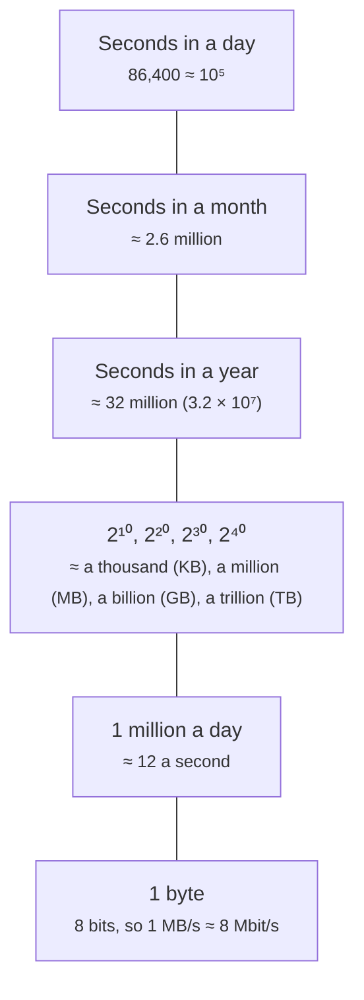
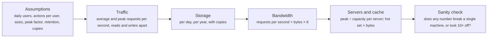
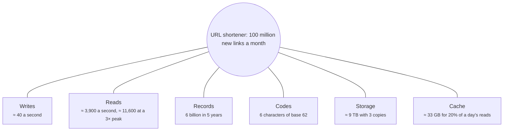

# Back-of-the-envelope estimation

> System Design · L1 Foundation · Estimation and design method · about 90 min · hub module `m09` ([open the hub](https://claude.ai/artifact/5FDy46yNwWT8pPPZwQUGP9))

## Why it matters
Before drawing boxes, an interviewer wants to know how big the problem is. A few minutes of rounded arithmetic (requests per second, storage per year, bandwidth at the peak) tells you whether one server will do or you need a fleet, and which part of the design deserves the most attention. The skill is stating assumptions and rounding boldly, not precision.

## Pre-question (answer before reading)
**Q:** A service gets 100 million requests a day. Roughly how many requests a second is that on average, and what might the peak be?

<details><summary>Answer</summary>

A day has 86,400 seconds; call it 100,000. 100 million ÷ 100,000 ≈ 1,000 requests a second on average (1,157 more exactly). Peaks are often 2 to 5 times the average, so plan for a few thousand a second, and say which peak factor you assumed.

</details>

## 🍎 Story time (kid version)
**Pizza Town and the family road trip: Packing for the road trip**

Before the road trip, Dad works out what to pack without a calculator. Four people, three days, about two sandwiches each a day: 4 × 3 × 2 is 24 sandwiches. Grandma's is about 500 km away and the car uses about 6 litres every 100 km, so the trip there needs about 30 litres of petrol. “Round the numbers so you can do them in your head,” he says, “and write down what you guessed, in case we're wrong.” Tara says the drive home is when everyone is hungriest, so they pack extra for that day.

| In the story | In a real system |
|---|---|
| 4 × 3 × 2 = 24 sandwiches | Multiplying rounded factors: users × actions per user × size |
| Writing down what you guessed | Stating assumptions, so they can be checked and changed |
| Rounding to do the sums in your head | Round numbers and powers of ten: a day ≈ 100,000 seconds |
| About 30 litres for 500 km | A rate times a quantity: requests per second × bytes, storage per day × days |
| Extra food for the hungriest day | Planning for the peak, not the average |

**Where the story breaks:** A wrong sandwich count costs a snack; a wrong estimate can cost a redesign. Real estimates are checked against measurements as soon as the system runs, and the assumptions are updated.

## Key ideas (grown-up version)
- **Why estimate**: a few minutes of arithmetic tells you whether the problem needs one server or a fleet, where the bottleneck will be (reads, writes, storage or bandwidth), and which parts of the design deserve attention. Interviewers grade the reasoning and the stated assumptions, not the exact numbers.
- **Round boldly**: a day is 86,400 seconds, about 10⁵; a month about 2.6 million seconds; a year about 3.2 × 10⁷. So 1 million requests a day is about 12 a second, and 1 billion a day about 12,000 a second.
- **Powers of two and ten**: 2¹⁰ ≈ 10³ (KB), 2²⁰ ≈ 10⁶ (MB), 2³⁰ ≈ 10⁹ (GB), 2⁴⁰ ≈ 10¹² (TB). An ASCII character is a byte, a number about 8 bytes, a short row of text and ids a few hundred bytes, a photo a few hundred KB to a few MB, a minute of HD video tens of MB.
- **Traffic**: requests per second = daily active users × actions per user per day ÷ 86,400. The peak = the average × a peak factor (often 2 to 5 for consumer apps; say which you assume). Split reads from writes: many products read 10 to 100 times more often than they write.
- **Storage**: new data per day = writes per day × bytes per item. Multiply by how long it's kept and by the number of copies (replicas, often 3), then add room for indexes and growth. 1 KB a write at 1 million writes a day is 1 GB a day, about 365 GB a year before copies.
- **Bandwidth**: bytes per second = requests per second × response size, and networks are measured in bits: multiply by 8. 1,000 requests a second of 100 KB is 100 MB/s, which is 800 Mbit/s, most of a 1 Gbit/s link: a hint that a CDN should serve those bytes.
- **Servers and memory**: servers = peak requests per second ÷ what one server carries with headroom (module 2). Cache memory: hold the hot set, often taken as the 20% of items that get 80% of the reads, so memory ≈ hot items × bytes per item.
- **Sanity checks**: compare each answer with something you know (one database handles thousands of simple queries a second; one large server has hundreds of GB of memory), and redo any sum that looks 10× off. A design built on the wrong order of magnitude fails either way.

## Diagrams
**Numbers to round with**



_Rounding 86,400 to 100,000 makes every per-second figure about 14% low; that's fine for an estimate, as long as you know which way you rounded._

**An estimate, step by step**



_Write the assumptions down first: every later number depends on them, and an interviewer will often change one to see how your design copes._

**The URL shortener in numbers (this module's worked example)**



_Nothing here needs a huge fleet: the hard parts are fast redirects and staying up, which is where the design effort goes._

## Comparisons
**Sizes to estimate with (rules of thumb)**

| Thing | Rough size |
|---|---|
| A character of English text | 1 byte in UTF-8 |
| An integer, id or timestamp | 4 to 8 bytes |
| A row of ids, short text and timestamps | a few hundred bytes to 1 KB |
| A compressed photo | a few hundred KB to a few MB |
| A minute of 1080p video | tens of MB |
| Memory in one large server | hundreds of GB |

**Where the big number usually is**

| Product | Biggest number | So the design focuses on |
|---|---|---|
| URL shortener | Reads: about 100 for every write | Caching and fast redirects |
| Photo sharing | Storage and image bandwidth | Object storage and a CDN |
| Chat | Writes and open connections | A store that scales writes, and connection servers |
| Analytics events | Write volume | Append-only logs and batch processing |

## Code (JavaScript + Python)
### Rounding and size helpers used by every example (powers of 1,000, as disks are sold)
```python
SECONDS_PER_DAY = 86_400

def one_decimal(x):                             # round half up, the same way in both languages
    return f"{int(x * 10 + 0.5) / 10:.1f}"

def human_bytes(n):
    """2_500_000 -> '2.5 MB', in powers of 1,000."""
    units, i = ["B", "KB", "MB", "GB", "TB", "PB"], 0
    while n >= 1000 and i < len(units) - 1:
        n /= 1000
        i += 1
    return f"{one_decimal(n)} {units[i]}"
```

```javascript
const SECONDS_PER_DAY = 86400;

const oneDecimal = x => (Math.floor(x * 10 + 0.5) / 10).toFixed(1);   // round half up, the same way in both languages

function humanBytes(n) {
  // 2500000 -> "2.5 MB", in powers of 1,000
  const units = ["B", "KB", "MB", "GB", "TB", "PB"];
  let i = 0;
  while (n >= 1000 && i < units.length - 1) { n /= 1000; i++; }
  return `${oneDecimal(n)} ${units[i]}`;
}
```

### Powers of two, and requests a day as requests a second
```python
for power, name in ((10, "KB"), (20, "MB"), (30, "GB"), (40, "TB")):
    print(f"2^{power} = {2 ** power:,} bytes, about 10^{power * 3 // 10} ({name})")
for per_day in (1_000_000, 100_000_000, 1_000_000_000):
    print(f"{per_day:,} a day = {one_decimal(per_day / SECONDS_PER_DAY)} a second")
```

Output:
```text
2^10 = 1,024 bytes, about 10^3 (KB)
2^20 = 1,048,576 bytes, about 10^6 (MB)
2^30 = 1,073,741,824 bytes, about 10^9 (GB)
2^40 = 1,099,511,627,776 bytes, about 10^12 (TB)
1,000,000 a day = 11.6 a second
100,000,000 a day = 1157.4 a second
1,000,000,000 a day = 11574.1 a second
```

- line 2: Each step of 2¹⁰ is about a factor of 1,000, and the error grows only slowly: 2⁴⁰ is 10% over 10¹².
- line 4: Dividing by 86,400 (about 10⁵): a million a day is about 12 a second, a billion a day about 12,000.

```javascript
for (const [power, name] of [[10, "KB"], [20, "MB"], [30, "GB"], [40, "TB"]]) {
  console.log(`2^${power} = ${(2 ** power).toLocaleString("en-US")} bytes, about 10^${Math.floor((power * 3) / 10)} (${name})`);
}
for (const perDay of [1000000, 100000000, 1000000000]) {
  console.log(`${perDay.toLocaleString("en-US")} a day = ${oneDecimal(perDay / SECONDS_PER_DAY)} a second`);
}
```

Output:
```text
2^10 = 1,024 bytes, about 10^3 (KB)
2^20 = 1,048,576 bytes, about 10^6 (MB)
2^30 = 1,073,741,824 bytes, about 10^9 (GB)
2^40 = 1,099,511,627,776 bytes, about 10^12 (TB)
1,000,000 a day = 11.6 a second
100,000,000 a day = 1157.4 a second
1,000,000,000 a day = 11574.1 a second
```

- line 2: Each step of 2¹⁰ is about a factor of 1,000, and the error grows only slowly: 2⁴⁰ is 10% over 10¹².
- line 5: Dividing by 86,400 (about 10⁵): a million a day is about 12 a second, a billion a day about 12,000.

### Traffic and storage for a feed
```python
dau = 10_000_000                              # assumption: daily active users
posts_per_user, reads_per_user = 2, 100       # assumption: per user, per day
peak_factor = 3                               # assumption: the busiest hour runs at 3x the average

writes = dau * posts_per_user / SECONDS_PER_DAY
reads = dau * reads_per_user / SECONDS_PER_DAY
print("writes/s:", one_decimal(writes), "average,", one_decimal(writes * peak_factor), "peak")
print("reads/s:", one_decimal(reads), "average,", one_decimal(reads * peak_factor), "peak")
print("reads per write:", reads_per_user // posts_per_user)

post_bytes = 1_000                            # assumption: text, ids and timestamps
per_day = dau * posts_per_user * post_bytes
print("new posts a day:", human_bytes(per_day), "| 5 years x 3 copies:", human_bytes(per_day * 365 * 5 * 3))
```

Output:
```text
writes/s: 231.5 average, 694.4 peak
reads/s: 11574.1 average, 34722.2 peak
reads per write: 50
new posts a day: 20.0 GB | 5 years x 3 copies: 109.5 TB
```

- line 1: Every estimate starts with assumptions, written where everyone can see and challenge them.
- line 9: Reads dominate at 50 per write: cache the feeds, and make sure the read path scales.
- line 13: Writes are modest (about 700 a second at the peak), but five years of posts with three copies is over 100 TB: plan storage early.

```javascript
const dau = 10000000;                         // assumption: daily active users
const postsPerUser = 2, readsPerUser = 100;   // assumption: per user, per day
const peakFactor = 3;                         // assumption: the busiest hour runs at 3x the average

const writes = (dau * postsPerUser) / SECONDS_PER_DAY;
const reads = (dau * readsPerUser) / SECONDS_PER_DAY;
console.log("writes/s:", oneDecimal(writes), "average,", oneDecimal(writes * peakFactor), "peak");
console.log("reads/s:", oneDecimal(reads), "average,", oneDecimal(reads * peakFactor), "peak");
console.log("reads per write:", Math.floor(readsPerUser / postsPerUser));

const postBytes = 1000;                       // assumption: text, ids and timestamps
const perDay = dau * postsPerUser * postBytes;
console.log("new posts a day:", humanBytes(perDay), "| 5 years x 3 copies:", humanBytes(perDay * 365 * 5 * 3));
```

Output:
```text
writes/s: 231.5 average, 694.4 peak
reads/s: 11574.1 average, 34722.2 peak
reads per write: 50
new posts a day: 20.0 GB | 5 years x 3 copies: 109.5 TB
```

- line 1: Every estimate starts with assumptions, written where everyone can see and challenge them.
- line 9: Reads dominate at 50 per write: cache the feeds, and make sure the read path scales.
- line 13: Writes are modest (about 700 a second at the peak), but five years of posts with three copies is over 100 TB: plan storage early.

### Bandwidth and cache memory
```python
reads_per_s = 11_574                          # from the feed estimate
item_bytes = 1_000                            # each feed item read
image_bytes = 200_000                         # assumption: one 200 KB image for every 10 items read
api_out = reads_per_s * item_bytes
image_out = reads_per_s // 10 * image_bytes
for label, rate in (("API responses", api_out), ("images", image_out)):
    print(f"{label}: {human_bytes(rate)}/s = {one_decimal(rate * 8 / 1e9)} Gbit/s")

daily_items = 20_000_000                      # posts written per day (10 million users x 2)
hot = daily_items * 20 // 100                 # assumption: 20% of items get 80% of the reads
print("cache for the hottest 20% of a day's posts:", human_bytes(hot * item_bytes))
```

Output:
```text
API responses: 11.6 MB/s = 0.1 Gbit/s
images: 231.4 MB/s = 1.9 Gbit/s
cache for the hottest 20% of a day's posts: 4.0 GB
```

- line 7: Bytes become bits: × 8. The images need about 20 times the bandwidth of the API itself, so they belong on a CDN.
- line 11: 4 GB fits easily in one cache server's memory, so caching the hot posts is cheap.

```javascript
const readsPerS = 11574;                      // from the feed estimate
const itemBytes = 1000;                       // each feed item read
const imageBytes = 200000;                    // assumption: one 200 KB image for every 10 items read
const apiOut = readsPerS * itemBytes;
const imageOut = Math.floor(readsPerS / 10) * imageBytes;
for (const [label, rate] of [["API responses", apiOut], ["images", imageOut]]) {
  console.log(`${label}: ${humanBytes(rate)}/s = ${oneDecimal((rate * 8) / 1e9)} Gbit/s`);
}

const dailyItems = 20000000;                  // posts written per day (10 million users x 2)
const hot = Math.floor((dailyItems * 20) / 100);   // assumption: 20% of items get 80% of the reads
console.log("cache for the hottest 20% of a day's posts:", humanBytes(hot * itemBytes));
```

Output:
```text
API responses: 11.6 MB/s = 0.1 Gbit/s
images: 231.4 MB/s = 1.9 Gbit/s
cache for the hottest 20% of a day's posts: 4.0 GB
```

- line 7: Bytes become bits: × 8. The images need about 20 times the bandwidth of the API itself, so they belong on a CDN.
- line 12: 4 GB fits easily in one cache server's memory, so caching the hot posts is cheap.

## Worked example
**Problem.** Estimate a URL shortener: 100 million new short URLs a month, 100 redirects for every new URL, about 500 bytes per record, kept for 5 years, a peak of 3× the average, and 3 copies of the data. How many writes and reads a second, how long must the codes be, how much storage, and how much cache memory for 20% of a day's reads?

1. Writes: 100 million a month ÷ (30 × 86,400 ≈ 2.6 million seconds) ≈ 40 new URLs a second.
2. Reads at 100 per write: about 3,900 redirects a second on average and about 11,600 at a 3× peak: a few app servers and a cache, not a giant fleet.
3. Five years of URLs: 100 million × 60 months = 6 billion records. 62⁵ ≈ 0.9 billion codes is too few and 62⁶ ≈ 57 billion is enough, so codes need 6 characters.
4. Storage: 6 billion × 500 bytes = 3 TB, 9 TB with three copies: one large or sharded database, not a big-data problem. Caching 20% of a day's 333 million reads at 500 bytes each takes about 33 GB of memory, one or two cache servers. Each figure is O(1) arithmetic; the code length loop runs a handful of times.

```python
def shortener_estimate(new_per_month, reads_per_write, record_bytes, years, peak_factor=3, copies=3):
    writes = new_per_month / (30 * SECONDS_PER_DAY)
    reads = writes * reads_per_write
    records = new_per_month * 12 * years
    code_len = 1
    while 62 ** code_len < records:           # the shortest base-62 code that covers every record
        code_len += 1
    daily_reads = new_per_month * reads_per_write // 30
    cache = daily_reads * 20 // 100 * record_bytes   # 20% of a day's reads
    return writes, reads, reads * peak_factor, records, code_len, records * record_bytes * copies, cache

w, r, peak, records, code_len, storage, cache = shortener_estimate(100_000_000, 100, 500, 5)
print("writes/s:", one_decimal(w), "| reads/s:", one_decimal(r), "| peak reads/s:", one_decimal(peak))
print(f"records in 5 years: {records:,} | code length: {code_len}")
print("storage with 3 copies:", human_bytes(storage), "| cache:", human_bytes(cache))
```

Output:
```text
writes/s: 38.6 | reads/s: 3858.0 | peak reads/s: 11574.1
records in 5 years: 6,000,000,000 | code length: 6
storage with 3 copies: 9.0 TB | cache: 33.3 GB
```

```javascript
function shortenerEstimate(newPerMonth, readsPerWrite, recordBytes, years, peakFactor = 3, copies = 3) {
  const writes = newPerMonth / (30 * SECONDS_PER_DAY);
  const reads = writes * readsPerWrite;
  const records = newPerMonth * 12 * years;
  let codeLen = 1;
  while (62 ** codeLen < records) codeLen++;  // the shortest base-62 code that covers every record
  const dailyReads = Math.floor((newPerMonth * readsPerWrite) / 30);
  const cache = Math.floor((dailyReads * 20) / 100) * recordBytes;   // 20% of a day's reads
  return [writes, reads, reads * peakFactor, records, codeLen, records * recordBytes * copies, cache];
}

const [w, r, peak, records, codeLen, storage, cache] = shortenerEstimate(100000000, 100, 500, 5);
console.log("writes/s:", oneDecimal(w), "| reads/s:", oneDecimal(r), "| peak reads/s:", oneDecimal(peak));
console.log(`records in 5 years: ${records.toLocaleString("en-US")} | code length: ${codeLen}`);
console.log("storage with 3 copies:", humanBytes(storage), "| cache:", humanBytes(cache));
```

Output:
```text
writes/s: 38.6 | reads/s: 3858.0 | peak reads/s: 11574.1
records in 5 years: 6,000,000,000 | code length: 6
storage with 3 copies: 9.0 TB | cache: 33.3 GB
```

**Answer.** About 38.6 writes and 3,858 reads a second on average (11,574 reads at the peak), 6 billion records that need 6-character codes, 9 TB of storage with three copies and about 33 GB of cache. All modest: the hard parts of this design are fast redirects and staying up, not size.

## Your turn (faded example)
**Problem.** Estimate a photo-sharing app: 2 million daily users, 10% of them upload one 2 MB photo a day, everyone views 50 thumbnails of 100 KB a day, and the peak is 3× the average. Finish `photo_estimate` so it returns uploads per second, new storage per day and per year (bytes, before copies) and the peak thumbnail traffic in bits per second.

- ✓ Write the assumptions down first; each one is an argument to the function, so it's easy to change later.
- **How many uploads a second, and how much new storage?**
  <details><summary>Answer</summary>200,000 uploads a day ÷ 86,400 ≈ 2.3 a second: tiny. But 200,000 × 2 MB = 400 GB a day, about 146 TB a year before copies: storage, not traffic, is this design's big number.</details>
- **What's the peak bandwidth for viewing?**
  <details><summary>Answer</summary>2 million × 50 × 100 KB = 10 TB a day, about 0.93 Gbit/s on average and about 2.8 Gbit/s at a 3× peak: a job for a CDN.</details>
- **What does the estimate cost, and which inputs matter most?**
  <details><summary>Answer</summary>A handful of multiplications: O(1). Every answer grows in step with its inputs, so the riskiest guesses are the photo size and the share of users who upload; say so, and check them against real numbers as soon as you can.</details>

Starter:
```python
def photo_estimate(dau, upload_pct, photo_bytes, views_per_user, thumb_bytes, peak_factor=3):
    """Returns (uploads per second, new bytes a day, new bytes a year, peak thumbnail bits per second)."""
    ...                                       # TODO: uploads a day, then the rates, storage and bandwidth
```

```javascript
function photoEstimate(dau, uploadPct, photoBytes, viewsPerUser, thumbBytes, peakFactor = 3) {
  // returns [uploads per second, new bytes a day, new bytes a year, peak thumbnail bits per second]
  // TODO: uploads a day, then the rates, storage and bandwidth
}
```

<details><summary>Full solution</summary>

```python
def photo_estimate(dau, upload_pct, photo_bytes, views_per_user, thumb_bytes, peak_factor=3):
    """Returns (uploads per second, new bytes a day, new bytes a year, peak thumbnail bits per second)."""
    uploads_per_day = dau * upload_pct // 100
    storage_day = uploads_per_day * photo_bytes
    peak_bits = dau * views_per_user * thumb_bytes * 8 * peak_factor / SECONDS_PER_DAY
    return uploads_per_day / SECONDS_PER_DAY, storage_day, storage_day * 365, peak_bits

ups, day, year, peak_bits = photo_estimate(2_000_000, 10, 2_000_000, 50, 100_000)
print("uploads/s:", one_decimal(ups), "| storage a day:", human_bytes(day), "| a year:", human_bytes(year))
print("peak thumbnail traffic:", one_decimal(peak_bits / 1e9), "Gbit/s")
```

Output:
```text
uploads/s: 2.3 | storage a day: 400.0 GB | a year: 146.0 TB
peak thumbnail traffic: 2.8 Gbit/s
```

```javascript
function photoEstimate(dau, uploadPct, photoBytes, viewsPerUser, thumbBytes, peakFactor = 3) {
  // returns [uploads per second, new bytes a day, new bytes a year, peak thumbnail bits per second]
  const uploadsPerDay = Math.floor((dau * uploadPct) / 100);
  const storageDay = uploadsPerDay * photoBytes;
  const peakBits = (dau * viewsPerUser * thumbBytes * 8 * peakFactor) / SECONDS_PER_DAY;
  return [uploadsPerDay / SECONDS_PER_DAY, storageDay, storageDay * 365, peakBits];
}

const [ups, day, year, peakBits] = photoEstimate(2000000, 10, 2000000, 50, 100000);
console.log("uploads/s:", oneDecimal(ups), "| storage a day:", humanBytes(day), "| a year:", humanBytes(year));
console.log("peak thumbnail traffic:", oneDecimal(peakBits / 1e9), "Gbit/s");
```

Output:
```text
uploads/s: 2.3 | storage a day: 400.0 GB | a year: 146.0 TB
peak thumbnail traffic: 2.8 Gbit/s
```

</details>

## Socratic checks and quiz (answers hidden)
**1. What does this print?**

```python
per_day = 50_000_000
print(per_day // 86_400, per_day * 3 // 86_400, 2 ** 20)
```

```javascript
const perDay = 50000000;
console.log(Math.floor(perDay / 86400), Math.floor((perDay * 3) / 86400), 2 ** 20);
```

- A. 578 1736 1048576
- B. 500 1500 1000000
- C. 578 1736 1000000
- D. 5787 17361 1048576

<details><summary>Answer</summary>

578 1736 1048576. 50 million ÷ 86,400 ≈ 578.7, rounded down to 578; three times the traffic gives 1,736. And 2²⁰ is exactly 1,048,576, close to a million but not equal to it.

</details>

**2. What does this print? (`human_bytes` / `humanBytes` and `one_decimal` / `oneDecimal` are this module's helpers.)**

```python
print(human_bytes(3_000_000 * 1_500 * 365), human_bytes(2_500 * 400_000), one_decimal(2_500 * 400_000 * 8 / 1e9))
```

```javascript
console.log(humanBytes(3000000 * 1500 * 365), humanBytes(2500 * 400000), oneDecimal((2500 * 400000 * 8) / 1e9));
```

- A. 1.6 TB 1.0 GB 8.0
- B. 4.5 GB 1.0 GB 8.0
- C. 1.6 TB 1.0 GB 1.0
- D. 1.6 TB 8.0 GB 8.0

<details><summary>Answer</summary>

1.6 TB 1.0 GB 8.0. 3 million rows of 1.5 KB is 4.5 GB a day, about 1.6 TB a year. 2,500 responses of 400 KB is 1 GB a second, which is 8 Gbit/s once you count bits.

</details>

**3. A social app has 20 million daily users who each view 30 images of 200 KB a day. Roughly what average outgoing bandwidth do the images need?**

- A. About 1.4 GB/s, roughly 11 Gbit/s: serve them from a CDN
- B. About 14 MB/s
- C. About 140 GB/s
- D. About 1.4 Gbit/s, which is roughly 0.17 GB/s

<details><summary>Answer</summary>

About 1.4 GB/s, roughly 11 Gbit/s: serve them from a CDN. 20 million × 30 × 200 KB = 120 TB a day; ÷ 86,400 ≈ 1.4 GB a second, and × 8 ≈ 11 Gbit/s on average, more at the peak. The last option confuses bytes with bits.

</details>

**4. Which belong in a storage estimate? (choose 2)**

- A. How long the data is kept
- B. How many copies are stored (replicas, backups)
- C. The number of app servers
- D. The CDN's hit ratio
- E. The peak reads per second

<details><summary>Answer</summary>

How long the data is kept, How many copies are stored (replicas, backups). Storage is items per day × size × retention × copies. App servers, the CDN and read rates shape the compute and network estimates, not the bytes on disk.

</details>

**5. Judge each statement.**

- A day has 86,400 seconds, which rounds to 10⁵ for quick estimates.
- 100 MB/s of data needs about 100 Mbit/s of network.
- 2³⁰ bytes is about a billion bytes.
- Servers should be sized for the average traffic, because peaks are rare.

<details><summary>Answer</summary>

A day has 86,400 seconds, which rounds to 10⁵ for quick estimates.: Yes; 100 MB/s of data needs about 100 Mbit/s of network.: No; 2³⁰ bytes is about a billion bytes.: Yes; Servers should be sized for the average traffic, because peaks are rare.: No. 86,400 is within 14% of 100,000. Bytes are 8 bits, so 100 MB/s needs about 800 Mbit/s. 2³⁰ = 1,073,741,824. And systems must survive their peak, so size for it.

</details>

**6. Put the steps of an estimate in order.**

- (put the steps in order)

<details><summary>Answer</summary>

Write down the assumptions: daily users and actions per user → Turn the daily counts into average requests per second → Multiply by a peak factor to get the peak → Divide the peak by one server's capacity to get the server count. Each step uses the previous result: the assumptions give daily counts, those give the average, the average gives the peak, and the peak sets the number of servers.

</details>

**7. Complete the JavaScript function for peak bandwidth in Gbit/s.**

```
function peakGbitPerS(dailyRequests, responseBytes, peakFactor) {
  const bytesPerS = {{0}} * responseBytes;
  return (bytesPerS * {{1}} * peakFactor) / 1e9;
}

```

<details><summary>Answer</summary>

dailyRequests / 86400 | 8. Requests a day ÷ 86,400 gives requests a second; × bytes gives bytes a second; × 8 turns bytes into bits, and × the peak factor gives the peak.

</details>

**8. Match each daily volume to its rough rate.**


<details><summary>Answer</summary>

About 12 requests a second = 1 million requests a day; About 120 requests a second = 10 million requests a day; About 1,200 requests a second = 100 million requests a day; About 12,000 requests a second = 1 billion requests a day. Divide by 86,400 (about 10⁵): every factor of 10 in the daily volume is a factor of 10 in the rate. 10 billion a day would be about 116,000 a second.

</details>

## Traps & misconceptions
- **“Estimates need precise numbers.”** They need the right order of magnitude and stated assumptions. Whether it's 1,157 or 1,000 requests a second doesn't matter; 1,000 against 100,000 changes the design.
- **“Size the system for the average traffic.”** Systems fall over at the peak. Multiply the average by a peak factor (and say which), then add headroom and a spare server.
- **“Storage is just items × size.”** Multiply by how long the data is kept and by the number of copies (replicas, backups), and add indexes and growth. 1 TB of data can easily mean 4 TB of disk.
- **“Bandwidth is the same thing as requests per second.”** Bandwidth is requests × bytes. A modest 1,000 requests a second of 1 MB images is 8 Gbit/s, more than many servers' network links: that's what CDNs are for.
- **“MB/s and Mbit/s are the same.”** File sizes are counted in bytes and network speeds in bits, with 8 bits to a byte. 100 MB/s of data needs about 800 Mbit/s of network.
- **“Every registered user is active every day.”** Daily active users are usually a fraction of everyone who has signed up, and each does only a few things a day. Start from daily active users and actions per user, and say where those numbers came from.

## Discussion prompts
- **Walk through estimating the storage for a chat app with 50 million daily users.**
  <details><summary>One good answer</summary>Assume each user sends 40 messages a day of about 100 bytes of text, plus about 100 bytes of ids, timestamps and index entries: 50 million × 40 × 200 bytes = 400 GB a day, about 146 TB a year, about 440 TB with three copies. Attachments would dwarf that, so they'd go to object storage and be estimated separately. Then check the rate: 2 billion messages a day is about 23,000 writes a second on average, so the message store must scale writes out.</details>
- **What do you do when the interviewer gives you no numbers?**
  <details><summary>One good answer</summary>Propose your own and say them out loud: “Let's assume 10 million daily users, each doing about 20 reads and 2 writes a day.” Pick round numbers, check that they're plausible for the product, and write them down so you can change one later. Then estimate, and let the results steer the design: which tier is the bottleneck, what needs a cache, what needs partitioning.</details>

## Teach-back
**Prompt:** Explain to a junior colleague how you'd estimate the requests per second, storage and bandwidth for a new feature.

Rubric:
- [ ] Write down the assumptions: daily users, actions per user, sizes
- [ ] Requests per second = daily counts ÷ about 100,000, then a peak factor
- [ ] Storage = items per day × size × days kept × copies
- [ ] Bandwidth = requests per second × response size, × 8 for bits
- [ ] Round boldly and sanity-check against known limits

<details><summary>Model answer</summary>

I start by writing down assumptions: how many people use the feature each day, how often each one reads and writes, and how big each item is. Daily counts divided by 86,400, which I round to 100,000, give the average requests per second, and a peak factor of 2 to 5 gives the number to design for, with reads and writes worked out separately. Storage is the new items per day times their size, times how long we keep them and how many copies we store. Bandwidth is requests per second times the response size, times 8 to get bits, which tells me whether images or video need a CDN. Then I check each answer against things I know, such as what one database or one server can handle, and redo anything that looks ten times off. The numbers tell me where the design effort should go.

</details>

## Quick Q&A (also in the SRS deck)
- **Seconds in a day, roughly?** 86,400: call it 100,000 for quick estimates.
- **1 million requests a day is about how many a second?** About 12.
- **2¹⁰, 2²⁰, 2³⁰?** About a thousand, a million and a billion: KB, MB, GB.
- **How do you turn MB/s into Mbit/s?** Multiply by 8.
- **The storage formula?** Items per day × bytes per item × days kept × number of copies, plus indexes.
- **A typical peak factor?** Often 2 to 5 times the average for consumer apps; always say which you assume.

## Practice problems
- [ ] [Exercise · Estimate a pastebin](https://github.com/donnemartin/system-design-primer) · use the primer's powers-of-two table, then estimate a pastebin with 10 million new pastes a month: writes, reads, storage for 3 years and cache size
- [ ] [Exercise · Peak against average in real traffic](https://radar.cloudflare.com/) · look at a week of internet traffic for your country, and estimate the peak-to-average ratio you'd plan for
- [ ] [Exercise · Does it fit on one machine?](https://aws.amazon.com/ec2/instance-types/) · find the memory and network bandwidth of one large instance, and check whether this module's 33 GB cache and 2.8 Gbit/s fit on one machine
- [ ] [Reference · KB or KiB?](https://en.wikipedia.org/wiki/Byte) · find the difference between decimal (kB, MB) and binary (KiB, MiB) units, and redo the photo estimate in TiB

## Sources (accessed 2026-10-09)
- [System Design Primer (powers of two, latency numbers)](https://github.com/donnemartin/system-design-primer)
- [Colin Scott: Latency numbers every programmer should know](https://colin-scott.github.io/personal_website/research/interactive_latency.html)
- [Wikipedia: Byte (units of measurement)](https://en.wikipedia.org/wiki/Byte)
- [AWS: Amazon EC2 instance types](https://aws.amazon.com/ec2/instance-types/)
