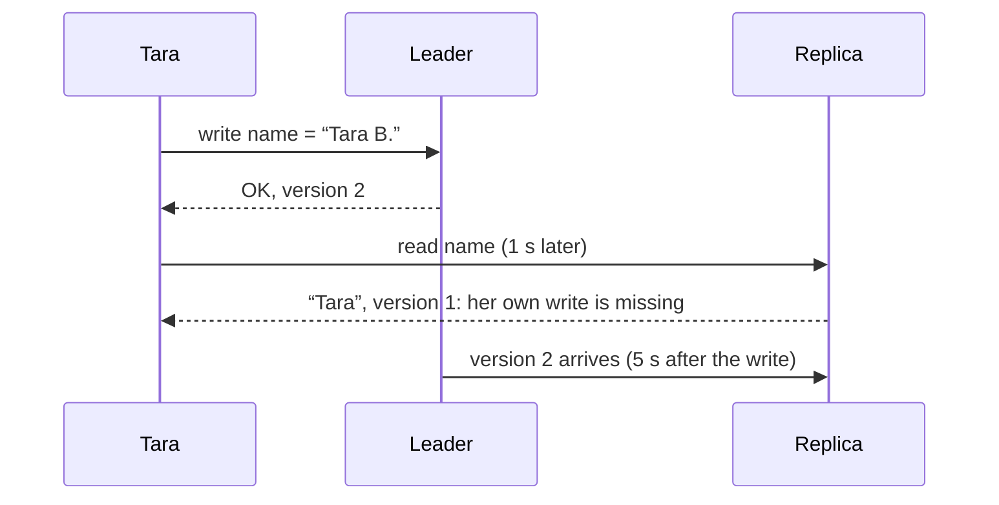
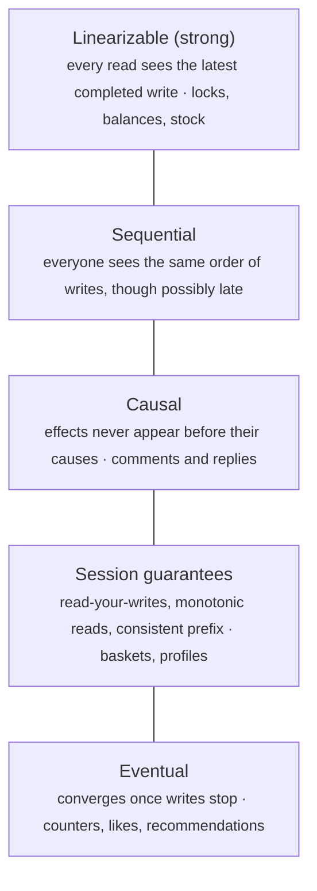

# Consistency models: what a reader is promised

> System Design · L2 Proficient · Consistency, replication and partitioning · about 100 min · hub module `m01` ([open the hub](https://claude.ai/artifact/WYKUGQ93VYjG6xBpea5exS))

## Why it matters
As soon as data lives on more than one machine, two readers can get different answers to the same question. A consistency model is the promise a system makes about what a read may return: the latest write, something eventually, or at least your own writes. Choosing the weakest promise a feature can live with buys speed and availability; choosing too weak a promise costs money or trust.

## Pre-question (answer before reading)
**Q:** A user changes their display name, refreshes and sees the old one; a second later the new name appears. Another user in another country sees the old name for five seconds. Is the system broken?

<details><summary>Answer</summary>

Not necessarily: it's eventually consistent, and the replicas caught up. But showing users their own old data breaks read-your-writes, which people notice and which is cheap to fix (send their reads to an up-to-date copy for a while). Another user seeing a few seconds of the old name is usually fine for a display name, and not fine for a bank balance.

</details>

## 🍎 Story time (kid version)
**Pizza Town and the family road trip: New price cards by bicycle**

When Luigi changes a price on the big board in his shop, a boy on a bicycle carries the new price card to every kiosk in town. For a few minutes some kiosks still show the old price; by teatime they all agree. Tara orders at the shop, then checks her order at a kiosk, and it isn't there yet. One day the bridge closes, and the kiosks across the river get no cards at all. Luigi must choose: tell those kiosks to stop selling until the bridge opens, or let them keep selling at the old prices. Even on normal days, waiting for every kiosk to confirm a change would make each change slow.

| In the story | In a real system |
|---|---|
| Kiosks showing the old price for a while, then all agreeing | Eventual consistency: replicas converge once updates stop |
| Tara's order missing at the kiosk just after she placed it | A read-your-writes violation |
| The bridge closing | A network partition between replicas |
| Stop selling, or keep selling at the old prices | CAP: during a partition, choose consistency or availability |
| Waiting for every kiosk to confirm makes each change slow | PACELC: even without a partition, stronger consistency costs latency |

**Where the story breaks:** A kiosk knows when its card is late; a real replica usually can't tell that it's stale. And real systems don't use one promise for everything: a bank balance and a like counter can have different models in the same app.

## Key ideas (grown-up version)
- **Why consistency models exist**: with several copies of the data (replicas, caches, regions), a read can land on a copy that hasn't seen the latest write yet. A consistency model is the contract that says which values a read is allowed to return.
- **Strong consistency (linearizability)**: every operation appears to take effect at one instant between its start and its end, so once a write has completed, every later read, by anyone, returns it or something newer. It's what one machine gives you, and what locks, leader election and account balances need.
- **Eventual consistency**: if writes stop, all replicas eventually return the same value. Until then a read may return an old value. It's cheap and stays available, and it's fine for likes, view counts and profile pictures.
- **Session guarantees**: in between. Read-your-writes: you always see your own earlier writes. Monotonic reads: you never see an older value after a newer one. Consistent prefix: you see writes in the order they happened, so an answer never appears before its question.
- **CAP**: during a network partition between replicas, a system must choose consistency (refuse or delay some requests so nobody reads diverging data) or availability (answer every request, possibly with stale or conflicting data). It's a choice made when a partition happens, not a permanent label.
- **PACELC**: if there's a Partition, choose Availability or Consistency; Else, choose Latency or Consistency. With a healthy network, waiting for replicas to confirm writes, or reading from the leader or a majority, still adds latency, so the trade-off is there every day.
- **Making the promises**: strong consistency usually means one leader per item with synchronous replication or majority quorums (module 2). Read-your-writes can come from reading the leader for a while after a write, or from remembering the version you wrote and only accepting replicas that have it.
- **Choose per feature**: one app can mix models. A transfer needs strong consistency, a basket read-your-writes, a like counter only eventual consistency. Ask what goes wrong if someone sees old data, and for how long that's acceptable.

## Diagrams
**Eventual consistency, and a read-your-writes violation**



_Remembering “I wrote version 2” lets the client refuse version 1 and ask the leader instead: read-your-writes for Tara, while everyone else keeps using the nearby replica._

**From the strongest promise to the weakest**



_Each step down is cheaper and stays available in more failures, and lets readers see more surprising results._

**PACELC: two choices, not one**

| | partitioned: stay available (PA) | partitioned: stay consistent (PC) |
|---|---|---|
| **normally: consistent, slower (EC)** | PA/EC: available during partitions, consistent when the network is healthy | PC/EC: always consistent: one leader or majority quorums; account balances |
| **normally: fast, maybe stale (EL)** | PA/EL: always fast and available, eventually consistent; likes, presence, carts | PC/EL: fast reads normally, but refuses rather than diverges in a partition |

## Comparisons
**Consistency models compared**

| Model | Promise | Cost | Good for |
|---|---|---|---|
| Linearizable | Every read sees the latest completed write | A leader or quorum round trip on every read and write; unavailable on the minority side of a partition | Balances, stock at checkout, locks, unique usernames |
| Read-your-writes | You always see your own writes | Track what each client wrote; some reads go to the leader | Profiles, baskets, settings, posts you just made |
| Monotonic reads | Time never goes backwards for a reader | Stick to one replica, or track the last version seen | Feeds, comment threads, dashboards |
| Eventual | Replicas converge once writes stop | Almost none; readers may see old values | Likes, view counts, recommendations, caches |

**During a partition**

|  | Consistency first (CP) | Availability first (AP) |
|---|---|---|
| Minority side | Refuses or delays reads and writes | Keeps answering |
| The data | Never diverges | Diverges; reconciled after healing |
| The risk | Errors and timeouts for some users | Stale reads; lost or merged writes |
| Typical use | Locks, leader election, balances | Carts, likes, presence, DNS |

## Code (JavaScript + Python)
### A leader and replicas that apply each write after a fixed lag
```python
class Replicated:
    """A leader takes writes; replica i applies each write lags[i] seconds after it happened (replica 0 is the leader)."""
    def __init__(self, lags):
        self.lags, self.log = lags, []          # log: (time, version, value) in write order

    def write(self, now, value):
        version = len(self.log) + 1
        self.log.append((now, version, value))
        return version

    def read(self, now, replica):
        """(version, value) of the newest write this replica has applied by `now`; (0, None) if none yet."""
        best = (0, None)
        for t, version, value in self.log:
            if t + self.lags[replica] <= now:
                best = (version, value)
        return best
```

```javascript
class Replicated {
  // a leader takes writes; replica i applies each write lags[i] seconds after it happened (replica 0 is the leader)
  constructor(lags) { this.lags = lags; this.log = []; }   // log: [time, version, value] in write order
  write(now, value) {
    const version = this.log.length + 1;
    this.log.push([now, version, value]);
    return version;
  }
  read(now, replica) {
    // [version, value] of the newest write this replica has applied by `now`; [0, null] if none yet
    let best = [0, null];
    for (const [t, version, value] of this.log) if (t + this.lags[replica] <= now) best = [version, value];
    return best;
  }
}
```

### Eventual consistency: replicas disagree for a while, then converge
```python
store = Replicated([0, 2, 5])                 # the leader and two replicas, 2 s and 5 s behind
store.write(0, "Tara")
store.write(10, "Tara B.")                    # she changes her name at t = 10
for now in (10, 11, 12, 15):
    print(f"t={now}:", " | ".join(store.read(now, r)[1] for r in range(3)))
```

Output:
```text
t=10: Tara B. | Tara | Tara
t=11: Tara B. | Tara | Tara
t=12: Tara B. | Tara B. | Tara
t=15: Tara B. | Tara B. | Tara B.
```

- line 1: Replica 0 is the leader; the others apply each write 2 and 5 seconds after it happens.
- line 5: For five seconds after the change, readers get different names depending on which copy answers.

```javascript
const store = new Replicated([0, 2, 5]);      // the leader and two replicas, 2 s and 5 s behind
store.write(0, "Tara");
store.write(10, "Tara B.");                   // she changes her name at t = 10
for (const now of [10, 11, 12, 15]) {
  console.log(`t=${now}:`, [0, 1, 2].map(r => store.read(now, r)[1]).join(" | "));
}
```

Output:
```text
t=10: Tara B. | Tara | Tara
t=11: Tara B. | Tara | Tara
t=12: Tara B. | Tara B. | Tara
t=15: Tara B. | Tara B. | Tara B.
```

- line 1: Replica 0 is the leader; the others apply each write 2 and 5 seconds after it happens.
- line 5: For five seconds after the change, readers get different names depending on which copy answers.

### Session guarantees: a client that tracks versions
```python
store = Replicated([0, 2, 5])
store.write(0, "Tara")
mine = store.write(10, "Tara B.")             # the client's own write: version 2

def read_at_least(now, replica, min_version):
    version, value = store.read(now, replica)
    if version < min_version:                 # this copy is too old for this client
        version, value = store.read(now, 0)   # so ask the leader
    return version, value

visits = [(10, 2), (12, 1), (13, 2)]          # (time, replica) of three reads
plain = [store.read(now, r)[0] for now, r in visits]
seen, tracked = mine, []
for now, r in visits:
    version, _ = read_at_least(now, r, seen)
    seen = max(seen, version)                 # never accept anything older than this again
    tracked.append(version)
print("plain:   ", *(f"v{v}" for v in plain))
print("tracking:", *(f"v{v}" for v in tracked))
```

Output:
```text
plain:    v1 v2 v1
tracking: v2 v2 v2
```

- line 3: The leader returns the new version number with every write, and the client keeps it.
- line 7: A replica older than what this client has already written or seen is skipped.
- line 18: Plain reads break both promises: the client misses its own write (v1 at t = 10), then goes back in time (v2, then v1).
- line 19: Tracking the version gives read-your-writes and monotonic reads; only the stale reads cost a trip to the leader.

```javascript
const store = new Replicated([0, 2, 5]);
store.write(0, "Tara");
const mine = store.write(10, "Tara B.");      // the client's own write: version 2

function readAtLeast(now, replica, minVersion) {
  let [version, value] = store.read(now, replica);
  if (version < minVersion) [version, value] = store.read(now, 0);   // too old for this client: ask the leader
  return [version, value];
}

const visits = [[10, 2], [12, 1], [13, 2]];   // [time, replica] of three reads
const plain = visits.map(([now, r]) => store.read(now, r)[0]);
let seen = mine;
const tracked = [];
for (const [now, r] of visits) {
  const [version] = readAtLeast(now, r, seen);
  seen = Math.max(seen, version);             // never accept anything older than this again
  tracked.push(version);
}
console.log("plain:   ", ...plain.map(v => `v${v}`));
console.log("tracking:", ...tracked.map(v => `v${v}`));
```

Output:
```text
plain:    v1 v2 v1
tracking: v2 v2 v2
```

- line 3: The leader returns the new version number with every write, and the client keeps it.
- line 7: A replica older than what this client has already written or seen is skipped.
- line 20: Plain reads break both promises: the client misses its own write (v1 at t = 10), then goes back in time (v2, then v1).
- line 21: Tracking the version gives read-your-writes and monotonic reads; only the stale reads cost a trip to the leader.

### CAP during a partition: consistency first or availability first
```python
def run(mode):
    sides = [{"A", "B"}, {"C"}]               # a partition: C can't reach A or B
    value = {r: (0, "8") for r in "ABC"}      # replica -> (time written, price)
    events = [(6, "X", "A", "write", "10"), (7, "Y", "C", "write", "12"), (8, "Z", "C", "read", None)]
    log = []
    for t, client, replica, op, price in events:
        side = next(s for s in sides if replica in s)
        if mode == "CP" and len(side) < 2:    # no majority of the 3 replicas on this side
            log.append(f"{client} refused")
        elif op == "write":
            for r in side:
                value[r] = (t, price)
            log.append(f"{client} ok")
        else:
            log.append(f"{client} reads {value[replica][1]}")
    return log, max(value.values())[1]        # healing: the newest write wins everywhere

for mode in ("CP", "AP"):
    log, final = run(mode)
    print(f"{mode}: {', '.join(log)}; after healing everyone reads {final}")
```

Output:
```text
CP: X ok, Y refused, Z refused; after healing everyone reads 10
AP: X ok, Y ok, Z reads 12; after healing everyone reads 12
```

- line 9: Consistency first: the side without a majority refuses both the write and the read, so no one sees diverging prices.
- line 16: When the partition heals, last-writer-wins keeps the newest write. In AP mode that silently discards X's price of 10.
- line 20: CP turned users away; AP answered everyone but lost a write. Neither is free: pick per feature.

```javascript
function run(mode) {
  const sides = [new Set(["A", "B"]), new Set(["C"])];   // a partition: C can't reach A or B
  const value = { A: [0, "8"], B: [0, "8"], C: [0, "8"] };   // replica -> [time written, price]
  const events = [[6, "X", "A", "write", "10"], [7, "Y", "C", "write", "12"], [8, "Z", "C", "read", null]];
  const log = [];
  for (const [t, client, replica, op, price] of events) {
    const side = sides.find(s => s.has(replica));
    if (mode === "CP" && side.size < 2) log.push(`${client} refused`);   // no majority of the 3 replicas on this side
    else if (op === "write") {
      for (const r of side) value[r] = [t, price];
      log.push(`${client} ok`);
    } else log.push(`${client} reads ${value[replica][1]}`);
  }
  const newest = Object.values(value).reduce((a, b) => (b[0] > a[0] ? b : a));   // healing: the newest write wins everywhere
  return [log, newest[1]];
}

for (const mode of ["CP", "AP"]) {
  const [log, final] = run(mode);
  console.log(`${mode}: ${log.join(", ")}; after healing everyone reads ${final}`);
}
```

Output:
```text
CP: X ok, Y refused, Z refused; after healing everyone reads 10
AP: X ok, Y ok, Z reads 12; after healing everyone reads 12
```

- line 8: Consistency first: the side without a majority refuses both the write and the read, so no one sees diverging prices.
- line 14: When the partition heals, last-writer-wins keeps the newest write. In AP mode that silently discards X's price of 10.
- line 20: CP turned users away; AP answered everyone but lost a write. Neither is free: pick per feature.

## Worked example
**Problem.** Users in Sydney read their profile; the leader is in Frankfurt (280 ms away) and a replica is 5 ms away. 5% of reads come within 10 seconds of that user's own write. Compare the average read latency of three policies: always read the leader (strong), always read the replica (eventual), and read-your-writes (the leader for 10 s after your own write, the replica otherwise).

1. Strong: every read goes to the leader so that it sees the latest write: 280 ms each, for everyone in Sydney.
2. Eventual: every read uses the nearby replica: 5 ms, but users may not see their own change for as long as the replica lags.
3. Read-your-writes: only the 5% of reads just after the user's own write go to the leader: 0.05 × 280 + 0.95 × 5 = 18.75 ms on average.
4. The guarantee users actually notice costs about 14 ms on average instead of 275. Other users may see the old value for a moment, which is fine for a profile but not for a balance. The arithmetic is O(1); the real work is deciding which feature needs which promise.

```python
def avg_latency_ms(policy, recent_pct, leader_ms=280, replica_ms=5):
    if policy == "strong":
        return leader_ms
    if policy == "eventual":
        return replica_ms
    return (recent_pct * leader_ms + (100 - recent_pct) * replica_ms) / 100   # read-your-writes

for policy in ("strong", "eventual", "read-your-writes"):
    print(f"{policy}: {avg_latency_ms(policy, 5):.2f} ms")
```

Output:
```text
strong: 280.00 ms
eventual: 5.00 ms
read-your-writes: 18.75 ms
```

```javascript
function avgLatencyMs(policy, recentPct, leaderMs = 280, replicaMs = 5) {
  if (policy === "strong") return leaderMs;
  if (policy === "eventual") return replicaMs;
  return (recentPct * leaderMs + (100 - recentPct) * replicaMs) / 100;   // read-your-writes
}

for (const policy of ["strong", "eventual", "read-your-writes"]) console.log(`${policy}: ${avgLatencyMs(policy, 5).toFixed(2)} ms`);
```

Output:
```text
strong: 280.00 ms
eventual: 5.00 ms
read-your-writes: 18.75 ms
```

**Answer.** Strong consistency costs 280 ms on every read, eventual consistency 5 ms, and read-your-writes 18.75 ms on average: almost the speed of the replica, while still showing users their own changes at once.

## Your turn (faded example)
**Problem.** A cheap check behind strong consistency: a read must never return a value that a later write had already replaced before the read began. Writes have unique values and run from `start` to `end`; reads report what they saw. Finish `stale_reads(writes, reads)` so it returns (read start, value seen) for every read that saw an already-replaced value (or the initial value after a write had completed).

- ✓ Linearizability forbids one thing above all: reading a value after a newer write has already finished.
- **When is a read of value V definitely stale?**
  <details><summary>Answer</summary>When some write W started after V's write had finished and itself finished before the read began: W is certainly newer than V and complete, so a strongly consistent read must return W or something newer.</details>
- **Why is a write that overlaps the read allowed either way?**
  <details><summary>Answer</summary>A write still in progress may take effect before or after the read, so seeing either the old or the new value is legal.</details>
- **What does the check cost, and what does it miss?**
  <details><summary>Answer</summary>O(reads × writes) time. It catches stale reads but isn't a full linearizability check: tools such as Jepsen's checkers search for one order of all operations that explains every result.</details>

Starter:
```python
def stale_reads(writes, reads):
    """writes: (start, end, value); reads: (start, end, value seen). Returns [(read start, value seen)] for stale reads."""
    ...                                       # TODO: stale if a write began after the seen value's write ended and ended before the read began
```

```javascript
function staleReads(writes, reads) {
  // writes: [start, end, value]; reads: [start, end, value seen]. Returns [[read start, value seen]] for stale reads
  // TODO: stale if a write began after the seen value's write ended and ended before the read began
}
```

<details><summary>Full solution</summary>

```python
def stale_reads(writes, reads):
    """writes: (start, end, value); reads: (start, end, value seen). Returns [(read start, value seen)] for stale reads."""
    ended = {value: end for _, end, value in writes}
    stale = []
    for r_start, _, seen in reads:
        seen_end = ended.get(seen, float("-inf"))   # the initial value counts as written before everything
        if any(w_start > seen_end and w_end < r_start for w_start, w_end, _ in writes):
            stale.append((r_start, seen))
    return stale

writes = [(0, 2, "v1"), (5, 6, "v2"), (9, 12, "v3")]
reads = [(3, 4, "v1"), (7, 8, "v1"), (10, 11, "v2"), (13, 14, "v2")]
print("stale reads:", *(f"{value} at t={start}" for start, value in stale_reads(writes, reads)))
```

Output:
```text
stale reads: v1 at t=7 v2 at t=13
```

```javascript
function staleReads(writes, reads) {
  // writes: [start, end, value]; reads: [start, end, value seen]. Returns [[read start, value seen]] for stale reads
  const ended = new Map(writes.map(([, end, value]) => [value, end]));
  const stale = [];
  for (const [rStart, , seen] of reads) {
    const seenEnd = ended.has(seen) ? ended.get(seen) : -Infinity;   // the initial value counts as written before everything
    if (writes.some(([wStart, wEnd]) => wStart > seenEnd && wEnd < rStart)) stale.push([rStart, seen]);
  }
  return stale;
}

const writes = [[0, 2, "v1"], [5, 6, "v2"], [9, 12, "v3"]];
const reads = [[3, 4, "v1"], [7, 8, "v1"], [10, 11, "v2"], [13, 14, "v2"]];
console.log("stale reads:", ...staleReads(writes, reads).map(([start, value]) => `${value} at t=${start}`));
```

Output:
```text
stale reads: v1 at t=7 v2 at t=13
```

</details>

## Socratic checks and quiz (answers hidden)
**1. What does this print? (`Replicated` is this module's helper: replica 0 is the leader.)**

```python
s = Replicated([0, 3])
s.write(0, "a")
s.write(10, "b")
print(*(s.read(t, r)[1] for t, r in ((9, 1), (10, 0), (12, 1), (13, 1))))
```

```javascript
const s = new Replicated([0, 3]);
s.write(0, "a");
s.write(10, "b");
console.log(...[[9, 1], [10, 0], [12, 1], [13, 1]].map(([t, r]) => s.read(t, r)[1]));
```

- A. a b a b
- B. a b b b
- C. b b a b
- D. a a a b

<details><summary>Answer</summary>

a b a b. The leader sees “b” at once (t = 10). The replica applies each write 3 s late, so it still shows “a” at 9 and 12 and switches to “b” at 13.

</details>

**2. What does this print?**

```python
leader_ms, replica_ms = 200, 10
print(*((pct * leader_ms + (100 - pct) * replica_ms) // 100 for pct in (0, 10, 100)))
```

```javascript
const leaderMs = 200, replicaMs = 10;
console.log(...[0, 10, 100].map(pct => Math.floor((pct * leaderMs + (100 - pct) * replicaMs) / 100)));
```

- A. 10 29 200
- B. 10 20 200
- C. 10 19 200
- D. 0 29 200

<details><summary>Answer</summary>

10 29 200. With no reads at the leader the average is the replica's 10 ms; with all of them it's 200 ms; with 10%: (10 × 200 + 90 × 10) ÷ 100 = 29 ms.

</details>

**3. During a network partition, a replica on the minority side receives a write. What does a consistency-first (CP) system do?**

- A. Refuses or delays the write until it can reach a majority
- B. Accepts it and lets the newest write win when the partition heals
- C. Accepts it and quietly forwards it later
- D. Accepts it on every replica at once

<details><summary>Answer</summary>

Refuses or delays the write until it can reach a majority. Without a majority it can't be sure no conflicting write was accepted elsewhere, so it refuses. Accepting and reconciling later is the availability-first choice; reaching every replica is impossible during a partition.

</details>

**4. Which features can live with eventual consistency? (choose 2)**

- A. A video's view count
- B. Product reviews
- C. Decrementing stock at checkout
- D. A bank transfer
- E. A lock that only one worker may hold

<details><summary>Answer</summary>

A video's view count, Product reviews. A count that's briefly off or reviews that appear a few seconds late harm nobody. Stock, money and locks need every reader to agree on the latest value.

</details>

**5. Judge each statement.**

- Eventual consistency promises that replicas converge once writes stop.
- CAP says a system can never be both consistent and available.
- Read-your-writes can be provided without making every read strongly consistent.
- Last-writer-wins can silently discard a concurrent write.

<details><summary>Answer</summary>

Eventual consistency promises that replicas converge once writes stop.: Yes; CAP says a system can never be both consistent and available.: No; Read-your-writes can be provided without making every read strongly consistent.: Yes; Last-writer-wins can silently discard a concurrent write.: Yes. Convergence is exactly eventual consistency's promise. CAP's choice only applies during a partition. Read-your-writes only needs the writer's reads to be fresh. And last-writer-wins keeps one of two concurrent writes and drops the other.

</details>

**6. Put the steps of a read-your-writes read in order.**

- (put the steps in order)

<details><summary>Answer</summary>

The client writes and keeps the version number it gets back → The client reads from a nearby replica → It compares the replica's version with the one it kept → If the replica is older, it reads from the leader instead. The client needs the version from its write before it can compare, it can only compare after the replica answers, and it only falls back to the leader when the comparison fails.

</details>

**7. Complete the JavaScript read that never returns anything older than the client has seen (`Replicated` is this module's helper).**

```
function readAtLeast(store, now, replica, minVersion) {
  const [version, value] = store.read(now, replica);
  if ({{0}}) return store.read(now, {{1}});
  return [version, value];
}

```

<details><summary>Answer</summary>

version < minVersion | 0. If the replica is older than the version the client must see, the leader (replica 0) has every write, so read from it; otherwise the nearby replica is good enough.

</details>

**8. Match each promise to its name.**


<details><summary>Answer</summary>

Every read sees the latest completed write = Linearizability; Replicas agree once writes stop = Eventual consistency; You always see your own updates = Read-your-writes; You never see an older value after a newer one = Monotonic reads. Consistent hashing decides where data lives (module 3); it isn't a promise about what a read returns.

</details>

## Traps & misconceptions
- **“Eventual consistency means the data might never agree.”** It promises convergence once writes stop; what it doesn't promise is when, or what you see in the meantime. In a healthy system the lag is usually milliseconds to seconds.
- **“CAP means you pick two of consistency, availability and partition tolerance.”** Partitions happen whether you like it or not, so the real choice is what to do during one: refuse some requests or answer with possibly stale data. Outside partitions, PACELC's latency-or-consistency trade-off applies.
- **“Strong consistency is always the safe choice.”** It costs latency on every operation and availability during partitions. Use it where stale data causes real harm (money, stock, locks) and weaker promises elsewhere.
- **“Read-your-writes needs strong consistency everywhere.”** It's a promise to each client: send a user's reads to the leader for a while after they write, or only accept replicas that have their version. Everyone else keeps reading nearby copies.
- **“A replica that answers quickly is up to date.”** Replicas rarely know they're stale, and speed says nothing about freshness. Only versions or timestamps compared with what the client has seen can tell you.
- **“Last-writer-wins resolves conflicts safely.”** It keeps one write and silently discards the others, and it trusts clocks that can disagree. Fine for a profile picture, dangerous for a basket or a balance; module 2 covers better merges.

## Discussion prompts
- **Which consistency would you choose for a shopping app's features?**
  <details><summary>One good answer</summary>Stock at checkout and payments: strong, with the decrement and the order in one transaction on the leader, because overselling costs money and trust. The basket: read-your-writes, so people always see what they added, with conflicting edits merged rather than overwritten. Product pages and reviews: eventual, cached and replicated freely, because a few seconds of staleness hurts nobody. Like and view counts: eventual, even approximate.</details>
- **Explain CAP with an example of each choice.**
  <details><summary>One good answer</summary>Take three replicas with one cut off by a network partition. A consistency-first system, for example one that needs a majority quorum, keeps serving on the side with two replicas and refuses writes, and possibly reads, on the isolated one, so nobody sees diverging values. An availability-first system lets every replica keep accepting reads and writes, so both sides stay up, but they diverge and must be reconciled later, possibly losing a write. Neither is free: the right choice depends on what stale or lost data would cost.</details>

## Teach-back
**Prompt:** Explain to a junior colleague the difference between strong, eventual and read-your-writes consistency, and where CAP and PACELC come in.

Rubric:
- [ ] Strong: every read sees the latest completed write
- [ ] Eventual: replicas converge; reads may be stale meanwhile
- [ ] Read-your-writes and monotonic reads as promises to one client
- [ ] CAP: during a partition, choose consistency or availability
- [ ] PACELC: otherwise, choose latency or consistency; pick per feature

<details><summary>Model answer</summary>

With several copies of the data, a read can hit a copy that hasn't seen the latest write, so we pick a promise. Strong consistency, or linearizability, says that once a write has finished, every later read by anyone sees it; that usually means going to a leader or a majority, which is slower. Eventual consistency only says the copies agree once writes stop, so reads can be stale for a while; it's cheap and fine for things like likes. In between are promises to one client: read-your-writes means you always see your own changes, and monotonic reads means you never go back in time; we can give those by tracking versions and asking the leader only when a replica is too old. CAP is about partitions: when replicas can't talk, we either refuse some requests or answer with possibly stale data. PACELC adds that even on a good day, stronger consistency costs latency. So I choose per feature: strong for money and stock, read-your-writes for baskets and profiles, eventual for counters.

</details>

## Quick Q&A (also in the SRS deck)
- **What does linearizability promise?** Once a write completes, every later read by anyone returns it or something newer.
- **What does eventual consistency promise?** If writes stop, all replicas eventually return the same value.
- **Read-your-writes?** A client always sees its own earlier writes.
- **Monotonic reads?** A client never sees an older value after it has seen a newer one.
- **CAP in one line?** During a network partition, a system chooses consistency or availability.
- **PACELC in one line?** If Partitioned, choose Availability or Consistency; Else, choose Latency or Consistency.

## Practice problems
- [ ] [Reading · A map of consistency models](https://jepsen.io/consistency) · find linearizable, sequential, causal, read-your-writes and monotonic reads, and note which stay available during a partition
- [ ] [Reading · CAP twelve years later](https://www.infoq.com/articles/cap-twelve-years-later-how-the-rules-have-changed/) · Brewer on what CAP does and doesn't say, and why partitions are rare but must be planned for
- [ ] [Exercise · Tunable consistency in a real database](https://learn.microsoft.com/en-us/azure/cosmos-db/consistency-levels) · compare the five consistency levels with this module's models, then pick one for a basket and one for a view counter
- [ ] [Exercise · Sessions that read their own writes](https://www.mongodb.com/docs/manual/core/causal-consistency-read-write-concerns/) · find how causally consistent sessions give read-your-writes and monotonic reads, and what they cost

## Sources (accessed 2026-10-09)
- [Jepsen: Consistency models](https://jepsen.io/consistency)
- [Eric Brewer: CAP twelve years later (InfoQ)](https://www.infoq.com/articles/cap-twelve-years-later-how-the-rules-have-changed/)
- [Wikipedia: PACELC design principle](https://en.wikipedia.org/wiki/PACELC_design_principle)
- [Azure Cosmos DB: Consistency levels](https://learn.microsoft.com/en-us/azure/cosmos-db/consistency-levels)
