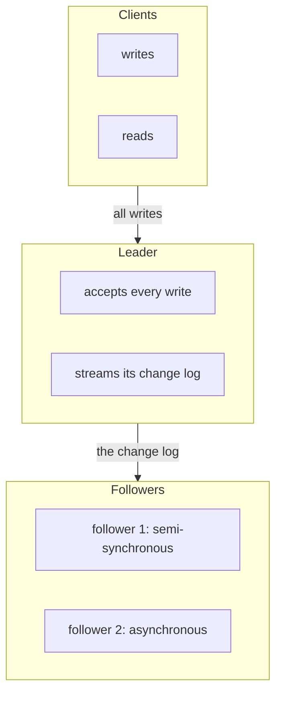
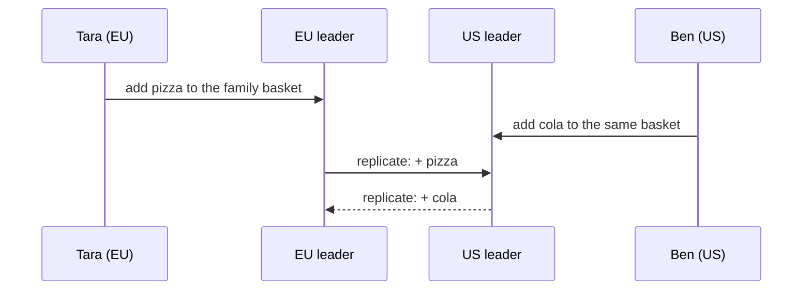

# Replication: leaders, followers and quorums

> System Design · L2 Proficient · Consistency, replication and partitioning · about 105 min · hub module `m02` ([open the hub](https://claude.ai/artifact/WYKUGQ93VYjG6xBpea5exS))

## Why it matters
Replication keeps copies of the same data on several machines, so the system survives a machine dying, reads can be spread out, and users far away get a nearby copy. The hard questions are who accepts writes, how the copies stay in step, and what happens when they disagree. Three answers (one leader, several leaders, or no leader at all) cover almost every database you'll meet.

## Pre-question (answer before reading)
**Q:** A database has one leader and two followers with asynchronous replication. The leader crashes a moment after confirming a write that hadn't reached either follower, and a follower is promoted. What happened to the write, and how could you have prevented it?

<details><summary>Answer</summary>

It's lost: the new leader never received it, even though the client was told it succeeded. Waiting for at least one follower before confirming (semi-synchronous replication) prevents that, at the cost of that wait on every write; writing to a quorum of replicas is the leaderless equivalent.

</details>

## 🍎 Story time (kid version)
**Pizza Town and the family road trip: Order books and noticeboards**

Luigi writes every order in his big order book, and his two helpers copy each new page into their own books a little later. When Luigi catches a cold, a helper takes over, but the last few orders were never copied. Luigi's second shop also takes orders, and the two shops swap pages every evening; once, both changed Ben's order on the same day, and nobody knew which to keep. In the market square there are five noticeboards. Tara pins her order on any three. Ben, checking, reads any three boards and trusts the newest note, because any three boards always share at least one with Tara's three.

| In the story | In a real system |
|---|---|
| Luigi's big book, copied a little later by his helpers | Leader-follower replication with asynchronous followers |
| The last orders never copied when Luigi falls ill | Failover can lose writes the followers hadn't received |
| Two shops both taking orders and swapping pages | Multi-leader replication, with conflicts to resolve |
| Pinning on any 3 of 5 boards, and reading any 3 | Leaderless replication with write and read quorums |
| Any three boards share one with Tara's three | W + R > N: every read overlaps the latest successful write |

**Where the story breaks:** A noticeboard never half-fails; real replicas do, and a read can catch a write that reached only some of them. So real systems add version numbers to know which note is newest, and repair stale copies as they find them.

## Key ideas (grown-up version)
- **Why replicate**: copies on several machines keep the data available when one dies, spread reads across more machines, and put data near users in other regions. The cost is keeping the copies in step.
- **Leader-follower (single leader)**: all writes go to one leader, which sends a log of its changes to the followers; reads can go to followers, a little behind. Simple and free of conflicts, but the leader is the write bottleneck and a single point of failure until failover.
- **Synchronous or asynchronous**: synchronous replication waits for followers before confirming a write (no loss on failover, but slower, and a dead follower stalls writes); asynchronous confirms at once (fast, but a crash can lose confirmed writes). Semi-synchronous waits for one follower: a common middle ground.
- **Failover**: when the leader dies, a follower is promoted. The dangers: losing writes it hadn't received, two nodes both believing they're the leader (split brain), and clients still writing to the old one. Fencing (writes from an old leadership term are rejected) and consensus (L3) make it safe.
- **Multi-leader**: several leaders, often one per region, each accept writes and replicate to each other. Writes are fast and local and survive a region failing, but the same item can be changed in two places at once, so conflicts must be resolved: last-writer-wins, a merge, or asking the user.
- **Leaderless (Dynamo-style)**: the client writes to W of the N replicas and reads from R of them, keeping the newest version. If W + R > N, every read set shares at least one replica with every write set, so a read sees the latest successful write. Stale copies are fixed by read repair and background anti-entropy.
- **Choosing quorums**: W = N with R = 1 makes reads cheap, but any dead replica blocks writes; W = 1 makes writes cheap but risks loss; a majority for both (N = 3, W = 2, R = 2) is the usual balance. Even with W + R > N, concurrent writes, half-finished writes and sloppy quorums mean quorums alone aren't linearizable.
- **Replication lag**: asynchronous followers usually trail the leader by milliseconds, and by seconds or minutes under load or after a failure. Measure it (as time or log position), alert on it, and hide it from users with module 1's session guarantees.

## Diagrams
**Leader-follower replication**



_The leader confirms a write once follower 1 has it, so a failover to follower 1 loses nothing. Follower 2 may lag; reads from it can be a little stale._

**A quorum with N = 5, W = 3, R = 3**

| write reached | 0 | 1 | 2 | 3 | 4 |
|---|---|---|---|---|---|
| value | **v7** | **v7** | **v7** | v6 | v6 |

| read asked | 0 | 1 | 2 | 3 | 4 |
|---|---|---|---|---|---|
| value |  |  | **v7** | **v6** | **v6** |

| overlap | 0 | 1 | 2 | 3 | 4 |
|---|---|---|---|---|---|
| value |  |  | ✓ |  |  |

_3 + 3 > 5, so any 3 replicas a read asks include at least one of the 3 that took the write. The read keeps the highest version (v7) and can repair replicas 3 and 4 on the way._

**Multi-leader: a conflict**



_Both leaders accepted a change to the same basket without seeing the other's. Last-writer-wins keeps one change and drops the other; a merge keeps both items._

## Comparisons
**Three ways to replicate**

|  | Leader-follower | Multi-leader | Leaderless |
|---|---|---|---|
| Who accepts writes | One leader | One leader per region or site | Any W of the N replicas |
| Conflicts | None: one order of writes | Yes: concurrent writes in different places | Yes: concurrent writes to different replicas |
| Write latency | A trip to the leader (plus followers if synchronous) | Local | The slowest of the W fastest replicas |
| One node fails | Failover, with possible loss if asynchronous | Other leaders carry on | Carry on while W and R replicas are reachable |
| Typical use | Most relational databases | Multi-region writes, offline-first apps | Dynamo-style stores such as Cassandra |

**Choosing W and R for N = 3**

| W, R | A read sees the latest write? | Replicas that can be down | Good for |
|---|---|---|---|
| W = 2, R = 2 | Yes (4 > 3) | 1 for writes, 1 for reads | The usual balance |
| W = 3, R = 1 | Yes (4 > 3) | 0 for writes, 2 for reads | Rare writes, many fast reads |
| W = 1, R = 3 | Yes (4 > 3) | 2 for writes, 0 for reads | Many fast writes, rare reads |
| W = 1, R = 1 | No (2 ≤ 3) | 2 for writes, 2 for reads | Data where speed matters more than freshness |

## Code (JavaScript + Python)
### A leaderless store: N replicas, writes reach some of them, reads ask some of them
```python
class QuorumStore:
    """N replicas each hold (version, value). A write reaches some replicas; a read asks some and keeps the newest."""
    def __init__(self, n):
        self.replicas = [(0, None)] * n
        self.version = 0

    def write(self, value, reached):            # reached: the replicas that acknowledged the write
        self.version += 1
        for r in reached:
            self.replicas[r] = (self.version, value)
        return self.version

    def read(self, asked, repair=False):        # asked: the replicas that answered the read
        newest = max((self.replicas[r] for r in asked), key=lambda vv: vv[0])   # the highest version wins
        if repair:
            for r in asked:
                self.replicas[r] = newest       # read repair: fix the stale copies we just saw
        return newest
```

```javascript
class QuorumStore {
  // N replicas each hold [version, value]. A write reaches some replicas; a read asks some and keeps the newest
  constructor(n) { this.replicas = Array.from({ length: n }, () => [0, null]); this.version = 0; }
  write(value, reached) {                       // reached: the replicas that acknowledged the write
    this.version++;
    for (const r of reached) this.replicas[r] = [this.version, value];
    return this.version;
  }
  read(asked, repair = false) {                 // asked: the replicas that answered the read
    const newest = asked.map(r => this.replicas[r]).reduce((a, b) => (b[0] > a[0] ? b : a));   // the highest version wins
    if (repair) for (const r of asked) this.replicas[r] = newest;   // read repair: fix the stale copies we just saw
    return newest;
  }
}
```

### Asynchronous replication can lose a confirmed write on failover
```python
def failover(write_times, lags, crash_at, semi_sync):
    """Writes confirmed before the crash, how many the promoted follower lacks, and the extra wait per write."""
    wait = min(lags) if semi_sync else 0      # semi-sync: confirm once the fastest follower has the write
    confirmed = [t for t in write_times if t + wait < crash_at]
    promoted_lag = min(lags)                  # promote the most up-to-date follower
    lost = sum(1 for t in confirmed if t + promoted_lag >= crash_at)
    return len(confirmed), lost, wait

writes = list(range(0, 1000, 10))             # a write every 10 ms, then the leader dies at 1,000 ms
for mode, semi in (("async", False), ("semi-sync", True)):
    confirmed, lost, wait = failover(writes, [30, 120], 1000, semi)
    print(f"{mode}: {confirmed} confirmed, {lost} lost on failover, +{wait} ms per write")
```

Output:
```text
async: 100 confirmed, 3 lost on failover, +0 ms per write
semi-sync: 97 confirmed, 0 lost on failover, +30 ms per write
```

- line 3: Semi-synchronous replication waits for the fastest follower before telling the client “done”.
- line 6: A confirmed write is lost if the promoted follower hadn't received it when the leader died.
- line 12: Asynchronous: the last 30 ms of confirmed writes vanish. Semi-sync: nothing confirmed is lost; the 3 unconfirmed writes failed visibly, so clients can retry.

```javascript
function failover(writeTimes, lags, crashAt, semiSync) {
  // writes confirmed before the crash, how many the promoted follower lacks, and the extra wait per write
  const wait = semiSync ? Math.min(...lags) : 0;   // semi-sync: confirm once the fastest follower has the write
  const confirmed = writeTimes.filter(t => t + wait < crashAt);
  const promotedLag = Math.min(...lags);           // promote the most up-to-date follower
  const lost = confirmed.filter(t => t + promotedLag >= crashAt).length;
  return [confirmed.length, lost, wait];
}

const writes = Array.from({ length: 100 }, (_, i) => i * 10);   // a write every 10 ms, then the leader dies at 1,000 ms
for (const [mode, semi] of [["async", false], ["semi-sync", true]]) {
  const [confirmed, lost, wait] = failover(writes, [30, 120], 1000, semi);
  console.log(`${mode}: ${confirmed} confirmed, ${lost} lost on failover, +${wait} ms per write`);
}
```

Output:
```text
async: 100 confirmed, 3 lost on failover, +0 ms per write
semi-sync: 97 confirmed, 0 lost on failover, +30 ms per write
```

- line 3: Semi-synchronous replication waits for the fastest follower before telling the client “done”.
- line 6: A confirmed write is lost if the promoted follower hadn't received it when the leader died.
- line 13: Asynchronous: the last 30 ms of confirmed writes vanish. Semi-sync: nothing confirmed is lost; the 3 unconfirmed writes failed visibly, so clients can retry.

### Quorums: when does every read overlap every write?
```python
def sets_of(n, k):                            # every set of k replicas out of n, as a bit mask
    return [m for m in range(1 << n) if bin(m).count("1") == k]

for n, w, r in ((3, 2, 2), (3, 1, 1), (3, 3, 1), (5, 3, 3), (5, 2, 3)):
    always = all(wm & rm for wm in sets_of(n, w) for rm in sets_of(n, r))
    verdict = "always overlaps" if always else "can miss the latest write"
    print(f"N={n} W={w} R={r}: {verdict}; writes survive {n - w} down, reads {n - r}")
```

Output:
```text
N=3 W=2 R=2: always overlaps; writes survive 1 down, reads 1
N=3 W=1 R=1: can miss the latest write; writes survive 2 down, reads 2
N=3 W=3 R=1: always overlaps; writes survive 0 down, reads 2
N=5 W=3 R=3: always overlaps; writes survive 2 down, reads 2
N=5 W=2 R=3: can miss the latest write; writes survive 3 down, reads 2
```

- line 5: Check every possible write set against every possible read set: they overlap exactly when W + R > N.
- line 7: The other side of the trade-off: how many replicas can be down while writes, and reads, still succeed.

```javascript
function setsOf(n, k) {                       // every set of k replicas out of n, as a bit mask
  const out = [];
  for (let m = 0; m < 1 << n; m++) {
    let bits = 0;
    for (let x = m; x; x &= x - 1) bits++;
    if (bits === k) out.push(m);
  }
  return out;
}

for (const [n, w, r] of [[3, 2, 2], [3, 1, 1], [3, 3, 1], [5, 3, 3], [5, 2, 3]]) {
  const always = setsOf(n, w).every(wm => setsOf(n, r).every(rm => (wm & rm) !== 0));
  const verdict = always ? "always overlaps" : "can miss the latest write";
  console.log(`N=${n} W=${w} R=${r}: ${verdict}; writes survive ${n - w} down, reads ${n - r}`);
}
```

Output:
```text
N=3 W=2 R=2: always overlaps; writes survive 1 down, reads 1
N=3 W=1 R=1: can miss the latest write; writes survive 2 down, reads 2
N=3 W=3 R=1: always overlaps; writes survive 0 down, reads 2
N=5 W=3 R=3: always overlaps; writes survive 2 down, reads 2
N=5 W=2 R=3: can miss the latest write; writes survive 3 down, reads 2
```

- line 12: Check every possible write set against every possible read set: they overlap exactly when W + R > N.
- line 14: The other side of the trade-off: how many replicas can be down while writes, and reads, still succeed.

### Multi-leader conflicts: last-writer-wins against a merge
```python
base = {"bread"}
eu = (base | {"pizza"}, 100.0)                # (basket, timestamp from the EU leader's clock)
us = (base | {"cola"}, 103.0)                 # written 3 s later in real time...
us_slow_clock = (us[0], us[1] - 5.0)          # ...but the US server's clock runs 5 s slow

def last_writer_wins(a, b):
    return a if a[1] >= b[1] else b           # keep the write with the later timestamp

def merge(a, b):
    return (a[0] | b[0], max(a[1], b[1]))     # union of the additions: nothing is lost

print("last writer wins:", *sorted(last_writer_wins(eu, us)[0]))
print("with a slow clock:", *sorted(last_writer_wins(eu, us_slow_clock)[0]))
print("merge:", *sorted(merge(eu, us_slow_clock)[0]))
```

Output:
```text
last writer wins: bread cola
with a slow clock: bread pizza
merge: bread cola pizza
```

- line 7: Last-writer-wins keeps one whole version and silently drops the other's change.
- line 10: A merge keeps both additions. Removals need more care (remembering what was removed), which is what CRDTs formalise.
- line 13: With a 5-second slow clock the later US write loses: last-writer-wins trusts timestamps, not real time.

```javascript
const base = new Set(["bread"]);
const eu = [new Set([...base, "pizza"]), 100];   // [basket, timestamp from the EU leader's clock]
const us = [new Set([...base, "cola"]), 103];    // written 3 s later in real time...
const usSlowClock = [us[0], us[1] - 5];          // ...but the US server's clock runs 5 s slow

const lastWriterWins = (a, b) => (a[1] >= b[1] ? a : b);   // keep the write with the later timestamp
const merge = (a, b) => [new Set([...a[0], ...b[0]]), Math.max(a[1], b[1])];   // union of the additions: nothing is lost

console.log("last writer wins:", ...[...lastWriterWins(eu, us)[0]].sort());
console.log("with a slow clock:", ...[...lastWriterWins(eu, usSlowClock)[0]].sort());
console.log("merge:", ...[...merge(eu, usSlowClock)[0]].sort());
```

Output:
```text
last writer wins: bread cola
with a slow clock: bread pizza
merge: bread cola pizza
```

- line 6: Last-writer-wins keeps one whole version and silently drops the other's change.
- line 7: A merge keeps both additions. Removals need more care (remembering what was removed), which is what CRDTs formalise.
- line 10: With a 5-second slow clock the later US write loses: last-writer-wins trusts timestamps, not real time.

## Worked example
**Problem.** Each of N = 3 replicas is up 99% of the time, independently. A write succeeds if at least W replicas are up, a read if at least R are. Compare the availability of writes and reads for (W, R) = (1, 3), (2, 2), (3, 1) and (1, 1), and say which settings guarantee that a read sees the latest write.

1. P(at least k of 3 replicas up): k = 1 is 1 − 0.01³ = 99.9999%; k = 2 is 3 × 0.99² × 0.01 + 0.99³ = 99.9702%; k = 3 is 0.99³ = 97.0299%.
2. W = 2, R = 2 gives 99.9702% for both, and 2 + 2 > 3, so every read overlaps the latest write.
3. W = 3, R = 1 makes reads very available, but one dead replica stops all writes (97.03%); W = 1, R = 3 is the mirror image.
4. W = 1, R = 1 is the most available for both, but 1 + 1 ≤ 3, so a read can miss the latest write. The sums take O(N²) time; the judgement is which operation must never fail for this product.

```python
from math import comb

def at_least(n, k, p):                        # the chance that at least k of n replicas are up
    total = 0.0
    for i in range(k, n + 1):
        term = comb(n, i)
        for _ in range(i):
            term *= p
        for _ in range(n - i):
            term *= 1 - p
        total += term
    return total

for w, r in ((1, 3), (2, 2), (3, 1), (1, 1)):
    fresh = "yes" if w + r > 3 else "no"
    print(f"W={w} R={r}: writes {at_least(3, w, 0.99) * 100:.4f}%, reads {at_least(3, r, 0.99) * 100:.4f}%, reads see the latest write: {fresh}")
```

Output:
```text
W=1 R=3: writes 99.9999%, reads 97.0299%, reads see the latest write: yes
W=2 R=2: writes 99.9702%, reads 99.9702%, reads see the latest write: yes
W=3 R=1: writes 97.0299%, reads 99.9999%, reads see the latest write: yes
W=1 R=1: writes 99.9999%, reads 99.9999%, reads see the latest write: no
```

```javascript
function comb(n, k) {
  let c = 1;
  for (let i = 1; i <= k; i++) c = (c * (n - k + i)) / i;
  return c;
}

function atLeast(n, k, p) {                   // the chance that at least k of n replicas are up
  let total = 0;
  for (let i = k; i <= n; i++) {
    let term = comb(n, i);
    for (let j = 0; j < i; j++) term *= p;
    for (let j = 0; j < n - i; j++) term *= 1 - p;
    total += term;
  }
  return total;
}

for (const [w, r] of [[1, 3], [2, 2], [3, 1], [1, 1]]) {
  const fresh = w + r > 3 ? "yes" : "no";
  console.log(`W=${w} R=${r}: writes ${(atLeast(3, w, 0.99) * 100).toFixed(4)}%, reads ${(atLeast(3, r, 0.99) * 100).toFixed(4)}%, reads see the latest write: ${fresh}`);
}
```

Output:
```text
W=1 R=3: writes 99.9999%, reads 97.0299%, reads see the latest write: yes
W=2 R=2: writes 99.9702%, reads 99.9702%, reads see the latest write: yes
W=3 R=1: writes 97.0299%, reads 99.9999%, reads see the latest write: yes
W=1 R=1: writes 99.9999%, reads 99.9999%, reads see the latest write: no
```

**Answer.** A majority for both (W = 2, R = 2) keeps reads and writes at about 99.97% and guarantees fresh reads. W = 3 or R = 3 makes one side fragile (97.03%), and W = 1, R = 1 is the most available but can return stale data.

## Your turn (faded example)
**Problem.** Multi-leader and leaderless stores detect concurrent writes with version vectors: each replica counts the writes it accepted, and a version carries every replica's count. Finish `compare(a, b)` so it returns "equal", "before" (a happened before b), "after" or "concurrent".

- ✓ A missing replica in a vector counts as 0.
- **When did a happen before b?**
  <details><summary>Answer</summary>When every count in a is ≤ the matching count in b, and they aren't all equal: b has seen everything a had, and more.</details>
- **What does “concurrent” mean, and what do you do about it?**
  <details><summary>Answer</summary>Each vector has some count larger than the other's: the two writes were made without seeing each other. Keep both as siblings and merge them (a union for a basket) or ask the user; don't silently pick one.</details>
- **What does a comparison cost?**
  <details><summary>Answer</summary>O(k) time and O(k) space per version for k replicas: cheap for a handful of replicas, which is why the counters are per replica rather than per client.</details>

Starter:
```python
def compare(a, b):
    """a, b: version vectors {replica: count}. Returns 'equal', 'before', 'after' or 'concurrent'."""
    ...                                       # TODO: compare every replica's count, treating missing as 0
```

```javascript
function compare(a, b) {
  // a, b: version vectors {replica: count}. Returns "equal", "before", "after" or "concurrent"
  // TODO: compare every replica's count, treating missing as 0
}
```

<details><summary>Full solution</summary>

```python
def compare(a, b):
    """a, b: version vectors {replica: count}. Returns 'equal', 'before', 'after' or 'concurrent'."""
    keys = set(a) | set(b)
    a_le_b = all(a.get(k, 0) <= b.get(k, 0) for k in keys)
    b_le_a = all(b.get(k, 0) <= a.get(k, 0) for k in keys)
    if a_le_b and b_le_a:
        return "equal"
    if a_le_b:
        return "before"
    if b_le_a:
        return "after"
    return "concurrent"                       # each has seen something the other hasn't

v1 = {"eu": 1}                                # the first version, written in the EU
v2 = {"eu": 2}                                # the EU edits it again
v3 = {"eu": 1, "us": 1}                       # the US edits v1 without seeing v2
print(compare(v1, v2), compare(v2, v3), compare(v3, v3), compare(v2, v1))
```

Output:
```text
before concurrent equal after
```

```javascript
function compare(a, b) {
  // a, b: version vectors {replica: count}. Returns "equal", "before", "after" or "concurrent"
  const keys = new Set([...Object.keys(a), ...Object.keys(b)]);
  const aLeB = [...keys].every(k => (a[k] ?? 0) <= (b[k] ?? 0));
  const bLeA = [...keys].every(k => (b[k] ?? 0) <= (a[k] ?? 0));
  if (aLeB && bLeA) return "equal";
  if (aLeB) return "before";
  if (bLeA) return "after";
  return "concurrent";                        // each has seen something the other hasn't
}

const v1 = { eu: 1 };                         // the first version, written in the EU
const v2 = { eu: 2 };                         // the EU edits it again
const v3 = { eu: 1, us: 1 };                  // the US edits v1 without seeing v2
console.log(compare(v1, v2), compare(v2, v3), compare(v3, v3), compare(v2, v1));
```

Output:
```text
before concurrent equal after
```

</details>

## Socratic checks and quiz (answers hidden)
**1. What does this print? (`QuorumStore` is this module's helper.)**

```python
q = QuorumStore(3)
q.write("a", reached=[0, 1, 2])
q.write("b", reached=[0, 1])
print(q.read([1, 2])[1], q.read([2])[1], q.read([2, 0], repair=True)[1], q.read([2])[1])
```

```javascript
const q = new QuorumStore(3);
q.write("a", [0, 1, 2]);
q.write("b", [0, 1]);
console.log(q.read([1, 2])[1], q.read([2])[1], q.read([2, 0], true)[1], q.read([2])[1]);
```

- A. b a b b
- B. b a b a
- C. b b b b
- D. a a b b

<details><summary>Answer</summary>

b a b b. Replica 2 missed the write of “b”. Asking replicas 1 and 2 finds “b”; asking replica 2 alone finds the stale “a”. The read that asks 2 and 0 finds “b” and repairs replica 2, so the last read sees “b”.

</details>

**2. What does this print?**

```python
a, b = {"eu": 2, "us": 1}, {"eu": 1, "us": 3}
le = lambda x, y: all(x.get(k, 0) <= y.get(k, 0) for k in set(x) | set(y))
print("yes" if le(a, b) else "no", "yes" if le(b, a) else "no",
      "concurrent" if not le(a, b) and not le(b, a) else "ordered")
```

```javascript
const a = { eu: 2, us: 1 }, b = { eu: 1, us: 3 };
const le = (x, y) => [...new Set([...Object.keys(x), ...Object.keys(y)])].every(k => (x[k] ?? 0) <= (y[k] ?? 0));
console.log(le(a, b) ? "yes" : "no", le(b, a) ? "yes" : "no", !le(a, b) && !le(b, a) ? "concurrent" : "ordered");
```

- A. no no concurrent
- B. yes no ordered
- C. no yes ordered
- D. yes yes ordered

<details><summary>Answer</summary>

no no concurrent. a has more EU writes (2 > 1) and b has more US writes (3 > 1), so neither has seen everything the other has: the versions are concurrent and must be merged.

</details>

**3. A leader confirms a write and crashes 50 ms later. Replication is asynchronous and the followers lag by 200 ms. A follower is promoted. What happens to the write?**

- A. It's lost: the new leader never received it, though the client was told it succeeded
- B. It's safe, because confirmed writes are always durable
- C. The new leader receives it when the old one restarts
- D. It's applied twice

<details><summary>Answer</summary>

It's lost: the new leader never received it, though the client was told it succeeded. The followers were 200 ms behind, so none had the write. When the old leader rejoins it becomes a follower of the new leader, and its unreplicated writes are typically discarded rather than merged.

</details>

**4. Which settings for N = 3 guarantee that a read overlaps the latest successful write? (choose 2)**

- A. W = 2, R = 2
- B. W = 3, R = 1
- C. W = 1, R = 1
- D. W = 1, R = 2
- E. W = 2, R = 1

<details><summary>Answer</summary>

W = 2, R = 2, W = 3, R = 1. Overlap needs W + R > N: 2 + 2 and 3 + 1 are 4 > 3. The others total 2 or 3, which isn't more than 3.

</details>

**5. Judge each statement.**

- A replica protects you from an accidental DELETE.
- Multi-leader replication needs a strategy for conflicting writes.
- With N = 5, W = 3 and R = 3, every read overlaps every write.
- Semi-synchronous replication waits for at least one follower before confirming a write.

<details><summary>Answer</summary>

A replica protects you from an accidental DELETE.: No; Multi-leader replication needs a strategy for conflicting writes.: Yes; With N = 5, W = 3 and R = 3, every read overlaps every write.: Yes; Semi-synchronous replication waits for at least one follower before confirming a write.: Yes. The DELETE replicates like any other change, so only backups undo it. Two leaders can change the same item at once. 3 + 3 = 6 > 5. And waiting for one follower is exactly what “semi-synchronous” means.

</details>

**6. Put the steps of a safe leader failover in order.**

- (put the steps in order)

<details><summary>Answer</summary>

Detect that the leader hasn't responded for longer than the timeout → Choose the follower with the most recent data → Give it a new, higher leadership term → Point clients at it, and make storage reject writes from older terms. You can only pick a successor after detecting the failure, the term belongs to the chosen follower, and fencing by term needs the new term to exist.

</details>

**7. Complete the Python check for quorum overlap.**

```
def always_overlaps(n, w, r):
    return {{0}} > {{1}}

```

<details><summary>Answer</summary>

w + r | n. Two sets of sizes W and R inside N replicas must share a member exactly when W + R > N (the pigeonhole principle).

</details>

**8. Match each description to its name.**


<details><summary>Answer</summary>

One node takes every write; the others copy its log = Leader-follower; Each region's leader accepts writes and syncs with the others = Multi-leader; Clients write to W replicas and read from R = Leaderless; Stale replicas found during a read are fixed = Read repair. Sharding splits data into parts (module 3); it doesn't copy the same data.

</details>

## Traps & misconceptions
- **“A replica is a backup.”** A replica copies every change, mistakes included: a bad DELETE reaches every replica within milliseconds. You still need backups and point-in-time recovery to undo errors.
- **“Asynchronous replication never loses a confirmed write.”** If the leader dies before the followers receive a write it has already confirmed, the promoted follower doesn't have it. Use semi-synchronous replication or quorum writes where losing a confirmed write is unacceptable.
- **“W + R > N makes a leaderless store strongly consistent.”** It guarantees overlap with the latest successful write, but concurrent writes, writes that fail halfway and sloppy quorums can still give stale or conflicting reads. Quorums alone aren't linearizable.
- **“Multi-leader is just a faster leader-follower.”** Every leader accepts writes, so the same item can change in two places at once. Without a conflict strategy (a merge, last-writer-wins, or asking the user), data is silently lost.
- **“Last-writer-wins uses real time.”** It uses timestamps from clocks that drift and jump, so a server whose clock runs a few seconds slow can lose every conflict, even for later writes. Prefer version vectors or merges for data that matters.
- **“Automatic failover is always safer than manual.”** An over-eager failover on a slow network can promote a follower while the old leader is still alive (split brain), or drop recent writes. Use timeouts that fit your network, fencing, and leader election by consensus (L3).

## Discussion prompts
- **How would you replicate a database for an app with users in Europe and the US?**
  <details><summary>One good answer</summary>If each piece of data has a natural home, such as a user's account, keep a single leader per user in their region and asynchronous followers elsewhere for reads: writes stay local for most users and can't conflict. If both regions must accept writes to the same data, use multi-leader with a clear conflict strategy, or a leaderless store with per-key merges. Either way, measure replication lag, give each user read-your-writes, and practise a regional failover.</details>
- **What can go wrong during a leader failover, and how do you make it safe?**
  <details><summary>One good answer</summary>The new leader may lack writes the old one confirmed, the old leader may come back still thinking it's in charge and accept writes (split brain), and clients may keep writing to it. Make it safe with semi-synchronous replication for important data, fencing (each new leader gets a higher term, and storage rejects writes from older terms), one source of truth for who leads (a consensus service), and failover timeouts long enough not to fire on a short network blip.</details>

## Teach-back
**Prompt:** Explain to a junior colleague the three ways to replicate data, and what quorums do.

Rubric:
- [ ] Leader-follower: one writer, a log to followers, failover risks
- [ ] Synchronous, asynchronous and semi-synchronous replication
- [ ] Multi-leader: local writes, and conflicts to resolve
- [ ] Leaderless: write W of N, read R of N, and W + R > N
- [ ] Replication lag, and hiding it with session guarantees

<details><summary>Model answer</summary>

With leader-follower replication one node takes every write and streams its change log to followers, which can serve reads a little behind; it's simple and conflict-free, but if replication is asynchronous a failover can lose writes the leader had already confirmed, so important data waits for at least one follower. Multi-leader puts a leader in each region so writes stay local, but two regions can change the same thing at once, so you need a conflict strategy such as a merge, and last-writer-wins only if losing an edit is acceptable. Leaderless stores let the client write to W of N replicas and read from R of them, keeping the newest version; when W + R > N every read overlaps the latest successful write, and read repair fixes stale copies. A majority for both is the usual choice. Whatever the method, followers lag, so I measure the lag and give users read-your-writes.

</details>

## Quick Q&A (also in the SRS deck)
- **What is leader-follower replication?** One leader takes all writes and streams them to followers, which can serve reads.
- **Synchronous or asynchronous replication?** Synchronous waits for followers before confirming (no loss, slower); asynchronous confirms at once (fast, can lose writes on failover).
- **The quorum rule?** W + R > N, so every read set overlaps every write set.
- **The usual quorum for N = 3?** W = 2 and R = 2.
- **What is split brain?** Two nodes both acting as the leader and accepting conflicting writes.
- **Concurrent writes, in version-vector terms?** Neither vector is ≤ the other everywhere: the writes were made without seeing each other.

## Practice problems
- [ ] [Reading · Amazon's Dynamo paper](https://www.allthingsdistributed.com/files/amazon-dynamo-sosp2007.pdf) · read the sections on sloppy quorums, hinted handoff and anti-entropy, and map them to this module
- [ ] [Exercise · Consistency levels in a leaderless store](https://cassandra.apache.org/doc/latest/cassandra/architecture/dynamo.html) · find the replication factor and the consistency levels ONE, QUORUM and ALL, and translate each into N, W and R
- [ ] [Exercise · Synchronous replication in PostgreSQL](https://www.postgresql.org/docs/current/warm-standby.html) · find streaming replication and synchronous_commit, and say which settings behave like semi-synchronous replication
- [ ] [Exercise · Design a failover](https://www.postgresql.org/docs/current/high-availability.html) · sketch how you'd promote a standby safely: detection, choosing the most recent standby, fencing the old leader

## Sources (accessed 2026-10-09)
- [Amazon's Dynamo paper (SOSP 2007)](https://www.allthingsdistributed.com/files/amazon-dynamo-sosp2007.pdf)
- [PostgreSQL docs: High availability, load balancing and replication](https://www.postgresql.org/docs/current/high-availability.html)
- [Apache Cassandra docs: Dynamo](https://cassandra.apache.org/doc/latest/cassandra/architecture/dynamo.html)
- [Designing Data-Intensive Applications, 2nd edition (2026)](https://martin.kleppmann.com/2026/03/24/designing-data-intensive-applications-2e.html)
