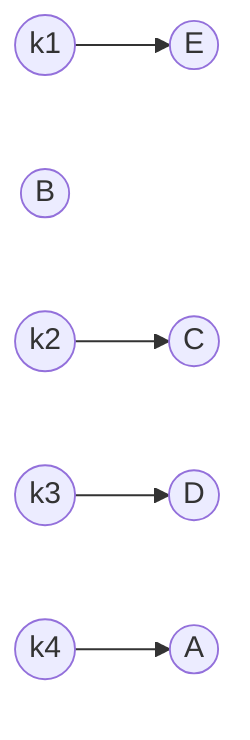
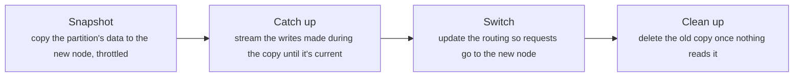

# Partitioning: splitting data across machines

> System Design · L2 Proficient · Consistency, replication and partitioning · about 105 min · hub module `m03` ([open the hub](https://claude.ai/artifact/WYKUGQ93VYjG6xBpea5exS))

## Why it matters
When one machine can't hold the data or take the writes, the data is split into partitions (shards), each owned by a different machine. How you split it decides which queries stay on one machine, whether the load spreads evenly, and how much data moves when you add a machine. Range splits keep order, hash splits spread load, and consistent hashing keeps the moves small.

## Pre-question (answer before reading)
**Q:** You split 1 billion user records across 10 machines by user_id mod 10. Six months later you add an 11th machine. Roughly what share of the records must move, and what would you do differently from the start?

<details><summary>Answer</summary>

A record stays only if user_id mod 10 equals user_id mod 11, about 1 in 11 of them, so roughly 90% move (L1 module 4 measured the same effect). Instead, use consistent hashing, so only about 1/11 of the data moves, all of it to the new machine, or create many more partitions than machines from the start (say 1,000) and move whole partitions.

</details>

## 🍎 Story time (kid version)
**Pizza Town and the family road trip: Sharing out the deliveries**

Luigi's drivers split the town by street name: Ana takes streets from A to F, Bo from G to M, Cy from N to Z. Finding every order on Abbey Road is easy, but when a huge new estate opens on Mill Lane, Bo is swamped. So Luigi tries a clock face: each address gets a time from a secret rule, and goes to the next driver round the clock. When a fourth driver joins, she only takes the addresses between her and the driver before her. On match day the stadium orders 300 pizzas at one address, so Luigi shares that single address between three drivers.

| In the story | In a real system |
|---|---|
| Streets A–F, G–M and N–Z | Range partitioning: each machine owns a range of keys |
| All the orders on Abbey Road with one driver | Range scans stay on one partition |
| A huge new estate on Mill Lane swamping Bo | A hot range: skewed data or traffic on one partition |
| Addresses placed round a clock face, each going to the next driver | Consistent hashing: a hash ring |
| The stadium's 300 orders shared by three drivers | Splitting a hot key across several partitions |

**Where the story breaks:** Drivers can see who's overloaded and help each other; partitions can't. Real systems must measure the load per partition and move partitions deliberately, because moving data costs bandwidth and time while traffic carries on.

## Key ideas (grown-up version)
- **Why partition**: when the data or the write traffic outgrows one machine, split the data into partitions (shards), each owned by one node, usually with replicas (module 2). Each node then holds and serves only its share. The cost: queries that span partitions get harder.
- **Range partitioning**: each partition owns a contiguous range of keys (A–F, G–M and so on). Range scans and sorted queries stay on one or a few partitions, but skewed keys, such as all of today's timestamps or one popular prefix, pile onto one partition.
- **Hash partitioning**: hash the key and assign partitions by hash, so even similar keys spread evenly. The load spreads well, but a range query must ask every partition, and hash mod N moves almost every key when N changes.
- **Consistent hashing**: put nodes on a ring of hash values; a key belongs to the first node clockwise from its own hash. Adding a node moves only the keys between it and the node before it, about 1/N of the data. Virtual nodes, many points per machine, even out the shares.
- **Fixed partitions**: create many more partitions than nodes (say 1,000 for 10 nodes) and give whole partitions to nodes. The key-to-partition mapping never changes; adding a node just moves some whole partitions to it.
- **Hot keys and skew**: even with a perfect hash, one key can get a huge share of the traffic (a celebrity's posts, a viral product). Cache it, split it into sub-keys (key#0 … key#9) that are merged on read, or give it its own capacity.
- **Rebalancing**: moving a partition costs bandwidth and disk while traffic continues. Copy a snapshot, stream the changes until the copy catches up, switch routing, then delete the old copy, a few partitions at a time with throttling. Automatic rebalancing can make an overloaded cluster worse, so many teams require approval.
- **Routing and secondary indexes**: something must map a key to its node: the client with a copy of the partition map, a routing tier, or any node that forwards. Secondary indexes are local (each partition indexes its own rows: writes stay local, queries ask every partition) or global (partitioned by the indexed value: queries go to one place, writes touch several).

## Diagrams
**A hash ring: nodes A to E, keys k1 to k4; each key belongs to the first node clockwise**



_E is the new node. Before it joined, k1 belonged to B; E took only the keys on the arc between A and E, and every other key stayed where it was._

**Moving one partition without downtime**



_Throughout, the old owner keeps serving, so users see no gap. Move a few partitions at a time: every copy competes with live traffic._

## Comparisons
**Ways to split the data**

|  | Range | Hash mod N | Consistent hashing | Fixed partitions |
|---|---|---|---|---|
| Range scans | On one or a few partitions | Ask every partition | Ask every partition | Ask every partition (if hashed) |
| Load spread | Uneven if keys are skewed | Even | Even with virtual nodes | Even if partitions are hashed |
| Adding a node | Split or move ranges | Almost every key moves | About 1/N of the keys move | A few whole partitions move |
| Typical use | Time series, sorted data, wide-column stores | Small, fixed clusters | Caches, Dynamo-style stores | Many databases and search engines |

**Secondary indexes on partitioned data**

|  | Local index | Global index |
|---|---|---|
| Partitioned by | The same key as the data | The indexed value |
| A write | Updates one partition | May update index entries on other partitions |
| A query by the indexed value | Asks every partition (scatter-gather) | Asks one index partition |
| Freshness | In step with the data | Often updated asynchronously |

## Code (JavaScript + Python)
### A well-mixed string hash and a consistent-hashing ring with virtual nodes
```python
def ring_hash(key):                             # FNV-1a, then a mixing step so similar strings spread well
    h = 0x811C9DC5
    for byte in key.encode():
        h = ((h ^ byte) * 0x01000193) & 0xFFFFFFFF
    h ^= h >> 16
    h = (h * 0x85EBCA6B) & 0xFFFFFFFF
    h ^= h >> 13
    h = (h * 0xC2B2AE35) & 0xFFFFFFFF
    return h ^ (h >> 16)

class HashRing:
    """Consistent hashing: each node gets `vnodes` points on a ring of 32-bit hash values."""
    def __init__(self, nodes, vnodes=1):
        self.points = sorted((ring_hash(f"{n}#{i}"), n) for n in nodes for i in range(vnodes))

    def index(self, key):                       # the first point at or after the key's hash (wrapping round)
        h, lo, hi = ring_hash(key), 0, len(self.points)
        while lo < hi:
            mid = (lo + hi) // 2
            if self.points[mid][0] < h:
                lo = mid + 1
            else:
                hi = mid
        return lo % len(self.points)

    def owner(self, key):
        return self.points[self.index(key)][1]
```

```javascript
function ringHash(key) {                        // FNV-1a, then a mixing step so similar strings spread well
  let h = 0x811c9dc5;
  for (const byte of Buffer.from(key)) h = Math.imul(h ^ byte, 0x01000193) >>> 0;
  h ^= h >>> 16;
  h = Math.imul(h, 0x85ebca6b) >>> 0;
  h ^= h >>> 13;
  h = Math.imul(h, 0xc2b2ae35) >>> 0;
  return (h ^ (h >>> 16)) >>> 0;
}

class HashRing {
  // consistent hashing: each node gets `vnodes` points on a ring of 32-bit hash values
  constructor(nodes, vnodes = 1) {
    this.points = nodes.flatMap(n => Array.from({ length: vnodes }, (_, i) => [ringHash(`${n}#${i}`), n]))
      .sort((a, b) => a[0] - b[0] || (a[1] < b[1] ? -1 : a[1] > b[1] ? 1 : 0));
  }
  index(key) {                                  // the first point at or after the key's hash (wrapping round)
    const h = ringHash(key);
    let lo = 0, hi = this.points.length;
    while (lo < hi) {
      const mid = (lo + hi) >> 1;
      if (this.points[mid][0] < h) lo = mid + 1; else hi = mid;
    }
    return lo % this.points.length;
  }
  owner(key) { return this.points[this.index(key)][1]; }
}
```

### Range or hash: where today's writes and an October scan go
```python
RANGES = [("2026-01", "2026-05"), ("2026-05", "2026-09"), ("2026-09", "2027-01")]   # [start, end) per partition

def by_range(key):
    return next(i for i, (lo, hi) in enumerate(RANGES) if lo <= key < hi)

def by_hash(key):
    return ring_hash(key) % len(RANGES)

todays = [f"2026-10-12T{i // 60:02d}:{i % 60:02d}#{i}" for i in range(1000)]   # 1,000 events written today
for name, part in (("range", by_range), ("hash", by_hash)):
    load = [0] * len(RANGES)
    for key in todays:
        load[part(key)] += 1
    scan = sum(1 for lo, hi in RANGES if lo < "2026-11" and "2026-10" < hi) if name == "range" else len(RANGES)
    print(f"{name}: today's writes per partition", *load, f"| partitions an October scan asks: {scan}")
```

Output:
```text
range: today's writes per partition 0 0 1000 | partitions an October scan asks: 1
hash: today's writes per partition 334 345 321 | partitions an October scan asks: 3
```

- line 1: Range partitioning by month: each partition owns a span of time.
- line 14: A time-range scan touches only the partitions whose ranges overlap it; with hashing it must ask all of them.
- line 15: Range partitioning sends every one of today's writes to the newest partition, a hot spot; hashing spreads them evenly.

```javascript
const RANGES = [["2026-01", "2026-05"], ["2026-05", "2026-09"], ["2026-09", "2027-01"]];   // [start, end) per partition

const byRange = key => RANGES.findIndex(([lo, hi]) => lo <= key && key < hi);
const byHash = key => ringHash(key) % RANGES.length;

const todays = Array.from({ length: 1000 }, (_, i) => `2026-10-12T${String(Math.floor(i / 60)).padStart(2, "0")}:${String(i % 60).padStart(2, "0")}#${i}`);   // 1,000 events written today
for (const [name, part] of [["range", byRange], ["hash", byHash]]) {
  const load = new Array(RANGES.length).fill(0);
  for (const key of todays) load[part(key)]++;
  const scan = name === "range" ? RANGES.filter(([lo, hi]) => lo < "2026-11" && "2026-10" < hi).length : RANGES.length;
  console.log(`${name}: today's writes per partition`, ...load, `| partitions an October scan asks: ${scan}`);
}
```

Output:
```text
range: today's writes per partition 0 0 1000 | partitions an October scan asks: 1
hash: today's writes per partition 334 345 321 | partitions an October scan asks: 3
```

- line 1: Range partitioning by month: each partition owns a span of time.
- line 10: A time-range scan touches only the partitions whose ranges overlap it; with hashing it must ask all of them.
- line 11: Range partitioning sends every one of today's writes to the newest partition, a hot spot; hashing spreads them evenly.

### Consistent hashing: virtual nodes for balance, small moves when a node joins
```python
keys = [f"user-{i}" for i in range(20_000)]
nodes = ["node-a", "node-b", "node-c", "node-d"]
for vnodes in (1, 10, 100):
    ring = HashRing(nodes, vnodes)
    counts = {n: 0 for n in nodes}
    for k in keys:
        counts[ring.owner(k)] += 1
    print(f"{vnodes} point(s) per node: the busiest node holds {max(counts.values()) * 100 // len(keys)}% (fair share 25%)")

before, after = HashRing(nodes, 100), HashRing(nodes + ["node-e"], 100)
moved = [k for k in keys if before.owner(k) != after.owner(k)]
mod_n = sum(ring_hash(k) % 4 != ring_hash(k) % 5 for k in keys)
print(f"adding node-e moves {len(moved) * 100 // len(keys)}% of keys on the ring",
      f"(all to node-e: {'yes' if all(after.owner(k) == 'node-e' for k in moved) else 'no'}), {mod_n * 100 // len(keys)}% with mod N")
```

Output:
```text
1 point(s) per node: the busiest node holds 41% (fair share 25%)
10 point(s) per node: the busiest node holds 31% (fair share 25%)
100 point(s) per node: the busiest node holds 28% (fair share 25%)
adding node-e moves 19% of keys on the ring (all to node-e: yes), 80% with mod N
```

- line 8: With one point per node the shares are lopsided; with 100 points each, every node is close to its fair 25%.
- line 11: A key moves only if node-e's points land between it and its old owner, and then it moves to node-e.
- line 14: About a fifth of the keys move, the minimum for going from 4 to 5 nodes, against about 80% with mod N.

```javascript
const keys = Array.from({ length: 20000 }, (_, i) => `user-${i}`);
const nodes = ["node-a", "node-b", "node-c", "node-d"];
for (const vnodes of [1, 10, 100]) {
  const ring = new HashRing(nodes, vnodes);
  const counts = Object.fromEntries(nodes.map(n => [n, 0]));
  for (const k of keys) counts[ring.owner(k)]++;
  console.log(`${vnodes} point(s) per node: the busiest node holds ${Math.floor((Math.max(...Object.values(counts)) * 100) / keys.length)}% (fair share 25%)`);
}

const before = new HashRing(nodes, 100), after = new HashRing([...nodes, "node-e"], 100);
const moved = keys.filter(k => before.owner(k) !== after.owner(k));
const modN = keys.filter(k => ringHash(k) % 4 !== ringHash(k) % 5).length;
console.log(`adding node-e moves ${Math.floor((moved.length * 100) / keys.length)}% of keys on the ring`,
  `(all to node-e: ${moved.every(k => after.owner(k) === "node-e") ? "yes" : "no"}), ${Math.floor((modN * 100) / keys.length)}% with mod N`);
```

Output:
```text
1 point(s) per node: the busiest node holds 41% (fair share 25%)
10 point(s) per node: the busiest node holds 31% (fair share 25%)
100 point(s) per node: the busiest node holds 28% (fair share 25%)
adding node-e moves 19% of keys on the ring (all to node-e: yes), 80% with mod N
```

- line 7: With one point per node the shares are lopsided; with 100 points each, every node is close to its fair 25%.
- line 11: A key moves only if node-e's points land between it and its old owner, and then it moves to node-e.
- line 13: About a fifth of the keys move, the minimum for going from 4 to 5 nodes, against about 80% with mod N.

### A hot key: one key's traffic, before and after salting
```python
def busiest_share(keys, partitions=8):
    counts = [0] * partitions
    for k in keys:
        counts[ring_hash(k) % partitions] += 1
    return max(counts) * 1000 // len(keys) / 10   # percent, one decimal place

requests = ["celebrity" if i % 10 < 3 else f"user-{i}" for i in range(10_000)]   # 30% of requests hit one key
salted = [f"celebrity#{i % 10}" if k == "celebrity" else k for i, k in enumerate(requests)]   # 10 sub-keys
for name, ks in (("one hot key", requests), ("salted into 10 sub-keys", salted)):
    print(f"{name}: the busiest partition takes {busiest_share(ks)}% of requests (fair share 12.5%)")
```

Output:
```text
one hot key: the busiest partition takes 38.7% of requests (fair share 12.5%)
salted into 10 sub-keys: the busiest partition takes 18.9% of requests (fair share 12.5%)
```

- line 7: However good the hash, every request for one key goes to the same partition.
- line 8: Salting spreads the key's writes over 10 sub-keys; reads must now fetch all 10 and merge them.

```javascript
function busiestShare(keys, partitions = 8) {
  const counts = new Array(partitions).fill(0);
  for (const k of keys) counts[ringHash(k) % partitions]++;
  return (Math.floor((Math.max(...counts) * 1000) / keys.length) / 10).toFixed(1);   // percent, one decimal place
}

const requests = Array.from({ length: 10000 }, (_, i) => (i % 10 < 3 ? "celebrity" : `user-${i}`));   // 30% of requests hit one key
const salted = requests.map((k, i) => (k === "celebrity" ? `celebrity#${i % 10}` : k));   // 10 sub-keys
for (const [name, ks] of [["one hot key", requests], ["salted into 10 sub-keys", salted]]) {
  console.log(`${name}: the busiest partition takes ${busiestShare(ks)}% of requests (fair share 12.5%)`);
}
```

Output:
```text
one hot key: the busiest partition takes 38.7% of requests (fair share 12.5%)
salted into 10 sub-keys: the busiest partition takes 18.9% of requests (fair share 12.5%)
```

- line 7: However good the hash, every request for one key goes to the same partition.
- line 8: Salting spreads the key's writes over 10 sub-keys; reads must now fetch all 10 and merge them.

## Worked example
**Problem.** A cluster has 1,000 fixed partitions spread over 10 nodes (100 each), 1 GB per partition. You add 2 nodes. Plan the move so that every node ends with 83 or 84 partitions and as few partitions as possible move, then estimate the copy time at a throttled 100 MB/s.

1. With fixed partitions a key's partition never changes (hash(key) mod 1,000); only the partition-to-node map does.
2. 1,000 ÷ 12 ≈ 83.3, so four nodes keep 84 and eight hold 83, the two new nodes among them.
3. Each new node takes 83 partitions from the most loaded old nodes: 166 partitions move (16.6% of the data), the minimum possible, and nothing else changes.
4. 166 GB at 100 MB/s is 1,660 seconds, about 28 minutes, while the old owners keep serving. Planning takes O(moves × nodes) time; the care goes into throttling, catching up and switching.

```python
def rebalance(assignment, new_nodes):
    """assignment: node -> list of partition ids (changed in place). Returns the moves made."""
    nodes = list(assignment) + new_nodes
    for n in new_nodes:
        assignment[n] = []
    total = sum(len(parts) for parts in assignment.values())
    base, extra = divmod(total, len(nodes))
    target = {n: base + (1 if i < extra else 0) for i, n in enumerate(nodes)}   # the first `extra` nodes keep one more
    moves = []
    for n in new_nodes:
        while len(assignment[n]) < target[n]:
            donor = max(nodes, key=lambda m: len(assignment[m]) - target[m])   # the most over-full node
            part = assignment[donor].pop()
            assignment[n].append(part)
            moves.append((part, donor, n))
    return moves

assignment = {f"n{i}": list(range(i * 100, i * 100 + 100)) for i in range(10)}
moves = rebalance(assignment, ["n10", "n11"])
sizes = sorted({len(p) for p in assignment.values()})
print(f"moved {len(moves)} of 1000 partitions ({len(moves) / 10:.1f}%); nodes now hold {sizes[0]}–{sizes[-1]}")
print(f"copying {len(moves)} GB at 100 MB/s takes about {(len(moves) * 1000 // 100 + 30) // 60} minutes")
```

Output:
```text
moved 166 of 1000 partitions (16.6%); nodes now hold 83–84
copying 166 GB at 100 MB/s takes about 28 minutes
```

```javascript
function rebalance(assignment, newNodes) {
  // assignment: node -> array of partition ids (changed in place). Returns the moves made
  const nodes = [...Object.keys(assignment), ...newNodes];
  for (const n of newNodes) assignment[n] = [];
  const total = Object.values(assignment).reduce((s, p) => s + p.length, 0);
  const base = Math.floor(total / nodes.length), extra = total % nodes.length;
  const target = Object.fromEntries(nodes.map((n, i) => [n, base + (i < extra ? 1 : 0)]));   // the first `extra` nodes keep one more
  const moves = [];
  for (const n of newNodes) {
    while (assignment[n].length < target[n]) {
      let donor = nodes[0];                   // the most over-full node (the first one on a tie)
      for (const m of nodes) if (assignment[m].length - target[m] > assignment[donor].length - target[donor]) donor = m;
      const part = assignment[donor].pop();
      assignment[n].push(part);
      moves.push([part, donor, n]);
    }
  }
  return moves;
}

const assignment = Object.fromEntries(Array.from({ length: 10 }, (_, i) => [`n${i}`, Array.from({ length: 100 }, (_, j) => i * 100 + j)]));
const moves = rebalance(assignment, ["n10", "n11"]);
const sizes = [...new Set(Object.values(assignment).map(p => p.length))].sort((a, b) => a - b);
console.log(`moved ${moves.length} of 1000 partitions (${(moves.length / 10).toFixed(1)}%); nodes now hold ${sizes[0]}–${sizes.at(-1)}`);
console.log(`copying ${moves.length} GB at 100 MB/s takes about ${Math.floor((Math.floor((moves.length * 1000) / 100) + 30) / 60)} minutes`);
```

Output:
```text
moved 166 of 1000 partitions (16.6%); nodes now hold 83–84
copying 166 GB at 100 MB/s takes about 28 minutes
```

**Answer.** 166 partitions move, 16.6% of the data, and every node ends with 83 or 84. Throttled to 100 MB/s, the copy takes about 28 minutes, with the old owners serving until each partition switches.

## Your turn (faded example)
**Problem.** Dynamo-style stores keep each key on R different machines: the owner plus the next distinct nodes clockwise on the ring. Finish `preference_list(ring, key, r)` so it walks clockwise from the key's position and returns the first r distinct physical nodes.

- ✓ Start at the key's position on the ring (`ring.index(key)`) and walk round, wrapping at the end.
- **Why skip points that belong to a node already in the list?**
  <details><summary>Answer</summary>With virtual nodes, the next few points often belong to the same machine; two replicas on one machine would defeat the point of replicating.</details>
- **What happens when a node in the list is down?**
  <details><summary>Answer</summary>Keep walking: the next distinct node holds the data for it (Dynamo calls this a sloppy quorum with hinted handoff) and hands it back when the node returns.</details>
- **What does it cost?**
  <details><summary>Answer</summary>O(log P) to find the start among P points, then usually only a few steps round the ring, and O(r) memory for the list.</details>

Starter:
```python
def preference_list(ring, key, r):
    """The first r distinct nodes clockwise from the key's position on `ring` (a HashRing)."""
    ...                                       # TODO: walk ring.points from ring.index(key), wrapping, skipping repeats
```

```javascript
function preferenceList(ring, key, r) {
  // the first r distinct nodes clockwise from the key's position on `ring` (a HashRing)
  // TODO: walk ring.points from ring.index(key), wrapping, skipping repeats
}
```

<details><summary>Full solution</summary>

```python
def preference_list(ring, key, r):
    """The first r distinct nodes clockwise from the key's position on `ring` (a HashRing)."""
    start, nodes = ring.index(key), []
    for step in range(len(ring.points)):
        node = ring.points[(start + step) % len(ring.points)][1]
        if node not in nodes:                 # the same machine twice would not be a real replica
            nodes.append(node)
            if len(nodes) == r:
                break
    return nodes

ring = HashRing(["node-a", "node-b", "node-c", "node-d"], vnodes=10)
for key in ("cart:tara", "cart:ben", "cart:ana"):
    print(key, "->", *preference_list(ring, key, 3))
```

Output:
```text
cart:tara -> node-b node-c node-d
cart:ben -> node-c node-d node-a
cart:ana -> node-b node-c node-d
```

```javascript
function preferenceList(ring, key, r) {
  // the first r distinct nodes clockwise from the key's position on `ring` (a HashRing)
  const start = ring.index(key), nodes = [];
  for (let step = 0; step < ring.points.length && nodes.length < r; step++) {
    const node = ring.points[(start + step) % ring.points.length][1];
    if (!nodes.includes(node)) nodes.push(node);   // the same machine twice would not be a real replica
  }
  return nodes;
}

const ring = new HashRing(["node-a", "node-b", "node-c", "node-d"], 10);
for (const key of ["cart:tara", "cart:ben", "cart:ana"]) console.log(key, "->", ...preferenceList(ring, key, 3));
```

Output:
```text
cart:tara -> node-b node-c node-d
cart:ben -> node-c node-d node-a
cart:ana -> node-b node-c node-d
```

</details>

## Socratic checks and quiz (answers hidden)
**1. What does this print?**

```python
points = [(100, "A"), (400, "B"), (700, "C")]   # positions on a ring of 0–999
owner = lambda pos: next((n for p, n in points if p >= pos), points[0][1])   # first node clockwise, wrapping
print(owner(50), owner(400), owner(650), owner(900))
```

```javascript
const points = [[100, "A"], [400, "B"], [700, "C"]];   // positions on a ring of 0–999
const owner = pos => (points.find(([p]) => p >= pos) ?? points[0])[1];   // first node clockwise, wrapping
console.log(owner(50), owner(400), owner(650), owner(900));
```

- A. A B C A
- B. A C C A
- C. A B C C
- D. B B C A

<details><summary>Answer</summary>

A B C A. 50 goes to the first node at or after it (A at 100), 400 sits exactly on B, 650 goes on to C at 700, and 900 is past every node, so it wraps round to A.

</details>

**2. What does this print?**

```python
moved = [k for k in range(12) if k % 3 != k % 4]
print(len(moved), *moved[:4])
```

```javascript
const moved = [...Array(12).keys()].filter(k => k % 3 !== k % 4);
console.log(moved.length, ...moved.slice(0, 4));
```

- A. 9 3 4 5 6
- B. 3 3 6 9
- C. 4 3 4 5 6
- D. 9 1 2 3 4

<details><summary>Answer</summary>

9 3 4 5 6. Only 0, 1 and 2 leave the same remainder for 3 and 4, so 9 of the 12 keys move when the cluster grows from 3 nodes to 4: the reason not to shard with mod N.

</details>

**3. Writes are range-partitioned by timestamp, and all of today's writes hit one node. What's the best fix?**

- A. Put a well-spread value first in the key (for example a bucket of the device id), then the timestamp
- B. Add more nodes to the cluster
- C. Switch to monthly ranges
- D. Add an index on the timestamp

<details><summary>Answer</summary>

Put a well-spread value first in the key (for example a bucket of the device id), then the timestamp. The newest range takes every write however many nodes there are, and bigger ranges make it worse. A spread-out prefix sends today's writes to many partitions while keeping time order within each.

</details>

**4. Which reduce the data moved when you add nodes? (choose 2)**

- A. Consistent hashing
- B. Many fixed partitions assigned to nodes
- C. hash(key) mod N
- D. Recomputing range boundaries from scratch
- E. Rehashing every key with a new hash function

<details><summary>Answer</summary>

Consistent hashing, Many fixed partitions assigned to nodes. Consistent hashing moves about 1/N of the keys, and fixed partitions move only whole partitions to the new node. Mod N, recomputed ranges and new hash functions move most of the data.

</details>

**5. Judge each statement.**

- Range partitioning keeps a range scan on few partitions.
- A perfect hash function prevents hot keys.
- With consistent hashing, adding a node moves keys only to the new node.
- A query by something other than the partition key may have to ask every partition.

<details><summary>Answer</summary>

Range partitioning keeps a range scan on few partitions.: Yes; A perfect hash function prevents hot keys.: No; With consistent hashing, adding a node moves keys only to the new node.: Yes; A query by something other than the partition key may have to ask every partition.: Yes. Neighbouring keys share a range. One key's traffic still goes to one partition. Only keys on the new node's arcs change owner, and their new owner is the new node. Without a global index, a query by another field must scatter.

</details>

**6. Put the steps of moving a partition to a new node in order.**

- (put the steps in order)

<details><summary>Answer</summary>

Copy a snapshot of the partition to the new node → Stream the writes made during the copy until it has caught up → Switch routing so requests go to the new node → Delete the partition from the old node. Catching up needs the snapshot first, switching before the copy is current would lose writes, and the old copy can only go once nothing routes to it.

</details>

**7. Complete the JavaScript ring lookup (points are sorted by position).**

```
function ownerOf(points, pos) {               // points: [position, node], sorted by position
  for (const [p, node] of points) if ({{0}}) return node;
  return {{1}};
}

```

<details><summary>Answer</summary>

p >= pos | points[0][1]. The owner is the first point at or after the key's position; a key past the last point wraps round to the first point.

</details>

**8. Match each description to its name.**


<details><summary>Answer</summary>

Each partition owns a contiguous range of keys = Range partitioning; A key goes to the first node clockwise on a ring = Consistent hashing; Many points per machine on the ring = Virtual nodes; One busy key split into key#0 … key#9 = Salting a hot key. Read repair fixes stale replicas (module 2); it has nothing to do with where keys live.

</details>

## Traps & misconceptions
- **“hash(key) mod N is fine for sharding.”** Changing N moves almost every key: about 80% going from 4 nodes to 5, and 90% from 10 to 11. Use consistent hashing or many fixed partitions so that growth moves only a small share.
- **“Range partitioning by timestamp spreads the writes.”** All of today's writes land in the newest range, so one partition takes everything. Put a well-spread value (a bucket of the user or device id) before the timestamp, or hash.
- **“A good hash removes hot spots.”** A hash spreads different keys, but one key with enormous traffic still lands on one partition. Cache it, salt it into sub-keys, or give it its own capacity.
- **“Cross-partition queries are just a bit slower.”** They ask every partition and wait for the slowest, so tail latency grows with the number of partitions, and joins or transactions across partitions need extra machinery. Pick the partition key so that the common queries stay on one partition.
- **“Consistent hashing balances the load on its own.”** With one point per node, shares can differ several-fold. Virtual nodes, dozens to hundreds of points per node, bring every node close to its fair share.
- **“Rebalance automatically as soon as the load is uneven.”** Moving data costs bandwidth and disk on nodes that are already busy, and an automatic rebalance during an overload or a brief failure can make things worse. Rebalance deliberately, a few partitions at a time, with throttling.

## Discussion prompts
- **How would you choose the partition key for a chat app's messages?**
  <details><summary>One good answer</summary>The commonest query is “the latest messages in this conversation”, so partition by conversation id and sort by time within it: one partition answers each read, in order. A huge group chat becomes a hot key, so cap group size, split very large conversations into time buckets (conversation#2026-10), or give them their own partitions. If you need per-user inboxes, they're a second table partitioned by user id.</details>
- **Range or hash partitioning for an analytics events table?**
  <details><summary>One good answer</summary>Analytics mostly scans time ranges, so a range on time looks natural, but then every new event lands on the newest partition. A common compromise is a compound key: hash a well-spread field (the device or user id) into a bucket, then order by time within the bucket. Writes spread across the buckets, and a time-range scan asks every bucket for its slice, in parallel.</details>

## Teach-back
**Prompt:** Explain to a junior colleague how you'd split a large table across machines, and what consistent hashing buys you.

Rubric:
- [ ] Range partitioning keeps scans local but risks hot ranges; hashing spreads load but scatters scans
- [ ] hash mod N moves almost everything when N changes
- [ ] Consistent hashing moves about 1/N of the keys; virtual nodes balance the shares
- [ ] Fixed partitions as an alternative: move whole partitions
- [ ] Hot keys need caching or salting; rebalancing needs care

<details><summary>Model answer</summary>

I'd start from the queries. If most reads scan ranges, such as a conversation's messages by time, range partitioning keeps them on one partition, but skewed keys like today's timestamps can overload one partition. If the load must spread evenly, I'd hash the key, accepting that range scans then ask every partition. I'd avoid hash mod N, because adding a node moves almost every key. Consistent hashing puts nodes on a ring and gives each key to the next node clockwise, so a new node takes only the keys just before it, about 1/N of the data, and virtual nodes even out the shares. Another option is a fixed set of many partitions, moved whole when nodes join. Either way I'd watch for hot keys, caching or salting them, and rebalance slowly and deliberately.

</details>

## Quick Q&A (also in the SRS deck)
- **Range partitioning?** Each partition owns a contiguous range of keys: good for scans, risky for skewed keys.
- **Hash partitioning?** Keys go to partitions by hash: the load spreads evenly, but range scans ask every partition.
- **What moves when a node joins a consistent-hashing ring?** Only the keys between the new node and the node before it: about 1/N of the data.
- **Why virtual nodes?** Many points per machine on the ring even out each machine's share.
- **How do you handle a hot key?** Cache it, or salt it into several sub-keys and merge them on read.
- **What are fixed partitions?** Many more partitions than nodes, moved whole when nodes join, so a key's partition never changes.

## Practice problems
- [ ] [Reading · Consistent hashing](https://en.wikipedia.org/wiki/Consistent_hashing) · read how the ring works and why virtual nodes help, then compare with this module's HashRing
- [ ] [Exercise · Spread a hot key's writes](https://docs.aws.amazon.com/amazondynamodb/latest/developerguide/bp-partition-key-sharding.html) · read the write-sharding pattern, then design sub-keys for a celebrity's follower counter and the read that sums them
- [ ] [Exercise · Ranges that split themselves](https://docs.cockroachlabs.com/docs/stable/architecture/distribution-layer) · find how ranges split when they grow or get busy, and how a node finds which range holds a key
- [ ] [Exercise · Fixed shard counts](https://www.elastic.co/guide/en/elasticsearch/reference/current/scalability.html) · find why the number of primary shards is set when an index is created, and how shards move between nodes

## Sources (accessed 2026-10-09)
- [Wikipedia: Consistent hashing](https://en.wikipedia.org/wiki/Consistent_hashing)
- [Amazon's Dynamo paper (SOSP 2007)](https://www.allthingsdistributed.com/files/amazon-dynamo-sosp2007.pdf)
- [CockroachDB docs: Distribution layer](https://docs.cockroachlabs.com/docs/stable/architecture/distribution-layer)
- [Designing Data-Intensive Applications, 2nd edition (2026)](https://martin.kleppmann.com/2026/03/24/designing-data-intensive-applications-2e.html)
