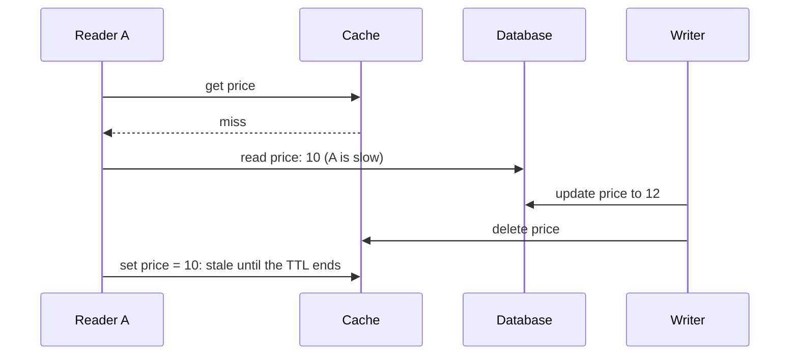
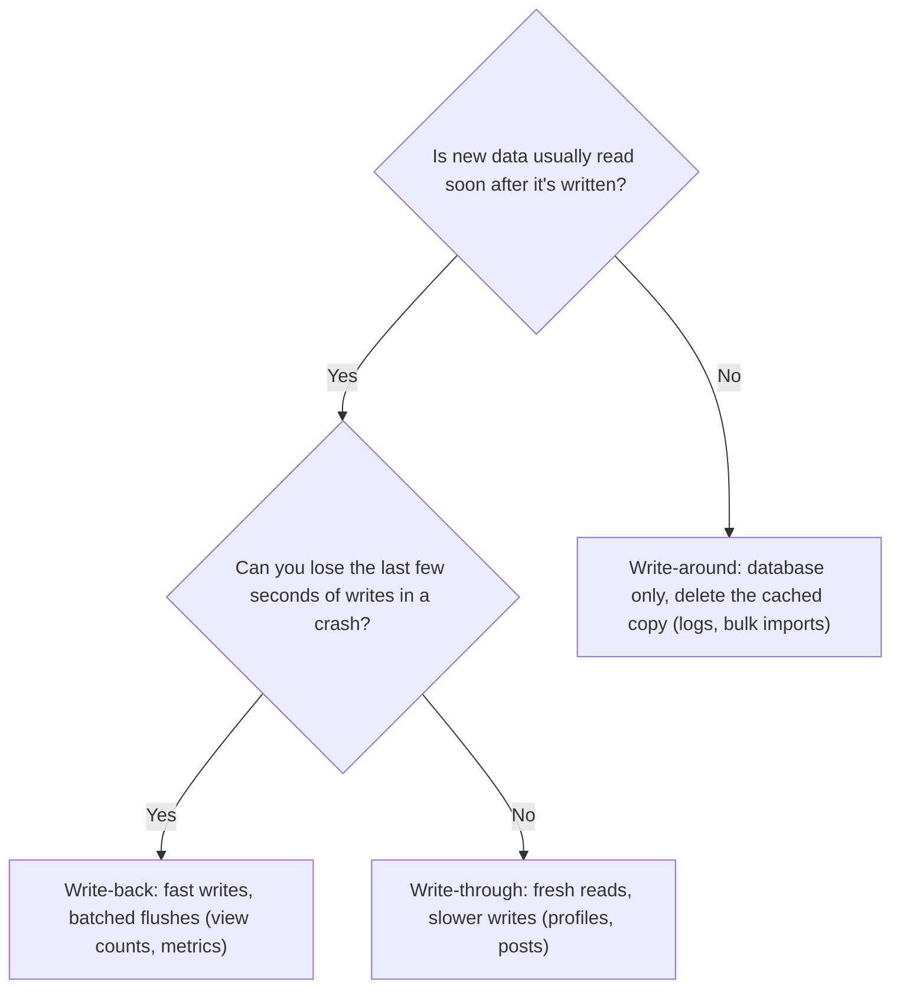
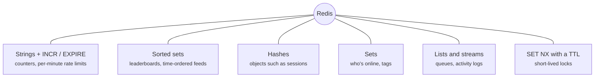

# Caching strategies: writes, invalidation and stampedes

> System Design · L2 Proficient · Caching, messaging and resilience · about 105 min · hub module `m04` ([open the hub](https://claude.ai/artifact/WYKUGQ93VYjG6xBpea5exS))

## Why it matters
At L1 a cache was a fast copy in front of a database. At scale the hard parts are the writes and the edges: how writes reach the cache, how stale copies get removed, and what happens when thousands of requests miss the same key at once. Redis, the most common shared cache, adds data structures that turn the cache into a toolbox for counters, leaderboards, queues and rate limiters.

## Pre-question (answer before reading)
**Q:** A product's price changes. Your code updates the database and then deletes the cache key. Five minutes later some users still see the old price. How can that happen?

<details><summary>Answer</summary>

A race: a reader missed the cache and read the old price from the database; then the writer updated the database and deleted the key; and only then did the slow reader store its old value in the cache, where it stays until the TTL runs out. Short TTLs, a second delete a moment later, or only accepting cache writes whose version is newest (leases) prevent it.

</details>

## 🍎 Story time (kid version)
**Pizza Town and the family road trip: Today's specials on the whiteboard**

Luigi keeps today's specials on a little whiteboard by the till, copied from his big recipe book. Sometimes he changes the book and the board together. Sometimes, in a rush, he changes only the board and copies it into the book at closing, but one evening the board got wiped first and a change was lost. Sometimes he changes only the book and rubs the special off the board, so the next customer makes him look it up. At opening time fifty customers ask about the special while the board is blank, so Luigi looks it up once and tells them all. Now he rewrites the board a little before it goes out of date.

| In the story | In a real system |
|---|---|
| Changing the book and the board together | Write-through: update the cache and the database in one operation |
| Changing only the board, copying to the book at closing | Write-back: write to the cache now, flush to the database later, and risk losing it |
| Changing only the book and rubbing the board clean | Write-around with invalidation: writes skip the cache; the next read reloads it |
| Looking it up once for fifty customers | Coalescing misses (single flight) to stop a stampede |
| Rewriting the board a little before it goes out of date | Early refresh: recompute before expiry, at a randomised moment |

**Where the story breaks:** Luigi is one person, so nobody can sneak an old special onto the board between his steps. In a real system many servers read and write at once, so an old value can be stored after an invalidation; versions or leases stop that.

## Key ideas (grown-up version)
- **Write-through**: every write updates the database and the cache before replying. Reads straight after a write find fresh data; writes are slower, and the cache fills with data that may never be read.
- **Write-back (write-behind)**: writes go to the cache and are flushed to the database later, often in batches. Writes are fast and bursts are absorbed, but anything not yet flushed is lost if the cache node dies, and the database lags behind.
- **Write-around**: writes go only to the database (and invalidate the cached copy); the cache fills only on reads. Good when new data is rarely read soon; the first read after each write is a miss.
- **Invalidation**: TTLs bound staleness; deleting the key after a write keeps it short; versioned keys (product:42:v7) make old entries unreachable without deleting them; change-data-capture can invalidate caches from the database's own log. Prefer deleting cached values to updating them, because concurrent updates can land in the wrong order.
- **The stale-set race**: a reader misses and reads the old value; the writer updates the database and deletes the key; then the reader stores its old value, which survives until the TTL ends. Fixes: short TTLs, a second delete a moment later, or versions and leases that reject anything older than the last invalidation.
- **Stampede protection**: when a hot key expires, let one request recompute while others wait (single flight), serve the stale value while one refresh runs (stale-while-revalidate), add jitter to TTLs, or refresh early with a probability that rises as expiry approaches (probabilistic early expiration, as in the XFetch algorithm).
- **Redis basics**: an in-memory key-value server with data structures (strings, hashes, lists, sets, sorted sets, streams), a TTL per key, and atomic commands such as INCR; scripts and transactions group several steps. Commands are executed one at a time, so each single command is atomic. Persistence and replication exist, but treat a cache as disposable.
- **Redis as a toolbox**: INCR with EXPIRE gives counters and simple rate limits, sorted sets give leaderboards and time-ordered feeds, sets track who's online, and SET with NX and a TTL gives a short-lived lock. Each replaces code you'd otherwise write, and each makes Redis more critical: plan its memory, eviction and failover.

## Diagrams
**The stale-set race**



_The delete came before A's late write, so it removed nothing. If the delete leaves a marker with the new version, the cache can reject A's older value._

**Choosing a write strategy**



**Redis data structures and what they're for**



## Comparisons
**Three write strategies**

|  | Write-through | Write-back | Write-around |
|---|---|---|---|
| A write goes to | The database and the cache | The cache; the database later | The database; the cached copy is deleted |
| A read right after a write | Hit, fresh | Hit, fresh | Miss, then cached |
| Write latency | Database + cache | Cache only | Database only |
| If the cache node dies | Nothing lost | Unflushed writes lost | Nothing lost |
| Good for | Data read soon after writing | Counters, metrics, bursts | Data rarely re-read soon |

**Defences against stampedes**

| Technique | How it works | What it costs |
|---|---|---|
| Single flight (or a lock) | One request recomputes; the others wait for its result | Waiting requests are slow; a stuck holder needs a timeout |
| Stale-while-revalidate | Serve the old value while one background refresh runs | Users may see data a little older than the TTL |
| Probabilistic early refresh | Each request may refresh early, more likely near expiry | A few extra recomputes |
| TTL jitter | Spread expiry times randomly | Doesn't help a single very hot key |

## Code (JavaScript + Python)
### The seeded random generator used by the stampede simulation
```python
def mulberry32(seed):                           # a tiny seeded random generator, same as the JavaScript one
    state = seed & 0xFFFFFFFF
    def rand():
        nonlocal state
        state = (state + 0x6D2B79F5) & 0xFFFFFFFF
        t = ((state ^ (state >> 15)) * (state | 1)) & 0xFFFFFFFF
        t = (t ^ (t + (((t ^ (t >> 7)) * (t | 61)) & 0xFFFFFFFF))) & 0xFFFFFFFF
        return ((t ^ (t >> 14)) & 0xFFFFFFFF) / 4294967296
    return rand
```

```javascript
function mulberry32(seed) {                     // a tiny seeded random generator, same as the Python one
  return function () {
    seed = (seed + 0x6D2B79F5) | 0;
    let t = Math.imul(seed ^ (seed >>> 15), 1 | seed);
    t = (t + Math.imul(t ^ (t >>> 7), 61 | t)) ^ t;
    return ((t ^ (t >>> 14)) >>> 0) / 4294967296;
  };
}
```

### Write-through, write-back and write-around side by side
```python
def run(policy, ops, flush_every=8, crash_at=None):
    cache, db, dirty = {}, {}, set()
    hits = reads = db_writes = 0
    for i, (op, key, value) in enumerate(ops):
        if i == crash_at:
            return hits, reads, db_writes, len(dirty)   # write-back: changes never flushed are gone
        if op == "write":
            if policy == "write-back":
                cache[key] = value
                dirty.add(key)
            else:
                db[key] = value
                db_writes += 1
                if policy == "write-through":
                    cache[key] = value
                else:
                    cache.pop(key, None)      # write-around: drop the cached copy
        else:
            reads += 1
            hits += key in cache
            cache.setdefault(key, db.get(key))
        if policy == "write-back" and (i + 1) % flush_every == 0:
            db_writes += len(dirty)           # one batched flush per changed key
            db.update({k: cache[k] for k in dirty})
            dirty.clear()
    return hits, reads, db_writes, len(dirty)

ops = [op for p in range(50) for op in (("write", p, "draft"), ("write", p, "final"), ("read", p, None), ("read", p, None))]
for policy in ("write-through", "write-back", "write-around"):
    hits, reads, writes, _ = run(policy, ops)
    lost = run(policy, ops, crash_at=198)[3]
    print(f"{policy}: read hits {hits}/{reads}, database writes {writes}, lost in a crash {lost}")
```

Output:
```text
write-through: read hits 100/100, database writes 100, lost in a crash 0
write-back: read hits 100/100, database writes 50, lost in a crash 2
write-around: read hits 50/100, database writes 100, lost in a crash 0
```

- line 5: A crash ends the run: any change still only in the write-back cache never reaches the database.
- line 17: Write-around keeps the database correct and simply drops the cached copy, so the next read is a miss.
- line 23: Write-back turns a draft and its final version into one database write per flush.
- line 31: Same reads, different costs: write-around halves the hits, write-back halves the database writes but can lose recent changes.

```javascript
function run(policy, ops, flushEvery = 8, crashAt = null) {
  const cache = new Map(), db = new Map(), dirty = new Set();
  let hits = 0, reads = 0, dbWrites = 0;
  for (let i = 0; i < ops.length; i++) {
    const [op, key, value] = ops[i];
    if (i === crashAt) return [hits, reads, dbWrites, dirty.size];   // write-back: changes never flushed are gone
    if (op === "write") {
      if (policy === "write-back") { cache.set(key, value); dirty.add(key); }
      else {
        db.set(key, value);
        dbWrites++;
        if (policy === "write-through") cache.set(key, value);
        else cache.delete(key);               // write-around: drop the cached copy
      }
    } else {
      reads++;
      if (cache.has(key)) hits++; else cache.set(key, db.get(key));
    }
    if (policy === "write-back" && (i + 1) % flushEvery === 0) {
      dbWrites += dirty.size;                 // one batched flush per changed key
      for (const k of dirty) db.set(k, cache.get(k));
      dirty.clear();
    }
  }
  return [hits, reads, dbWrites, dirty.size];
}

const ops = Array.from({ length: 50 }, (_, p) => [["write", p, "draft"], ["write", p, "final"], ["read", p, null], ["read", p, null]]).flat();
for (const policy of ["write-through", "write-back", "write-around"]) {
  const [hits, reads, writes] = run(policy, ops);
  const lost = run(policy, ops, 8, 198)[3];
  console.log(`${policy}: read hits ${hits}/${reads}, database writes ${writes}, lost in a crash ${lost}`);
}
```

Output:
```text
write-through: read hits 100/100, database writes 100, lost in a crash 0
write-back: read hits 100/100, database writes 50, lost in a crash 2
write-around: read hits 50/100, database writes 100, lost in a crash 0
```

- line 6: A crash ends the run: any change still only in the write-back cache never reaches the database.
- line 13: Write-around keeps the database correct and simply drops the cached copy, so the next read is a miss.
- line 20: Write-back turns a draft and its final version into one database write per flush.
- line 31: Same reads, different costs: write-around halves the hits, write-back halves the database writes but can lose recent changes.

### The stale-set race, and a version check that stops it
```python
db = {"price": (1, 10)}                       # key -> (version, value)

def scenario(guarded):
    cache = {}

    def cache_set(key, version, value):
        if guarded and key in cache and cache[key][0] >= version:
            return                            # an older value arriving late is ignored
        cache[key] = (version, value)

    def invalidate(key, version):
        if guarded:
            cache[key] = (version, None)      # a marker that remembers the newest version
        else:
            cache.pop(key, None)

    db["price"] = (1, 10)
    slow_read = db["price"]                   # reader A misses and reads the old row...
    db["price"] = (2, 12)                     # ...a writer updates the database
    invalidate("price", 2)                    # ...and invalidates the cache
    cache_set("price", *slow_read)            # reader A finally stores what it read: the OLD price
    hit = cache.get("price")
    if hit is None or hit[1] is None:         # a miss (or only a marker): read the database
        hit = db["price"]
        cache_set("price", *hit)
    return hit[1]

print("plain delete:", scenario(False), "| with versions:", scenario(True))
```

Output:
```text
plain delete: 10 | with versions: 12
```

- line 7: The guard: a value whose version is not newer than what the cache already knows is dropped.
- line 13: Instead of forgetting the key, the invalidation leaves a marker carrying version 2.
- line 21: Without the guard, the late write puts the old price back after the delete; with it, the write is rejected.
- line 28: The plain delete serves 10 until the TTL ends; the versioned cache reloads and serves 12.

```javascript
const db = new Map([["price", [1, 10]]]);     // key -> [version, value]

function scenario(guarded) {
  const cache = new Map();
  const cacheSet = (key, version, value) => {
    if (guarded && cache.has(key) && cache.get(key)[0] >= version) return;   // an older value arriving late is ignored
    cache.set(key, [version, value]);
  };
  const invalidate = (key, version) => {
    if (guarded) cache.set(key, [version, null]);   // a marker that remembers the newest version
    else cache.delete(key);
  };

  db.set("price", [1, 10]);
  const slowRead = db.get("price");           // reader A misses and reads the old row...
  db.set("price", [2, 12]);                   // ...a writer updates the database
  invalidate("price", 2);                     // ...and invalidates the cache
  cacheSet("price", ...slowRead);             // reader A finally stores what it read: the OLD price
  let hit = cache.get("price");
  if (hit === undefined || hit[1] === null) { // a miss (or only a marker): read the database
    hit = db.get("price");
    cacheSet("price", ...hit);
  }
  return hit[1];
}

console.log("plain delete:", scenario(false), "| with versions:", scenario(true));
```

Output:
```text
plain delete: 10 | with versions: 12
```

- line 6: The guard: a value whose version is not newer than what the cache already knows is dropped.
- line 10: Instead of forgetting the key, the invalidation leaves a marker carrying version 2.
- line 18: Without the guard, the late write puts the old price back after the delete; with it, the write is rejected.
- line 27: The plain delete serves 10 until the TTL ends; the versioned cache reloads and serves 12.

### A stampede on a hot key: plain misses, single flight, and early refresh
```python
def simulate(policy, seconds=300, rate=100, ttl=60, compute=2, window=10, seed=5):
    rand = mulberry32(seed)
    expires, ready_at = ttl, None             # the cached value is valid until `expires`; a refresh may finish at `ready_at`
    recomputes = waited = 0
    for i in range(seconds * rate):
        now = i / rate
        if ready_at is not None and now >= ready_at:
            expires, ready_at = ready_at + ttl, None    # a refresh finished: fresh again
        fresh = now < expires
        if policy == "early refresh" and fresh and ready_at is None:
            if rand() < (now - (expires - window)) / window:   # 0 until the last 10 s, then rising to 1
                ready_at = now + compute      # refresh in the background; keep serving the old value
                recomputes += 1
        if fresh:
            continue
        waited += 1                           # a miss: this request has to wait for a value
        if policy == "plain misses" or ready_at is None:
            recomputes += 1                   # plain: every miss recomputes; otherwise only the first
            if ready_at is None:
                ready_at = now + compute
    return recomputes, waited

for policy in ("plain misses", "single flight", "early refresh"):
    recomputes, waited = simulate(policy)
    print(f"{policy}: {recomputes} recomputes, {waited} requests waited")
```

Output:
```text
plain misses: 800 recomputes, 800 requests waited
single flight: 4 recomputes, 800 requests waited
early refresh: 5 recomputes, 0 requests waited
```

- line 11: Early refresh: in the last 10 seconds before expiry, each request may start a refresh, more likely the closer expiry is.
- line 18: Plain misses: every request that finds the key expired recomputes it, hundreds at once.
- line 25: Single flight cuts the recomputes to one per expiry but still makes every request in the gap wait; early refresh avoids the gap altogether.

```javascript
function simulate(policy, seconds = 300, rate = 100, ttl = 60, compute = 2, window = 10, seed = 5) {
  const rand = mulberry32(seed);
  let expires = ttl, readyAt = null;          // the cached value is valid until `expires`; a refresh may finish at `readyAt`
  let recomputes = 0, waited = 0;
  for (let i = 0; i < seconds * rate; i++) {
    const now = i / rate;
    if (readyAt !== null && now >= readyAt) { expires = readyAt + ttl; readyAt = null; }   // a refresh finished: fresh again
    const fresh = now < expires;
    if (policy === "early refresh" && fresh && readyAt === null) {
      if (rand() < (now - (expires - window)) / window) {   // 0 until the last 10 s, then rising to 1
        readyAt = now + compute;              // refresh in the background; keep serving the old value
        recomputes++;
      }
    }
    if (fresh) continue;
    waited++;                                 // a miss: this request has to wait for a value
    if (policy === "plain misses" || readyAt === null) {
      recomputes++;                           // plain: every miss recomputes; otherwise only the first
      if (readyAt === null) readyAt = now + compute;
    }
  }
  return [recomputes, waited];
}

for (const policy of ["plain misses", "single flight", "early refresh"]) {
  const [recomputes, waited] = simulate(policy);
  console.log(`${policy}: ${recomputes} recomputes, ${waited} requests waited`);
}
```

Output:
```text
plain misses: 800 recomputes, 800 requests waited
single flight: 4 recomputes, 800 requests waited
early refresh: 5 recomputes, 0 requests waited
```

- line 10: Early refresh: in the last 10 seconds before expiry, each request may start a refresh, more likely the closer expiry is.
- line 18: Plain misses: every request that finds the key expired recomputes it, hundreds at once.
- line 27: Single flight cuts the recomputes to one per expiry but still makes every request in the gap wait; early refresh avoids the gap altogether.

## Worked example
**Problem.** Design a game leaderboard that shows the top 3 players and any player's rank while scores change thousands of times a second. Use Redis-style sorted sets: ZADD to set a score, ZREVRANGE for the top, ZREVRANK for a rank, plus INCR and EXPIRE for a per-minute request counter.

1. A sorted set keeps members ordered by score: Redis uses a skip list plus a hash table, so ZADD, ZREVRANK and fetching the top k cost O(log n) (plus k), with millions of members in one set.
2. Each score update is one ZADD (it moves the member if it already exists); the top 3 is ZREVRANGE leaderboard 0 2; a rank is ZREVRANK plus one.
3. INCR on a key like rate:tara:minute-1 counts requests, and EXPIRE makes the counter vanish after the minute: a simple rate limiter (module 6 does better).
4. This emulation uses a sorted list, so an update that moves a member costs O(n); Redis's skip list makes it O(log n). For one game a single sorted set is enough; for many games or regions, one set each (partitioned by key).

```python
import bisect

class MiniRedis:
    """A few Redis commands in memory: INCR and EXPIRE for counters, ZADD / ZREVRANGE / ZREVRANK for sorted sets."""
    def __init__(self):
        self.data, self.expiry, self.zsets = {}, {}, {}

    def incr(self, key, now):
        if self.expiry.get(key, now + 1) <= now:  # an expired key reads as missing
            self.data.pop(key, None)
            del self.expiry[key]
        self.data[key] = self.data.get(key, 0) + 1
        return self.data[key]

    def expire(self, key, seconds, now):
        self.expiry[key] = now + seconds

    def zadd(self, key, member, score):
        scores, order = self.zsets.setdefault(key, ({}, []))
        if member in scores:
            order.remove((-scores[member], member))   # O(n) here; Redis's skip list makes it O(log n)
        scores[member] = score
        bisect.insort(order, (-score, member))    # highest score first

    def zrevrange(self, key, start, stop):
        return [m for _, m in self.zsets[key][1][start:stop + 1]]

    def zrevrank(self, key, member):
        scores, order = self.zsets[key]
        return bisect.bisect_left(order, (-scores[member], member))

r = MiniRedis()
for player, score in (("tara", 1200), ("ben", 950), ("ana", 1500), ("cy", 700)):
    r.zadd("leaderboard", player, score)
r.zadd("leaderboard", "ben", 1600)            # ben's new score moves him up
print("top 3:", *r.zrevrange("leaderboard", 0, 2), "| tara's rank:", r.zrevrank("leaderboard", "tara") + 1)
counts = [r.incr("rate:tara:minute-1", now) for now in (0, 10, 20)]
r.expire("rate:tara:minute-1", 60, 0)
print("requests this minute:", counts[-1], "| after the minute:", r.incr("rate:tara:minute-1", 61))
```

Output:
```text
top 3: ben ana tara | tara's rank: 3
requests this minute: 3 | after the minute: 1
```

```javascript
class MiniRedis {
  // a few Redis commands in memory: INCR and EXPIRE for counters, ZADD / ZREVRANGE / ZREVRANK for sorted sets
  constructor() { this.data = new Map(); this.expiry = new Map(); this.zsets = new Map(); }
  incr(key, now) {
    if (this.expiry.has(key) && this.expiry.get(key) <= now) { this.data.delete(key); this.expiry.delete(key); }   // an expired key reads as missing
    this.data.set(key, (this.data.get(key) ?? 0) + 1);
    return this.data.get(key);
  }
  expire(key, seconds, now) { this.expiry.set(key, now + seconds); }
  static before(a, b) { return a[0] < b[0] || (a[0] === b[0] && a[1] < b[1]); }   // order by -score, then name
  position(order, item) {                     // binary search: the first index not before `item`
    let lo = 0, hi = order.length;
    while (lo < hi) {
      const mid = (lo + hi) >> 1;
      if (MiniRedis.before(order[mid], item)) lo = mid + 1; else hi = mid;
    }
    return lo;
  }
  zadd(key, member, score) {
    if (!this.zsets.has(key)) this.zsets.set(key, [new Map(), []]);
    const [scores, order] = this.zsets.get(key);
    if (scores.has(member)) order.splice(this.position(order, [-scores.get(member), member]), 1);   // O(n) here; Redis's skip list makes it O(log n)
    scores.set(member, score);
    const item = [-score, member];
    order.splice(this.position(order, item), 0, item);   // highest score first
  }
  zrevrange(key, start, stop) { return this.zsets.get(key)[1].slice(start, stop + 1).map(([, m]) => m); }
  zrevrank(key, member) {
    const [scores, order] = this.zsets.get(key);
    return this.position(order, [-scores.get(member), member]);
  }
}

const r = new MiniRedis();
for (const [player, score] of [["tara", 1200], ["ben", 950], ["ana", 1500], ["cy", 700]]) r.zadd("leaderboard", player, score);
r.zadd("leaderboard", "ben", 1600);           // ben's new score moves him up
console.log("top 3:", ...r.zrevrange("leaderboard", 0, 2), "| tara's rank:", r.zrevrank("leaderboard", "tara") + 1);
const counts = [0, 10, 20].map(now => r.incr("rate:tara:minute-1", now));
r.expire("rate:tara:minute-1", 60, 0);
console.log("requests this minute:", counts.at(-1), "| after the minute:", r.incr("rate:tara:minute-1", 61));
```

Output:
```text
top 3: ben ana tara | tara's rank: 3
requests this minute: 3 | after the minute: 1
```

**Answer.** After Ben's update the top three are Ben (1,600), Ana (1,500) and Tara (1,200), so Tara is third. The counter reaches 3 within the minute and starts again at 1 once the key has expired.

## Your turn (faded example)
**Problem.** Finish `get(key, now)` for a stale-while-revalidate cache: return fresh values directly; for values older than the TTL but younger than TTL + `stale_for`, return the stale value and start one background refresh (only one per key at a time); otherwise load the value synchronously. `finish_refresh(key, now)` is called when a background refresh completes.

- ✓ Each entry remembers when it was fetched. Fresh: younger than the TTL. Acceptably stale: younger than TTL + stale_for.
- **What happens to a request that finds an acceptably stale entry?**
  <details><summary>Answer</summary>It gets the stale value at once, and if no refresh is running for that key, it starts one; later requests don't start another.</details>
- **When must a request wait?**
  <details><summary>Answer</summary>When there's no entry, or it's older than TTL + stale_for: serving it would be too wrong, so the request loads the value itself.</details>
- **What does it cost, and what's the risk?**
  <details><summary>Answer</summary>O(1) per get and O(keys) memory. Users may see data up to TTL + stale_for old, so set stale_for from what the product can tolerate; in return, hot keys never make users wait for a refresh. HTTP has the same idea: Cache-Control: stale-while-revalidate.</details>

Starter:
```python
class SWRCache:
    def __init__(self, loader, ttl, stale_for):
        self.loader, self.ttl, self.stale_for = loader, ttl, stale_for
        self.items = {}                       # key -> (value, fetched_at)
        self.refreshing = set()
        self.sync_loads = self.background = 0

    def get(self, key, now):
        ...                                   # TODO: fresh / acceptably stale (start one refresh) / load and wait

    def finish_refresh(self, key, now):       # a background refresh has completed
        if key in self.refreshing:
            self.refreshing.discard(key)
            self.items[key] = (self.loader(key), now)
```

```javascript
class SWRCache {
  constructor(loader, ttl, staleFor) {
    this.loader = loader; this.ttl = ttl; this.staleFor = staleFor;
    this.items = new Map();                   // key -> [value, fetchedAt]
    this.refreshing = new Set();
    this.syncLoads = 0; this.background = 0;
  }
  get(key, now) {
    // TODO: fresh / acceptably stale (start one refresh) / load and wait
  }
  finishRefresh(key, now) {                   // a background refresh has completed
    if (this.refreshing.has(key)) { this.refreshing.delete(key); this.items.set(key, [this.loader(key), now]); }
  }
}
```

<details><summary>Full solution</summary>

```python
class SWRCache:
    def __init__(self, loader, ttl, stale_for):
        self.loader, self.ttl, self.stale_for = loader, ttl, stale_for
        self.items = {}                       # key -> (value, fetched_at)
        self.refreshing = set()
        self.sync_loads = self.background = 0

    def get(self, key, now):
        item = self.items.get(key)
        if item and now < item[1] + self.ttl:
            return item[0]                    # fresh
        if item and now < item[1] + self.ttl + self.stale_for:
            if key not in self.refreshing:
                self.refreshing.add(key)      # start one background refresh; nobody waits
                self.background += 1
            return item[0]                    # stale, but acceptable
        self.sync_loads += 1                  # missing or too old: this caller waits
        self.items[key] = (self.loader(key), now)
        self.refreshing.discard(key)
        return self.items[key][0]

    def finish_refresh(self, key, now):       # a background refresh has completed
        if key in self.refreshing:
            self.refreshing.discard(key)
            self.items[key] = (self.loader(key), now)

loads = []
cache = SWRCache(lambda key: loads.append(key) or f"v{len(loads)}", ttl=10, stale_for=20)
seen = [cache.get("menu", t) for t in (0, 5, 12, 13)]
cache.finish_refresh("menu", 14)
seen += [cache.get("menu", t) for t in (20, 60)]
print("values:", *seen, "| waited for a load:", cache.sync_loads, "| background refreshes:", cache.background)
```

Output:
```text
values: v1 v1 v1 v1 v2 v3 | waited for a load: 2 | background refreshes: 1
```

```javascript
class SWRCache {
  constructor(loader, ttl, staleFor) {
    this.loader = loader; this.ttl = ttl; this.staleFor = staleFor;
    this.items = new Map();                   // key -> [value, fetchedAt]
    this.refreshing = new Set();
    this.syncLoads = 0; this.background = 0;
  }
  get(key, now) {
    const item = this.items.get(key);
    if (item && now < item[1] + this.ttl) return item[0];   // fresh
    if (item && now < item[1] + this.ttl + this.staleFor) {
      if (!this.refreshing.has(key)) { this.refreshing.add(key); this.background++; }   // start one background refresh; nobody waits
      return item[0];                         // stale, but acceptable
    }
    this.syncLoads++;                         // missing or too old: this caller waits
    this.items.set(key, [this.loader(key), now]);
    this.refreshing.delete(key);
    return this.items.get(key)[0];
  }
  finishRefresh(key, now) {                   // a background refresh has completed
    if (this.refreshing.has(key)) { this.refreshing.delete(key); this.items.set(key, [this.loader(key), now]); }
  }
}

const loads = [];
const cache = new SWRCache(key => { loads.push(key); return `v${loads.length}`; }, 10, 20);
const seen = [0, 5, 12, 13].map(t => cache.get("menu", t));
cache.finishRefresh("menu", 14);
seen.push(...[20, 60].map(t => cache.get("menu", t)));
console.log("values:", ...seen, "| waited for a load:", cache.syncLoads, "| background refreshes:", cache.background);
```

Output:
```text
values: v1 v1 v1 v1 v2 v3 | waited for a load: 2 | background refreshes: 1
```

</details>

## Socratic checks and quiz (answers hidden)
**1. What does this print?**

```python
cache, db = {}, {}
def write(policy, k, v):
    if policy in ("through", "around"):
        db[k] = v
    if policy in ("through", "back"):
        cache[k] = v
    if policy == "around":
        cache.pop(k, None)
write("through", "a", 1)
write("back", "b", 2)
write("around", "a", 3)
print(*(f"{k}={v}" for k, v in sorted(cache.items())), "|", *(f"{k}={v}" for k, v in sorted(db.items())))
```

```javascript
const cache = new Map(), db = new Map();
function write(policy, k, v) {
  if (policy === "through" || policy === "around") db.set(k, v);
  if (policy === "through" || policy === "back") cache.set(k, v);
  if (policy === "around") cache.delete(k);
}
write("through", "a", 1);
write("back", "b", 2);
write("around", "a", 3);
const show = m => [...m].sort().map(([k, v]) => `${k}=${v}`);
console.log(...show(cache), "|", ...show(db));
```

- A. b=2 | a=3
- B. a=3 b=2 | a=3
- C. a=1 b=2 | a=3 b=2
- D. b=2 | a=3 b=2

<details><summary>Answer</summary>

b=2 | a=3. The write-through puts a=1 in both. The write-back puts b=2 only in the cache (not flushed yet). The write-around sets a=3 in the database and removes a from the cache.

</details>

**2. What does this print?**

```python
ttl, stale_for, fetched_at = 10, 20, 0
print(*("fresh" if now - fetched_at < ttl else "stale-ok" if now - fetched_at < ttl + stale_for else "reload"
        for now in (5, 15, 35)))
```

```javascript
const ttl = 10, staleFor = 20, fetchedAt = 0;
console.log(...[5, 15, 35].map(now => (now - fetchedAt < ttl ? "fresh" : now - fetchedAt < ttl + staleFor ? "stale-ok" : "reload")));
```

- A. fresh stale-ok reload
- B. fresh reload reload
- C. fresh fresh stale-ok
- D. stale-ok stale-ok reload

<details><summary>Answer</summary>

fresh stale-ok reload. At 5 seconds the value is younger than the 10-second TTL; at 15 it's stale but within the 30-second limit, so it's served while a refresh runs; at 35 it's too old and must be reloaded.

</details>

**3. View counts are written 50,000 times a second, and losing a few seconds of counts in a crash is acceptable. Which write strategy fits?**

- A. Write-back, flushing batched counts every few seconds
- B. Write-through
- C. Write-around
- D. No cache: write every view to the database

<details><summary>Answer</summary>

Write-back, flushing batched counts every few seconds. Write-back absorbs the bursts and turns thousands of increments into one database write per batch; the risk of losing a few seconds is accepted. The other options send every view to the database.

</details>

**4. Which reduce stampedes on a hot key? (choose 2)**

- A. Serve the stale value while one background refresh runs
- B. Refresh early, with a probability that rises as expiry approaches
- C. Give the hot key a one-second TTL
- D. Delete the hot key on every read
- E. Let every miss query the database

<details><summary>Answer</summary>

Serve the stale value while one background refresh runs, Refresh early, with a probability that rises as expiry approaches. Both keep a value available while exactly one refresh runs. A one-second TTL makes the key expire, and stampede, far more often; deleting on read causes a miss every time; and letting every miss query the database is the stampede.

</details>

**5. Judge each statement.**

- Write-around makes the first read after a write a cache miss.
- Updating cached values on writes is safer than deleting them.
- With write-back, writes not yet flushed are lost if the cache node fails.
- Each single Redis command is atomic.

<details><summary>Answer</summary>

Write-around makes the first read after a write a cache miss.: Yes; Updating cached values on writes is safer than deleting them.: No; With write-back, writes not yet flushed are lost if the cache node fails.: Yes; Each single Redis command is atomic.: Yes. Write-around drops the cached copy, so the next read misses. Concurrent updates can leave the cache wrong, while deletes just cause a reload. Unflushed write-back data lives only in the cache. And Redis executes commands one at a time.

</details>

**6. Put the steps of the stale-set race in order.**

- (put the steps in order)

<details><summary>Answer</summary>

Reader A misses the cache and reads the old row from the database → A writer updates the row in the database → The writer deletes the cached copy → Reader A stores the old row in the cache, where it stays until the TTL ends. The race needs A's read before the update (so A holds the old value), the delete after the update, and A's late store after the delete; in any other order the cache ends up correct.

</details>

**7. Complete the Python cache write that ignores values older than what the cache already knows.**

```
def cache_set(cache, key, version, value):
    current = cache.get(key)
    if current is not None and {{0}}:
        return False
    cache[key] = {{1}}
    return True

```

<details><summary>Answer</summary>

current[0] >= version | (version, value). A value is stored only if its version is newer than the cached one, and the cache keeps (version, value) so the next write can be compared.

</details>

**8. Match each description to its name.**


<details><summary>Answer</summary>

Update the database and the cache together = Write-through; Write to the cache now, the database later = Write-back; Write to the database only; the cache fills on reads = Write-around; Serve stale data while one refresh runs = Stale-while-revalidate. Read repair fixes stale replicas in a leaderless store (module 2), not caches.

</details>

## Traps & misconceptions
- **“Write-back is just a faster write-through.”** Writes that haven't been flushed exist only in the cache; if that node dies, they're gone. Use it where losing the last few seconds is acceptable (counters, metrics), or make the cache durable.
- **“Update the cached value on every write instead of deleting it.”** Two concurrent writers can update the database in one order and the cache in the other, leaving the cache wrong until its TTL ends. Deleting is safer: the next read reloads whatever the database holds.
- **“Deleting the key after a write keeps the cache consistent.”** A slow reader that read the old row before the write can store it after the delete (the stale-set race). Keep TTLs short, delete again a moment later, or use versions or leases that reject older values.
- **“A lock around recomputation solves stampedes.”** It stops the duplicate work but makes every waiting request slow, and a crashed lock holder stalls them all unless the lock expires. Serving stale data while one refresh runs, or refreshing early, keeps latency flat.
- **“Redis is a database, so it won't lose data.”** Its persistence is configurable and often asynchronous, and with eviction enabled it deletes keys under memory pressure by design. Keep the source of truth in a real database unless you've configured and tested Redis for durability.
- **“Put everything in one Redis.”** One instance is a single point of failure and executes commands one at a time. Separate the cache from rate limiters and locks, plan memory and eviction for each use, and use replicas or a cluster for anything critical.

## Discussion prompts
- **Which write strategy would you pick for a social app's posts, likes and view counts?**
  <details><summary>One good answer</summary>Posts: write to the database and delete (or write through) the cached copy, because authors expect to see their post at once and losing one is unacceptable. Likes: write-through, or a Redis counter persisted every few seconds, since a short delay is fine. View counts: write-back, flushed in batches, because losing a few views in a crash is acceptable and it cuts database writes enormously.</details>
- **How would you keep many servers' caches consistent after a product update?**
  <details><summary>One good answer</summary>Write the database first, then publish an invalidation, or let change-data-capture emit one from the database's log, that every cache layer consumes: shared caches delete the key and in-process caches drop their copy. Keep TTLs as a safety net, version the keys where staleness is costly, and accept a short window of inconsistency rather than putting distributed locks around every read.</details>

## Teach-back
**Prompt:** Explain to a junior colleague how write-through, write-back and write-around differ, and how you'd stop a cache stampede.

Rubric:
- [ ] Write-through: fresh reads, slower writes
- [ ] Write-back: fast, batched writes, at the risk of losing unflushed data
- [ ] Write-around: database only, so the first read after a write misses
- [ ] Invalidation by deleting, and the stale-set race with its fixes
- [ ] Stampedes: single flight, stale-while-revalidate, early refresh, TTL jitter

<details><summary>Model answer</summary>

Write-through updates the database and the cache together, so reads right after a write are fresh, at the cost of slower writes. Write-back writes only to the cache and flushes to the database later in batches, which is fast but loses anything unflushed if the cache dies, so I'd keep it for counters and metrics. Write-around writes only to the database and deletes the cached copy, so the first read afterwards is a miss; that suits data that's rarely re-read soon. I prefer deleting to updating cached values, and I guard against the stale-set race, where a slow reader stores an old value after the delete, with short TTLs or version checks. For stampedes on hot keys I'd let one request refresh while the others get the stale value, refresh a little before expiry with a randomised trigger, and add jitter to TTLs so keys don't all expire together.

</details>

## Quick Q&A (also in the SRS deck)
- **Write-through?** Every write updates the database and the cache together.
- **Write-back?** Writes go to the cache and reach the database later; unflushed writes can be lost.
- **Write-around?** Writes go only to the database; the cache fills on reads.
- **The stale-set race?** A slow reader stores an old value after a writer's invalidation, so the cache stays stale until its TTL.
- **Stale-while-revalidate?** Serve a slightly stale value while one background refresh fetches a new one.
- **Which Redis structure makes a leaderboard?** A sorted set: ZADD, ZREVRANGE and ZREVRANK.

## Practice problems
- [ ] [Reading · Optimal probabilistic cache stampede prevention](https://cseweb.ucsd.edu/~avattani/papers/cache_stampede.pdf) · the XFetch rule: refresh early with a probability that rises exponentially near expiry; compare it with this module's linear ramp
- [ ] [Exercise · Pick Redis data types](https://redis.io/docs/latest/develop/data-types/) · choose a type and write the commands for a leaderboard, a set of online users, a per-minute counter and a list of recent items
- [ ] [Exercise · What Redis loses in a crash](https://redis.io/docs/latest/operate/oss_and_stack/management/persistence/) · compare snapshots and the append-only file, and say how much each can lose with its default settings
- [ ] [Reference · stale-while-revalidate in HTTP](https://www.rfc-editor.org/rfc/rfc5861) · the same idea as a Cache-Control extension; find what stale-if-error adds

## Sources (accessed 2026-10-09)
- [Vattani, Chierichetti and Lowenstein: Optimal probabilistic cache stampede prevention (VLDB 2015)](https://cseweb.ucsd.edu/~avattani/papers/cache_stampede.pdf)
- [Redis docs: Data types](https://redis.io/docs/latest/develop/data-types/)
- [RFC 5861: HTTP Cache-Control extensions for stale content](https://www.rfc-editor.org/rfc/rfc5861)
- [Scaling Memcache at Facebook (NSDI 2013)](https://www.usenix.org/conference/nsdi13/technical-sessions/presentation/nishtala)
