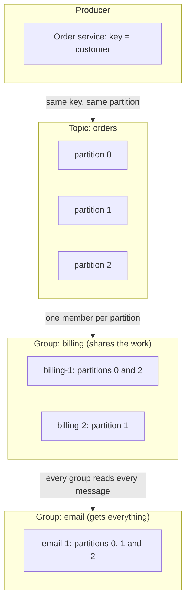
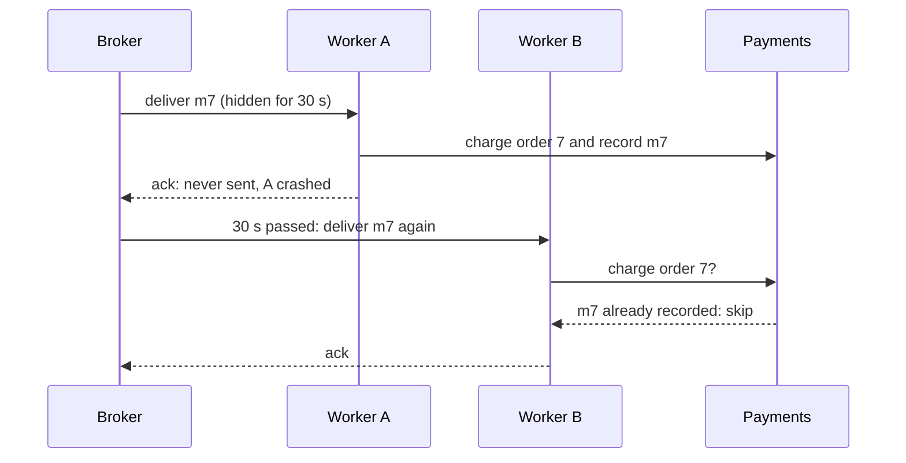
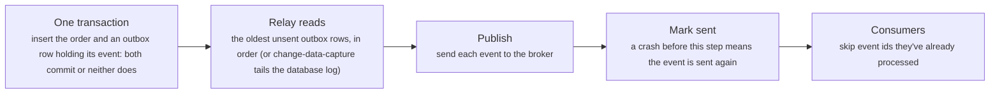

# Messaging: queues, pub/sub and delivery guarantees

> System Design · L2 Proficient · Caching, messaging and resilience · about 105 min · hub module `m05` ([open the hub](https://claude.ai/artifact/WYKUGQ93VYjG6xBpea5exS))

## Why it matters
A queue lets a service hand work off and reply at once; a topic lets one event reach every service that cares. The hard parts are the failures in between: a worker crashes before acknowledging, an ack gets lost, a message can't be parsed, two events for the same order race each other. Brokers deliver at least once, so exactly-once is something you build (with idempotent consumers), and order holds only per partition.

## Pre-question (answer before reading)
**Q:** A payment worker takes a 'charge order 7' message from a queue, charges the card, and crashes before acknowledging the message. What happens next, and what could go wrong?

<details><summary>Answer</summary>

The broker never received the ack, so once the visibility timeout passes (or the connection drops) it delivers the message again, and another worker charges the card a second time. Redelivery is how the broker avoids losing messages, so duplicates are normal. The worker has to be idempotent: store the message id in the same transaction as the charge, and skip ids it has already processed.

</details>

## 🍎 Story time (kid version)
**Pizza Town and the family road trip: Tickets on the kitchen rail**

In Luigi's kitchen, waiters pin order tickets on a rail, and each ticket is taken by one free cook. A ticket stays on the rail until the dish leaves the kitchen, so if a cook is called away, someone else picks it up. Once, table 5 nearly got two pizzas, until the waiter checked the ticket number. When the closing bell rings, every waiter, the cashier and the cleaner hear it. Tickets for one table hang on the same hook, so the starter comes before the main. A smudged ticket that three cooks couldn't read goes to the manager's tray instead of round and round.

| In the story | In a real system |
|---|---|
| Tickets on the rail, each taken by one cook | A queue: each message goes to one consumer (competing consumers) |
| The closing bell everyone hears | Pub/sub: every subscriber gets its own copy of each event |
| A ticket stays on the rail until the dish leaves, and the waiter checks its number | At-least-once delivery (a message is removed only once acknowledged, so a crash means redelivery) with an idempotent consumer that deduplicates by message id |
| One hook per table | Ordering per key: messages with the same key go to the same partition and stay in order |
| The manager's tray | A dead-letter queue for messages that keep failing |

**Where the story breaks:** Luigi's cooks can see each other, and the waiter is in the room. A real broker can't tell a slow consumer from a dead one, so it redelivers after a timeout, and duplicates arrive even when nothing crashed.

## Key ideas (grown-up version)
- **Why a queue**: it decouples producer and consumer in time and load. The producer replies at once, consumers work at their own pace, and a spike becomes a backlog instead of errors (load levelling). The costs: results arrive later, there's a broker to run, and new failure modes. Watch queue depth and consumer lag, and push back on producers when the backlog keeps growing.
- **Queue or pub/sub**: a queue gives each message to one consumer, so adding consumers shares the work (competing consumers). A topic gives each message to every subscriber. Log-based brokers such as Kafka do both: every consumer group receives every message, and inside a group the partitions are split among the members.
- **Acknowledgements**: a broker forgets a message only when the consumer acknowledges it. SQS hides a received message for a visibility timeout and shows it again if it isn't deleted in time; RabbitMQ requeues unacknowledged messages when the consumer's channel closes; Kafka consumers commit offsets. A log-based broker keeps messages for a retention period, so a new group can replay them.
- **Delivery guarantees**: ack (or commit) before processing gives at-most-once: a crash loses the message. Process, then ack gives at-least-once: a crash or a slow ack means a duplicate. No broker can promise exactly-once delivery across an unreliable network; what you build is an exactly-once effect: at-least-once delivery plus idempotent processing.
- **Idempotent consumers**: give every message a unique id (or idempotency key), record processed ids in the same transaction as the effect, and skip ids already seen; or make the operation idempotent by nature (set status = 'paid' rather than add 10). Keep the dedupe records for at least as long as redeliveries can happen.
- **Ordering**: many consumers on one queue don't preserve order. Kafka keeps order within a partition, so key messages by entity (an order id) to keep each entity's events in order; SQS FIFO queues keep order within a message group. Retries and dead-letter queues can still reorder, so consumers that check versions or do idempotent upserts are the safest.
- **Dead-letter queues**: after a few failed attempts, move the message to a dead-letter queue instead of retrying forever, so a poison message doesn't block a partition or burn consumers. Alert on the DLQ's depth, inspect the errors, fix the cause and replay. Transient errors deserve retries with backoff first (module 6).
- **Transactional outbox**: writing to the database and publishing to a broker are two writes that can't be made atomic, so a crash between them loses an event, or announces a change that never committed. Insert the event into an outbox table in the same transaction as the change; a relay, or change-data-capture on the database log, publishes it at least once.

## Diagrams
**One topic, two consumer groups**



_Inside a group the partitions are split among the members, like a queue; across groups every group gets every message, like pub/sub. Offsets belong to each group, so a new group can start from the beginning and replay._

**At-least-once: the ack that never arrived**



_The broker can't tell a crashed worker from a slow one, so it redelivers. Recording the message id with the charge makes the second delivery harmless._

**The transactional outbox**



_The transaction makes the event as durable as the order, the relay makes delivery at-least-once, and the consumers' dedupe turns that into an exactly-once effect._

## Comparisons
**Queues and pub/sub**

|  | Queue (point to point) | Pub/sub (topic) |
|---|---|---|
| Each message goes to | One consumer | Every subscriber (in Kafka, every consumer group) |
| Adding consumers | Shares the work | Adds another independent reader |
| After it's consumed | Deleted once acknowledged | Classic pub/sub drops it once delivered; a log keeps it for the retention period |
| Typical use | Background jobs, work distribution | Events that several services react to |
| Examples | Amazon SQS, RabbitMQ queues, Celery | Kafka topics, Amazon SNS, Google Pub/Sub, Redis pub/sub |

**Delivery guarantees**

| Guarantee | How | On a crash | Use for |
|---|---|---|---|
| At-most-once | Ack (or commit the offset) before processing | The message is lost | Metrics, logs, anything where a gap is fine |
| At-least-once | Process, then ack; redeliver after a timeout | The message is processed again | The default for almost everything |
| Exactly-once effect | At-least-once plus idempotent processing, or a transaction that covers reading, processing and writing | The duplicate is detected and skipped | Payments, ledgers, inventory |

## Code (JavaScript + Python)
### The seeded random generator used by the simulations
```python
def mulberry32(seed):                           # a tiny seeded random generator, same as the JavaScript one
    state = seed & 0xFFFFFFFF
    def rand():
        nonlocal state
        state = (state + 0x6D2B79F5) & 0xFFFFFFFF
        t = ((state ^ (state >> 15)) * (state | 1)) & 0xFFFFFFFF
        t = (t ^ (t + (((t ^ (t >> 7)) * (t | 61)) & 0xFFFFFFFF))) & 0xFFFFFFFF
        return ((t ^ (t >> 14)) & 0xFFFFFFFF) / 4294967296
    return rand
```

```javascript
function mulberry32(seed) {                     // a tiny seeded random generator, same as the Python one
  return function () {
    seed = (seed + 0x6D2B79F5) | 0;
    let t = Math.imul(seed ^ (seed >>> 15), 1 | seed);
    t = (t + Math.imul(t ^ (t >>> 7), 61 | t)) ^ t;
    return ((t ^ (t >>> 14)) >>> 0) / 4294967296;
  };
}
```

### A topic with partitions and consumer groups: a queue and pub/sub at once
```python
class Topic:
    """A log-based topic: messages are appended to partitions and kept; each consumer group has its own offsets."""
    def __init__(self, partitions):
        self.parts = [[] for _ in range(partitions)]
        self.offsets = {}                         # (group, partition) -> next offset to read

    def publish(self, key, message):
        self.parts[sum(map(ord, key)) % len(self.parts)].append(message)   # same key, same partition

    def poll(self, group, partition):
        offset = self.offsets.get((group, partition), 0)
        batch = self.parts[partition][offset:]
        self.offsets[(group, partition)] = len(self.parts[partition])     # commit: nothing is deleted
        return batch

def consume(topic, group, members):
    """Split the partitions among a group's members; each member reads only its own partitions."""
    got = {m: [] for m in members}
    for p in range(len(topic.parts)):
        got[members[p % len(members)]] += topic.poll(group, p)
    return got

orders = Topic(partitions=3)
for n, customer in enumerate(["ana", "ben", "eve", "ana", "ben", "cy"], 1):
    orders.publish(customer, f"o{n}")
for group, members in (("billing", ["billing-1", "billing-2"]), ("email", ["email-1"])):
    for member, msgs in consume(orders, group, members).items():
        print(f"{member}: {' '.join(msgs)}")
again = len(consume(orders, "email", ["email-1"])["email-1"])
late = len(consume(orders, "analytics", ["analytics-1"])["analytics-1"])
print(f"email polls again: {again} new | analytics, a new group, reads {late} from the start")
```

Output:
```text
billing-1: o2 o5 o3
billing-2: o1 o4 o6
email-1: o2 o5 o1 o4 o6 o3
email polls again: 0 new | analytics, a new group, reads 6 from the start
```

- line 8: The key picks the partition, so all of one customer's orders land in the same partition, in the order they were sent.
- line 13: Reading deletes nothing: the group only moves its own offset forward, and other groups keep their own positions.
- line 20: Inside a group each partition has exactly one reader, so the members share the work like a queue.
- line 30: A new group starts at offset 0 and replays the whole log; a classic queue would already have deleted these messages.

```javascript
class Topic {
  // a log-based topic: messages are appended to partitions and kept; each consumer group has its own offsets
  constructor(partitions) {
    this.parts = Array.from({ length: partitions }, () => []);
    this.offsets = new Map();                   // "group/partition" -> next offset to read
  }
  publish(key, message) {
    const p = [...key].reduce((sum, ch) => sum + ch.charCodeAt(0), 0) % this.parts.length;
    this.parts[p].push(message);                // same key, same partition
  }
  poll(group, partition) {
    const offset = this.offsets.get(`${group}/${partition}`) ?? 0;
    const batch = this.parts[partition].slice(offset);
    this.offsets.set(`${group}/${partition}`, this.parts[partition].length);   // commit: nothing is deleted
    return batch;
  }
}

function consume(topic, group, members) {
  // split the partitions among a group's members; each member reads only its own partitions
  const got = new Map(members.map(m => [m, []]));
  for (let p = 0; p < topic.parts.length; p++) got.get(members[p % members.length]).push(...topic.poll(group, p));
  return got;
}

const orders = new Topic(3);
["ana", "ben", "eve", "ana", "ben", "cy"].forEach((customer, i) => orders.publish(customer, `o${i + 1}`));
for (const [group, members] of [["billing", ["billing-1", "billing-2"]], ["email", ["email-1"]]]) {
  for (const [member, msgs] of consume(orders, group, members)) console.log(`${member}: ${msgs.join(" ")}`);
}
const again = consume(orders, "email", ["email-1"]).get("email-1").length;
const late = consume(orders, "analytics", ["analytics-1"]).get("analytics-1").length;
console.log(`email polls again: ${again} new | analytics, a new group, reads ${late} from the start`);
```

Output:
```text
billing-1: o2 o5 o3
billing-2: o1 o4 o6
email-1: o2 o5 o1 o4 o6 o3
email polls again: 0 new | analytics, a new group, reads 6 from the start
```

- line 9: The key picks the partition, so all of one customer's orders land in the same partition, in the order they were sent.
- line 14: Reading deletes nothing: the group only moves its own offset forward, and other groups keep their own positions.
- line 22: Inside a group each partition has exactly one reader, so the members share the work like a queue.
- line 32: A new group starts at offset 0 and replays the whole log; a classic queue would already have deleted these messages.

### At-most-once, at-least-once and an idempotent consumer, under the same crashes
```python
def deliver(mode, n=100, crash_rate=0.1, seed=6):
    rand = mulberry32(seed)
    charges, seen = {}, set()                     # order -> times charged; orders already processed
    for order in range(n):
        while True:                               # the broker keeps delivering until it gets an ack
            crashed = rand() < crash_rate         # does the worker die during this attempt?
            if mode == "at-most-once":            # ack first, then process
                if not crashed:
                    charges[order] = charges.get(order, 0) + 1
                break                             # acked either way: a crash loses the order
            if not (mode == "idempotent" and order in seen):
                charges[order] = charges.get(order, 0) + 1
                seen.add(order)                   # stored in the same transaction as the charge
            if not crashed:
                break                             # process, then ack: a crash before the ack means redelivery
    lost = n - len(charges)
    duplicated = sum(1 for times in charges.values() if times > 1)
    return lost, duplicated

for mode in ("at-most-once", "at-least-once", "idempotent"):
    lost, duplicated = deliver(mode)
    print(f"{mode}: {lost} orders never charged, {duplicated} charged more than once")
```

Output:
```text
at-most-once: 10 orders never charged, 0 charged more than once
at-least-once: 0 orders never charged, 10 charged more than once
idempotent: 0 orders never charged, 0 charged more than once
```

- line 10: At-most-once: the ack went first, so when the worker crashes the broker has already forgotten the message.
- line 11: The idempotent consumer checks whether this order was already processed; a redelivery skips the charge and just acks.
- line 15: At-least-once: the ack comes after the work, so a crash in between makes the broker deliver the same message again.
- line 22: Same crashes, three outcomes: lost orders, double charges, or neither. Only the idempotent consumer gets an exactly-once effect.

```javascript
function deliver(mode, n = 100, crashRate = 0.1, seed = 6) {
  const rand = mulberry32(seed);
  const charges = new Map(), seen = new Set();  // order -> times charged; orders already processed
  const charge = order => charges.set(order, (charges.get(order) ?? 0) + 1);
  for (let order = 0; order < n; order++) {
    while (true) {                              // the broker keeps delivering until it gets an ack
      const crashed = rand() < crashRate;       // does the worker die during this attempt?
      if (mode === "at-most-once") {            // ack first, then process
        if (!crashed) charge(order);
        break;                                  // acked either way: a crash loses the order
      }
      if (!(mode === "idempotent" && seen.has(order))) {
        charge(order);
        seen.add(order);                        // stored in the same transaction as the charge
      }
      if (!crashed) break;                      // process, then ack: a crash before the ack means redelivery
    }
  }
  const lost = n - charges.size;
  const duplicated = [...charges.values()].filter(times => times > 1).length;
  return [lost, duplicated];
}

for (const mode of ["at-most-once", "at-least-once", "idempotent"]) {
  const [lost, duplicated] = deliver(mode);
  console.log(`${mode}: ${lost} orders never charged, ${duplicated} charged more than once`);
}
```

Output:
```text
at-most-once: 10 orders never charged, 0 charged more than once
at-least-once: 0 orders never charged, 10 charged more than once
idempotent: 0 orders never charged, 0 charged more than once
```

- line 10: At-most-once: the ack went first, so when the worker crashes the broker has already forgotten the message.
- line 12: The idempotent consumer checks whether this order was already processed; a redelivery skips the charge and just acks.
- line 16: At-least-once: the ack comes after the work, so a crash in between makes the broker deliver the same message again.
- line 26: Same crashes, three outcomes: lost orders, double charges, or neither. Only the idempotent consumer gets an exactly-once effect.

### Ordering: a shared queue against partitioning by key
```python
def apply_events(events, workers, by_key, seed=4):
    """Process the events with several workers; count orders whose events finished out of order."""
    rand = mulberry32(seed)
    free_at = [0] * workers                       # when each worker is next free
    finished = {}                                 # (order, step) -> time its processing finished
    for order, step in events:
        if by_key:
            w = order % workers                   # partitioned: an order's events always go to the same worker
        else:
            w = free_at.index(min(free_at))       # shared queue: whichever worker is free first
        free_at[w] += 1 + int(rand() * 5)         # processing takes 1 to 5 time units
        finished[(order, step)] = free_at[w]
    orders = {order for order, _ in events}
    return sum(1 for o in orders if any(finished[(o, s + 1)] < finished[(o, s)] for s in range(2)))

events = [(order, step) for order in range(10) for step in range(3)]   # created, paid, shipped, back to back
for by_key, label in ((False, "one shared queue, 3 workers"), (True, "partitioned by order id, 3 workers")):
    print(f"{label}: {apply_events(events, 3, by_key)} of 10 orders had events applied out of order")
```

Output:
```text
one shared queue, 3 workers: 5 of 10 orders had events applied out of order
partitioned by order id, 3 workers: 0 of 10 orders had events applied out of order
```

- line 8: Partitioned by key: all of an order's events go to one worker, which handles them one after another.
- line 10: A shared queue hands each event to whichever worker is free, so created, paid and shipped can run at the same time.
- line 14: An order counts as broken if any later event finished before the one before it.
- line 18: Half the orders are applied out of order with a shared queue, none with partitioning. The price: one slow or hot key holds up its whole partition.

```javascript
function applyEvents(events, workers, byKey, seed = 4) {
  // process the events with several workers; count orders whose events finished out of order
  const rand = mulberry32(seed);
  const freeAt = new Array(workers).fill(0);    // when each worker is next free
  const finished = new Map();                   // "order/step" -> time its processing finished
  for (const [order, step] of events) {
    const w = byKey
      ? order % workers                         // partitioned: an order's events always go to the same worker
      : freeAt.indexOf(Math.min(...freeAt));    // shared queue: whichever worker is free first
    freeAt[w] += 1 + Math.floor(rand() * 5);    // processing takes 1 to 5 time units
    finished.set(`${order}/${step}`, freeAt[w]);
  }
  const orders = new Set(events.map(([order]) => order));
  return [...orders].filter(o => [0, 1].some(s => finished.get(`${o}/${s + 1}`) < finished.get(`${o}/${s}`))).length;
}

const events = Array.from({ length: 10 }, (_, order) => [0, 1, 2].map(step => [order, step])).flat();   // created, paid, shipped, back to back
for (const [byKey, label] of [[false, "one shared queue, 3 workers"], [true, "partitioned by order id, 3 workers"]]) {
  console.log(`${label}: ${applyEvents(events, 3, byKey)} of 10 orders had events applied out of order`);
}
```

Output:
```text
one shared queue, 3 workers: 5 of 10 orders had events applied out of order
partitioned by order id, 3 workers: 0 of 10 orders had events applied out of order
```

- line 8: Partitioned by key: all of an order's events go to one worker, which handles them one after another.
- line 9: A shared queue hands each event to whichever worker is free, so created, paid and shipped can run at the same time.
- line 14: An order counts as broken if any later event finished before the one before it.
- line 19: Half the orders are applied out of order with a shared queue, none with partitioning. The price: one slow or hot key holds up its whole partition.

## Worked example
**Problem.** An order service must save each order and publish an OrderPlaced event. Show what goes wrong when it commits to the database and then publishes to the broker, and design a transactional outbox that never loses an event.

1. Two separate writes can't be atomic. Crash after the database commit and before the publish, and the event is lost; publish first and crash before the commit, and other services hear about an order that doesn't exist.
2. The outbox: in the same database transaction as the order, insert a row holding the event into an outbox table. Both commit or neither does.
3. A relay reads the unsent outbox rows in order, publishes each one, then marks it sent. A crash between publishing and marking means the event is published again after a restart: at-least-once, so events carry ids and consumers deduplicate.
4. Change-data-capture (Debezium reading the database log, for example) can replace the polling relay. The costs: a table to prune, a little delay before publishing, and a relay to monitor; the age of the oldest unsent row makes a good alert.

```python
def dual_write(n, seed):
    rand, db, published = mulberry32(seed), [], []
    for order in range(n):
        db.append(order)                          # 1. commit the order
        if rand() < 0.08:
            continue                              # crash here: the order exists, the event is never sent
        published.append(order)                   # 2. publish the event
    return db, published

def with_outbox(n, seed):
    rand, db, outbox, published = mulberry32(seed), [], [], []
    for order in range(n):
        db.append(order)                          # one transaction: the order...
        outbox.append({"id": order, "sent": False})   # ...and its event, committed together
    while True:                                   # the relay
        row = next((r for r in outbox if not r["sent"]), None)   # SELECT the oldest unsent row
        if row is None:
            break
        published.append(row["id"])               # publish it
        if rand() < 0.08:
            continue                              # crash before marking it sent: it is published again
        row["sent"] = True                        # UPDATE outbox SET sent = true
    return db, published

def consume_once(events):
    seen, handled = set(), 0
    for event_id in events:
        if event_id not in seen:                  # dedupe by event id
            seen.add(event_id)
            handled += 1
    return handled

for name, run in (("dual write", dual_write), ("outbox", with_outbox)):
    db, published = run(100, seed=4)
    missing = len(db) - len(set(published))
    print(f"{name}: {len(db)} orders, {len(published)} events sent, {missing} orders missing, {consume_once(published)} handled after dedupe")
```

Output:
```text
dual write: 100 orders, 92 events sent, 8 orders missing, 92 handled after dedupe
outbox: 100 orders, 108 events sent, 0 orders missing, 100 handled after dedupe
```

```javascript
function dualWrite(n, seed) {
  const rand = mulberry32(seed), db = [], published = [];
  for (let order = 0; order < n; order++) {
    db.push(order);                             // 1. commit the order
    if (rand() < 0.08) continue;                // crash here: the order exists, the event is never sent
    published.push(order);                      // 2. publish the event
  }
  return [db, published];
}

function withOutbox(n, seed) {
  const rand = mulberry32(seed), db = [], outbox = [], published = [];
  for (let order = 0; order < n; order++) {
    db.push(order);                             // one transaction: the order...
    outbox.push({ id: order, sent: false });    // ...and its event, committed together
  }
  while (true) {                                // the relay
    const row = outbox.find(r => !r.sent);      // SELECT the oldest unsent row
    if (row === undefined) break;
    published.push(row.id);                     // publish it
    if (rand() < 0.08) continue;                // crash before marking it sent: it is published again
    row.sent = true;                            // UPDATE outbox SET sent = true
  }
  return [db, published];
}

function consumeOnce(events) {
  const seen = new Set();
  let handled = 0;
  for (const id of events) {
    if (!seen.has(id)) { seen.add(id); handled++; }   // dedupe by event id
  }
  return handled;
}

for (const [name, run] of [["dual write", dualWrite], ["outbox", withOutbox]]) {
  const [db, published] = run(100, 4);
  const missing = db.length - new Set(published).size;
  console.log(`${name}: ${db.length} orders, ${published.length} events sent, ${missing} orders missing, ${consumeOnce(published)} handled after dedupe`);
}
```

Output:
```text
dual write: 100 orders, 92 events sent, 8 orders missing, 92 handled after dedupe
outbox: 100 orders, 108 events sent, 0 orders missing, 100 handled after dedupe
```

**Answer.** The dual write loses 8 of the 100 events: those orders exist, but no other service ever hears about them. The outbox sends 108 events, 8 of them repeats after relay crashes, and loses none; the consumer's dedupe by event id brings that back to exactly 100.

## Your turn (faded example)
**Problem.** Finish `drain(messages, handler, max_attempts)`: process messages in order; when the handler raises, the message goes to the back of the queue to be retried; after `max_attempts` failures it moves to the dead-letter list with its error. Return the processed ids, the dead letters and the number of handler calls.

- ✓ Keep each message with its count of failed attempts. Take from the front, call the handler, and record the id on success.
- **What happens to a message whose handler fails?**
  <details><summary>Answer</summary>Its failure count goes up. Below the limit it goes to the back of the queue, so the messages behind it aren't blocked; at the limit it moves to the dead-letter list with the error.</details>
- **What does sending failures to the back cost?**
  <details><summary>Answer</summary>Ordering: m2 is processed after m4 and m5. When a key's order matters, retry in place after a delay (holding up only that key's partition), or park the message and hold the later messages with the same key.</details>
- **What's the cost, and what do you monitor?**
  <details><summary>Answer</summary>Each message is handled at most max_attempts times, so a poison message costs a bounded amount of work. Alert on the dead-letter queue's depth and age, inspect the errors, fix the cause and replay. Real systems also wait between attempts, with backoff (module 6).</details>

Starter:
```python
from collections import deque

def drain(messages, handler, max_attempts=3):
    queue = deque((m, 0) for m in messages)      # (message, failed attempts so far)
    done, dead, calls = [], [], 0
    while queue:
        msg, failures = queue.popleft()
        calls += 1
        ...                                       # TODO: call the handler; on failure retry at the back, or dead-letter
    return done, dead, calls
```

```javascript
function drain(messages, handler, maxAttempts = 3) {
  const queue = messages.map(m => [m, 0]);      // [message, failed attempts so far]
  const done = [], dead = [];
  let calls = 0;
  while (queue.length) {
    let [msg, failures] = queue.shift();
    calls++;
    // TODO: call the handler; on failure retry at the back, or dead-letter
  }
  return [done, dead, calls];
}
```

<details><summary>Full solution</summary>

```python
from collections import deque

def drain(messages, handler, max_attempts=3):
    queue = deque((m, 0) for m in messages)      # (message, failed attempts so far)
    done, dead, calls = [], [], 0
    while queue:
        msg, failures = queue.popleft()
        calls += 1
        try:
            handler(msg)
            done.append(msg["id"])
        except ValueError as err:
            failures += 1
            if failures < max_attempts:
                queue.append((msg, failures))     # retry later; don't block the messages behind it
            else:
                dead.append(f"{msg['id']} ({err})")   # give up: park it for a human to inspect
    return done, dead, calls

flaky_seen = set()
def handler(msg):
    if msg["body"] == "???":
        raise ValueError("unreadable body")       # a poison message: it will never succeed
    if msg["body"] == "flaky" and msg["id"] not in flaky_seen:
        flaky_seen.add(msg["id"])
        raise ValueError("timeout")               # a transient failure: works on the second try

messages = [{"id": f"m{i}", "body": body} for i, body in enumerate(["ok", "flaky", "???", "ok", "ok"], 1)]
done, dead, calls = drain(messages, handler)
print("processed:", *done, "| dead letters:", *dead, "| handler calls:", calls)
```

Output:
```text
processed: m1 m4 m5 m2 | dead letters: m3 (unreadable body) | handler calls: 8
```

```javascript
function drain(messages, handler, maxAttempts = 3) {
  const queue = messages.map(m => [m, 0]);      // [message, failed attempts so far]
  const done = [], dead = [];
  let calls = 0;
  while (queue.length) {
    let [msg, failures] = queue.shift();
    calls++;
    try {
      handler(msg);
      done.push(msg.id);
    } catch (err) {
      failures++;
      if (failures < maxAttempts) queue.push([msg, failures]);   // retry later; don't block the messages behind it
      else dead.push(`${msg.id} (${err.message})`);              // give up: park it for a human to inspect
    }
  }
  return [done, dead, calls];
}

const flakySeen = new Set();
function handler(msg) {
  if (msg.body === "???") throw new Error("unreadable body");   // a poison message: it will never succeed
  if (msg.body === "flaky" && !flakySeen.has(msg.id)) {
    flakySeen.add(msg.id);
    throw new Error("timeout");                 // a transient failure: works on the second try
  }
}

const messages = ["ok", "flaky", "???", "ok", "ok"].map((body, i) => ({ id: `m${i + 1}`, body }));
const [done, dead, calls] = drain(messages, handler);
console.log("processed:", ...done, "| dead letters:", ...dead, "| handler calls:", calls);
```

Output:
```text
processed: m1 m4 m5 m2 | dead letters: m3 (unreadable body) | handler calls: 8
```

</details>

## Socratic checks and quiz (answers hidden)
**1. What does this print?**

```python
msgs = ["a", "b", "c", "d", "e"]
workers = {"w1": [], "w2": []}
names = list(workers)
for i, m in enumerate(msgs):
    workers[names[i % 2]].append(m)
audit = list(msgs)
print(" ".join(workers["w1"]), "|", " ".join(workers["w2"]), "|", len(audit))
```

```javascript
const msgs = ["a", "b", "c", "d", "e"];
const workers = { w1: [], w2: [] };
const names = Object.keys(workers);
msgs.forEach((m, i) => workers[names[i % 2]].push(m));
const audit = [...msgs];
console.log(workers.w1.join(" "), "|", workers.w2.join(" "), "|", audit.length);
```

- A. a c e | b d | 5
- B. a b c d e | a b c d e | 5
- C. a c e | b d | 0
- D. a b c | d e | 5

<details><summary>Answer</summary>

a c e | b d | 5. The two workers compete for the queue's messages, so they alternate; the audit service is a separate subscriber and receives all five.

</details>

**2. What does this print?**

```python
balance, seen = 0, set()
for msg_id, amount in [("t1", 50), ("t2", 20), ("t1", 50), ("t3", 30), ("t2", 20)]:
    if msg_id in seen:
        continue
    seen.add(msg_id)
    balance += amount
print(balance, len(seen))
```

```javascript
let balance = 0;
const seen = new Set();
for (const [msgId, amount] of [["t1", 50], ["t2", 20], ["t1", 50], ["t3", 30], ["t2", 20]]) {
  if (seen.has(msgId)) continue;
  seen.add(msgId);
  balance += amount;
}
console.log(balance, seen.size);
```

- A. 100 3
- B. 170 5
- C. 100 5
- D. 170 3

<details><summary>Answer</summary>

100 3. t1 and t2 are each delivered twice, but the second copies are skipped, so only t1, t2 and t3 count: 50 + 20 + 30 = 100, from 3 distinct messages.

</details>

**3. Each order's events (created, paid, shipped) must be processed in order, and you need 20 consumers for throughput. What do you do?**

- A. Partition the topic by order id, with each partition read by one consumer at a time
- B. Put all events on one queue with 20 competing consumers
- C. Use a single consumer
- D. Let consumers sort events by their timestamps

<details><summary>Answer</summary>

Partition the topic by order id, with each partition read by one consumer at a time. Partitioning by key keeps each order's events in one partition, read in order, while the 20 consumers share the partitions. One shared queue lets events of the same order run in parallel; one consumer can't keep up; and timestamps from different machines can't be trusted to order events.

</details>

**4. Which make a consumer safe under at-least-once delivery? (choose 2)**

- A. Record each message id in the same transaction as its effect, and skip ids already seen
- B. Make the effect idempotent by nature, such as setting status = 'paid'
- C. Acknowledge each message before processing it
- D. Raise the visibility timeout to an hour
- E. Retry failed messages forever

<details><summary>Answer</summary>

Record each message id in the same transaction as its effect, and skip ids already seen, Make the effect idempotent by nature, such as setting status = 'paid'. Both make a repeated delivery harmless. Acknowledging first trades duplicates for lost messages; a longer timeout makes redelivery rarer but not impossible; and endless retries let a poison message block the queue.

</details>

**5. Judge each statement.**

- A topic delivers each message to every subscriber group.
- Acknowledging a message before processing it gives at-least-once delivery.
- Kafka keeps a topic's messages in order across all of its partitions.
- A dead-letter queue stops a poison message from being retried forever.

<details><summary>Answer</summary>

A topic delivers each message to every subscriber group.: Yes; Acknowledging a message before processing it gives at-least-once delivery.: No; Kafka keeps a topic's messages in order across all of its partitions.: No; A dead-letter queue stops a poison message from being retried forever.: Yes. Every group gets every message. Acknowledging first gives at-most-once: a crash loses the message. Kafka orders messages only within a partition. And a dead-letter queue parks messages after a set number of failures.

</details>

**6. Put the transactional outbox steps in order.**

- (put the steps in order)

<details><summary>Answer</summary>

In one transaction, insert the order and an outbox row holding its event → The relay reads the oldest unsent outbox row → The relay publishes the event to the broker → The relay marks the row as sent → The consumer processes the event, skipping ids it has already seen. The transaction makes the event durable with the order; the relay publishes before marking, so a crash causes a repeat rather than a loss, and the consumer's dedupe absorbs the repeat.

</details>

**7. Complete the Python failure handler: retry at the back of the queue, and dead-letter the message once it has failed `max_attempts` times.**

```
def on_failure(msg, attempts, queue, dlq, max_attempts=3):
    attempts += 1
    if {{0}}:
        dlq.append(msg)
    else:
        queue.append({{1}})
    return attempts

```

<details><summary>Answer</summary>

attempts >= max_attempts | (msg, attempts). After the third failure the message goes to the dead-letter queue; before that it goes back on the queue carrying its new attempt count, so the next failure is counted correctly.

</details>

**8. Match each description to its name.**


<details><summary>Answer</summary>

Each message goes to one consumer in a group = Queue (competing consumers); Every subscriber gets each message = Pub/sub; Messages that keep failing are parked here = Dead-letter queue; Events written in the same transaction as the data = Transactional outbox. Write-back is a caching strategy (module 4), not a messaging pattern.

</details>

## Traps & misconceptions
- **“Our broker guarantees exactly-once, so consumers don't need to deduplicate.”** Exactly-once features cover a narrow path, such as Kafka transactions from topic to topic, or SQS FIFO deduplication within a five-minute window. Effects outside the broker, like charging a card or sending an email, still need idempotency keys.
- **“Acknowledge first, so the message isn't redelivered.”** That's at-most-once: a crash after the ack loses the message. Process first, then acknowledge, and make the processing idempotent.
- **“A FIFO queue keeps things in order, however many consumers it has.”** The queue hands messages out in order, but parallel consumers finish them in any order. Order holds per partition or message group, with one consumer at a time.
- **“Retry failed messages until they succeed.”** A poison message never succeeds: it burns consumers and, in an ordered partition, blocks everything behind it. Cap the attempts, back off between them, and dead-letter the rest.
- **“Save to the database, then publish the event: what could go wrong?”** A crash between the two loses the event, and publishing first can announce an order that never commits. Use a transactional outbox or change-data-capture.
- **“A queue fixes overload.”** It turns a spike into a backlog. If consumers are slower than producers on average, the backlog grows until messages expire or the disk fills. Watch depth and consumer lag, scale consumers, and push back on producers.

## Discussion prompts
- **When would you choose a log-based broker such as Kafka over a classic queue such as SQS or RabbitMQ?**
  <details><summary>One good answer</summary>Kafka when several independent consumers need the same events, when you want to replay history (rebuild a view, backfill a new service), or when per-key ordering at high throughput matters. A classic queue when the job is handing tasks to workers, with per-message acks, delays, dead-letter queues and easy scaling, and nobody needs the history.</details>
- **A payment consumer occasionally charges customers twice. How would you find and fix it?**
  <details><summary>One good answer</summary>Duplicates point to at-least-once redelivery: a handler slower than the visibility timeout, a crash between charging and acknowledging, or a producer retry that published twice. Fix it at the effect: give each payment an idempotency key, store it with the charge in one transaction (and pass it to the payment provider, which accepts idempotency keys), and skip keys already processed. Then tune the timeout and alert on redelivery counts.</details>

## Teach-back
**Prompt:** Explain to a junior colleague the difference between a queue and pub/sub, and how you'd make a consumer safe when the broker delivers at least once.

Rubric:
- [ ] Queue: each message to one consumer; pub/sub: every subscriber gets a copy
- [ ] Ack after processing gives at-least-once; ack before gives at-most-once
- [ ] Exactly-once effect: at-least-once delivery plus an idempotent consumer that records ids with the effect
- [ ] Order holds only per partition or key
- [ ] A dead-letter queue after a few attempts, monitored and replayed

<details><summary>Model answer</summary>

A queue gives each message to one consumer, so adding consumers shares the work; pub/sub gives every subscriber its own copy, so several services can react to the same event. Kafka does both with consumer groups. Brokers forget a message only when it's acknowledged, so I process first and ack after, which is at-least-once: a crash or a slow ack means the same message arrives again. To make that safe, the consumer records each message id in the same transaction as its effect and skips ids it has seen, which gives an exactly-once effect. Order holds only within a partition, so I key messages by entity. Messages that keep failing go to a dead-letter queue after a few attempts, with an alert, so they can be fixed and replayed instead of blocking everything.

</details>

## Quick Q&A (also in the SRS deck)
- **Queue or pub/sub: which gives each message to one consumer?** A queue; pub/sub gives every subscriber a copy.
- **Acknowledging before processing gives?** At-most-once delivery: a crash after the ack loses the message.
- **How do you get an exactly-once effect?** At-least-once delivery plus an idempotent consumer that records message ids with the effect.
- **How does Kafka keep order?** Only within a partition, so key messages by entity to keep each entity's events in order.
- **What is a dead-letter queue for?** Parking messages that keep failing, so they stop blocking or burning consumers.
- **The transactional outbox?** Write the event to an outbox table in the same transaction as the data; a relay publishes it.

## Practice problems
- [ ] [Exercise · SQS visibility timeouts](https://docs.aws.amazon.com/AWSSimpleQueueService/latest/SQSDeveloperGuide/sqs-visibility-timeout.html) · work out what happens when processing takes longer than the timeout, and how a consumer can extend it
- [ ] [Exercise · SQS dead-letter queues](https://docs.aws.amazon.com/AWSSimpleQueueService/latest/SQSDeveloperGuide/sqs-dead-letter-queues.html) · set a maxReceiveCount for a payment queue, say why it shouldn't be 1, and plan how failed messages get replayed
- [ ] [Reading · Kafka's design: delivery semantics](https://kafka.apache.org/43/design/design/) · in the Message Delivery Semantics section, explain how committing the offset before or after processing changes the guarantee, and what Kafka transactions add
- [ ] [Pattern · Transactional outbox](https://microservices.io/patterns/data/transactional-outbox.html) · sketch the outbox table and the relay for an order service, and list what consumers must do about duplicates

## Sources (accessed 2026-10-09)
- [Apache Kafka documentation: Design](https://kafka.apache.org/43/design/design/)
- [Amazon SQS Developer Guide: Visibility timeout](https://docs.aws.amazon.com/AWSSimpleQueueService/latest/SQSDeveloperGuide/sqs-visibility-timeout.html)
- [Amazon SQS Developer Guide: Dead-letter queues](https://docs.aws.amazon.com/AWSSimpleQueueService/latest/SQSDeveloperGuide/sqs-dead-letter-queues.html)
- [RabbitMQ: Consumer acknowledgements and publisher confirms](https://www.rabbitmq.com/docs/confirms)
- [microservices.io: Transactional outbox](https://microservices.io/patterns/data/transactional-outbox.html)
