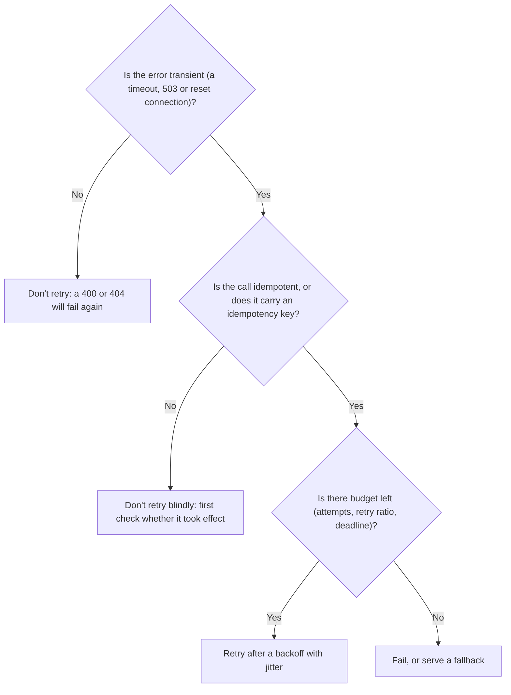
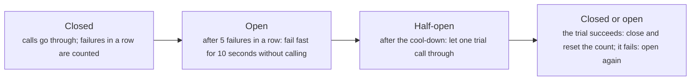
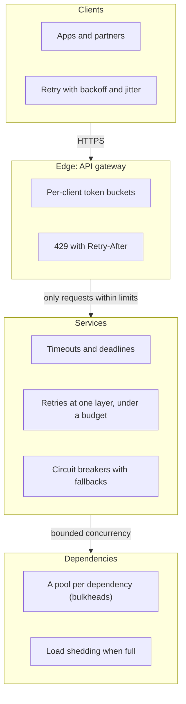

# Rate limiting and resilience: limits, timeouts, retries and breakers

> System Design · L2 Proficient · Caching, messaging and resilience · about 110 min · hub module `m06` ([open the hub](https://claude.ai/artifact/WYKUGQ93VYjG6xBpea5exS))

## Why it matters
One client's runaway script, or one slow dependency, can take a whole service down. Rate limiters decide how much each client may send. Timeouts, retries with backoff, circuit breakers and bulkheads decide what happens when something you call gets slow or fails, so that a fault stays small instead of cascading through every service that waits on it.

## Pre-question (answer before reading)
**Q:** Your service calls a payment API with a 30-second timeout and retries three times on any error. The payment API slows to 20 seconds per call. What happens to your service?

<details><summary>Answer</summary>

Every payment request now holds a thread or connection for 20 seconds, and much longer with retries, so the pool fills and every endpoint, even ones that never touch payments, starts queueing and timing out. The retries also multiply the load on the struggling API. A shorter timeout, retries with backoff and jitter under a budget, a circuit breaker and a separate pool (a bulkhead) for payment calls would keep the slowdown contained.

</details>

## 🍎 Story time (kid version)
**Pizza Town and the family road trip: The pool's water slides**

At the pool, the big slide has a jar of tokens: one token per ride, one new token every ten seconds, five at most, so friends can go back to back, but nobody hogs it. The small slide just lets one kid go every ten seconds, however long the line. When the slide is shut, kids come back after one minute, then two, then four, each at a slightly different time, so they don't all rush back at once. After three kids got stuck, the lifeguard closed the slide for ten minutes, then let one kid test it. And the toddlers have their own slide, so a jam on the big one never stops them.

| In the story | In a real system |
|---|---|
| A jar of tokens that refills slowly, five at most | Token bucket: a steady refill rate, with room for short bursts |
| The small slide: one kid every ten seconds | Leaky bucket: requests leave at a fixed rate, however fast they arrive |
| Coming back after one, two, then four minutes, at slightly different times | Retries with exponential backoff and jitter |
| Closing the slide after three got stuck, then letting one kid test it | A circuit breaker: open after repeated failures, half-open to try again |
| The toddlers' own slide | A bulkhead: separate pools, so one failing dependency can't use up everything |

**Where the story breaks:** The kids can see that the slide is shut. A service usually can't: it only sees slow replies, so it needs timeouts to notice, and limits that hold across many servers rather than at one gate.

## Key ideas (grown-up version)
- **Why limit**: to protect a service from overload and abuse, share capacity fairly between clients, and control cost. Limit per client (API key, user, sometimes IP) and sometimes globally; reject with 429 Too Many Requests and a Retry-After header, and tell clients their remaining quota.
- **Token bucket**: tokens refill at rate r up to a capacity b; each request spends one; an empty bucket rejects. Bursts of up to b pass, then r per second on average. Only two numbers per client: the tokens left and the time of the last refill.
- **Leaky bucket**: requests join a queue that drains at a fixed rate, and a full queue rejects. The output is perfectly smooth, which suits a fragile backend, but requests wait in the queue and bursts can't get through faster. NGINX's limit_req works this way.
- **Windows**: a fixed window counter is simplest (INCR plus EXPIRE) but lets up to twice the limit through around a window boundary. A sliding log stores every timestamp and is exact; a sliding window counter weights the previous window's count by how much of it still overlaps, which is accurate enough with just two counters.
- **Limiting across servers**: with many API servers the counters must be shared (usually in Redis), and the check and the update must be one atomic step (a Lua script, or a single INCR), or two servers can both let the last request through. Cheaper approximations: give each of N servers limit/N, or route each client to one server. Decide whether to fail open or closed when the limiter's store is down.
- **Timeouts**: every remote call needs one, set from the dependency's measured latency (a little above its p99.9, say), plus an overall deadline that shrinks as it's passed down the call chain. Without timeouts, one slow dependency holds threads and connections until everything queues behind it.
- **Retries**: retry only transient failures (timeouts, 503s, dropped connections) and only idempotent operations or ones carrying an idempotency key. Use exponential backoff with jitter so clients don't retry in lockstep, cap the attempts, keep a retry budget (retries under about 10% of requests), and retry at one layer only: 4 attempts at each of 3 layers can turn one call into 64.
- **Circuit breakers and bulkheads**: a breaker counts recent failures; past a threshold it opens and fails fast for a cool-down, then half-opens to let a trial call through, closing if it succeeds. A bulkhead gives each dependency its own pool of threads or connections, so one slow dependency can't starve the rest. With fallbacks (a cached or default answer) and load shedding, they stop failures from cascading.

## Diagrams
**Should this call be retried?**



**A circuit breaker's states**



_Failing fast spares the caller's threads and gives the dependency room to recover; the half-open trial finds out when it has._

**Where the protections sit**



_Edge limits keep clients fair and reject cheaply before any work is done; the inner layers keep each service alive when the things it calls misbehave._

## Comparisons
**Rate-limiting algorithms**

| Algorithm | State per client | Bursts | Accuracy | Notes |
|---|---|---|---|---|
| Token bucket | Tokens and the last refill time | Up to the capacity | Exact | The usual choice for API limits |
| Leaky bucket (queue) | A queue | Smoothed out | Exact | Steady output, but requests wait |
| Fixed window counter | One counter per window | Up to twice the limit at a boundary | Coarse | Simplest: INCR and EXPIRE |
| Sliding window log | Every timestamp in the window | None beyond the limit | Exact | Memory grows with the limit |
| Sliding window counter | Two counters | Small | Approximate | Weights the previous window; good enough at scale |

**Resilience patterns**

| Pattern | Protects against | Watch out for |
|---|---|---|
| Timeout | Waiting forever on a slow dependency | Too long ties up resources; too short fails healthy calls |
| Retry with backoff and jitter | Brief, transient failures | Duplicates (needs idempotency) and multiplied load |
| Circuit breaker | Hammering a dependency that's down | Needs a fallback; thresholds to tune per dependency |
| Bulkhead | One slow dependency using up every thread or connection | Pools that are too small waste capacity |
| Load shedding | More work than capacity | Shed low-priority work first |

## Code (JavaScript + Python)
### The seeded random generator used by the simulations
```python
def mulberry32(seed):                           # a tiny seeded random generator, same as the JavaScript one
    state = seed & 0xFFFFFFFF
    def rand():
        nonlocal state
        state = (state + 0x6D2B79F5) & 0xFFFFFFFF
        t = ((state ^ (state >> 15)) * (state | 1)) & 0xFFFFFFFF
        t = (t ^ (t + (((t ^ (t >> 7)) * (t | 61)) & 0xFFFFFFFF))) & 0xFFFFFFFF
        return ((t ^ (t >> 14)) & 0xFFFFFFFF) / 4294967296
    return rand
```

```javascript
function mulberry32(seed) {                     // a tiny seeded random generator, same as the Python one
  return function () {
    seed = (seed + 0x6D2B79F5) | 0;
    let t = Math.imul(seed ^ (seed >>> 15), 1 | seed);
    t = (t + Math.imul(t ^ (t >>> 7), 61 | t)) ^ t;
    return ((t ^ (t >>> 14)) >>> 0) / 4294967296;
  };
}
```

### Three limiters, 10 requests a minute, 20 requests around the minute boundary
```python
class FixedWindow:
    def __init__(self, limit, window_ms):
        self.limit, self.window, self.counts = limit, window_ms, {}

    def allow(self, now):
        w = now // self.window                    # which window this request falls in
        if self.counts.get(w, 0) >= self.limit:
            return False
        self.counts[w] = self.counts.get(w, 0) + 1
        return True

class SlidingWindowCounter:
    def __init__(self, limit, window_ms):
        self.limit, self.window, self.counts = limit, window_ms, {}

    def allow(self, now):
        w, into = divmod(now, self.window)
        prev, cur = self.counts.get(w - 1, 0), self.counts.get(w, 0)
        # estimate = prev x (share of the previous window still in the last minute) + cur, in whole numbers
        if prev * (self.window - into) + cur * self.window >= self.limit * self.window:
            return False
        self.counts[w] = cur + 1
        return True

class TokenBucket:
    def __init__(self, capacity, ms_per_token):
        self.capacity, self.ms_per_token = capacity, ms_per_token
        self.credit, self.last = capacity * ms_per_token, 0   # credit counts milliseconds of refill; starts full

    def allow(self, now):
        self.credit = min(self.capacity * self.ms_per_token, self.credit + now - self.last)   # refill
        self.last = now
        if self.credit < self.ms_per_token:
            return False
        self.credit -= self.ms_per_token          # spend one token
        return True

burst = [59_000 + 100 * i for i in range(20)]     # 20 requests between 59.0 s and 60.9 s
for name, limiter in (("fixed window", FixedWindow(10, 60_000)),
                      ("sliding window counter", SlidingWindowCounter(10, 60_000)),
                      ("token bucket", TokenBucket(10, 6_000))):
    allowed = sum(1 for t in burst if limiter.allow(t))
    print(f"{name}: {allowed} of 20 allowed in 2 seconds")
```

Output:
```text
fixed window: 20 of 20 allowed in 2 seconds
sliding window counter: 11 of 20 allowed in 2 seconds
token bucket: 10 of 20 allowed in 2 seconds
```

- line 6: Each window has its own counter, so the count starts again from zero at 60.0 seconds.
- line 20: The previous window still counts in proportion to how much of it overlaps the last 60 seconds, so the full previous minute blocks almost everything.
- line 31: Refill is computed lazily from the time since the last request, so an idle client costs nothing.
- line 43: The fixed window lets 20 through in two seconds, twice the limit. The sliding counter lets one extra slip through; the token bucket holds at 10.

```javascript
class FixedWindow {
  constructor(limit, windowMs) { this.limit = limit; this.window = windowMs; this.counts = new Map(); }
  allow(now) {
    const w = Math.floor(now / this.window);    // which window this request falls in
    if ((this.counts.get(w) ?? 0) >= this.limit) return false;
    this.counts.set(w, (this.counts.get(w) ?? 0) + 1);
    return true;
  }
}

class SlidingWindowCounter {
  constructor(limit, windowMs) { this.limit = limit; this.window = windowMs; this.counts = new Map(); }
  allow(now) {
    const w = Math.floor(now / this.window), into = now % this.window;
    const prev = this.counts.get(w - 1) ?? 0, cur = this.counts.get(w) ?? 0;
    // estimate = prev x (share of the previous window still in the last minute) + cur, in whole numbers
    if (prev * (this.window - into) + cur * this.window >= this.limit * this.window) return false;
    this.counts.set(w, cur + 1);
    return true;
  }
}

class TokenBucket {
  constructor(capacity, msPerToken) {
    this.capacity = capacity; this.msPerToken = msPerToken;
    this.credit = capacity * msPerToken; this.last = 0;   // credit counts milliseconds of refill; starts full
  }
  allow(now) {
    this.credit = Math.min(this.capacity * this.msPerToken, this.credit + now - this.last);   // refill
    this.last = now;
    if (this.credit < this.msPerToken) return false;
    this.credit -= this.msPerToken;             // spend one token
    return true;
  }
}

const burst = Array.from({ length: 20 }, (_, i) => 59_000 + 100 * i);   // 20 requests between 59.0 s and 60.9 s
for (const [name, limiter] of [["fixed window", new FixedWindow(10, 60_000)],
                               ["sliding window counter", new SlidingWindowCounter(10, 60_000)],
                               ["token bucket", new TokenBucket(10, 6_000)]]) {
  const allowed = burst.filter(t => limiter.allow(t)).length;
  console.log(`${name}: ${allowed} of 20 allowed in 2 seconds`);
}
```

Output:
```text
fixed window: 20 of 20 allowed in 2 seconds
sliding window counter: 11 of 20 allowed in 2 seconds
token bucket: 10 of 20 allowed in 2 seconds
```

- line 4: Each window has its own counter, so the count starts again from zero at 60.0 seconds.
- line 17: The previous window still counts in proportion to how much of it overlaps the last 60 seconds, so the full previous minute blocks almost everything.
- line 29: Refill is computed lazily from the time since the last request, so an idle client costs nothing.
- line 42: The fixed window lets 20 through in two seconds, twice the limit. The sliding counter lets one extra slip through; the token bucket holds at 10.

### A retry storm: immediate retries, plain backoff and backoff with jitter
```python
def storm(policy, clients=100, capacity=10, base=8, seed=2):
    """100 clients fail at once and retry. Each time slot the server completes 10 requests,
    but only 5 when more than 20 arrive: an overloaded server wastes work."""
    rand = mulberry32(seed)
    due = {0: list(range(clients))}               # slot -> clients sending a request in that slot
    failures = [0] * clients
    calls = overloaded = last = 0
    while due:
        slot = min(due)
        batch = due.pop(slot)
        calls += len(batch)
        busy = len(batch) > 2 * capacity
        if busy:
            overloaded += 1
        served = capacity // 2 if busy else capacity
        for i, c in enumerate(batch):
            if i < served:
                last = slot                       # this client is done
                continue
            failures[c] += 1
            ceiling = min(64, base * 2 ** (failures[c] - 1))   # 8, 16, 32, 64, 64... slots
            if policy == "immediate":
                wait = 1
            elif policy == "backoff":
                wait = ceiling                    # everyone who failed together waits the same time
            else:
                wait = 1 + int(rand() * ceiling)  # full jitter: anywhere up to the ceiling
            due.setdefault(slot + wait, []).append(c)
    return calls, overloaded, last

for policy in ("immediate", "backoff", "backoff + jitter"):
    calls, overloaded, last = storm(policy)
    print(f"{policy}: {calls} calls, overloaded slots {overloaded}, last client served in slot {last}")
```

Output:
```text
immediate: 1030 calls, overloaded slots 16, last client served in slot 17
backoff: 1030 calls, overloaded slots 16, last client served in slot 952
backoff + jitter: 215 calls, overloaded slots 1, last client served in slot 24
```

- line 15: Overload makes things worse: a server swamped with requests completes fewer of them, so the retries feed the overload.
- line 23: Immediate retries hit the server again in the very next slot, keeping it overloaded until the crowd thins.
- line 25: Plain backoff waits longer each time, but clients that failed together still return together, in waves.
- line 27: Jitter spreads each wave across the whole waiting period, so the server rarely sees more than it can handle.

```javascript
function storm(policy, clients = 100, capacity = 10, base = 8, seed = 2) {
  // 100 clients fail at once and retry. Each time slot the server completes 10 requests,
  // but only 5 when more than 20 arrive: an overloaded server wastes work.
  const rand = mulberry32(seed);
  const due = new Map([[0, Array.from({ length: clients }, (_, c) => c)]]);   // slot -> clients sending in that slot
  const failures = new Array(clients).fill(0);
  let calls = 0, overloaded = 0, last = 0;
  while (due.size) {
    const slot = Math.min(...due.keys());
    const batch = due.get(slot);
    due.delete(slot);
    calls += batch.length;
    const busy = batch.length > 2 * capacity;
    if (busy) overloaded++;
    const served = busy ? Math.floor(capacity / 2) : capacity;
    batch.forEach((c, i) => {
      if (i < served) { last = slot; return; }  // this client is done
      failures[c]++;
      const ceiling = Math.min(64, base * 2 ** (failures[c] - 1));   // 8, 16, 32, 64, 64... slots
      let wait;
      if (policy === "immediate") wait = 1;
      else if (policy === "backoff") wait = ceiling;              // everyone who failed together waits the same time
      else wait = 1 + Math.floor(rand() * ceiling);               // full jitter: anywhere up to the ceiling
      if (!due.has(slot + wait)) due.set(slot + wait, []);
      due.get(slot + wait).push(c);
    });
  }
  return [calls, overloaded, last];
}

for (const policy of ["immediate", "backoff", "backoff + jitter"]) {
  const [calls, overloaded, last] = storm(policy);
  console.log(`${policy}: ${calls} calls, overloaded slots ${overloaded}, last client served in slot ${last}`);
}
```

Output:
```text
immediate: 1030 calls, overloaded slots 16, last client served in slot 17
backoff: 1030 calls, overloaded slots 16, last client served in slot 952
backoff + jitter: 215 calls, overloaded slots 1, last client served in slot 24
```

- line 15: Overload makes things worse: a server swamped with requests completes fewer of them, so the retries feed the overload.
- line 21: Immediate retries hit the server again in the very next slot, keeping it overloaded until the crowd thins.
- line 22: Plain backoff waits longer each time, but clients that failed together still return together, in waves.
- line 23: Jitter spreads each wave across the whole waiting period, so the server rarely sees more than it can handle.

### A circuit breaker through an outage
```python
class CircuitBreaker:
    def __init__(self, threshold=5, cooldown=10):
        self.threshold, self.cooldown = threshold, cooldown
        self.state, self.failures, self.opened_at = "closed", 0, None

    def call(self, now, fn):
        if self.state == "open":
            if now - self.opened_at < self.cooldown:
                return "o"                        # open: fail fast, don't even call
            self.state = "half-open"              # cool-down over: let one trial call through
        ok = fn(now)
        if self.state == "half-open":
            if ok:
                self.state, self.failures = "closed", 0
                return "H"                        # the trial worked: close again
            self.state, self.opened_at = "open", now
            return "h"                            # the trial failed: open for another cool-down
        if ok:
            self.failures = 0
            return "."
        self.failures += 1
        if self.failures >= self.threshold:
            self.state, self.opened_at = "open", now   # too many failures in a row: open
        return "x"

def healthy(t):
    return not 10 <= t < 36                       # the dependency is down from second 10 to second 35

breaker = CircuitBreaker()
timeline = "".join(breaker.call(t, healthy) for t in range(60))   # one call a second for a minute
print("timeline:", timeline)
reached = sum(1 for t, mark in enumerate(timeline) if mark != "o" and not healthy(t))
print(f"calls that reached the dependency while it was down: {reached} of 26")
```

Output:
```text
timeline: ..........xxxxxooooooooohooooooooohoooooooooH...............
calls that reached the dependency while it was down: 7 of 26
```

- line 9: Open: the call fails at once without touching the dependency, so the caller's threads are free and the dependency gets room to recover.
- line 17: A failed trial opens the breaker again for another full cool-down.
- line 22: Five failures in a row open the breaker; a success resets the count.
- line 33: In the timeline, . is a success, x a failure, o a fast failure, h a failed trial and H the trial that closed it. Only 7 of the 26 calls during the outage reached the dependency.

```javascript
class CircuitBreaker {
  constructor(threshold = 5, cooldown = 10) {
    this.threshold = threshold; this.cooldown = cooldown;
    this.state = "closed"; this.failures = 0; this.openedAt = null;
  }
  call(now, fn) {
    if (this.state === "open") {
      if (now - this.openedAt < this.cooldown) return "o";   // open: fail fast, don't even call
      this.state = "half-open";                 // cool-down over: let one trial call through
    }
    const ok = fn(now);
    if (this.state === "half-open") {
      if (ok) { this.state = "closed"; this.failures = 0; return "H"; }   // the trial worked: close again
      this.state = "open"; this.openedAt = now;
      return "h";                               // the trial failed: open for another cool-down
    }
    if (ok) { this.failures = 0; return "."; }
    this.failures++;
    if (this.failures >= this.threshold) { this.state = "open"; this.openedAt = now; }   // too many failures in a row: open
    return "x";
  }
}

const healthy = t => !(t >= 10 && t < 36);    // the dependency is down from second 10 to second 35

const breaker = new CircuitBreaker();
const timeline = Array.from({ length: 60 }, (_, t) => breaker.call(t, healthy)).join("");   // one call a second for a minute
console.log("timeline:", timeline);
const reached = [...timeline].filter((mark, t) => mark !== "o" && !healthy(t)).length;
console.log(`calls that reached the dependency while it was down: ${reached} of 26`);
```

Output:
```text
timeline: ..........xxxxxooooooooohooooooooohoooooooooH...............
calls that reached the dependency while it was down: 7 of 26
```

- line 8: Open: the call fails at once without touching the dependency, so the caller's threads are free and the dependency gets room to recover.
- line 15: A failed trial opens the breaker again for another full cool-down.
- line 19: Five failures in a row open the breaker; a success resets the count.
- line 30: In the timeline, . is a success, x a failure, o a fast failure, h a failed trial and H the trial that closed it. Only 7 of the 26 calls during the outage reached the dependency.

## Worked example
**Problem.** Three API servers must enforce one limit per client: 10 requests, shared across all of them, kept in Redis. Show what goes wrong if each server reads the token count and then writes it back, and how to make the check safe.

1. Store each client's bucket in Redis as a hash (tokens and the time of the last refill), with a TTL so idle clients' keys disappear. Every server checks the same key, so the limit holds across the fleet.
2. Refill, check and spend must be one step. With separate GET and SET calls, two servers can read the same count and both spend the same token. A Lua script (EVAL) or Redis function runs the whole thing atomically, because Redis runs one command or script at a time.
3. Reply 429 Too Many Requests with Retry-After when the bucket is empty. Decide what happens when Redis is unreachable: usually fail open (allow) for ordinary APIs, and fail closed for abuse-sensitive ones such as logins.
4. The cost is one Redis round trip per request, under a millisecond inside one zone. At very high volume, give each server a small local allowance that it syncs in batches, trading a little accuracy for fewer calls, and spread clients' keys across a Redis cluster.

```python
def run(atomic, servers=3, per_server=10, tokens=10, seed=1):
    """Three API servers share one token count in a store such as Redis; each has 10 requests to check."""
    rand = mulberry32(seed)
    store = {"tokens": tokens}
    pending = [per_server] * servers              # requests each server still has to check
    read = [None] * servers                       # a value a server has read but not yet written back
    allowed = 0
    while any(pending):
        live = [s for s in range(servers) if pending[s]]
        s = live[int(rand() * len(live))]         # the servers' steps interleave unpredictably
        if atomic:                                # one script: read, check and write, nothing in between
            if store["tokens"] > 0:
                store["tokens"] -= 1
                allowed += 1
            pending[s] -= 1
        elif read[s] is None:
            read[s] = store["tokens"]             # step 1: GET tokens
        else:
            if read[s] > 0:                       # step 2: decide on the value read earlier, then SET
                store["tokens"] = read[s] - 1
                allowed += 1
            read[s] = None
            pending[s] -= 1
    return allowed

print("GET, then SET:", run(atomic=False), "of 30 allowed | one atomic script:", run(atomic=True), "of 30 allowed | limit: 10")
```

Output:
```text
GET, then SET: 20 of 30 allowed | one atomic script: 10 of 30 allowed | limit: 10
```

```javascript
function run(atomic, servers = 3, perServer = 10, tokens = 10, seed = 1) {
  // three API servers share one token count in a store such as Redis; each has 10 requests to check
  const rand = mulberry32(seed);
  const store = { tokens };
  const pending = new Array(servers).fill(perServer);   // requests each server still has to check
  const read = new Array(servers).fill(null);   // a value a server has read but not yet written back
  let allowed = 0;
  while (pending.some(p => p > 0)) {
    const live = pending.map((p, s) => s).filter(s => pending[s] > 0);
    const s = live[Math.floor(rand() * live.length)];   // the servers' steps interleave unpredictably
    if (atomic) {                               // one script: read, check and write, nothing in between
      if (store.tokens > 0) { store.tokens--; allowed++; }
      pending[s]--;
    } else if (read[s] === null) {
      read[s] = store.tokens;                   // step 1: GET tokens
    } else {
      if (read[s] > 0) { store.tokens = read[s] - 1; allowed++; }   // step 2: decide on the value read earlier, then SET
      read[s] = null;
      pending[s]--;
    }
  }
  return allowed;
}

console.log("GET, then SET:", run(false), "of 30 allowed | one atomic script:", run(true), "of 30 allowed | limit: 10");
```

Output:
```text
GET, then SET: 20 of 30 allowed | one atomic script: 10 of 30 allowed | limit: 10
```

**Answer.** With GET and SET as separate steps, 20 of the 30 requests get through a limit of 10: servers read the same count and each writes back the same decrement, so spent tokens are lost. Running the read, the check and the write as one atomic step, as a Redis Lua script does, allows exactly 10.

## Your turn (faded example)
**Problem.** Finish `retry(fn, rand, sleep, max_attempts, base, cap)`: call `fn`; if it raises a `TransientError`, wait a random time between 0 and min(cap, base × 2^attempt) milliseconds (full jitter) and try again, up to `max_attempts` calls in all. Any other error goes straight back to the caller, and so does the last transient one.

- ✓ Loop over the attempts, and return as soon as `fn` succeeds.
- **Which errors deserve a retry?**
  <details><summary>Answer</summary>Only transient ones (TransientError here: timeouts, 503s, dropped connections). A 400 or a validation error will fail the same way again, so it goes straight back to the caller.</details>
- **How long should each wait be?**
  <details><summary>Answer</summary>Full jitter: a random time between 0 and min(cap, base × 2^attempt), so up to 100 ms, then 200, then 400. Randomizing spreads out clients that failed together, and the cap bounds the longest wait.</details>
- **What's the cost, and what else does production code need?**
  <details><summary>Answer</summary>At most max_attempts calls and a bounded total wait. Real code also stops when the request's deadline would pass, honours Retry-After, keeps a retry budget across requests, and retries only idempotent operations.</details>

Starter:
```python
class TransientError(Exception):
    """A failure worth retrying: a timeout, a 503, a dropped connection."""

def retry(fn, rand, sleep, max_attempts=4, base=100, cap=2000):
    for attempt in range(max_attempts):
        ...                                       # TODO: call fn; on TransientError wait (full jitter) and loop, or re-raise
```

```javascript
class TransientError extends Error {}         // a failure worth retrying: a timeout, a 503, a dropped connection

function retry(fn, rand, sleep, maxAttempts = 4, base = 100, cap = 2000) {
  for (let attempt = 0; ; attempt++) {
    // TODO: call fn; on TransientError wait (full jitter) and loop, or rethrow
  }
}
```

<details><summary>Full solution</summary>

```python
class TransientError(Exception):
    """A failure worth retrying: a timeout, a 503, a dropped connection."""

def retry(fn, rand, sleep, max_attempts=4, base=100, cap=2000):
    for attempt in range(max_attempts):
        try:
            return fn()
        except TransientError:                    # anything else isn't caught, so it isn't retried
            if attempt == max_attempts - 1:
                raise                             # out of attempts: let the caller see the error
            sleep(int(rand() * min(cap, base * 2 ** attempt)))   # full jitter, in milliseconds

replies = iter(["timeout", "timeout", "ok"])
def flaky():
    reply = next(replies)
    if reply == "timeout":
        raise TransientError(reply)
    return reply

waits = []
print("result:", retry(flaky, mulberry32(5), waits.append), "| waited (ms):", *waits)

def bad_request():
    raise ValueError("400 bad request")
try:
    retry(bad_request, mulberry32(5), waits.append)
except ValueError as err:
    print("not retried:", err, "| waits so far:", len(waits))

calls = []
def down():
    calls.append(1)
    raise TransientError("503")
try:
    retry(down, mulberry32(5), waits.append)
except TransientError as err:
    print("gave up after", len(calls), "attempts:", err)
```

Output:
```text
result: ok | waited (ms): 68 154
not retried: 400 bad request | waits so far: 2
gave up after 4 attempts: 503
```

```javascript
class TransientError extends Error {}         // a failure worth retrying: a timeout, a 503, a dropped connection

function retry(fn, rand, sleep, maxAttempts = 4, base = 100, cap = 2000) {
  for (let attempt = 0; ; attempt++) {
    try {
      return fn();
    } catch (err) {
      if (!(err instanceof TransientError)) throw err;   // not worth retrying: fail at once
      if (attempt === maxAttempts - 1) throw err;          // out of attempts: let the caller see the error
      sleep(Math.floor(rand() * Math.min(cap, base * 2 ** attempt)));   // full jitter, in milliseconds
    }
  }
}

const replies = ["timeout", "timeout", "ok"];
function flaky() {
  const reply = replies.shift();
  if (reply === "timeout") throw new TransientError(reply);
  return reply;
}

const waits = [];
console.log("result:", retry(flaky, mulberry32(5), w => waits.push(w)), "| waited (ms):", ...waits);
try {
  retry(() => { throw new Error("400 bad request"); }, mulberry32(5), w => waits.push(w));
} catch (err) {
  console.log("not retried:", err.message, "| waits so far:", waits.length);
}
let calls = 0;
try {
  retry(() => { calls++; throw new TransientError("503"); }, mulberry32(5), w => waits.push(w));
} catch (err) {
  console.log("gave up after", calls, "attempts:", err.message);
}
```

Output:
```text
result: ok | waited (ms): 68 154
not retried: 400 bad request | waits so far: 2
gave up after 4 attempts: 503
```

</details>

## Socratic checks and quiz (answers hidden)
**1. What does this print?**

```python
limit, counts, allowed = 3, {}, []
for t in [58, 59, 59, 60, 60, 61]:
    w = t // 60
    if counts.get(w, 0) < limit:
        counts[w] = counts.get(w, 0) + 1
        allowed.append(t)
print(len(allowed), *allowed)
```

```javascript
const limit = 3, counts = new Map(), allowed = [];
for (const t of [58, 59, 59, 60, 60, 61]) {
  const w = Math.floor(t / 60);
  if ((counts.get(w) ?? 0) < limit) {
    counts.set(w, (counts.get(w) ?? 0) + 1);
    allowed.push(t);
  }
}
console.log(allowed.length, ...allowed);
```

- A. 6 58 59 59 60 60 61
- B. 3 58 59 59
- C. 4 58 59 59 60
- D. 3 60 60 61

<details><summary>Answer</summary>

6 58 59 59 60 60 61. Seconds 58 and 59 fall in window 0 and seconds 60 and 61 in window 1, each with its own count of 3, so all six pass within four seconds: twice the limit.

</details>

**2. What does this print?**

```python
capacity, rate = 4, 1
tokens, last, out = capacity, 0, []
for t in [0, 0, 0, 0, 0, 2, 2, 2]:
    tokens = min(capacity, tokens + (t - last) * rate)
    last = t
    if tokens >= 1:
        tokens -= 1
        out.append("ok")
    else:
        out.append("429")
print(" ".join(out))
```

```javascript
const capacity = 4, rate = 1;
let tokens = capacity, last = 0;
const out = [];
for (const t of [0, 0, 0, 0, 0, 2, 2, 2]) {
  tokens = Math.min(capacity, tokens + (t - last) * rate);
  last = t;
  if (tokens >= 1) { tokens--; out.push("ok"); } else out.push("429");
}
console.log(out.join(" "));
```

- A. ok ok ok ok 429 ok ok 429
- B. ok ok ok ok ok ok ok ok
- C. ok ok ok ok 429 ok 429 429
- D. ok ok ok ok 429 429 429 429

<details><summary>Answer</summary>

ok ok ok ok 429 ok ok 429. The full bucket lets the first 4 requests at second 0 through and rejects the fifth. Two seconds later 2 tokens have refilled, so two more pass and the third is rejected.

</details>

**3. Three layers of services each make up to 4 attempts (1 call plus 3 retries), and the database at the bottom fails every call. How many database calls can one user request cause?**

- A. 64
- B. 12
- C. 4
- D. 27

<details><summary>Answer</summary>

64. Attempts multiply: each of the top layer's 4 attempts makes 4 calls to the middle layer, and each of those makes 4 database calls, 4 × 4 × 4 = 64. Retry at one layer, and keep a retry budget.

</details>

**4. When should a client retry a failed request?**

- A. After a timeout or a 503, if the operation is idempotent or carries an idempotency key
- B. After a 400 Bad Request
- C. After any error, immediately and without limit
- D. Never: retries always make overload worse

<details><summary>Answer</summary>

After a timeout or a 503, if the operation is idempotent or carries an idempotency key. Transient errors on safe-to-repeat operations are what retries are for. A 400 will fail again, unlimited immediate retries cause storms, and well-behaved retries (backoff, jitter, budgets) do help with brief failures.

</details>

**5. Which stop a slow payment provider from taking down the whole checkout service? (choose 3)**

- A. A timeout a little above the provider's normal p99.9 latency
- B. A circuit breaker that fails fast while the provider keeps failing
- C. A separate connection pool (a bulkhead) for payment calls
- D. Retrying every failed call immediately, up to 10 times
- E. Raising the provider timeout to 60 seconds

<details><summary>Answer</summary>

A timeout a little above the provider's normal p99.9 latency, A circuit breaker that fails fast while the provider keeps failing, A separate connection pool (a bulkhead) for payment calls. Timeouts bound each wait, the breaker stops waiting on a provider that's down, and the bulkhead keeps payment calls from using up the connections everything else needs. Immediate retries multiply the load, and a longer timeout holds resources longer.

</details>

**6. Judge each statement.**

- A token bucket allows short bursts, up to its capacity.
- A fixed window limiter can let through twice the limit around a window boundary.
- In the half-open state, a circuit breaker lets a trial call through.
- Exponential backoff without jitter stops clients from retrying in sync.

<details><summary>Answer</summary>

A token bucket allows short bursts, up to its capacity.: Yes; A fixed window limiter can let through twice the limit around a window boundary.: Yes; In the half-open state, a circuit breaker lets a trial call through.: Yes; Exponential backoff without jitter stops clients from retrying in sync.: No. Bursts up to the capacity are the token bucket's design. Fixed windows reset at the boundary. Half-open is the trial state. And without jitter, clients that failed together keep retrying together.

</details>

**7. Put a circuit breaker's states in the order it moves through them during an outage and recovery.**

- (put the steps in order)

<details><summary>Answer</summary>

Closed: calls go through and failures are counted → Open: calls fail fast for a cool-down period → Half-open: one trial call is let through → Closed again: the trial succeeded, so calls flow and the count resets. Failures past the threshold open the breaker; after the cool-down a trial decides whether to close it or open it again.

</details>

**8. Complete the Python token bucket: refill for the time that has passed, then spend one token if there is one.**

```
def allow(bucket, now, capacity, rate):
    bucket["tokens"] = min(capacity, bucket["tokens"] + {{0}})
    bucket["last"] = now
    if bucket["tokens"] >= {{1}}:
        bucket["tokens"] -= 1
        return True
    return False

```

<details><summary>Answer</summary>

(now - bucket["last"]) * rate | 1. Tokens grow by the elapsed time multiplied by the rate, capped at the capacity, and a request needs one whole token.

</details>

## Traps & misconceptions
- **“Rate limit by IP address.”** Many users can share one IP (offices, mobile carriers), and one attacker can use thousands. Limit by API key or user where you can, and keep IP limits as a coarse outer layer.
- **“Just retry on errors.”** Retrying a non-idempotent call can double a payment, a 400 will never succeed, and retries at every layer multiply the load on a struggling service. Retry transient errors only, with backoff, jitter and a budget, at one layer.
- **“Exponential backoff is enough.”** Clients that failed together back off by the same amounts and come back together, in synchronized waves. Jitter, a random part in each wait, spreads them out.
- **“Long timeouts are safer: the call will succeed eventually.”** While it waits, the caller holds a thread, a connection and memory; enough slow calls exhaust them and the caller fails too. Set timeouts from the dependency's real latency, and pass deadlines down the call chain.
- **“A circuit breaker fixes the failing service.”** It protects the caller and gives the dependency room to recover, but users still see errors unless there's a fallback: a cached result, a default, or a feature that degrades gracefully.
- **“Each server can keep its own counter.”** With N servers behind a load balancer, a client gets up to N times the limit. Share the counters (Redis, updated atomically), give each server limit/N as an approximation, or route each client to one server.

## Discussion prompts
- **Where would you put rate limiting in a system with an API gateway, ten services and a database?**
  <details><summary>One good answer</summary>At the edge (the gateway or load balancer) for per-client limits and abuse protection, so excess requests are rejected cheaply before any work is done. Inside, each service protects itself with concurrency limits and load shedding, because internal callers can overload it too. In front of the database, connection pools are a natural limit. Edge limits are about fairness; the inner ones are about survival.</details>
- **Your product page calls a recommendations API that sometimes slows to 10 seconds. The page can live without recommendations. How do you design the call?**
  <details><summary>One good answer</summary>A short timeout (say 300 ms, from its normal p99), no retries or a single one with jitter, a circuit breaker that opens after a run of failures, and a fallback: popular items from a cache, or no recommendations section at all. Run the call on its own bounded pool (a bulkhead) so that slow recommendations can't hold up the rest of the page, and monitor how often the fallback is used.</details>

## Teach-back
**Prompt:** Explain to a junior colleague how a token bucket works, and how timeouts, retries and a circuit breaker protect a service from a failing dependency.

Rubric:
- [ ] Token bucket: a refill rate, a capacity for bursts, 429 when empty
- [ ] Limits across servers need shared, atomic counters
- [ ] Timeouts set from real latency, with deadlines passed down
- [ ] Retries: transient and idempotent only, backoff with jitter, a budget, one layer
- [ ] Circuit breaker: closed, open, half-open; bulkheads isolate pools

<details><summary>Model answer</summary>

A token bucket gives each client a bucket that refills at a steady rate up to a capacity; each request spends a token, so short bursts pass, and when the bucket is empty we reply 429 with Retry-After. With several servers the bucket lives in Redis and the check runs as one atomic script, or servers race and let too much through. For calls to other services, every call gets a timeout based on that service's real latency, and the request's deadline is passed down. I retry only transient errors on idempotent calls, with exponential backoff and jitter, a small budget, and at one layer, because retries multiply. A circuit breaker stops calling a dependency that keeps failing, fails fast while it's open, and lets a trial call through after a cool-down. Bulkheads give each dependency its own pool, so one slow service can't use up every thread.

</details>

## Quick Q&A (also in the SRS deck)
- **Token bucket?** Tokens refill at a steady rate up to a capacity; each request spends one, so bursts up to the capacity pass.
- **Leaky bucket?** Requests queue and leave at a fixed rate; a full queue rejects.
- **The fixed window's weakness?** Up to twice the limit can pass around a window boundary.
- **Why add jitter to backoff?** So clients that failed together don't retry together.
- **A circuit breaker's three states?** Closed (calls pass), open (fail fast), half-open (one trial call).
- **A bulkhead?** A separate pool of threads or connections per dependency, so one slow dependency can't starve the rest.

## Practice problems
- [ ] [Reading · Exponential backoff and jitter](https://aws.amazon.com/blogs/architecture/exponential-backoff-and-jitter/) · compare full, equal and decorrelated jitter, and match the findings to this module's simulation
- [ ] [Reading · Scaling your API with rate limiters](https://stripe.com/blog/rate-limiters) · list Stripe's four kinds of limiter and say which one protects against what
- [ ] [Exercise · Counting at scale](https://blog.cloudflare.com/counting-things-a-lot-of-different-things/) · with a limit of 50 a minute, a client made 42 requests last minute and 18 so far, 15 seconds into this one: does the sliding window counter allow the next request?
- [ ] [Pattern · Circuit Breaker](https://learn.microsoft.com/en-us/azure/architecture/patterns/circuit-breaker) · choose the thresholds, cool-down and fallback for a payment call, and decide how many trial calls half-open allows

## Sources (accessed 2026-10-09)
- [AWS Architecture Blog: Exponential backoff and jitter](https://aws.amazon.com/blogs/architecture/exponential-backoff-and-jitter/)
- [Amazon Builders' Library: Timeouts, retries, and backoff with jitter](https://aws.amazon.com/builders-library/timeouts-retries-and-backoff-with-jitter/)
- [Stripe: Scaling your API with rate limiters](https://stripe.com/blog/rate-limiters)
- [Cloudflare: How we built rate limiting capable of scaling to millions of domains](https://blog.cloudflare.com/counting-things-a-lot-of-different-things/)
- [Google SRE book: Handling overload](https://sre.google/sre-book/handling-overload/)
- [Martin Fowler: CircuitBreaker](https://martinfowler.com/bliki/CircuitBreaker.html)
