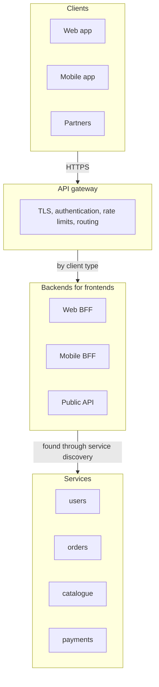
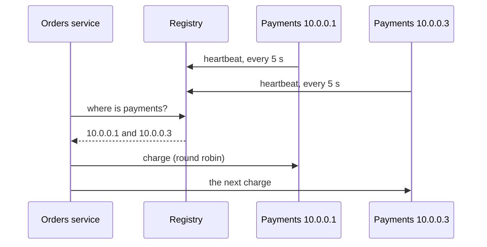

# Service architecture: monoliths, microservices, gateways and discovery

> System Design · L2 Proficient · Services, real time and observability · about 100 min · hub module `m07` ([open the hub](https://claude.ai/artifact/WYKUGQ93VYjG6xBpea5exS))

## Why it matters
How you split a system into deployable pieces shapes how fast teams ship, how it fails and what it costs, more than any single technology choice. Microservices turn function calls into network calls, so they need an API gateway at the edge, service discovery inside and often a backend for each kind of client. Most systems should start as a well-structured monolith and split only where a boundary has earned it.

## Pre-question (answer before reading)
**Q:** A six-person startup splits its new app into twelve microservices from day one. Six months later, most features touch four services and every release needs coordinating. What went wrong?

<details><summary>Answer</summary>

The services were split before anyone knew where the real boundaries were, so features cut across them and every change became a distributed change: several deploys, API versions to agree, network failures to handle. For one small team, a modular monolith with clear internal boundaries would have shipped faster. Services pay off when separate teams need to deploy independently, or when parts need to scale or fail separately.

</details>

## 🍎 Story time (kid version)
**Pizza Town and the family road trip: From one kitchen to a food court**

Luigi's restaurant had one big kitchen that made everything: easy to plan, but when the oven broke, nothing came out. The new food court has a stall for each kind of food, each with its own cooks, so the juice stall can change its menu without asking the burger stall. A burger and a juice now come from two stalls, so a front desk takes your whole order and passes it on. Stalls move around, so the desk checks a board showing where each one is today. Children order at a low counter with a picture menu, and delivery riders at a side window with a short list.

| In the story | In a real system |
|---|---|
| One big kitchen that makes everything | A monolith: one deployable unit; simple calls, but a shared fate |
| A stall for each kind of food, with its own cooks | Microservices: owned by separate teams, deployed and scaled independently |
| The front desk that takes your whole order | An API gateway: one entry point that routes, authenticates and limits |
| The board showing where each stall is today | Service discovery: a registry of where each service's instances are running |
| The children's counter and the riders' window | Backends for frontends: an API tailored to each kind of client |

**Where the story breaks:** Walking between stalls takes seconds and never fails. Calls between services cross a network: they can be slow, fail or arrive twice, and data that once sat in one database now has to stay consistent across several.

## Key ideas (grown-up version)
- **Monolith**: one codebase and one deployable unit, usually with one database. Calls are function calls and transactions are local, so it's simple to build, test and debug. The pain grows with the number of teams: one shared release train, one bug that can take everything down, and scaling only as a whole.
- **Modular monolith**: still one deployable, but split into modules with enforced boundaries: separate packages, a public interface per module, and no reaching into another module's tables. It keeps the monolith's simplicity while preparing clean seams, and it's usually the best start.
- **Microservices**: small services, each owned by one team, deployed independently and owning its data (no shared database). The gains: independent deploys and scaling, fault isolation, a technology choice per service. The costs: network calls (latency, partial failure), distributed data (no transactions across services, so sagas and eventual consistency), and much more to operate: pipelines, monitoring, tracing, discovery.
- **Finding boundaries**: split by business capability (orders, payments, catalogue: a bounded context in domain-driven design), not by technical layer. A good boundary has high cohesion inside and few, coarse calls across it. Conway's law says systems mirror the communication structure of the organisations that build them, so align services with teams. Extract from a monolith gradually, with the strangler fig pattern.
- **API gateway**: one entry point in front of the services. It routes requests, terminates TLS, authenticates, rate-limits and can combine several calls into one response. Keep business logic out of it, and run it highly available, because every request passes through it.
- **Backends for frontends (BFF)**: a separate backend for each kind of client (web, mobile, partner API), usually owned by that client's team, which shapes and combines data for exactly what the client shows. It avoids one bloated general-purpose API, at the price of some duplication.
- **Service discovery**: instances come and go with autoscaling, deploys and failures, so callers look up current addresses. Client-side: the caller asks a registry (Consul, Eureka) and balances the load itself. Server-side: the caller uses a stable name or load balancer that knows the instances (a Kubernetes Service, a cloud load balancer). Health checks and heartbeats remove dead instances, after a delay.
- **Calls between services**: synchronous calls (REST, gRPC) are simple but tie availability together: when every call is needed, availabilities multiply, and in a chain the latencies add. Asynchronous events (module 5) decouple services. Keep synchronous chains short, fan out in parallel, and consider a service mesh (sidecar proxies such as Envoy) for retries, mutual TLS and metrics on every call.

## Diagrams
**A gateway with backends for frontends**



_The gateway handles what every request needs; each BFF shapes data for one kind of client; the services own the business logic and their own data._

**Client-side service discovery**



_An instance that stops sending heartbeats is dropped once its TTL passes. With server-side discovery, the orders service would call one stable name, such as a Kubernetes Service, instead._

**Which shape fits? A rough first guess**

| | one team | many teams |
|---|---|---|
| **stable domain** | Modular monolith: clear modules; extract one only if it needs its own scaling or isolation | Microservices: one per bounded context, each owned by one team, with its own data |
| **changing domain** | Monolith: move fast; the boundaries will become clear | Modular monolith, then extract: find the seams first; split off the most stable parts as teams grow |

## Comparisons
**Monolith, modular monolith and microservices**

|  | Monolith | Modular monolith | Microservices |
|---|---|---|---|
| Deploys | Everything together | Everything together | Each service on its own |
| Calls between parts | Function calls | Function calls through module interfaces | Network calls (REST, gRPC, events) |
| Data | One database, shared freely | One database; each module owns its tables | A database per service |
| Failures | One bug can take down everything | The same, but easier to reason about | Isolated, if calls have timeouts and fallbacks |
| Operations | Simple | Simple | Pipelines, discovery, tracing and monitoring per service |
| Fits | Small teams, new products | Most teams, as the default | Many teams, stable boundaries, different scaling needs |

**Client-side and server-side discovery**

|  | Client-side | Server-side |
|---|---|---|
| Who picks the instance | The calling service, using a registry | A load balancer or the platform's proxy |
| Examples | Consul or Eureka with a client library | Kubernetes Services, cloud load balancers |
| Strengths | No extra hop; each caller can balance cleverly | Callers stay simple, in any language |
| Weaknesses | A discovery library in every language you use | An extra hop, and another component to run |

## Code (JavaScript + Python)
### The seeded random generator used by the latency simulation
```python
def mulberry32(seed):                           # a tiny seeded random generator, same as the JavaScript one
    state = seed & 0xFFFFFFFF
    def rand():
        nonlocal state
        state = (state + 0x6D2B79F5) & 0xFFFFFFFF
        t = ((state ^ (state >> 15)) * (state | 1)) & 0xFFFFFFFF
        t = (t ^ (t + (((t ^ (t >> 7)) * (t | 61)) & 0xFFFFFFFF))) & 0xFFFFFFFF
        return ((t ^ (t >> 14)) & 0xFFFFFFFF) / 4294967296
    return rand
```

```javascript
function mulberry32(seed) {                     // a tiny seeded random generator, same as the Python one
  return function () {
    seed = (seed + 0x6D2B79F5) | 0;
    let t = Math.imul(seed ^ (seed >>> 15), 1 | seed);
    t = (t + Math.imul(t ^ (t >>> 7), 61 | t)) ^ t;
    return ((t ^ (t >>> 14)) >>> 0) / 4294967296;
  };
}
```

### What a call chain costs: latency and availability
```python
def percentile(sorted_ms, p):
    return sorted_ms[len(sorted_ms) * p // 100 - 1]   # nearest rank; p is a whole percent

def call_ms(rand):
    """One backend call: usually 10 to 29 ms, but 1 call in 50 hits a slow path of 200 to 499 ms."""
    if rand() < 0.02:
        return 200 + int(rand() * 300)
    return 10 + int(rand() * 20)

def page_loads(n_calls, parallel, trials=10_000, seed=3):
    rand = mulberry32(seed)
    totals = []
    for _ in range(trials):
        times = [call_ms(rand) for _ in range(n_calls)]
        totals.append(max(times) if parallel else sum(times))   # parallel: wait for the slowest; chain: add them up
    totals.sort()
    return percentile(totals, 50), percentile(totals, 99)

def availability_ppm(n, each_ppm=999_000):         # in parts per million: 999,000 is 99.9%
    ppm = 1_000_000
    for _ in range(n):
        ppm = (ppm * each_ppm + 500_000) // 1_000_000   # every call must succeed, so the chances multiply
    return ppm

for label, n, parallel in (("1 call", 1, True), ("10 calls in parallel", 10, True), ("10 calls in a chain", 10, False)):
    p50, p99 = page_loads(n, parallel)
    ppm = availability_ppm(n)
    print(f"{label}: p50 {p50} ms, p99 {p99} ms, available {ppm // 10_000}.{ppm % 10_000:04d}%")
```

Output:
```text
1 call: p50 20 ms, p99 352 ms, available 99.9000%
10 calls in parallel: p50 29 ms, p99 484 ms, available 99.0045%
10 calls in a chain: p50 200 ms, p99 773 ms, available 99.0045%
```

- line 7: The rare slow path is the tail: 2% of calls. With one call, it barely shows at p99; with ten calls per page, about 18% of pages hit it.
- line 15: In parallel the page waits for its slowest call; in a chain the times add up.
- line 22: Availabilities multiply when every call is needed: ten services at 99.9% give about 99.0%, ten times the downtime.
- line 28: Fanning out barely moves the median but drags the p99 towards the slow path; the chain is slow even at the median.

```javascript
function percentile(sortedMs, p) {
  return sortedMs[Math.floor(sortedMs.length * p / 100) - 1];   // nearest rank; p is a whole percent
}

function callMs(rand) {
  // one backend call: usually 10 to 29 ms, but 1 call in 50 hits a slow path of 200 to 499 ms
  if (rand() < 0.02) return 200 + Math.floor(rand() * 300);
  return 10 + Math.floor(rand() * 20);
}

function pageLoads(nCalls, parallel, trials = 10_000, seed = 3) {
  const rand = mulberry32(seed);
  const totals = [];
  for (let i = 0; i < trials; i++) {
    const times = Array.from({ length: nCalls }, () => callMs(rand));
    totals.push(parallel ? Math.max(...times) : times.reduce((a, b) => a + b, 0));   // parallel: wait for the slowest; chain: add them up
  }
  totals.sort((a, b) => a - b);
  return [percentile(totals, 50), percentile(totals, 99)];
}

function availabilityPpm(n, eachPpm = 999_000) {   // in parts per million: 999,000 is 99.9%
  let ppm = 1_000_000;
  for (let i = 0; i < n; i++) ppm = Math.floor((ppm * eachPpm + 500_000) / 1_000_000);   // every call must succeed, so the chances multiply
  return ppm;
}

for (const [label, n, parallel] of [["1 call", 1, true], ["10 calls in parallel", 10, true], ["10 calls in a chain", 10, false]]) {
  const [p50, p99] = pageLoads(n, parallel);
  const ppm = availabilityPpm(n);
  console.log(`${label}: p50 ${p50} ms, p99 ${p99} ms, available ${Math.floor(ppm / 10_000)}.${String(ppm % 10_000).padStart(4, "0")}%`);
}
```

Output:
```text
1 call: p50 20 ms, p99 352 ms, available 99.9000%
10 calls in parallel: p50 29 ms, p99 484 ms, available 99.0045%
10 calls in a chain: p50 200 ms, p99 773 ms, available 99.0045%
```

- line 7: The rare slow path is the tail: 2% of calls. With one call, it barely shows at p99; with ten calls per page, about 18% of pages hit it.
- line 16: In parallel the page waits for its slowest call; in a chain the times add up.
- line 24: Availabilities multiply when every call is needed: ten services at 99.9% give about 99.0%, ten times the downtime.
- line 31: Fanning out barely moves the median but drags the p99 towards the slow path; the chain is slow even at the median.

### A service registry with heartbeats, and the window when it's wrong
```python
class Registry:
    def __init__(self, ttl):
        self.ttl, self.last_seen = ttl, {}        # (service, address) -> time of the last heartbeat

    def heartbeat(self, service, address, now):
        self.last_seen[(service, address)] = now  # registering is just the first heartbeat

    def lookup(self, service, now):
        return sorted(addr for (svc, addr), seen in self.last_seen.items()
                      if svc == service and now - seen <= self.ttl)   # silent for longer than the TTL: gone

registry = Registry(ttl=10)
alive = {"10.0.0.1": (0, 99), "10.0.0.2": (0, 20), "10.0.0.3": (0, 99), "10.0.0.4": (25, 99)}   # running from, until
sent_to_dead = 0
for now in range(40):                             # one request a second, for 40 seconds
    for addr, (start, stop) in alive.items():
        if start <= now <= stop and now % 5 == 0:
            registry.heartbeat("payments", addr, now)   # running instances check in every 5 seconds
    targets = registry.lookup("payments", now)
    target = targets[now % len(targets)]          # client-side round robin
    start, stop = alive[target]
    if not start <= now <= stop:
        sent_to_dead += 1
    if now in (0, 25, 31):
        print(f"t={now}: {' '.join(targets)}")
print(f"requests sent to an instance that had crashed: {sent_to_dead} of 40")
```

Output:
```text
t=0: 10.0.0.1 10.0.0.2 10.0.0.3
t=25: 10.0.0.1 10.0.0.2 10.0.0.3 10.0.0.4
t=31: 10.0.0.1 10.0.0.3 10.0.0.4
requests sent to an instance that had crashed: 3 of 40
```

- line 10: An instance that hasn't checked in within the TTL is left out. A crash is noticed only after the TTL passes.
- line 18: New instances appear as soon as they send their first heartbeat; 10.0.0.4 joins at t=25.
- line 20: The caller balances the load itself: that's client-side discovery.
- line 26: 10.0.0.2 died just after t=20 but stayed listed until t=30, so 3 requests went to it. Callers should retry on another instance, and shorter TTLs shrink the window at the cost of more heartbeats.

```javascript
class Registry {
  constructor(ttl) { this.ttl = ttl; this.lastSeen = new Map(); }   // "service|address" -> time of the last heartbeat
  heartbeat(service, address, now) {
    this.lastSeen.set(`${service}|${address}`, now);   // registering is just the first heartbeat
  }
  lookup(service, now) {
    return [...this.lastSeen]
      .filter(([key, seen]) => key.split("|")[0] === service && now - seen <= this.ttl)   // silent for longer than the TTL: gone
      .map(([key]) => key.split("|")[1])
      .sort();
  }
}

const registry = new Registry(10);
const alive = new Map([["10.0.0.1", [0, 99]], ["10.0.0.2", [0, 20]], ["10.0.0.3", [0, 99]], ["10.0.0.4", [25, 99]]]);   // running from, until
let sentToDead = 0;
for (let now = 0; now < 40; now++) {              // one request a second, for 40 seconds
  for (const [addr, [start, stop]] of alive) {
    if (start <= now && now <= stop && now % 5 === 0) registry.heartbeat("payments", addr, now);   // running instances check in every 5 seconds
  }
  const targets = registry.lookup("payments", now);
  const target = targets[now % targets.length];   // client-side round robin
  const [start, stop] = alive.get(target);
  if (!(start <= now && now <= stop)) sentToDead++;
  if ([0, 25, 31].includes(now)) console.log(`t=${now}: ${targets.join(" ")}`);
}
console.log(`requests sent to an instance that had crashed: ${sentToDead} of 40`);
```

Output:
```text
t=0: 10.0.0.1 10.0.0.2 10.0.0.3
t=25: 10.0.0.1 10.0.0.2 10.0.0.3 10.0.0.4
t=31: 10.0.0.1 10.0.0.3 10.0.0.4
requests sent to an instance that had crashed: 3 of 40
```

- line 8: An instance that hasn't checked in within the TTL is left out. A crash is noticed only after the TTL passes.
- line 19: New instances appear as soon as they send their first heartbeat; 10.0.0.4 joins at t=25.
- line 22: The caller balances the load itself: that's client-side discovery.
- line 27: 10.0.0.2 died just after t=20 but stayed listed until t=30, so 3 requests went to it. Callers should retry on another instance, and shorter TTLs shrink the window at the cost of more heartbeats.

### A gateway in front of two backends for frontends
```python
import json

BACKEND_MS = {"users": 12, "orders": 25, "recs": 18}   # each service's time inside the data centre
PHONE_RTT_MS = 150                                # one round trip over a mobile network

def users(uid):
    return {"id": uid, "name": "Ana", "email": "ana@example.com", "tier": "gold", "joined": "2021-04-02"}

def orders(uid):
    return [{"id": f"o{i}", "total": 20 * i, "items": i, "status": "delivered"} for i in range(1, 6)]

def recs(uid):
    return ["tea", "mug", "kettle", "honey", "scones", "jam"]

def web_home(uid):                                # the web BFF: a big screen, so everything
    return {"user": users(uid), "orders": orders(uid), "recommended": recs(uid)}

def mobile_home(uid):                             # the mobile BFF: only what the phone's home screen shows
    return {"name": users(uid)["name"], "last_order": orders(uid)[-1]["id"], "recommended": recs(uid)[:2]}

ROUTES = {"/web/home": web_home, "/mobile/home": mobile_home}

def gateway(path, token):
    if token != "valid":                          # authenticate once, at the edge
        return 401, ""
    if path not in ROUTES:
        return 404, ""
    return 200, json.dumps(ROUTES[path]("u42"), separators=(",", ":"))

for path, token in (("/web/home", "valid"), ("/mobile/home", "valid"), ("/mobile/home", "stolen"), ("/admin", "valid")):
    status, body = gateway(path, token)
    print(f"{path} ({token} token): {status}, {len(body)} bytes")
chatty = len(BACKEND_MS) * PHONE_RTT_MS + sum(BACKEND_MS.values())
bff = PHONE_RTT_MS + max(BACKEND_MS.values())     # one trip from the phone; the BFF calls the services in parallel
print(f"phone calling the 3 services one after another: {chatty} ms | one call to the mobile BFF: {bff} ms")
```

Output:
```text
/web/home (valid token): 200, 438 bytes
/mobile/home (valid token): 200, 60 bytes
/mobile/home (stolen token): 401, 0 bytes
/admin (valid token): 404, 0 bytes
phone calling the 3 services one after another: 505 ms | one call to the mobile BFF: 175 ms
```

- line 16: The web BFF returns everything, because a big screen shows it all.
- line 19: The mobile BFF trims the same data to what the phone actually shows: about a seventh of the bytes.
- line 24: Cross-cutting checks such as authentication happen once at the gateway, not in every service.
- line 35: The phone pays one slow mobile round trip instead of three, while the BFF's calls inside the data centre are fast and parallel.

```javascript
const BACKEND_MS = { users: 12, orders: 25, recs: 18 };   // each service's time inside the data centre
const PHONE_RTT_MS = 150;                         // one round trip over a mobile network

const users = uid => ({ id: uid, name: "Ana", email: "ana@example.com", tier: "gold", joined: "2021-04-02" });
const orders = uid => Array.from({ length: 5 }, (_, k) => ({ id: `o${k + 1}`, total: 20 * (k + 1), items: k + 1, status: "delivered" }));
const recs = uid => ["tea", "mug", "kettle", "honey", "scones", "jam"];

function webHome(uid) {                           // the web BFF: a big screen, so everything
  return { user: users(uid), orders: orders(uid), recommended: recs(uid) };
}

function mobileHome(uid) {                        // the mobile BFF: only what the phone's home screen shows
  return { name: users(uid).name, last_order: orders(uid).at(-1).id, recommended: recs(uid).slice(0, 2) };
}

const ROUTES = new Map([["/web/home", webHome], ["/mobile/home", mobileHome]]);

function gateway(path, token) {
  if (token !== "valid") return [401, ""];        // authenticate once, at the edge
  if (!ROUTES.has(path)) return [404, ""];
  return [200, JSON.stringify(ROUTES.get(path)("u42"))];
}

for (const [path, token] of [["/web/home", "valid"], ["/mobile/home", "valid"], ["/mobile/home", "stolen"], ["/admin", "valid"]]) {
  const [status, body] = gateway(path, token);
  console.log(`${path} (${token} token): ${status}, ${body.length} bytes`);
}
const chatty = Object.keys(BACKEND_MS).length * PHONE_RTT_MS + Object.values(BACKEND_MS).reduce((a, b) => a + b, 0);
const bff = PHONE_RTT_MS + Math.max(...Object.values(BACKEND_MS));   // one trip from the phone; the BFF calls the services in parallel
console.log(`phone calling the 3 services one after another: ${chatty} ms | one call to the mobile BFF: ${bff} ms`);
```

Output:
```text
/web/home (valid token): 200, 438 bytes
/mobile/home (valid token): 200, 60 bytes
/mobile/home (stolen token): 401, 0 bytes
/admin (valid token): 404, 0 bytes
phone calling the 3 services one after another: 505 ms | one call to the mobile BFF: 175 ms
```

- line 9: The web BFF returns everything, because a big screen shows it all.
- line 13: The mobile BFF trims the same data to what the phone actually shows: about a seventh of the bytes.
- line 19: Cross-cutting checks such as authentication happen once at the gateway, not in every service.
- line 30: The phone pays one slow mobile round trip instead of three, while the BFF's calls inside the data centre are fast and parallel.

## Worked example
**Problem.** The pricing logic lives inside a monolith, and the team wants to move it into its own service without breaking checkout. Plan a strangler fig migration, and show how shadow traffic catches a difference before users see it.

1. Put a routing layer (the gateway, or a proxy) in front of the monolith, so each route can be sent elsewhere without clients noticing.
2. Build the pricing service for one bounded context, with its own data: copy it, or read through the monolith's API at first, but never share tables.
3. Shadow first: send real requests to both, answer from the monolith, and compare. Mismatches reveal undocumented rules, like the 10% discount below, before any user sees a difference.
4. Cut over gradually (a percentage of traffic, then all of it), keep a switch to route back, then delete the old code. The monolith shrinks route by route until it's gone, or small enough to keep.

```python
PRICES = {1: 1200, 2: 450, 3: 9900, 4: 15000}    # item -> price in cents

def monolith_price(item):                         # the old code inside the monolith
    price = PRICES[item]
    return price - price // 10 if price >= 10000 else price   # 10% off big-ticket items: a rule nobody documented

def new_price_v1(item):                           # the new pricing service, first version
    return PRICES[item]

def new_price_v2(item):                           # after shadowing revealed the missing rule
    price = PRICES[item]
    return price - price // 10 if price >= 10000 else price

class StranglerRouter:
    """Sends pricing requests to the monolith, the new service, or both (shadow mode)."""
    def __init__(self, new_service):
        self.new, self.mode, self.mismatches = new_service, "monolith", []

    def price(self, item):
        if self.mode == "new":
            return self.new(item)
        old = monolith_price(item)
        if self.mode == "shadow":                 # call both, answer with the monolith, compare quietly
            new = self.new(item)
            if new != old:
                self.mismatches.append(f"item {item}: monolith {old}, new {new}")
        return old

router = StranglerRouter(new_price_v1)
router.mode = "shadow"
served = [router.price(item) for item in PRICES]
print("shadow v1: mismatches", len(router.mismatches), "|", *router.mismatches)
router.new, router.mismatches = new_price_v2, []
served = [router.price(item) for item in PRICES]
print("shadow v2: mismatches", len(router.mismatches), "| users were served", *served)
router.mode = "new"                               # cut over: the monolith's pricing code can now be deleted
print("cut over:", *(router.price(item) for item in PRICES))
```

Output:
```text
shadow v1: mismatches 1 | item 4: monolith 13500, new 15000
shadow v2: mismatches 0 | users were served 1200 450 9900 13500
cut over: 1200 450 9900 13500
```

```javascript
const PRICES = new Map([[1, 1200], [2, 450], [3, 9900], [4, 15000]]);   // item -> price in cents

function monolithPrice(item) {                    // the old code inside the monolith
  const price = PRICES.get(item);
  return price >= 10000 ? price - Math.floor(price / 10) : price;   // 10% off big-ticket items: a rule nobody documented
}

function newPriceV1(item) {                       // the new pricing service, first version
  return PRICES.get(item);
}

function newPriceV2(item) {                       // after shadowing revealed the missing rule
  const price = PRICES.get(item);
  return price >= 10000 ? price - Math.floor(price / 10) : price;
}

class StranglerRouter {
  // sends pricing requests to the monolith, the new service, or both (shadow mode)
  constructor(newService) { this.new = newService; this.mode = "monolith"; this.mismatches = []; }
  price(item) {
    if (this.mode === "new") return this.new(item);
    const old = monolithPrice(item);
    if (this.mode === "shadow") {                 // call both, answer with the monolith, compare quietly
      const fresh = this.new(item);
      if (fresh !== old) this.mismatches.push(`item ${item}: monolith ${old}, new ${fresh}`);
    }
    return old;
  }
}

const router = new StranglerRouter(newPriceV1);
router.mode = "shadow";
let served = [...PRICES.keys()].map(item => router.price(item));
console.log("shadow v1: mismatches", router.mismatches.length, "|", ...router.mismatches);
router.new = newPriceV2; router.mismatches = [];
served = [...PRICES.keys()].map(item => router.price(item));
console.log("shadow v2: mismatches", router.mismatches.length, "| users were served", ...served);
router.mode = "new";                              // cut over: the monolith's pricing code can now be deleted
console.log("cut over:", ...[...PRICES.keys()].map(item => router.price(item)));
```

Output:
```text
shadow v1: mismatches 1 | item 4: monolith 13500, new 15000
shadow v2: mismatches 0 | users were served 1200 450 9900 13500
cut over: 1200 450 9900 13500
```

**Answer.** In shadow mode users are always served the monolith's prices, so the missing discount on item 4 (13,500 against 15,000 cents) shows up only as a logged mismatch. After the fix there are no mismatches, so the cut-over changes nothing users can see, and the monolith's pricing code can be deleted.

## Your turn (faded example)
**Problem.** Finish `home(calls, deadline_ms)` for a mobile BFF that calls three services in parallel. `calls` maps each service to (latency in ms, result, or None if it failed). User and orders are required: if either fails or misses the deadline, return 503. Recommendations are optional: use a cached fallback instead. Return the status, the sections served, and how long the BFF waited.

- ✓ The calls run in parallel, so the BFF waits for the slowest one, but never past the deadline: that wait is min(deadline, the largest latency).
- **What happens when a required section fails?**
  <details><summary>Answer</summary>The page can't be built without it, so the whole response is a 503, and the client can retry or show an error screen.</details>
- **And when an optional one fails or is too slow?**
  <details><summary>Answer</summary>Serve the rest of the page, with a cached fallback for that section (or leave it out). Users get a slightly worse page instead of an error.</details>
- **What does it cost, and what would you monitor?**
  <details><summary>Answer</summary>One pass over the calls, O(number of services). Monitor how often each fallback is used and how often the deadline is hit: a fallback rate that creeps up means a dependency is getting slower.</details>

Starter:
```python
REQUIRED = ("user", "orders")                     # the page is useless without these
FALLBACKS = {"recs": ["tea", "mug"]}              # a cached answer for optional sections

def home(calls, deadline_ms=200):
    waited = ...                                  # TODO: the calls run in parallel, but the deadline caps the wait
    sections = []
    for name, (ms, result) in calls.items():
        ...                                       # TODO: serve it, fail the page (503), or use the fallback
    return 200, sections, waited
```

```javascript
const REQUIRED = ["user", "orders"];              // the page is useless without these
const FALLBACKS = { recs: ["tea", "mug"] };       // a cached answer for optional sections

function home(calls, deadlineMs = 200) {
  const waited = 0;                               // TODO: the calls run in parallel, but the deadline caps the wait
  const sections = [];
  for (const [name, [ms, result]] of Object.entries(calls)) {
    // TODO: serve it, fail the page (503), or use the fallback
  }
  return [200, sections, waited];
}
```

<details><summary>Full solution</summary>

```python
REQUIRED = ("user", "orders")                     # the page is useless without these
FALLBACKS = {"recs": ["tea", "mug"]}              # a cached answer for optional sections

def home(calls, deadline_ms=200):
    waited = min(deadline_ms, max(ms for ms, _ in calls.values()))   # parallel calls: the slowest, capped by the deadline
    sections = []
    for name, (ms, result) in calls.items():
        if result is not None and ms <= deadline_ms:
            sections.append(name)                 # arrived in time
        elif name in REQUIRED:
            return 503, [], waited                # a required section is missing: fail the page
        elif name in FALLBACKS:
            sections.append(name + " (cached)")   # optional: degrade instead of failing
    return 200, sections, waited

scenarios = {
    "all healthy": {"user": (30, "Ana"), "orders": (45, ["o5"]), "recs": (60, ["tea"])},
    "slow recommendations": {"user": (30, "Ana"), "orders": (45, ["o5"]), "recs": (900, ["tea"])},
    "orders down": {"user": (30, "Ana"), "orders": (20, None), "recs": (60, ["tea"])},
}
for label, calls in scenarios.items():
    status, sections, waited = home(calls)
    print(f"{label}: {status} | {' '.join(sections) or '-'} | waited {waited} ms")
```

Output:
```text
all healthy: 200 | user orders recs | waited 60 ms
slow recommendations: 200 | user orders recs (cached) | waited 200 ms
orders down: 503 | - | waited 60 ms
```

```javascript
const REQUIRED = ["user", "orders"];              // the page is useless without these
const FALLBACKS = { recs: ["tea", "mug"] };       // a cached answer for optional sections

function home(calls, deadlineMs = 200) {
  const waited = Math.min(deadlineMs, Math.max(...Object.values(calls).map(([ms]) => ms)));   // parallel calls: the slowest, capped by the deadline
  const sections = [];
  for (const [name, [ms, result]] of Object.entries(calls)) {
    if (result !== null && ms <= deadlineMs) sections.push(name);   // arrived in time
    else if (REQUIRED.includes(name)) return [503, [], waited];     // a required section is missing: fail the page
    else if (name in FALLBACKS) sections.push(`${name} (cached)`);  // optional: degrade instead of failing
  }
  return [200, sections, waited];
}

const scenarios = {
  "all healthy": { user: [30, "Ana"], orders: [45, ["o5"]], recs: [60, ["tea"]] },
  "slow recommendations": { user: [30, "Ana"], orders: [45, ["o5"]], recs: [900, ["tea"]] },
  "orders down": { user: [30, "Ana"], orders: [20, null], recs: [60, ["tea"]] },
};
for (const [label, calls] of Object.entries(scenarios)) {
  const [status, sections, waited] = home(calls);
  console.log(`${label}: ${status} | ${sections.join(" ") || "-"} | waited ${waited} ms`);
}
```

Output:
```text
all healthy: 200 | user orders recs | waited 60 ms
slow recommendations: 200 | user orders recs (cached) | waited 200 ms
orders down: 503 | - | waited 60 ms
```

</details>

## Socratic checks and quiz (answers hidden)
**1. What does this print?**

```python
ppm = 1_000_000                                 # availability in parts per million
for each in [999_000, 999_000, 995_000]:
    ppm = ppm * each // 1_000_000               # rounded down
print(f"{ppm // 10_000}.{ppm % 10_000:04d}%")
```

```javascript
let ppm = 1_000_000;                            // availability in parts per million
for (const each of [999_000, 999_000, 995_000]) ppm = Math.floor(ppm * each / 1_000_000);   // rounded down
console.log(`${Math.floor(ppm / 10_000)}.${String(ppm % 10_000).padStart(4, "0")}%`);
```

- A. 99.3010%
- B. 99.9000%
- C. 99.5000%
- D. 97.3010%

<details><summary>Answer</summary>

99.3010%. Every call must succeed, so the availabilities multiply: 0.999 × 0.999 × 0.995 ≈ 0.99301. The chain is less available than its weakest member.

</details>

**2. A team of five is building a new product whose domain still changes every week. Which architecture fits best?**

- A. A modular monolith with clear internal boundaries
- B. Twenty microservices, one per database table
- C. A microservice per developer
- D. Serverless functions for every endpoint, all sharing one database

<details><summary>Answer</summary>

A modular monolith with clear internal boundaries. One small team gains nothing from independent deploys, and a changing domain means boundaries drawn now will be wrong. A modular monolith keeps changes cheap while the seams become clear.

</details>

**3. Why should each microservice own its data, rather than all of them sharing one database?**

- A. So a team can change its schema and deploy without coordinating with other teams
- B. Because one database can't serve more than one service
- C. To make queries across services faster
- D. So that transactions can span services

<details><summary>Answer</summary>

So a team can change its schema and deploy without coordinating with other teams. Shared tables couple the services: any schema change needs every team. Separate data costs fast cross-service queries and transactions, which is the trade-off you accept.

</details>

**4. Which belong in an API gateway? (choose 3)**

- A. Routing requests to the right service
- B. Authentication and TLS termination
- C. Per-client rate limiting
- D. Pricing and discount rules
- E. Writing orders to the database

<details><summary>Answer</summary>

Routing requests to the right service, Authentication and TLS termination, Per-client rate limiting. Cross-cutting concerns that every request needs belong at the edge. Business rules and data belong in the services that own them.

</details>

**5. Judge each statement.**

- Conway's law says a system tends to mirror the communication structure of the organisation that builds it.
- In client-side discovery, the caller looks up instances in a registry and picks one itself.
- A backend for frontend is a single API shared by every kind of client.
- Splitting a monolith into microservices makes transactions across services easy.

<details><summary>Answer</summary>

Conway's law says a system tends to mirror the communication structure of the organisation that builds it.: Yes; In client-side discovery, the caller looks up instances in a registry and picks one itself.: Yes; A backend for frontend is a single API shared by every kind of client.: No; Splitting a monolith into microservices makes transactions across services easy.: No. A BFF is one backend per kind of client. And splitting the data removes local transactions: work that spans services needs sagas and eventual consistency.

</details>

**6. Put a strangler fig migration of one feature in order.**

- (put the steps in order)

<details><summary>Answer</summary>

Route all traffic through a facade in front of the monolith → Build the new service for one bounded context, with its own data → Shadow traffic to both and compare the answers → Shift traffic to the new service gradually → Delete the old code from the monolith. The facade makes routing changes invisible to clients, shadowing catches differences safely, and the gradual shift keeps a way back until the old code is removed.

</details>

**7. Complete the Python registry lookup: the addresses of one service's instances that have sent a heartbeat within the TTL, sorted.**

```
def lookup(last_seen, service, now, ttl):
    return {{0}}(addr for (svc, addr), seen in last_seen.items()
                 if svc == service and {{1}})

```

<details><summary>Answer</summary>

sorted | now - seen <= ttl. An instance counts as alive if its last heartbeat is no older than the TTL, and sorting gives callers a stable list to balance over.

</details>

**8. Match each description to its name.**


<details><summary>Answer</summary>

One entry point that routes, authenticates and limits = API gateway; An API tailored to one kind of client = Backend for frontend; A registry of where each service's instances run = Service discovery; Replacing a monolith piece by piece behind a facade = Strangler fig. Write-around is a caching strategy (module 4).

</details>

## Traps & misconceptions
- **“Microservices will make us faster.”** Only when separate teams are blocking each other. For a small team they add network calls, distributed data and operational work, and slow everything down. Start with a modular monolith and split where a boundary has earned it.
- **“Split by layer: a UI service, a logic service, a data service.”** Then every feature touches every service. Split by business capability (orders, payments, catalogue), so most changes stay inside one service.
- **“The services can share one database; it's simpler.”** Shared tables couple the services: a schema change needs every team, and one service's heavy query slows the others. Each service owns its data and shares it through its API or events.
- **“Put business logic in the gateway, since every request passes through it.”** The gateway becomes a bottleneck every team must change, and a single point of failure for that logic. Keep it to cross-cutting concerns: routing, authentication, limits, TLS.
- **“A long chain of synchronous calls is fine; each service is 99.9% available.”** Availabilities multiply and latencies add: ten services in a chain at 99.9% each give about 99.0%, and the chain is as slow as all of them together. Prefer events for workflows, and keep chains short.
- **“Service discovery means hard-coding the load balancer's address.”** Instances change constantly with autoscaling and deploys. Callers need a registry kept current by health checks (or a platform such as Kubernetes that provides one), and should retry on another instance when one fails.

## Discussion prompts
- **Checkout in your monolith is slowed down by a reporting feature that runs heavy queries. Would you extract a service, and which one?**
  <details><summary>One good answer</summary>Extract reporting first: it's a clear bounded context, it can read from its own copy of the data (a replica, or a stream of events), and moving it takes the load off checkout. Checkout itself is riskier to move and gains less. Use the strangler fig: route the reporting endpoints through a facade, build the service with its own read model, shadow, then cut over.</details>
- **When does a BFF help, and when is it overkill?**
  <details><summary>One good answer</summary>It helps when clients differ a lot (a web app with rich pages, a mobile app on slow networks, a partner API with stability promises) and one general API forces each of them to over-fetch or make many calls. It's overkill with a single client, or clients that need the same data; then one well-designed API, perhaps with field selection (GraphQL or sparse fieldsets), is simpler.</details>

## Teach-back
**Prompt:** Explain to a junior colleague when you'd choose microservices over a monolith, and what an API gateway, a BFF and service discovery each do.

Rubric:
- [ ] A modular monolith first; microservices when teams need independent deploys, or parts need separate scaling or isolation
- [ ] Split by business capability, each service owning its data
- [ ] The costs: network calls, distributed data, operations
- [ ] Gateway: one entry point for routing, auth and limits; BFF: an API per client type
- [ ] Discovery: a registry kept current by health checks, client-side or server-side

<details><summary>Model answer</summary>

I'd start with a modular monolith: one deployable with enforced module boundaries, which is simple to build and debug. I'd move to microservices when several teams keep blocking each other's releases, or a part needs its own scaling or failure isolation, splitting by business capability, with each service owning its data. The price is network calls that can be slow or fail, no transactions across services, and much more to operate. An API gateway is the single entry point that routes requests and handles TLS, authentication and rate limits. A backend for frontend is an API shaped for one kind of client, such as mobile, so the phone makes one small call instead of several big ones. Service discovery keeps track of where each service's instances are running, using heartbeats or health checks; either the caller looks them up and balances itself, or a load balancer or Kubernetes does it.

</details>

## Quick Q&A (also in the SRS deck)
- **Modular monolith?** One deployable unit, split into modules with enforced boundaries.
- **Conway's law?** Systems mirror the communication structure of the organisation that builds them.
- **API gateway?** One entry point that routes requests and handles TLS, authentication and rate limits.
- **Backend for frontend?** A separate backend for each kind of client, shaping data for exactly what that client shows.
- **Client-side or server-side discovery?** The caller looks up instances in a registry and picks one, or it calls a stable name or load balancer that does that.
- **The strangler fig pattern?** Replace a monolith piece by piece behind a routing facade, until the old code can be removed.

## Practice problems
- [ ] [Reading · Microservices](https://martinfowler.com/articles/microservices.html) · list the nine characteristics Lewis and Fowler describe, and mark which ones your current system has
- [ ] [Reading · Monolith first](https://martinfowler.com/bliki/MonolithFirst.html) · summarise the argument, then find one case where starting with services was justified
- [ ] [Pattern · Backends for frontends](https://samnewman.io/patterns/architectural/bff/) · design the BFFs for an app with a web site, an iOS app and a partner API, and decide who owns each
- [ ] [Exercise · Strangler fig](https://martinfowler.com/bliki/StranglerFigApplication.html) · plan the order in which you'd extract three features from a monolith, and the shadowing check for each

## Sources (accessed 2026-10-09)
- [James Lewis and Martin Fowler: Microservices](https://martinfowler.com/articles/microservices.html)
- [Martin Fowler: MonolithFirst](https://martinfowler.com/bliki/MonolithFirst.html)
- [Sam Newman: Backends for frontends](https://samnewman.io/patterns/architectural/bff/)
- [Martin Fowler: StranglerFigApplication](https://martinfowler.com/bliki/StranglerFigApplication.html)
- [Kubernetes documentation: Service](https://kubernetes.io/docs/concepts/services-networking/service/)
- [Melvin Conway: How do committees invent?](https://www.melconway.com/Home/Committees_Paper.html)
