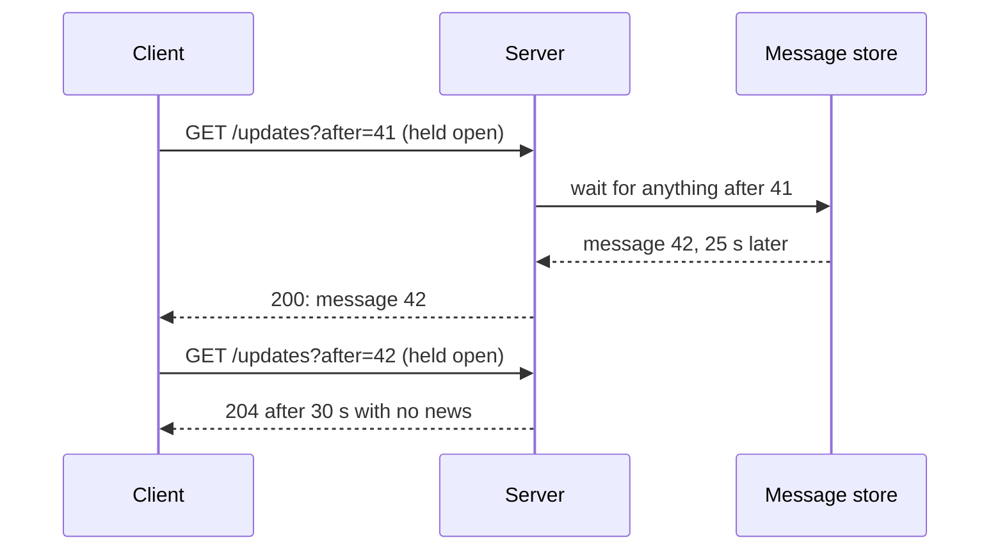
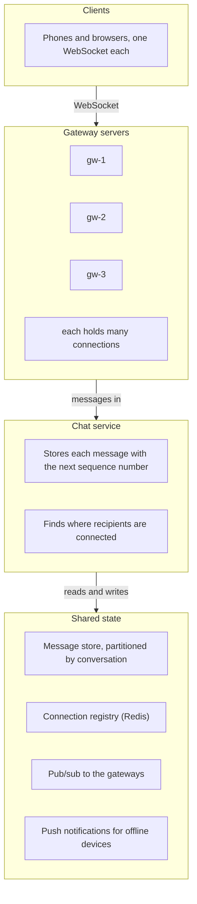
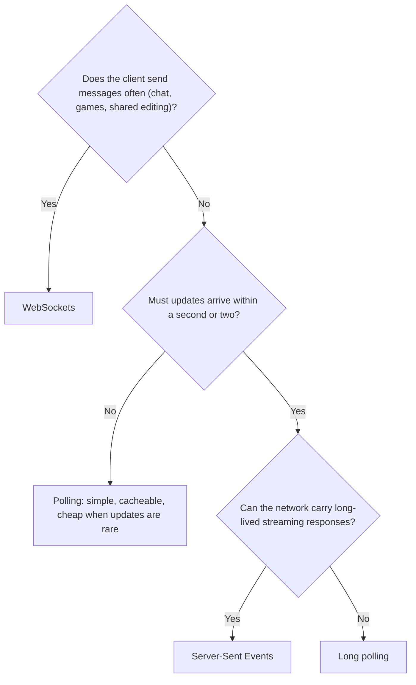

# Real-time communication: polling, long polling, SSE and WebSockets

> System Design · L2 Proficient · Services, real time and observability · about 100 min · hub module `m08` ([open the hub](https://claude.ai/artifact/WYKUGQ93VYjG6xBpea5exS))

## Why it matters
Chat messages, live scores, delivery tracking and shared documents all need the server to tell the client something the moment it happens. HTTP was built for the client to ask, so there are four ways around that, with different costs in requests, delay, open connections and complexity. At scale the hard part isn't the protocol: it's holding millions of long-lived connections and getting each message to the server that holds the right one.

## Pre-question (answer before reading)
**Q:** A chat app polls the server every 2 seconds for new messages, with 1 million users online. How many requests per second is that, and how many of them return anything if a typical user gets a message every 2 minutes?

<details><summary>Answer</summary>

500,000 requests per second, and only about 1 in 60 returns something new (one message every 120 seconds, a poll every 2 seconds), so roughly 98% of the work is wasted, and a message can still wait up to 2 seconds. Long polling, Server-Sent Events or WebSockets let the server answer only when there's something to say.

</details>

## 🍎 Story time (kid version)
**Pizza Town and the family road trip: Is my pizza ready?**

At Luigi's, Mia runs to the counter every minute to ask whether her pizza is ready; mostly the answer is no. Her brother just waits at the counter until the cook hands one over, then waits again for the next. Later, Luigi put up a speaker that announces each pizza the moment it's ready, so everyone simply listens. The big birthday table got a walkie-talkie: they can ask for extra cheese, and the cook can answer back. With three counters, Luigi keeps a list of who's waiting at which one, so each announcement reaches the right place.

| In the story | In a real system |
|---|---|
| Running to ask every minute | Polling: the client asks on a timer; simple, but mostly empty answers and up to a full interval late |
| Waiting at the counter until a pizza comes | Long polling: the server holds the request until there's news, then the client asks again |
| The speaker announcing each pizza | Server-Sent Events: one long HTTP response streaming events from server to client |
| The walkie-talkie | WebSocket: one long-lived, two-way connection |
| The list of who waits at which counter | A connection registry or pub/sub, so a message reaches the server holding the right connection |

**Where the story breaks:** Luigi's speaker reaches everyone in one room. Real users are spread over many servers, each holding its own connections, and mobile connections drop all the time, so clients must reconnect and catch up on what they missed.

## Key ideas (grown-up version)
- **Polling**: the client asks every N seconds. It's simple, stateless, cacheable and works everywhere, but most responses are empty, the load is clients × frequency whatever is happening, and updates arrive up to N seconds late. Fine for data that changes slowly, such as a dashboard refreshed every minute.
- **Long polling**: the server holds the request until it has news or a timeout passes (often 20 to 30 seconds), replies, and the client asks again at once. Near-real-time over plain HTTP, without empty answers for every interval; but each message costs a full request and response, and the server holds one open request per client.
- **Server-Sent Events (SSE)**: the client makes one HTTP request and the server keeps writing events to the response (Content-Type text/event-stream). One-way and text only, with automatic reconnection and a Last-Event-ID header so the server can resend what was missed. Good for feeds, notifications, live scores and streaming model output. Over HTTP/1.1 browsers allow only about 6 connections per site, so serve SSE over HTTP/2 when users open many tabs.
- **WebSockets**: an HTTP request upgraded (101 Switching Protocols) to a persistent, full-duplex connection carrying small frames both ways. The lowest overhead per message and true two-way traffic: chat, multiplayer games, collaborative editing. Reconnection, heartbeats (ping and pong), ordering and re-authentication are yours to build, and proxies and load balancers may need configuring for long-lived connections.
- **Choosing**: if the client sends often, WebSockets. If only the server pushes, SSE. If updates are rare, or the network blocks long-lived connections, polling or long polling. Many products mix them: WebSockets for chat, SSE for notifications, polling as a fallback.
- **Holding connections**: an idle open connection costs memory and a file descriptor, not CPU, so one tuned server can hold a very large number. The load balancer must support long-lived connections and balance them by count; deploys must drain connections gently, because restarting a server disconnects everyone on it at once, and their reconnects need jitter.
- **Routing messages**: users connect to different gateway servers, so a message for Bob must reach the server holding Bob's connection. Keep a registry (user to server, in Redis) and send there, or publish on a pub/sub channel per user or room that the right gateways subscribe to. Fan-out to very large rooms is the expensive case.
- **Missed messages**: connections drop, so push is a fast path, not a guarantee. Store each message first, with a sequence number per conversation; clients that see a gap fetch the missing numbers, ignore duplicates, and on reconnect ask for everything after the last number they saw.

## Diagrams
**Long polling**



_No empty answers every few seconds, but each message still costs a full request and response, and the server holds one open request per client._

**The real-time layer of a chat system**



_Store first, then push: the store is the source of truth, and the push is a fast path that clients back up with gap detection and catch-up on reconnect._

**Choosing a technique**



## Comparisons
**Four ways to get updates**

|  | Polling | Long polling | SSE | WebSocket |
|---|---|---|---|---|
| Direction | The client asks | The client asks; the server waits | Server to client | Both ways |
| Delay | Up to one interval | Near zero | Near zero | Near zero |
| Cost per message | Many empty requests | One request per message | A few bytes on an open stream | A few bytes on an open connection |
| Reconnection | Not needed | Every reply ends the request | Automatic, resuming with Last-Event-ID | Yours to build |
| Good for | Slowly changing data | A fallback where streaming is blocked | Feeds, notifications, live scores | Chat, games, collaborative editing |

## Code (JavaScript + Python)
### The seeded random generator used by the simulations
```python
def mulberry32(seed):                           # a tiny seeded random generator, same as the JavaScript one
    state = seed & 0xFFFFFFFF
    def rand():
        nonlocal state
        state = (state + 0x6D2B79F5) & 0xFFFFFFFF
        t = ((state ^ (state >> 15)) * (state | 1)) & 0xFFFFFFFF
        t = (t ^ (t + (((t ^ (t >> 7)) * (t | 61)) & 0xFFFFFFFF))) & 0xFFFFFFFF
        return ((t ^ (t >> 14)) & 0xFFFFFFFF) / 4294967296
    return rand
```

```javascript
function mulberry32(seed) {                     // a tiny seeded random generator, same as the Python one
  return function () {
    seed = (seed + 0x6D2B79F5) | 0;
    let t = Math.imul(seed ^ (seed >>> 15), 1 | seed);
    t = (t + Math.imul(t ^ (t >>> 7), 61 | t)) ^ t;
    return ((t ^ (t >>> 14)) >>> 0) / 4294967296;
  };
}
```

### Ten messages in ten minutes: polling, long polling and push
```python
def tenths(total, count):                          # an average, rounded to one decimal place, in whole numbers
    t = (20 * total + count) // (2 * count)
    return f"{t // 10}.{t % 10}"

def polling(arrivals, every, duration):
    requests = empty = delay = 0
    for t in range(every, duration + 1, every):    # a request every `every` seconds
        requests += 1
        new = [a for a in arrivals if t - every < a <= t]
        if not new:
            empty += 1                             # nothing happened since the last poll
        delay += sum(t - a for a in new)           # each message waited until this poll
    return requests, empty, delay

def long_polling(arrivals, timeout, duration):
    requests = empty = 0
    t = 0                                          # a request is open from time t
    while t < duration:
        upcoming = [a for a in arrivals if a > t]
        if upcoming and upcoming[0] - t <= timeout:
            t = upcoming[0]                        # the server answers the moment a message arrives
        else:
            t += timeout                           # nothing within the timeout: an empty answer
            empty += 1
        requests += 1
    return requests, empty, 0

rand = mulberry32(1)
arrivals = sorted(1 + int(rand() * 600) for _ in range(10))   # message times, in seconds
for label, (requests, empty, delay) in (("poll every 5 s", polling(arrivals, 5, 600)),
                                        ("poll every 30 s", polling(arrivals, 30, 600)),
                                        ("long polling, 30 s timeout", long_polling(arrivals, 30, 600))):
    print(f"{label}: {requests} requests, {empty} empty, average delay {tenths(delay, len(arrivals))} s")
print("push (SSE or WebSocket): 1 connection, 0 empty, average delay 0.0 s")
```

Output:
```text
poll every 5 s: 120 requests, 110 empty, average delay 2.5 s
poll every 30 s: 20 requests, 13 empty, average delay 15.0 s
long polling, 30 s timeout: 26 requests, 16 empty, average delay 0.0 s
push (SSE or WebSocket): 1 connection, 0 empty, average delay 0.0 s
```

- line 11: Most polls find nothing: 110 of 120 at a 5-second interval, and that cost grows with every connected client.
- line 12: A message waits until the next poll, so the average delay is about half the interval: polling trades load for freshness.
- line 21: Long polling answers the moment a message arrives (plus one network trip, ignored here), and sends one empty answer per quiet timeout.
- line 34: Push keeps one connection open and sends only when there's news: no empty answers and no polling delay.

```javascript
function tenths(total, count) {                    // an average, rounded to one decimal place, in whole numbers
  const t = Math.floor((20 * total + count) / (2 * count));
  return `${Math.floor(t / 10)}.${t % 10}`;
}

function polling(arrivals, every, duration) {
  let requests = 0, empty = 0, delay = 0;
  for (let t = every; t <= duration; t += every) { // a request every `every` seconds
    requests++;
    const fresh = arrivals.filter(a => t - every < a && a <= t);
    if (fresh.length === 0) empty++;               // nothing happened since the last poll
    delay += fresh.reduce((sum, a) => sum + (t - a), 0);   // each message waited until this poll
  }
  return [requests, empty, delay];
}

function longPolling(arrivals, timeout, duration) {
  let requests = 0, empty = 0, t = 0;              // a request is open from time t
  while (t < duration) {
    const upcoming = arrivals.filter(a => a > t);
    if (upcoming.length && upcoming[0] - t <= timeout) {
      t = upcoming[0];                             // the server answers the moment a message arrives
    } else {
      t += timeout;                                // nothing within the timeout: an empty answer
      empty++;
    }
    requests++;
  }
  return [requests, empty, 0];
}

const rand = mulberry32(1);
const arrivals = Array.from({ length: 10 }, () => 1 + Math.floor(rand() * 600)).sort((a, b) => a - b);   // message times, in seconds
for (const [label, [requests, empty, delay]] of [["poll every 5 s", polling(arrivals, 5, 600)],
                                                 ["poll every 30 s", polling(arrivals, 30, 600)],
                                                 ["long polling, 30 s timeout", longPolling(arrivals, 30, 600)]]) {
  console.log(`${label}: ${requests} requests, ${empty} empty, average delay ${tenths(delay, arrivals.length)} s`);
}
console.log("push (SSE or WebSocket): 1 connection, 0 empty, average delay 0.0 s");
```

Output:
```text
poll every 5 s: 120 requests, 110 empty, average delay 2.5 s
poll every 30 s: 20 requests, 13 empty, average delay 15.0 s
long polling, 30 s timeout: 26 requests, 16 empty, average delay 0.0 s
push (SSE or WebSocket): 1 connection, 0 empty, average delay 0.0 s
```

- line 11: Most polls find nothing: 110 of 120 at a 5-second interval, and that cost grows with every connected client.
- line 12: A message waits until the next poll, so the average delay is about half the interval: polling trades load for freshness.
- line 22: Long polling answers the moment a message arrives (plus one network trip, ignored here), and sends one empty answer per quiet timeout.
- line 39: Push keeps one connection open and sends only when there's news: no empty answers and no polling delay.

### Server-Sent Events: the wire format, and resuming after a drop
```python
EVENTS = [(1, "score", "1-0"), (2, "score", "1-1"), (3, "card", "yellow: #4"), (4, "score", "2-1")]   # id, type, data

def stream(last_event_id=0):
    """What the server writes on a text/event-stream response."""
    out = "retry: 3000\n\n"                        # ask the browser to wait 3 s before reconnecting
    for eid, kind, data in EVENTS:
        if eid > last_event_id:                    # resume after the last event the client saw
            out += f"id: {eid}\nevent: {kind}\ndata: {data}\n\n"
    return out

def parse(text):
    """What the browser's EventSource does: split on blank lines, then read the fields."""
    events = []
    for block in text.split("\n\n"):
        fields = dict(line.split(": ", 1) for line in block.split("\n") if ": " in line)
        if "data" in fields:
            events.append((int(fields["id"]), fields["event"], fields["data"]))
    return events

received = parse(stream())[:2]                     # the connection drops after two events
print("before the drop:", " | ".join(f"{e} {k} {d}" for e, k, d in received))
last_id = received[-1][0]
print("the browser reconnects with Last-Event-ID:", last_id)
resumed = stream(last_id)
print("the server resends:")
for line in resumed.split("\n"):
    if line.startswith(("id", "event", "data")):
        print("  " + line)
print("after:", " | ".join(f"{e} {k} {d}" for e, k, d in parse(resumed)))
```

Output:
```text
before the drop: 1 score 1-0 | 2 score 1-1
the browser reconnects with Last-Event-ID: 2
the server resends:
  id: 3
  event: card
  data: yellow: #4
  id: 4
  event: score
  data: 2-1
after: 3 card yellow: #4 | 4 score 2-1
```

- line 5: The retry field tells the browser how long to wait before reconnecting on its own.
- line 8: Each event is a few text lines ending in a blank line. The id is what makes resuming possible.
- line 15: Split each line at the first colon-and-space only: the data itself may contain one, as in yellow: #4.
- line 24: On reconnect the browser sends the last id it saw, and the server replays only what came after it.

```javascript
const EVENTS = [[1, "score", "1-0"], [2, "score", "1-1"], [3, "card", "yellow: #4"], [4, "score", "2-1"]];   // id, type, data

function stream(lastEventId = 0) {
  // what the server writes on a text/event-stream response
  let out = "retry: 3000\n\n";                     // ask the browser to wait 3 s before reconnecting
  for (const [eid, kind, data] of EVENTS) {
    if (eid > lastEventId) out += `id: ${eid}\nevent: ${kind}\ndata: ${data}\n\n`;   // resume after the last event the client saw
  }
  return out;
}

function parse(text) {
  // what the browser's EventSource does: split on blank lines, then read the fields
  const events = [];
  for (const block of text.split("\n\n")) {
    const fields = Object.fromEntries(block.split("\n").filter(line => line.includes(": ")).map(line => {
      const i = line.indexOf(": ");
      return [line.slice(0, i), line.slice(i + 2)];
    }));
    if ("data" in fields) events.push([Number(fields.id), fields.event, fields.data]);
  }
  return events;
}

const received = parse(stream()).slice(0, 2);     // the connection drops after two events
console.log("before the drop:", received.map(([e, k, d]) => `${e} ${k} ${d}`).join(" | "));
const lastId = received.at(-1)[0];
console.log("the browser reconnects with Last-Event-ID:", lastId);
const resumed = stream(lastId);
console.log("the server resends:");
for (const line of resumed.split("\n")) {
  if (["id", "event", "data"].some(f => line.startsWith(f))) console.log("  " + line);
}
console.log("after:", parse(resumed).map(([e, k, d]) => `${e} ${k} ${d}`).join(" | "));
```

Output:
```text
before the drop: 1 score 1-0 | 2 score 1-1
the browser reconnects with Last-Event-ID: 2
the server resends:
  id: 3
  event: card
  data: yellow: #4
  id: 4
  event: score
  data: 2-1
after: 3 card yellow: #4 | 4 score 2-1
```

- line 5: The retry field tells the browser how long to wait before reconnecting on its own.
- line 7: Each event is a few text lines ending in a blank line. The id is what makes resuming possible.
- line 17: Split each line at the first colon-and-space only: the data itself may contain one, as in yellow: #4.
- line 29: On reconnect the browser sends the last id it saw, and the server replays only what came after it.

### Routing chat messages to the servers that hold the connections
```python
class Gateway:
    """One WebSocket server: it holds some users' connections and pushes to them."""
    def __init__(self, name):
        self.name, self.sockets = name, set()

    def push(self, user, text):
        return f"{user}@{self.name}"               # in real life: write a frame to the user's socket

class Router:
    def __init__(self, gateways):
        self.gateways = {g.name: g for g in gateways}
        self.where = {}                            # user -> servers holding their connections (Redis in production)
        self.rooms, self.hops = {}, 0              # hops: messages sent between servers

    def connect(self, user, gw):
        self.gateways[gw].sockets.add(user)
        self.where.setdefault(user, set()).add(gw)

    def disconnect(self, user, gw):
        self.gateways[gw].sockets.discard(user)
        self.where[user].discard(gw)

    def send(self, room, sender, text):
        by_server = {}
        for user in self.rooms[room]:
            if user != sender:
                for gw in self.where.get(user, ()):
                    by_server.setdefault(gw, []).append(user)   # group recipients by the server holding them
        delivered = []
        for gw, users in sorted(by_server.items()):
            self.hops += 1                         # one message per server, however many users it holds
            delivered += [self.gateways[gw].push(u, text) for u in sorted(users)]
        return delivered

router = Router([Gateway(f"gw-{i}") for i in range(1, 51)])   # a fleet of 50 gateway servers
for user, gw in (("ana", "gw-1"), ("bob", "gw-2"), ("cy", "gw-2"), ("dev", "gw-3"), ("bob", "gw-4")):   # bob has a laptop and a phone
    router.connect(user, gw)
router.rooms["team"] = {"ana", "bob", "cy", "dev"}
print("ana -> team:", *router.send("team", "ana", "standup?"), "| server hops so far:", router.hops)
router.disconnect("bob", "gw-2")                   # bob's laptop drops, and reconnects to another server
router.connect("bob", "gw-3")
print("dev -> team:", *router.send("team", "dev", "on my way"), "| server hops so far:", router.hops)
print("broadcasting both messages to all", len(router.gateways), "servers would have taken", 2 * len(router.gateways), "hops")
```

Output:
```text
ana -> team: bob@gw-2 cy@gw-2 dev@gw-3 bob@gw-4 | server hops so far: 3
dev -> team: ana@gw-1 cy@gw-2 bob@gw-3 bob@gw-4 | server hops so far: 7
broadcasting both messages to all 50 servers would have taken 100 hops
```

- line 12: The registry records which servers hold each user's connections; one user can be on several devices, and so on several servers.
- line 28: Recipients are grouped by server, so one hop reaches every user that server holds.
- line 41: When a connection moves, the registry is updated, and the next message follows it to the new server.
- line 43: Targeted routing used 7 hops for two messages; broadcasting to every server would cost 100, and the gap grows with the fleet.

```javascript
class Gateway {
  // one WebSocket server: it holds some users' connections and pushes to them
  constructor(name) { this.name = name; this.sockets = new Set(); }
  push(user, text) { return `${user}@${this.name}`; }   // in real life: write a frame to the user's socket
}

class Router {
  constructor(gateways) {
    this.gateways = new Map(gateways.map(g => [g.name, g]));
    this.where = new Map();                        // user -> servers holding their connections (Redis in production)
    this.rooms = new Map(); this.hops = 0;         // hops: messages sent between servers
  }
  connect(user, gw) {
    this.gateways.get(gw).sockets.add(user);
    if (!this.where.has(user)) this.where.set(user, new Set());
    this.where.get(user).add(gw);
  }
  disconnect(user, gw) {
    this.gateways.get(gw).sockets.delete(user);
    this.where.get(user).delete(gw);
  }
  send(room, sender, text) {
    const byServer = new Map();
    for (const user of this.rooms.get(room)) {
      if (user === sender) continue;
      for (const gw of this.where.get(user) ?? []) {
        if (!byServer.has(gw)) byServer.set(gw, []);
        byServer.get(gw).push(user);               // group recipients by the server holding them
      }
    }
    const delivered = [];
    for (const gw of [...byServer.keys()].sort()) {
      this.hops++;                                 // one message per server, however many users it holds
      delivered.push(...byServer.get(gw).sort().map(u => this.gateways.get(gw).push(u, text)));
    }
    return delivered;
  }
}

const router = new Router(Array.from({ length: 50 }, (_, i) => new Gateway(`gw-${i + 1}`)));   // a fleet of 50 gateway servers
for (const [user, gw] of [["ana", "gw-1"], ["bob", "gw-2"], ["cy", "gw-2"], ["dev", "gw-3"], ["bob", "gw-4"]]) router.connect(user, gw);   // bob has a laptop and a phone
router.rooms.set("team", new Set(["ana", "bob", "cy", "dev"]));
console.log("ana -> team:", ...router.send("team", "ana", "standup?"), "| server hops so far:", router.hops);
router.disconnect("bob", "gw-2");                  // bob's laptop drops, and reconnects to another server
router.connect("bob", "gw-3");
console.log("dev -> team:", ...router.send("team", "dev", "on my way"), "| server hops so far:", router.hops);
console.log("broadcasting both messages to all", router.gateways.size, "servers would have taken", 2 * router.gateways.size, "hops");
```

Output:
```text
ana -> team: bob@gw-2 cy@gw-2 dev@gw-3 bob@gw-4 | server hops so far: 3
dev -> team: ana@gw-1 cy@gw-2 bob@gw-3 bob@gw-4 | server hops so far: 7
broadcasting both messages to all 50 servers would have taken 100 hops
```

- line 10: The registry records which servers hold each user's connections; one user can be on several devices, and so on several servers.
- line 28: Recipients are grouped by server, so one hop reaches every user that server holds.
- line 45: When a connection moves, the registry is updated, and the next message follows it to the new server.
- line 47: Targeted routing used 7 hops for two messages; broadcasting to every server would cost 100, and the gap grows with the fleet.

## Worked example
**Problem.** Design the message delivery path of a chat app: 1:1 and group chats, several devices per user, and no lost or reordered messages even though pushes over mobile networks are sometimes lost or duplicated. Show the client logic that makes it reliable.

1. Scale first: 50 million daily users sending about 40 messages each is 2 billion a day, about 23,000 a second on average, with peaks perhaps three times that.
2. Clients hold a WebSocket to a gateway fleet. The chat service stores each message with the next sequence number for its conversation (partitioned by conversation id, so one leader assigns the numbers), then pushes through the gateways that hold recipients' devices; offline devices get a push notification.
3. Push is best effort, so the client does the rest: a number below what it has shown is a duplicate and is ignored; a number that skips ahead reveals a gap, so it fetches the missing messages; and on reconnect it asks for everything after the last number it saw.
4. Trade-offs: sequence numbers need one writer per conversation; very large groups are cheaper to fan out on read than on write; and presence (who's online) is a heartbeat with a TTL, so it's always slightly stale.

```python
class Server:
    def __init__(self):
        self.log = []                              # the durable store: message n is log[n - 1]

    def fetch(self, first, last):
        return self.log[first - 1:last]

class Client:
    def __init__(self, server):
        self.server, self.shown = server, []
        self.gap_fills = self.dupes = self.caught_up = 0

    def on_push(self, seq, text):
        last = len(self.shown)                     # messages are numbered 1, 2, 3... in each conversation
        if seq <= last:
            self.dupes += 1                        # already shown: a duplicate push
            return
        if seq > last + 1:                         # a gap: earlier pushes were lost
            missing = self.server.fetch(last + 1, seq - 1)
            self.gap_fills += len(missing)
            self.shown += missing
        self.shown.append(text)

    def reconnect(self):                           # catch up on anything pushed while we were away
        missing = self.server.fetch(len(self.shown) + 1, len(self.server.log))
        self.caught_up += len(missing)
        self.shown += missing

server, rand = Server(), mulberry32(2)
client = Client(server)
lost = duplicated = 0
for seq in range(1, 21):
    server.log.append(f"m{seq}")                   # 1. store, with its sequence number
    r = rand()
    if r < 0.15:
        lost += 1                                  # 2. push: the network loses some...
        continue
    client.on_push(seq, f"m{seq}")
    if r > 0.9:
        duplicated += 1
        client.on_push(seq, f"m{seq}")             # ...and a retry delivers some twice
client.reconnect()
order = "in order" if client.shown == server.log else "OUT OF ORDER"
print(f"pushes lost: {lost}, duplicated: {duplicated} | filled from gaps: {client.gap_fills}, "
      f"caught up on reconnect: {client.caught_up}, duplicates ignored: {client.dupes}")
print(f"the client shows {len(client.shown)} messages, {order}")
```

Output:
```text
pushes lost: 3, duplicated: 1 | filled from gaps: 2, caught up on reconnect: 1, duplicates ignored: 1
the client shows 20 messages, in order
```

```javascript
class Server {
  constructor() { this.log = []; }                 // the durable store: message n is log[n - 1]
  fetch(first, last) { return this.log.slice(first - 1, last); }
}

class Client {
  constructor(server) {
    this.server = server; this.shown = [];
    this.gapFills = 0; this.dupes = 0; this.caughtUp = 0;
  }
  onPush(seq, text) {
    const last = this.shown.length;                // messages are numbered 1, 2, 3... in each conversation
    if (seq <= last) { this.dupes++; return; }     // already shown: a duplicate push
    if (seq > last + 1) {                          // a gap: earlier pushes were lost
      const missing = this.server.fetch(last + 1, seq - 1);
      this.gapFills += missing.length;
      this.shown.push(...missing);
    }
    this.shown.push(text);
  }
  reconnect() {                                    // catch up on anything pushed while we were away
    const missing = this.server.fetch(this.shown.length + 1, this.server.log.length);
    this.caughtUp += missing.length;
    this.shown.push(...missing);
  }
}

const server = new Server(), rand = mulberry32(2);
const client = new Client(server);
let lost = 0, duplicated = 0;
for (let seq = 1; seq <= 20; seq++) {
  server.log.push(`m${seq}`);                      // 1. store, with its sequence number
  const r = rand();
  if (r < 0.15) { lost++; continue; }              // 2. push: the network loses some...
  client.onPush(seq, `m${seq}`);
  if (r > 0.9) { duplicated++; client.onPush(seq, `m${seq}`); }   // ...and a retry delivers some twice
}
client.reconnect();
const order = client.shown.join() === server.log.join() ? "in order" : "OUT OF ORDER";
console.log(`pushes lost: ${lost}, duplicated: ${duplicated} | filled from gaps: ${client.gapFills}, ` +
            `caught up on reconnect: ${client.caughtUp}, duplicates ignored: ${client.dupes}`);
console.log(`the client shows ${client.shown.length} messages, ${order}`);
```

Output:
```text
pushes lost: 3, duplicated: 1 | filled from gaps: 2, caught up on reconnect: 1, duplicates ignored: 1
the client shows 20 messages, in order
```

**Answer.** Three pushes were lost and one was duplicated, yet the client shows all 20 messages in order: two lost messages were fetched when a later number revealed the gap, the last one came back with the catch-up on reconnect, and the duplicate was ignored because its number had already been shown.

## Your turn (faded example)
**Problem.** Finish `parse_sse(text)` the way a browser's EventSource reads a stream: a blank line ends an event; lines starting with a colon are comments; each line is `field: value` (the space after the colon is optional); several `data` lines join with newlines; `event` sets the type (default `message`); and `id` sets the last event id, which carries over to later events. Return (last id, type, data) for each event that has data.

- ✓ Read line by line, collecting the current event's data lines and type; a blank line dispatches the event if it has any data, then resets them.
- **Why do servers send comment lines?**
  <details><summary>Answer</summary>As keep-alives: a line like `: ping` every 15 to 30 seconds stops proxies and load balancers from closing an idle connection, and the browser ignores it.</details>
- **Why does the last id carry over instead of resetting?**
  <details><summary>Answer</summary>It's the reconnection point: the browser sends it as Last-Event-ID, so it has to remember the latest id it saw, even across events that didn't set one.</details>
- **What does it cost?**
  <details><summary>Answer</summary>One pass over the text: O(n) time, with memory for the current event. Browsers do this incrementally as bytes arrive, which is why each event must end with a blank line.</details>

Starter:
```python
def parse_sse(text):
    events, data, kind, last_id = [], [], "message", ""
    for line in text.split("\n"):
        ...                                        # TODO: blank line, comment, or field: value
    return events
```

```javascript
function parseSse(text) {
  const events = [];
  let data = [], kind = "message", lastId = "";
  for (const line of text.split("\n")) {
    // TODO: blank line, comment, or field: value
  }
  return events;
}
```

<details><summary>Full solution</summary>

```python
def parse_sse(text):
    events, data, kind, last_id = [], [], "message", ""
    for line in text.split("\n"):
        if line == "":                             # a blank line ends the event
            if data:
                events.append((last_id, kind, "\n".join(data)))
            data, kind = [], "message"
            continue
        if line.startswith(":"):
            continue                               # a comment: servers send these as keep-alives
        field, _, value = line.partition(":")
        if value.startswith(" "):
            value = value[1:]                      # one space after the colon is optional
        if field == "data":
            data.append(value)
        elif field == "event":
            kind = value
        elif field == "id":
            last_id = value                        # kept for the next reconnect, across events
    return events

stream = ": keep-alive\n\nid: 7\nevent: score\ndata: 2-1\n\ndata: line one\ndata: line two\n\nevent: card\ndata:red\n\n"
for last_id, kind, data in parse_sse(stream):
    print(f"id {last_id} | {kind} | {data.replace(chr(10), ' / ')}")
```

Output:
```text
id 7 | score | 2-1
id 7 | message | line one / line two
id 7 | card | red
```

```javascript
function parseSse(text) {
  const events = [];
  let data = [], kind = "message", lastId = "";
  for (const line of text.split("\n")) {
    if (line === "") {                             // a blank line ends the event
      if (data.length) events.push([lastId, kind, data.join("\n")]);
      data = []; kind = "message";
      continue;
    }
    if (line.startsWith(":")) continue;            // a comment: servers send these as keep-alives
    const i = line.indexOf(":");
    const field = i === -1 ? line : line.slice(0, i);
    let value = i === -1 ? "" : line.slice(i + 1);
    if (value.startsWith(" ")) value = value.slice(1);   // one space after the colon is optional
    if (field === "data") data.push(value);
    else if (field === "event") kind = value;
    else if (field === "id") lastId = value;       // kept for the next reconnect, across events
  }
  return events;
}

const stream = ": keep-alive\n\nid: 7\nevent: score\ndata: 2-1\n\ndata: line one\ndata: line two\n\nevent: card\ndata:red\n\n";
for (const [lastId, kind, data] of parseSse(stream)) console.log(`id ${lastId} | ${kind} | ${data.replaceAll("\n", " / ")}`);
```

Output:
```text
id 7 | score | 2-1
id 7 | message | line one / line two
id 7 | card | red
```

</details>

## Socratic checks and quiz (answers hidden)
**1. What does this print?**

```python
last, fetched = 0, 0
for seq in [1, 2, 2, 5, 6]:
    if seq <= last:
        continue                                 # a duplicate
    if seq > last + 1:
        fetched += seq - last - 1                # fill the gap from the server
    last = seq
print(last, fetched)
```

```javascript
let last = 0, fetched = 0;
for (const seq of [1, 2, 2, 5, 6]) {
  if (seq <= last) continue;                     // a duplicate
  if (seq > last + 1) fetched += seq - last - 1; // fill the gap from the server
  last = seq;
}
console.log(last, fetched);
```

- A. 6 2
- B. 5 2
- C. 6 0
- D. 4 3

<details><summary>Answer</summary>

6 2. The second 2 is a duplicate and is skipped. Jumping from 2 to 5 reveals a gap of two messages (3 and 4), which are fetched; then 6 follows on, so the client ends at 6.

</details>

**2. A live sports page receives score updates from the server, and the browser never sends anything back. Which fits best?**

- A. Server-Sent Events
- B. WebSockets
- C. Polling every 100 ms
- D. Long polling with a 1-second timeout

<details><summary>Answer</summary>

Server-Sent Events. One-way updates are exactly what SSE is for, with reconnection and resuming built in. WebSockets would work, but add two-way machinery nobody uses; fast polling wastes requests.

</details>

**3. 1 million connected clients each poll every 2 seconds. How many requests per second is that?**

- A. 500,000
- B. 2,000,000
- C. 1,000,000
- D. 50,000

<details><summary>Answer</summary>

500,000. Each client makes half a request per second: 1,000,000 ÷ 2 = 500,000 per second, whether or not anything has changed.

</details>

**4. Which are true of WebSockets? (choose 2)**

- A. They start as an HTTP request upgraded with 101 Switching Protocols
- B. Both sides can send messages at any time over one connection
- C. The browser reconnects automatically and resumes with Last-Event-ID
- D. Each message needs a new HTTP request
- E. They only carry text from the server to the client

<details><summary>Answer</summary>

They start as an HTTP request upgraded with 101 Switching Protocols, Both sides can send messages at any time over one connection. Automatic reconnection with Last-Event-ID belongs to SSE; WebSockets leave reconnection to you. Messages flow both ways over one connection, without new requests, as text or binary frames.

</details>

**5. Judge each statement.**

- Long polling holds a request open until the server has news or a timeout passes.
- SSE lets the client send messages to the server over the same stream.
- Restarting a WebSocket server disconnects every client connected to it.
- If messages are stored first, a client that reconnects can ask for everything after the last sequence number it saw.

<details><summary>Answer</summary>

Long polling holds a request open until the server has news or a timeout passes.: Yes; SSE lets the client send messages to the server over the same stream.: No; Restarting a WebSocket server disconnects every client connected to it.: Yes; If messages are stored first, a client that reconnects can ask for everything after the last sequence number it saw.: Yes. SSE is one-way: the client sends with ordinary HTTP requests. A restart drops that server's connections, so deploys must drain gently, and stored, numbered messages make catching up possible.

</details>

**6. Put the delivery of a chat message to a user on another gateway server in order.**

- (put the steps in order)

<details><summary>Answer</summary>

The sender's gateway receives the message over its WebSocket → The chat service stores it with the next sequence number → It finds which gateway holds the recipient's connection, or publishes to the recipient's channel → That gateway pushes the message down the recipient's WebSocket → The recipient's client checks the sequence number for gaps. Storing before pushing means a lost push can always be recovered, and the sequence number lets the client notice when that's needed.

</details>

**7. Complete the Python routing step: group a room's recipients (everyone except the sender) by the gateway servers holding their connections.**

```
def route(where, members, sender):
    by_server = {}
    for user in members:
        if user != {{0}}:
            for gw in where.get(user, ()):
                by_server.setdefault({{1}}, []).append(user)
    return by_server

```

<details><summary>Answer</summary>

sender | gw. The sender is skipped, and each recipient is filed under every server that holds one of their connections, so each server needs one message, however many recipients it holds.

</details>

**8. Match each description to its name.**


<details><summary>Answer</summary>

The client asks on a timer = Polling; The server holds each request until there's news = Long polling; One HTTP response that streams events to the client = Server-Sent Events; A persistent two-way connection = WebSocket. Write-back is a caching strategy (module 4), not a way to deliver updates.

</details>

## Traps & misconceptions
- **“WebSockets are always the best choice for real time.”** If only the server sends, SSE is simpler: plain HTTP, with reconnection and resuming built in. If updates are rare, polling may be cheaper than holding a connection per user.
- **“Once a message is pushed, it has been delivered.”** Pushes are lost when phones switch networks or apps go to sleep. Store first, number messages per conversation, and let clients fetch gaps and catch up on reconnect.
- **“Polling every second gives real time cheaply.”** The load is clients × frequency whether or not anything changed: a million clients polling every second is a million requests a second, nearly all of them empty.
- **“The load balancer will spread WebSocket load evenly.”** Connections live for hours, so a server that restarts or joins late stays unbalanced. Balance by connection count, drain gently on deploys, and add jitter to reconnects so a restart doesn't cause a stampede.
- **“Every server can broadcast every message to every other server.”** That works for a handful of servers; then the traffic between servers dominates. Route through a registry of which server holds which user, or subscribe each server only to the channels its users need.
- **“Presence (who's online) can be exact.”** Connections die silently, so presence is a heartbeat with a TTL and is always a few seconds stale. Design the interface to tolerate that.

## Discussion prompts
- **How would you build the notifications bell for a web app with 5 million daily users?**
  <details><summary>One good answer</summary>Write each notification to a per-user store first. While the page is open, push the unread count and new items over SSE (one-way, reconnects by itself, resumes with Last-Event-ID) from a gateway tier, routed through pub/sub keyed by user. On page load, fetch the latest from the API. Polling every minute is a reasonable fallback for clients behind proxies that break streaming.</details>
- **A sports platform expects 2 million viewers to receive the same score update within a second. What's the bottleneck, and the design?**
  <details><summary>One good answer</summary>Fan-out: one update must reach 2 million connections. Spread the connections over many gateway servers, publish each update once to a topic every gateway subscribes to, and let each gateway write it to its own connections. Everyone gets the same update, so there's no per-user routing; the costs are the gateways' outbound bandwidth and the reconnect storm after a gateway fails, which needs jittered reconnects.</details>

## Teach-back
**Prompt:** Explain to a junior colleague the difference between polling, long polling, SSE and WebSockets, and how a chat system makes sure no message is lost.

Rubric:
- [ ] Polling: empty requests, and a delay of up to one interval
- [ ] Long polling: the server holds the request until there's news
- [ ] SSE: one-way streaming over HTTP, with reconnection and Last-Event-ID
- [ ] WebSocket: a persistent two-way connection; routing between gateway servers
- [ ] Store first with sequence numbers; clients fill gaps, ignore duplicates and catch up on reconnect

<details><summary>Model answer</summary>

Polling asks every few seconds, so most answers are empty and updates arrive up to one interval late. Long polling holds each request open until there's news, which removes the empty answers but still costs a request per message. SSE keeps one HTTP response open and streams events from the server; the browser reconnects by itself and sends Last-Event-ID so the server can resend what was missed. WebSockets give a persistent two-way connection, which chat needs. In a chat system, users connect to many gateway servers, so a registry or pub/sub gets each message to the server holding the recipient's connection. Pushes can be lost, so every message is stored first with a sequence number per conversation; the client fetches any gap it notices, ignores duplicates, and on reconnect asks for everything after the last number it saw.

</details>

## Quick Q&A (also in the SRS deck)
- **Polling's two costs?** Mostly empty responses, and updates up to one interval late.
- **Long polling?** The server holds the request until there's news or a timeout, then the client asks again.
- **Server-Sent Events?** One long HTTP response streaming events from server to client, with automatic reconnection.
- **Last-Event-ID?** The header an SSE client sends when it reconnects, so the server can resend what it missed.
- **WebSocket?** A persistent two-way connection, upgraded from an HTTP request.
- **How does a message reach a user connected to another server?** Through a registry of which server holds the user's connection, or a pub/sub channel that server subscribes to.

## Practice problems
- [ ] [Reference · Using server-sent events](https://developer.mozilla.org/en-US/docs/Web/API/Server-sent_events/Using_server-sent_events) · build a small SSE endpoint that resends missed events when the browser reconnects with Last-Event-ID
- [ ] [Reference · The WebSocket protocol](https://www.rfc-editor.org/rfc/rfc6455) · read the opening handshake and the ping and pong frames, then explain how you'd detect a dead connection
- [ ] [Exercise · The WebSocket API](https://developer.mozilla.org/en-US/docs/Web/API/WebSockets_API) · write a client that reconnects with backoff and jitter, and resumes from the last sequence number it saw
- [ ] [Exercise · Design a chat system](https://bytebytego.com/courses/system-design-interview/design-a-chat-system) · compare the chapter's design with the delivery path in this module's worked example

## Sources (accessed 2026-10-09)
- [MDN: Using server-sent events](https://developer.mozilla.org/en-US/docs/Web/API/Server-sent_events/Using_server-sent_events)
- [HTML Living Standard: Server-sent events](https://html.spec.whatwg.org/multipage/server-sent-events.html)
- [RFC 6455: The WebSocket Protocol](https://www.rfc-editor.org/rfc/rfc6455)
- [MDN: The WebSocket API](https://developer.mozilla.org/en-US/docs/Web/API/WebSockets_API)
