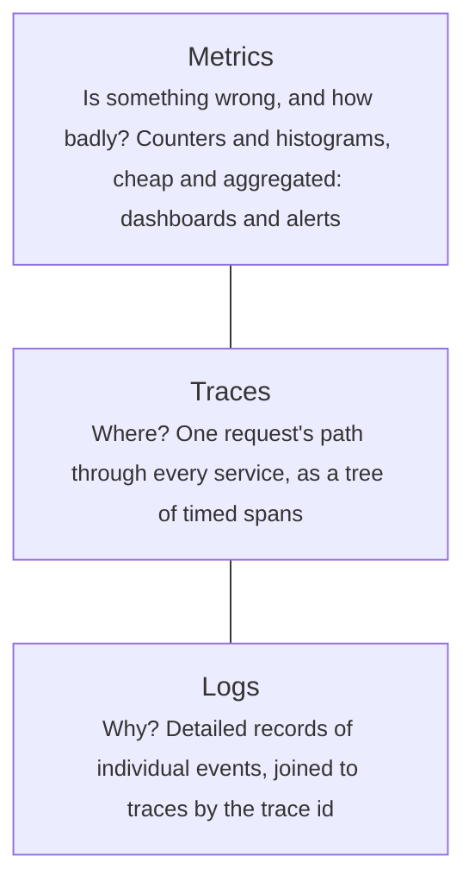
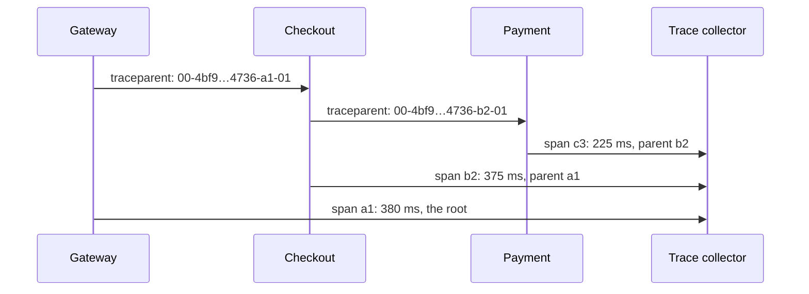
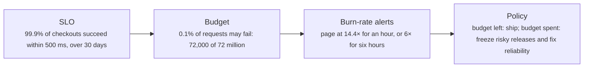

# Observability: logs, metrics, traces and SLOs

> System Design · L2 Proficient · Services, real time and observability · about 100 min · hub module `m09` ([open the hub](https://claude.ai/artifact/WYKUGQ93VYjG6xBpea5exS))

## Why it matters
In production you can't attach a debugger: you learn what the system is doing from what it emits. Metrics tell you that something is wrong, traces tell you where, and logs tell you why. SLOs turn "is it working?" into a number users care about, and the error budget turns reliability into a decision you make together with the product team.

## Pre-question (answer before reading)
**Q:** Your dashboard shows an average API latency of 120 ms, well under the 300 ms target, yet users say the app is slow. How can both be true?

<details><summary>Answer</summary>

Averages hide the tail. If 95% of requests take 80 ms and 5% take 900 ms, the average is about 120 ms, but one request in twenty is slow, and a page that makes several requests hits a slow one far more often. Track percentiles (p95, p99) from histograms, and set the objective on them: for example, 99% of requests within 300 ms.

</details>

## 🍎 Story time (kid version)
**Pizza Town and the family road trip: How is the restaurant doing tonight?**

Luigi keeps a diary of everything unusual: "table 4's soup came back cold at 8:12". On the kitchen wall, a tally counts the dishes served and sent back each hour. When one order takes forever, he follows its ticket, which every station stamps with the time, and sees it waited 20 minutes at the grill. He promises his customers that 99 dishes in every 100 come out within 15 minutes. That leaves one slow dish in a hundred to spare, and when a month has used it up, he stops trying new recipes until things calm down.

| In the story | In a real system |
|---|---|
| The diary of unusual events | Logs: detailed, timestamped records of individual events |
| The tally on the kitchen wall | Metrics: cheap counts and measurements over time, for dashboards and alerts |
| Following one ticket, stamped at each station | A trace: one request's path through every service, with the time spent in each |
| 99 dishes in every 100 within 15 minutes | An SLO: a target for an SLI (the share of good events) over a time window |
| The one slow dish in a hundred to spare | The error budget: the failures the SLO allows, to be spent on change and risk |

**Where the story breaks:** Luigi can see his whole kitchen at once. A distributed system has hundreds of processes that nobody sees whole, so every request needs an id that travels with it, and every service must emit the same kinds of signals.

## Key ideas (grown-up version)
- **Three signals**: metrics are numbers aggregated over time (request rate, error rate, latency histograms, CPU): cheap to keep, fast to query, ideal for dashboards and alerts. Logs record individual events: rich in detail, expensive at volume. Traces follow one request across services as a tree of timed spans. Metrics say something is wrong, traces say where, logs say why.
- **What to measure**: for each service, RED (rate, errors, duration); for each resource, USE (utilisation, saturation, errors); or Google's four golden signals: latency, traffic, errors and saturation. Record latency as histograms and alert on percentiles, never on averages.
- **Structured logs**: emit JSON with consistent fields (time, level, service, trace id, tenant or user id) so logs can be filtered and joined, not just searched as text. Never log secrets or personal data you don't need, sample noisy debug logs, and set retention by value.
- **Distributed tracing**: a trace id is created at the edge and passed on every call in a header (W3C traceparent); each service records spans with a name, start, duration, parent and attributes, and the tree shows where time went. Sample to control cost: keep every error and slow request, plus a small share of the rest. OpenTelemetry is the vendor-neutral standard for emitting all three signals.
- **Cardinality**: every distinct combination of metric labels is a separate time series. Labels such as status code or route are fine; user ids, request ids or full URLs multiply the series and the bill. Keep high-cardinality detail in logs and traces.
- **SLIs and SLOs**: an SLI is a measured ratio of good events to all events, such as checkout requests that succeed within 500 ms ÷ all checkout requests. An SLO is a target for it over a window: 99.9% over 30 days. Pick SLIs users would notice, measure them close to the user, and set targets below 100%: perfection is impossible, and past a point users can't tell the difference.
- **Error budgets**: 1 − SLO is the budget. 99.9% over 30 days allows 0.1% of requests to fail, or about 43 minutes of complete downtime. While budget remains, ship; when it's spent, slow risky releases and fix reliability. The budget makes reliability a shared, numeric decision between product and engineering.
- **Alerting**: page on symptoms users feel (the SLO burning), not on causes (CPU at 90%). The burn rate is how fast the budget is being spent compared with spending it evenly. Google's SRE workbook suggests paging when 2% of a 30-day budget burns in an hour (a burn rate of 14.4) or 5% in six hours (6), each confirmed by a short window, so that both sudden outages and slow leaks are caught. Every page should be actionable, with a runbook.

## Diagrams
**Three signals, three questions**



_An investigation moves down the list: an alert from the metrics, then a slow trace, then the logs for that trace._

**Passing the trace context along**



_Every hop carries the same trace id with its caller's span as the parent, so the collector can rebuild the whole tree._

**An error budget policy**



_Agree the policy with the product team before an incident, so that spending the budget leads to a decision rather than an argument._

## Comparisons
**Metrics, logs and traces**

|  | Metrics | Logs | Traces |
|---|---|---|---|
| Answers | Is something wrong, and how much? | What exactly happened, and why? | Where did the time go? |
| Unit | A number over time | One event | One request across services |
| Cost | Low, if label cardinality is controlled | Grows with traffic and detail | Grows with traffic; usually sampled |
| Typical tools | Prometheus, CloudWatch, Datadog | Loki, Elasticsearch, CloudWatch Logs | Jaeger, Tempo, Zipkin, X-Ray |
| Standards | OpenTelemetry, the Prometheus format | OpenTelemetry, JSON | OpenTelemetry, W3C Trace Context |

**SLO targets and their budgets over 30 days**

| SLO | Failures allowed | Complete downtime allowed |
|---|---|---|
| 99% | 1 in 100 | 7 h 12 min |
| 99.5% | 1 in 200 | 3 h 36 min |
| 99.9% | 1 in 1,000 | 43 min |
| 99.95% | 1 in 2,000 | 21.6 min |
| 99.99% | 1 in 10,000 | 4.3 min |

## Code (JavaScript + Python)
### The seeded random generator used by the simulations
```python
def mulberry32(seed):                           # a tiny seeded random generator, same as the JavaScript one
    state = seed & 0xFFFFFFFF
    def rand():
        nonlocal state
        state = (state + 0x6D2B79F5) & 0xFFFFFFFF
        t = ((state ^ (state >> 15)) * (state | 1)) & 0xFFFFFFFF
        t = (t ^ (t + (((t ^ (t >> 7)) * (t | 61)) & 0xFFFFFFFF))) & 0xFFFFFFFF
        return ((t ^ (t >> 14)) & 0xFFFFFFFF) / 4294967296
    return rand
```

```javascript
function mulberry32(seed) {                     // a tiny seeded random generator, same as the Python one
  return function () {
    seed = (seed + 0x6D2B79F5) | 0;
    let t = Math.imul(seed ^ (seed >>> 15), 1 | seed);
    t = (t + Math.imul(t ^ (t >>> 7), 61 | t)) ^ t;
    return ((t ^ (t >>> 14)) >>> 0) / 4294967296;
  };
}
```

### Averages hide the tail
```python
def percentile(sorted_ms, permille):
    return sorted_ms[len(sorted_ms) * permille // 1000 - 1]   # nearest rank: 990 per mille is p99

rand = mulberry32(1)
latencies = []
for _ in range(10_000):
    if rand() < 0.05:
        latencies.append(600 + int(rand() * 600))  # 1 request in 20 takes a slow path
    else:
        latencies.append(50 + int(rand() * 60))
s = sorted(latencies)
print(f"average {sum(latencies) // len(latencies)} ms | p50 {percentile(s, 500)} ms | "
      f"p95 {percentile(s, 950)} ms | p99 {percentile(s, 990)} ms")
good = sum(1 for ms in latencies if ms <= 300)     # the SLI: requests answered within 300 ms
tenths = good * 1000 // len(latencies)
print(f"within 300 ms: {tenths // 10}.{tenths % 10}% of requests, against an SLO of 99%")
```

Output:
```text
average 118 ms | p50 81 ms | p95 109 ms | p99 1074 ms
within 300 ms: 95.1% of requests, against an SLO of 99%
```

- line 2: Nearest rank: sort, then take the value at that share of the list. Monitoring systems estimate this from histogram buckets instead.
- line 8: About 5% of requests take 600 ms or more. That's invisible in the average and only just outside the p95.
- line 12: The average (118 ms) and even the p95 look healthy; the p99 shows the slow requests users complain about.
- line 16: As an SLI, 95.1% of requests within 300 ms clearly misses a 99% objective, which the average never revealed.

```javascript
function percentile(sortedMs, permille) {
  return sortedMs[Math.floor(sortedMs.length * permille / 1000) - 1];   // nearest rank: 990 per mille is p99
}

const rand = mulberry32(1);
const latencies = [];
for (let i = 0; i < 10_000; i++) {
  if (rand() < 0.05) latencies.push(600 + Math.floor(rand() * 600));   // 1 request in 20 takes a slow path
  else latencies.push(50 + Math.floor(rand() * 60));
}
const s = [...latencies].sort((a, b) => a - b);
const average = Math.floor(latencies.reduce((a, b) => a + b, 0) / latencies.length);
console.log(`average ${average} ms | p50 ${percentile(s, 500)} ms | ` +
            `p95 ${percentile(s, 950)} ms | p99 ${percentile(s, 990)} ms`);
const good = latencies.filter(ms => ms <= 300).length;   // the SLI: requests answered within 300 ms
const tenths = Math.floor(good * 1000 / latencies.length);
console.log(`within 300 ms: ${Math.floor(tenths / 10)}.${tenths % 10}% of requests, against an SLO of 99%`);
```

Output:
```text
average 118 ms | p50 81 ms | p95 109 ms | p99 1074 ms
within 300 ms: 95.1% of requests, against an SLO of 99%
```

- line 2: Nearest rank: sort, then take the value at that share of the list. Monitoring systems estimate this from histogram buckets instead.
- line 8: About 5% of requests take 600 ms or more. That's invisible in the average and only just outside the p95.
- line 13: The average (118 ms) and even the p95 look healthy; the p99 shows the slow requests users complain about.
- line 17: As an SLI, 95.1% of requests within 300 ms clearly misses a 99% objective, which the average never revealed.

### A trace: spans, parents and a text waterfall
```python
CALLS = ("checkout", 5, [("auth", 20, []),         # (name, its own work in ms, the calls it makes in turn)
                         ("cart", 10, [("db: load cart", 45, [])]),
                         ("payment", 10, [("fraud check", 60, []), ("card network", 225, [])])])

def trace(call, parent, start, spans):
    """Run a call and its children one after another, recording a span (name, start, duration, parent) for each."""
    name, own_ms, children = call
    index = len(spans)
    spans.append(None)                             # reserve this span's place before its children's
    clock = start + own_ms
    for child in children:
        clock = trace(child, index, clock, spans)  # the child's traceparent names this span as its parent
    spans[index] = (name, start, clock - start, parent)
    return clock

spans = []
total = trace(CALLS, None, 0, spans)
for name, start, ms, parent in spans:
    depth, p = 0, parent
    while p is not None:                           # walk up the parents to find how deep this span is
        depth, p = depth + 1, spans[p][3]
    bar = "." * (start * 30 // total) + "#" * max(1, ms * 30 // total)
    print(f"{'  ' * depth + name:<18}{bar:<31}{start}-{start + ms} ms")
own = [ms - sum(c[2] for c in spans if c[3] == i) for i, (_, _, ms, _) in enumerate(spans)]
worst = max(range(len(spans)), key=lambda i: own[i])
print(f"most time spent in: {spans[worst][0]}, {own[worst]} of {total} ms")
```

Output:
```text
checkout          ############################## 0-375 ms
  auth            #                              5-25 ms
  cart            ..####                         25-80 ms
    db: load cart ..###                          35-80 ms
  payment         ......#######################  80-375 ms
    fraud check   .......####                    90-150 ms
    card network  ............################## 150-375 ms
most time spent in: card network, 225 of 375 ms
```

- line 9: Each span is reserved before its children run, so the list comes out in the same order as the waterfall.
- line 12: In a real system the parent's span id travels in the traceparent header, and the child's span points back to it.
- line 23: The waterfall shows where the time went: payment holds most of the request, and inside it the card network.
- line 24: Self time is a span's duration minus its children's. The biggest self time is where to start optimising.

```javascript
const CALLS = ["checkout", 5, [["auth", 20, []],   // [name, its own work in ms, the calls it makes in turn]
                               ["cart", 10, [["db: load cart", 45, []]]],
                               ["payment", 10, [["fraud check", 60, []], ["card network", 225, []]]]]];

function trace(call, parent, start, spans) {
  // run a call and its children one after another, recording a span [name, start, duration, parent] for each
  const [name, ownMs, children] = call;
  const index = spans.length;
  spans.push(null);                                // reserve this span's place before its children's
  let clock = start + ownMs;
  for (const child of children) clock = trace(child, index, clock, spans);   // the child's traceparent names this span as its parent
  spans[index] = [name, start, clock - start, parent];
  return clock;
}

const spans = [];
const total = trace(CALLS, null, 0, spans);
for (const [name, start, ms, parent] of spans) {
  let depth = 0;
  for (let p = parent; p !== null; p = spans[p][3]) depth++;   // walk up the parents to find how deep this span is
  const bar = ".".repeat(Math.floor(start * 30 / total)) + "#".repeat(Math.max(1, Math.floor(ms * 30 / total)));
  console.log(`${("  ".repeat(depth) + name).padEnd(18)}${bar.padEnd(31)}${start}-${start + ms} ms`);
}
const own = spans.map(([, , ms], i) => ms - spans.filter(c => c[3] === i).reduce((sum, c) => sum + c[2], 0));
let worst = 0;
own.forEach((ms, i) => { if (ms > own[worst]) worst = i; });
console.log(`most time spent in: ${spans[worst][0]}, ${own[worst]} of ${total} ms`);
```

Output:
```text
checkout          ############################## 0-375 ms
  auth            #                              5-25 ms
  cart            ..####                         25-80 ms
    db: load cart ..###                          35-80 ms
  payment         ......#######################  80-375 ms
    fraud check   .......####                    90-150 ms
    card network  ............################## 150-375 ms
most time spent in: card network, 225 of 375 ms
```

- line 9: Each span is reserved before its children run, so the list comes out in the same order as the waterfall.
- line 11: In a real system the parent's span id travels in the traceparent header, and the child's span points back to it.
- line 22: The waterfall shows where the time went: payment holds most of the request, and inside it the card network.
- line 24: Self time is a span's duration minus its children's. The biggest self time is where to start optimising.

### An error budget and two burn-rate alerts over a month
```python
REQUESTS_PER_HOUR, SLO_PERMILLE, HOURS = 100_000, 999, 720   # 99.9% over 30 days
allowed_per_hour = REQUESTS_PER_HOUR * (1000 - SLO_PERMILLE) // 1000   # 100 failures an hour is exactly on budget
budget = allowed_per_hour * HOURS

rand = mulberry32(1)
errors = []
for h in range(HOURS):
    e = 10 + int(rand() * 20)                      # a normal hour: 0.01% to 0.03% of requests fail
    if 300 <= h < 302:
        e = 5000 + int(rand() * 100)               # an outage: 5% of requests fail for 2 hours
    if 500 <= h < 512:
        e = 800 + int(rand() * 50)                 # a bad deploy: 0.8% fail for 12 hours
    errors.append(e)

def first_alert(start, rule):
    return next((h for h in range(start, start + 24) if rule(h)), None)

fast = lambda h: errors[h] >= 144 * allowed_per_hour // 10                      # 14.4x over 1 hour
slow = lambda h: sum(errors[max(0, h - 5):h + 1]) >= 6 * 6 * allowed_per_hour   # 6x over 6 hours
print(f"budget: {budget} failed requests in 30 days, 0.1% of {REQUESTS_PER_HOUR * HOURS}")
for label, start in (("outage (5% for 2 h)", 300), ("bad deploy (0.8% for 12 h)", 500)):
    f, s = first_alert(start, fast), first_alert(start, slow)
    print(f"{label}: fast burn {'at hour ' + str(f) if f is not None else 'never'}, "
          f"slow burn {'at hour ' + str(s) if s is not None else 'never'}")
used = sum(errors) * 1000 // budget
print(f"used by the end of the month: {sum(errors)} of {budget} ({used // 10}.{used % 10}%), so the SLO is {'met' if used < 1000 else 'missed'}")
```

Output:
```text
budget: 72000 failed requests in 30 days, 0.1% of 72000000
outage (5% for 2 h): fast burn at hour 300, slow burn at hour 300
bad deploy (0.8% for 12 h): fast burn never, slow burn at hour 504
used by the end of the month: 33512 of 72000 (46.5%), so the SLO is met
```

- line 2: On budget means 0.1% of each hour's 100,000 requests: 100 failures. A burn rate is the actual failures divided by that.
- line 18: The fast rule pages when an hour burns 14.4 times the planned rate: 2% of the month's budget gone in one hour.
- line 19: The slow rule pages when six hours average 6 times the planned rate: 5% of the budget gone, too slowly for the fast rule to notice.
- line 23: The outage trips both rules at once; the bad deploy never reaches 14.4x, so only the six-hour rule catches it, five hours in.

```javascript
const REQUESTS_PER_HOUR = 100_000, SLO_PERMILLE = 999, HOURS = 720;   // 99.9% over 30 days
const allowedPerHour = Math.floor(REQUESTS_PER_HOUR * (1000 - SLO_PERMILLE) / 1000);   // 100 failures an hour is exactly on budget
const budget = allowedPerHour * HOURS;

const rand = mulberry32(1);
const errors = [];
for (let h = 0; h < HOURS; h++) {
  let e = 10 + Math.floor(rand() * 20);            // a normal hour: 0.01% to 0.03% of requests fail
  if (h >= 300 && h < 302) e = 5000 + Math.floor(rand() * 100);   // an outage: 5% of requests fail for 2 hours
  if (h >= 500 && h < 512) e = 800 + Math.floor(rand() * 50);     // a bad deploy: 0.8% fail for 12 hours
  errors.push(e);
}

function firstAlert(start, rule) {
  for (let h = start; h < start + 24; h++) if (rule(h)) return h;
  return null;
}

const fast = h => errors[h] >= Math.floor(144 * allowedPerHour / 10);   // 14.4x over 1 hour
const slow = h => errors.slice(Math.max(0, h - 5), h + 1).reduce((a, b) => a + b, 0) >= 6 * 6 * allowedPerHour;   // 6x over 6 hours
console.log(`budget: ${budget} failed requests in 30 days, 0.1% of ${REQUESTS_PER_HOUR * HOURS}`);
for (const [label, start] of [["outage (5% for 2 h)", 300], ["bad deploy (0.8% for 12 h)", 500]]) {
  const f = firstAlert(start, fast), s = firstAlert(start, slow);
  console.log(`${label}: fast burn ${f !== null ? "at hour " + f : "never"}, ` +
              `slow burn ${s !== null ? "at hour " + s : "never"}`);
}
const spent = errors.reduce((a, b) => a + b, 0);
const used = Math.floor(spent * 1000 / budget);
console.log(`used by the end of the month: ${spent} of ${budget} (${Math.floor(used / 10)}.${used % 10}%), so the SLO is ${used < 1000 ? "met" : "missed"}`);
```

Output:
```text
budget: 72000 failed requests in 30 days, 0.1% of 72000000
outage (5% for 2 h): fast burn at hour 300, slow burn at hour 300
bad deploy (0.8% for 12 h): fast burn never, slow burn at hour 504
used by the end of the month: 33512 of 72000 (46.5%), so the SLO is met
```

- line 2: On budget means 0.1% of each hour's 100,000 requests: 100 failures. A burn rate is the actual failures divided by that.
- line 19: The fast rule pages when an hour burns 14.4 times the planned rate: 2% of the month's budget gone in one hour.
- line 20: The slow rule pages when six hours average 6 times the planned rate: 5% of the budget gone, too slowly for the fast rule to notice.
- line 24: The outage trips both rules at once; the bad deploy never reaches 14.4x, so only the six-hour rule catches it, five hours in.

## Worked example
**Problem.** Checkout's latency SLO is burning after a deploy. Using structured logs that carry a trace id and each span's timing, find which endpoint got slower, which dependency is responsible, and why.

1. Start from the metrics: compare each endpoint's p99 before and after the deploy. Only /checkout moved, from under 200 ms to about a second, so /cart and the shared layers are fine.
2. Then the traces: take the slow /checkout requests and find the span with the most time in each. If one span dominates almost every slow trace, that's the dependency to look at.
3. Then the logs for those traces: what do they have in common? Here every slow request was a cache miss in the inventory lookup, which points to a cache change in the deploy.
4. The investigation needs the trace id in every log line and consistent field names across services; without them each step is guesswork. Afterwards, add an alert on the cache hit rate, and a check to the deploy.

```python
import json

def p99(values):
    s = sorted(values)
    return s[len(s) * 99 // 100 - 1]

def make_logs(seed=7):
    """An hour of requests. At minute 30 a deploy makes 8% of inventory lookups miss the cache."""
    rand, logs = mulberry32(seed), []
    for minute in range(60):
        for _ in range(50):
            for route in ("/checkout", "/cart"):
                spans, cache = {"auth": 5 + int(rand() * 10)}, "hit"
                if route == "/checkout":
                    if minute >= 30 and rand() < 0.08:
                        cache, spans["inventory"] = "miss", 600 + int(rand() * 400)
                    else:
                        spans["inventory"] = 10 + int(rand() * 20)
                    spans["payment"] = 80 + int(rand() * 60)
                else:
                    spans["db"] = 20 + int(rand() * 30)
                logs.append(json.dumps({"minute": minute, "route": route, "trace": f"t{len(logs)}",
                                        "ms": sum(spans.values()), "spans": spans, "cache": cache},
                                       separators=(",", ":")))
    return logs

lines = make_logs()
print("a log line:", lines[0])
records = [json.loads(line) for line in lines]
for route in ("/checkout", "/cart"):                # 1. metrics: which endpoint moved?
    before = [r["ms"] for r in records if r["route"] == route and r["minute"] < 30]
    after = [r["ms"] for r in records if r["route"] == route and r["minute"] >= 30]
    print(f"{route} p99: {p99(before)} ms before the deploy, {p99(after)} ms after")
slow = [r for r in records if r["route"] == "/checkout" and r["ms"] > 500]
worst = {}
for r in slow:                                      # 2. traces: which span holds the time?
    name = max(r["spans"], key=r["spans"].get)
    worst[name] = worst.get(name, 0) + 1
print(f"slow /checkout traces: {len(slow)} | slowest span:", ", ".join(f"{k} in {v}" for k, v in sorted(worst.items())))
misses = sum(1 for r in slow if r["cache"] == "miss")   # 3. logs: what do they share?
print(f"their logs: cache miss in {misses} of {len(slow)}")
```

Output:
```text
a log line: {"minute":0,"route":"/checkout","trace":"t0","ms":154,"spans":{"auth":5,"inventory":11,"payment":138},"cache":"hit"}
/checkout p99: 173 ms before the deploy, 1050 ms after
/cart p99: 61 ms before the deploy, 61 ms after
slow /checkout traces: 110 | slowest span: inventory in 110
their logs: cache miss in 110 of 110
```

```javascript
function p99(values) {
  const s = [...values].sort((a, b) => a - b);
  return s[Math.floor(s.length * 99 / 100) - 1];
}

function makeLogs(seed = 7) {
  // an hour of requests; at minute 30 a deploy makes 8% of inventory lookups miss the cache
  const rand = mulberry32(seed), logs = [];
  for (let minute = 0; minute < 60; minute++) {
    for (let i = 0; i < 50; i++) {
      for (const route of ["/checkout", "/cart"]) {
        const spans = { auth: 5 + Math.floor(rand() * 10) };
        let cache = "hit";
        if (route === "/checkout") {
          if (minute >= 30 && rand() < 0.08) { cache = "miss"; spans.inventory = 600 + Math.floor(rand() * 400); }
          else spans.inventory = 10 + Math.floor(rand() * 20);
          spans.payment = 80 + Math.floor(rand() * 60);
        } else {
          spans.db = 20 + Math.floor(rand() * 30);
        }
        const ms = Object.values(spans).reduce((a, b) => a + b, 0);
        logs.push(JSON.stringify({ minute, route, trace: `t${logs.length}`, ms, spans, cache }));
      }
    }
  }
  return logs;
}

const lines = makeLogs();
console.log("a log line:", lines[0]);
const records = lines.map(line => JSON.parse(line));
for (const route of ["/checkout", "/cart"]) {       // 1. metrics: which endpoint moved?
  const before = records.filter(r => r.route === route && r.minute < 30).map(r => r.ms);
  const after = records.filter(r => r.route === route && r.minute >= 30).map(r => r.ms);
  console.log(`${route} p99: ${p99(before)} ms before the deploy, ${p99(after)} ms after`);
}
const slow = records.filter(r => r.route === "/checkout" && r.ms > 500);
const worst = new Map();
for (const r of slow) {                             // 2. traces: which span holds the time?
  const name = Object.keys(r.spans).reduce((a, b) => (r.spans[b] > r.spans[a] ? b : a));
  worst.set(name, (worst.get(name) ?? 0) + 1);
}
console.log(`slow /checkout traces: ${slow.length} | slowest span:`, [...worst].sort().map(([k, v]) => `${k} in ${v}`).join(", "));
const misses = slow.filter(r => r.cache === "miss").length;   // 3. logs: what do they share?
console.log(`their logs: cache miss in ${misses} of ${slow.length}`);
```

Output:
```text
a log line: {"minute":0,"route":"/checkout","trace":"t0","ms":154,"spans":{"auth":5,"inventory":11,"payment":138},"cache":"hit"}
/checkout p99: 173 ms before the deploy, 1050 ms after
/cart p99: 61 ms before the deploy, 61 ms after
slow /checkout traces: 110 | slowest span: inventory in 110
their logs: cache miss in 110 of 110
```

**Answer.** Only /checkout moved, from a p99 of 173 ms to 1,050 ms; /cart stayed at 61 ms. All 110 slow checkout traces spend most of their time in the inventory span, and every one of them logged a cache miss, so the deploy's cache change is the cause.

## Your turn (faded example)
**Problem.** Finish `histogram_quantile(permille, buckets)` the way Prometheus estimates a percentile. `buckets` is a list of (upper bound in ms, cumulative count), ending with (infinity, total). Find the bucket that contains the wanted rank and interpolate linearly inside it; the first bucket starts at 0, and a rank in the infinite bucket returns the highest finite bound.

- ✓ The rank is total × permille ÷ 1000. Walk the buckets until the cumulative count reaches it.
- **How do you estimate a value inside the bucket?**
  <details><summary>Answer</summary>Assume the requests are spread evenly between the bucket's lower and upper bounds: lower + (upper − lower) × (rank − count below) ÷ count in the bucket.</details>
- **Why can't the estimate be exact?**
  <details><summary>Answer</summary>The histogram only stores counts per bucket, not the values. Accuracy depends on the bucket edges, so put edges near the thresholds you alert on (for example, one at exactly 300 ms for a 300 ms SLO).</details>
- **What does it cost, and why do monitoring systems store histograms?**
  <details><summary>Answer</summary>O(buckets) per estimate, with no sorting. Bucket counts can be added up across servers and time windows, while percentiles can't: you can't average p99s.</details>

Starter:
```python
INF = float("inf")

def histogram_quantile(permille, buckets):
    total = buckets[-1][1]
    lower, below = 0, 0                            # the previous bucket's bound and cumulative count
    for upper, count in buckets:
        ...                                        # TODO: is the rank in this bucket? if so, interpolate
    return lower
```

```javascript
function histogramQuantile(permille, buckets) {
  const total = buckets.at(-1)[1];
  let lower = 0, below = 0;                        // the previous bucket's bound and cumulative count
  for (const [upper, count] of buckets) {
    // TODO: is the rank in this bucket? if so, interpolate
  }
  return lower;
}
```

<details><summary>Full solution</summary>

```python
INF = float("inf")

def histogram_quantile(permille, buckets):
    total = buckets[-1][1]
    lower, below = 0, 0                            # the previous bucket's bound and cumulative count
    for upper, count in buckets:
        if count * 1000 >= total * permille:       # the rank (total x permille / 1000) is in this bucket
            if upper == INF:
                return lower                       # can't interpolate to infinity: the highest finite bound
            in_bucket = count - below
            if in_bucket == 0:
                return lower                       # an empty bucket: nothing to interpolate
            return lower + (upper - lower) * (total * permille - below * 1000) // (in_bucket * 1000)
        lower, below = upper, count
    return lower

buckets = [(50, 1200), (100, 9300), (250, 9520), (500, 9610), (1000, 9930), (2500, 10000), (INF, 10000)]
print(*(f"p{q // 10} ≈ {histogram_quantile(q, buckets)} ms" for q in (500, 950, 990)), sep=" | ")
```

Output:
```text
p50 ≈ 73 ms | p95 ≈ 236 ms | p99 ≈ 953 ms
```

```javascript
function histogramQuantile(permille, buckets) {
  const total = buckets.at(-1)[1];
  let lower = 0, below = 0;                        // the previous bucket's bound and cumulative count
  for (const [upper, count] of buckets) {
    if (count * 1000 >= total * permille) {        // the rank (total x permille / 1000) is in this bucket
      if (upper === Infinity) return lower;        // can't interpolate to infinity: the highest finite bound
      const inBucket = count - below;
      if (inBucket === 0) return lower;            // an empty bucket: nothing to interpolate
      return lower + Math.floor((upper - lower) * (total * permille - below * 1000) / (inBucket * 1000));
    }
    lower = upper; below = count;
  }
  return lower;
}

const buckets = [[50, 1200], [100, 9300], [250, 9520], [500, 9610], [1000, 9930], [2500, 10000], [Infinity, 10000]];
console.log([500, 950, 990].map(q => `p${Math.floor(q / 10)} ≈ ${histogramQuantile(q, buckets)} ms`).join(" | "));
```

Output:
```text
p50 ≈ 73 ms | p95 ≈ 236 ms | p99 ≈ 953 ms
```

</details>

## Socratic checks and quiz (answers hidden)
**1. What does this print?**

```python
slo_permille = 999
minutes = 30 * 24 * 60
budget = minutes * (1000 - slo_permille) // 1000
print(minutes, budget)
```

```javascript
const sloPermille = 999;
const minutes = 30 * 24 * 60;
const budget = Math.floor(minutes * (1000 - sloPermille) / 1000);
console.log(minutes, budget);
```

- A. 43200 43
- B. 43200 432
- C. 1440 1
- D. 43200 4

<details><summary>Answer</summary>

43200 43. 30 days is 43,200 minutes, and 0.1% of that is 43.2, rounded down to 43 minutes of complete downtime a month.

</details>

**2. What does this print?**

```python
allowed_per_hour = 100                           # 0.1% of 100,000 requests
out = []
for errors in [90, 1500, 800]:
    burn = errors / allowed_per_hour
    out.append("page" if burn >= 14.4 else "ok")
print(" ".join(out))
```

```javascript
const allowedPerHour = 100;                      // 0.1% of 100,000 requests
const out = [];
for (const errors of [90, 1500, 800]) {
  const burn = errors / allowedPerHour;
  out.push(burn >= 14.4 ? "page" : "ok");
}
console.log(out.join(" "));
```

- A. ok page ok
- B. ok page page
- C. page page page
- D. ok ok ok

<details><summary>Answer</summary>

ok page ok. The burn rates are 0.9, 15 and 8. Only 15 crosses 14.4; the 8x hour is serious but slower, which is what the six-hour rule is for.

</details>

**3. Which label is safe to put on a request-count metric?**

- A. The HTTP status code
- B. The user id
- C. The request id
- D. The full URL, including the query string

<details><summary>Answer</summary>

The HTTP status code. A status code has a handful of values. The other three have millions, and every distinct value creates another time series.

</details>

**4. Which makes the best SLI for a checkout API?**

- A. The share of checkout requests that succeed within 500 ms, measured at the load balancer
- B. The average CPU use of the checkout servers
- C. The number of log lines per minute
- D. The uptime of the database host

<details><summary>Answer</summary>

The share of checkout requests that succeed within 500 ms, measured at the load balancer. A good SLI is a ratio of good events to all events that users would notice, measured close to them. CPU, log volume and host uptime are causes or noise, not the user's experience.

</details>

**5. Which should page an on-call engineer at 3 a.m.? (choose 2)**

- A. The error budget burning 14 times faster than planned over the last hour
- B. Checkout success below its SLO for the last 15 minutes, and falling
- C. CPU at 85% on one of twenty servers
- D. A disk that is 60% full
- E. One request that took 4 seconds

<details><summary>Answer</summary>

The error budget burning 14 times faster than planned over the last hour, Checkout success below its SLO for the last 15 minutes, and falling. Both describe users being hurt right now. The others are causes or single events that belong on a dashboard or in a ticket, not in a page.

</details>

**6. Judge each statement.**

- Averages are a good basis for a latency SLO.
- A trace id passed in a header lets spans from different services be joined into one trace.
- A 99.9% SLO allows about 43 minutes of complete downtime in 30 days.
- User ids make cheap metric labels, because each label is just a string.

<details><summary>Answer</summary>

Averages are a good basis for a latency SLO.: No; A trace id passed in a header lets spans from different services be joined into one trace.: Yes; A 99.9% SLO allows about 43 minutes of complete downtime in 30 days.: Yes; User ids make cheap metric labels, because each label is just a string.: No. Latency SLOs use percentiles or the share of fast requests, since averages hide the tail. And each distinct label value is another series, so user ids are expensive.

</details>

**7. Put the investigation of a latency alert in order.**

- (put the steps in order)

<details><summary>Answer</summary>

An SLO burn-rate alert fires for checkout latency → Dashboards show which endpoint's p99 rose, and when → Slow traces from that endpoint show which span holds the time → The logs for those traces show why: a cache miss, a retry, an error → A fix ships, and the burn rate returns to normal. From cheap and aggregated to detailed and specific: the metrics narrow it down, the traces locate it, the logs explain it.

</details>

**8. Complete the Python latency SLI: the percentage (rounded down) of requests answered within the threshold.**

```
def latency_sli(durations_ms, threshold_ms):
    good = sum(1 for d in durations_ms if d {{0}} threshold_ms)
    return {{1}}

```

<details><summary>Answer</summary>

<= | good * 100 // len(durations_ms). A good event is a request at or under the threshold, and the SLI is good events divided by all events, here as a whole percentage.

</details>

## Traps & misconceptions
- **“Alert on high CPU.”** Users don't feel CPU; they feel errors and slowness. Page on symptoms (the SLO burning), and keep cause signals like CPU for dashboards and capacity planning.
- **“Track the average latency.”** Averages hide the slow requests users remember. Record histograms and watch p95 and p99, and remember that a page making ten calls meets each call's p99 far more often than 1% of the time.
- **“Aim for 100% availability.”** It's impossible, enormously expensive to approach, and users can't tell 99.99% from 100% through their own networks and devices. Pick the target users need, and spend the rest of the budget on shipping.
- **“Add the user id as a metric label so we can break it down by user.”** Every distinct label value creates another time series; a million users means a million series per metric. Keep high-cardinality fields in logs and traces.
- **“Log everything at debug level, just in case.”** Volume drives cost and buries the signal, and logs can leak secrets and personal data. Log structured events with ids, sample the noisy ones, and use traces for request flows.
- **“Tracing means instrumenting every service by hand.”** OpenTelemetry's libraries and auto-instrumentation cover common frameworks, HTTP clients and databases; you add spans by hand only for your own important steps. What must never be skipped is passing the trace header on.

## Discussion prompts
- **Your team keeps arguing about whether to ship features or fix reliability. How can SLOs settle it?**
  <details><summary>One good answer</summary>Agree an SLO with the product team (say 99.9% of checkouts succeed within 500 ms over 30 days) and a policy for the error budget. While budget remains, ship at full speed; when a burn-rate alert shows it's going fast, or it's gone, the agreed policy applies: slow risky releases, prioritise reliability work, and review the incidents. An argument about opinions becomes a number both sides signed up to.</details>
- **A request passes through a gateway, three services and a queue. How do you make it traceable from end to end?**
  <details><summary>One good answer</summary>Create the trace at the gateway (or accept the caller's traceparent), pass the traceparent header on every HTTP or gRPC call, and put it in the queue message's headers so the consumer continues the trace or links to it. Each service emits spans with OpenTelemetry, and every log line includes the trace id, so you can jump from a slow span to its logs. Keep every error and slow trace, plus a small sample of the rest.</details>

## Teach-back
**Prompt:** Explain to a junior colleague what metrics, logs and traces are each for, and how an SLO and its error budget work.

Rubric:
- [ ] Metrics: is something wrong; traces: where; logs: why
- [ ] Percentiles from histograms, not averages; watch label cardinality
- [ ] A trace id propagated on every call; spans form a tree
- [ ] SLI as a ratio of good events; SLO as a target over a window
- [ ] Error budget and burn-rate alerts that page on symptoms

<details><summary>Model answer</summary>

Metrics are cheap numbers over time, such as request rates, error rates and latency histograms; they tell us something is wrong and drive dashboards and alerts. Traces follow a single request through every service as a tree of timed spans, joined by a trace id passed in a header, so they show where the time went. Logs are detailed structured events, tagged with that trace id, so they explain why. For latency I look at percentiles, not averages. An SLI is the share of good events, such as requests that succeed within 300 ms, and an SLO is the target for it, say 99.9% over 30 days. What's left over, 0.1%, is the error budget: while there's budget we ship, and when it's being burned too fast, an alert pages us and we slow down releases to fix reliability.

</details>

## Quick Q&A (also in the SRS deck)
- **Metrics, logs or traces: which shows where the time went?** Traces: they show which service and span took the time.
- **RED?** Rate, errors and duration: the three metrics to track for every service.
- **SLI?** A measured share of good events, such as requests that succeed within 300 ms.
- **The error budget for 99.9% over 30 days?** 0.1% of requests, or about 43 minutes of complete downtime.
- **Burn rate?** How fast the error budget is being spent, compared with spending it evenly over the window.
- **Cardinality?** The number of distinct label combinations, each one a separate time series.

## Practice problems
- [ ] [Reading · Service level objectives](https://sre.google/sre-book/service-level-objectives/) · write SLIs and SLOs for a checkout service, and say where you'd measure each one
- [ ] [Exercise · Alerting on SLOs](https://sre.google/workbook/alerting-on-slos/) · work through the burn-rate table, then choose the windows and thresholds for a 99.5% SLO
- [ ] [Reference · OpenTelemetry concepts](https://opentelemetry.io/docs/concepts/) · instrument a small service with traces and metrics, and propagate the context to a second service
- [ ] [Reference · Trace Context](https://www.w3.org/TR/trace-context/) · decode a traceparent header field by field, and explain what the sampled flag does

## Sources (accessed 2026-10-09)
- [Google SRE book: Service level objectives](https://sre.google/sre-book/service-level-objectives/)
- [Google SRE book: Monitoring distributed systems](https://sre.google/sre-book/monitoring-distributed-systems/)
- [Google SRE workbook: Alerting on SLOs](https://sre.google/workbook/alerting-on-slos/)
- [OpenTelemetry documentation: Concepts](https://opentelemetry.io/docs/concepts/)
- [W3C Recommendation: Trace Context](https://www.w3.org/TR/trace-context/)
- [Prometheus documentation: Histograms and summaries](https://prometheus.io/docs/practices/histograms/)
