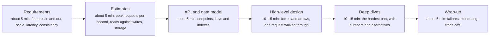
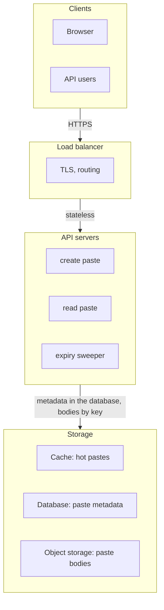
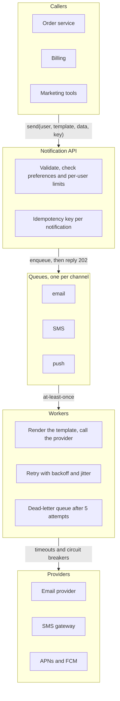

# The interview framework and classic designs

> System Design · L2 Proficient · Interview framework and classic designs · about 110 min · hub module `m10` ([open the hub](https://claude.ai/artifact/WYKUGQ93VYjG6xBpea5exS))

## Why it matters
At L2 the questions are open-ended: “design a pastebin”, “design a chat app”. Interviewers and design reviews judge the route as much as the result: clear scope, numbers that drive choices, an API and data model that serve the real access patterns, a walk-through of the design, one or two deep dives, and honest trade-offs. A repeatable routine keeps you from rambling or forgetting the requirements that matter most, and four classic designs (a rate limiter, a news feed, chat and a notification service) bring together everything in this hub.

## Pre-question (answer before reading)
**Q:** You're asked to design a pastebin in 45 minutes. What do you do in the first five minutes, before drawing any boxes?

<details><summary>Answer</summary>

Clarify the scope and the constraints: who uses it, which features are in (create, read by link, expiry) and which are out (accounts, editing), and the non-functional needs: pastes and reads per day, size limits, how long pastes live, latency and availability targets. Then estimate quickly, so that the numbers can drive the design.

</details>

## 🍎 Story time (kid version)
**Pizza Town and the family road trip: Tara's stall at the fair**

The school asks Tara and Ben to run a pizza stall at the fair. Before buying anything, Tara asks questions: how many people will come, how long the fair lasts, and does anyone need gluten-free? She writes the answers down and works out roughly how many pizzas they'll need. Then she makes the price board and plans where the oven, the till and the queue will go. “What if the oven breaks?” asks Ben. They borrow a second oven, but only one till fits, so they accept a longer queue at lunchtime.

| In the story | In a real system |
|---|---|
| Asking how many people, how long, and who needs gluten-free | Clarifying functional and non-functional requirements |
| Working out roughly how many pizzas | Back-of-the-envelope estimates that drive the design |
| The price board | The API: what clients can ask for |
| Planning where the oven, the till and the queue go | The high-level design: components and the request path |
| A second oven, but a longer queue at lunchtime | Handling a failure, and naming the trade-off you accepted |

**Where the story breaks:** The fair's needs are fixed for the day; a real product's requirements change. A good design notes which assumptions would force a redesign if they changed: ten times the users, a second region, stricter consistency.

## Key ideas (grown-up version)
- **Clarify first**: functional requirements (the features in scope), non-functional requirements (scale, latency, availability, consistency, durability, cost) and constraints. Write down what's out of scope. Ask; if the interviewer won't say, propose numbers and carry on.
- **Estimate to decide**: peak requests per second for reads and writes, storage and bandwidth (L1 module 9). Every number should change a decision: cache or not, replicas or not, partition or not, queue or not.
- **API first**: list the main operations with their inputs and outputs (POST /pastes returns an id; GET /pastes/{id} returns the text). The API fixes the contract and exposes the access patterns the data model must serve.
- **Data model from access patterns**: one table or collection per entity, keys that serve the main lookups, and an index for every other query the API needs. A query with neither scans everything and will fail at scale.
- **High-level design**: draw the request path (clients, load balancer, services, cache, database, queue, object storage) and walk one read and one write through it, naming what each box does.
- **Deep dives**: pick the one or two hardest or riskiest parts for this product and go deep with numbers and alternatives, rather than skimming everything. The classics each have a crux: an atomic shared counter for a rate limiter, fan-out for a news feed, ordered and never-lost delivery for chat, and retries without duplicates for notifications.
- **Failure and operations**: name the single points of failure, what happens when each box fails, the timeouts and retries between them, and what you'd monitor, starting with the four golden signals: latency, traffic, errors and saturation.
- **Trade-offs out loud**: consistency or availability, latency or cost, simplicity or flexibility. Say what you chose, what it cost, and what would make you choose differently.

## Diagrams
**A 45-minute design routine**



_Say the plan at the start and check in at each step. Interviewers usually steer the deep dives; let them._

**A pastebin's high-level design**



_Reads hit the cache first, then fetch metadata and the body. Expired pastes are hidden on read and deleted in batches by a background job._

**A notification service**



_The API replies as soon as the message is queued; the workers absorb slow providers. The idempotency key stops retries from sending twice, and per-user limits stop a bug from spamming everyone._

## Comparisons
**Functional and non-functional requirements**

|  | Functional | Non-functional |
|---|---|---|
| Answers | What does it do? | How well, and at what scale? |
| Pastebin examples | Create a paste; read it by link; pastes expire | 1 million new pastes a day; reads under 100 ms; 99.9% available; a saved paste is never lost |
| Drives | The API and the data model | Caching, replication, partitioning, queues, regions |
| Often forgotten | Deletion, expiry, abuse limits | Durability, cost, privacy and compliance |

**Questions for the first five minutes**

| Topic | Question |
|---|---|
| Users | Who uses it, and how many each day? |
| Features | Which features are in, and which are out? |
| Scale | How many reads and writes a day? How big is each item? How long is it kept? |
| Latency | What must feel instant, and what can take seconds? |
| Consistency | May a reader see slightly old data? For how long? |
| Availability | What happens if it's down for a minute? For an hour? |

**Four classic designs, and where this hub covers them**

| Design | The crux | Core pieces | Covered in |
|---|---|---|---|
| Rate limiter | One limit shared by many servers, checked in about a millisecond | Token buckets in Redis, updated by an atomic script; 429 with Retry-After | Module 6 |
| News feed | Fan-out: writing to millions of feeds, or reading from hundreds of accounts | Fan-out on write for most accounts, on read for celebrities; a feed cache | This module |
| Chat | Ordered, never-lost delivery to every device | WebSocket gateways, sequence numbers per conversation, store first, catch up on reconnect | Module 8 |
| Notification service | Reliable delivery through slow providers, without duplicates or spam | A queue per channel, workers with retries and a dead-letter queue, idempotency keys, per-user limits | Modules 5 and 6 |

## Code (JavaScript + Python)
### Estimates that drive choices (the thresholds are rules of thumb, not measurements)
```python
SECONDS_PER_DAY = 86_400

def human_bytes(n):
    units, i = ["B", "KB", "MB", "GB", "TB", "PB"], 0
    while n >= 1000 and i < len(units) - 1:
        n /= 1000
        i += 1
    return f"{int(n * 10 + 0.5) / 10:.1f} {units[i]}"

def decide(dau, reads_per_user, writes_per_user, item_bytes, keep_days, peak=3, copies=3):
    """Peak reads/s, peak writes/s, database bytes, and the choices those numbers suggest."""
    reads = dau * reads_per_user * peak // SECONDS_PER_DAY
    writes = dau * writes_per_user * peak // SECONDS_PER_DAY
    db_bytes = dau * writes_per_user * item_bytes * keep_days * copies
    choices = []
    if item_bytes >= 10_000:
        choices.append("object storage for the bodies")
        db_bytes = db_bytes * 200 // item_bytes  # only about 200 bytes of metadata per item stay in the database
    if reads > 1_000:
        choices.append("cache")
    if reads > 5_000:
        choices.append("read replicas")         # assumption: one database node serves ~5,000 simple reads/s
    if writes > 1_000 or db_bytes > 2 * 10**12:
        choices.append("partitioning")          # assumption: ~1,000 writes/s or ~2 TB is comfortable on one node
    return reads, writes, db_bytes, choices or ["one database node"]
```

```javascript
const SECONDS_PER_DAY = 86400;

function humanBytes(n) {
  const units = ["B", "KB", "MB", "GB", "TB", "PB"];
  let i = 0;
  while (n >= 1000 && i < units.length - 1) { n /= 1000; i++; }
  return `${(Math.floor(n * 10 + 0.5) / 10).toFixed(1)} ${units[i]}`;
}

function decide(dau, readsPerUser, writesPerUser, itemBytes, keepDays, peak = 3, copies = 3) {
  // peak reads/s, peak writes/s, database bytes, and the choices those numbers suggest
  const reads = Math.floor((dau * readsPerUser * peak) / SECONDS_PER_DAY);
  const writes = Math.floor((dau * writesPerUser * peak) / SECONDS_PER_DAY);
  let dbBytes = dau * writesPerUser * itemBytes * keepDays * copies;
  const choices = [];
  if (itemBytes >= 10000) {
    choices.push("object storage for the bodies");
    dbBytes = Math.floor((dbBytes * 200) / itemBytes);   // only about 200 bytes of metadata per item stay in the database
  }
  if (reads > 1000) choices.push("cache");
  if (reads > 5000) choices.push("read replicas");       // assumption: one database node serves ~5,000 simple reads/s
  if (writes > 1000 || dbBytes > 2e12) choices.push("partitioning");   // assumption: ~1,000 writes/s or ~2 TB is comfortable on one node
  return [reads, writes, dbBytes, choices.length ? choices : ["one database node"]];
}
```

### Numbers that drive choices
```python
specs = {                                     # (daily users, reads and writes per user per day, bytes per item, days kept)
    "pastebin": (2_000_000, 5, 1, 10_000, 365),
    "chat": (50_000_000, 200, 40, 200, 365),
    "team wiki": (20_000, 30, 2, 5_000, 1_825),
}
for name, spec in specs.items():
    reads, writes, db_bytes, choices = decide(*spec)
    print(f"{name}: reads/s {reads:,} | writes/s {writes:,} | database {human_bytes(db_bytes)} -> {', '.join(choices)}")
```

Output:
```text
pastebin: reads/s 347 | writes/s 69 | database 438.0 GB -> object storage for the bodies
chat: reads/s 347,222 | writes/s 69,444 | database 438.0 TB -> cache, read replicas, partitioning
team wiki: reads/s 20 | writes/s 1 | database 1.1 TB -> one database node
```

- line 2: Big bodies move to object storage, so only small metadata rows stay in the database.
- line 3: Hundreds of thousands of reads and tens of thousands of writes a second: this one needs every tool.
- line 4: Twenty reads a second and about a terabyte: one database node (with a standby) is the right answer, and saying so is a strength.

```javascript
const specs = {                               // [daily users, reads and writes per user per day, bytes per item, days kept]
  pastebin: [2000000, 5, 1, 10000, 365],
  chat: [50000000, 200, 40, 200, 365],
  "team wiki": [20000, 30, 2, 5000, 1825],
};
for (const [name, spec] of Object.entries(specs)) {
  const [reads, writes, dbBytes, choices] = decide(...spec);
  console.log(`${name}: reads/s ${reads.toLocaleString("en-US")} | writes/s ${writes.toLocaleString("en-US")} | database ${humanBytes(dbBytes)} -> ${choices.join(", ")}`);
}
```

Output:
```text
pastebin: reads/s 347 | writes/s 69 | database 438.0 GB -> object storage for the bodies
chat: reads/s 347,222 | writes/s 69,444 | database 438.0 TB -> cache, read replicas, partitioning
team wiki: reads/s 20 | writes/s 1 | database 1.1 TB -> one database node
```

- line 2: Big bodies move to object storage, so only small metadata rows stay in the database.
- line 3: Hundreds of thousands of reads and tens of thousands of writes a second: this one needs every tool.
- line 4: Twenty reads a second and about a terabyte: one database node (with a standby) is the right answer, and saying so is a strength.

### From the API to the data model: does every query have a key or an index?
```python
tables = {                                    # table -> (primary key, secondary indexes)
    "pastes": ("paste_id", ["user_id"]),
    "users": ("user_id", ["email"]),
}
queries = [                                   # (what the API needs, table, the column it looks up by)
    ("GET /pastes/{id}", "pastes", "paste_id"),
    ("GET /users/{id}/pastes", "pastes", "user_id"),
    ("POST /login", "users", "email"),
    ("expiry sweeper", "pastes", "expires_at"),
]
for api, table, column in queries:
    pk, indexes = tables[table]
    how = "primary key" if column == pk else "index" if column in indexes else "FULL SCAN: add an index"
    print(f"{api:<24}{table}.{column}: {how}")
```

Output:
```text
GET /pastes/{id}        pastes.paste_id: primary key
GET /users/{id}/pastes  pastes.user_id: index
POST /login             users.email: index
expiry sweeper          pastes.expires_at: FULL SCAN: add an index
```

- line 5: List the access patterns from the API and the background jobs, not from the tables.
- line 9: Background jobs have access patterns too: the sweeper needs an index on expires_at or it reads every paste.

```javascript
const tables = {                              // table -> [primary key, secondary indexes]
  pastes: ["paste_id", ["user_id"]],
  users: ["user_id", ["email"]],
};
const queries = [                             // [what the API needs, table, the column it looks up by]
  ["GET /pastes/{id}", "pastes", "paste_id"],
  ["GET /users/{id}/pastes", "pastes", "user_id"],
  ["POST /login", "users", "email"],
  ["expiry sweeper", "pastes", "expires_at"],
];
for (const [api, table, column] of queries) {
  const [pk, indexes] = tables[table];
  const how = column === pk ? "primary key" : indexes.includes(column) ? "index" : "FULL SCAN: add an index";
  console.log(`${api.padEnd(24)}${table}.${column}: ${how}`);
}
```

Output:
```text
GET /pastes/{id}        pastes.paste_id: primary key
GET /users/{id}/pastes  pastes.user_id: index
POST /login             users.email: index
expiry sweeper          pastes.expires_at: FULL SCAN: add an index
```

- line 5: List the access patterns from the API and the background jobs, not from the tables.
- line 9: Background jobs have access patterns too: the sweeper needs an index on expires_at or it reads every paste.

### Walking requests through the design: what's on the critical path?
```python
HOP_MS = {"lb": 1, "app": 4, "cache": 1, "db read": 5, "db write": 10, "queue": 2, "email": 300}   # rules of thumb

paths = {
    "read, cache hit": ["lb", "app", "cache"],
    "read, cache miss": ["lb", "app", "cache", "db read"],
    "sign-up, email sent inline": ["lb", "app", "db write", "email"],
    "sign-up, email queued": ["lb", "app", "db write", "queue"],
}
for name, hops in paths.items():
    print(f"{name}: {sum(HOP_MS[h] for h in hops)} ms")
```

Output:
```text
read, cache hit: 6 ms
read, cache miss: 11 ms
sign-up, email sent inline: 315 ms
sign-up, email queued: 17 ms
```

- line 1: Rough per-hop costs: assumptions to state, then replace with measurements.
- line 6: Sending the email inside the request makes every sign-up wait for a slow outside service; queuing it (module 5) takes it off the critical path.

```javascript
const HOP_MS = { lb: 1, app: 4, cache: 1, "db read": 5, "db write": 10, queue: 2, email: 300 };   // rules of thumb

const paths = {
  "read, cache hit": ["lb", "app", "cache"],
  "read, cache miss": ["lb", "app", "cache", "db read"],
  "sign-up, email sent inline": ["lb", "app", "db write", "email"],
  "sign-up, email queued": ["lb", "app", "db write", "queue"],
};
for (const [name, hops] of Object.entries(paths)) console.log(`${name}: ${hops.reduce((t, h) => t + HOP_MS[h], 0)} ms`);
```

Output:
```text
read, cache hit: 6 ms
read, cache miss: 11 ms
sign-up, email sent inline: 315 ms
sign-up, email queued: 17 ms
```

- line 1: Rough per-hop costs: assumptions to state, then replace with measurements.
- line 6: Sending the email inside the request makes every sign-up wait for a slow outside service; queuing it (module 5) takes it off the critical path.

### A news feed three ways: fan-out on write, on read, and the hybrid
```python
class FeedService:
    """Home feeds built by pushing posts to followers (fan-out on write), pulling at read time, or both."""
    def __init__(self, follows, strategy, celebrity_min=3):
        self.follows, self.strategy, self.celebrity_min = follows, strategy, celebrity_min
        self.followers = {}
        for user, accounts in follows.items():
            for account in accounts:
                self.followers.setdefault(account, []).append(user)
        self.posts, self.feeds = {}, {}           # author -> their posts; user -> their precomputed feed
        self.writes = self.reads = 0

    def pushed(self, author):
        if self.strategy == "hybrid":
            return len(self.followers.get(author, [])) < self.celebrity_min   # celebrities are pulled instead
        return self.strategy == "write"

    def post(self, author, t, text):
        self.posts.setdefault(author, []).append((t, text))
        self.writes += 1
        if self.pushed(author):
            for follower in self.followers.get(author, []):
                self.feeds.setdefault(follower, []).append((t, text))   # one write per follower
                self.writes += 1

    def home(self, user, k=3):
        items = list(self.feeds.get(user, []))
        self.reads += 1
        for account in self.follows.get(user, []):
            if not self.pushed(account):
                items += self.posts.get(account, [])   # pulled and merged at read time
                self.reads += 1
        return [text for _, text in sorted(items, reverse=True)[:k]]

follows = {"ana": ["kim", "bob"], "bob": ["kim", "ana"], "cy": ["kim", "ana"], "dev": ["kim"]}   # kim is the celebrity
for strategy in ("write", "read", "hybrid"):
    feeds = FeedService(follows, strategy)
    for t, (author, text) in enumerate([("kim", "new album"), ("ana", "hello"), ("bob", "lunch?"), ("kim", "tour dates")], 1):
        feeds.post(author, t, f"{author}: {text}")
    homes = {user: feeds.home(user) for user in follows}
    print(f"fan-out on {strategy}: {feeds.writes} writes, {feeds.reads} reads | ana sees", " / ".join(homes["ana"]))
```

Output:
```text
fan-out on write: 15 writes, 4 reads | ana sees kim: tour dates / bob: lunch? / kim: new album
fan-out on read: 4 writes, 11 reads | ana sees kim: tour dates / bob: lunch? / kim: new album
fan-out on hybrid: 7 writes, 8 reads | ana sees kim: tour dates / bob: lunch? / kim: new album
```

- line 14: The hybrid pushes ordinary accounts' posts but pulls celebrities' at read time, the approach Twitter described for its home timelines.
- line 22: Fan-out on write costs one write per follower: home reads become a single lookup, but one post by an account with 50 million followers means 50 million writes.
- line 30: Fan-out on read writes each post once, but every home view merges the posts of everyone the user follows, which is expensive for the many reads.
- line 40: The same feed three ways, at different costs. Feeds are read far more often than posts are written, so most systems push, and pull only for the accounts that would make pushing explode.

```javascript
class FeedService {
  // home feeds built by pushing posts to followers (fan-out on write), pulling at read time, or both
  constructor(follows, strategy, celebrityMin = 3) {
    this.follows = follows; this.strategy = strategy; this.celebrityMin = celebrityMin;
    this.followers = new Map();
    for (const [user, accounts] of Object.entries(follows)) {
      for (const account of accounts) {
        if (!this.followers.has(account)) this.followers.set(account, []);
        this.followers.get(account).push(user);
      }
    }
    this.posts = new Map(); this.feeds = new Map();   // author -> their posts; user -> their precomputed feed
    this.writes = 0; this.reads = 0;
  }
  pushed(author) {
    if (this.strategy === "hybrid") return (this.followers.get(author) ?? []).length < this.celebrityMin;   // celebrities are pulled instead
    return this.strategy === "write";
  }
  post(author, t, text) {
    if (!this.posts.has(author)) this.posts.set(author, []);
    this.posts.get(author).push([t, text]);
    this.writes++;
    if (this.pushed(author)) {
      for (const follower of this.followers.get(author) ?? []) {
        if (!this.feeds.has(follower)) this.feeds.set(follower, []);
        this.feeds.get(follower).push([t, text]);   // one write per follower
        this.writes++;
      }
    }
  }
  home(user, k = 3) {
    let items = [...(this.feeds.get(user) ?? [])];
    this.reads++;
    for (const account of this.follows[user] ?? []) {
      if (!this.pushed(account)) {
        items = items.concat(this.posts.get(account) ?? []);   // pulled and merged at read time
        this.reads++;
      }
    }
    return items.sort((a, b) => b[0] - a[0]).slice(0, k).map(([, text]) => text);
  }
}

const follows = { ana: ["kim", "bob"], bob: ["kim", "ana"], cy: ["kim", "ana"], dev: ["kim"] };   // kim is the celebrity
for (const strategy of ["write", "read", "hybrid"]) {
  const feeds = new FeedService(follows, strategy);
  [["kim", "new album"], ["ana", "hello"], ["bob", "lunch?"], ["kim", "tour dates"]].forEach(([author, text], i) => feeds.post(author, i + 1, `${author}: ${text}`));
  const homes = Object.fromEntries(Object.keys(follows).map(user => [user, feeds.home(user)]));
  console.log(`fan-out on ${strategy}: ${feeds.writes} writes, ${feeds.reads} reads | ana sees`, homes.ana.join(" / "));
}
```

Output:
```text
fan-out on write: 15 writes, 4 reads | ana sees kim: tour dates / bob: lunch? / kim: new album
fan-out on read: 4 writes, 11 reads | ana sees kim: tour dates / bob: lunch? / kim: new album
fan-out on hybrid: 7 writes, 8 reads | ana sees kim: tour dates / bob: lunch? / kim: new album
```

- line 16: The hybrid pushes ordinary accounts' posts but pulls celebrities' at read time, the approach Twitter described for its home timelines.
- line 26: Fan-out on write costs one write per follower: home reads become a single lookup, but one post by an account with 50 million followers means 50 million writes.
- line 36: Fan-out on read writes each post once, but every home view merges the posts of everyone the user follows, which is expensive for the many reads.
- line 49: The same feed three ways, at different costs. Feeds are read far more often than posts are written, so most systems push, and pull only for the accounts that would make pushing explode.

## Worked example
**Problem.** Should a pastebin keep paste bodies in the database or in object storage? Weigh four criteria (cost 3, simplicity 2, read latency 2, room to grow 3), score each option from 1 to 5, and then find how much simplicity would have to matter for the database option to win.

1. Scores: bodies in the database are simple (5) and quick to read (4) but cost more per gigabyte (2) and grow badly (2); object storage is cheap (5) and grows without limit (5), with an extra call per read (3) and one more system to run (3).
2. Weighted totals: database 3 × 2 + 2 × 5 + 2 × 4 + 3 × 2 = 30; object storage 3 × 5 + 2 × 3 + 2 × 3 + 3 × 5 = 42. Object storage wins clearly.
3. Sensitivity: raise simplicity's weight until the database option wins. The totals are 20 + 5s and 36 + 3s, so the database wins only once s > 8, more than four times today's weight.
4. Only an unlikely change flips the result, so the choice is robust. The sums take O(criteria × options) time; the real work is scoring honestly and saying the result in one sentence.

```python
def weighted_total(weights, scores):
    return sum(weights[c] * scores[c] for c in weights)

weights = {"cost": 3, "simplicity": 2, "read latency": 2, "room to grow": 3}
options = {
    "bodies in the database": {"cost": 2, "simplicity": 5, "read latency": 4, "room to grow": 2},
    "bodies in object storage": {"cost": 5, "simplicity": 3, "read latency": 3, "room to grow": 5},
}
for name, scores in options.items():
    print(name, weighted_total(weights, scores))

w = dict(weights)                             # how much would simplicity have to matter?
while weighted_total(w, options["bodies in the database"]) <= weighted_total(w, options["bodies in object storage"]):
    w["simplicity"] += 1
print("the database option wins once simplicity weighs", w["simplicity"])
```

Output:
```text
bodies in the database 30
bodies in object storage 42
the database option wins once simplicity weighs 9
```

```javascript
const weightedTotal = (weights, scores) => Object.keys(weights).reduce((t, c) => t + weights[c] * scores[c], 0);

const weights = { cost: 3, simplicity: 2, "read latency": 2, "room to grow": 3 };
const options = {
  "bodies in the database": { cost: 2, simplicity: 5, "read latency": 4, "room to grow": 2 },
  "bodies in object storage": { cost: 5, simplicity: 3, "read latency": 3, "room to grow": 5 },
};
for (const [name, scores] of Object.entries(options)) console.log(name, weightedTotal(weights, scores));

const w = { ...weights };                     // how much would simplicity have to matter?
while (weightedTotal(w, options["bodies in the database"]) <= weightedTotal(w, options["bodies in object storage"])) w.simplicity++;
console.log("the database option wins once simplicity weighs", w.simplicity);
```

Output:
```text
bodies in the database 30
bodies in object storage 42
the database option wins once simplicity weighs 9
```

**Answer.** Object storage scores 42 against the database's 30, and the database option would only win if simplicity weighed 9, more than four times its current weight. The choice is robust: keep the bodies in object storage and the metadata in the database.

## Your turn (faded example)
**Problem.** Write a tiny design review. A design lists its components with their number of copies, the calls between them with their timeouts (None or null for none), and the components a request can't succeed without. Finish `review(design)` so it returns the single points of failure (critical components with fewer than 2 copies, sorted) and the calls without a timeout.

- ✓ A component is a single point of failure if requests fail without it and it has only one copy.
- **Why isn't the single cache node a single point of failure here?**
  <details><summary>Answer</summary>With cache-aside, reads fall back to the database when the cache is down: slower, but still working. It's on the path but not critical, as long as the database can take the extra load for a while.</details>
- **Why flag calls without a timeout?**
  <details><summary>Answer</summary>A dependency that hangs ties up a worker for every request until the server runs out of workers (Little's law, L1 module 2). A timeout turns a hang into a fast error that can be retried or handled.</details>
- **What does the review cost?**
  <details><summary>Answer</summary>O(components + calls) time and memory. The hard part is describing the design honestly, not running the check.</details>

Starter:
```python
def review(design):
    """Returns (sorted single points of failure, list of "a -> b" calls without a timeout)."""
    ...                                       # TODO: critical components with < 2 copies; calls whose timeout is None
```

```javascript
function review(design) {
  // returns [sorted single points of failure, list of "a -> b" calls without a timeout]
  // TODO: critical components with < 2 copies; calls whose timeout is null
}
```

<details><summary>Full solution</summary>

```python
def review(design):
    """Returns (sorted single points of failure, list of "a -> b" calls without a timeout)."""
    copies = design["components"]
    spofs = sorted(name for name in design["critical"] if copies[name] < 2)
    no_timeout = [f"{a} -> {b}" for a, b, timeout in design["calls"] if timeout is None]
    return spofs, no_timeout

design = {
    "components": {"lb": 2, "api": 3, "cache": 1, "db": 1, "payments": 2},   # name -> copies
    "calls": [("lb", "api", 2_000), ("api", "cache", 50), ("api", "db", None), ("api", "payments", None)],
    "critical": {"lb", "api", "db", "payments"},                              # requests fail without these
}
spofs, no_timeout = review(design)
print("single points of failure:", *spofs)
print("calls without a timeout:", ", ".join(no_timeout))
```

Output:
```text
single points of failure: db
calls without a timeout: api -> db, api -> payments
```

```javascript
function review(design) {
  // returns [sorted single points of failure, list of "a -> b" calls without a timeout]
  const copies = design.components;
  const spofs = [...design.critical].filter(name => copies[name] < 2).sort();
  const noTimeout = design.calls.filter(([, , timeout]) => timeout === null).map(([a, b]) => `${a} -> ${b}`);
  return [spofs, noTimeout];
}

const design = {
  components: { lb: 2, api: 3, cache: 1, db: 1, payments: 2 },   // name -> copies
  calls: [["lb", "api", 2000], ["api", "cache", 50], ["api", "db", null], ["api", "payments", null]],
  critical: new Set(["lb", "api", "db", "payments"]),             // requests fail without these
};
const [spofs, noTimeout] = review(design);
console.log("single points of failure:", ...spofs);
console.log("calls without a timeout:", noTimeout.join(", "));
```

Output:
```text
single points of failure: db
calls without a timeout: api -> db, api -> payments
```

</details>

## Socratic checks and quiz (answers hidden)
**1. What does this print? (`decide` is this module's helper: peak reads/s, peak writes/s, database bytes and choices.)**

```python
reads, writes, db_bytes, choices = decide(1_000_000, 50, 2, 1_000, 365)
print(reads, writes, *choices, sep=" | ")
```

```javascript
const [reads, writes, dbBytes, choices] = decide(1000000, 50, 2, 1000, 365);
console.log([reads, writes, ...choices].join(" | "));
```

- A. 1736 | 69 | cache | partitioning
- B. 1736 | 69 | cache
- C. 578 | 23 | one database node
- D. 1736 | 69 | cache | read replicas | partitioning

<details><summary>Answer</summary>

1736 | 69 | cache | partitioning. Peak reads are 1,000,000 × 50 × 3 ÷ 86,400 ≈ 1,736 a second, enough for a cache but not replicas; writes are about 69 a second; and storage is 1,000,000 × 2 × 1 KB × 365 × 3 copies ≈ 2.2 TB, just over the 2 TB assumption, so partitioning (or a bigger node, or shorter retention).

</details>

**2. What does this print?**

```python
w = {"latency": 3, "cost": 1}
a, b = {"latency": 5, "cost": 1}, {"latency": 2, "cost": 5}
total = lambda s: sum(w[k] * s[k] for k in w)
print(total(a), total(b), "a" if total(a) > total(b) else "b")
```

```javascript
const w = { latency: 3, cost: 1 };
const a = { latency: 5, cost: 1 }, b = { latency: 2, cost: 5 };
const total = s => Object.keys(w).reduce((t, k) => t + w[k] * s[k], 0);
console.log(total(a), total(b), total(a) > total(b) ? "a" : "b");
```

- A. 16 11 a
- B. 6 7 b
- C. 16 11 b
- D. 11 16 b

<details><summary>Answer</summary>

16 11 a. a scores 3 × 5 + 1 × 1 = 16 and b scores 3 × 2 + 1 × 5 = 11. With latency weighted three times as heavily as cost, a wins.

</details>

**3. An interviewer says “design a photo-sharing app”. What should you do first?**

- A. Agree the scope and the non-functional requirements (users, scale, latency, consistency), then estimate
- B. Draw the load balancer, servers and database straight away
- C. Pick a database product and explain why it's the best
- D. Start with the deep dive into the image pipeline

<details><summary>Answer</summary>

Agree the scope and the non-functional requirements (users, scale, latency, consistency), then estimate. Everything later depends on the requirements and numbers. Boxes, products and deep dives chosen before them have nothing to be right about.

</details>

**4. Which are non-functional requirements? (choose 2)**

- A. 99.9% of feed loads finish in under 300 ms
- B. A message is never lost once the server has acknowledged it
- C. Users can follow other users
- D. Users can upload a profile photo
- E. Each post shows a like button

<details><summary>Answer</summary>

99.9% of feed loads finish in under 300 ms, A message is never lost once the server has acknowledged it. Latency and durability targets describe how well the system works. Following, uploading and liking are features: functional requirements.

</details>

**5. Judge each statement.**

- With cache-aside, a single cache node isn't necessarily a single point of failure.
- Every query the API needs should be served by a primary key or an index.
- A design for the stated scale should also say what would change at 10× the traffic.
- Deep dives should give every component equal time.

<details><summary>Answer</summary>

With cache-aside, a single cache node isn't necessarily a single point of failure.: Yes; Every query the API needs should be served by a primary key or an index.: Yes; A design for the stated scale should also say what would change at 10× the traffic.: Yes; Deep dives should give every component equal time.: No. Reads fall back to the database when a cache-aside cache fails. Queries without a key or index scan everything. Saying what changes at 10× shows the design can grow. And deep dives go where the risk is.

</details>

**6. Put these design steps in order.**

- (put the steps in order)

<details><summary>Answer</summary>

Clarify the requirements and the scale → Estimate traffic and storage → Draw the high-level design that those numbers call for → Deep-dive into the riskiest component. The estimates need the scale from the requirements, the design needs the estimates, and you can only pick the riskiest component once the design exists.

</details>

**7. Complete the Python function that lists single points of failure.**

```
def single_points(components, critical):
    return sorted(n for n in {{0}} if components[n] {{1}})

```

<details><summary>Answer</summary>

critical | < 2. Only components that requests can't succeed without count, and only those with a single copy, so loop over the critical set and keep copies < 2.

</details>

**8. Match each item to the step of the routine it belongs to.**


<details><summary>Answer</summary>

About 3,000 reads a second at the peak = Estimate; POST /pastes returns an id = API; pastes(paste_id, user_id, expires_at) with an index on expires_at = Data model; Reads finish in under 200 ms at the 99th percentile = Non-functional requirement. A deep dive is a stage of the interview, not an artefact like these four.

</details>

## Traps & misconceptions
- **“Start drawing boxes straight away.”** Without requirements and numbers the design has nothing to be right about. Spend the first minutes on scope, non-functional needs and estimates; they decide whether you need a cache, partitioning or a queue.
- **“Non-functional requirements are optional extras.”** Latency, availability, consistency and durability targets shape a design more than its features do: “messages are never lost” and “a feed may be a minute stale” lead to very different systems.
- **“Design for a billion users from day one.”** Design for the stated scale with room to grow, and say what you'd change at 10× and 100×. Complexity that the numbers don't justify costs money and time, and interviewers notice.
- **“A single cache node is a single point of failure.”** Only if requests fail without it. With cache-aside, a cache outage makes reads slower, not impossible, provided the database can take the extra load for a while.
- **“There's one right answer.”** There are several defensible designs. What's judged is whether each choice follows from the requirements and whether you can say what it costs.
- **“Deep dives should cover everything.”** Time is short: pick the one or two parts that are hardest or riskiest for this product, such as fan-out for a feed or ordering for chat, and go deep there.

## Discussion prompts
- **How do you run the 45 minutes of a design interview?**
  <details><summary>One good answer</summary>About 5 minutes on requirements and scope, 5 on estimates, 5 on the API and data model, 10 to 15 on the high-level design with one request walked through it, 10 to 15 on one or two deep dives, and the last few minutes on failures, monitoring and trade-offs. Say the plan out loud at the start, and check in with the interviewer at each step, because they often want to steer the deep dives.</details>
- **How would you build home feeds for a social network where a few accounts have 50 million followers?**
  <details><summary>One good answer</summary>Push most posts into followers' precomputed feeds (fan-out on write, done asynchronously by queue workers), because feeds are read far more often than posts are written. For accounts above a follower threshold, don't push: merge their recent posts in at read time, from a cache. Keep only a few hundred items per feed in memory, rebuild a feed from the posts store when it's missing, and skip pushing to followers who haven't been active for weeks.</details>
- **How do you decide between two designs when both could work?**
  <details><summary>One good answer</summary>List what matters for this product, weigh it, and score each option honestly; then ask what would flip the decision. If only an unlikely change would flip it, the choice is robust. Then say it in one sentence: “Bodies go in object storage because cost and growth matter most here; if pastes were tiny and few, keeping them in the database would be simpler.”</details>

## Teach-back
**Prompt:** Explain to a junior colleague the steps you'd follow to answer “design a pastebin”.

Rubric:
- [ ] Clarify functional and non-functional requirements, and what's out of scope
- [ ] Estimate, and let the numbers decide (cache, object storage, partitioning)
- [ ] API first, then a data model with a key or index for every access pattern
- [ ] A high-level design with a request walked through, then a deep dive
- [ ] Single points of failure, timeouts, monitoring, and trade-offs said out loud

<details><summary>Model answer</summary>

I'd start by agreeing the scope: anyone can create a paste and read it by link, pastes expire, and accounts and editing are out. Then the non-functional side: say 2 million new pastes a day, five reads each, bodies up to about 10 KB, kept for a year, reads under 100 ms, and no saved paste ever lost. A quick estimate gives a few hundred reads a second at the peak and tens of terabytes of bodies over a year, so the bodies go to object storage and the database keeps small metadata rows. The API is POST /pastes and GET /pastes/{id}, and the data model needs the paste id as the key plus an index on the expiry time for the clean-up job. I'd draw the path through a load balancer, stateless API servers, a cache for hot pastes, the database and object storage, and walk a read through it. My deep dive would be expiry and abuse limits. I'd finish with single points of failure, timeouts, the four golden signals, and why I chose each part.

</details>

## Quick Q&A (also in the SRS deck)
- **Functional or non-functional requirements?** What the system does, against how well it does it: scale, latency, availability, consistency, durability, cost.
- **Why estimate before designing?** The numbers decide whether you need a cache, replicas, partitioning, a CDN or a queue.
- **Where does the data model come from?** From the access patterns in the API and background jobs: every query needs a key or an index.
- **What is a single point of failure?** A component that requests can't succeed without and that has only one copy.
- **The four golden signals?** Latency, traffic, errors and saturation.
- **How do you state a trade-off?** What you chose, what it cost, and what would make you choose differently.

## Practice problems
- [ ] [Exercise · Design a pastebin end to end](https://github.com/donnemartin/system-design-primer/blob/master/solutions/system_design/pastebin/README.md) · do it yourself with this module's routine first, then compare with the primer's write-up and list what you'd change
- [ ] [Exercise · Write a one-page design doc](https://www.industrialempathy.com/posts/design-docs-at-google/) · read how design docs are structured at Google, then write one for the pastebin with goals and non-goals
- [ ] [Exercise · Choose what to monitor](https://sre.google/sre-book/monitoring-distributed-systems/) · read the four golden signals and list the graphs and alerts you'd set up for the pastebin
- [ ] [Exercise · Design a home timeline](https://github.com/donnemartin/system-design-primer/blob/master/solutions/system_design/twitter/README.md) · design it with this module's routine and the fan-out code, then compare with the primer's solution

## Sources (accessed 2026-10-09)
- [Google SRE book: Monitoring distributed systems](https://sre.google/sre-book/monitoring-distributed-systems/)
- [Malte Ubl: Design docs at Google](https://www.industrialempathy.com/posts/design-docs-at-google/)
- [System Design Primer](https://github.com/donnemartin/system-design-primer)
- [System Design Primer: Design the Twitter timeline and search](https://github.com/donnemartin/system-design-primer/blob/master/solutions/system_design/twitter/README.md)
- [Google SRE book: Service level objectives](https://sre.google/sre-book/service-level-objectives/)
