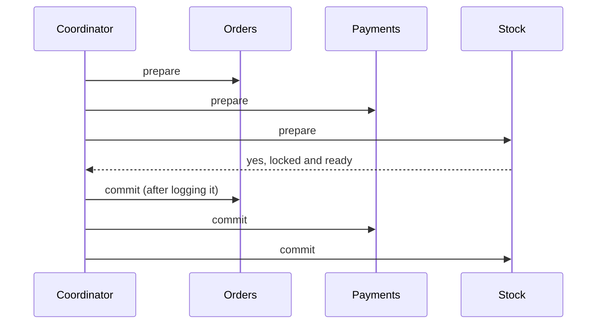
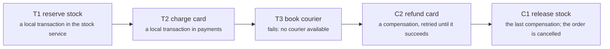
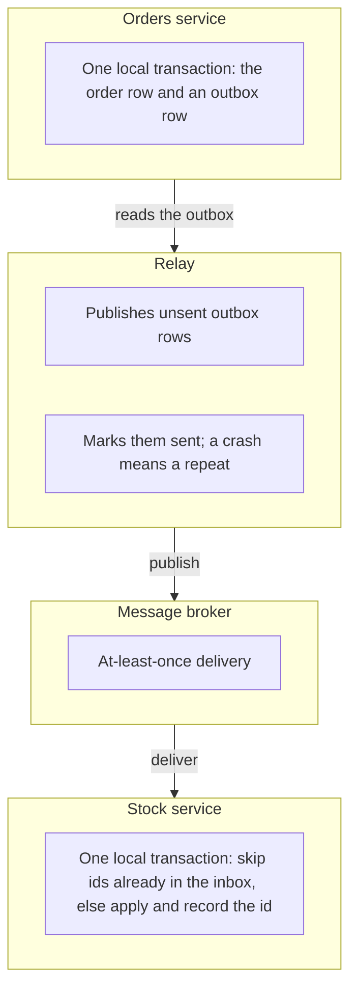

# Distributed transactions: two-phase commit, sagas, outbox and inbox

> System Design · L3 Specialist · Transactions, events and streams · about 120 min · hub module `m01` ([open the hub](https://claude.ai/artifact/W93mxxEWBqV4MS8kJiz9dU))

## Why it matters
An order touches three services: stock reserves the item, payments takes the money, shipping books a courier. Either all of it should happen or none of it. A database transaction can't stretch across services, so you choose: two-phase commit, which is atomic but blocks when its coordinator fails, or a saga, a chain of local transactions with compensations that undo earlier steps. The outbox and inbox patterns make each step's messages reliable and each consumer idempotent.

## Pre-question (answer before reading)
**Q:** The payment went through, but reserving stock then failed because the item had sold out. The money has left the customer's card. What should the system do, and why can't it simply roll back?

<details><summary>Answer</summary>

The payment was committed in another service's database, so there's no transaction left to roll back. The saga runs a compensating action instead: refund the payment (a new transaction that undoes it in business terms) and mark the order cancelled. Compensations must be idempotent and must eventually succeed, so they're retried until they do.

</details>

## 🍎 Story time (kid version)
**Pizza Town and the family road trip: Luigi plans a party**

Luigi is planning a party: the bouncy castle, the cake and the magician must all come, or none of them. One way: he phones all three and asks, "Can you keep Saturday free?" Only when all three say yes does he ring back to say "It's on!" But one year Luigi lost his voice after they'd all said yes, and they kept Saturday free for days, waiting. Now he books them one at a time, and if the magician can't come, he cancels the cake, then the castle, instead of pretending they were never booked. He writes every call he must make in a notebook first, and the castle company ticks off the calls it has already answered.

| In the story | In a real system |
|---|---|
| Asking all three to keep Saturday free, then saying "It's on!" | Two-phase commit: prepare and vote, then commit everywhere |
| Everyone waiting after Luigi lost his voice | Blocking: participants that voted yes wait for the coordinator, holding their locks |
| Booking one at a time, and cancelling instead of un-booking | A saga: local transactions with compensations, run in reverse on failure |
| Writing every call in the notebook first | The outbox: messages saved in the same transaction as the change |
| Ticking off calls already answered | The inbox: a consumer records message ids so a repeat has no effect |

**Where the story breaks:** Luigi's helpers can tell he's lost his voice. Services can't tell a crashed coordinator from a slow one, and while a saga runs, everyone else can see the half-finished booking.

## Key ideas (grown-up version)
- **Why it's hard**: a database transaction can't span several services' databases. Between steps any service can fail, and a lost reply leaves you unsure whether a step committed. Every design here answers two questions: how do all the steps end up done or undone, and what does everyone else see in between?
- **Two-phase commit (2PC)**: a coordinator asks every participant to prepare; each writes its changes durably, keeps them locked and votes yes (promising to obey the decision) or no. If all vote yes, the coordinator logs COMMIT and tells everyone; otherwise ABORT. It's atomic, but participants hold locks across two round trips, and if the coordinator fails after the yes votes they're stuck in doubt until it recovers.
- **Where 2PC lives**: inside database systems (distributed SQL databases run it with replicated, consensus-backed coordinators so the coordinator can't simply disappear) and across a few XA-capable resources. Across microservices it's rare: it couples their availability and needs every participant to support prepare.
- **Sagas**: a sequence of local transactions T1…Tn, each with a compensating transaction. If Tk fails, the saga runs the compensations for the earlier steps in reverse. Every step commits at once, so there's no blocking, but there's no isolation either: other transactions can see the intermediate states.
- **Compensations**: a semantic undo (refund, release the reservation, cancel the booking), not a rollback. They must be idempotent and retried until they succeed. Steps that can't be undone go after the ones that might fail: compensatable steps first, then one pivot step, then steps that are retried until they succeed.
- **Orchestration or choreography**: an orchestrator, a durable state machine, tells each service what to do and records progress, so a long flow can be followed, changed and resumed after a crash. In choreography, services react to each other's events: no central component, but the flow is implicit and easy to tangle.
- **Living without isolation**: mark records as pending (a semantic lock) so other operations wait or refuse; prefer commutative updates (add and subtract rather than overwrite); re-read a value before acting on it; and show users the pending state honestly, such as "payment processing".
- **Outbox and inbox**: each step writes its outgoing messages to an outbox table in the same local transaction, and a relay publishes them at least once (L2 module 5). Each consumer records the ids of the messages it has handled in an inbox table, in the same transaction as the effect, and ignores repeats. Together they give an exactly-once effect per step.

## Diagrams
**Two-phase commit, and the window where it blocks**



_Once a participant has voted yes, it may neither commit nor abort on its own. If the coordinator crashes before telling it, it holds its locks and waits._

**A saga that fails at the third step**



_Compensations run newest first. Between T1 and C1, other transactions can see stock reserved for an order that will never ship._

**Outbox and inbox between two services**



_The outbox stops a message from being lost or invented; the inbox stops a repeated message from being applied twice._

## Comparisons
**Two-phase commit or a saga**

|  | Two-phase commit | Saga |
|---|---|---|
| Atomicity | All or nothing, enforced by the protocol | All or nothing in the end, through compensations |
| Isolation | Yes: locks are held until the decision | No: others see intermediate states |
| If the coordinator fails | Participants block, holding locks, until it recovers | The orchestrator resumes from its durable log |
| Latency | Two round trips with locks held across them | Each step commits locally at once |
| Typical use | Inside one database system, or a few XA resources | Business workflows across services |

**Orchestration or choreography**

|  | Orchestration | Choreography |
|---|---|---|
| Who drives the flow | A central orchestrator: a durable state machine | Each service reacts to the others' events |
| Seeing the whole flow | In one place | Spread across services and their subscriptions |
| Coupling | Services take commands from the orchestrator | Services depend on each other's events |
| Good for | Long or branching flows that change | Short flows with two or three steps |

## Code (JavaScript + Python)
### The seeded random generator used by the simulations
```python
def mulberry32(seed):                           # a tiny seeded random generator, same as the JavaScript one
    state = seed & 0xFFFFFFFF
    def rand():
        nonlocal state
        state = (state + 0x6D2B79F5) & 0xFFFFFFFF
        t = ((state ^ (state >> 15)) * (state | 1)) & 0xFFFFFFFF
        t = (t ^ (t + (((t ^ (t >> 7)) * (t | 61)) & 0xFFFFFFFF))) & 0xFFFFFFFF
        return ((t ^ (t >> 14)) & 0xFFFFFFFF) / 4294967296
    return rand
```

```javascript
function mulberry32(seed) {                     // a tiny seeded random generator, same as the Python one
  return function () {
    seed = (seed + 0x6D2B79F5) | 0;
    let t = Math.imul(seed ^ (seed >>> 15), 1 | seed);
    t = (t + Math.imul(t ^ (t >>> 7), 61 | t)) ^ t;
    return ((t ^ (t >>> 14)) >>> 0) / 4294967296;
  };
}
```

### Two-phase commit, and what a coordinator crash leaves behind
```python
class Participant:
    def __init__(self, name, vote_yes=True):
        self.name, self.vote_yes, self.state = name, vote_yes, "idle"

    def prepare(self):
        if not self.vote_yes:
            self.state = "aborted"             # can't do it: vote no and drop the work
            return False
        self.state = "prepared"                # changes written durably and locked; promises to obey the decision
        return True

    def finish(self, decision):
        self.state = "committed" if decision == "commit" else "aborted"

def two_phase_commit(participants, log, crash=None):
    votes = [p.prepare() for p in participants]    # phase 1: prepare and vote
    decision = "commit" if all(votes) else "abort"
    if crash == "before deciding":
        return
    log.append(decision)                       # the decision is durable before anyone hears it
    for i, p in enumerate(participants):       # phase 2: tell everyone
        if crash == "mid-broadcast" and i == 1:
            return
        p.finish(decision)

def recover(participants, log):
    decision = log[-1] if log else "abort"     # nothing logged: nobody can have committed, so abort
    for p in participants:
        if p.state == "prepared":
            p.finish(decision)

def show(label, participants):
    held = sum(1 for p in participants if p.state == "prepared")
    print(f"{label}: {', '.join(f'{p.name} {p.state}' for p in participants)} | holding locks: {held}")

for label, stock_votes_yes, crash in (("all vote yes", True, None), ("stock votes no", False, None),
                                      ("crash before deciding", True, "before deciding"),
                                      ("crash mid-broadcast", True, "mid-broadcast")):
    ps = [Participant("orders"), Participant("payments"), Participant("stock", stock_votes_yes)]
    log = []
    two_phase_commit(ps, log, crash)
    show(label, ps)
    if crash:
        recover(ps, log)
        show(f"  after recovery ({log[-1] if log else 'no decision logged'})", ps)
```

Output:
```text
all vote yes: orders committed, payments committed, stock committed | holding locks: 0
stock votes no: orders aborted, payments aborted, stock aborted | holding locks: 0
crash before deciding: orders prepared, payments prepared, stock prepared | holding locks: 3
  after recovery (no decision logged): orders aborted, payments aborted, stock aborted | holding locks: 0
crash mid-broadcast: orders committed, payments prepared, stock prepared | holding locks: 2
  after recovery (commit): orders committed, payments committed, stock committed | holding locks: 0
```

- line 9: A yes vote is a promise: the changes are durable and locked, and the participant may no longer decide on its own.
- line 20: The coordinator writes its decision to its own durable log first, so it can repeat it after a crash.
- line 27: With no decision logged, nobody can have committed, so recovery may safely abort.
- line 42: Crash between the votes and the decision, and every participant sits prepared, holding locks, until the coordinator returns.

```javascript
class Participant {
  constructor(name, voteYes = true) { this.name = name; this.voteYes = voteYes; this.state = "idle"; }
  prepare() {
    if (!this.voteYes) { this.state = "aborted"; return false; }   // can't do it: vote no and drop the work
    this.state = "prepared";                   // changes written durably and locked; promises to obey the decision
    return true;
  }
  finish(decision) { this.state = decision === "commit" ? "committed" : "aborted"; }
}

function twoPhaseCommit(participants, log, crash = null) {
  const votes = participants.map(p => p.prepare());   // phase 1: prepare and vote
  const decision = votes.every(Boolean) ? "commit" : "abort";
  if (crash === "before deciding") return;
  log.push(decision);                          // the decision is durable before anyone hears it
  for (let i = 0; i < participants.length; i++) {   // phase 2: tell everyone
    if (crash === "mid-broadcast" && i === 1) return;
    participants[i].finish(decision);
  }
}

function recover(participants, log) {
  const decision = log.length ? log.at(-1) : "abort";   // nothing logged: nobody can have committed, so abort
  for (const p of participants) if (p.state === "prepared") p.finish(decision);
}

function show(label, participants) {
  const held = participants.filter(p => p.state === "prepared").length;
  console.log(`${label}: ${participants.map(p => `${p.name} ${p.state}`).join(", ")} | holding locks: ${held}`);
}

for (const [label, stockVotesYes, crash] of [["all vote yes", true, null], ["stock votes no", false, null],
                                             ["crash before deciding", true, "before deciding"],
                                             ["crash mid-broadcast", true, "mid-broadcast"]]) {
  const ps = [new Participant("orders"), new Participant("payments"), new Participant("stock", stockVotesYes)];
  const log = [];
  twoPhaseCommit(ps, log, crash);
  show(label, ps);
  if (crash) {
    recover(ps, log);
    show(`  after recovery (${log.length ? log.at(-1) : "no decision logged"})`, ps);
  }
}
```

Output:
```text
all vote yes: orders committed, payments committed, stock committed | holding locks: 0
stock votes no: orders aborted, payments aborted, stock aborted | holding locks: 0
crash before deciding: orders prepared, payments prepared, stock prepared | holding locks: 3
  after recovery (no decision logged): orders aborted, payments aborted, stock aborted | holding locks: 0
crash mid-broadcast: orders committed, payments prepared, stock prepared | holding locks: 2
  after recovery (commit): orders committed, payments committed, stock committed | holding locks: 0
```

- line 5: A yes vote is a promise: the changes are durable and locked, and the participant may no longer decide on its own.
- line 15: The coordinator writes its decision to its own durable log first, so it can repeat it after a crash.
- line 23: With no decision logged, nobody can have committed, so recovery may safely abort.
- line 38: Crash between the votes and the decision, and every participant sits prepared, holding locks, until the coordinator returns.

### An orchestrated saga: compensations in reverse
```python
STEPS = [("reserve stock", "release stock"), ("charge card", "refund card"), ("book courier", "cancel courier")]

def run_saga(fail_at=None):
    done, log = [], []
    for action, compensation in STEPS:
        if action == fail_at:
            log.append(f"{action} FAILED")
            for _, undo in reversed(done):     # undo what succeeded, newest first
                log.append(undo)
            return "cancelled", log
        log.append(action)                     # each step is a local transaction that commits at once
        done.append((action, compensation))
    return "confirmed", log

for fail_at in (None, "charge card", "book courier"):
    status, log = run_saga(fail_at)
    print(f"{fail_at or 'no failure'}: {' -> '.join(log)} => order {status}")
```

Output:
```text
no failure: reserve stock -> charge card -> book courier => order confirmed
charge card: reserve stock -> charge card FAILED -> release stock => order cancelled
book courier: reserve stock -> charge card -> book courier FAILED -> refund card -> release stock => order cancelled
```

- line 1: Every step comes with its compensation: a business-level undo, not a database rollback.
- line 8: On failure, the steps that already committed are undone newest first, which matters when later steps depend on earlier ones.
- line 11: Each step commits on its own, so other transactions can see the half-done order: sagas have no isolation.

```javascript
const STEPS = [["reserve stock", "release stock"], ["charge card", "refund card"], ["book courier", "cancel courier"]];

function runSaga(failAt = null) {
  const done = [], log = [];
  for (const [action, compensation] of STEPS) {
    if (action === failAt) {
      log.push(`${action} FAILED`);
      for (const [, undo] of [...done].reverse()) log.push(undo);   // undo what succeeded, newest first
      return ["cancelled", log];
    }
    log.push(action);                          // each step is a local transaction that commits at once
    done.push([action, compensation]);
  }
  return ["confirmed", log];
}

for (const failAt of [null, "charge card", "book courier"]) {
  const [status, log] = runSaga(failAt);
  console.log(`${failAt ?? "no failure"}: ${log.join(" -> ")} => order ${status}`);
}
```

Output:
```text
no failure: reserve stock -> charge card -> book courier => order confirmed
charge card: reserve stock -> charge card FAILED -> release stock => order cancelled
book courier: reserve stock -> charge card -> book courier FAILED -> refund card -> release stock => order cancelled
```

- line 1: Every step comes with its compensation: a business-level undo, not a database rollback.
- line 8: On failure, the steps that already committed are undone newest first, which matters when later steps depend on earlier ones.
- line 11: Each step commits on its own, so other transactions can see the half-done order: sagas have no isolation.

### Outbox and inbox in SQLite: every message applied exactly once
```python
import sqlite3

orders_db, stock_db = sqlite3.connect(":memory:"), sqlite3.connect(":memory:")
orders_db.executescript("""
    CREATE TABLE orders (id INTEGER PRIMARY KEY, item TEXT, qty INTEGER);
    CREATE TABLE outbox (id INTEGER PRIMARY KEY, payload TEXT, sent INTEGER DEFAULT 0);
""")
stock_db.executescript("""
    CREATE TABLE stock (item TEXT PRIMARY KEY, reserved INTEGER);
    CREATE TABLE inbox (message_id INTEGER PRIMARY KEY);
    INSERT INTO stock VALUES ('pizza', 0);
""")

def place_order(item, qty):
    with orders_db:                            # one local transaction: the order and its message
        order_id = orders_db.execute("INSERT INTO orders (item, qty) VALUES (?, ?)", (item, qty)).lastrowid
        orders_db.execute("INSERT INTO outbox (payload) VALUES (?)", (f"{order_id}:{item}:{qty}",))

def handle(message_id, payload):
    with stock_db:                             # the inbox row and the effect commit together
        if stock_db.execute("INSERT OR IGNORE INTO inbox VALUES (?)", (message_id,)).rowcount == 0:
            return "duplicate"                 # seen before: skip the effect
        _, item, qty = payload.split(":")
        stock_db.execute("UPDATE stock SET reserved = reserved + ? WHERE item = ?", (int(qty), item))
        return "applied"

for _ in range(20):
    place_order("pizza", 1)
rand, outcomes = mulberry32(8), {"applied": 0, "duplicate": 0}
while True:                                    # the relay: at-least-once delivery
    row = orders_db.execute("SELECT id, payload FROM outbox WHERE sent = 0 ORDER BY id LIMIT 1").fetchone()
    if row is None:
        break
    outcomes[handle(*row)] += 1
    if rand() < 0.3:
        continue                               # crashed before marking it sent: it will be delivered again
    with orders_db:
        orders_db.execute("UPDATE outbox SET sent = 1 WHERE id = ?", (row[0],))
reserved = stock_db.execute("SELECT reserved FROM stock").fetchone()[0]
print(f"orders: 20 | deliveries: {sum(outcomes.values())} | applied: {outcomes['applied']} | "
      f"duplicates ignored: {outcomes['duplicate']} | pizzas reserved: {reserved}")
```

Output:
```text
orders: 20 | deliveries: 30 | applied: 20 | duplicates ignored: 10 | pizzas reserved: 20
```

- line 15: The order and its outgoing message commit together, so neither can exist without the other.
- line 21: INSERT OR IGNORE changes no rows for an id that's already there: that's the duplicate check, inside the same transaction as the effect.
- line 36: A crash between delivering and marking the row sent makes the relay deliver it again: at-least-once.
- line 40: More deliveries than orders, yet exactly 20 pizzas reserved: the outbox and the inbox together give an exactly-once effect.

```javascript
const { DatabaseSync } = require("node:sqlite");

const ordersDb = new DatabaseSync(":memory:"), stockDb = new DatabaseSync(":memory:");
ordersDb.exec(`
  CREATE TABLE orders (id INTEGER PRIMARY KEY, item TEXT, qty INTEGER);
  CREATE TABLE outbox (id INTEGER PRIMARY KEY, payload TEXT, sent INTEGER DEFAULT 0);
`);
stockDb.exec(`
  CREATE TABLE stock (item TEXT PRIMARY KEY, reserved INTEGER);
  CREATE TABLE inbox (message_id INTEGER PRIMARY KEY);
  INSERT INTO stock VALUES ('pizza', 0);
`);

function inTransaction(db, fn) {               // commit if fn returns, roll back if it throws
  db.exec("BEGIN");
  try { const result = fn(); db.exec("COMMIT"); return result; } catch (err) { db.exec("ROLLBACK"); throw err; }
}

function placeOrder(item, qty) {
  inTransaction(ordersDb, () => {              // one local transaction: the order and its message
    const orderId = ordersDb.prepare("INSERT INTO orders (item, qty) VALUES (?, ?)").run(item, qty).lastInsertRowid;
    ordersDb.prepare("INSERT INTO outbox (payload) VALUES (?)").run(`${orderId}:${item}:${qty}`);
  });
}

function handle(messageId, payload) {
  return inTransaction(stockDb, () => {        // the inbox row and the effect commit together
    if (stockDb.prepare("INSERT OR IGNORE INTO inbox VALUES (?)").run(messageId).changes === 0) return "duplicate";   // seen before: skip the effect
    const [, item, qty] = payload.split(":");
    stockDb.prepare("UPDATE stock SET reserved = reserved + ? WHERE item = ?").run(Number(qty), item);
    return "applied";
  });
}

for (let i = 0; i < 20; i++) placeOrder("pizza", 1);
const rand = mulberry32(8), outcomes = { applied: 0, duplicate: 0 };
while (true) {                                 // the relay: at-least-once delivery
  const row = ordersDb.prepare("SELECT id, payload FROM outbox WHERE sent = 0 ORDER BY id LIMIT 1").get();
  if (row === undefined) break;
  outcomes[handle(row.id, row.payload)]++;
  if (rand() < 0.3) continue;                  // crashed before marking it sent: it will be delivered again
  ordersDb.prepare("UPDATE outbox SET sent = 1 WHERE id = ?").run(row.id);
}
const reserved = stockDb.prepare("SELECT reserved FROM stock").get().reserved;
console.log(`orders: 20 | deliveries: ${outcomes.applied + outcomes.duplicate} | applied: ${outcomes.applied} | ` +
            `duplicates ignored: ${outcomes.duplicate} | pizzas reserved: ${reserved}`);
```

Output:
```text
orders: 20 | deliveries: 30 | applied: 20 | duplicates ignored: 10 | pizzas reserved: 20
```

- line 20: The order and its outgoing message commit together, so neither can exist without the other.
- line 27: INSERT OR IGNORE changes no rows for an id that's already there: that's the duplicate check, inside the same transaction as the effect.
- line 41: A crash between delivering and marking the row sent makes the relay deliver it again: at-least-once.
- line 45: More deliveries than orders, yet exactly 20 pizzas reserved: the outbox and the inbox together give an exactly-once effect.

## Worked example
**Problem.** A travel site books a hotel, a hire car and a flight for one trip. Holds on the hotel and car can be released for free, but once a flight is ticketed it can't be undone. Confirmation emails and loyalty points must happen eventually. Order the saga's steps and show what happens when each kind of step fails.

1. Classify each step: compensatable (hotel hold, car hold: they can be undone), the pivot (ticketing the flight: once it succeeds the saga must finish), and retriable (email, points: they can't fail for good, so they're retried until they succeed).
2. Order them: every compensatable step before the pivot, every retriable step after it. A failure before or at the pivot compensates the earlier holds; after the pivot there's no going back, only forward with retries.
3. Make every step idempotent with a key per saga and step, because the orchestrator may repeat a step after a crash, and persist the saga's progress after every step so it can resume.
4. Cost: one local transaction per step plus one per compensation, O(steps); the price of no isolation is that users and other services can see the holds, so show them as pending.

```python
def check(steps):
    """Compensatable steps first, then at most one pivot, then only retriable steps."""
    rank = {"compensatable": 0, "pivot": 1, "retriable": 2}
    ranks = [rank[kind] for _, kind, _ in steps]
    return ranks == sorted(ranks) and ranks.count(1) <= 1

def run(steps, failures):
    """failures: step name -> how many attempts fail before one succeeds (a big number means it never does)."""
    log, undo = [], []
    for name, kind, compensation in steps:
        attempts = 1
        while attempts <= failures.get(name, 0):
            if kind != "retriable":            # a hold or the pivot failed: compensate and stop
                return "cancelled", log + [f"{name} failed"] + undo[::-1]
            attempts += 1                      # retriable: try again (with backoff in real life)
        log.append(name if attempts == 1 else f"{name} (try {attempts})")
        if compensation:
            undo.append(compensation)
    return "booked", log

TRIP = [("hold hotel", "compensatable", "release hotel"), ("hold car", "compensatable", "release car"),
        ("ticket flight", "pivot", None), ("email itinerary", "retriable", None), ("award points", "retriable", None)]
BAD = [TRIP[0], TRIP[2], TRIP[1]] + TRIP[3:]      # the flight is ticketed before the car hold
print("step order:", "valid" if check(TRIP) else "invalid", "| with the flight before the car:", "valid" if check(BAD) else "invalid")
for label, failures in (("no failures", {}), ("ticketing fails", {"ticket flight": 99}),
                        ("email fails twice", {"email itinerary": 2})):
    status, log = run(TRIP, failures)
    print(f"{label}: {' -> '.join(log)} => {status}")
```

Output:
```text
step order: valid | with the flight before the car: invalid
no failures: hold hotel -> hold car -> ticket flight -> email itinerary -> award points => booked
ticketing fails: hold hotel -> hold car -> ticket flight failed -> release car -> release hotel => cancelled
email fails twice: hold hotel -> hold car -> ticket flight -> email itinerary (try 3) -> award points => booked
```

```javascript
function check(steps) {
  // compensatable steps first, then at most one pivot, then only retriable steps
  const rank = { compensatable: 0, pivot: 1, retriable: 2 };
  const ranks = steps.map(([, kind]) => rank[kind]);
  return ranks.every((r, i) => i === 0 || ranks[i - 1] <= r) && ranks.filter(r => r === 1).length <= 1;
}

function run(steps, failures) {
  // failures: step name -> how many attempts fail before one succeeds (a big number means it never does)
  const log = [], undo = [];
  for (const [name, kind, compensation] of steps) {
    let attempts = 1;
    while (attempts <= (failures[name] ?? 0)) {
      if (kind !== "retriable") return ["cancelled", [...log, `${name} failed`, ...[...undo].reverse()]];   // a hold or the pivot failed: compensate and stop
      attempts++;                              // retriable: try again (with backoff in real life)
    }
    log.push(attempts === 1 ? name : `${name} (try ${attempts})`);
    if (compensation) undo.push(compensation);
  }
  return ["booked", log];
}

const TRIP = [["hold hotel", "compensatable", "release hotel"], ["hold car", "compensatable", "release car"],
              ["ticket flight", "pivot", null], ["email itinerary", "retriable", null], ["award points", "retriable", null]];
const BAD = [TRIP[0], TRIP[2], TRIP[1], ...TRIP.slice(3)];   // the flight is ticketed before the car hold
console.log("step order:", check(TRIP) ? "valid" : "invalid", "| with the flight before the car:", check(BAD) ? "valid" : "invalid");
for (const [label, failures] of [["no failures", {}], ["ticketing fails", { "ticket flight": 99 }],
                                 ["email fails twice", { "email itinerary": 2 }]]) {
  const [status, log] = run(TRIP, failures);
  console.log(`${label}: ${log.join(" -> ")} => ${status}`);
}
```

Output:
```text
step order: valid | with the flight before the car: invalid
no failures: hold hotel -> hold car -> ticket flight -> email itinerary -> award points => booked
ticketing fails: hold hotel -> hold car -> ticket flight failed -> release car -> release hotel => cancelled
email fails twice: hold hotel -> hold car -> ticket flight -> email itinerary (try 3) -> award points => booked
```

**Answer.** The trip's order is valid, while ticketing the flight before the car hold is rejected. When ticketing fails, the car and hotel holds are released, newest first, and the trip is cancelled; when the email fails twice after the flight is ticketed, the saga can only go forward, so it retries until the third try succeeds and the trip is booked.

## Your turn (faded example)
**Problem.** An orchestrator crashed in the middle of a saga. Its durable log holds entries like `did reserve stock`, `failed book courier` and `undid refund card`. Finish `resume(log)`: return the actions still to run. With no failure logged, continue forward from the first step not done; after a failure, run the compensations of the steps done that aren't yet undone, newest first.

- ✓ Collect the steps done (in order), the compensations already run, and whether any step failed.
- **Why might `resume` repeat an action that actually happened?**
  <details><summary>Answer</summary>The orchestrator can crash after a step committed but before it logged `did …`. Resuming then runs the step again, which is why every step and compensation must be idempotent, keyed by saga and step.</details>
- **Why compensate newest first?**
  <details><summary>Answer</summary>Later steps often depend on earlier ones: refund the card before releasing the stock, so nothing is shipped against a released reservation, and the state unwinds through valid states.</details>
- **What does it cost, and where does the log live?**
  <details><summary>Answer</summary>O(log length) to rebuild the state. The log must be durable and written before each action is acknowledged, in the orchestrator's own database, or kept by a workflow engine (Temporal, AWS Step Functions and similar keep this history for you).</details>

Starter:
```python
STEPS = [("reserve stock", "release stock"), ("charge card", "refund card"), ("book courier", "cancel courier")]

def resume(log):
    ...                                        # TODO: forward from the first step not done, or compensate newest first
```

```javascript
const STEPS = [["reserve stock", "release stock"], ["charge card", "refund card"], ["book courier", "cancel courier"]];

function resume(log) {
  // TODO: forward from the first step not done, or compensate newest first
}
```

<details><summary>Full solution</summary>

```python
STEPS = [("reserve stock", "release stock"), ("charge card", "refund card"), ("book courier", "cancel courier")]

def resume(log):
    done = [e[len("did "):] for e in log if e.startswith("did ")]
    undone = {e[len("undid "):] for e in log if e.startswith("undid ")}
    if any(e.startswith("failed ") for e in log):
        compensation = dict(STEPS)
        return [compensation[a] for a in reversed(done) if compensation[a] not in undone]   # unwind, newest first
    return [a for a, _ in STEPS][len(done):]   # carry on forward

for label, log in (("crashed after charging", ["did reserve stock", "did charge card"]),
                   ("crashed while compensating", ["did reserve stock", "did charge card", "failed book courier", "undid refund card"]),
                   ("crashed before starting", [])):
    print(f"{label}: next {', '.join(resume(log)) or 'nothing'}")
```

Output:
```text
crashed after charging: next book courier
crashed while compensating: next release stock
crashed before starting: next reserve stock, charge card, book courier
```

```javascript
const STEPS = [["reserve stock", "release stock"], ["charge card", "refund card"], ["book courier", "cancel courier"]];

function resume(log) {
  const done = log.filter(e => e.startsWith("did ")).map(e => e.slice("did ".length));
  const undone = new Set(log.filter(e => e.startsWith("undid ")).map(e => e.slice("undid ".length)));
  if (log.some(e => e.startsWith("failed "))) {
    const compensation = new Map(STEPS);
    return [...done].reverse().map(a => compensation.get(a)).filter(c => !undone.has(c));   // unwind, newest first
  }
  return STEPS.map(([a]) => a).slice(done.length);   // carry on forward
}

for (const [label, log] of [["crashed after charging", ["did reserve stock", "did charge card"]],
                            ["crashed while compensating", ["did reserve stock", "did charge card", "failed book courier", "undid refund card"]],
                            ["crashed before starting", []]]) {
  console.log(`${label}: next ${resume(log).join(", ") || "nothing"}`);
}
```

Output:
```text
crashed after charging: next book courier
crashed while compensating: next release stock
crashed before starting: next reserve stock, charge card, book courier
```

</details>

## Socratic checks and quiz (answers hidden)
**1. What does this print?**

```python
votes = {"orders": True, "payments": True, "stock": False}
decision = "commit" if all(votes.values()) else "abort"
print(decision, sum(votes.values()))
```

```javascript
const votes = { orders: true, payments: true, stock: false };
const decision = Object.values(votes).every(Boolean) ? "commit" : "abort";
console.log(decision, Object.values(votes).filter(Boolean).length);
```

- A. abort 2
- B. commit 2
- C. abort 3
- D. commit 3

<details><summary>Answer</summary>

abort 2. One no vote aborts the whole transaction, even though two participants voted yes and were ready to commit.

</details>

**2. What does this print?**

```python
done = ["reserve stock", "charge card"]
undo = {"reserve stock": "release stock", "charge card": "refund card"}
print(" > ".join(undo[s] for s in reversed(done)))
```

```javascript
const done = ["reserve stock", "charge card"];
const undo = { "reserve stock": "release stock", "charge card": "refund card" };
console.log([...done].reverse().map(s => undo[s]).join(" > "));
```

- A. refund card > release stock
- B. release stock > refund card
- C. cancel courier > refund card > release stock
- D. refund card

<details><summary>Answer</summary>

refund card > release stock. Only the steps that succeeded are compensated, newest first: the card is refunded, then the stock released. The failed courier booking needs no undo.

</details>

**3. In two-phase commit, a participant has voted yes, and then the coordinator goes silent. What may the participant do?**

- A. Wait, holding its locks, until it learns the decision (from the coordinator, or from a participant that knows it)
- B. Commit on its own
- C. Abort on its own
- D. Follow whatever most participants voted

<details><summary>Answer</summary>

Wait, holding its locks, until it learns the decision (from the coordinator, or from a participant that knows it). The coordinator may have logged either decision. Committing alone could break an abort; aborting alone could break a commit that others already applied. It can learn the decision from a peer that knows it, but if every peer is also just prepared, it must wait.

</details>

**4. When does an orchestrated saga fit better than choreography?**

- A. A long flow with many steps and branches that you need to follow, change and resume in one place
- B. Two services that each react to one event
- C. When no component should know the whole flow
- D. When none of the steps can be compensated

<details><summary>Answer</summary>

A long flow with many steps and branches that you need to follow, change and resume in one place. An orchestrator keeps the flow explicit and its progress durable. Choreography suits short flows, and steps that can't be compensated need careful ordering whichever style you use.

</details>

**5. Which make compensations safe to rely on? (choose 2)**

- A. They're idempotent, so running one twice is harmless
- B. They're retried until they succeed
- C. They roll back the other service's database directly
- D. They run in the same database transaction as the original step
- E. They're skipped when the original step looks as if it failed

<details><summary>Answer</summary>

They're idempotent, so running one twice is harmless, They're retried until they succeed. Orchestrators retry, so compensations repeat; they must be idempotent and must eventually succeed. The original step committed in another database, so there's no shared transaction to roll back, and a step that only looks failed may have committed.

</details>

**6. Judge each statement.**

- Two-phase commit can leave participants blocked if the coordinator fails after they vote yes.
- A saga gives the same isolation as a single database transaction.
- An inbox table lets a consumer ignore a message it has already processed.
- Steps that can't be undone should come before steps that might fail.

<details><summary>Answer</summary>

Two-phase commit can leave participants blocked if the coordinator fails after they vote yes.: Yes; A saga gives the same isolation as a single database transaction.: No; An inbox table lets a consumer ignore a message it has already processed.: Yes; Steps that can't be undone should come before steps that might fail.: No. Sagas expose intermediate states, so they need countermeasures such as pending states. And irreversible steps go after the steps that might fail, so a failure can still be compensated.

</details>

**7. Put two-phase commit in order.**

- (put the steps in order)

<details><summary>Answer</summary>

The coordinator asks every participant to prepare → Each participant writes its changes durably and votes → The coordinator logs its decision → The coordinator tells every participant the decision → Participants commit or abort and release their locks. Logging the decision before telling anyone is what lets a recovering coordinator finish the job.

</details>

**8. Complete the Python inbox check: apply a message's effect only the first time its id is seen, in one transaction.**

```
def handle_once(db, message_id, apply):
    with db:
        cur = db.execute("INSERT OR {{0}} INTO inbox (message_id) VALUES (?)", (message_id,))
        if cur.rowcount == {{1}}:
            return False
        apply(db)
        return True

```

<details><summary>Answer</summary>

IGNORE | 0. INSERT OR IGNORE inserts nothing for an id already present, so the cursor reports 0 changed rows and the effect is skipped; the inbox row and the effect commit together.

</details>

## Traps & misconceptions
- **“Use two-phase commit across our microservices.”** Every service must support prepare, all of them must be up for any order to commit, and a coordinator failure leaves them holding locks. Across services, sagas with idempotent steps are the usual answer; keep 2PC inside database systems that make the coordinator highly available.
- **“A compensation is a rollback.”** The original step committed and others may have seen it. A compensation is a new business action (a refund, a release, a cancellation) that must be idempotent and retried until it succeeds, and it may leave traces, such as a refund line on a statement.
- **“A saga is isolated like a transaction.”** Each step commits at once, so other transactions see intermediate states: stock reserved for an order that will be cancelled. Use pending states, commutative updates and re-reads, and show users the pending status.
- **“Put the irreversible step first, to get it over with.”** Then a later failure leaves nothing you can undo. Put compensatable steps first, then the pivot, then steps that can only be retried.
- **“Choreography is always more decoupled, so always use it.”** For long flows the logic hides in a web of subscriptions, cycles creep in, and nobody can say where an order is. An orchestrator keeps the flow visible and resumable; choreography suits two or three steps.
- **“The broker deduplicates, so consumers don't need an inbox.”** Broker deduplication covers narrow cases and windows. A consumer that records processed ids in the same transaction as its effect is safe against every kind of repeat, including relay replays from the outbox.

## Discussion prompts
- **When would you still choose two-phase commit?**
  <details><summary>One good answer</summary>When the participants are resources inside one system you control and the coordinator is made highly available: a distributed SQL database, for example, commits multi-shard transactions with a 2PC-style protocol whose state is replicated by consensus, so a coordinator crash doesn't block for long. For a few XA-capable resources in one data centre it can also work. Across independently deployed services, sagas are usually better.</details>
- **Design the saga for placing a food order: payment, restaurant acceptance and courier assignment.**
  <details><summary>One good answer</summary>Steps: authorise the card (compensation: void the authorisation), ask the restaurant to accept (compensation: cancel the order with the restaurant), assign a courier (retriable, since another courier can be tried), then capture the payment as the pivot once the food is collected. An orchestrator persists the state after each step, every call carries an idempotency key, and the customer sees "waiting for the restaurant" rather than a false confirmation.</details>

## Teach-back
**Prompt:** Explain to a junior colleague the difference between two-phase commit and a saga, and how the outbox and inbox patterns make a saga's messages safe.

Rubric:
- [ ] 2PC: prepare and vote, then commit; atomic but blocking if the coordinator fails
- [ ] Saga: local transactions with compensations in reverse; no isolation
- [ ] Compensations are idempotent business undos, retried until they succeed
- [ ] Step order: compensatable, then the pivot, then retriable; orchestration versus choreography
- [ ] Outbox for reliable publishing, inbox for idempotent consuming

<details><summary>Model answer</summary>

Two-phase commit asks every participant to prepare, which makes their changes durable and locked, and to vote; if everyone votes yes, the coordinator logs commit and tells them all. It's atomic, but participants hold locks across two round trips and are stuck if the coordinator dies after the votes, so it's mostly used inside database systems. A saga instead runs a local transaction in each service and, if a step fails, runs compensations for the earlier steps in reverse: a refund, a release, a cancellation. Compensations must be idempotent and retried until they succeed, and steps that can't be undone go after the ones that might fail. Sagas have no isolation, so we show pending states. Each step writes its messages to an outbox in the same transaction as its data, and a relay publishes them at least once; each consumer records message ids in an inbox in the same transaction as its effect, so a repeated message has no effect.

</details>

## Quick Q&A (also in the SRS deck)
- **What does a yes vote mean in two-phase commit?** The participant's changes are durable and locked, and it will obey the coordinator's decision.
- **Why does 2PC block?** Participants that voted yes can't decide alone, so they wait, holding locks, if the coordinator fails.
- **What is a compensating transaction?** A business action that semantically undoes a committed saga step, such as a refund.
- **Where does the pivot step go in a saga?** After every compensatable step and before every retriable one.
- **Orchestration or choreography?** A central durable orchestrator drives the flow, or services react to each other's events.
- **What does the inbox pattern store?** The ids of messages already handled, written in the same transaction as their effects.

## Practice problems
- [ ] [Reading · Sagas (1987)](https://www.cs.cornell.edu/andru/cs711/2002fa/reading/sagas.pdf) · read sections 1–3, then explain why a saga gives up isolation and what the paper suggests instead
- [ ] [Pattern · Saga](https://microservices.io/patterns/data/saga.html) · draw the order saga from this module as both an orchestration and a choreography, and compare them
- [ ] [Reference · Saga distributed transactions](https://learn.microsoft.com/en-us/azure/architecture/patterns/saga) · list the data anomalies it describes and match each to a countermeasure
- [ ] [Exercise · PREPARE TRANSACTION](https://www.postgresql.org/docs/current/sql-prepare-transaction.html) · prepare a transaction in one session, then try to update the same row from another and watch it wait

## Sources (accessed 2026-10-09)
- [Hector Garcia-Molina and Kenneth Salem: Sagas (SIGMOD 1987)](https://www.cs.cornell.edu/andru/cs711/2002fa/reading/sagas.pdf)
- [microservices.io: Pattern: Saga](https://microservices.io/patterns/data/saga.html)
- [Azure Architecture Center: Saga distributed transactions pattern](https://learn.microsoft.com/en-us/azure/architecture/patterns/saga)
- [PostgreSQL docs: PREPARE TRANSACTION](https://www.postgresql.org/docs/current/sql-prepare-transaction.html)
- [microservices.io: Pattern: Transactional outbox](https://microservices.io/patterns/data/transactional-outbox.html)
