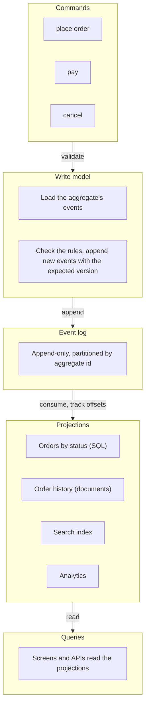
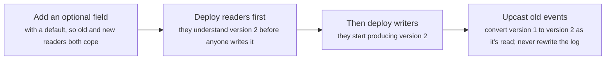

# Event-driven architecture: event sourcing, CQRS and evolving schemas

> System Design · L3 Specialist · Transactions, events and streams · about 120 min · hub module `m02` ([open the hub](https://claude.ai/artifact/W93mxxEWBqV4MS8kJiz9dU))

## Why it matters
Instead of storing only the current state, store what happened: OrderPlaced, PaymentTaken, OrderShipped. The log of events becomes the source of truth, and current state, search indexes and dashboards become views computed from it. That buys an audit trail, replays and new read models whenever you need them. The price is read models that lag, events that must stay readable for years, and Kafka partitions to size and rebalance.

## Pre-question (answer before reading)
**Q:** An online shop stores only each order's current status. Finance asks how many orders were cancelled after payment last quarter, and how long each spent waiting for payment. Why is that hard to answer, and what would have made it easy?

<details><summary>Answer</summary>

Each status change overwrote the last, so only the final status survives. If every change had been kept as an immutable event (placed, paid, cancelled, each with a time), the question would be a query over the event log, and a new report could be built at any time by replaying the log from the start.

</details>

## 🍎 Story time (kid version)
**Pizza Town and the family road trip: Luigi's diary instead of a whiteboard**

Luigi used to keep only the till total on a whiteboard, wiping it at every sale. Now he writes every sale and every refund in a diary, one line each, and never rubs anything out: a mistake gets a new line that corrects it. From the diary he can work out the total at any moment, and his helpers make their own summaries from it, such as tips per waiter or pizzas per hour, without disturbing his writing. When he began noting table numbers, the old lines had none, so the summaries say "unknown table" for those. On busy nights, each helper reads only some tables' pages.

| In the story | In a real system |
|---|---|
| A line for every sale and refund, never rubbed out | Event sourcing: an append-only log of immutable events is the source of truth |
| Working out the total at any moment | Current state is a fold over the events; replay gives the state at any point in time |
| Helpers' summaries made from the diary | CQRS projections: read models built from events, separate from the write side |
| Old lines without table numbers | Schema evolution: new fields need defaults so old events stay readable |
| Each helper reading only some tables' pages | Partitions and consumer groups: each partition is read by one member, in order |

**Where the story breaks:** Luigi's diary is one book on one counter. A real event log is spread over many machines and partitions, so events for different tables can be read in different orders, and summaries can lag behind the latest line.

## Key ideas (grown-up version)
- **Event sourcing**: store every state change as an immutable event in an append-only stream per entity (an aggregate): AccountOpened, MoneyDeposited, MoneyWithdrawn. Current state is a fold over the stream. Events are never edited; a mistake is corrected by a new event.
- **What it buys, and what it costs**: a complete audit trail, the state at any past moment, replays to fix bugs or build new views, and a natural feed for other services. The costs: rebuilding state means replaying (so take snapshots every N events), read models are eventually consistent, events must stay readable forever, and erasing personal data from an immutable log needs care (for example, encrypt each person's data with their own key and delete the key).
- **Commands and concurrency**: a command (withdraw €30) is checked against the current state and either rejected or turned into new events. Two writers can decide on the same old state, so appends carry the version the writer saw (an expected version); the store rejects a stale append, and the writer reloads and decides again.
- **CQRS**: separate the write model, which validates commands and appends events, from read models (projections) shaped for each query: a status count in SQL, order history in a document store, text in a search index. Projections consume the events, track their position in the log, are idempotent, can lag, and can be rebuilt from offset zero.
- **Designing events**: name business facts in the past tense, include what consumers need (ids, amounts, currency, time), and keep events small and stable. An event is a public contract: once other teams consume it, changing it is a migration.
- **Schema evolution**: backward compatibility means new readers can read old events; forward compatibility means old readers can read new ones. Add optional fields with defaults; never reuse, rename or retype a field. A schema registry (Avro, Protobuf or JSON Schema) checks every change, and old events can be upcast to the new shape as they're read.
- **Kafka partitions**: a topic's partitions are its unit of ordering and of parallelism. Records with the same key go to the same partition (a hash of the key, modulo the partition count), so they stay in order. Size the count from the target throughput divided by what one consumer handles, with headroom: adding partitions later remaps most keys and breaks per-key ordering across the change.
- **Consumer groups in operation**: each partition is read by one member of a group. When members join or leave, partitions are reassigned; cooperative (incremental) rebalancing moves only what must move, instead of pausing everything. Consumer lag (latest offset minus committed offset) is the health metric to alert on, and log compaction keeps only the latest record per key for changelog topics.

## Diagrams
**Event sourcing with CQRS**



_Writes and reads scale and change separately. A new read model is built by replaying the log from the start, without touching the write side._

**Changing an event schema safely**



_A schema registry can enforce the compatibility rule on every change, so a breaking schema never reaches production._

**Six partitions, before and after a third consumer joins**

| partition | 0 | 1 | 2 | 3 | 4 | 5 |
|---|---|---|---|---|---|---|
| value | 0 | 1 | 2 | 3 | 4 | 5 |

| 2 consumers | 0 | 1 | 2 | 3 | 4 | 5 |
|---|---|---|---|---|---|---|
| value | A | A | A | B | B | B |

| 3, sticky | 0 | 1 | 2 | 3 | 4 | 5 |
|---|---|---|---|---|---|---|
| value | A | A | C | B | B | C |

_A sticky, cooperative rebalance moves only partitions 2 and 5 to the new consumer C; an eager rebalance pauses all six while it reassigns them._

## Comparisons
**Storing state, or storing events**

|  | Current state only | Event sourcing |
|---|---|---|
| What's stored | The latest row per entity | Every change, as an immutable event |
| History and audit | Only if you add it separately | Built in |
| Reading current state | One lookup | A replay, a snapshot plus newer events, or a projection |
| Fixing a mistake | Update the row | Append a correcting event |
| Hard parts | Lost history, ad hoc audit tables | Lagging read models, schema evolution, erasure |

**Schema changes and compatibility**

| Change | Backward: new readers, old events | Forward: old readers, new events |
|---|---|---|
| Add an optional field with a default | Yes | Yes |
| Add a required field without a default | No | Yes: old readers ignore it |
| Remove an optional field | Yes | Yes, if old readers have a default |
| Rename or retype a field | No | No |

## Code (JavaScript + Python)
### A small 32-bit hash (FNV-1a) for picking partitions, the same in both languages
```python
def fnv1a(text):
    h = 0x811C9DC5
    for byte in text.encode():
        h = ((h ^ byte) * 0x01000193) & 0xFFFFFFFF
    return h
```

```javascript
function fnv1a(text) {
  let h = 0x811c9dc5;
  for (const byte of Buffer.from(text)) h = Math.imul(h ^ byte, 0x01000193) >>> 0;
  return h;
}
```

### An event-sourced account: state is a fold over events
```python
def apply(state, event):
    kind, amount = event
    if kind == "opened":
        return {"balance": 0, "open": True}
    if kind == "deposited":
        return {**state, "balance": state["balance"] + amount}
    if kind == "withdrawn":
        return {**state, "balance": state["balance"] - amount}
    if kind == "closed":
        return {**state, "open": False}
    raise ValueError(kind)

def replay(events):
    state = None
    for event in events:
        state = apply(state, event)            # current state = fold(apply, events)
    return state

def withdraw(events, amount):
    """A command: check it against the current state, then return the new events, or refuse."""
    state = replay(events)
    if not state["open"] or state["balance"] < amount:
        return None                            # refused: nothing is written
    return [("withdrawn", amount)]

log = [("opened", 0), ("deposited", 5000), ("withdrawn", 1200), ("deposited", 300)]   # amounts in cents
print("balance now:", replay(log)["balance"], "| after the first two events:", replay(log[:2])["balance"])
for amount in (3000, 9000):
    new = withdraw(log, amount)
    if new:
        log += new
    print(f"withdraw {amount}: {'accepted' if new else 'refused'} | balance {replay(log)['balance']} | events {len(log)}")
snapshot = (len(log), replay(log))             # a snapshot: the state as of event 5
log += [("deposited", 700)]
state = snapshot[1]
for event in log[snapshot[0]:]:
    state = apply(state, event)                # only the events after the snapshot
print("from the snapshot:", state["balance"], "| from a full replay:", replay(log)["balance"])
```

Output:
```text
balance now: 4100 | after the first two events: 5000
withdraw 3000: accepted | balance 1100 | events 5
withdraw 9000: refused | balance 1100 | events 5
from the snapshot: 1800 | from a full replay: 1800
```

- line 1: Each event type knows how it changes the state; the state itself is never stored as the truth.
- line 16: Replaying the stream rebuilds the state, and replaying a prefix gives the state at any earlier moment.
- line 22: A command checks the rules against the current state; if it passes it becomes a new event, otherwise nothing is written.
- line 33: A snapshot saves replaying the whole stream: start from it and apply only the newer events.

```javascript
function apply(state, [kind, amount]) {
  if (kind === "opened") return { balance: 0, open: true };
  if (kind === "deposited") return { ...state, balance: state.balance + amount };
  if (kind === "withdrawn") return { ...state, balance: state.balance - amount };
  if (kind === "closed") return { ...state, open: false };
  throw new Error(kind);
}

function replay(events) {
  return events.reduce(apply, null);           // current state = fold(apply, events)
}

function withdraw(events, amount) {
  // a command: check it against the current state, then return the new events, or refuse
  const state = replay(events);
  if (!state.open || state.balance < amount) return null;   // refused: nothing is written
  return [["withdrawn", amount]];
}

let log = [["opened", 0], ["deposited", 5000], ["withdrawn", 1200], ["deposited", 300]];   // amounts in cents
console.log("balance now:", replay(log).balance, "| after the first two events:", replay(log.slice(0, 2)).balance);
for (const amount of [3000, 9000]) {
  const fresh = withdraw(log, amount);
  if (fresh) log = log.concat(fresh);
  console.log(`withdraw ${amount}: ${fresh ? "accepted" : "refused"} | balance ${replay(log).balance} | events ${log.length}`);
}
const snapshot = [log.length, replay(log)];    // a snapshot: the state as of event 5
log.push(["deposited", 700]);
let state = snapshot[1];
for (const event of log.slice(snapshot[0])) state = apply(state, event);   // only the events after the snapshot
console.log("from the snapshot:", state.balance, "| from a full replay:", replay(log).balance);
```

Output:
```text
balance now: 4100 | after the first two events: 5000
withdraw 3000: accepted | balance 1100 | events 5
withdraw 9000: refused | balance 1100 | events 5
from the snapshot: 1800 | from a full replay: 1800
```

- line 1: Each event type knows how it changes the state; the state itself is never stored as the truth.
- line 10: Replaying the stream rebuilds the state, and replaying a prefix gives the state at any earlier moment.
- line 16: A command checks the rules against the current state; if it passes it becomes a new event, otherwise nothing is written.
- line 27: A snapshot saves replaying the whole stream: start from it and apply only the newer events.

### CQRS: two projections from one log, and a third built later by replaying it
```python
events = [                                     # (offset, order, event, amount in cents, day)
    (0, "o1", "placed", 2400, "Mon"), (1, "o2", "placed", 1800, "Mon"), (2, "o1", "paid", 2400, "Mon"),
    (3, "o3", "placed", 3100, "Tue"), (4, "o2", "cancelled", 0, "Tue"), (5, "o3", "paid", 3100, "Tue"),
    (6, "o4", "placed", 900, "Wed"), (7, "o1", "shipped", 0, "Wed"),
]

class Projection:
    """A read model: consumes events in order, remembers its offset, can be rebuilt from zero."""
    def __init__(self, handle):
        self.handle, self.offset, self.view = handle, 0, {}

    def catch_up(self, log, upto=None):
        for offset, *event in log[self.offset:upto]:
            self.handle(self.view, *event)
            self.offset = offset + 1           # stored with the view, so a restart resumes here

def by_status(view, order, event, amount, day):
    view[order] = event                        # the latest status of each order

def revenue_per_day(view, order, event, amount, day):
    if event == "paid":
        view[day] = view.get(day, 0) + amount

status = Projection(by_status)
status.catch_up(events, upto=5)                # this one is lagging: it has read only 5 events
counts = {}
for s in status.view.values():
    counts[s] = counts.get(s, 0) + 1
print("status view at offset", status.offset, "->", ", ".join(f"{k} {v}" for k, v in sorted(counts.items())))
status.catch_up(events)
print("caught up to offset", status.offset, "-> o1", status.view["o1"], "| o3", status.view["o3"])
revenue = Projection(revenue_per_day)          # a new question next month: replay the whole log
revenue.catch_up(events)
print("revenue per day, built from offset 0:", ", ".join(f"{d} {c}" for d, c in revenue.view.items()))
```

Output:
```text
status view at offset 5 -> cancelled 1, paid 1, placed 1
caught up to offset 8 -> o1 shipped | o3 paid
revenue per day, built from offset 0: Mon 2400, Tue 3100
```

- line 15: The projection's offset is saved with its view, so after a restart it carries on where it stopped, and replaying from zero rebuilds it.
- line 18: A read model is shaped for one question; the write side never has to change for it.
- line 29: A lagging projection shows older states: o3 still looks unpaid until it catches up. That's the eventual consistency of CQRS.
- line 32: A question nobody planned for gets its own projection by replaying the whole log.

```javascript
const events = [                               // [offset, order, event, amount in cents, day]
  [0, "o1", "placed", 2400, "Mon"], [1, "o2", "placed", 1800, "Mon"], [2, "o1", "paid", 2400, "Mon"],
  [3, "o3", "placed", 3100, "Tue"], [4, "o2", "cancelled", 0, "Tue"], [5, "o3", "paid", 3100, "Tue"],
  [6, "o4", "placed", 900, "Wed"], [7, "o1", "shipped", 0, "Wed"],
];

class Projection {
  // a read model: consumes events in order, remembers its offset, can be rebuilt from zero
  constructor(handle) { this.handle = handle; this.offset = 0; this.view = new Map(); }
  catchUp(log, upto = log.length) {
    for (const [offset, ...event] of log.slice(this.offset, upto)) {
      this.handle(this.view, ...event);
      this.offset = offset + 1;                // stored with the view, so a restart resumes here
    }
  }
}

const byStatus = (view, order, event) => view.set(order, event);   // the latest status of each order
const revenuePerDay = (view, order, event, amount, day) => {
  if (event === "paid") view.set(day, (view.get(day) ?? 0) + amount);
};

const status = new Projection(byStatus);
status.catchUp(events, 5);                     // this one is lagging: it has read only 5 events
const counts = new Map();
for (const s of status.view.values()) counts.set(s, (counts.get(s) ?? 0) + 1);
console.log("status view at offset", status.offset, "->", [...counts].sort().map(([k, v]) => `${k} ${v}`).join(", "));
status.catchUp(events);
console.log("caught up to offset", status.offset, "-> o1", status.view.get("o1"), "| o3", status.view.get("o3"));
const revenue = new Projection(revenuePerDay); // a new question next month: replay the whole log
revenue.catchUp(events);
console.log("revenue per day, built from offset 0:", [...revenue.view].map(([d, c]) => `${d} ${c}`).join(", "));
```

Output:
```text
status view at offset 5 -> cancelled 1, paid 1, placed 1
caught up to offset 8 -> o1 shipped | o3 paid
revenue per day, built from offset 0: Mon 2400, Tue 3100
```

- line 13: The projection's offset is saved with its view, so after a restart it carries on where it stopped, and replaying from zero rebuilds it.
- line 18: A read model is shaped for one question; the write side never has to change for it.
- line 27: A lagging projection shows older states: o3 still looks unpaid until it catches up. That's the eventual consistency of CQRS.
- line 30: A question nobody planned for gets its own projection by replaying the whole log.

### Partitions: keys, a rebalance, and the cost of adding partitions later
```python
def partition_of(key, partitions):
    return fnv1a(key) % partitions             # the same key always lands in the same partition

def range_assign(partitions, consumers):
    """Eager style: split the partitions into contiguous ranges, one per consumer, from scratch."""
    size, extra = divmod(partitions, len(consumers))
    out, p = {}, 0
    for i, c in enumerate(consumers):
        for _ in range(size + (1 if i < extra else 0)):
            out[p] = c
            p += 1
    return out

def sticky_assign(old, consumers):
    """Cooperative style: keep every partition where it is unless a consumer has more than its share."""
    share = -(-len(old) // len(consumers))     # ceiling division
    load = {c: 0 for c in consumers}
    out, moving = {}, []
    for p, c in sorted(old.items()):
        if c in load and load[c] < share:     # still within its share: stays put
            out[p] = c
            load[c] += 1
        else:
            moving.append(p)
    for p in moving:                           # hand the spare partitions to the least loaded consumers
        c = min(consumers, key=lambda x: (load[x], x))
        out[p] = c
        load[c] += 1
    return out

before = range_assign(6, ["A", "B"])
eager = range_assign(6, ["A", "B", "C"])
sticky = sticky_assign(before, ["A", "B", "C"])
moved = lambda new: sum(1 for p in before if before[p] != new[p])
print("2 consumers:", "".join(before[p] for p in range(6)), "| eager with 3:", "".join(eager[p] for p in range(6)),
      f"(all 6 paused, {moved(eager)} moved) | sticky with 3:", "".join(sticky[p] for p in range(6)), f"({moved(sticky)} moved)")
keys = [f"customer-{i}" for i in range(1000)]
changed = sum(1 for k in keys if partition_of(k, 6) != partition_of(k, 8))
print(f"growing from 6 to 8 partitions moves {changed} of 1000 keys to a different partition")
```

Output:
```text
2 consumers: AAABBB | eager with 3: AABBCC (all 6 paused, 3 moved) | sticky with 3: AACBBC (2 moved)
growing from 6 to 8 partitions moves 749 of 1000 keys to a different partition
```

- line 2: Key, hash, modulo: so all of one customer's events share a partition and stay in order.
- line 4: An eager rebalance revokes every partition and assigns from scratch, so the whole group stops while it happens.
- line 14: A cooperative, sticky rebalance keeps partitions where they are and moves only the few the new member needs.
- line 38: Changing the partition count changes hash modulo n for most keys: their new events land in a new partition while old ones sit in the old, so per-key order is broken across the change.

```javascript
const partitionOf = (key, partitions) => fnv1a(key) % partitions;   // the same key always lands in the same partition

function rangeAssign(partitions, consumers) {
  // eager style: split the partitions into contiguous ranges, one per consumer, from scratch
  const size = Math.floor(partitions / consumers.length), extra = partitions % consumers.length;
  const out = new Map();
  let p = 0;
  consumers.forEach((c, i) => { for (let k = 0; k < size + (i < extra ? 1 : 0); k++) out.set(p++, c); });
  return out;
}

function stickyAssign(old, consumers) {
  // cooperative style: keep every partition where it is unless a consumer has more than its share
  const share = Math.ceil(old.size / consumers.length);
  const load = new Map(consumers.map(c => [c, 0]));
  const out = new Map(), moving = [];
  for (const [p, c] of [...old].sort((a, b) => a[0] - b[0])) {
    if (load.has(c) && load.get(c) < share) {  // still within its share: stays put
      out.set(p, c);
      load.set(c, load.get(c) + 1);
    } else moving.push(p);
  }
  for (const p of moving) {                    // hand the spare partitions to the least loaded consumers
    const c = [...consumers].sort((x, y) => load.get(x) - load.get(y) || (x < y ? -1 : 1))[0];
    out.set(p, c);
    load.set(c, load.get(c) + 1);
  }
  return out;
}

const before = rangeAssign(6, ["A", "B"]);
const eager = rangeAssign(6, ["A", "B", "C"]);
const sticky = stickyAssign(before, ["A", "B", "C"]);
const moved = fresh => [...before.keys()].filter(p => before.get(p) !== fresh.get(p)).length;
const show = m => [0, 1, 2, 3, 4, 5].map(p => m.get(p)).join("");
console.log("2 consumers:", show(before), "| eager with 3:", show(eager), `(all 6 paused, ${moved(eager)} moved) | sticky with 3:`, show(sticky), `(${moved(sticky)} moved)`);
const keys = Array.from({ length: 1000 }, (_, i) => `customer-${i}`);
const changed = keys.filter(k => partitionOf(k, 6) !== partitionOf(k, 8)).length;
console.log(`growing from 6 to 8 partitions moves ${changed} of 1000 keys to a different partition`);
```

Output:
```text
2 consumers: AAABBB | eager with 3: AABBCC (all 6 paused, 3 moved) | sticky with 3: AACBBC (2 moved)
growing from 6 to 8 partitions moves 749 of 1000 keys to a different partition
```

- line 1: Key, hash, modulo: so all of one customer's events share a partition and stay in order.
- line 3: An eager rebalance revokes every partition and assigns from scratch, so the whole group stops while it happens.
- line 12: A cooperative, sticky rebalance keeps partitions where they are and moves only the few the new member needs.
- line 38: Changing the partition count changes hash modulo n for most keys: their new events land in a new partition while old ones sit in the old, so per-key order is broken across the change.

## Worked example
**Problem.** OrderPlaced events have been written as version 1 for two years: {order, total} with the total in cents. Version 2 adds the currency and a coupon. Make the change without breaking any reader, and show which kinds of schema change would have been breaking.

1. Version 2 adds currency (default "EUR", since every old order was in euros) and coupon (optional, default none). Both have defaults, so new readers can read old events (backward compatible) and old readers simply ignore the new fields (forward compatible).
2. Deploy the readers first, so they understand version 2 before any appears; then the writers. Old events are never rewritten: an upcaster turns version 1 into version 2 as each is read.
3. A compatibility check catches mistakes before deploy: a new required field without a default breaks backward compatibility, and removing a field that old readers require breaks forward compatibility. A schema registry runs this check on every change.
4. Cost: upcasting is O(fields) per event read. Chains of upcasters (v1 → v2 → v3) keep each step small; after a few versions, teams sometimes copy the stream into a new topic in the latest version.

```python
import json

V2_DEFAULTS = {"currency": "EUR", "coupon": None}

def upcast(raw):
    """Read any version and return the latest shape; old events are never rewritten in the log."""
    event = json.loads(raw)
    if event.get("v", 1) == 1:
        event = {**event, "v": 2, **V2_DEFAULTS}   # version 1 had no currency or coupon
    return event

def compatible(old, new):
    """Schemas map field -> (required, has_default). Return (backward, forward)."""
    backward = all(not req or has_default or f in old for f, (req, has_default) in new.items())
    forward = all(not req or f in new or has_default for f, (req, has_default) in old.items())
    return backward, forward

log = ['{"v": 1, "order": "o1", "total": 2400}',
       '{"v": 2, "order": "o2", "total": 1800, "currency": "GBP", "coupon": "SPRING"}']
for raw in log:
    e = upcast(raw)
    print(f"{e['order']}: {e['total']} {e['currency']}, coupon {e['coupon'] or 'none'}")

v1 = {"order": (True, False), "total": (True, False)}
changes = {
    "add currency and coupon with defaults": {**v1, "currency": (True, True), "coupon": (False, True)},
    "add a required channel with no default": {**v1, "channel": (True, False)},
    "drop total": {"order": (True, False)},
}
for label, v2 in changes.items():
    backward, forward = compatible(v1, v2)
    print(f"{label}: backward {'yes' if backward else 'NO'}, forward {'yes' if forward else 'NO'}")
```

Output:
```text
o1: 2400 EUR, coupon none
o2: 1800 GBP, coupon SPRING
add currency and coupon with defaults: backward yes, forward yes
add a required channel with no default: backward NO, forward yes
drop total: backward yes, forward NO
```

```javascript
const V2_DEFAULTS = { currency: "EUR", coupon: null };

function upcast(raw) {
  // read any version and return the latest shape; old events are never rewritten in the log
  let event = JSON.parse(raw);
  if ((event.v ?? 1) === 1) event = { ...event, v: 2, ...V2_DEFAULTS };   // version 1 had no currency or coupon
  return event;
}

function compatible(oldSchema, newSchema) {
  // schemas map field -> [required, hasDefault]; return [backward, forward]
  const backward = Object.entries(newSchema).every(([f, [req, hasDefault]]) => !req || hasDefault || f in oldSchema);
  const forward = Object.entries(oldSchema).every(([f, [req, hasDefault]]) => !req || f in newSchema || hasDefault);
  return [backward, forward];
}

const log = ['{"v": 1, "order": "o1", "total": 2400}',
             '{"v": 2, "order": "o2", "total": 1800, "currency": "GBP", "coupon": "SPRING"}'];
for (const raw of log) {
  const e = upcast(raw);
  console.log(`${e.order}: ${e.total} ${e.currency}, coupon ${e.coupon ?? "none"}`);
}

const v1 = { order: [true, false], total: [true, false] };
const changes = {
  "add currency and coupon with defaults": { ...v1, currency: [true, true], coupon: [false, true] },
  "add a required channel with no default": { ...v1, channel: [true, false] },
  "drop total": { order: [true, false] },
};
for (const [label, v2] of Object.entries(changes)) {
  const [backward, forward] = compatible(v1, v2);
  console.log(`${label}: backward ${backward ? "yes" : "NO"}, forward ${forward ? "yes" : "NO"}`);
}
```

Output:
```text
o1: 2400 EUR, coupon none
o2: 1800 GBP, coupon SPRING
add currency and coupon with defaults: backward yes, forward yes
add a required channel with no default: backward NO, forward yes
drop total: backward yes, forward NO
```

**Answer.** The old order reads as 2,400 EUR with no coupon, filled in by the upcaster, and the new one keeps its GBP and coupon. Adding fields with defaults is compatible both ways; a new required field without a default would break new readers of old events (backward), and dropping a field old readers require would break them on new events (forward).

## Your turn (faded example)
**Problem.** Finish `EventStore.append(stream, expected_version, events)`: append the events only if the stream's current version (its number of events) equals `expected_version`; otherwise raise a concurrency error. Then two writers who loaded the same version both try to withdraw: the second must reload, check the balance again, and either succeed or refuse.

- ✓ The version is the number of events in the stream. An append that names the wrong version means someone else wrote in between.
- **Why not just lock the account while deciding?**
  <details><summary>Answer</summary>Locks held across a read, a decision and a write across a network hurt throughput and need timeouts. Optimistic concurrency assumes conflicts are rare: nobody waits, and the rare loser simply reloads and decides again.</details>
- **What must the losing writer do?**
  <details><summary>Answer</summary>Reload the stream, rebuild the state and re-check the business rule with the new events, since the other writer may have changed the outcome (here, the balance), and only then append with the new expected version.</details>
- **What does it cost?**
  <details><summary>Answer</summary>O(1) for the version check, plus a reload on conflict. Event stores do this check atomically: an append with an expected version in EventStoreDB, a conditional write in DynamoDB, or a unique (stream, version) index in SQL.</details>

Starter:
```python
class ConcurrencyError(Exception):
    pass

class EventStore:
    def __init__(self):
        self.streams = {}

    def load(self, stream):
        events = self.streams.get(stream, [])
        return list(events), len(events)       # the events and the version they represent

    def append(self, stream, expected_version, events):
        ...                                    # TODO: refuse a stale version, otherwise append
```

```javascript
class ConcurrencyError extends Error {}

class EventStore {
  constructor() { this.streams = new Map(); }
  load(stream) {
    const events = this.streams.get(stream) ?? [];
    return [[...events], events.length];       // the events and the version they represent
  }
  append(stream, expectedVersion, events) {
    // TODO: refuse a stale version, otherwise append
  }
}
```

<details><summary>Full solution</summary>

```python
class ConcurrencyError(Exception):
    pass

class EventStore:
    def __init__(self):
        self.streams = {}

    def load(self, stream):
        events = self.streams.get(stream, [])
        return list(events), len(events)       # the events and the version they represent

    def append(self, stream, expected_version, events):
        current = self.streams.setdefault(stream, [])
        if len(current) != expected_version:
            raise ConcurrencyError(f"expected version {expected_version}, stream is at {len(current)}")
        current.extend(events)                 # in a real store, the check and the append are one atomic step
        return len(current)

def balance(events):
    return sum(a if k == "deposited" else -a for k, a in events)

def withdraw(store, stream, amount, loaded):
    events, version = loaded
    while True:
        if balance(events) < amount:
            return f"refused at version {version} (balance {balance(events)})"
        try:
            return f"accepted, now at version {store.append(stream, version, [('withdrawn', amount)])}"
        except ConcurrencyError as err:
            print("  conflict:", err)
            events, version = store.load(stream)   # reload, then check the rule again

store = EventStore()
store.append("acct-7", 0, [("deposited", 5000)])
first, second = store.load("acct-7"), store.load("acct-7")   # two writers read version 1 at the same time
print("writer 1:", withdraw(store, "acct-7", 3000, first))
print("writer 2:", withdraw(store, "acct-7", 3000, second))
print("writer 3:", withdraw(store, "acct-7", 1500, store.load("acct-7")))
```

Output:
```text
writer 1: accepted, now at version 2
  conflict: expected version 1, stream is at 2
writer 2: refused at version 2 (balance 2000)
writer 3: accepted, now at version 3
```

```javascript
class ConcurrencyError extends Error {}

class EventStore {
  constructor() { this.streams = new Map(); }
  load(stream) {
    const events = this.streams.get(stream) ?? [];
    return [[...events], events.length];       // the events and the version they represent
  }
  append(stream, expectedVersion, events) {
    if (!this.streams.has(stream)) this.streams.set(stream, []);
    const current = this.streams.get(stream);
    if (current.length !== expectedVersion) throw new ConcurrencyError(`expected version ${expectedVersion}, stream is at ${current.length}`);
    current.push(...events);                   // in a real store, the check and the append are one atomic step
    return current.length;
  }
}

const balance = events => events.reduce((s, [k, a]) => s + (k === "deposited" ? a : -a), 0);

function withdraw(store, stream, amount, loaded) {
  let [events, version] = loaded;
  while (true) {
    if (balance(events) < amount) return `refused at version ${version} (balance ${balance(events)})`;
    try {
      return `accepted, now at version ${store.append(stream, version, [["withdrawn", amount]])}`;
    } catch (err) {
      if (!(err instanceof ConcurrencyError)) throw err;
      console.log("  conflict:", err.message);
      [events, version] = store.load(stream);  // reload, then check the rule again
    }
  }
}

const store = new EventStore();
store.append("acct-7", 0, [["deposited", 5000]]);
const first = store.load("acct-7"), second = store.load("acct-7");   // two writers read version 1 at the same time
console.log("writer 1:", withdraw(store, "acct-7", 3000, first));
console.log("writer 2:", withdraw(store, "acct-7", 3000, second));
console.log("writer 3:", withdraw(store, "acct-7", 1500, store.load("acct-7")));
```

Output:
```text
writer 1: accepted, now at version 2
  conflict: expected version 1, stream is at 2
writer 2: refused at version 2 (balance 2000)
writer 3: accepted, now at version 3
```

</details>

## Socratic checks and quiz (answers hidden)
**1. What does this print?**

```python
events = [("deposited", 50), ("withdrawn", 20), ("deposited", 5), ("withdrawn", 10)]
balance = 0
for kind, amount in events:
    balance += amount if kind == "deposited" else -amount
print(balance, len(events))
```

```javascript
const events = [["deposited", 50], ["withdrawn", 20], ["deposited", 5], ["withdrawn", 10]];
let balance = 0;
for (const [kind, amount] of events) balance += kind === "deposited" ? amount : -amount;
console.log(balance, events.length);
```

- A. 25 4
- B. 85 4
- C. 35 4
- D. 25 2

<details><summary>Answer</summary>

25 4. 50 − 20 + 5 − 10 = 25, computed from all four events: the balance itself was never stored.

</details>

**2. What does this print?**

```python
keys = [10, 11, 12, 13, 14, 15]
same = [k for k in keys if k % 4 == k % 6]
print(len(same), *same)
```

```javascript
const keys = [10, 11, 12, 13, 14, 15];
const same = keys.filter(k => k % 4 === k % 6);
console.log(same.length, ...same);
```

- A. 4 12 13 14 15
- B. 6 10 11 12 13 14 15
- C. 1 12
- D. 2 10 11

<details><summary>Answer</summary>

4 12 13 14 15. 12 to 15 give the same remainder modulo 4 and modulo 6 (they're 0 to 3 past a multiple of 12), so they'd stay put if the topic grew from 4 to 6 partitions; 10 and 11 would move.

</details>

**3. Why does an event-sourced system take snapshots?**

- A. So it can rebuild an entity's state without replaying its whole history
- B. Because events expire after a few days
- C. To avoid storing events at all
- D. So projections don't need offsets

<details><summary>Answer</summary>

So it can rebuild an entity's state without replaying its whole history. A snapshot is a cached fold: start from it and apply only the events after it. The events are still the source of truth.

</details>

**4. Two services write events for the same account at the same moment. What stops one of them from deciding on stale state?**

- A. Appending with the expected version, so the store rejects the second append and that writer reloads
- B. A projection that lags behind the log
- C. Adding more partitions
- D. Log compaction

<details><summary>Answer</summary>

Appending with the expected version, so the store rejects the second append and that writer reloads. Optimistic concurrency: the append names the version the writer saw. Lag, partitions and compaction don't detect a conflicting decision.

</details>

**5. Which schema changes keep both backward and forward compatibility? (choose 2)**

- A. Adding an optional field with a default
- B. Removing an optional field that old readers default
- C. Renaming a field
- D. Adding a required field without a default
- E. Changing a field from a number to a string

<details><summary>Answer</summary>

Adding an optional field with a default, Removing an optional field that old readers default. Optional fields with defaults can come and go safely. Renames and type changes break both directions, and a new required field without a default breaks new readers of old events.

</details>

**6. Judge each statement.**

- In event sourcing, a mistake is corrected by appending a new event.
- CQRS read models always show the latest write.
- Records with the same key go to the same Kafka partition, as long as the partition count doesn't change.
- A cooperative rebalance pauses every partition in the group.

<details><summary>Answer</summary>

In event sourcing, a mistake is corrected by appending a new event.: Yes; CQRS read models always show the latest write.: No; Records with the same key go to the same Kafka partition, as long as the partition count doesn't change.: Yes; A cooperative rebalance pauses every partition in the group.: No. Events are immutable, read models lag, keys map to partitions by hash modulo the count, and cooperative rebalancing moves only the partitions that must move.

</details>

**7. Put the CQRS flow in order, from a user's command to their next screen.**

- (put the steps in order)

<details><summary>Answer</summary>

The command is validated against the aggregate's current state → New events are appended with the expected version → A projection consumes the events and updates its read model → The projection stores its new offset with the view → A query reads the updated read model. The write side decides and appends; read models follow asynchronously and record how far they've read.

</details>

**8. Complete the Python fold that rebuilds a shopping cart from its events.**

```
def cart(events):
    items = {}
    for kind, sku, qty in events:
        if kind == "added":
            items[sku] = items.get(sku, 0) {{0}} qty
        elif kind == "removed":
            items[sku] = items.get(sku, 0) - qty
            if items[sku] {{1}} 0:
                del items[sku]
    return items

```

<details><summary>Answer</summary>

+ | <=. Adding increases the quantity; removing decreases it and drops the item once nothing (or less than nothing) is left.

</details>

## Traps & misconceptions
- **“With event sourcing we can delete the database and just keep events.”** Replaying everything on every read is too slow. Keep snapshots and projections for reading; the log is the source of truth, not the only store.
- **“Events are just our database rows, sent out.”** Rows describe current state and change shape with every refactor. Events are business facts, in the past tense, designed as a stable contract that other teams build on.
- **“CQRS means the read side is always up to date.”** Projections lag behind the log, by milliseconds or minutes. Design screens for it: show what was just submitted from the command's result, or wait for the projection's offset to pass the write.
- **“We can rename a field in the new version; consumers will update.”** Old events in the log keep the old name forever, and consumers update at different times. Add a new field with a default, keep reading the old one, and upcast.
- **“Start with a few partitions; we can add more later.”** Adding partitions remaps most keys, so a key's new events land in a different partition from its old ones and per-key order breaks. Size for growth from the start, or plan a migration to a new topic.
- **“Immutable logs and the right to be forgotten don't mix, so ignore it.”** Regulations still apply. Keep personal data out of events where you can, reference it by id, or encrypt it per person and delete that person's key (crypto-shredding).

## Discussion prompts
- **When is event sourcing worth it, and when is it overkill?**
  <details><summary>One good answer</summary>Worth it when the history is the product or the law: ledgers, orders, bookings, anything needing an audit trail, temporal queries or many read models fed from one source. Overkill for simple CRUD data where nobody asks what happened, such as user preferences; there, a table plus an outbox for change events is simpler.</details>
- **How would you choose the number of partitions for an orders topic?**
  <details><summary>One good answer</summary>From throughput and consumers: if the peak is 30,000 events a second and one consumer handles about 3,000, you need at least 10 partitions to run 10 consumers, then add headroom for growth and rebalancing, say 24 or 30. Partitions cost memory, file handles and longer rebalances, so not thousands. Choose the key for ordering (the order id) and check that no single key is hot.</details>

## Teach-back
**Prompt:** Explain to a junior colleague what event sourcing and CQRS are, and how you'd change an event's schema without breaking consumers.

Rubric:
- [ ] Event sourcing: immutable events as the source of truth; state is a fold; snapshots
- [ ] Commands validated against state; optimistic concurrency with expected versions
- [ ] CQRS: projections per query, tracking offsets, eventually consistent, rebuildable
- [ ] Schema evolution: optional fields with defaults, readers first, upcasting, a registry
- [ ] Partitions: per-key order, sized for throughput, adding them later remaps keys

<details><summary>Model answer</summary>

With event sourcing we store every change as an immutable event, like MoneyDeposited, and treat the log as the source of truth; the current state is a fold over the events, with snapshots so we don't replay everything. A command is checked against the current state and becomes new events, appended with the version the writer saw, so a concurrent writer gets a conflict and decides again. CQRS separates that write side from read models, projections that consume the events, remember their offset and can be rebuilt from the start, at the price of lagging a little. To change an event schema, I only add optional fields with defaults, deploy readers before writers, and upcast old events as they're read; a schema registry checks every change. On Kafka, I key events by the entity so they stay in order within a partition, and choose the partition count up front, because adding partitions later remaps keys.

</details>

## Quick Q&A (also in the SRS deck)
- **What is the source of truth in event sourcing?** The append-only log of immutable events; state is computed from it.
- **Why take snapshots?** To rebuild state without replaying the whole stream: start from the snapshot and apply newer events.
- **What does an expected version protect against?** Two writers deciding on the same old state: the second append is rejected and retried after a reload.
- **What is a projection in CQRS?** A read model built by consuming events, tracking its offset, and rebuildable from zero.
- **Backward or forward compatibility: which lets new readers read old events?** Backward compatibility.
- **Why is adding Kafka partitions later risky?** It changes most keys' partition, breaking per-key ordering across the change.

## Practice problems
- [ ] [Reading · Event sourcing](https://martinfowler.com/eaaDev/EventSourcing.html) · list what Fowler says event sourcing enables, and which of those your current system can't do
- [ ] [Reference · CQRS pattern](https://learn.microsoft.com/en-us/azure/architecture/patterns/cqrs) · design read models for an order screen and a sales dashboard from one stream of order events
- [ ] [Reference · Schema evolution and compatibility](https://docs.confluent.io/platform/current/schema-registry/fundamentals/schema-evolution.html) · for each compatibility mode, say whether readers or writers must be upgraded first
- [ ] [Reading · Kafka's design](https://kafka.apache.org/43/design/design/) · read the log compaction section, and decide which of your topics should be compacted

## Sources (accessed 2026-10-09)
- [Martin Fowler: Event Sourcing](https://martinfowler.com/eaaDev/EventSourcing.html)
- [Azure Architecture Center: CQRS pattern](https://learn.microsoft.com/en-us/azure/architecture/patterns/cqrs)
- [Azure Architecture Center: Event Sourcing pattern](https://learn.microsoft.com/en-us/azure/architecture/patterns/event-sourcing)
- [Confluent docs: Schema evolution and compatibility](https://docs.confluent.io/platform/current/schema-registry/fundamentals/schema-evolution.html)
- [Apache Kafka 4.3 docs: Design](https://kafka.apache.org/43/design/design/)
