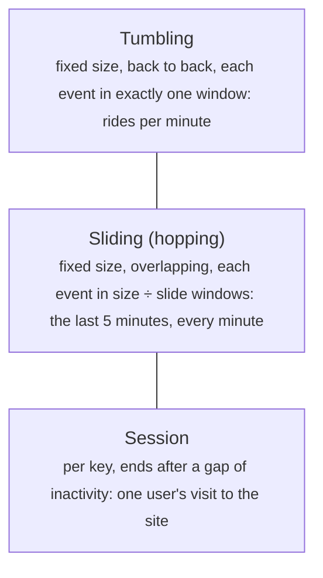
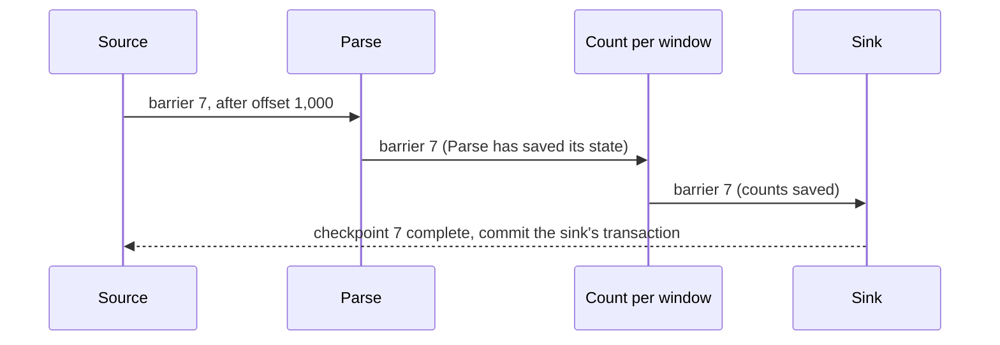
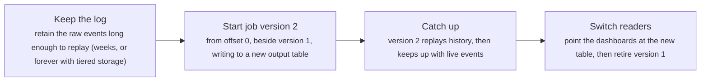

# Stream and batch processing: windows, watermarks and exactly-once

> System Design · L3 Specialist · Transactions, events and streams · about 120 min · hub module `m03` ([open the hub](https://claude.ai/artifact/W93mxxEWBqV4MS8kJiz9dU))

## Why it matters
Batch jobs answer questions about yesterday; stream processors answer them while events are still arriving. Streams are harder: events arrive late and out of order, machines crash halfway through, and every result must count each event exactly once. The tools are event-time windows, watermarks, checkpoints, and idempotent or transactional sinks. The architecture follows from them: Lambda runs a batch path beside a fast one, Kappa runs one streaming path and replays the log to reprocess.

## Pre-question (answer before reading)
**Q:** A dashboard counts taxi rides per minute. A phone that was in a tunnel uploads 40 rides from 12:01 at 12:06. Which minute should they count in, and what happens to the 12:01 total that's already on the screen?

<details><summary>Answer</summary>

They belong to 12:01, the event time, not 12:06, when they arrived. The processor must either wait a little before finalising 12:01 (a watermark with some allowed lateness) or update the 12:01 result when late rides arrive, and decide how late is too late. Counting by arrival time would make 12:06 spike and 12:01 dip.

</details>

## 🍎 Story time (kid version)
**Pizza Town and the family road trip: Luigi's pizzas per hour**

Luigi counts pizzas per hour from the tickets his riders hand in, but some riders are late. So each ticket is counted in the hour the pizza was made, not the hour it reached him. He closes each hour's tally ten minutes after the hour ends; a ticket later than that goes in a "late" tray and gets added as a correction. If the lights go out, he starts again from the last page he bookmarked, and he crosses off ticket numbers as he counts them, so nothing is counted twice. On Sundays he recounts the whole week from the ticket box, which once caught a mistake in his tallies.

| In the story | In a real system |
|---|---|
| Counting by when the pizza was made | Event time: group events by when they happened, not when they arrived |
| Closing each tally ten minutes after the hour | A watermark with allowed lateness: a window's result is emitted when the watermark passes its end |
| The late tray and its corrections | Late data: dropped, sent to a side output, or used to update a result already emitted |
| Starting again from the bookmarked page, crossing off tickets | Checkpoints of state and input position, plus idempotent output: exactly-once results |
| The Sunday recount from the ticket box | Reprocessing: a batch recount (Lambda) or a replay of the log (Kappa) |

**Where the story breaks:** Luigi can see when every rider has come home. A stream processor never knows for sure that no more old events will arrive: a watermark is only an estimate, so the choice is always between waiting longer and being wrong more often.

## Key ideas (grown-up version)
- **Batch and stream**: batch jobs process bounded data (yesterday's files) completely and simply, with hours of latency. Stream processors handle unbounded data continuously, with seconds of latency, but must cope with disorder, late data, state and failures. Engines such as Apache Flink and Spark treat a batch as a stream that happens to end.
- **Lambda architecture**: a batch layer periodically recomputes accurate views from all the raw data, a speed layer covers the most recent data quickly and approximately, and queries merge the two. The cost: the same logic written twice, in two systems, which drift apart.
- **Kappa architecture**: one streaming pipeline over a log that can be replayed (Kafka with long retention). To reprocess, run a new version of the job from the start of the log beside the old one, and switch readers to its output once it catches up. It needs a long enough log and a job that replays fast.
- **Event time and processing time**: each event carries the time it happened; the processor sees it later, and not in order (network delays, offline phones, retries). Group by event time to get right answers; processing time is simpler, but its results depend on delays.
- **Windows**: tumbling windows are fixed and back to back (rides per minute); sliding or hopping windows are fixed and overlapping (the last 5 minutes, every minute); session windows are per key and end after a gap of inactivity (one user's visit). State is kept per key per window until the window is final.
- **Watermarks and late data**: a watermark is the processor's estimate that no events older than T are still coming, often the newest event time seen minus an allowed lateness. A window's result is emitted when the watermark passes its end. Events later than that are dropped, sent to a side output, or used to update the result already emitted. More lateness means more complete results but later ones.
- **Exactly-once processing**: the processor periodically checkpoints every operator's state together with the input offsets (Flink sends barriers through the pipeline, after the Chandy–Lamport snapshot algorithm). After a crash it restores the checkpoint and replays from those offsets. Inside the pipeline that's exactly once; outputs need idempotent writes (upserts by key) or transactional sinks that commit with each checkpoint.
- **Running it**: slow sinks push back up the pipeline through bounded buffers (backpressure); large state lives in an embedded store such as RocksDB with incremental checkpoints; scale by partitioning on the key; and watch consumer lag, checkpoint duration and late-event counts.

## Diagrams
**Three kinds of window**



_Windows are defined in event time; the watermark decides when each one's result can be emitted._

**A checkpoint barrier flowing through a pipeline**



_After a crash, every operator restores checkpoint 7 and the source rewinds to offset 1,000. State and input agree, so nothing inside the pipeline is lost or counted twice._

**Reprocessing in a Kappa architecture**



_One codebase does both live processing and reprocessing, which is the main thing Kappa saves over Lambda._

## Comparisons
**Lambda or Kappa**

|  | Lambda | Kappa |
|---|---|---|
| Paths | A batch layer and a speed layer | One streaming path |
| Reprocessing | Rerun the batch job | Replay the log through a new version of the job |
| Code | Two implementations to keep in step | One |
| Needs | A batch store and a stream processor | A replayable, long-retention log and a job that replays fast |
| Fits | Heavy batch analytics beside quick approximations | Most new pipelines |

**Delivery guarantees in stream processing**

| Guarantee | How | Cost |
|---|---|---|
| At-most-once | Commit offsets before processing; never replay | Events lost on failure |
| At-least-once | Replay from the last committed offsets | Duplicates in state or outputs |
| Exactly-once (effectively once) | Checkpoint state and offsets together; idempotent or transactional sinks | Checkpoint overhead, and output delayed until each commit |

## Code (JavaScript + Python)
### The seeded random generator used by the simulations
```python
def mulberry32(seed):                           # a tiny seeded random generator, same as the JavaScript one
    state = seed & 0xFFFFFFFF
    def rand():
        nonlocal state
        state = (state + 0x6D2B79F5) & 0xFFFFFFFF
        t = ((state ^ (state >> 15)) * (state | 1)) & 0xFFFFFFFF
        t = (t ^ (t + (((t ^ (t >> 7)) * (t | 61)) & 0xFFFFFFFF))) & 0xFFFFFFFF
        return ((t ^ (t >> 14)) & 0xFFFFFFFF) / 4294967296
    return rand
```

```javascript
function mulberry32(seed) {                     // a tiny seeded random generator, same as the Python one
  return function () {
    seed = (seed + 0x6D2B79F5) | 0;
    let t = Math.imul(seed ^ (seed >>> 15), 1 | seed);
    t = (t + Math.imul(t ^ (t >>> 7), 61 | t)) ^ t;
    return ((t ^ (t >>> 14)) >>> 0) / 4294967296;
  };
}
```

### Event time against processing time: rides per minute
```python
rand = mulberry32(2)
rides = []
for _ in range(200):
    event_time = 600 + int(rand() * 300)       # rides between 12:10:00 and 12:14:59, in seconds after 12:00
    delay = 2 if rand() < 0.9 else 60 + int(rand() * 240)   # most arrive in 2 s; phones in tunnels up to 5 min late
    rides.append((event_time, event_time + delay))

def minute(t):
    return f"12:{t // 60:02d}"

by_event, by_arrival = {}, {}
for event_time, arrival in rides:
    by_event[minute(event_time)] = by_event.get(minute(event_time), 0) + 1       # when it happened
    by_arrival[minute(arrival)] = by_arrival.get(minute(arrival), 0) + 1         # when we saw it
minutes = sorted(set(by_event) | set(by_arrival))
print("by event time:  ", " ".join(f"{m}={by_event.get(m, 0)}" for m in minutes))
print("by arrival time:", " ".join(f"{m}={by_arrival.get(m, 0)}" for m in minutes))
```

Output:
```text
by event time:   12:10=38 12:11=38 12:12=43 12:13=41 12:14=40 12:15=0 12:16=0 12:17=0
by arrival time: 12:10=30 12:11=33 12:12=44 12:13=43 12:14=42 12:15=3 12:16=3 12:17=2
```

- line 5: Most events arrive within seconds, but one in ten is delayed by minutes, as phones reconnect.
- line 13: Grouping by event time puts each ride in the minute it happened, whenever it arrives.
- line 17: By arrival time, rides leak out of 12:10–12:14 into the following minutes, which never had any rides at all.

```javascript
const rand = mulberry32(2);
const rides = [];
for (let i = 0; i < 200; i++) {
  const eventTime = 600 + Math.floor(rand() * 300);   // rides between 12:10:00 and 12:14:59, in seconds after 12:00
  const delay = rand() < 0.9 ? 2 : 60 + Math.floor(rand() * 240);   // most arrive in 2 s; phones in tunnels up to 5 min late
  rides.push([eventTime, eventTime + delay]);
}

const minute = t => `12:${String(Math.floor(t / 60)).padStart(2, "0")}`;

const byEvent = new Map(), byArrival = new Map();
for (const [eventTime, arrival] of rides) {
  byEvent.set(minute(eventTime), (byEvent.get(minute(eventTime)) ?? 0) + 1);       // when it happened
  byArrival.set(minute(arrival), (byArrival.get(minute(arrival)) ?? 0) + 1);       // when we saw it
}
const minutes = [...new Set([...byEvent.keys(), ...byArrival.keys()])].sort();
console.log("by event time:  ", minutes.map(m => `${m}=${byEvent.get(m) ?? 0}`).join(" "));
console.log("by arrival time:", minutes.map(m => `${m}=${byArrival.get(m) ?? 0}`).join(" "));
```

Output:
```text
by event time:   12:10=38 12:11=38 12:12=43 12:13=41 12:14=40 12:15=0 12:16=0 12:17=0
by arrival time: 12:10=30 12:11=33 12:12=44 12:13=43 12:14=42 12:15=3 12:16=3 12:17=2
```

- line 5: Most events arrive within seconds, but one in ten is delayed by minutes, as phones reconnect.
- line 13: Grouping by event time puts each ride in the minute it happened, whenever it arrives.
- line 18: By arrival time, rides leak out of 12:10–12:14 into the following minutes, which never had any rides at all.

### Tumbling and sliding windows
```python
clicks = [(5, "ana"), (12, "ben"), (40, "ana"), (61, "ana"), (95, "ben"), (130, "ana"), (170, "ana"), (178, "ben")]

def tumbling(events, size):
    out = {}
    for t, _ in events:
        start = t - t % size                   # each event falls in exactly one window
        out[start] = out.get(start, 0) + 1
    return out

def sliding(events, size, slide):
    out = {}
    for t, _ in events:
        first = (t - size) // slide * slide + slide   # the earliest window start that still covers t
        for start in range(max(0, first), t + 1, slide):
            out[start] = out.get(start, 0) + 1    # an event counts in every window that covers it
    return out

show = lambda windows, size: " | ".join(f"{s}-{s + size - 1}: {n}" for s, n in sorted(windows.items()))
print("tumbling, 60 s:", show(tumbling(clicks, 60), 60))
print("sliding, 120 s every 60 s:", show(sliding(clicks, 120, 60), 120))
```

Output:
```text
tumbling, 60 s: 0-59: 3 | 60-119: 2 | 120-179: 3
sliding, 120 s every 60 s: 0-119: 5 | 60-179: 5 | 120-239: 3
```

- line 6: A tumbling window's start is the time rounded down to the window size.
- line 13: The first sliding window that can still contain t starts just after t minus the size, rounded up to the slide.
- line 15: With a 120-second window every 60 seconds, each event is counted twice: once in each window that covers it.

```javascript
const clicks = [[5, "ana"], [12, "ben"], [40, "ana"], [61, "ana"], [95, "ben"], [130, "ana"], [170, "ana"], [178, "ben"]];

function tumbling(events, size) {
  const out = new Map();
  for (const [t] of events) {
    const start = t - (t % size);              // each event falls in exactly one window
    out.set(start, (out.get(start) ?? 0) + 1);
  }
  return out;
}

function sliding(events, size, slide) {
  const out = new Map();
  for (const [t] of events) {
    const first = Math.floor((t - size) / slide) * slide + slide;   // the earliest window start that still covers t
    for (let start = Math.max(0, first); start <= t; start += slide) out.set(start, (out.get(start) ?? 0) + 1);   // an event counts in every window that covers it
  }
  return out;
}

const show = (windows, size) => [...windows].sort((a, b) => a[0] - b[0]).map(([s, n]) => `${s}-${s + size - 1}: ${n}`).join(" | ");
console.log("tumbling, 60 s:", show(tumbling(clicks, 60), 60));
console.log("sliding, 120 s every 60 s:", show(sliding(clicks, 120, 60), 120));
```

Output:
```text
tumbling, 60 s: 0-59: 3 | 60-119: 2 | 120-179: 3
sliding, 120 s every 60 s: 0-119: 5 | 60-179: 5 | 120-239: 3
```

- line 6: A tumbling window's start is the time rounded down to the window size.
- line 15: The first sliding window that can still contain t starts just after t minus the size, rounded up to the slide.
- line 16: With a 120-second window every 60 seconds, each event is counted twice: once in each window that covers it.

### Watermarks: how long to wait for late events
```python
rand = mulberry32(9)
events = []
for _ in range(600):
    t = int(rand() * 600)                      # ten minutes of events
    late = rand() < 0.08
    events.append((t, t + (20 + int(rand() * 100) if late else int(rand() * 3))))   # 8% arrive 20–119 s late
events.sort(key=lambda e: (e[1], e[0]))        # the processor sees them in arrival order

def run(lateness, size=60):
    counts, emitted, delays = {}, set(), []
    dropped = newest = 0
    for event_time, arrival in events:
        start = event_time - event_time % size
        if start in emitted:
            dropped += 1                       # its window's result has already gone out
        else:
            counts[start] = counts.get(start, 0) + 1
        newest = max(newest, event_time)
        watermark = newest - lateness          # "no events older than this are still coming"
        for s in sorted(counts):
            if s not in emitted and s + size <= watermark:
                emitted.add(s)                 # emit the window's final result now
                delays.append(arrival - (s + size))
    return len(delays), sum(delays) // len(delays), dropped

for lateness in (0, 30, 120):
    windows, delay, dropped = run(lateness)
    print(f"allowed lateness {lateness} s: {windows} windows emitted, about {delay} s after each ends, {dropped} late events dropped")
```

Output:
```text
allowed lateness 0 s: 9 windows emitted, about 1 s after each ends, 41 late events dropped
allowed lateness 30 s: 9 windows emitted, about 31 s after each ends, 30 late events dropped
allowed lateness 120 s: 7 windows emitted, about 121 s after each ends, 0 late events dropped
```

- line 7: Sorting by arrival time is what the processor actually experiences: later event times often arrive before earlier ones.
- line 14: An event for a window that has already been emitted is late: this version drops it; others send it to a side output or update the result.
- line 19: The watermark trails the newest event time by the allowed lateness: the longer it trails, the more stragglers each window waits for.
- line 28: Waiting longer drops fewer late events but makes every result later. With 120 s, the last two windows are still waiting when the input stops.

```javascript
const rand = mulberry32(9);
const events = [];
for (let i = 0; i < 600; i++) {
  const t = Math.floor(rand() * 600);         // ten minutes of events
  const late = rand() < 0.08;
  events.push([t, t + (late ? 20 + Math.floor(rand() * 100) : Math.floor(rand() * 3))]);   // 8% arrive 20–119 s late
}
events.sort((a, b) => a[1] - b[1] || a[0] - b[0]);   // the processor sees them in arrival order

function run(lateness, size = 60) {
  const counts = new Map(), emitted = new Set(), delays = [];
  let dropped = 0, newest = 0;
  for (const [eventTime, arrival] of events) {
    const start = eventTime - (eventTime % size);
    if (emitted.has(start)) dropped++;         // its window's result has already gone out
    else counts.set(start, (counts.get(start) ?? 0) + 1);
    newest = Math.max(newest, eventTime);
    const watermark = newest - lateness;      // "no events older than this are still coming"
    for (const s of [...counts.keys()].sort((a, b) => a - b)) {
      if (!emitted.has(s) && s + size <= watermark) {
        emitted.add(s);                        // emit the window's final result now
        delays.push(arrival - (s + size));
      }
    }
  }
  return [delays.length, Math.floor(delays.reduce((a, b) => a + b, 0) / delays.length), dropped];
}

for (const lateness of [0, 30, 120]) {
  const [windows, delay, dropped] = run(lateness);
  console.log(`allowed lateness ${lateness} s: ${windows} windows emitted, about ${delay} s after each ends, ${dropped} late events dropped`);
}
```

Output:
```text
allowed lateness 0 s: 9 windows emitted, about 1 s after each ends, 41 late events dropped
allowed lateness 30 s: 9 windows emitted, about 31 s after each ends, 30 late events dropped
allowed lateness 120 s: 7 windows emitted, about 121 s after each ends, 0 late events dropped
```

- line 8: Sorting by arrival time is what the processor actually experiences: later event times often arrive before earlier ones.
- line 15: An event for a window that has already been emitted is late: this version drops it; others send it to a side output or update the result.
- line 18: The watermark trails the newest event time by the allowed lateness: the longer it trails, the more stragglers each window waits for.
- line 31: Waiting longer drops fewer late events but makes every result later. With 120 s, the last two windows are still waiting when the input stops.

## Worked example
**Problem.** A stream job counts rides per city and writes one output row per ride processed. It checkpoints every 100 events and crashes twice, at offsets 250 and 470. Show what three kinds of sink end up holding: an append-only sink, an idempotent sink that upserts by ride id, and a transactional sink that commits its output with each checkpoint.

1. A checkpoint stores the operator state (counts per city) together with the input offset. After a crash the job restores the latest checkpoint and replays from its offset, so the events since that checkpoint are processed twice.
2. Inside the job that's harmless: the state was restored to before those events, so the counts come out exact. The outputs are the problem: rows written after the checkpoint were already sent.
3. An append-only sink keeps both copies. An idempotent sink overwrites a row with the same key (the ride id), so a replay rewrites identical rows. A transactional sink holds output in an open transaction and commits it only when the checkpoint completes, so a crash discards the uncommitted rows.
4. Costs: replays redo work since the last checkpoint (checkpoint more often: more overhead, less replay); transactional sinks delay output until each commit; idempotent sinks need a stable key per output row.

```python
rand = mulberry32(4)
cities = ["lyon", "nice", "paris"]
events = [(f"ride-{i}", cities[int(rand() * 3)]) for i in range(600)]
true_counts = {c: sum(1 for _, city in events if city == c) for c in cities}

def run(sink_kind, checkpoint_every=100, crash_at=(250, 470)):
    crashes = set(crash_at)
    offset, state, checkpoint = 0, {}, (0, {})
    sink, pending, processed = ([] if sink_kind != "idempotent" else {}), [], 0
    while offset < len(events):
        if offset in crashes:                  # a crash: restore the last checkpoint and rewind the input
            crashes.discard(offset)
            offset, state = checkpoint[0], dict(checkpoint[1])
            pending = []                       # an open sink transaction dies with the job
            continue
        ride, city = events[offset]
        state[city] = state.get(city, 0) + 1
        processed += 1
        if sink_kind == "append":
            sink.append((ride, city))
        elif sink_kind == "idempotent":
            sink[ride] = city                  # an upsert: a replayed ride rewrites the same row
        else:
            pending.append((ride, city))
        offset += 1
        if offset % checkpoint_every == 0:
            checkpoint = (offset, dict(state)) # state and offset saved together
            if sink_kind == "transactional":
                sink += pending                # commit the output with the checkpoint
                pending = []
    if sink_kind == "transactional":
        sink += pending
    return processed, len(sink), state == true_counts

for kind in ("append", "idempotent", "transactional"):
    processed, rows, state_ok = run(kind)
    print(f"{kind} sink: {processed} events processed, {rows} output rows, state correct: {'yes' if state_ok else 'no'}")
```

Output:
```text
append sink: 720 events processed, 720 output rows, state correct: yes
idempotent sink: 720 events processed, 600 output rows, state correct: yes
transactional sink: 720 events processed, 600 output rows, state correct: yes
```

```javascript
const rand = mulberry32(4);
const cities = ["lyon", "nice", "paris"];
const events = Array.from({ length: 600 }, (_, i) => [`ride-${i}`, cities[Math.floor(rand() * 3)]]);
const trueCounts = Object.fromEntries(cities.map(c => [c, events.filter(([, city]) => city === c).length]));

function run(sinkKind, checkpointEvery = 100, crashAt = [250, 470]) {
  const crashes = new Set(crashAt);
  let offset = 0, state = {}, checkpoint = [0, {}];
  let sink = sinkKind === "idempotent" ? new Map() : [], pending = [], processed = 0;
  while (offset < events.length) {
    if (crashes.has(offset)) {                 // a crash: restore the last checkpoint and rewind the input
      crashes.delete(offset);
      offset = checkpoint[0]; state = { ...checkpoint[1] };
      pending = [];                            // an open sink transaction dies with the job
      continue;
    }
    const [ride, city] = events[offset];
    state[city] = (state[city] ?? 0) + 1;
    processed++;
    if (sinkKind === "append") sink.push([ride, city]);
    else if (sinkKind === "idempotent") sink.set(ride, city);   // an upsert: a replayed ride rewrites the same row
    else pending.push([ride, city]);
    offset++;
    if (offset % checkpointEvery === 0) {
      checkpoint = [offset, { ...state }];     // state and offset saved together
      if (sinkKind === "transactional") { sink.push(...pending); pending = []; }   // commit the output with the checkpoint
    }
  }
  if (sinkKind === "transactional") sink.push(...pending);
  const rows = sinkKind === "idempotent" ? sink.size : sink.length;
  const stateOk = cities.every(c => state[c] === trueCounts[c]);
  return [processed, rows, stateOk];
}

for (const kind of ["append", "idempotent", "transactional"]) {
  const [processed, rows, stateOk] = run(kind);
  console.log(`${kind} sink: ${processed} events processed, ${rows} output rows, state correct: ${stateOk ? "yes" : "no"}`);
}
```

Output:
```text
append sink: 720 events processed, 720 output rows, state correct: yes
idempotent sink: 720 events processed, 600 output rows, state correct: yes
transactional sink: 720 events processed, 600 output rows, state correct: yes
```

**Answer.** All three process 720 events: the crash at offset 250 replays the 50 events since the checkpoint at 200, and the crash at 470 replays the 70 since 400. The counts per city are exact every time, because the state was restored together with the offsets. Only the sinks differ. The append-only sink holds 720 rows, 120 of them duplicates. The idempotent sink holds 600, because each replayed ride overwrote its own row. The transactional sink holds 600, because the rows written after each checkpoint died with the open transaction and were written once on replay. That is exactly-once in practice: processing may repeat, but the outputs are idempotent or committed atomically with the checkpoint.

## Your turn (faded example)
**Problem.** Finish `sessions(events, gap)`: group each user's clicks into session windows, where a session ends when the user is quiet for more than `gap` seconds. Return, per user, a list of [start, end, clicks].

- ✓ Sort each user's clicks by time, then walk them, keeping the current session open.
- **When does a click join the current session, and when does it start a new one?**
  <details><summary>Answer</summary>It joins if it comes within gap seconds of the session's last click, extending the session's end; otherwise the session is closed and the click starts a new one.</details>
- **How does a streaming engine know a session is over, when more clicks could still come?**
  <details><summary>Answer</summary>It can't know from the clicks alone: it waits until the watermark passes the session's last click plus the gap. A late click inside the gap can even merge two sessions into one, which engines support but outputs must handle.</details>
- **What does it cost?**
  <details><summary>Answer</summary>O(n log n) to sort, O(n) to walk. In a streaming engine the state is one open session per active user, which is why session gaps must be bounded.</details>

Starter:
```python
def sessions(events, gap):
    out = {}
    for t, user in sorted(events, key=lambda e: (e[1], e[0])):   # by user, then by time
        ...                                    # TODO: extend the user's current session, or start a new one
    return out
```

```javascript
function sessions(events, gap) {
  const out = new Map();
  for (const [t, user] of [...events].sort((a, b) => (a[1] < b[1] ? -1 : a[1] > b[1] ? 1 : a[0] - b[0]))) {   // by user, then by time
    // TODO: extend the user's current session, or start a new one
  }
  return out;
}
```

<details><summary>Full solution</summary>

```python
def sessions(events, gap):
    out = {}
    for t, user in sorted(events, key=lambda e: (e[1], e[0])):   # by user, then by time
        user_sessions = out.setdefault(user, [])
        if user_sessions and t - user_sessions[-1][1] <= gap:
            user_sessions[-1][1] = t            # close enough: the session goes on
            user_sessions[-1][2] += 1
        else:
            user_sessions.append([t, t, 1])     # a long silence: a new session starts
    return out

clicks = [(5, "ana"), (12, "ben"), (40, "ana"), (61, "ana"), (95, "ben"), (130, "ana"), (170, "ana"), (178, "ben")]
for user, found in sessions(clicks, 45).items():
    print(f"{user}:", ", ".join(f"{s}-{e} ({n} clicks)" for s, e, n in found))
```

Output:
```text
ana: 5-61 (3 clicks), 130-170 (2 clicks)
ben: 12-12 (1 clicks), 95-95 (1 clicks), 178-178 (1 clicks)
```

```javascript
function sessions(events, gap) {
  const out = new Map();
  for (const [t, user] of [...events].sort((a, b) => (a[1] < b[1] ? -1 : a[1] > b[1] ? 1 : a[0] - b[0]))) {   // by user, then by time
    if (!out.has(user)) out.set(user, []);
    const userSessions = out.get(user);
    const last = userSessions.at(-1);
    if (last && t - last[1] <= gap) { last[1] = t; last[2]++; }   // close enough: the session goes on
    else userSessions.push([t, t, 1]);         // a long silence: a new session starts
  }
  return out;
}

const clicks = [[5, "ana"], [12, "ben"], [40, "ana"], [61, "ana"], [95, "ben"], [130, "ana"], [170, "ana"], [178, "ben"]];
for (const [user, found] of sessions(clicks, 45)) {
  console.log(`${user}:`, found.map(([s, e, n]) => `${s}-${e} (${n} clicks)`).join(", "));
}
```

Output:
```text
ana: 5-61 (3 clicks), 130-170 (2 clicks)
ben: 12-12 (1 clicks), 95-95 (1 clicks), 178-178 (1 clicks)
```

</details>

## Socratic checks and quiz (answers hidden)
**1. What does this print?**

```python
print(*(t - t % 60 for t in (59, 60, 61, 125)))
```

```javascript
console.log(...[59, 60, 61, 125].map(t => t - (t % 60)));
```

- A. 0 60 60 120
- B. 60 60 60 120
- C. 0 0 60 120
- D. 59 60 61 125

<details><summary>Answer</summary>

0 60 60 120. Each time is rounded down to a multiple of 60: 59 is in the window starting at 0, 60 and 61 in the one starting at 60, and 125 in the one starting at 120.

</details>

**2. What does this print?**

```python
newest, lateness = 0, 30
for event_time in (100, 130, 120, 170):
    newest = max(newest, event_time)
watermark = newest - lateness
print(watermark, "window [60, 120) is final" if watermark >= 120 else "window [60, 120) is still open")
```

```javascript
let newest = 0;
const lateness = 30;
for (const eventTime of [100, 130, 120, 170]) newest = Math.max(newest, eventTime);
const watermark = newest - lateness;
console.log(watermark, watermark >= 120 ? "window [60, 120) is final" : "window [60, 120) is still open");
```

- A. 140 window [60, 120) is final
- B. 140 window [60, 120) is still open
- C. 90 window [60, 120) is still open
- D. 170 window [60, 120) is final

<details><summary>Answer</summary>

140 window [60, 120) is final. The watermark follows the newest event time seen, 170, minus 30 seconds of lateness: 140, which is past the window's end at 120, so its result can be emitted.

</details>

**3. What is the main cost of the Lambda architecture?**

- A. The same logic implemented twice, for batch and for streaming, which must be kept in step
- B. It can't reprocess history
- C. It has no low-latency path
- D. It needs exactly-once sinks

<details><summary>Answer</summary>

The same logic implemented twice, for batch and for streaming, which must be kept in step. Lambda reprocesses with its batch layer and serves recent data from its speed layer; the price is two codebases whose results drift apart.

</details>

**4. In a Kappa architecture, how do you fix a bug in last month's results?**

- A. Run a corrected version of the streaming job from the start of the retained log, then switch readers to its output
- B. Run a separate batch job over a data warehouse
- C. Edit the results by hand
- D. Delete the topic and start again

<details><summary>Answer</summary>

Run a corrected version of the streaming job from the start of the retained log, then switch readers to its output. Kappa keeps one codebase: reprocessing is the same job replaying the log, which is why the log must be retained long enough.

</details>

**5. What does exactly-once processing in a stream processor rely on? (choose 3)**

- A. Checkpoints that save operator state together with the input offsets
- B. A source that can replay from those offsets
- C. Idempotent or transactional sinks
- D. Processing-time windows
- E. Dropping every late event

<details><summary>Answer</summary>

Checkpoints that save operator state together with the input offsets, A source that can replay from those offsets, Idempotent or transactional sinks. State, input position and output must all move together: restore the state, rewind the input, and make the outputs either overwrite themselves or commit with the checkpoint. Window type and late-data policy are separate choices.

</details>

**6. Judge each statement.**

- Event time is when the event happened; processing time is when the system sees it.
- With 1-minute tumbling windows, each event is counted in exactly one window.
- A watermark guarantees that no older event will ever arrive.
- A 10-minute window sliding every minute counts each event in 10 windows.

<details><summary>Answer</summary>

Event time is when the event happened; processing time is when the system sees it.: Yes; With 1-minute tumbling windows, each event is counted in exactly one window.: Yes; A watermark guarantees that no older event will ever arrive.: No; A 10-minute window sliding every minute counts each event in 10 windows.: Yes. A watermark is only an estimate, so late data needs a policy. A sliding window of size 10 and slide 1 covers each moment ten times.

</details>

**7. Put a checkpointed stream job's failure and recovery in order.**

- (put the steps in order)

<details><summary>Answer</summary>

Each operator snapshots its state when the checkpoint barrier reaches it → The checkpoint completes once every operator has snapshotted → A worker crashes → Every operator restores the last completed checkpoint, and the sources rewind to its offsets → The events since that checkpoint are processed again. Only a completed checkpoint is restored, which is why state and input positions always match after recovery.

</details>

**8. Complete the Python function that lists the sliding windows (size and slide in seconds) that contain time t.**

```
def windows_for(t, size, slide):
    first = (t - size) // slide * slide + {{0}}
    return list(range(max(0, first), t + 1, {{1}}))

```

<details><summary>Answer</summary>

slide | slide. Rounding t − size down to the slide and adding one slide gives the earliest start that still covers t; from there, windows start every slide up to t.

</details>

## Traps & misconceptions
- **“Window by processing time; it's simpler.”** Results then depend on network delays and outages: a backlog after an outage piles into the minute it's processed. Window by event time, and use processing time only where arrival time really is the question.
- **“A watermark guarantees no older events will come.”** It's an estimate. Decide what happens to events behind it: drop them and count them, send them to a side output, or update results already emitted, and make downstream consumers handle updates.
- **“Exactly-once processing means my emails are sent exactly once.”** Checkpoints make state and transactional or idempotent sinks exact. A side effect outside them, such as an email or an API call, can still repeat after a replay unless it carries an idempotency key.
- **“Lambda is the safe choice because the batch layer fixes everything.”** It doubles the logic and the bugs: two codebases computing the same metric drift, and their results disagree. With a replayable log, one streaming job that can reprocess (Kappa) is usually simpler.
- **“Checkpoint as rarely as possible to save overhead.”** Rarely checkpointed jobs replay a lot after every failure, and transactional sinks hold their output longer. Choose the interval from the recovery time you can accept.
- **“State grows; we'll just add memory.”** Windows and sessions keep state per key until the watermark passes them; unbounded keys or no allowed-lateness limit means unbounded state. Bound lateness, expire state with TTLs, and keep large state in RocksDB with incremental checkpoints.

## Discussion prompts
- **A fraud-detection team wants alerts within 2 seconds and accurate daily reports. Lambda or Kappa?**
  <details><summary>One good answer</summary>Kappa, if the events are in a replayable log: one stream job computes features and alerts in real time, and the daily report is a window over the same stream, or a batch query on the job's output. Reprocessing after a model change means replaying the log through the new job. Lambda only earns its second codebase if the daily report needs heavy batch computations that the streaming engine can't do.</details>
- **How would you choose the allowed lateness for a per-minute ride count?**
  <details><summary>One good answer</summary>Measure the delay distribution: if 99.9% of events arrive within 20 seconds, allow 30, so results come out about half a minute after each minute ends. Send later events to a side output and either update the stored count or reconcile in a nightly batch, and alert if the late fraction suddenly grows, since that usually means a broken client or a network problem.</details>

## Teach-back
**Prompt:** Explain to a junior colleague why stream processors use event time and watermarks, and how they give exactly-once results despite crashes.

Rubric:
- [ ] Event time versus processing time, and why disorder breaks processing-time results
- [ ] Tumbling, sliding and session windows
- [ ] Watermarks with allowed lateness: the latency and completeness trade-off; late-data policies
- [ ] Checkpoints of state with input offsets, and replay after a crash
- [ ] Idempotent or transactional sinks; Lambda versus Kappa

<details><summary>Model answer</summary>

Events carry the time they happened, but they reach us late and out of order, so we group them into windows by event time: tumbling for per-minute counts, sliding for rolling totals, sessions for user visits. Because we never know that every event has arrived, the processor keeps a watermark, roughly the newest event time minus an allowed lateness, and emits a window's result once the watermark passes its end; later events are dropped, sent aside, or used to update the result. Waiting longer means more complete results, but later ones. For exactly-once results, the processor checkpoints every operator's state together with the input offsets; after a crash it restores the checkpoint and replays from there, and the sinks are idempotent upserts or transactions committed with each checkpoint. With a replayable log, one streaming job can also reprocess history, which is the Kappa architecture.

</details>

## Quick Q&A (also in the SRS deck)
- **Event time or processing time: which should windows use?** Event time, so results don't depend on delays.
- **Tumbling or sliding window?** Tumbling windows are back to back and don't overlap; sliding windows overlap, so each event counts in several.
- **What is a watermark?** The processor's estimate that no events older than a given time are still coming.
- **What does allowed lateness trade?** Completeness against latency: waiting longer catches more late events but emits results later.
- **What goes into a stream-processing checkpoint?** Every operator's state together with the input offsets.
- **Kappa's way to reprocess?** Replay the log from the start through a new version of the streaming job.

## Practice problems
- [ ] [Reading · Questioning the Lambda Architecture](https://www.oreilly.com/radar/questioning-the-lambda-architecture/) · summarise Kreps's argument, then name one case where a separate batch layer still earns its keep
- [ ] [Reading · The Dataflow Model (VLDB 2015)](https://www.vldb.org/pvldb/vol8/p1792-Akidau.pdf) · explain windows, triggers and watermarks in the paper's terms, and map them onto this module's code
- [ ] [Reference · Flink: Timely stream processing](https://nightlies.apache.org/flink/flink-docs-stable/docs/concepts/time/) · find how Flink generates watermarks from sources, and what idle sources do to them
- [ ] [Reference · Flink: Stateful stream processing](https://nightlies.apache.org/flink/flink-docs-stable/docs/concepts/stateful-stream-processing/) · draw how checkpoint barriers align across two inputs, and what unaligned checkpoints change

## Sources (accessed 2026-10-09)
- [Jay Kreps: Questioning the Lambda Architecture (O'Reilly, 2014)](https://www.oreilly.com/radar/questioning-the-lambda-architecture/)
- [Akidau et al.: The Dataflow Model (VLDB 2015)](https://www.vldb.org/pvldb/vol8/p1792-Akidau.pdf)
- [Apache Flink docs: Timely stream processing](https://nightlies.apache.org/flink/flink-docs-stable/docs/concepts/time/)
- [Apache Flink docs: Stateful stream processing](https://nightlies.apache.org/flink/flink-docs-stable/docs/concepts/stateful-stream-processing/)
