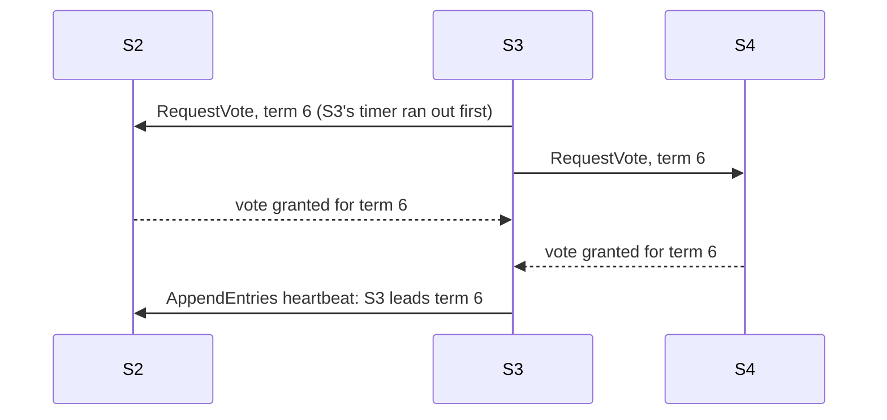
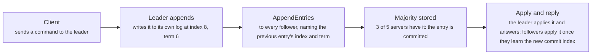
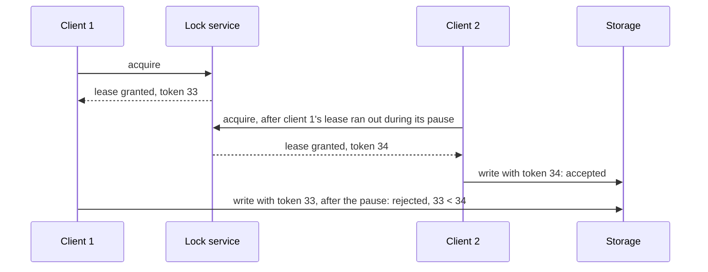

# Consensus and coordination: Raft, fencing tokens and logical clocks

> System Design · L3 Specialist · Consensus and storage engines · about 120 min · hub module `m04` ([open the hub](https://claude.ai/artifact/W93mxxEWBqV4MS8kJiz9dU))

## Why it matters
Servers often have to agree on one thing, such as who leads, which write came first, or who holds a lock, while messages get lost and machines pause. Raft gets a majority of servers to agree on one ordered log, so the cluster survives a minority of failures. Locks also need fencing tokens, because a paused holder can wake up still believing it holds the lock. And because wall clocks drift, ordering events across machines takes logical clocks: Lamport, vector or hybrid.

## Pre-question (answer before reading)
**Q:** A worker takes a lock with a 10-second lease, then stops for 15 seconds in a garbage-collection pause. The lease runs out and a second worker takes the lock. When the first worker wakes up, it writes to the shared file. What went wrong, and what would stop that write?

<details><summary>Answer</summary>

Both workers believed they held the lock, and a lease can't stop a paused process from acting afterwards. The fix is a fencing token: the lock service hands out a larger number with every grant, each write carries it, and the file's storage rejects any token lower than one it has already seen.

</details>

## 🍎 Story time (kid version)
**Pizza Town and the family road trip: Luigi's recipe book committee**

Luigi's five branch managers keep the same recipe book. A change is official once three of the five have written it down, so the book survives two managers being away. One manager chairs; if the chair goes quiet, each manager waits a different, random while before asking for votes, so usually one asks first and wins. Each manager votes only once per election. The storeroom key comes with a numbered ticket, and the storeroom refuses any ticket lower than the last it saw, in case an old holder wanders back. And since every branch's clock is a bit off, notes are numbered by a counter that each manager bumps past any number they've heard.

| In the story | In a real system |
|---|---|
| Three of five managers writing a change down | A majority quorum: an entry is committed once most servers store it, so 2f+1 servers survive f failures |
| Random waits before asking for votes, one vote each | Leader election: randomized election timeouts, and one vote per server per term |
| The numbered storeroom ticket | A fencing token: the resource rejects requests from an older lock holder |
| Notes numbered by a counter, not the clock | Logical clocks: Lamport timestamps follow cause and effect even when wall clocks disagree |

**Where the story breaks:** Luigi's managers are honest. Raft and its relatives assume servers crash or go quiet, but never lie. Tolerating servers that lie (Byzantine faults) takes more servers, more messages and different algorithms.

## Key ideas (grown-up version)
- **Consensus**: getting servers to agree on a value, or on an ordered log of values, despite crashes and lost messages. A cluster of 2f+1 servers tolerates f failures, because any two majorities share at least one server. It underpins leader election, configuration, locks and replicated state machines: etcd, ZooKeeper, Consul and Kafka's KRaft all run on it.
- **Raft terms and elections**: each server is a follower, a candidate or the leader. Time is divided into numbered terms with at most one leader each. A follower that hears no heartbeat within its election timeout, randomized between roughly 150 and 300 ms, becomes a candidate: it increments the term, votes for itself and asks the others. Each server grants one vote per term, so at most one candidate can win a majority.
- **Log replication**: the leader appends each command to its log and sends it to the followers in AppendEntries messages, which name the previous entry's index and term; a follower accepts only if it has that entry, so accepted logs agree up to it. An entry from the current term is committed once a majority stores it, and every server applies committed entries in order.
- **Election safety**: servers refuse to vote for a candidate whose log is less up to date than their own (compare the last entry's term, then the log's length). Any majority contains a server with every committed entry, so a new leader has them all. A leader commits older-term entries only indirectly, by committing an entry from its own term.
- **Limits**: in a fully asynchronous network, no algorithm can guarantee to reach agreement if even one server may crash (the FLP result). Raft is always safe and makes progress whenever the network behaves long enough for an election to finish. A minority partition can't commit anything: consensus chooses consistency over availability.
- **Reads from the leader**: a leader cut off by a partition may not know it has been replaced. For linearizable reads it either sends the read through the log, confirms with a round of heartbeats that it still leads (ReadIndex), or relies on a lease that is only safe if clock drift is bounded.
- **Locks and fencing tokens**: a lease can run out while its holder is paused by garbage collection, a VM migration or a slow network, and the holder can't notice. The lock service returns a larger fencing token with each grant (an etcd revision, a ZooKeeper zxid), and the protected resource rejects tokens lower than the highest it has seen. A lock that only saves duplicate work can be a simple lease; a lock that protects correctness needs consensus and fencing.
- **Clocks**: machine clocks drift, and NTP corrections can step them backwards, so timestamps from different machines can't reliably order events; last-write-wins with skewed clocks silently drops writes. Lamport clocks give an order consistent with causality, vector clocks also detect concurrent events, and hybrid logical clocks (HLC) stay close to wall time while respecting causality. Spanner instead bounds clock uncertainty with TrueTime and waits it out.

## Diagrams
**A Raft election after the leader crashes**



_S3 has three votes, its own included: a majority of five, even with S1 down and S5 slow. Each server votes once per term, so no other candidate can also win term 6._

**Replicating one entry**



_Every server applies the same committed commands in the same order, so their state machines stay identical._

**A fencing token stops a paused lock holder**



_The paused client can't tell that its lease ran out, but the storage can: it remembers the highest token it has accepted._

## Comparisons
**Lamport, vector and hybrid logical clocks**

|  | Lamport clock | Vector clock | Hybrid logical clock |
|---|---|---|---|
| Timestamp | One counter | One counter per node | Physical time plus a small counter |
| If a happened before b | L(a) < L(b) | V(a) < V(b) | H(a) < H(b) |
| Detects concurrent events | No | Yes: neither vector is ≤ the other | No |
| Close to wall-clock time | No | No | Yes, within the clock skew |
| Used by | Total-order broadcast, tie-breaking | Dynamo-style conflict detection (Riak) | CockroachDB, MongoDB, YugabyteDB |

**A lock for efficiency or for correctness**

|  | For efficiency | For correctness |
|---|---|---|
| If two clients hold it at once | Some duplicate work, such as a report emailed twice | Corrupted data, such as a lost update |
| Good enough | A lease in Redis or a database row | A consensus-backed service such as etcd or ZooKeeper |
| Also needs | Idempotent work where possible | Fencing tokens checked by the protected resource |

## Code (JavaScript + Python)
### The seeded random generator used by the election simulation
```python
def mulberry32(seed):                           # a tiny seeded random generator, same as the JavaScript one
    state = seed & 0xFFFFFFFF
    def rand():
        nonlocal state
        state = (state + 0x6D2B79F5) & 0xFFFFFFFF
        t = ((state ^ (state >> 15)) * (state | 1)) & 0xFFFFFFFF
        t = (t ^ (t + (((t ^ (t >> 7)) * (t | 61)) & 0xFFFFFFFF))) & 0xFFFFFFFF
        return ((t ^ (t >> 14)) & 0xFFFFFFFF) / 4294967296
    return rand
```

```javascript
function mulberry32(seed) {                     // a tiny seeded random generator, same as the Python one
  return function () {
    seed = (seed + 0x6D2B79F5) | 0;
    let t = Math.imul(seed ^ (seed >>> 15), 1 | seed);
    t = (t + Math.imul(t ^ (t >>> 7), 61 | t)) ^ t;
    return ((t ^ (t >>> 14)) >>> 0) / 4294967296;
  };
}
```

### Why Raft randomizes election timeouts
```python
rand = mulberry32(7)

def elect(randomized):
    nodes = [{"term": 1, "voted": None, "votes": set(), "state": "follower"} for _ in range(5)]
    timeout = (lambda: 150 + int(rand() * 150)) if randomized else (lambda: 150)
    deadline = [None] + [int(rand() * 5) + timeout() for _ in range(4)]   # node 0, the old leader, has crashed
    inbox, elections = [], 0
    for now in range(5000):
        for _, kind, term, sender, to in [m for m in inbox if m[0] == now]:   # this millisecond's messages
            node = nodes[to]
            if term > node["term"]:
                node.update(term=term, voted=None, state="follower")   # a newer term: step down
            if kind == "vote?" and term == node["term"] and node["voted"] in (None, sender):
                node["voted"] = sender                         # one vote per term
                deadline[to] = now + timeout()                 # granting a vote resets the timer
                inbox.append((now + 2 + int(rand() * 8), "yes", term, to, sender))
            elif kind == "yes" and term == node["term"] and node["state"] == "candidate":
                node["votes"].add(sender)
                if len(node["votes"]) >= 3:                     # a majority of all five
                    return now, elections
        inbox = [m for m in inbox if m[0] > now]
        for i in range(1, 5):
            if deadline[i] == now:                             # no heartbeat in time: stand for election
                node = nodes[i]
                node.update(term=node["term"] + 1, voted=i, votes={i}, state="candidate")
                elections += 1
                deadline[i] = now + timeout()
                for j in range(1, 5):
                    if j != i:
                        inbox.append((now + 2 + int(rand() * 8), "vote?", node["term"], i, j))
    return None, elections

for randomized in (False, True):
    times, elections = [], 0
    for _ in range(200):
        took, started = elect(randomized)
        elections += started
        if took is not None:
            times.append(took)
    label = "random 150-299 ms timeouts" if randomized else "fixed 150 ms timeouts"
    per_trial = elections * 10 // 200
    print(f"{label}: a leader within 5 s in {len(times)} of 200 trials, after about {sum(times) // len(times)} ms;",
          f"{per_trial // 10}.{per_trial % 10} elections per trial")
```

Output:
```text
fixed 150 ms timeouts: a leader within 5 s in 100 of 200 trials, after about 1730 ms; 82.2 elections per trial
random 150-299 ms timeouts: a leader within 5 s in 200 of 200 trials, after about 202 ms; 1.2 elections per trial
```

- line 6: With fixed timeouts, the four survivors time out within a few milliseconds of each other, because only network jitter separates them.
- line 14: Each server votes at most once per term, for the first candidate that asks: this is what makes two leaders in one term impossible.
- line 19: Three votes out of five servers, counting the candidate's own: still a majority with the old leader dead.
- line 25: A candidate whose election fails just waits for its timer again, and starts a new term.
- line 42: Fixed timeouts give split votes again and again, often for longer than 5 seconds; random ones elect a leader in about one try.

```javascript
const rand = mulberry32(7);

function elect(randomized) {
  const nodes = Array.from({ length: 5 }, () => ({ term: 1, voted: null, votes: new Set(), state: "follower" }));
  const timeout = randomized ? () => 150 + Math.floor(rand() * 150) : () => 150;
  const deadline = [null];                                   // node 0, the old leader, has crashed
  for (let i = 1; i < 5; i++) deadline.push(Math.floor(rand() * 5) + timeout());
  let inbox = [], elections = 0;
  for (let now = 0; now < 5000; now++) {
    for (const [, kind, term, sender, to] of inbox.filter(m => m[0] === now)) {   // this millisecond's messages
      const node = nodes[to];
      if (term > node.term) Object.assign(node, { term, voted: null, state: "follower" });   // a newer term: step down
      if (kind === "vote?" && term === node.term && (node.voted === null || node.voted === sender)) {
        node.voted = sender;                                 // one vote per term
        deadline[to] = now + timeout();                      // granting a vote resets the timer
        inbox.push([now + 2 + Math.floor(rand() * 8), "yes", term, to, sender]);
      } else if (kind === "yes" && term === node.term && node.state === "candidate") {
        node.votes.add(sender);
        if (node.votes.size >= 3) return [now, elections];   // a majority of all five
      }
    }
    inbox = inbox.filter(m => m[0] > now);
    for (let i = 1; i < 5; i++) {
      if (deadline[i] === now) {                             // no heartbeat in time: stand for election
        const node = nodes[i];
        Object.assign(node, { term: node.term + 1, voted: i, votes: new Set([i]), state: "candidate" });
        elections++;
        deadline[i] = now + timeout();
        for (let j = 1; j < 5; j++) if (j !== i) inbox.push([now + 2 + Math.floor(rand() * 8), "vote?", node.term, i, j]);
      }
    }
  }
  return [null, elections];
}

for (const randomized of [false, true]) {
  const times = [];
  let elections = 0;
  for (let trial = 0; trial < 200; trial++) {
    const [took, started] = elect(randomized);
    elections += started;
    if (took !== null) times.push(took);
  }
  const label = randomized ? "random 150-299 ms timeouts" : "fixed 150 ms timeouts";
  const perTrial = Math.floor(elections * 10 / 200);
  console.log(`${label}: a leader within 5 s in ${times.length} of 200 trials, after about ${Math.floor(times.reduce((a, b) => a + b, 0) / times.length)} ms;`,
    `${Math.floor(perTrial / 10)}.${perTrial % 10} elections per trial`);
}
```

Output:
```text
fixed 150 ms timeouts: a leader within 5 s in 100 of 200 trials, after about 1730 ms; 82.2 elections per trial
random 150-299 ms timeouts: a leader within 5 s in 200 of 200 trials, after about 202 ms; 1.2 elections per trial
```

- line 7: With fixed timeouts, the four survivors time out within a few milliseconds of each other, because only network jitter separates them.
- line 14: Each server votes at most once per term, for the first candidate that asks: this is what makes two leaders in one term impossible.
- line 19: Three votes out of five servers, counting the candidate's own: still a majority with the old leader dead.
- line 26: A candidate whose election fails just waits for its timer again, and starts a new term.
- line 46: Fixed timeouts give split votes again and again, often for longer than 5 seconds; random ones elect a leader in about one try.

### Lamport and vector clocks on three replicas
```python
class Process:
    def __init__(self, name, index, n=3):
        self.name, self.index = name, index
        self.lamport, self.vector = 0, [0] * n

    def tick(self, what):
        self.lamport += 1                              # every event moves both clocks on
        self.vector[self.index] += 1
        return (f"{self.name}: {what}", self.lamport, list(self.vector))

    def send(self, what):
        event = self.tick(what)
        return event, (self.lamport, list(self.vector))   # the message carries both clocks

    def receive(self, message, what):
        lamport, vector = message
        self.lamport = max(self.lamport, lamport)      # catch up with the sender, then tick
        self.vector = [max(mine, theirs) for mine, theirs in zip(self.vector, vector)]
        return self.tick(what)

a, b, c = Process("A", 0), Process("B", 1), Process("C", 2)
events = {}
events["a1"] = a.tick("price = 10")
events["a2"], to_b = a.send("send to B")
events["c1"] = c.tick("price = 11")
events["b1"] = b.receive(to_b, "receive from A")
events["b2"] = b.tick("price = 12")
events["b3"], to_c = b.send("send to C")
events["c2"] = c.receive(to_c, "receive from B")
for key, (label, lamport, vector) in events.items():
    print(f"{key} {label:<20} lamport {lamport}  vector {','.join(map(str, vector))}")

def before(v, w):                                       # every entry <= and not equal
    return all(x <= y for x, y in zip(v, w)) and v != w

for e, f in (("a1", "b2"), ("c1", "b2"), ("a1", "c1")):
    v, w = events[e][2], events[f][2]
    relation = "happened before" if before(v, w) else "happened after" if before(w, v) else "is concurrent with"
    print(f"{e} {relation} {f} (lamport {events[e][1]} and {events[f][1]})")
```

Output:
```text
a1 A: price = 10        lamport 1  vector 1,0,0
a2 A: send to B         lamport 2  vector 2,0,0
c1 C: price = 11        lamport 1  vector 0,0,1
b1 B: receive from A    lamport 3  vector 2,1,0
b2 B: price = 12        lamport 4  vector 2,2,0
b3 B: send to C         lamport 5  vector 2,3,0
c2 C: receive from B    lamport 6  vector 2,3,2
a1 happened before b2 (lamport 1 and 4)
c1 is concurrent with b2 (lamport 1 and 4)
a1 is concurrent with c1 (lamport 1 and 1)
```

- line 8: Each process counts its own events in its own slot of the vector; the Lamport clock is a single counter.
- line 17: On receipt, jump past the sender's Lamport time and take the element-wise maximum of the vectors: the receiver now knows everything the sender knew.
- line 33: One event happened before another only if its vector is less than or equal in every slot and not identical.
- line 39: Lamport says c1 (1) comes before b2 (4), but neither could have caused the other: only the vectors reveal that the two price writes conflict.

```javascript
class Process {
  constructor(name, index, n = 3) {
    this.name = name; this.index = index;
    this.lamport = 0; this.vector = new Array(n).fill(0);
  }

  tick(what) {
    this.lamport++;                                  // every event moves both clocks on
    this.vector[this.index]++;
    return [`${this.name}: ${what}`, this.lamport, [...this.vector]];
  }

  send(what) {
    const event = this.tick(what);
    return [event, [this.lamport, [...this.vector]]];   // the message carries both clocks
  }

  receive([lamport, vector], what) {
    this.lamport = Math.max(this.lamport, lamport);  // catch up with the sender, then tick
    this.vector = this.vector.map((mine, i) => Math.max(mine, vector[i]));
    return this.tick(what);
  }
}

const a = new Process("A", 0), b = new Process("B", 1), c = new Process("C", 2);
const events = {};
events.a1 = a.tick("price = 10");
const [a2, toB] = a.send("send to B"); events.a2 = a2;
events.c1 = c.tick("price = 11");
events.b1 = b.receive(toB, "receive from A");
events.b2 = b.tick("price = 12");
const [b3, toC] = b.send("send to C"); events.b3 = b3;
events.c2 = c.receive(toC, "receive from B");
for (const [key, [label, lamport, vector]] of Object.entries(events)) {
  console.log(`${key} ${label.padEnd(20)} lamport ${lamport}  vector ${vector.join(",")}`);
}

const before = (v, w) => v.every((x, i) => x <= w[i]) && v.some((x, i) => x !== w[i]);   // every entry <= and not equal

for (const [e, f] of [["a1", "b2"], ["c1", "b2"], ["a1", "c1"]]) {
  const v = events[e][2], w = events[f][2];
  const relation = before(v, w) ? "happened before" : before(w, v) ? "happened after" : "is concurrent with";
  console.log(`${e} ${relation} ${f} (lamport ${events[e][1]} and ${events[f][1]})`);
}
```

Output:
```text
a1 A: price = 10        lamport 1  vector 1,0,0
a2 A: send to B         lamport 2  vector 2,0,0
c1 C: price = 11        lamport 1  vector 0,0,1
b1 B: receive from A    lamport 3  vector 2,1,0
b2 B: price = 12        lamport 4  vector 2,2,0
b3 B: send to C         lamport 5  vector 2,3,0
c2 C: receive from B    lamport 6  vector 2,3,2
a1 happened before b2 (lamport 1 and 4)
c1 is concurrent with b2 (lamport 1 and 4)
a1 is concurrent with c1 (lamport 1 and 1)
```

- line 9: Each process counts its own events in its own slot of the vector; the Lamport clock is a single counter.
- line 19: On receipt, jump past the sender's Lamport time and take the element-wise maximum of the vectors: the receiver now knows everything the sender knew.
- line 38: One event happened before another only if its vector is less than or equal in every slot and not identical.
- line 43: Lamport says c1 (1) comes before b2 (4), but neither could have caused the other: only the vectors reveal that the two price writes conflict.

### A lease alone, then fencing tokens
```python
class LockService:
    def __init__(self, lease):
        self.lease, self.expires, self.token = lease, 0, 0

    def acquire(self, now):
        if now < self.expires:
            return None                                # someone else's lease is still running
        self.expires = now + self.lease
        self.token += 1                                # every grant gets a larger token
        return self.token

class Storage:
    def __init__(self, fencing):
        self.fencing, self.highest, self.value = fencing, 0, None

    def write(self, value, token):
        if self.fencing and token < self.highest:
            return f"rejected (token {token} < {self.highest})"
        self.highest = max(self.highest, token)
        self.value = value
        return "accepted"

for fencing in (False, True):
    locks, storage = LockService(lease=10), Storage(fencing)
    print("with fencing tokens:" if fencing else "without fencing:")
    first = locks.acquire(now=0)
    print(f"  t=0  client-1 gets token {first} and writes: {storage.write('part 1 by client-1', first)}")
    # client-1 now stops for 15 s in a garbage-collection pause; its lease ends at t=10
    second = locks.acquire(now=12)
    print(f"  t=12 client-2 gets token {second} and writes: {storage.write('report by client-2', second)}")
    print(f"  t=15 client-1 wakes up and writes: {storage.write('part 2 by client-1', first)}")
    print(f"  stored: {storage.value}")
```

Output:
```text
without fencing:
  t=0  client-1 gets token 1 and writes: accepted
  t=12 client-2 gets token 2 and writes: accepted
  t=15 client-1 wakes up and writes: accepted
  stored: part 2 by client-1
with fencing tokens:
  t=0  client-1 gets token 1 and writes: accepted
  t=12 client-2 gets token 2 and writes: accepted
  t=15 client-1 wakes up and writes: rejected (token 1 < 2)
  stored: report by client-2
```

- line 9: The token only ever grows; in etcd it's the key's revision, in ZooKeeper the zxid.
- line 17: The check happens at the resource, where the write lands; only there can a stale holder be stopped.
- line 28: Client-1 still believes it holds the lock: nothing inside a paused process can notice that its lease ran out.
- line 31: Without fencing, the stale write silently replaces client-2's report; with fencing it's rejected.

```javascript
class LockService {
  constructor(lease) { this.lease = lease; this.expires = 0; this.token = 0; }

  acquire(now) {
    if (now < this.expires) return null;             // someone else's lease is still running
    this.expires = now + this.lease;
    return ++this.token;                             // every grant gets a larger token
  }
}

class Storage {
  constructor(fencing) { this.fencing = fencing; this.highest = 0; this.value = null; }

  write(value, token) {
    if (this.fencing && token < this.highest) return `rejected (token ${token} < ${this.highest})`;
    this.highest = Math.max(this.highest, token);
    this.value = value;
    return "accepted";
  }
}

for (const fencing of [false, true]) {
  const locks = new LockService(10), storage = new Storage(fencing);
  console.log(fencing ? "with fencing tokens:" : "without fencing:");
  const first = locks.acquire(0);
  console.log(`  t=0  client-1 gets token ${first} and writes: ${storage.write("part 1 by client-1", first)}`);
  // client-1 now stops for 15 s in a garbage-collection pause; its lease ends at t=10
  const second = locks.acquire(12);
  console.log(`  t=12 client-2 gets token ${second} and writes: ${storage.write("report by client-2", second)}`);
  console.log(`  t=15 client-1 wakes up and writes: ${storage.write("part 2 by client-1", first)}`);
  console.log(`  stored: ${storage.value}`);
}
```

Output:
```text
without fencing:
  t=0  client-1 gets token 1 and writes: accepted
  t=12 client-2 gets token 2 and writes: accepted
  t=15 client-1 wakes up and writes: accepted
  stored: part 2 by client-1
with fencing tokens:
  t=0  client-1 gets token 1 and writes: accepted
  t=12 client-2 gets token 2 and writes: accepted
  t=15 client-1 wakes up and writes: rejected (token 1 < 2)
  stored: report by client-2
```

- line 7: The token only ever grows; in etcd it's the key's revision, in ZooKeeper the zxid.
- line 15: The check happens at the resource, where the write lands; only there can a stale holder be stopped.
- line 27: Client-1 still believes it holds the lock: nothing inside a paused process can notice that its lease ran out.
- line 30: Without fencing, the stale write silently replaces client-2's report; with fencing it's rejected.

## Worked example
**Problem.** Server S1 has just become leader for term 5. Its log holds entries from terms 1 1 2 4 4 5 5, and it knows entries up to index 5 are committed. The followers' logs are S2: 1 1 2 4 4 5; S3: 1 1 2; S4: 1 1 2 3 3 3, written by a term-3 leader that never replicated them; and S5: 1 1 2 4 4. Simulate AppendEntries rounds with Raft's consistency check, and say when index 7 is committed.

1. Each AppendEntries names the entry just before the new ones, by index and term. A follower accepts only if its own log has that entry, so a follower that accepts agrees with the leader on everything up to it: Raft's Log Matching property.
2. The leader starts optimistic, with each follower's nextIndex just past its own log. Each refusal moves that follower's nextIndex back by one, until the logs agree; then the follower deletes from the first conflicting entry onwards and appends the leader's entries.
3. The leader commits index N once a majority stores it and entry N is from the current term; everything before N is committed with it. Counting replicas of an older term's entry isn't enough, because a later leader could still overwrite it.
4. Cost: one round trip per entry of disagreement. Real implementations reply with the conflicting term and its first index, so the leader can skip back a whole term at a time.

```python
def append_entries(log, prev_index, prev_term, entries):
    if prev_index > len(log) or (prev_index > 0 and log[prev_index - 1] != prev_term):
        return False                           # no matching entry at prev_index: refuse
    for i, entry_term in enumerate(entries, start=prev_index):
        if i < len(log) and log[i] != entry_term:
            del log[i:]                        # the first conflict: drop it and everything after
        if i >= len(log):
            log.append(entry_term)
    return True

def commit_index(match, log, term):
    for n in range(len(log), 0, -1):
        if sum(m >= n for m in match) * 2 > len(match) and log[n - 1] == term:
            return n                           # stored on a majority, and from the current term
    return 0

def replicate(leader, term, commit, followers):
    next_index = {name: len(leader) + 1 for name in followers}   # start optimistic
    match = {name: 0 for name in followers}
    lines = []
    while any(m < len(leader) for m in match.values()):
        results = []
        for name, log in followers.items():
            if match[name] == len(leader):
                continue
            prev = next_index[name] - 1
            if append_entries(log, prev, leader[prev - 1] if prev else 0, leader[prev:]):
                match[name], next_index[name] = len(leader), len(leader) + 1
                results.append(f"{name} ok")
            else:
                next_index[name] -= 1          # refused: back up one entry and try again
                results.append(f"{name} no")
        commit = max(commit, commit_index([len(leader)] + list(match.values()), leader, term))
        lines.append(f"round {len(lines) + 1}: {', '.join(results)} | commit index {commit}")
    return lines, commit

followers = {"S2": [1, 1, 2, 4, 4, 5], "S3": [1, 1, 2], "S4": [1, 1, 2, 3, 3, 3], "S5": [1, 1, 2, 4, 4]}
lines, commit = replicate([1, 1, 2, 4, 4, 5, 5], term=5, commit=5, followers=followers)
print(*lines, sep="\n")
print("S4 now:", *followers["S4"])
```

Output:
```text
round 1: S2 no, S3 no, S4 no, S5 no | commit index 5
round 2: S2 ok, S3 no, S4 no, S5 no | commit index 5
round 3: S3 no, S4 no, S5 ok | commit index 7
round 4: S3 no, S4 no | commit index 7
round 5: S3 ok, S4 ok | commit index 7
S4 now: 1 1 2 4 4 5 5
```

```javascript
function appendEntries(log, prevIndex, prevTerm, entries) {
  if (prevIndex > log.length || (prevIndex > 0 && log[prevIndex - 1] !== prevTerm)) return false;   // no matching entry at prevIndex: refuse
  entries.forEach((entryTerm, k) => {
    const i = prevIndex + k;
    if (i < log.length && log[i] !== entryTerm) log.length = i;   // the first conflict: drop it and everything after
    if (i >= log.length) log.push(entryTerm);
  });
  return true;
}

function commitIndex(match, log, term) {
  for (let n = log.length; n > 0; n--) {
    if (match.filter(m => m >= n).length * 2 > match.length && log[n - 1] === term) return n;   // stored on a majority, and from the current term
  }
  return 0;
}

function replicate(leader, term, commit, followers) {
  const nextIndex = {}, match = {};
  for (const name of Object.keys(followers)) { nextIndex[name] = leader.length + 1; match[name] = 0; }   // start optimistic
  const lines = [];
  while (Object.values(match).some(m => m < leader.length)) {
    const results = [];
    for (const [name, log] of Object.entries(followers)) {
      if (match[name] === leader.length) continue;
      const prev = nextIndex[name] - 1;
      if (appendEntries(log, prev, prev ? leader[prev - 1] : 0, leader.slice(prev))) {
        match[name] = leader.length; nextIndex[name] = leader.length + 1;
        results.push(`${name} ok`);
      } else {
        nextIndex[name]--;                             // refused: back up one entry and try again
        results.push(`${name} no`);
      }
    }
    commit = Math.max(commit, commitIndex([leader.length, ...Object.values(match)], leader, term));
    lines.push(`round ${lines.length + 1}: ${results.join(", ")} | commit index ${commit}`);
  }
  return [lines, commit];
}

const followers = { S2: [1, 1, 2, 4, 4, 5], S3: [1, 1, 2], S4: [1, 1, 2, 3, 3, 3], S5: [1, 1, 2, 4, 4] };
const [lines, commit] = replicate([1, 1, 2, 4, 4, 5, 5], 5, 5, followers);
console.log(lines.join("\n"));
console.log("S4 now:", ...followers.S4);
```

Output:
```text
round 1: S2 no, S3 no, S4 no, S5 no | commit index 5
round 2: S2 ok, S3 no, S4 no, S5 no | commit index 5
round 3: S3 no, S4 no, S5 ok | commit index 7
round 4: S3 no, S4 no | commit index 7
round 5: S3 ok, S4 ok | commit index 7
S4 now: 1 1 2 4 4 5 5
```

**Answer.** Round 1 is refused everywhere, because no follower has entry 7. In round 2, S2 has entry 6 from term 5 and accepts. In round 3, S5 accepts from index 5. Now S1, S2 and S5 hold index 7, a majority, and entry 7 is from term 5, so the commit index jumps from 5 to 7. S3 and S4 catch up in round 5: S3 was simply behind, while S4's term-3 entries conflicted at index 4, so entries 4 to 6 were deleted and replaced. Those entries were only ever on S4, never on a majority, so they were never committed and it's safe to throw them away.

## Your turn (faded example)
**Problem.** Finish the hybrid logical clock's `receive(msg_l, msg_c, physical)`: the node's new timestamp (l, c) must come after both its own previous timestamp and the message's, with l as close to physical time as possible.

- ✓ An HLC timestamp is a pair (l, c): l is the largest physical time the node has heard of, and c counts events while l stays the same. Pairs compare by l, then by c.
- **On a receive, what should the new l be?**
  <details><summary>Answer</summary>The largest of the node's own l, the message's l and the local physical clock: it must never go backwards, and never fall behind a timestamp the node has seen.</details>
- **How is c set?**
  <details><summary>Answer</summary>If the new l equals both the old l and the message's l, c becomes the larger counter plus one. If it equals only the old l, c goes up by one; if only the message's l, it becomes the message's c plus one; if the physical clock is ahead of both, c resets to 0.</details>
- **Why not just timestamp with the physical clock?**
  <details><summary>Answer</summary>Clocks are skewed: a message from a node whose clock runs fast would arrive 'before' it was sent, breaking cause and effect. HLC stays within the clock skew of physical time yet still orders causally related events.</details>

Starter:
```python
class HybridClock:
    def __init__(self):
        self.l, self.c = 0, 0                  # the largest physical time seen, and a counter

    def now(self, physical):                   # a local event or a send
        if physical > self.l:
            self.l, self.c = physical, 0       # the wall clock has moved on: use it
        else:
            self.c += 1                        # it hasn't: count instead
        return (self.l, self.c)

    def receive(self, msg_l, msg_c, physical):
        ...                                    # TODO: end up after both timestamps, close to physical time
        return (self.l, self.c)
```

```javascript
class HybridClock {
  constructor() { this.l = 0; this.c = 0; }       // the largest physical time seen, and a counter

  now(physical) {                                 // a local event or a send
    if (physical > this.l) { this.l = physical; this.c = 0; }   // the wall clock has moved on: use it
    else this.c++;                                // it hasn't: count instead
    return [this.l, this.c];
  }

  receive(msgL, msgC, physical) {
    // TODO: end up after both timestamps, close to physical time
    return [this.l, this.c];
  }
}
```

<details><summary>Full solution</summary>

```python
class HybridClock:
    def __init__(self):
        self.l, self.c = 0, 0                  # the largest physical time seen, and a counter

    def now(self, physical):                   # a local event or a send
        if physical > self.l:
            self.l, self.c = physical, 0       # the wall clock has moved on: use it
        else:
            self.c += 1                        # it hasn't: count instead
        return (self.l, self.c)

    def receive(self, msg_l, msg_c, physical):
        l = max(self.l, msg_l, physical)
        if l == self.l == msg_l:
            self.c = max(self.c, msg_c) + 1    # both at the same time: count past both
        elif l == self.l:
            self.c += 1
        elif l == msg_l:
            self.c = msg_c + 1                 # the sender is ahead: adopt its time, count past it
        else:
            self.c = 0                         # the local wall clock is ahead of both
        self.l = l
        return (self.l, self.c)

show = lambda stamp: f"({stamp[0]},{stamp[1]})"
a, b = HybridClock(), HybridClock()
sent = a.now(1050)                             # A's clock runs 50 ms fast
got = b.receive(*sent, physical=1003)          # B's clock reads 1003 when the message lands
after = b.now(1004)
later = b.now(1060)
print("A sends", show(sent), "| B receives", show(got), "| B's next event", show(after), "| B at 1060 ms", show(later))
```

Output:
```text
A sends (1050,0) | B receives (1050,1) | B's next event (1050,2) | B at 1060 ms (1060,0)
```

```javascript
class HybridClock {
  constructor() { this.l = 0; this.c = 0; }       // the largest physical time seen, and a counter

  now(physical) {                                 // a local event or a send
    if (physical > this.l) { this.l = physical; this.c = 0; }   // the wall clock has moved on: use it
    else this.c++;                                // it hasn't: count instead
    return [this.l, this.c];
  }

  receive(msgL, msgC, physical) {
    const l = Math.max(this.l, msgL, physical);
    if (l === this.l && l === msgL) this.c = Math.max(this.c, msgC) + 1;   // both at the same time: count past both
    else if (l === this.l) this.c++;
    else if (l === msgL) this.c = msgC + 1;       // the sender is ahead: adopt its time, count past it
    else this.c = 0;                              // the local wall clock is ahead of both
    this.l = l;
    return [this.l, this.c];
  }
}

const show = ([l, c]) => `(${l},${c})`;
const a = new HybridClock(), b = new HybridClock();
const sent = a.now(1050);                         // A's clock runs 50 ms fast
const got = b.receive(...sent, 1003);             // B's clock reads 1003 when the message lands
const after = b.now(1004);
const later = b.now(1060);
console.log("A sends", show(sent), "| B receives", show(got), "| B's next event", show(after), "| B at 1060 ms", show(later));
```

Output:
```text
A sends (1050,0) | B receives (1050,1) | B's next event (1050,2) | B at 1060 ms (1060,0)
```

</details>

## Socratic checks and quiz (answers hidden)
**1. What does this print?**

```python
print(*(f"{n}:{(n - 1) // 2}" for n in (3, 4, 5, 7)))
```

```javascript
console.log(...[3, 4, 5, 7].map(n => `${n}:${Math.floor((n - 1) / 2)}`));
```

- A. 3:1 4:1 5:2 7:3
- B. 3:1 4:2 5:2 7:3
- C. 3:2 4:2 5:3 7:4
- D. 3:1 4:1 5:2 7:4

<details><summary>Answer</summary>

3:1 4:1 5:2 7:3. A cluster of n servers tolerates (n − 1) // 2 failures, because the rest must still be a majority. A fourth server adds no tolerance over three.

</details>

**2. What does this print?**

```python
clock, seen = 0, []
for kind, stamp in [("local", 0), ("receive", 5), ("local", 0), ("receive", 3)]:
    clock = max(clock, stamp) + 1 if kind == "receive" else clock + 1
    seen.append(clock)
print(*seen)
```

```javascript
let clock = 0;
const seen = [];
for (const [kind, stamp] of [["local", 0], ["receive", 5], ["local", 0], ["receive", 3]]) {
  clock = kind === "receive" ? Math.max(clock, stamp) + 1 : clock + 1;
  seen.push(clock);
}
console.log(...seen);
```

- A. 1 6 7 8
- B. 1 6 7 4
- C. 1 5 6 7
- D. 1 2 3 4

<details><summary>Answer</summary>

1 6 7 8. A local event adds one; a receive jumps past the message's timestamp first. The message stamped 3 arrives when the clock is already at 7, so the clock just moves on to 8.

</details>

**3. A partition splits a five-server Raft cluster into groups of three and two, with the old leader among the two. What happens?**

- A. The three elect a new leader and keep committing; the old leader commits nothing until the partition heals
- B. Both sides keep committing and merge their logs later
- C. The whole cluster stops until the partition heals
- D. The old leader keeps committing because it has the latest term

<details><summary>Answer</summary>

The three elect a new leader and keep committing; the old leader commits nothing until the partition heals. Only a majority can commit. The old leader may still accept requests, but none of them commit; when it hears the higher term it steps down, and its uncommitted entries are overwritten.

</details>

**4. A worker's lock lease ran out during a 20-second garbage-collection pause, and another worker now holds the lock. What stops the first worker's late write from corrupting data?**

- A. The storage rejects writes whose fencing token is lower than the highest it has seen
- B. A longer lease
- C. Checking the lock just before writing
- D. Synchronizing clocks with NTP

<details><summary>Answer</summary>

The storage rejects writes whose fencing token is lower than the highest it has seen. Any lease can be outlived by a long enough pause, and a check before the write can be followed by a pause. Only the resource, comparing tokens, can reject the stale writer.

</details>

**5. Which are true of Raft? (choose 3)**

- A. A server votes for at most one candidate per term
- B. A candidate needs votes from a majority of the whole cluster
- C. Servers refuse to vote for a candidate whose log is less up to date than their own
- D. A follower can commit entries on its own
- E. Raft tolerates servers that lie about their logs

<details><summary>Answer</summary>

A server votes for at most one candidate per term, A candidate needs votes from a majority of the whole cluster, Servers refuse to vote for a candidate whose log is less up to date than their own. One vote per term plus majorities give at most one leader per term, and the up-to-date rule makes sure the winner has every committed entry. Followers never commit on their own, and Raft assumes crashes, not lies; that needs Byzantine fault tolerance.

</details>

**6. Judge each statement.**

- If event a happened before event b, a's Lamport timestamp is smaller than b's.
- If a's Lamport timestamp is smaller than b's, a happened before b.
- Events with vector clocks 2,1,0 and 1,2,0 are concurrent.
- NTP keeps clocks close enough to order writes from different machines.

<details><summary>Answer</summary>

If event a happened before event b, a's Lamport timestamp is smaller than b's.: Yes; If a's Lamport timestamp is smaller than b's, a happened before b.: No; Events with vector clocks 2,1,0 and 1,2,0 are concurrent.: Yes; NTP keeps clocks close enough to order writes from different machines.: No. Lamport timestamps respect causality in one direction only. Neither of those vectors is less than or equal to the other in every slot, so the events are concurrent. NTP keeps clocks within milliseconds and can step them backwards: enough to reorder close writes.

</details>

**7. Put a Raft leader election in order.**

- (put the steps in order)

<details><summary>Answer</summary>

A follower hears no heartbeat before its election timeout runs out → It increments its term, becomes a candidate and votes for itself → It sends RequestVote to every other server → A majority grant it their vote for this term → It becomes leader and sends heartbeats, which stop new elections. Heartbeats keep resetting every follower's timer; the randomized timeout makes it likely that one follower starts and wins before the others time out.

</details>

**8. Complete the Python function that decides whether a Raft server grants its vote.**

```
def grant_vote(me, term, candidate, cand_last_term, cand_last_index):
    if term < me["term"]:
        return False                           # a stale candidate
    if term > me["term"]:
        me["term"], me["voted"] = term, None   # a new term: free to vote again
    my_last_term = me["log"][-1] if me["log"] else 0
    up_to_date = (cand_last_term, cand_last_index) >= (my_last_term, {{0}})
    if me["voted"] in (None, candidate) and up_to_date:
        me["voted"] = {{1}}
        return True
    return False

```

<details><summary>Answer</summary>

len(me['log']) | candidate. Logs compare by their last entry's term, then by length, and the vote is recorded against the candidate, so a repeated request from the same candidate in the same term is granted again but no one else's is.

</details>

## Traps & misconceptions
- **“Two nodes are enough for a highly available consensus cluster.”** A majority of two is two, so losing either one stops all progress. Use three servers to survive one failure, or five to survive two; an even number adds cost without adding tolerance.
- **“A lock with a lease is safe: the lease expires before anyone else can get it.”** The holder can pause past its lease (garbage collection, a VM migration, a slow disk) and then act as if it still holds it. Locks that protect correctness need fencing tokens checked by the resource.
- **“Check that we still hold the lock just before writing.”** The pause can come between the check and the write. Only the resource receiving the write can reliably reject a stale holder, by comparing tokens.
- **“Order writes from different machines by their timestamps.”** Clock skew and NTP steps make cross-machine timestamps unreliable, and last-write-wins with skewed clocks silently drops writes. Order through a consensus log, or use logical or hybrid clocks.
- **“Lamport timestamps tell me which events were concurrent.”** They give an order consistent with causality, but L(a) < L(b) doesn't mean a caused b. Use vector clocks to detect concurrent updates.
- **“Five members across two data centres, three in one and two in the other, survive a data-centre outage.”** Losing the three-member site leaves two of five: no majority, so the cluster stops. Spread members over three failure domains, such as 2 + 2 + 1, so any one can fail.

## Discussion prompts
- **Your batch scheduler runs on three instances and must start each nightly job once. How do you coordinate them?**
  <details><summary>One good answer</summary>Elect a leader through a coordination service, such as an etcd lease or a ZooKeeper ephemeral node, so only the leader schedules. Leadership can change mid-job, so give each run an idempotency key and pass the leader's fencing token (the lease revision) to the job store, which rejects writes from older leaders. A plain Redis lock is fine only if an occasional duplicate run is harmless.</details>
- **Why do etcd and ZooKeeper clusters usually have three or five members rather than seven or nine?**
  <details><summary>One good answer</summary>Each write waits for a majority, so more voting members add latency and replication traffic, and five already survive two failures. To scale reads, add non-voting members (etcd learners, ZooKeeper observers) instead of voters.</details>

## Teach-back
**Prompt:** Explain to a junior colleague how Raft keeps a replicated log consistent, and why distributed locks need fencing tokens.

Rubric:
- [ ] Majority quorums: 2f+1 servers survive f failures, and two majorities always overlap
- [ ] Terms, randomized election timeouts and one vote per server per term
- [ ] Log replication: the consistency check, commit on a majority, and the up-to-date rule for votes
- [ ] Leases can expire during a pause; fencing tokens are checked by the resource
- [ ] Why wall clocks can't order events across machines, and what logical clocks give

<details><summary>Model answer</summary>

Raft keeps one log of commands identical on every server. Time is split into terms; if followers stop hearing the leader's heartbeats, the first whose randomized timeout runs out becomes a candidate for a new term, and wins if a majority votes for it. Each server votes once per term, so there's at most one leader per term, and only for candidates whose log is at least as up to date as its own, so a new leader has every committed entry. The leader sends entries with the index and term of the entry before them; followers accept only if they match, and the leader backs up until they do. An entry is committed once a majority stores it, so five servers survive two failures. Locks are different: a holder can pause past its lease without noticing, so the lock service hands out increasing fencing tokens and the storage rejects any write with an older token. And we never trust wall clocks to order events across machines; we use the log, or logical clocks.

</details>

## Quick Q&A (also in the SRS deck)
- **How many failures does a five-server Raft cluster tolerate?** Two: the remaining three are still a majority.
- **Why are Raft election timeouts randomized?** So one follower usually times out first and wins before others compete, avoiding repeated split votes.
- **When does a Raft leader consider an entry committed?** When a majority stores it and it's from the leader's current term.
- **What does a fencing token protect against?** A former lock holder that paused past its lease and then writes: the resource rejects tokens older than the newest it has seen.
- **What can vector clocks tell that Lamport clocks can't?** Whether two events are concurrent.
- **What is a hybrid logical clock?** Physical time plus a logical counter: close to wall time, yet consistent with causality.

## Practice problems
- [ ] [Reading · The Raft paper](https://raft.github.io/raft.pdf) · read sections 5.1 to 5.4, then explain in your own words why a leader may not commit an older term's entry by counting replicas
- [ ] [Visualization · RaftScope on the Raft site](https://raft.github.io/) · stop the leader in the visualization, and narrate each message until a new leader is elected
- [ ] [Reading · How to do distributed locking](https://martin.kleppmann.com/2016/02/08/how-to-do-distributed-locking.html) · list the timing assumptions a lease-based lock depends on, and where fencing tokens remove them
- [ ] [Reading · Time, Clocks, and the Ordering of Events](https://lamport.azurewebsites.net/pubs/time-clocks.pdf) · define happened-before in your own words, and say why Lamport timestamps can't detect concurrency

## Sources (accessed 2026-10-09)
- [Ongaro and Ousterhout: In Search of an Understandable Consensus Algorithm (Raft, extended version)](https://raft.github.io/raft.pdf)
- [The Raft Consensus Algorithm site, with RaftScope](https://raft.github.io/)
- [Martin Kleppmann: How to do distributed locking (2016)](https://martin.kleppmann.com/2016/02/08/how-to-do-distributed-locking.html)
- [Leslie Lamport: Time, Clocks, and the Ordering of Events in a Distributed System (1978)](https://lamport.azurewebsites.net/pubs/time-clocks.pdf)
- [Kulkarni et al.: Logical Physical Clocks and Consistent Snapshots in Globally Distributed Databases (HLC, 2014)](https://cse.buffalo.edu/tech-reports/2014-04.pdf)
